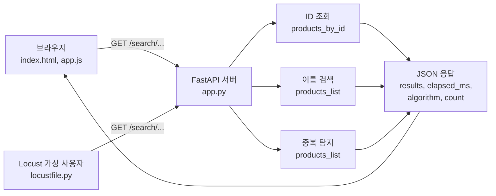
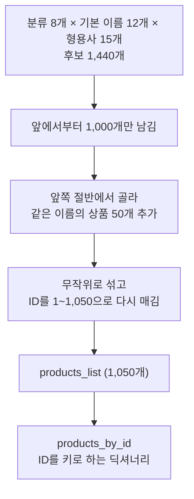
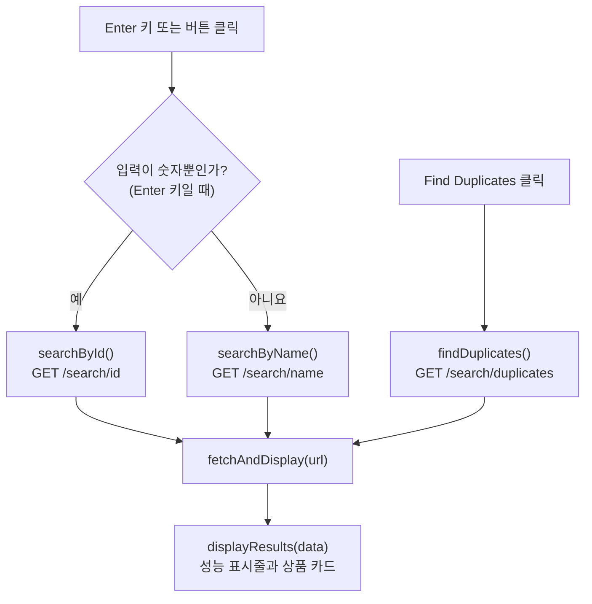
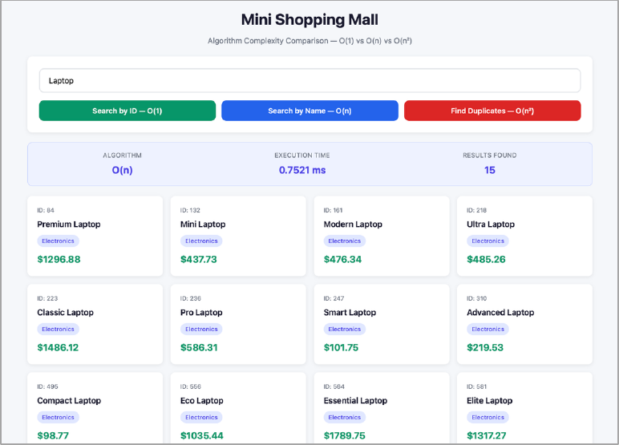
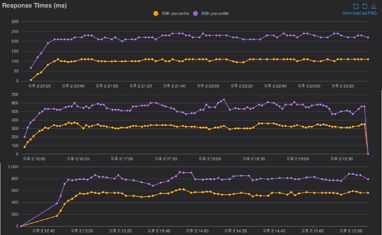
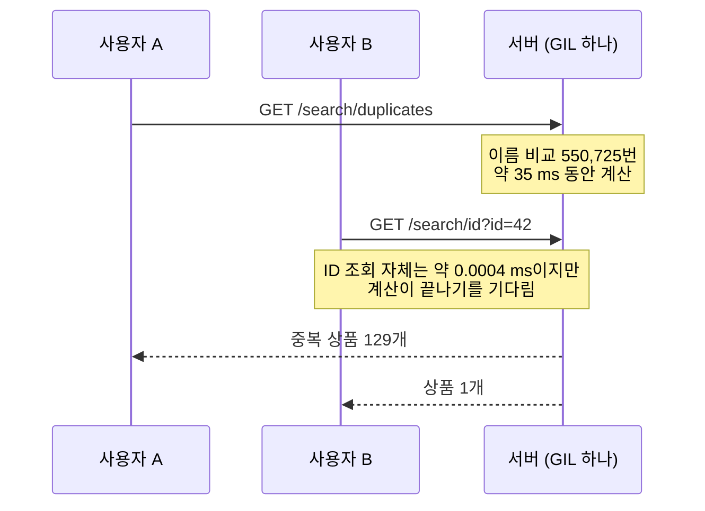

# HW1 과제 해설 — 미니 쇼핑몰 상품 검색

[레포지토리 안내](../../README.ko.md) | [English](Assignment-Explanation.md) | [한국어](Assignment-Explanation.ko.md)

> **최종 수정일:** 2026-11-16
>
> Introduction to Algorithms, Cormen, Leiserson, Rivest, and Stein, Ch 2, 3, 11

> **학습 목표:**
> 1. 같은 상품 데이터를 리스트와 해시 테이블에 함께 두고, 조회 방식에 맞는 자료구조를 고를 수 있다
> 2. ID 조회, 이름 검색, 중복 탐지의 기본 연산 횟수를 세어 각 검색의 시간 복잡도를 유도할 수 있다
> 3. FastAPI로 검색 엔드포인트를 만들고 `time.perf_counter()`로 알고리즘 부분의 실행 시간을 잴 수 있다
> 4. Locust 부하 테스트의 응답 시간, 백분위수, 처리량을 읽고 동시 사용자 수와 연결하여 해석할 수 있다
> 5. 부하 테스트의 결과를 Big-O와 서버의 요청 처리 방식에 연결하여 설명할 수 있다

---

## 목차

- [1. 과제 구성과 실행 방법](#1-과제-구성과-실행-방법)
  - [1.1 과제 개요](#11-과제-개요)
  - [1.2 디렉토리 구성](#12-디렉토리-구성)
  - [1.3 설치와 실행](#13-설치와-실행)
  - [1.4 Locust 부하 테스트 실행](#14-locust-부하-테스트-실행)
- [2. 요구사항](#2-요구사항)
  - [2.1 상품 데이터와 검색 알고리즘](#21-상품-데이터와-검색-알고리즘)
  - [2.2 웹 인터페이스](#22-웹-인터페이스)
  - [2.3 API 엔드포인트](#23-api-엔드포인트)
  - [2.4 부하 테스트와 보고서](#24-부하-테스트와-보고서)
  - [2.5 평가 기준](#25-평가-기준)
- [3. 설계](#3-설계)
  - [3.1 전체 구조](#31-전체-구조)
  - [3.2 상품 데이터 생성](#32-상품-데이터-생성)
  - [3.3 리스트와 해시 테이블](#33-리스트와-해시-테이블)
- [4. 세 가지 검색의 구현](#4-세-가지-검색의-구현)
  - [4.1 ID 조회](#41-id-조회)
  - [4.2 이름 검색](#42-이름-검색)
  - [4.3 중복 탐지](#43-중복-탐지)
  - [4.4 실행 시간 측정](#44-실행-시간-측정)
- [5. 웹 인터페이스와 부하 테스트 스크립트](#5-웹-인터페이스와-부하-테스트-스크립트)
  - [5.1 프런트엔드](#51-프런트엔드)
  - [5.2 locustfile.py](#52-locustfilepy)
- [6. 테스트와 결과](#6-테스트와-결과)
  - [6.1 엔드포인트 동작 확인](#61-엔드포인트-동작-확인)
  - [6.2 검색 결과 화면](#62-검색-결과-화면)
  - [6.3 Locust 부하 테스트 결과](#63-locust-부하-테스트-결과)
  - [6.4 같은 조건의 재측정](#64-같은-조건의-재측정)
- [7. 부하에 따른 성능 저하 분석](#7-부하에-따른-성능-저하-분석)
  - [7.1 알고리즘별 작업량](#71-알고리즘별-작업량)
  - [7.2 동시 요청이 몰릴 때](#72-동시-요청이-몰릴-때)
  - [7.3 개선 방향](#73-개선-방향)
- [요약](#요약)
- [점검 문제](#점검-문제)

---

<br>

## 1. 과제 구성과 실행 방법

> **풀어 보기:** 이 문서는 정답과 풀이를 담고 있다. 먼저 [과제 안내문](Original/Assignment.ko.md)의 문제를 직접 풀어 본 뒤 읽는다.

### 1.1 과제 개요

과제는 사용자가 상품을 검색하는 미니 쇼핑몰 웹 앱을 만들고, 시간 복잡도가 서로 다른 세 가지 검색 방법의 성능을 비교하는 것이다. 안내문은 ID 조회를 O(1), 이름 검색을 O(n), 이름이 같은 상품을 찾는 중복 탐지를 O(n²)으로 구현하라고 정하고, 이 세 검색을 Locust 부하 테스트로 호출하여 동시 사용자가 늘어날 때 알고리즘의 선택이 서비스에 미치는 영향을 관찰하게 한다. 제출물은 소스 코드와 2쪽 이내의 보고서이며, 보고서에는 검색 화면, 동시 사용자 10명, 30명, 50명의 응답 시간 차트, 부하에 따른 성능 변화의 분석을 담는다. 2주차 이론의 [시간 복잡도와 점근적 표기법](../../Lecture-Notes/Week02_Algorithm-Design-and-Complexity-Analysis/Concepts_Lecture.ko.md)을 실제 웹 서비스에서 확인하는 과제이다.

### 1.2 디렉토리 구성

```text
Coursework/HW01_Algorithm-Design-and-Complexity-Analysis/
├── Assignment-Explanation.md       # 과제 해설 (영어)
├── Assignment-Explanation.ko.md    # 과제 해설 (한국어, 이 문서)
├── Code-Walkthrough.md             # 코드 총정리 (영어)
├── Code-Walkthrough.ko.md          # 코드 총정리 (한국어)
├── Original/
│   ├── Assignment.md               # 과제 안내문 (영어)
│   └── Assignment.ko.md            # 과제 안내문 (한국어)
└── Solution/
    ├── app.py                      # FastAPI 백엔드: 상품 데이터와 검색 엔드포인트
    ├── locustfile.py               # Locust 부하 테스트 스크립트
    ├── requirements.txt            # 의존 패키지 목록
    └── static/
        ├── index.html              # 화면 구조
        ├── style.css               # 화면 스타일
        └── app.js                  # 검색 요청과 결과 표시
```

*그림 1. HW1 과제의 디렉토리 구성*

### 1.3 설치와 실행

백엔드는 Python의 웹 프레임워크 FastAPI로 작성했고, ASGI 서버 uvicorn으로 실행한다. 다음 명령은 레포지토리 루트에서 시작한다.

```bash
cd Coursework/HW01_Algorithm-Design-and-Complexity-Analysis/Solution
python3 -m pip install -r requirements.txt   # fastapi, uvicorn, locust 설치
python3 app.py                               # http://localhost:8000 에서 서버 시작
```

브라우저에서 `http://localhost:8000`을 열면 검색 화면이 나타난다. 검색창에 상품 이름이나 ID를 넣고 세 버튼 중 하나를 누르거나, Enter 키를 누른다.

> **참고:** `app.py`의 마지막 줄은 `uvicorn.run("app:app", ...)`처럼 모듈 이름을 문자열로 넘기므로, `python3 app.py`는 `Solution` 디렉토리 안에서 실행해야 한다. 다른 디렉토리에서 실행하려면 `uvicorn app:app --app-dir <Solution 경로> --port 8000`처럼 경로를 지정한다.

### 1.4 Locust 부하 테스트 실행

서버를 띄운 상태에서 다른 터미널을 열고 같은 디렉토리에서 Locust를 실행한다.

```bash
locust -f locustfile.py --host=http://localhost:8000
```

`http://localhost:8089`에서 Locust 웹 UI를 열고 동시 사용자 수(Number of users)와 초당 생성 수(Ramp up)를 정한 뒤 시작한다. 동시 사용자 10명, 30명, 50명으로 한 번씩 실행하고 STATISTICS 탭의 표와 CHARTS 탭의 응답 시간 차트를 기록한다. 웹 UI 없이 정해진 시간만 실행하려면 다음처럼 headless 모드를 쓴다.

```bash
locust -f locustfile.py --headless -u 10 -r 10 -t 30s --host http://localhost:8000
```

각 파일의 코드는 [HW1 코드 총정리](Code-Walkthrough.ko.md)에서 처음부터 끝까지 줄 단위로 설명한다.

---

<br>

## 2. 요구사항

이 절은 [과제 안내문](Original/Assignment.ko.md)의 요구사항을 정리하고, 각 요구사항을 `Solution`의 어느 부분이 충족하는지 함께 적는다. 줄 번호는 각 파일 기준이다.

### 2.1 상품 데이터와 검색 알고리즘

| 요구사항 | 구현 위치 | 구현 내용 |
|:-----|:-----|:-----|
| id, 이름, 분류, 가격을 가진 1,000개 이상의 상품 | `app.py` 82\~127번 줄 | `generate_products()`가 상품 1,050개를 만들고, 시작할 때 리스트와 딕셔너리에 담는다 |
| ID 조회, `dict[product_id]`, O(1) | `app.py` 143\~162번 줄 | `products_by_id.get(id)` 한 번으로 찾는다 |
| 이름 검색, 모든 상품을 차례로 훑음, O(n) | `app.py` 165\~181번 줄 | `for` 반복문 하나로 이름에 검색어가 들어 있는지 확인한다 |
| 중복 탐지, 중첩 반복문, O(n²) | `app.py` 184\~212번 줄 | 이중 `for` 반복문으로 모든 상품 쌍의 이름을 비교한다 |

*표 1. 상품 데이터와 검색 알고리즘 요구사항의 구현 위치*

### 2.2 웹 인터페이스

| 요구사항 | 구현 위치 | 구현 내용 |
|:-----|:-----|:-----|
| 이름이나 ID로 검색하는 검색창 | `index.html` 18\~28번 줄, `app.js` 19\~41번 줄 | 입력창과 두 검색 버튼을 두고, Enter 키는 입력이 숫자뿐이면 ID 조회, 아니면 이름 검색을 부른다 |
| "Find Duplicates" 버튼 | `index.html` 27번 줄, `app.js` 43\~45번 줄 | 버튼을 누르면 `/search/duplicates`를 호출한다 |
| 이름, 가격, 분류를 담은 상품 카드 목록 | `app.js` 95\~112번 줄 | 결과마다 카드를 하나씩 만들어 격자에 붙인다 |
| 검색마다 실행 시간(ms) 표시 | `index.html` 32\~45번 줄, `app.js` 79\~82번 줄 | 성능 표시줄에 알고리즘, 실행 시간, 결과 수를 쓴다 |

*표 2. 웹 인터페이스 요구사항의 구현 위치*

### 2.3 API 엔드포인트

| 메서드와 경로 | 요구된 동작 | 구현 위치 |
|:-----|:-----|:-----|
| `GET /search/id?id=123` | 상품 ID로 O(1) 조회 | `app.py` 143\~162번 줄, `search_by_id` |
| `GET /search/name?q=keyword` | 이름으로 O(n) 선형 검색 | `app.py` 165\~181번 줄, `search_by_name` |
| `GET /search/duplicates` | O(n²) 중복 탐지 | `app.py` 184\~212번 줄, `find_duplicates` |
| `GET /` | 프런트엔드 페이지 제공 | `app.py` 136\~140번 줄, `serve_index` |

*표 3. API 엔드포인트 요구사항의 구현 위치*

세 검색 엔드포인트는 모두 같은 모양의 JSON을 돌려준다. `results`는 찾은 상품의 목록, `elapsed_ms`는 알고리즘 부분의 실행 시간(밀리초), `algorithm`은 복잡도 문자열, `count`는 결과 수이며, 중복 탐지는 비교 횟수 `comparisons`를 하나 더 담는다.

### 2.4 부하 테스트와 보고서

| 요구사항 | 구현 위치 |
|:-----|:-----|
| 동시 사용자가 세 엔드포인트를 호출하는 `locustfile.py` | `locustfile.py` 8\~18번 줄 (5.2절) |
| 10명으로 시작해 50명까지 늘리며 응답 시간과 처리량 관찰 | 6.3절과 6.4절의 측정 |
| 보고서: 검색 결과 화면 캡처 | 6.2절의 그림 6 |
| 보고서: 10명, 30명, 50명의 응답 시간 차트 | 6.3절의 그림 7과 표 8 |
| 보고서: 부하가 걸리면 O(n²)의 성능이 떨어지는 이유를 Big-O와 실제 영향에 연결한 분석 | 7절 |

*표 4. 부하 테스트와 보고서 요구사항*

### 2.5 평가 기준

| 항목 | 비율 |
|:-----|-----:|
| 웹 앱이 실행되고 올바르게 동작한다 | 20% |
| 알고리즘 요구사항을 모두 구현한다 | 40% |
| 보고서 (최대 2쪽, 글자 크기 11 이상) | 40% |

*표 5. 평가 항목과 비율*

---

<br>

## 3. 설계

### 3.1 전체 구조

앱은 브라우저에서 동작하는 프런트엔드와 FastAPI 백엔드로 나뉜다. 백엔드는 시작할 때 상품 데이터를 한 번 만들어 메모리에 두고, 요청이 올 때마다 그 데이터에서 검색만 한다. 따라서 요청 하나의 비용은 검색 알고리즘의 비용과 HTTP 처리 비용의 합이다. Locust는 브라우저 대신 같은 엔드포인트를 반복해서 호출하는 가상의 사용자들이다.



*그림 2. 미니 쇼핑몰의 요청 흐름*

### 3.2 상품 데이터 생성

안내문은 id, 이름, 분류, 가격을 가진 상품이 1,000개 이상 있어야 한다고 요구한다. `generate_products()`는 이 데이터를 무작위로 만들되 `random.seed(42)`로 시드를 고정하므로, 서버를 몇 번 다시 시작해도 같은 상품 목록이 나온다. 검색 결과를 보고서의 그림과 비교할 수 있는 것도 이 때문이다.

생성 과정은 다음 네 단계이다.

1. **고유 상품 만들기:** 분류 8개마다 기본 이름 12개가 있고, 형용사 15개를 하나씩 앞에 붙여 `"Premium Laptop"` 같은 이름을 만든다. 후보는 8 × 12 × 15 = 1,440개이며, 가격은 분류마다 정한 범위에서 무작위로 고른다.
2. **1,000개로 자르기:** 중복을 넣을 자리 50개를 남기기 위해 앞에서부터 1,000개만 남긴다.
3. **의도적 중복 50개 넣기:** 목록 앞쪽 절반에서 상품을 하나 골라 이름과 분류는 같고 가격만 0.8\~1.2배로 바꾼 상품을 50번 추가한다.
4. **섞고 ID 다시 매기기:** 목록을 섞은 뒤 ID를 1부터 1,050까지 차례로 다시 붙인다.



*그림 3. 상품 데이터의 생성 단계*

2단계의 자르기는 분류의 순서대로 이루어진다. 분류마다 상품이 12 × 15 = 180개이므로 Electronics, Books, Clothing, Home & Kitchen, Sports의 900개와 Food & Beverages의 앞쪽 100개만 남고, 뒤에 있는 Toys와 Office Supplies는 모두 빠진다. `CATEGORIES`에는 분류가 8개 있지만 실제 상품 목록에 남는 분류는 6개이다. 3단계의 중복은 섞기 전 목록의 앞쪽 절반에서 고르는데, 이 구간에는 Electronics, Books와 Clothing의 일부만 들어 있으므로 중복도 이 세 분류에만 더해진다. 최종 분류별 상품 수는 다음과 같다.

| 분류 | 자른 뒤 | 의도적 중복 | 최종 |
|:-----|-----:|-----:|-----:|
| Electronics | 180 | 18 | 198 |
| Books | 180 | 13 | 193 |
| Clothing | 180 | 19 | 199 |
| Home & Kitchen | 180 | 0 | 180 |
| Sports | 180 | 0 | 180 |
| Food & Beverages | 100 | 0 | 100 |
| 합계 | 1,000 | 50 | 1,050 |

*표 6. 분류별 상품 수*

중복은 3단계에서 넣은 50개만 있는 것이 아니다. 기본 이름 `"Water Bottle"`이 Home & Kitchen과 Sports 두 분류에 모두 들어 있어, `"Premium Water Bottle"`처럼 형용사가 같은 15개 이름이 분류만 다른 두 상품으로 처음부터 존재한다. 또 3단계에서 `"Premium Hoodie"`가 두 번 뽑혀 이 이름은 상품 3개가 된다. 결과적으로 이름이 둘 이상의 상품에 쓰인 경우는 64개(63개 이름은 상품 2개, 1개 이름은 상품 3개)이고, 이 이름들을 가진 상품은 모두 129개이다. 같은 이름의 상품 쌍으로 세면 63 + 3 = 66쌍이다.

### 3.3 리스트와 해시 테이블

같은 상품 데이터를 두 가지 자료구조에 담는다. `products_list`는 상품을 순서대로 담은 리스트로, 모든 상품을 훑어야 하는 이름 검색과 중복 탐지가 쓴다. `products_by_id`는 ID를 키, 상품을 값으로 하는 딕셔너리로, ID 조회가 쓴다. 두 자료구조는 같은 상품 객체를 가리키므로 상품 정보가 두 벌로 복사되지는 않는다.

Python의 딕셔너리는 **해시 테이블(hash table)** 이다. 키를 해시 함수에 넣어 저장 위치를 바로 계산하므로, 원소 수 n과 관계없이 평균 O(1) 시간에 키를 찾는다. 최악의 경우는 충돌이 몰려 O(n)이 될 수 있지만, 정수 키와 잘 설계된 해시 함수에서는 일어나기 어렵다. 딕셔너리를 만드는 비용 O(n)은 서버를 시작할 때 한 번만 치르고, 그 뒤의 모든 ID 조회가 이 비용을 나누어 가진다.

> **[자료구조]** 해시 테이블은 키를 해시 함수로 배열의 인덱스로 바꾸어 저장하는 자료구조이다. 서로 다른 키가 같은 인덱스로 가는 충돌은 분리 연쇄법이나 개방 주소법으로 처리하며, 부하율을 일정 수준 아래로 유지하면 삽입, 삭제, 검색이 평균 O(1)이다. 자세한 내용은 [10주차 이론](../../Lecture-Notes/Week10_Hash-Tables-and-Set-Data-Structures/Concepts_Lecture.ko.md)에 있다.

---

<br>

## 4. 세 가지 검색의 구현

세 엔드포인트의 알고리즘, 복잡도, 구현을 정리하면 다음과 같다. 중복 탐지의 비교 횟수는 상품 수 n = 1,050에서 계산한 값이다.

| 엔드포인트 | 알고리즘 | 복잡도 | 구현 |
|:-----|:-----|:-----|:-----|
| `/search/id` | ID 조회 | O(1) | Python 딕셔너리의 `dict.get(id)`, 해시를 이용한 직접 접근 |
| `/search/name` | 이름 검색 | O(n) | 상품 1,050개를 모두 도는 `for` 반복문 하나와 부분 문자열 검사 |
| `/search/duplicates` | 중복 탐지 | O(n²) | 모든 쌍을 비교하는 중첩 `for` 반복문, 비교 550,725번 |

*표 7. 세 엔드포인트의 알고리즘과 구현*

### 4.1 ID 조회

**요구사항:** 상품 ID를 받아 `dict[product_id]`처럼 O(1)에 상품을 찾는다.

```python
@app.get("/search/id")
def search_by_id(id: int = Query(..., description="Product ID")):
    """O(1) lookup by product ID using dict."""
    start = time.perf_counter()
    result = products_by_id.get(id)
    elapsed_ms = (time.perf_counter() - start) * 1000
```

143번 줄의 데코레이터가 `GET /search/id` 요청을 이 함수에 연결하고, 144번 줄의 `Query(...)`는 `id`가 반드시 있어야 하는 정수 쿼리 매개변수임을 FastAPI에 알린다. `id=abc`처럼 정수가 아닌 값이 오면 FastAPI가 함수를 부르기 전에 422 오류로 응답한다. 147번 줄의 `products_by_id.get(id)`는 해시 한 번과 키 비교 몇 번으로 끝나며, 키가 없으면 예외 대신 `None`을 돌려준다. 150\~162번 줄은 결과가 있으면 상품 하나를 담은 목록과 `count` 1을, 없으면 빈 목록과 `count` 0을 돌려준다.

상품 수가 n이어도 이 함수가 하는 일은 해시 계산 한 번, 저장 위치 확인, 응답 구성으로 일정하다. 따라서 시간 복잡도는 평균 O(1)이다.

### 4.2 이름 검색

**요구사항:** 모든 상품을 차례로 훑어 이름에 검색어가 들어 있는 상품을 찾는다(O(n)).

```python
    start = time.perf_counter()
    q_lower = q.lower()
    results = []
    for product in products_list:
        if q_lower in product["name"].lower():
            results.append(product)
    elapsed_ms = (time.perf_counter() - start) * 1000
```

169번 줄에서 검색어를 한 번만 소문자로 바꾸고, 171\~173번 줄의 반복문이 상품마다 이름을 소문자로 바꾼 뒤 검색어가 그 안에 들어 있는지(`in`) 확인한다. 대소문자를 모두 소문자로 맞추므로 `laptop`과 `Laptop`은 같은 15개 상품을 찾는다. 반복문은 결과를 찾아도 멈추지 않고 끝까지 돌기 때문에, 검색어와 관계없이 항상 n개 상품을 모두 검사한다.

부분 문자열 검사 한 번의 비용은 상품 이름의 길이와 검색어의 길이에 비례한다. 이름의 최대 길이를 L이라 하면 전체 비용은 O(nL)이고, 이 앱의 이름은 형용사와 기본 이름을 붙인 짧은 문자열이어서 L을 상수로 볼 수 있으므로 O(n)이다.

> **주의:** Python에서 빈 문자열은 모든 문자열의 부분 문자열이므로(`"" in s`가 참), `q`가 빈 문자열이면 1,050개 상품이 모두 결과가 된다. 프런트엔드는 입력이 비어 있으면 요청을 보내지 않으므로(`app.js` 39번 줄) 화면에서는 이 경우가 생기지 않는다.

### 4.3 중복 탐지

**요구사항:** 중첩 반복문으로 이름이 같은 상품을 모두 찾는다(O(n²)).

```python
    for i in range(n):
        for j in range(i + 1, n):
            comparisons += 1
            if products_list[i]["name"] == products_list[j]["name"]:
                if products_list[i]["id"] not in seen_ids:
                    duplicates.append(products_list[i])
                    seen_ids.add(products_list[i]["id"])
                if products_list[j]["id"] not in seen_ids:
                    duplicates.append(products_list[j])
                    seen_ids.add(products_list[j]["id"])
```

193번 줄의 바깥 반복문은 i를 0부터 n − 1까지, 194번 줄의 안쪽 반복문은 j를 i + 1부터 n − 1까지 돌린다. j가 i + 1에서 시작하므로 (i, j)와 (j, i)를 두 번 비교하지 않고, 자기 자신과도 비교하지 않는다. 196번 줄에서 두 이름이 같으면 197\~202번 줄이 두 상품을 결과에 넣는데, `seen_ids` 집합으로 이미 넣은 상품을 걸러 같은 상품이 결과에 두 번 들어가지 않게 한다. 상품 3개가 같은 이름을 가지면 쌍이 3개 생기지만 결과에는 상품 3개만 들어간다.

비교 횟수는 i마다 n − 1 − i번이므로 다음과 같이 n개 중 2개를 고르는 조합의 수와 같다.

$$
\sum_{i=0}^{n-1} (n-1-i) = (n-1) + (n-2) + \cdots + 1 + 0 = \frac{n(n-1)}{2} = \binom{n}{2}
$$

n = 1,050이면 1,050 × 1,049 / 2 = 550,725번이다. 195번 줄의 `comparisons`가 이 값을 그대로 세어 응답에 담는다. 반복문에 일찍 끝내는 조건이 없으므로 중복이 있든 없든 비교 횟수는 항상 같고, 최선과 최악의 경우가 모두 Θ(n²)이다. `seen_ids`의 확인과 추가는 해시 테이블 연산이어서 평균 O(1)이므로 전체 복잡도를 바꾸지 않는다.

```text
n = 5일 때 비교하는 쌍 (i, j)

i = 0:  (0,1) (0,2) (0,3) (0,4)    4번
i = 1:        (1,2) (1,3) (1,4)    3번
i = 2:              (2,3) (2,4)    2번
i = 3:                    (3,4)    1번
                            합계: 10 = 5 × 4 / 2
```

*그림 4. 중첩 반복문이 비교하는 쌍의 삼각형 모양*

3.2절의 데이터에서 이 엔드포인트는 이름이 겹치는 64개 이름의 상품 129개를 돌려준다. `count`는 쌍의 수가 아니라 결과에 담긴 상품 수이다.

### 4.4 실행 시간 측정

**요구사항:** 검색마다 실행 시간(ms)을 보여 준다.

세 엔드포인트는 모두 알고리즘 부분의 앞뒤에서 `time.perf_counter()`를 부르고, 그 차이에 1,000을 곱해 밀리초로 바꾼 뒤 소수 넷째 자리까지 반올림하여 `elapsed_ms`로 돌려준다. `perf_counter()`는 시스템 시각과 무관하게 단조 증가하는 고해상도 시계여서 짧은 구간을 재는 데 알맞다.

이 값은 **서버 안에서 알고리즘이 실행된 시간만** 잰다. 요청이 네트워크를 지나 서버에 도착하고, 차례를 기다리고, 응답이 JSON으로 바뀌어 돌아가는 시간은 들어 있지 않다. 반면 Locust가 기록하는 응답 시간은 요청을 보낸 순간부터 응답을 다 받은 순간까지이므로 이 모든 시간을 포함한다. 6절과 7절에서 두 값이 크게 다른 이유가 여기에 있다.

---

<br>

## 5. 웹 인터페이스와 부하 테스트 스크립트

### 5.1 프런트엔드

**요구사항:** 검색창, "Find Duplicates" 버튼, 상품 카드 목록, 실행 시간 표시를 갖춘 화면을 만든다.

`index.html`은 화면을 위에서부터 머리글, 검색 영역(입력창과 버튼 세 개), 성능 표시줄(알고리즘, 실행 시간, 결과 수), 로딩 문구, 결과 격자, 빈 상태 안내로 나눈다. `app.js`는 버튼마다 클릭 처리 함수를 연결하고, 입력창에서 Enter 키를 누르면 입력이 숫자로만 이루어졌는지 정규 표현식 `/^\d+$/`로 확인하여 숫자면 ID 조회, 아니면 이름 검색을 부른다.

세 검색은 모두 `fetchAndDisplay(url)` 하나로 서버를 호출한다. 이 함수는 로딩 문구를 보이고, `fetch()`로 요청을 보내 JSON을 받은 뒤 `displayResults()`로 넘긴다. `displayResults()`는 성능 표시줄에 `algorithm`, `elapsed_ms`, `count`를 쓰고, 결과마다 상품 카드를 만든다. 카드에 상품 이름과 분류를 넣을 때는 `escapeHtml()`로 HTML 특수 문자를 바꾸어, 이름에 들어 있는 문자열이 HTML로 해석되지 않게 한다. 서버 오류나 네트워크 오류가 나면 빈 상태 안내 자리에 오류 메시지를 보인다.



*그림 5. 프런트엔드의 검색 처리 흐름*

### 5.2 locustfile.py

**요구사항:** 동시 사용자가 세 검색 엔드포인트를 호출하는 상황을 흉내 낸다.

```python
from locust import HttpUser, task
class ShopUser(HttpUser):
    @task
    def search_by_id(self):
        self.client.get("/search/id?id=42")
    @task
    def search_by_name(self):
        self.client.get("/search/name?q=laptop")
    @task
    def find_duplicates(self):
        self.client.get("/search/duplicates")
```

`ShopUser` 하나가 가상의 사용자 한 명이다. `@task`를 붙인 세 메서드는 가중치를 따로 주지 않았으므로 가중치가 모두 1이고, 각 사용자는 매번 셋 중 하나를 같은 확률로 골라 실행한다. 따라서 오래 실행하면 세 엔드포인트가 거의 같은 횟수로 호출되어, 같은 부하 분포에서 세 검색을 공정하게 비교할 수 있다.

`ShopUser`에는 `wait_time`이 없다. Locust에서 `wait_time`을 정하지 않으면 대기 시간이 0이므로, 각 사용자는 응답을 받자마자 다음 요청을 보낸다. 사용자 수가 N이면 서버에는 언제나 요청 N개가 처리 중이거나 차례를 기다리는 상태가 된다. 이 성질은 7.2절에서 응답 시간을 해석하는 데 쓰인다.

---

<br>

## 6. 테스트와 결과

### 6.1 엔드포인트 동작 확인

FastAPI의 `TestClient`로 `app.py`를 불러와 각 엔드포인트를 호출하고, 서버를 uvicorn으로 띄워 같은 요청을 다시 보내 결과를 확인했다. 시드가 고정되어 있어 다음 값은 실행할 때마다 같다(`elapsed_ms`만 실행마다 달라진다).

```text
GET /search/id?id=42
  -> count 1, results [{"id": 42, "name": "Pro Python Guide", "category": "Books", "price": 78.81}]
GET /search/id?id=9999
  -> count 0, results []
GET /search/id?id=abc
  -> 422 Unprocessable Entity
GET /search/name?q=Laptop   (q=laptop도 같음)
  -> count 15, 첫 결과 ID 84 "Premium Laptop" 1296.88
GET /search/duplicates
  -> count 129, comparisons 550725
GET /
  -> 200, text/html
```

상품 1,050개, 분류 6개, 중복 이름 64개, 중복 상품 129개, 비교 550,725번이라는 3.2절과 4.3절의 값이 모두 실행 결과와 일치한다.

### 6.2 검색 결과 화면



*그림 6. "Laptop" 이름 검색 결과 화면*

그림 6은 검색창에 `Laptop`을 넣고 이름 검색(O(n))을 실행한 화면이다. 성능 표시줄에 알고리즘 O(n), 실행 시간 0.7521 ms, 결과 15개가 나타나고, 아래 격자에 Electronics 분류의 노트북 카드가 ID, 이름, 분류, 가격과 함께 나열된다. 카드의 ID와 가격(ID 84 Premium Laptop, ID 132 Mini Laptop 등)은 6.1절에서 같은 검색으로 얻은 결과와 같다. 실행 시간은 컴퓨터와 그 순간의 상태에 따라 달라지며, 같은 검색을 다른 컴퓨터에서 반복하면 0.07\~0.15 ms 정도가 나오기도 한다.

### 6.3 Locust 부하 테스트 결과

세 엔드포인트를 같은 `@task` 가중치로 호출하며 동시 사용자 10명, 30명, 50명에서 부하 테스트를 했다. 다음 표는 엔드포인트별 평균, 95번째 백분위수, 최댓값 응답 시간이다(단위 ms).

<table>
<tr><th rowspan="2">엔드포인트</th><th rowspan="2">복잡도</th><th colspan="3">평균</th><th colspan="3">95번째 백분위수</th><th colspan="3">최댓값</th></tr>
<tr><th>10명</th><th>30명</th><th>50명</th><th>10명</th><th>30명</th><th>50명</th><th>10명</th><th>30명</th><th>50명</th></tr>
<tr><td><code>/search/id</code></td><td>O(1)</td><td>6.93</td><td>11.06</td><td>12.66</td><td>28</td><td>50</td><td>51</td><td>87</td><td>86</td><td>131</td></tr>
<tr><td><code>/search/name</code></td><td>O(n)</td><td>8.16</td><td>10.52</td><td>12.50</td><td>31</td><td>49</td><td>53</td><td>106</td><td>98</td><td>115</td></tr>
<tr><td><code>/search/duplicates</code></td><td>O(n²)</td><td>71.39</td><td>64.64</td><td>60.99</td><td>97</td><td>110</td><td>110</td><td>116</td><td>143</td><td>150</td></tr>
</table>

*표 8. 동시 사용자 수에 따른 엔드포인트별 응답 시간 (ms)*



*그림 7. 동시 사용자 10명, 30명, 50명의 Locust 응답 시간 차트*

그림 7은 Locust의 CHARTS 탭에서 모든 요청을 합친 응답 시간의 50번째 백분위수(주황색)와 95번째 백분위수(보라색)를 시간에 따라 그린 것으로, 위에서부터 사용자 10명, 30명, 50명이다. 세로축의 범위가 0\~300 ms, 0\~700 ms, 0\~1,000 ms로 서로 다르다는 점에 주의해야 한다. 50번째 백분위수는 10명에서 약 100 ms, 30명에서 약 300\~350 ms, 50명에서 약 550 ms로, 사용자 수에 거의 비례하여 올라간다. 처음 몇 초 동안 값이 0에서 올라가는 부분은 사용자를 차례로 생성하는 구간이다.

표 8에서 `/search/duplicates`는 모든 사용자 수에서 평균 61\~71 ms로, 13 ms를 넘지 않는 다른 두 엔드포인트보다 약 5\~10배 느리다. O(1)인 `/search/id`의 최댓값도 10명의 87 ms에서 50명의 131 ms로 늘었다. `/search/duplicates`의 평균은 사용자가 늘수록 오히려 조금 줄었는데, 반복 호출로 CPU 캐시가 채워진 효과일 수도 있고 측정의 편차일 수도 있어 이 측정만으로는 원인을 가릴 수 없다. 반면 같은 엔드포인트의 95번째 백분위수와 최댓값은 사용자 수와 함께 늘었다.

> **주의:** 표 8과 그림 7은 같은 측정에서 나온 값이 아니다. 그림 7의 10명 차트에서 95번째 백분위수는 약 200\~240 ms인데, 표 8의 10명 최댓값은 세 엔드포인트 모두 116 ms 이하이다. 최댓값은 95번째 백분위수보다 작을 수 없으므로 두 자료는 서로 다른 실행에서 얻은 것이다. 각 자료 안에서의 비교는 의미가 있지만, 표의 수치와 차트의 수치를 서로 맞대어 비교해서는 안 된다.

### 6.4 같은 조건의 재측정

제출한 `app.py`와 `locustfile.py`를 그대로 써서 같은 부하 테스트를 다시 실행했다. 서버는 uvicorn 프로세스 하나로 띄우고, Locust는 headless 모드에서 사용자 수만큼 한꺼번에 생성하여(`-u N -r N`) 30초씩 실행했다(Apple M2 Pro, macOS, Python 3.13, FastAPI 0.163.1, uvicorn 0.54.0, Locust 2.47.0). 컴퓨터가 다르므로 수치는 표 8, 그림 7과 같지 않지만 경향을 비교할 수 있다.

<table>
<tr><th rowspan="2">엔드포인트</th><th colspan="3">평균</th><th colspan="3">95번째 백분위수</th><th colspan="3">최댓값</th></tr>
<tr><th>10명</th><th>30명</th><th>50명</th><th>10명</th><th>30명</th><th>50명</th><th>10명</th><th>30명</th><th>50명</th></tr>
<tr><td><code>/search/id</code></td><td>80.33</td><td>280.07</td><td>509.46</td><td>160</td><td>480</td><td>780</td><td>222</td><td>749</td><td>2,770</td></tr>
<tr><td><code>/search/name</code></td><td>82.23</td><td>287.94</td><td>503.79</td><td>160</td><td>480</td><td>790</td><td>247</td><td>743</td><td>2,437</td></tr>
<tr><td><code>/search/duplicates</code></td><td>177.01</td><td>443.26</td><td>687.82</td><td>290</td><td>710</td><td>1,000</td><td>476</td><td>935</td><td>2,353</td></tr>
<tr><td>전체</td><td>113.02</td><td>336.30</td><td>566.56</td><td>240</td><td>580</td><td>900</td><td>476</td><td>935</td><td>2,770</td></tr>
</table>

*표 9. 제출 코드로 다시 측정한 응답 시간 (ms)*

전체 요청의 중앙값은 10명, 30명, 50명에서 100 ms, 330 ms, 540 ms이고 95번째 백분위수는 240 ms, 580 ms, 900 ms로, 그림 7의 차트와 같은 크기와 경향을 보인다. 그림 7의 차트는 제출 코드의 동작과 일치한다. 두 가지 특징이 눈에 띈다. 첫째, 전체 처리량은 사용자 수와 관계없이 초당 88.3건, 88.8건, 87.7건으로 거의 같다. 둘째, O(1)인 ID 조회도 사용자 수에 비례하여 느려져 50명에서는 평균 500 ms를 넘는다. 알고리즘만 재면 ID 조회는 약 0.0004 ms인데(7.1절의 표 10), 응답 시간은 그보다 수십만 배 길다. 7절은 이 현상을 설명한다.

---

<br>

## 7. 부하에 따른 성능 저하 분석

안내문의 분석 질문은 "부하가 걸리면 O(n²)의 성능이 왜 떨어지는가? Big-O 및 실제 서비스에 미치는 영향과 연결하여 설명한다."이다.

### 7.1 알고리즘별 작업량

상품이 n = 1,050개일 때 세 알고리즘이 하는 일의 양은 근본적으로 다르다. O(1)은 해시 조회 한 번, O(n)은 약 1,050개 상품의 검사, O(n²)은 모든 쌍의 비교 n(n − 1)/2 = 550,725번이다.

| 알고리즘 | 기본 연산 횟수 (n = 1,050) | 알고리즘 부분의 실행 시간 (중앙값) |
|:-----|-----:|-----:|
| ID 조회, O(1) | 해시 조회 1번 | 약 0.0004 ms |
| 이름 검색, O(n) | 부분 문자열 검사 1,050번 | 약 0.07 ms |
| 중복 탐지, O(n²) | 이름 비교 550,725번 | 약 35 ms |

*표 10. 세 알고리즘의 작업량과 실행 시간*

실행 시간은 6.4절과 같은 컴퓨터에서 각 함수를 직접 수십\~수백 번 호출해 얻은 중앙값이다. 중복 탐지는 이름 검색보다 비교 횟수가 약 524배 많고, 실행 시간도 약 500배 길다. 상품 수가 2배가 되면 이름 검색의 일은 2배, 중복 탐지의 일은 약 4배가 된다.

O(1)과 O(n)은 이 규모에서 응답 시간이 거의 같다. 표 8에서 두 엔드포인트의 평균은 모든 사용자 수에서 13 ms 아래로 붙어 있다. 알고리즘 자체의 시간(0.0004 ms와 0.07 ms)이 HTTP 요청의 처리, 라우팅, JSON 변환 같은 프레임워크의 고정 비용보다 훨씬 작기 때문이다. 작업량이 작을 때는 Big-O의 차이가 응답 시간에 드러나지 않고 고정 비용이 응답 시간을 결정한다.

### 7.2 동시 요청이 몰릴 때

동시 사용자가 늘면 격차가 더 벌어진다. O(n²) 엔드포인트는 계산만 하는 **CPU 위주(CPU-bound)** 작업이어서, 비교 약 550,000번을 하는 동안 CPU를 계속 차지한다. 다른 요청은 그동안 차례를 기다려야 하고, 기다리는 요청에는 O(1)인 ID 조회도 포함된다. 표 8에서 ID 조회의 최댓값이 10명의 87 ms에서 50명의 131 ms로 늘고, 중복 탐지의 최댓값이 150 ms까지 늘어난 것이 이 대기의 흔적이다. 느린 알고리즘 하나가 그 엔드포인트만이 아니라 시스템 전체를 느리게 만든다.

FastAPI는 `async`가 없는 일반 함수(`def`)로 만든 엔드포인트를 스레드 풀의 작업 스레드에서 실행하므로, 여러 요청이 동시에 들어오면 여러 스레드가 함께 돈다. 그러나 CPython은 **전역 인터프리터 잠금(Global Interpreter Lock, GIL)** 때문에 한 번에 한 스레드만 Python 바이트코드를 실행한다. 중복 탐지의 이중 반복문은 순수한 Python 코드이므로, 스레드가 여럿이어도 계산은 사실상 하나씩 차례로 진행되고 다른 요청의 처리도 그 사이사이에 끼어들 뿐이다.

> **[운영체제]** 스레드는 한 프로세스 안에서 코드를 실행하는 흐름이며, 여러 스레드가 있어도 실제로 동시에 실행되려면 CPU 코어가 여럿이고 서로를 막는 잠금이 없어야 한다. CPU 위주 작업은 계산 시간이 길고, 입출력 위주(I/O-bound) 작업은 대부분의 시간을 입출력을 기다리며 보낸다. 입출력을 기다리는 스레드는 CPU를 내놓으므로 입출력 위주 작업은 스레드를 늘리면 처리량이 늘지만, CPU 위주 작업은 CPU를 더 얻지 못하면 처리량이 늘지 않는다.



*그림 8. 중복 탐지 계산 뒤에서 기다리는 ID 조회*

`locustfile.py`에는 `wait_time`이 없으므로 각 사용자는 응답을 받자마자 다음 요청을 보낸다(5.2절). 이런 닫힌 시스템에서는 사용자 수 N, 처리량 X(초당 처리한 요청 수), 평균 응답 시간 R 사이에 다음 관계가 성립한다.

$$
N = X \times R \quad \Longrightarrow \quad R = \frac{N}{X}
$$

> **참고:** 이 관계는 대기열 이론의 **리틀의 법칙(Little's law)** 으로, 안정된 시스템에 머무르는 평균 개수는 평균 도착률과 평균 체류 시간의 곱이라는 정리이다. 여기서는 서버 안에 있는 요청 수가 언제나 사용자 수 N이고, 도착률은 처리량 X와 같다.

서버의 처리량은 CPU가 감당하는 계산량으로 정해진다. 세 엔드포인트가 같은 비율로 호출되므로, 요청 3건마다 중복 탐지 1건(약 35 ms)과 거의 비용이 없는 검색 2건이 들어온다. 따라서 처리량의 상한은 대략 다음과 같다.

$$
X_{\max} \approx \frac{3}{35\ \text{ms}} \approx 86\ \text{req/s}
$$

6.4절에서 측정한 처리량은 초당 약 88건으로 이 값에 가깝고, 사용자 수와 관계없이 일정했다. 처리량이 상한에 막혀 있으므로 평균 응답 시간은 사용자 수에 비례한다. 10 / 88.3 ≈ 0.113초, 30 / 88.8 ≈ 0.338초, 50 / 87.7 ≈ 0.570초로, 표 9의 전체 평균인 113 ms, 336 ms, 567 ms와 거의 같다. 사용자를 늘리면 처리량은 늘지 않고 대기열만 길어진다는 뜻이며, 그림 7의 응답 시간이 사용자 수에 비례하여 올라가는 이유도 같다.

이 분석은 Big-O가 실제 서비스에 미치는 영향을 보여 준다. 요청 하나의 계산 시간이 n²에 비례하면 서버의 최대 처리량은 1/n²에 비례하여 줄어든다. 상품이 2배가 되면 중복 탐지의 계산은 약 4배가 되어 처리량의 상한이 약 4분의 1로 떨어지고, 같은 사용자 수에서 모든 요청의 응답 시간이 약 4배가 된다. 실제 서비스에서는 이것이 지연 증가, 시간 초과, 사용자 경험의 악화로 나타난다.

### 7.3 개선 방향

중첩 반복문 대신 해시 테이블을 쓰면 중복 탐지를 O(n²)에서 O(n)으로 줄일 수 있다. 이름을 키로 하는 딕셔너리에 상품을 이름별로 모으면 상품마다 해시 연산 한 번이면 되고, 상품이 둘 이상 모인 이름의 상품을 모두 꺼내면 된다. 다음 코드는 제출한 코드가 아니라 비교를 위해 작성한 예이다.

```python
def find_duplicates_linear(products):
    groups = {}
    for p in products:                      # O(n): 이름별로 모으기
        groups.setdefault(p["name"], []).append(p)
    return [p for g in groups.values() if len(g) > 1 for p in g]   # O(n)
```

같은 1,050개 상품에서 이 함수는 같은 129개 상품을 약 0.10 ms에 찾는다. 중첩 반복문의 약 35 ms보다 약 340배 빠르고, 이름 검색과 같은 수준이다. 이름을 하나씩 보면서 이미 본 이름인지 확인하는 집합(`set`)만으로도 두 번째 이후에 나온 상품은 한 번의 순회로 찾을 수 있지만, 처음 나온 상품까지 결과에 넣으려면 이처럼 이름별로 모으는 방법이 편하다. 같은 아이디어는 [2주차 실습](../../Lecture-Notes/Week02_Algorithm-Design-and-Complexity-Analysis/Concepts_Lab.ko.md)의 2.2절(중복 찾기를 O(n²)에서 O(n)으로)에도 나온다.

계산량을 줄이는 것 외에, 결과가 자주 바뀌지 않는 중복 목록은 서버를 시작할 때 한 번 계산해 두거나 상품이 바뀔 때만 다시 계산하는 방법도 있다. 다만 어떤 방법을 쓰든 출발점은 알고리즘의 선택이다. 알고리즘의 선택은 규모가 커질수록 서비스 품질을 직접 좌우하는 중요한 공학적 결정이다.

---

<br>

## 요약

| 개념 | 핵심 요약 |
|:-----|:-----|
| 데이터 생성 | 시드 42로 고정한 후보 1,440개에서 1,000개를 남기고 같은 이름의 상품 50개를 더해 1,050개를 만들며, 실제로 남는 분류는 6개이다. |
| 자료구조의 선택 | 이름 검색과 중복 탐지는 리스트를 훑고, ID 조회는 ID를 키로 하는 해시 테이블을 써서 평균 O(1)에 찾는다. |
| 이름 검색 | 상품 n개를 모두 검사하는 반복문 하나로, 이름 길이를 상수로 보면 O(n)이다. |
| 중복 탐지 | j를 i + 1부터 도는 이중 반복문이 n(n − 1)/2번 비교하며, n = 1,050에서 550,725번이고 항상 Θ(n²)이다. |
| 실행 시간과 응답 시간 | `elapsed_ms`는 서버 안의 알고리즘 시간만 재고, Locust의 응답 시간은 네트워크, 대기, 직렬화를 모두 포함한다. |
| 부하와 처리량 | 대기 시간이 없는 사용자 N명의 닫힌 시스템에서는 R = N / X가 성립하여, CPU 위주인 중복 탐지가 처리량을 묶으면 모든 요청의 응답 시간이 사용자 수에 비례하여 늘어난다. |
| 개선 | 이름별로 모으는 해시 테이블을 쓰면 중복 탐지가 O(n)이 되어 같은 데이터에서 약 340배 빨라진다. |

---

<br>

## 점검 문제

1. **비교 횟수:** 상품이 2,000개라면 `find_duplicates()`의 `comparisons`는 얼마이며, 1,050개일 때의 약 몇 배인가?

   <details>
   <summary>정답</summary>

   2,000 × 1,999 / 2 = 1,999,000번이다. 1,050개일 때의 550,725번보다 약 3.63배 많으며, 상품 수의 비 2,000 / 1,050 ≈ 1.90의 제곱과 거의 같다.

   </details>

2. **분류의 수:** `CATEGORIES`에는 분류가 8개 있는데 실제 상품 목록에는 왜 6개만 나타나는가?

   <details>
   <summary>정답</summary>

   후보 1,440개가 분류 순서대로 만들어진 뒤 앞에서부터 1,000개만 남기 때문이다. 분류마다 180개이므로 앞의 다섯 분류 900개와 Food & Beverages의 100개가 남고, Toys와 Office Supplies는 모두 잘려 나간다.

   </details>

3. **빈 검색어:** `/search/name?q=`처럼 빈 검색어를 보내면 결과가 몇 개인가? 그 이유는 무엇인가?

   <details>
   <summary>정답</summary>

   1,050개 모두이다. Python에서 빈 문자열은 모든 문자열의 부분 문자열이어서 `"" in name`이 항상 참이기 때문이다. 화면에서는 `app.js`가 빈 입력일 때 요청을 보내지 않아 이 경우가 생기지 않는다.

   </details>

4. **응답 시간 예측:** 6.4절의 서버에서 처리량이 초당 약 88건으로 묶여 있을 때, 대기 시간 없는 사용자 100명이 요청을 보내면 평균 응답 시간은 대략 얼마로 예상되는가?

   <details>
   <summary>정답</summary>

   R = N / X ≈ 100 / 88 ≈ 1.14초이다. 처리량이 늘지 않으므로 사용자를 늘린 만큼 대기열이 길어져 평균 응답 시간도 사용자 수에 비례하여 늘어난다.

   </details>

5. **O(1)의 지연:** ID 조회는 알고리즘만 재면 약 0.0004 ms인데, 부하 테스트에서는 왜 수백 ms가 걸리는가?

   <details>
   <summary>정답</summary>

   Locust의 응답 시간은 서버에서 차례를 기다리는 시간을 포함하기 때문이다. 중복 탐지는 순수한 Python 계산으로 약 35 ms 동안 CPU를 차지하고, GIL 때문에 다른 스레드의 계산은 그동안 사실상 진행되지 못한다. ID 조회 요청도 같은 대기열에서 앞선 계산이 끝나기를 기다리므로, 응답 시간은 알고리즘의 시간이 아니라 대기 시간이 결정한다.

   </details>
