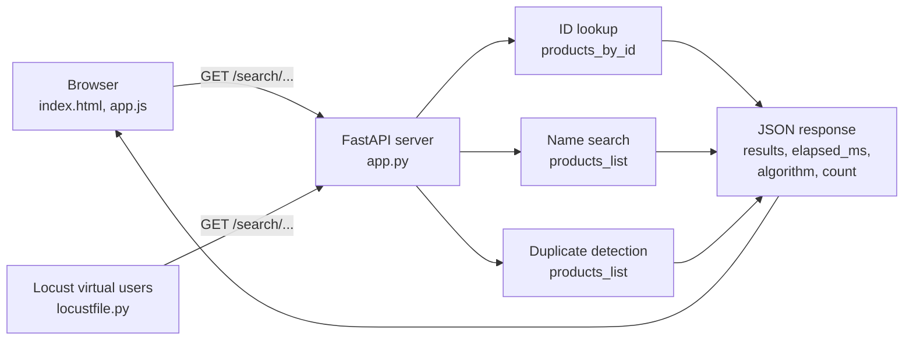
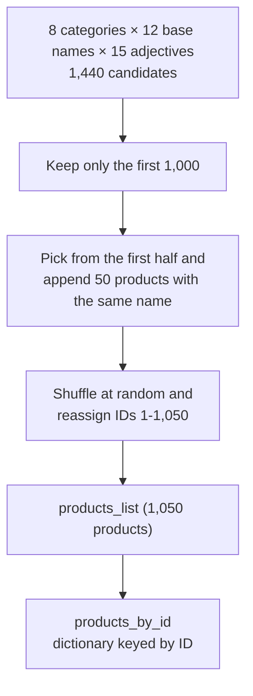
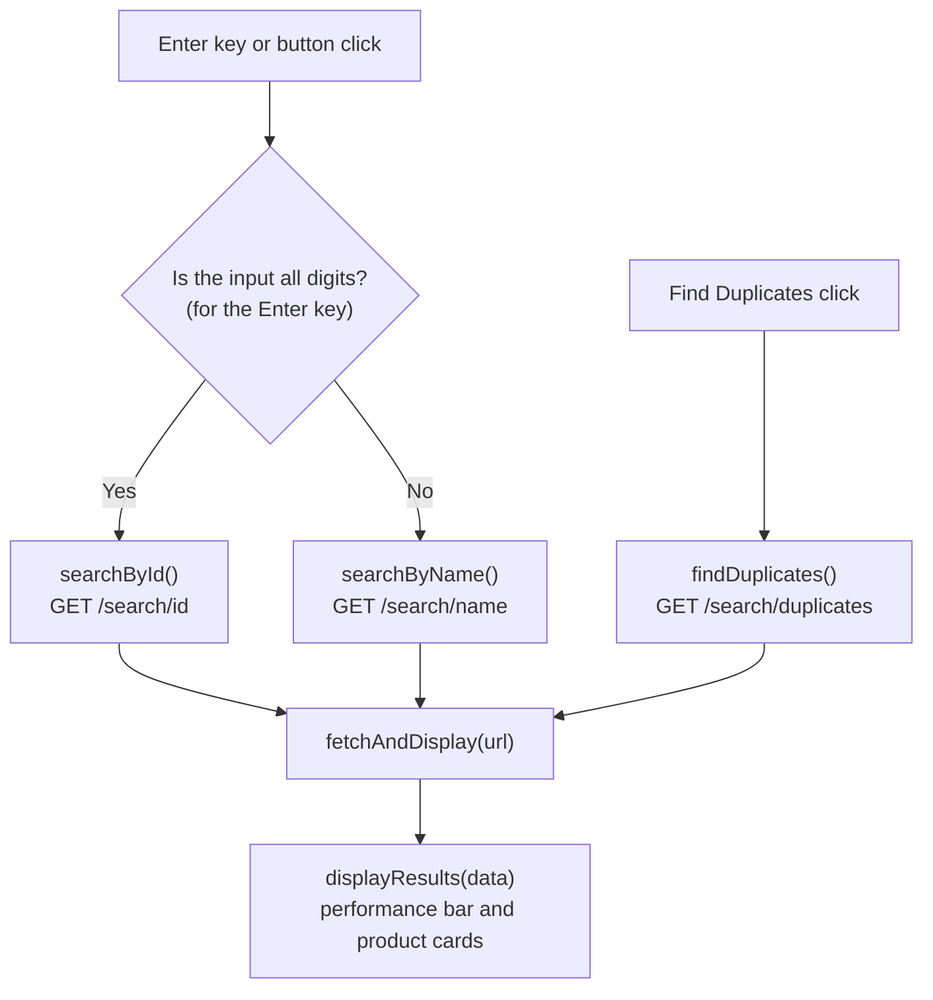
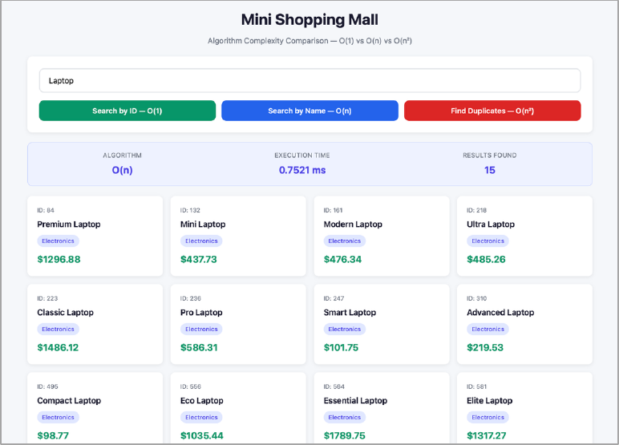
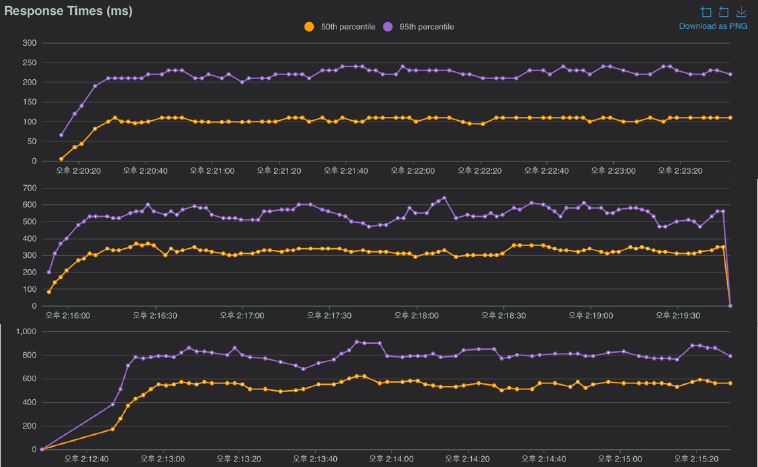
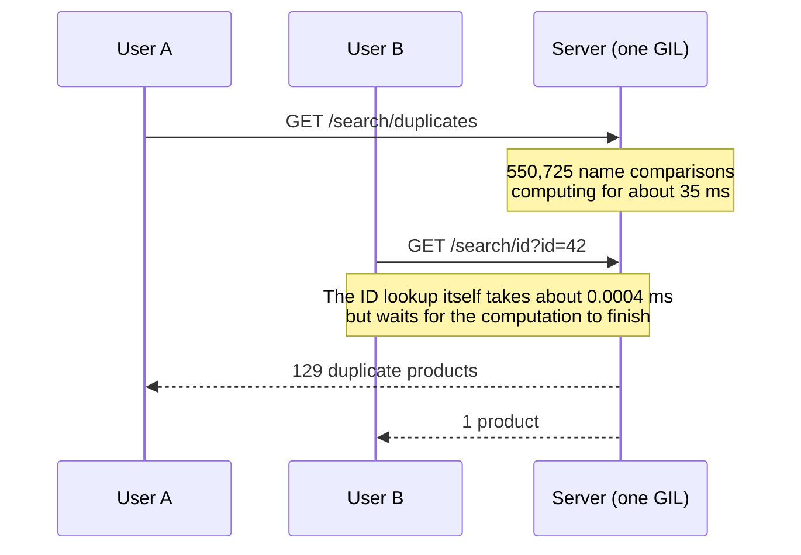

# HW1 Assignment Explanation — Mini Shopping Mall Product Search

[Repository Guide](../../README.md) | [English](Assignment-Explanation.md) | [한국어](Assignment-Explanation.ko.md)

> **Last Updated:** 2026-11-18
>
> Introduction to Algorithms, Cormen, Leiserson, Rivest, and Stein, Ch 2, 3, 11

> **Learning Objectives:**
> 1. Keep the same product data in both a list and a hash table, and choose the data structure that fits each kind of lookup
> 2. Count the basic operations of ID lookup, name search, and duplicate detection to derive the time complexity of each search
> 3. Build search endpoints with FastAPI and measure the execution time of the algorithm part with `time.perf_counter()`
> 4. Read the response times, percentiles, and throughput of a Locust load test and interpret them in terms of the number of concurrent users
> 5. Explain load test results in terms of Big-O and the way the server processes requests

---

## Table of Contents

- [1. Assignment Structure and How to Run](#1-assignment-structure-and-how-to-run)
  - [1.1 Assignment Overview](#11-assignment-overview)
  - [1.2 Directory Structure](#12-directory-structure)
  - [1.3 Installation and Running](#13-installation-and-running)
  - [1.4 Running the Locust Load Test](#14-running-the-locust-load-test)
- [2. Requirements](#2-requirements)
  - [2.1 Product Data and Search Algorithms](#21-product-data-and-search-algorithms)
  - [2.2 Web Interface](#22-web-interface)
  - [2.3 API Endpoints](#23-api-endpoints)
  - [2.4 Load Test and Report](#24-load-test-and-report)
  - [2.5 Grading Criteria](#25-grading-criteria)
- [3. Design](#3-design)
  - [3.1 Overall Structure](#31-overall-structure)
  - [3.2 Product Data Generation](#32-product-data-generation)
  - [3.3 List and Hash Table](#33-list-and-hash-table)
- [4. Implementing the Three Searches](#4-implementing-the-three-searches)
  - [4.1 ID Lookup](#41-id-lookup)
  - [4.2 Name Search](#42-name-search)
  - [4.3 Duplicate Detection](#43-duplicate-detection)
  - [4.4 Measuring Execution Time](#44-measuring-execution-time)
- [5. Web Interface and Load Test Script](#5-web-interface-and-load-test-script)
  - [5.1 Frontend](#51-frontend)
  - [5.2 locustfile.py](#52-locustfilepy)
- [6. Tests and Results](#6-tests-and-results)
  - [6.1 Checking the Endpoints](#61-checking-the-endpoints)
  - [6.2 Search Result Screen](#62-search-result-screen)
  - [6.3 Locust Load Test Results](#63-locust-load-test-results)
  - [6.4 Response Time and Throughput of a Single-Process Server](#64-response-time-and-throughput-of-a-single-process-server)
- [7. Analysis of Performance Degradation under Load](#7-analysis-of-performance-degradation-under-load)
  - [7.1 Workload of Each Algorithm](#71-workload-of-each-algorithm)
  - [7.2 When Concurrent Requests Pile Up](#72-when-concurrent-requests-pile-up)
  - [7.3 Directions for Improvement](#73-directions-for-improvement)
- [Summary](#summary)
- [Self-Check Questions](#self-check-questions)

---

<br>

## 1. Assignment Structure and How to Run

> **Try It First:** This document contains the answers and solutions. Solve the problems in the [assignment handout](Original/Assignment.md) yourself before reading on.

### 1.1 Assignment Overview

The assignment is to build a mini shopping mall web app in which users search for products, and to compare the performance of three search methods with different time complexities. The handout requires ID lookup in O(1), name search in O(n), and duplicate detection, which finds products with the same name, in O(n²), and it asks the student to call these three searches in a Locust load test to observe how the choice of algorithm affects the service as concurrent users increase. The deliverables are the source code and a report of at most two pages, and the report contains the search screen, the response time charts for 10, 30, and 50 concurrent users, and an analysis of how performance changes under load. The assignment checks the [time complexity and asymptotic notation](../../Lecture-Notes/Week02_Algorithm-Design-and-Complexity-Analysis/Concepts_Lecture.md) of the Week 2 Lecture in a real web service.

### 1.2 Directory Structure

```text
Coursework/HW01_Algorithm-Design-and-Complexity-Analysis/
├── Assignment-Explanation.md       # Assignment explanation (English, this document)
├── Assignment-Explanation.ko.md    # Assignment explanation (Korean)
├── Code-Walkthrough.md             # Code walkthrough (English)
├── Code-Walkthrough.ko.md          # Code walkthrough (Korean)
├── Original/
│   ├── Assignment.md               # Assignment handout (English)
│   └── Assignment.ko.md            # Assignment handout (Korean)
└── Solution/
    ├── app.py                      # FastAPI backend: product data and search endpoints
    ├── locustfile.py               # Locust load test script
    ├── requirements.txt            # List of dependencies
    └── static/
        ├── index.html              # Page structure
        ├── style.css               # Page style
        └── app.js                  # Search requests and result display
```

*Figure 1. Directory structure of HW1*

### 1.3 Installation and Running

The backend is written with the Python web framework FastAPI and runs on the ASGI server uvicorn. The following commands start from the repository root.

```bash
cd Coursework/HW01_Algorithm-Design-and-Complexity-Analysis/Solution
python3 -m pip install -r requirements.txt   # install fastapi, uvicorn, locust
python3 app.py                               # start the server at http://localhost:8000
```

Opening `http://localhost:8000` in a browser shows the search screen. Type a product name or ID into the search bar and press one of the three buttons, or press Enter.

> **Note:** The last line of `app.py` passes the module name as a string, as in `uvicorn.run("app:app", ...)`, so `python3 app.py` must be run inside the `Solution` directory. To run it from another directory, give the path explicitly, as in `uvicorn app:app --app-dir <path to Solution> --port 8000`.

### 1.4 Running the Locust Load Test

With the server running, open another terminal and run Locust in the same directory.

```bash
locust -f locustfile.py --host=http://localhost:8000
```

Open the Locust web UI at `http://localhost:8089`, set the number of concurrent users (Number of users) and the spawn rate per second (Ramp up), and start. Run once each with 10, 30, and 50 concurrent users, and record the table in the STATISTICS tab and the response time chart in the CHARTS tab. To run for a fixed time without the web UI, use headless mode as follows.

```bash
locust -f locustfile.py --headless -u 10 -r 10 -t 30s --host http://localhost:8000
```

The [HW1 code walkthrough](Code-Walkthrough.md) explains the code of every file line by line from beginning to end.

---

<br>

## 2. Requirements

This section summarizes the requirements of the [assignment handout](Original/Assignment.md) and notes which part of `Solution` meets each requirement. Line numbers refer to each file.

### 2.1 Product Data and Search Algorithms

| Requirement | Location | Implementation |
|:-----|:-----|:-----|
| At least 1,000 products with id, name, category, and price | `app.py` lines 82-127 | `generate_products()` creates 1,050 products, which are put into a list and a dictionary at startup |
| ID lookup, `dict[product_id]`, O(1) | `app.py` lines 143-162 | A single `products_by_id.get(id)` finds the product |
| Name search, scan all products sequentially, O(n) | `app.py` lines 165-181 | One `for` loop checks whether the keyword occurs in each name |
| Duplicate detection, nested loops, O(n²) | `app.py` lines 184-212 | A double `for` loop compares the names of every pair of products |

*Table 1. Where the product data and search algorithm requirements are implemented*

### 2.2 Web Interface

| Requirement | Location | Implementation |
|:-----|:-----|:-----|
| A search bar to search by name or ID | `index.html` lines 18-28, `app.js` lines 19-41 | An input box and two search buttons; the Enter key calls ID lookup if the input is all digits and name search otherwise |
| A "Find Duplicates" button | `index.html` line 27, `app.js` lines 43-45 | Pressing the button calls `/search/duplicates` |
| A product card list with name, price, and category | `app.js` lines 95-112 | One card is created for each result and appended to the grid |
| Execution time (ms) shown for each search | `index.html` lines 32-45, `app.js` lines 79-82 | The performance bar shows the algorithm, the execution time, and the number of results |

*Table 2. Where the web interface requirements are implemented*

### 2.3 API Endpoints

| Method and path | Required behavior | Location |
|:-----|:-----|:-----|
| `GET /search/id?id=123` | O(1) lookup by product ID | `app.py` lines 143-162, `search_by_id` |
| `GET /search/name?q=keyword` | O(n) linear search by name | `app.py` lines 165-181, `search_by_name` |
| `GET /search/duplicates` | O(n²) duplicate detection | `app.py` lines 184-212, `find_duplicates` |
| `GET /` | Serve the frontend page | `app.py` lines 136-140, `serve_index` |

*Table 3. Where the API endpoint requirements are implemented*

All three search endpoints return JSON of the same shape. `results` is the list of products found, `elapsed_ms` is the execution time of the algorithm part in milliseconds, `algorithm` is the complexity string, and `count` is the number of results; duplicate detection adds the number of comparisons, `comparisons`.

### 2.4 Load Test and Report

| Requirement | Location |
|:-----|:-----|
| A `locustfile.py` in which concurrent users call the three endpoints | `locustfile.py` lines 8-18 (Section 5.2) |
| Start with 10 users, ramp up to 50, and observe response time and throughput | Measurements in Sections 6.3 and 6.4 |
| Report: screenshot of the search results | Figure 6 in Section 6.2 |
| Report: response time charts for 10, 30, and 50 users | Figure 7 and Table 8 in Section 6.3 |
| Report: analysis of why O(n²) degrades under load, related to Big-O and real-world impact | Section 7 |

*Table 4. Load test and report requirements*

### 2.5 Grading Criteria

| Criterion | Weight |
|:-----|-----:|
| The web app runs and works correctly | 20% |
| The algorithm requirements are fully implemented | 40% |
| Report (at most 2 pages, font size 11 or larger) | 40% |

*Table 5. Grading criteria and weights*

---

<br>

## 3. Design

### 3.1 Overall Structure

The app consists of a frontend that runs in the browser and a FastAPI backend. The backend creates the product data once at startup and keeps it in memory, and each request only searches that data. The cost of one request is therefore the cost of the search algorithm plus the cost of HTTP processing. Locust plays the role of virtual users who call the same endpoints repeatedly instead of a browser.



*Figure 2. Request flow of the mini shopping mall*

### 3.2 Product Data Generation

The handout requires at least 1,000 products with id, name, category, and price. `generate_products()` creates this data randomly but fixes the seed with `random.seed(42)`, so the same product list comes out no matter how many times the server restarts. This is also why the search results can be compared with the figures of the report.

Generation takes the following four steps.

1. **Create unique products:** Each of the 8 categories has 12 base names, and each of 15 adjectives is put in front to form names such as `"Premium Laptop"`. There are 8 × 12 × 15 = 1,440 candidates, and each price is chosen at random from the range set for its category.
2. **Trim to 1,000:** To leave room for 50 duplicates, only the first 1,000 are kept.
3. **Insert 50 intentional duplicates:** A product is picked from the first half of the list, and a product with the same name and category but a price scaled by 0.8-1.2 is appended, 50 times.
4. **Shuffle and reassign IDs:** The list is shuffled and the IDs are reassigned sequentially from 1 to 1,050.



*Figure 3. Steps of product data generation*

The trimming in step 2 follows the order of the categories. Each category has 12 × 15 = 180 products, so only the 900 products of Electronics, Books, Clothing, Home & Kitchen, and Sports and the first 100 of Food & Beverages remain, and Toys and Office Supplies at the end are dropped entirely. `CATEGORIES` lists 8 categories, but only 6 remain in the actual product list. The duplicates in step 3 are picked from the first half of the list before shuffling, and since that range holds only Electronics, Books, and part of Clothing, the duplicates are added only to these three categories. The final number of products per category is as follows.

| Category | After trimming | Intentional duplicates | Final |
|:-----|-----:|-----:|-----:|
| Electronics | 180 | 18 | 198 |
| Books | 180 | 13 | 193 |
| Clothing | 180 | 19 | 199 |
| Home & Kitchen | 180 | 0 | 180 |
| Sports | 180 | 0 | 180 |
| Food & Beverages | 100 | 0 | 100 |
| Total | 1,000 | 50 | 1,050 |

*Table 6. Number of products per category*

The duplicates are not only the 50 inserted in step 3. The base name `"Water Bottle"` appears in both Home & Kitchen and Sports, so 15 names with the same adjective, such as `"Premium Water Bottle"`, exist from the start as two products that differ only in category. In addition, `"Premium Hoodie"` is picked twice in step 3, so this name belongs to 3 products. As a result, 64 names are used by more than one product (63 names by 2 products and 1 name by 3 products), and 129 products carry these names. Counted as pairs of products with the same name, there are 63 + 3 = 66 pairs.

### 3.3 List and Hash Table

The same product data is kept in two data structures. `products_list` is a list that holds the products in order, used by name search and duplicate detection, which must scan every product. `products_by_id` is a dictionary with the ID as key and the product as value, used by ID lookup. Both structures refer to the same product objects, so the product information is not copied twice.

A Python dictionary is a **hash table**. It computes the storage location directly by passing the key to a hash function, so it finds a key in O(1) average time regardless of the number of elements n. The worst case can become O(n) when collisions pile up, but this rarely happens with integer keys and a well-designed hash function. The O(n) cost of building the dictionary is paid only once at server startup, and every later ID lookup shares that cost.

> **[Data Structures]** A hash table stores keys by turning them into array indices with a hash function. Collisions, in which different keys go to the same index, are handled by separate chaining or open addressing, and if the load factor is kept below a certain level, insertion, deletion, and search take O(1) on average. Details are in the [Week 10 Lecture](../../Lecture-Notes/Week10_Hash-Tables-and-Set-Data-Structures/Concepts_Lecture.md).

---

<br>

## 4. Implementing the Three Searches

The algorithm, complexity, and implementation of the three endpoints are summarized below. The number of comparisons for duplicate detection is computed for n = 1,050 products.

| Endpoint | Algorithm | Complexity | Implementation |
|:-----|:-----|:-----|:-----|
| `/search/id` | ID lookup | O(1) | Python dictionary `dict.get(id)`, hash-based direct access |
| `/search/name` | Name search | O(n) | A single `for` loop over all 1,050 products with substring matching |
| `/search/duplicates` | Duplicate detection | O(n²) | Nested `for` loops that compare every pair, 550,725 comparisons |

*Table 7. Algorithms and implementations of the three endpoints*

### 4.1 ID Lookup

**Requirement:** Given a product ID, find the product in O(1), as with `dict[product_id]`.

```python
@app.get("/search/id")
def search_by_id(id: int = Query(..., description="Product ID")):
    """O(1) lookup by product ID using dict."""
    start = time.perf_counter()
    result = products_by_id.get(id)
    elapsed_ms = (time.perf_counter() - start) * 1000
```

The decorator on line 143 connects `GET /search/id` requests to this function, and `Query(...)` on line 144 tells FastAPI that `id` is a required integer query parameter. If a non-integer value such as `id=abc` arrives, FastAPI responds with a 422 error before calling the function. `products_by_id.get(id)` on line 147 finishes with one hash and a few key comparisons, and returns `None` instead of raising an exception when the key is missing. Lines 150-162 return a list with one product and `count` 1 if a result exists, and an empty list and `count` 0 otherwise.

Even with n products, the function does a constant amount of work: one hash computation, a check of the storage location, and building the response. The time complexity is therefore O(1) on average.

### 4.2 Name Search

**Requirement:** Scan all products sequentially and find the products whose names contain the keyword (O(n)).

```python
    start = time.perf_counter()
    q_lower = q.lower()
    results = []
    for product in products_list:
        if q_lower in product["name"].lower():
            results.append(product)
    elapsed_ms = (time.perf_counter() - start) * 1000
```

Line 169 lowercases the keyword only once, and the loop on lines 171-173 lowercases each product name and checks whether the keyword occurs in it (`in`). Because both sides are lowercased, `laptop` and `Laptop` find the same 15 products. The loop does not stop when it finds a result but runs to the end, so it always checks all n products regardless of the keyword.

The cost of one substring check is proportional to the lengths of the product name and the keyword. If L is the maximum name length, the total cost is O(nL), and since the names in this app are short strings made of an adjective and a base name, L can be treated as a constant, which gives O(n).

> **Caution:** In Python the empty string is a substring of every string (`"" in s` is true), so if `q` is the empty string, all 1,050 products become results. The frontend does not send a request when the input is empty (`app.js` line 39), so this case does not occur on the screen.

### 4.3 Duplicate Detection

**Requirement:** Find all products with the same name using nested loops (O(n²)).

```python
    for i in range(n):
        for j in range(i + 1, n):
            comparisons += 1
            if products_list[i]["name"] == products_list[j]["name"]:
                if products_list[i]["id"] not in seen_ids:
                    duplicates.append(products_list[i])
                    seen_ids.add(products_list[i]["id"])
                if products_list[j]["id"] not in seen_ids:
                    duplicates.append(products_list[j])
                    seen_ids.add(products_list[j]["id"])
```

The outer loop on line 193 runs i from 0 to n − 1, and the inner loop on line 194 runs j from i + 1 to n − 1. Because j starts at i + 1, the loops never compare (i, j) and (j, i) twice and never compare a product with itself. If the two names are equal on line 196, lines 197-202 add both products to the result, and the `seen_ids` set filters out products already added so that the same product never enters the result twice. If 3 products share a name, there are 3 pairs, but only the 3 products enter the result.

The number of comparisons is n − 1 − i for each i, so it equals the number of ways to choose 2 out of n, as follows.

$$
\sum_{i=0}^{n-1} (n-1-i) = (n-1) + (n-2) + \cdots + 1 + 0 = \frac{n(n-1)}{2} = \binom{n}{2}
$$

For n = 1,050 this is 1,050 × 1,049 / 2 = 550,725. The `comparisons` variable on line 195 counts exactly this value and includes it in the response. The loops have no early-exit condition, so the number of comparisons is always the same whether or not duplicates exist, and both the best and worst cases are Θ(n²). Checking and adding to `seen_ids` are hash table operations that take O(1) on average, so they do not change the overall complexity.

```text
Pairs (i, j) compared when n = 5

i = 0:  (0,1) (0,2) (0,3) (0,4)    4
i = 1:        (1,2) (1,3) (1,4)    3
i = 2:              (2,3) (2,4)    2
i = 3:                    (3,4)    1
                          Total: 10 = 5 × 4 / 2
```

*Figure 4. Triangular shape of the pairs compared by the nested loops*

With the data of Section 3.2, this endpoint returns the 129 products of the 64 shared names. `count` is not the number of pairs but the number of products in the result.

### 4.4 Measuring Execution Time

**Requirement:** Show the execution time (ms) for each search.

All three endpoints call `time.perf_counter()` before and after the algorithm part, multiply the difference by 1,000 to convert it to milliseconds, round it to four decimal places, and return it as `elapsed_ms`. `perf_counter()` is a monotonic high-resolution clock that does not depend on the system time, which makes it suitable for measuring short intervals.

This value measures **only the time the algorithm runs inside the server**. It does not include the time for the request to travel over the network to the server, to wait for its turn, and for the response to be turned into JSON and sent back. The response time recorded by Locust, by contrast, runs from the moment the request is sent to the moment the whole response is received, so it includes all of this time. This is why the two values differ so much in Sections 6 and 7.

---

<br>

## 5. Web Interface and Load Test Script

### 5.1 Frontend

**Requirement:** Build a screen with a search bar, a "Find Duplicates" button, a product card list, and an execution time display.

`index.html` divides the screen from top to bottom into a header, a search area (an input box and three buttons), a performance bar (algorithm, execution time, number of results), a loading message, a result grid, and an empty state message. `app.js` attaches a click handler to each button, and when Enter is pressed in the input box, it checks with the regular expression `/^\d+$/` whether the input consists only of digits, calling ID lookup if so and name search otherwise.

All three searches call the server through a single function, `fetchAndDisplay(url)`. This function shows the loading message, sends the request with `fetch()`, receives the JSON, and passes it to `displayResults()`. `displayResults()` writes `algorithm`, `elapsed_ms`, and `count` into the performance bar and creates a product card for each result. When putting the product name and category into a card, it converts HTML special characters with `escapeHtml()` so that a string in a name is never interpreted as HTML. If a server or network error occurs, the error message appears in place of the empty state message.



*Figure 5. Search handling flow of the frontend*

### 5.2 locustfile.py

**Requirement:** Simulate concurrent users calling the three search endpoints.

```python
from locust import HttpUser, task
class ShopUser(HttpUser):
    @task
    def search_by_id(self):
        self.client.get("/search/id?id=42")
    @task
    def search_by_name(self):
        self.client.get("/search/name?q=laptop")
    @task
    def find_duplicates(self):
        self.client.get("/search/duplicates")
```

One `ShopUser` is one virtual user. The three methods marked with `@task` have no explicit weights, so all weights are 1, and each user picks one of the three with equal probability every time. Over a long run the three endpoints are called almost equally often, so the three searches can be compared fairly under the same load distribution.

`ShopUser` has no `wait_time`. In Locust, an unspecified `wait_time` means a wait of 0, so each user sends the next request as soon as it receives a response. With N users, the server always has N requests that are either being processed or waiting for their turn. Section 7.2 uses this property to interpret the response times.

---

<br>

## 6. Tests and Results

### 6.1 Checking the Endpoints

Calling each endpoint gives the following results. Because the seed is fixed, the following values are the same on every run (only `elapsed_ms` changes from run to run).

```text
GET /search/id?id=42
  -> count 1, results [{"id": 42, "name": "Pro Python Guide", "category": "Books", "price": 78.81}]
GET /search/id?id=9999
  -> count 0, results []
GET /search/id?id=abc
  -> 422 Unprocessable Entity
GET /search/name?q=Laptop   (same for q=laptop)
  -> count 15, first result ID 84 "Premium Laptop" 1296.88
GET /search/duplicates
  -> count 129, comparisons 550725
GET /
  -> 200, text/html
```

The values of Sections 3.2 and 4.3, namely 1,050 products, 6 categories, 64 duplicate names, 129 duplicate products, and 550,725 comparisons, are the same as these results.

### 6.2 Search Result Screen



*Figure 6. Result screen of the name search for "Laptop"*

Figure 6 shows the screen after entering `Laptop` in the search bar and running the name search (O(n)). The performance bar shows algorithm O(n), execution time 0.7521 ms, and 15 results, and the grid below lists the laptop cards of the Electronics category with ID, name, category, and price. The IDs and prices on the cards (ID 84 Premium Laptop, ID 132 Mini Laptop, and so on) are the same as the results of the same search in Section 6.1. The execution time depends on the computer and its state at that moment, and repeating the same search on another computer can give about 0.07-0.15 ms.

### 6.3 Locust Load Test Results

Load tests were run with 10, 30, and 50 concurrent users, calling the three endpoints with equal `@task` weights. The following table gives the average, 95th percentile, and maximum response times per endpoint (in ms).

<table>
<tr><th rowspan="2">Endpoint</th><th rowspan="2">Complexity</th><th colspan="3">Average</th><th colspan="3">95th percentile</th><th colspan="3">Max</th></tr>
<tr><th>10u</th><th>30u</th><th>50u</th><th>10u</th><th>30u</th><th>50u</th><th>10u</th><th>30u</th><th>50u</th></tr>
<tr><td><code>/search/id</code></td><td>O(1)</td><td>6.93</td><td>11.06</td><td>12.66</td><td>28</td><td>50</td><td>51</td><td>87</td><td>86</td><td>131</td></tr>
<tr><td><code>/search/name</code></td><td>O(n)</td><td>8.16</td><td>10.52</td><td>12.50</td><td>31</td><td>49</td><td>53</td><td>106</td><td>98</td><td>115</td></tr>
<tr><td><code>/search/duplicates</code></td><td>O(n²)</td><td>71.39</td><td>64.64</td><td>60.99</td><td>97</td><td>110</td><td>110</td><td>116</td><td>143</td><td>150</td></tr>
</table>

*Table 8. Response times per endpoint by number of concurrent users (ms)*



*Figure 7. Locust response time charts for 10, 30, and 50 concurrent users*

Figure 7 plots, from the CHARTS tab of Locust, the 50th percentile (orange) and 95th percentile (purple) of the response time of all requests combined over time, for 10, 30, and 50 users from top to bottom. Note that the vertical axes have different ranges: 0-300 ms, 0-700 ms, and 0-1,000 ms. The 50th percentile is about 100 ms for 10 users, about 300-350 ms for 30 users, and about 550 ms for 50 users, rising almost in proportion to the number of users. The first few seconds, in which the values climb from 0, are the period in which the users are being spawned.

In Table 8, `/search/duplicates` averages 61-71 ms at every user count, about 5-10 times slower than the other two endpoints, which stay under 13 ms. The maximum of `/search/id`, which is O(1), also rose from 87 ms with 10 users to 131 ms with 50 users. The average of `/search/duplicates` decreased slightly as users increased; this may be an effect of CPU caches being filled by repeated calls or simply measurement variance, and this measurement alone cannot tell which. The 95th percentile and the maximum of the same endpoint, on the other hand, rose with the number of users.

> **Caution:** Table 8 and Figure 7 do not come from the same measurement. In the 10-user chart of Figure 7, the 95th percentile is about 200-240 ms, whereas the 10-user maximum in Table 8 is at most 116 ms for all three endpoints. A maximum cannot be smaller than the 95th percentile, so the two were obtained from different runs. Comparisons within each source are meaningful, but the numbers of the table and of the chart must not be compared against each other.

### 6.4 Response Time and Throughput of a Single-Process Server

The following table gives the response times of a load test in which the server runs as a single uvicorn process and Locust runs in headless mode, spawning all users at once (`-u N -r N`) for 30 seconds each (Apple M2 Pro, macOS, Python 3.13, FastAPI 0.163.1, uvicorn 0.54.0, Locust 2.47.0). The execution environment differs from that of Table 8 and Figure 7, so the numbers are not the same, but the trends can be compared.

<table>
<tr><th rowspan="2">Endpoint</th><th colspan="3">Average</th><th colspan="3">95th percentile</th><th colspan="3">Max</th></tr>
<tr><th>10u</th><th>30u</th><th>50u</th><th>10u</th><th>30u</th><th>50u</th><th>10u</th><th>30u</th><th>50u</th></tr>
<tr><td><code>/search/id</code></td><td>80.33</td><td>280.07</td><td>509.46</td><td>160</td><td>480</td><td>780</td><td>222</td><td>749</td><td>2,770</td></tr>
<tr><td><code>/search/name</code></td><td>82.23</td><td>287.94</td><td>503.79</td><td>160</td><td>480</td><td>790</td><td>247</td><td>743</td><td>2,437</td></tr>
<tr><td><code>/search/duplicates</code></td><td>177.01</td><td>443.26</td><td>687.82</td><td>290</td><td>710</td><td>1,000</td><td>476</td><td>935</td><td>2,353</td></tr>
<tr><td>All requests</td><td>113.02</td><td>336.30</td><td>566.56</td><td>240</td><td>580</td><td>900</td><td>476</td><td>935</td><td>2,770</td></tr>
</table>

*Table 9. Response times of a single-process server (ms)*

The median of all requests is 100 ms, 330 ms, and 540 ms for 10, 30, and 50 users, and the 95th percentile is 240 ms, 580 ms, and 900 ms, which matches the size and trend of the charts in Figure 7. Two features stand out. First, the total throughput is almost the same regardless of the number of users: 88.3, 88.8, and 87.7 requests per second. Second, even ID lookup, which is O(1), slows down in proportion to the number of users, exceeding an average of 500 ms with 50 users. Measured on its own, the ID lookup algorithm takes about 0.0004 ms (Table 10 in Section 7.1), and the response time is hundreds of thousands of times longer. Section 7 explains this phenomenon.

---

<br>

## 7. Analysis of Performance Degradation under Load

The analysis question of the handout is "Why does O(n²) degrade under load? Relate it to Big-O and its real-world impact."

### 7.1 Workload of Each Algorithm

With n = 1,050 products, the three algorithms do fundamentally different amounts of work. O(1) does one hash lookup, O(n) checks about 1,050 products, and O(n²) compares every pair, n(n − 1)/2 = 550,725 times.

| Algorithm | Basic operations (n = 1,050) | Execution time of the algorithm part (median) |
|:-----|-----:|-----:|
| ID lookup, O(1) | 1 hash lookup | about 0.0004 ms |
| Name search, O(n) | 1,050 substring checks | about 0.07 ms |
| Duplicate detection, O(n²) | 550,725 name comparisons | about 35 ms |

*Table 10. Workload and execution time of the three algorithms*

The execution times are medians obtained by calling each function directly tens to hundreds of times on the same computer as in Section 6.4. Duplicate detection makes about 524 times as many comparisons as name search and takes about 500 times as long. If the number of products doubles, the work of name search doubles and the work of duplicate detection roughly quadruples.

At this scale, O(1) and O(n) have almost the same response times. In Table 8 the averages of the two endpoints stay together under 13 ms at every user count. The time of the algorithms themselves (0.0004 ms and 0.07 ms) is far smaller than the fixed cost of the framework, such as handling the HTTP request, routing, and converting to JSON. When the workload is small, differences in Big-O do not show up in the response time, and the fixed cost determines the response time.

### 7.2 When Concurrent Requests Pile Up

As concurrent users increase, the gap widens. The O(n²) endpoint is a **CPU-bound** task that only computes, so it keeps the CPU busy during its roughly 550,000 comparisons. Other requests must wait for their turn in the meantime, and the waiting requests include O(1) ID lookups. In Table 8, the maximum of ID lookup rising from 87 ms with 10 users to 131 ms with 50 users, and the maximum of duplicate detection growing to 150 ms, are traces of this waiting. A single slow algorithm slows down the entire system, not just its own endpoint.

FastAPI runs endpoints written as plain functions (`def`, without `async`) on worker threads of a thread pool, so when several requests arrive at once, several threads run together. However, because of the **Global Interpreter Lock (GIL)**, CPython lets only one thread execute Python bytecode at a time. The double loop of duplicate detection is pure Python code, so even with several threads the computation effectively proceeds one at a time, and the processing of other requests only slips in between.

> **[Operating Systems]** A thread is a flow of execution within a process, and for several threads to actually run at the same time, there must be several CPU cores and no lock that blocks them from each other. A CPU-bound task spends a long time computing, while an I/O-bound task spends most of its time waiting for I/O. A thread waiting for I/O gives up the CPU, so adding threads raises the throughput of I/O-bound work, but CPU-bound work gains no throughput unless it gets more CPU.



*Figure 8. An ID lookup waiting behind the duplicate detection computation*

`locustfile.py` has no `wait_time`, so each user sends the next request as soon as it receives a response (Section 5.2). In such a closed system, the number of users N, the throughput X (requests processed per second), and the average response time R satisfy the following relation.

$$
N = X \times R \quad \Longrightarrow \quad R = \frac{N}{X}
$$

> **Note:** This relation is **Little's law** from queueing theory, which states that the average number of items in a stable system equals the average arrival rate times the average time spent in the system. Here the number of requests in the server is always the number of users N, and the arrival rate equals the throughput X.

The throughput of the server is set by the amount of computation the CPU can handle. Since the three endpoints are called in equal proportion, every 3 requests bring 1 duplicate detection (about 35 ms) and 2 searches that cost almost nothing. The upper bound on the throughput is therefore roughly as follows.

$$
X_{\max} \approx \frac{3}{35\ \text{ms}} \approx 86\ \text{req/s}
$$

The throughput measured in Section 6.4, about 88 requests per second, is close to this value and stayed constant regardless of the number of users. Since the throughput is stuck at its upper bound, the average response time is proportional to the number of users. 10 / 88.3 ≈ 0.113 s, 30 / 88.8 ≈ 0.338 s, and 50 / 87.7 ≈ 0.570 s are almost the same as the overall averages of Table 9, 113 ms, 336 ms, and 567 ms. Adding users does not raise the throughput but only lengthens the queue, and this is also why the response times in Figure 7 rise in proportion to the number of users.

This analysis shows the impact of Big-O on a real service. If the computation time of one request is proportional to n², the maximum throughput of the server shrinks in proportion to 1/n². If the number of products doubles, the duplicate detection computation roughly quadruples, the throughput bound drops to about a quarter, and the response time of every request at the same number of users roughly quadruples. In a real service this appears as increased latency, timeouts, and a worse user experience.

### 7.3 Directions for Improvement

Using a hash table instead of nested loops reduces duplicate detection from O(n²) to O(n). If products are grouped by name in a dictionary keyed by name, each product needs only one hash operation, and the products of every name that collected two or more products are taken out. The following code is not the submitted code but an example written for comparison.

```python
def find_duplicates_linear(products):
    groups = {}
    for p in products:                      # O(n): group by name
        groups.setdefault(p["name"], []).append(p)
    return [p for g in groups.values() if len(g) > 1 for p in g]   # O(n)
```

On the same 1,050 products, this function finds the same 129 products in about 0.10 ms. That is about 340 times faster than the roughly 35 ms of the nested loops and on the same level as name search. A set (`set`) that checks whether each name has already been seen is enough to find the second and later occurrences in a single pass, but grouping by name as above is convenient for including the first occurrence in the result as well. The same idea appears in Section 2.2 (finding duplicates, from O(n²) to O(n)) of the [Week 2 Lab](../../Lecture-Notes/Week02_Algorithm-Design-and-Complexity-Analysis/Concepts_Lab.md).

Besides reducing the computation, a duplicate list that rarely changes can be computed once at server startup or recomputed only when the products change. Whatever the method, the starting point is the choice of algorithm. Algorithm selection is a critical engineering decision that directly affects service quality as the scale grows.

---

<br>

## Summary

| Concept | Key Summary |
|:-----|:-----|
| Data generation | From 1,440 candidates with the seed fixed at 42, 1,000 are kept and 50 products with duplicate names are added to make 1,050, and only 6 categories actually remain. |
| Choice of data structure | Name search and duplicate detection scan the list, and ID lookup uses a hash table keyed by ID to find the product in O(1) on average. |
| Name search | A single loop checks all n products, which is O(n) when the name length is treated as a constant. |
| Duplicate detection | The double loop in which j starts at i + 1 makes n(n − 1)/2 comparisons, 550,725 for n = 1,050, and is always Θ(n²). |
| Execution time and response time | `elapsed_ms` measures only the algorithm time inside the server, while the Locust response time includes the network, waiting, and serialization. |
| Load and throughput | In a closed system of N users with no wait time, R = N / X holds, so when the CPU-bound duplicate detection caps the throughput, the response time of every request grows in proportion to the number of users. |
| Improvement | Grouping by name with a hash table makes duplicate detection O(n), about 340 times faster on the same data. |

---

<br>

## Self-Check Questions

1. **Number of comparisons:** If there were 2,000 products, what would `comparisons` of `find_duplicates()` be, and about how many times the value for 1,050 products is it?

   <details>
   <summary>Answer</summary>

   It would be 2,000 × 1,999 / 2 = 1,999,000. This is about 3.63 times the 550,725 for 1,050 products, almost the square of the ratio of product counts, 2,000 / 1,050 ≈ 1.90.

   </details>

2. **Number of categories:** `CATEGORIES` lists 8 categories, so why do only 6 appear in the actual product list?

   <details>
   <summary>Answer</summary>

   The 1,440 candidates are created in category order, and only the first 1,000 are kept. Each category has 180 products, so the 900 products of the first five categories and 100 of Food & Beverages remain, and Toys and Office Supplies are cut off entirely.

   </details>

3. **Empty keyword:** How many results does an empty keyword give, as in `/search/name?q=`? Why?

   <details>
   <summary>Answer</summary>

   All 1,050. In Python the empty string is a substring of every string, so `"" in name` is always true. On the screen this case does not occur, because `app.js` sends no request when the input is empty.

   </details>

4. **Predicting response time:** On the server of Section 6.4, whose throughput is capped at about 88 requests per second, what average response time would you expect if 100 users with no wait time send requests?

   <details>
   <summary>Answer</summary>

   R = N / X ≈ 100 / 88 ≈ 1.14 s. Since the throughput does not grow, adding users only lengthens the queue, and the average response time grows in proportion to the number of users.

   </details>

5. **Latency of O(1):** Measured on its own, the ID lookup algorithm takes about 0.0004 ms, so why does it take hundreds of milliseconds in the load test?

   <details>
   <summary>Answer</summary>

   The Locust response time includes the time spent waiting for a turn in the server. Duplicate detection occupies the CPU for about 35 ms with pure Python computation, and because of the GIL the computation of other threads effectively cannot proceed in the meantime. ID lookup requests also wait in the same queue for the earlier computation to finish, so their response time is determined by the waiting time, not by the time of the algorithm.

   </details>
