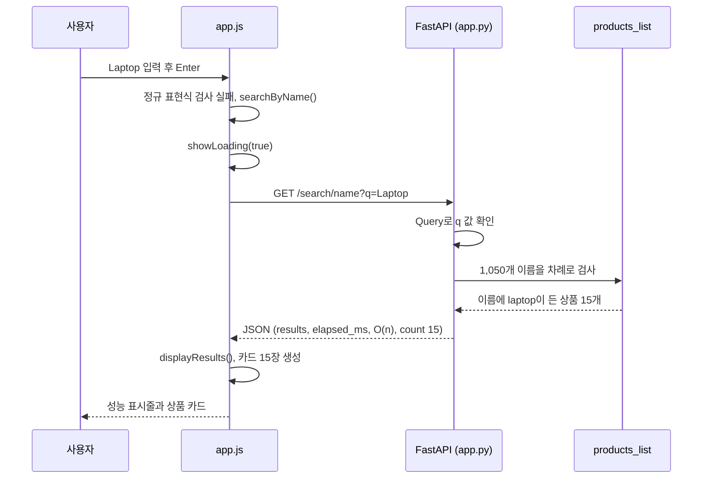

# HW1 코드 총정리 — 미니 쇼핑몰 상품 검색

[레포지토리 안내](../../README.ko.md) | [English](Code-Walkthrough.md) | [한국어](Code-Walkthrough.ko.md)

> **최종 수정일:** 2026-11-16
>
> Introduction to Algorithms, Cormen, Leiserson, Rivest, and Stein, Ch 2, 3, 11

> **학습 목표:**
> 1. `generate_products()`의 각 단계가 상품 목록을 어떻게 바꾸는지 줄 단위로 추적할 수 있다
> 2. FastAPI의 데코레이터, `Query`, `FileResponse`, `StaticFiles`가 요청을 함수와 파일에 연결하는 방식을 설명할 수 있다
> 3. 세 검색 엔드포인트의 반복문과 자료구조 접근을 읽고 각 함수의 시간 복잡도를 말할 수 있다
> 4. `app.js`가 사용자 입력을 요청으로 바꾸고 JSON 응답을 화면 요소로 그리는 과정을 설명할 수 있다
> 5. `locustfile.py`의 `HttpUser`와 `@task`가 가상 사용자의 행동을 정의하는 방식을 설명할 수 있다

---

## 목차

- [1. 파일 구성](#1-파일-구성)
- [2. app.py: 머리 주석과 import](#2-apppy-머리-주석과-import)
- [3. app.py: 분류와 이름 재료](#3-apppy-분류와-이름-재료)
- [4. app.py: 상품 데이터 생성](#4-apppy-상품-데이터-생성)
  - [4.1 함수 머리와 시드](#41-함수-머리와-시드)
  - [4.2 고유 상품 만들기](#42-고유-상품-만들기)
  - [4.3 목표 개수로 자르기](#43-목표-개수로-자르기)
  - [4.4 의도적 중복 넣기](#44-의도적-중복-넣기)
  - [4.5 섞기와 ID 다시 매기기](#45-섞기와-id-다시-매기기)
- [5. app.py: 시작할 때 만드는 자료구조](#5-apppy-시작할-때-만드는-자료구조)
- [6. app.py: FastAPI 앱과 첫 페이지](#6-apppy-fastapi-앱과-첫-페이지)
- [7. app.py: ID 조회 엔드포인트](#7-apppy-id-조회-엔드포인트)
- [8. app.py: 이름 검색 엔드포인트](#8-apppy-이름-검색-엔드포인트)
- [9. app.py: 중복 탐지 엔드포인트](#9-apppy-중복-탐지-엔드포인트)
- [10. app.py: 정적 파일과 직접 실행](#10-apppy-정적-파일과-직접-실행)
- [11. locustfile.py](#11-locustfilepy)
- [12. static/index.html](#12-staticindexhtml)
- [13. static/app.js](#13-staticappjs)
  - [13.1 DOM 참조](#131-dom-참조)
  - [13.2 이벤트 연결](#132-이벤트-연결)
  - [13.3 API 호출](#133-api-호출)
  - [13.4 결과 표시](#134-결과-표시)
- [14. static/style.css](#14-staticstylecss)
- [15. requirements.txt](#15-requirementstxt)
- [16. 요청 흐름 추적](#16-요청-흐름-추적)
- [17. 복잡도](#17-복잡도)
- [요약](#요약)
- [점검 문제](#점검-문제)

---

<br>

## 1. 파일 구성

> **풀어 보기:** 이 문서는 작성한 코드 전체와 줄별 설명을 담고 있다. 먼저 [과제 안내문](Original/Assignment.ko.md)의 문제를 직접 풀어 본 뒤 읽는다.

짝이 되는 문서 [HW1 과제 해설](Assignment-Explanation.ko.md)은 요구사항, 설계, 테스트 결과, 부하 테스트의 분석을 정리한다. 이 문서는 `Solution`의 파일 일곱 개를 처음부터 끝까지 읽는다. 줄 번호는 모두 각 파일 기준이다.

| 파일 | 줄 | 부분 | 역할 |
|:-----|:-----|:-----|:-----|
| `app.py` | 1\~14 | 머리 주석, import | 백엔드 |
| `app.py` | 16\~79 | `CATEGORIES`, `BASE_NAMES`, `ADJECTIVES` | 상품 이름과 가격의 재료 |
| `app.py` | 82\~122 | `generate_products()` | 상품 1,050개 생성 |
| `app.py` | 125\~127 | `products_list`, `products_by_id` | 시작할 때 만드는 자료구조 |
| `app.py` | 129\~140 | `app`, `serve_index()` | FastAPI 앱과 `GET /` |
| `app.py` | 143\~162 | `search_by_id()` | `GET /search/id` |
| `app.py` | 165\~181 | `search_by_name()` | `GET /search/name` |
| `app.py` | 184\~212 | `find_duplicates()` | `GET /search/duplicates` |
| `app.py` | 215\~224 | 정적 파일 마운트, 직접 실행 | 서버 설정 |
| `locustfile.py` | 1\~18 | `ShopUser` | Locust 부하 테스트 |
| `static/index.html` | 1\~61 | 화면 구조 | 프런트엔드 |
| `static/app.js` | 1\~118 | DOM 참조, 이벤트, API 호출, 결과 표시 | 프런트엔드 |
| `static/style.css` | 1\~236 | 변수, 배치, 버튼, 카드, 반응형 | 프런트엔드 |
| `requirements.txt` | 1\~3 | 의존 패키지 | 설치 |

*표 1. 풀이 파일의 구성*

---

<br>

## 2. app.py: 머리 주석과 import

```python
"""
@file    app.py
@brief   FastAPI product search server for complexity analysis lab
@author  Cheolwon Park
@date    2026-03-18
"""

import time
import random
import os

from fastapi import FastAPI, Query
from fastapi.responses import FileResponse
from fastapi.staticfiles import StaticFiles
```

1\~6번 줄은 파일 이름, 설명, 작성자, 날짜를 적은 모듈 docstring이다. 8\~10번 줄은 표준 라이브러리를 불러온다. `time`은 실행 시간을 재는 `perf_counter()`, `random`은 무작위 상품 생성, `os`는 파일 경로 조립에 쓴다. 12\~14번 줄은 FastAPI에서 앱 객체 `FastAPI`와 쿼리 매개변수 선언 `Query`, 파일을 그대로 응답하는 `FileResponse`, 디렉토리를 통째로 제공하는 `StaticFiles`를 불러온다.

---

<br>

## 3. app.py: 분류와 이름 재료

```python
# ---------------------------------------------------------------------------
# Product Data Generation
# ---------------------------------------------------------------------------

CATEGORIES = {
    "Electronics": (50, 2000),
    "Books": (5, 80),
    "Clothing": (10, 300),
    "Home & Kitchen": (15, 500),
    "Sports": (20, 400),
    "Food & Beverages": (3, 50),
    "Toys": (10, 150),
    "Office Supplies": (5, 100),
}

BASE_NAMES = {
    "Electronics": [
        "Laptop", "Wireless Mouse", "Bluetooth Speaker", "USB-C Hub",
        "Mechanical Keyboard", "Monitor Stand", "Webcam", "Headphones",
        "Smartwatch", "Tablet", "Power Bank", "HDMI Cable",
    ],
    "Books": [
        "Python Guide", "Algorithm Textbook", "Data Science Handbook",
        "Machine Learning Intro", "Web Development 101", "AI Ethics",
        "Database Systems", "Operating Systems", "Network Programming",
        "Computer Architecture", "Software Engineering", "Discrete Math",
    ],
    "Clothing": [
        "T-Shirt", "Hoodie", "Jeans", "Sneakers",
        "Jacket", "Cap", "Socks", "Backpack",
        "Sunglasses", "Belt", "Scarf", "Gloves",
    ],
    "Home & Kitchen": [
        "Coffee Maker", "Blender", "Toaster", "Cutting Board",
        "Frying Pan", "Knife Set", "Water Bottle", "Dish Rack",
        "Candle", "Towel Set", "Storage Box", "Apron",
    ],
    "Sports": [
        "Yoga Mat", "Dumbbell", "Running Shoes", "Jump Rope",
        "Resistance Band", "Gym Bag", "Water Bottle", "Fitness Tracker",
        "Tennis Racket", "Basketball", "Cycling Gloves", "Swim Goggles",
    ],
    "Food & Beverages": [
        "Organic Coffee", "Green Tea", "Protein Bar", "Granola",
        "Dark Chocolate", "Olive Oil", "Honey", "Trail Mix",
        "Almond Milk", "Energy Drink", "Dried Fruit", "Peanut Butter",
    ],
    "Toys": [
        "Building Blocks", "Puzzle Set", "Action Figure", "Board Game",
        "Stuffed Animal", "RC Car", "Art Kit", "Card Game",
        "Drone", "Robot Kit", "Science Kit", "Magic Set",
    ],
    "Office Supplies": [
        "Notebook", "Ballpoint Pen", "Desk Lamp", "Sticky Notes",
        "Stapler", "File Folder", "Whiteboard", "Marker Set",
        "Paper Clips", "Tape Dispenser", "Scissors", "Calculator",
    ],
}

ADJECTIVES = [
    "Premium", "Compact", "Pro", "Ultra", "Classic",
    "Deluxe", "Essential", "Advanced", "Budget", "Portable",
    "Modern", "Eco", "Smart", "Mini", "Elite",
]
```

16\~18번 줄은 구역을 나누는 주석이다. 20\~29번 줄의 `CATEGORIES`는 분류 이름을 키로, (최저가, 최고가) 튜플을 값으로 하는 딕셔너리이다. Python 3.7부터 딕셔너리는 넣은 순서를 지키므로, 4.2절의 반복문은 Electronics부터 Office Supplies까지 이 순서대로 분류를 돈다. 이 순서가 4.3절에서 어떤 분류가 잘려 나가는지를 정한다.

| 분류 | 가격 범위 | 상품 목록에 남는가 |
|:-----|:-----|:-----|
| Electronics | 50\~2000 | 180개 모두 남음 |
| Books | 5\~80 | 180개 모두 남음 |
| Clothing | 10\~300 | 180개 모두 남음 |
| Home & Kitchen | 15\~500 | 180개 모두 남음 |
| Sports | 20\~400 | 180개 모두 남음 |
| Food & Beverages | 3\~50 | 앞쪽 100개만 남음 |
| Toys | 10\~150 | 모두 잘림 |
| Office Supplies | 5\~100 | 모두 잘림 |

*표 2. `CATEGORIES`의 분류와 가격 범위*

31\~73번 줄의 `BASE_NAMES`는 분류마다 기본 이름 12개를 담은 리스트이다. Home & Kitchen(50번 줄)과 Sports(55번 줄)에 `"Water Bottle"`이 함께 들어 있어, 같은 형용사를 붙이면 분류만 다른 같은 이름의 상품이 두 개 생긴다. 75\~79번 줄의 `ADJECTIVES`는 기본 이름 앞에 붙일 형용사 15개이다. 기본 이름 96개와 형용사 15개를 조합하면 이름 후보가 1,440개 나온다.

---

<br>

## 4. app.py: 상품 데이터 생성

### 4.1 함수 머리와 시드

```python
def generate_products(target_count: int = 1050, duplicate_count: int = 50) -> list[dict]:
    """Generate product data with intentional duplicates."""
    random.seed(42)
    products: list[dict] = []
    product_id = 1
```

82번 줄은 전체 상품 수 `target_count`(기본값 1,050)와 의도적으로 넣을 중복 수 `duplicate_count`(기본값 50)를 받아 딕셔너리의 리스트를 돌려주는 함수를 선언한다. `list[dict]` 같은 타입 표기는 Python 3.9부터 쓸 수 있다. 84번 줄의 `random.seed(42)`는 난수 생성기의 시드를 고정한다. 이후의 `random.uniform`, `random.choice`, `random.shuffle`이 매번 같은 순서의 난수를 내므로, 서버를 다시 시작해도 같은 상품 목록이 만들어진다. 85\~86번 줄은 빈 결과 리스트와 1부터 시작하는 ID 계수기를 준비한다.

### 4.2 고유 상품 만들기

```python
    # Phase 1 — generate unique products
    for category, (min_price, max_price) in CATEGORIES.items():
        names = BASE_NAMES[category]
        for base_name in names:
            for adj in ADJECTIVES:
                full_name = f"{adj} {base_name}"
                products.append({
                    "id": product_id,
                    "name": full_name,
                    "category": category,
                    "price": round(random.uniform(min_price, max_price), 2),
                })
                product_id += 1
```

89번 줄은 분류마다 이름과 가격 범위를 꺼내고(튜플을 `(min_price, max_price)`로 풀어 받는다), 91번 줄과 92번 줄은 그 분류의 기본 이름 12개와 형용사 15개를 차례로 돈다. 93번 줄의 f-string은 `"Premium Laptop"`처럼 형용사와 기본 이름을 공백으로 잇는다. 94\~99번 줄은 ID, 이름, 분류, 가격을 담은 딕셔너리를 리스트에 붙이는데, 가격은 98번 줄에서 범위 안의 실수를 고르게 뽑아 소수 둘째 자리로 반올림한다. 100번 줄이 ID를 하나씩 올리므로 이 단계가 끝나면 상품 1,440개에 ID 1\~1,440이 붙고, 형용사가 가장 안쪽 반복문이어서 같은 기본 이름의 상품 15개가 연달아 놓인다.

### 4.3 목표 개수로 자르기

```python
    # Trim to target size (minus room for duplicates)
    if len(products) > target_count - duplicate_count:
        products = products[: target_count - duplicate_count]
```

103번 줄은 상품이 1,050 − 50 = 1,000개보다 많은지 확인하고, 104번 줄은 슬라이스로 앞의 1,000개만 남긴다. 상품이 분류 순서대로 놓여 있으므로 앞의 다섯 분류 900개와 Food & Beverages의 앞쪽 100개(기본 이름 `"Organic Coffee"`부터 `"Olive Oil"`까지의 90개와 `"Honey"`의 10개)가 남고, Toys와 Office Supplies는 사라진다. 이 시점의 `product_id`는 1,441이다.

### 4.4 의도적 중복 넣기

```python
    # Phase 2 — insert deliberate duplicates (same name, different id/price)
    for _ in range(duplicate_count):
        original = random.choice(products[: len(products) // 2])
        products.append({
            "id": product_id,
            "name": original["name"],           # same name → duplicate
            "category": original["category"],
            "price": round(original["price"] * random.uniform(0.8, 1.2), 2),
        })
        product_id += 1
```

107번 줄의 반복문은 50번 돈다. 반복 변수를 쓰지 않으므로 이름을 `_`로 둔다. 108번 줄은 리스트의 앞쪽 절반에서 원본 상품을 하나 무작위로 고른다. 리스트가 아직 섞이지 않았고 새 중복은 뒤에 붙으므로 이 구간은 인덱스 0부터 약 520까지의 원래 상품이며, Electronics, Books와 Clothing의 일부만 들어 있다. 109\~114번 줄은 원본과 이름, 분류가 같고 가격은 원본의 0.8\~1.2배로 바꾼 상품을 새 ID로 붙인다. 시드 42에서는 50번 가운데 `"Premium Hoodie"`가 두 번 뽑혀 이 이름의 상품이 3개가 된다.

### 4.5 섞기와 ID 다시 매기기

```python
    # Shuffle and reassign sequential IDs
    random.shuffle(products)
    for idx, p in enumerate(products):
        p["id"] = idx + 1

    return products
```

118번 줄의 `random.shuffle()`은 리스트를 제자리에서 무작위로 섞는다. 섞지 않으면 같은 기본 이름의 상품이 연달아 있고 중복이 모두 끝에 몰려 있어, 데이터가 실제 쇼핑몰의 목록과 거리가 멀다. 119\~120번 줄은 섞인 순서대로 ID를 1부터 다시 붙여, ID가 1\~1,050의 빈틈없는 정수가 되게 한다. 122번 줄은 완성한 리스트를 돌려준다.

---

<br>

## 5. app.py: 시작할 때 만드는 자료구조

```python
# Build data structures at startup
products_list: list[dict] = generate_products()
products_by_id: dict[int, dict] = {p["id"]: p for p in products_list}
```

126번 줄과 127번 줄은 모듈 수준에 있으므로, 서버가 `app.py`를 불러올 때 한 번만 실행된다. 126번 줄은 상품 1,050개의 리스트를 만들고, 127번 줄은 딕셔너리 컴프리헨션으로 ID를 키, 상품 딕셔너리를 값으로 하는 해시 테이블을 만든다. 127번 줄은 4.5절에서 ID를 다시 매긴 뒤에 실행되므로 키와 상품의 `"id"` 값이 일치한다. 두 자료구조의 값은 같은 딕셔너리 객체를 가리키며, 상품 데이터를 복사하지 않는다.

---

<br>

## 6. app.py: FastAPI 앱과 첫 페이지

```python
# ---------------------------------------------------------------------------
# FastAPI Application
# ---------------------------------------------------------------------------

app = FastAPI(title="Mini Shopping Mall")


@app.get("/")
def serve_index():
    """Serve the frontend page."""
    html_path = os.path.join(os.path.dirname(__file__), "static", "index.html")
    return FileResponse(html_path)
```

133번 줄은 FastAPI 앱 객체를 만든다. `title`은 FastAPI가 자동으로 만드는 API 문서(`/docs`)의 제목이 된다. 136번 줄의 `@app.get("/")` 데코레이터는 `GET /` 요청을 바로 아래 함수에 연결한다. 139번 줄은 `__file__`(이 `app.py`의 경로)에서 디렉토리를 구해 `static/index.html`의 경로를 만들므로, 서버를 어느 디렉토리에서 실행하든 같은 파일을 찾는다. 140번 줄의 `FileResponse`는 그 HTML 파일을 그대로 응답으로 보낸다.

---

<br>

## 7. app.py: ID 조회 엔드포인트

```python
@app.get("/search/id")
def search_by_id(id: int = Query(..., description="Product ID")):
    """O(1) lookup by product ID using dict."""
    start = time.perf_counter()
    result = products_by_id.get(id)
    elapsed_ms = (time.perf_counter() - start) * 1000

    if result:
        return {
            "results": [result],
            "elapsed_ms": round(elapsed_ms, 4),
            "algorithm": "O(1)",
            "count": 1,
        }
    return {
        "results": [],
        "elapsed_ms": round(elapsed_ms, 4),
        "algorithm": "O(1)",
        "count": 0,
    }
```

143번 줄은 `GET /search/id`를 이 함수에 연결한다. 144번 줄에서 매개변수 이름 `id`가 쿼리 문자열의 `?id=42`와 짝을 이루고, 타입 표기 `int`에 따라 FastAPI가 문자열 `"42"`를 정수 42로 바꾼다. `Query(...)`의 첫 인자 `...`(Ellipsis)는 기본값이 없는 필수 매개변수라는 뜻이어서, `id`가 없거나 정수로 바꿀 수 없으면 FastAPI가 함수를 부르지 않고 422 응답을 보낸다. `description`은 API 문서에 나오는 설명이다.

146번 줄과 148번 줄 사이에 있는 147번 줄 한 줄만이 측정 구간이다. `products_by_id.get(id)`는 키가 있으면 상품을, 없으면 `None`을 돌려준다. 150번 줄의 `if result:`는 상품 딕셔너리(비어 있지 않으므로 참)와 `None`(거짓)을 구분한다. 151\~156번 줄과 157\~162번 줄은 결과 유무에 따라 `results`와 `count`만 다르고 나머지 키는 같은 응답을 돌려준다. FastAPI는 돌려준 딕셔너리를 JSON으로 바꾸어 보낸다.

---

<br>

## 8. app.py: 이름 검색 엔드포인트

```python
@app.get("/search/name")
def search_by_name(q: str = Query(..., description="Search keyword")):
    """O(n) linear scan — search products by name substring."""
    start = time.perf_counter()
    q_lower = q.lower()
    results = []
    for product in products_list:
        if q_lower in product["name"].lower():
            results.append(product)
    elapsed_ms = (time.perf_counter() - start) * 1000

    return {
        "results": results,
        "elapsed_ms": round(elapsed_ms, 4),
        "algorithm": "O(n)",
        "count": len(results),
    }
```

166번 줄의 `q`는 필수 문자열 쿼리 매개변수이다. 169번 줄은 반복문에 들어가기 전에 검색어를 한 번만 소문자로 바꾼다. 171\~173번 줄은 상품 1,050개를 모두 돌며 이름을 소문자로 바꾸고, 검색어가 그 이름의 부분 문자열이면 결과에 붙인다. Python의 `in` 연산자는 문자열에 쓰면 부분 문자열 포함 여부를 검사한다. 측정 구간(168\~174번 줄)에는 검색어 변환과 반복문이 모두 들어 있다. 176\~181번 줄은 결과 목록과 그 길이를 `count`로 돌려준다.

반복문 안의 `product["name"].lower()`는 요청이 올 때마다 1,050개 이름의 소문자 사본을 새로 만든다. 소문자 이름을 미리 저장해 두면 이 비용을 줄일 수 있지만, 상품마다 일정한 일이 하나씩 늘 뿐이어서 O(n)이라는 복잡도는 같다.

---

<br>

## 9. app.py: 중복 탐지 엔드포인트

```python
@app.get("/search/duplicates")
def find_duplicates():
    """O(n^2) duplicate detection using nested loops."""
    start = time.perf_counter()
    duplicates = []
    seen_ids: set[int] = set()
    n = len(products_list)
    comparisons = 0

    for i in range(n):
        for j in range(i + 1, n):
            comparisons += 1
            if products_list[i]["name"] == products_list[j]["name"]:
                if products_list[i]["id"] not in seen_ids:
                    duplicates.append(products_list[i])
                    seen_ids.add(products_list[i]["id"])
                if products_list[j]["id"] not in seen_ids:
                    duplicates.append(products_list[j])
                    seen_ids.add(products_list[j]["id"])

    elapsed_ms = (time.perf_counter() - start) * 1000

    return {
        "results": duplicates,
        "elapsed_ms": round(elapsed_ms, 4),
        "algorithm": "O(n\u00b2)",
        "count": len(duplicates),
        "comparisons": comparisons,
    }
```

185번 줄의 함수는 매개변수가 없다. 188\~191번 줄은 결과 리스트, 이미 결과에 넣은 상품의 ID를 기록하는 집합 `seen_ids`, 상품 수 `n`, 비교 횟수 계수기를 준비한다. 193번 줄과 194번 줄의 이중 반복문은 i < j인 모든 쌍 (i, j)를 한 번씩 만들고, 195번 줄이 쌍마다 계수기를 올린다. 196번 줄에서 두 상품의 이름이 같으면 197\~199번 줄이 i번째 상품을, 200\~202번 줄이 j번째 상품을 각각 아직 결과에 없을 때만 결과에 넣는다.

`seen_ids`가 없으면 같은 이름의 상품이 3개일 때 쌍 3개에서 각 상품이 두 번씩 결과에 들어간다. ID는 상품마다 다르므로 ID로 확인하면 같은 상품의 중복만 걸러지고, 이름이 같은 다른 상품은 모두 남는다. 결과의 순서는 이중 반복문에서 처음 짝을 찾은 순서여서, 같은 이름의 상품이 대체로 이웃하여 나온다(첫 결과는 ID 7과 ID 276의 `"Essential Water Bottle"`이다). 209번 줄의 `"O(n\u00b2)"`는 유니코드 이스케이프로 위첨자 2(`²`)를 쓴 문자열이며, 응답의 JSON에는 `"O(n²)"`로 나간다. 다른 엔드포인트와 달리 211번 줄에서 비교 횟수 `comparisons`(n = 1,050에서 550,725)를 함께 돌려준다.

---

<br>

## 10. app.py: 정적 파일과 직접 실행

```python
# Mount static files AFTER route definitions
app.mount("/static", StaticFiles(directory=os.path.join(os.path.dirname(__file__), "static")), name="static")

# ---------------------------------------------------------------------------
# Run with: python app.py
# ---------------------------------------------------------------------------

if __name__ == "__main__":
    import uvicorn
    uvicorn.run("app:app", host="0.0.0.0", port=8000, reload=True)
```

216번 줄은 `static` 디렉토리를 `/static` 경로에 붙여(mount), `/static/style.css`와 `/static/app.js` 같은 요청에 그 디렉토리의 파일을 돌려주게 한다. FastAPI(Starlette)는 경로를 등록한 순서대로 맞추어 보므로, 마운트를 `/` 같은 넓은 경로에 먼저 등록하면 뒤의 라우트가 가려질 수 있다. 여기서는 마운트 경로가 `/static`이어서 순서가 결과를 바꾸지 않지만, 215번 줄의 주석처럼 라우트를 먼저 정의하고 마운트를 뒤에 두는 것이 안전한 습관이다.

222번 줄의 조건은 `python app.py`로 파일을 직접 실행할 때만 참이다. 223번 줄은 그때만 uvicorn을 불러오고, 224번 줄은 `"app:app"`(모듈 `app`의 변수 `app`)을 모든 네트워크 인터페이스(`0.0.0.0`)의 8000번 포트에서 실행한다. `reload=True`는 코드가 바뀌면 서버를 자동으로 다시 시작하는 개발용 옵션이며, 이 옵션을 쓰려면 앱을 객체가 아니라 이처럼 문자열로 넘겨야 한다. 문자열의 모듈 이름은 현재 디렉토리를 기준으로 찾으므로 `Solution` 디렉토리에서 실행해야 한다.

---

<br>

## 11. locustfile.py

```python
"""
@file    locustfile.py
@brief   Locust load testing script for product search API
@author  Cheolwon Park
@date    2026-03-18
"""

from locust import HttpUser, task
class ShopUser(HttpUser):
    @task
    def search_by_id(self):
        self.client.get("/search/id?id=42")
    @task
    def search_by_name(self):
        self.client.get("/search/name?q=laptop")
    @task
    def find_duplicates(self):
        self.client.get("/search/duplicates")
```

1\~6번 줄은 모듈 docstring이다. 8번 줄은 HTTP 요청을 보내는 가상 사용자의 기반 클래스 `HttpUser`와 작업 표시 데코레이터 `task`를 불러온다. 9번 줄의 `ShopUser`는 `HttpUser`를 상속하며, Locust는 지정한 사용자 수만큼 이 클래스의 인스턴스를 만들어 동시에 실행한다. `self.client`는 `--host`로 준 주소를 기준으로 요청을 보내고 응답 시간을 기록하는 HTTP 클라이언트이다.

10\~18번 줄의 세 메서드는 `@task`로 표시되어 있다. 가중치를 주지 않은 `@task`의 가중치는 1이므로, 각 사용자는 작업을 고를 때마다 세 메서드 중 하나를 같은 확률로 고른다. 요청은 고정된 주소로 간다. ID 조회는 항상 ID 42(`"Pro Python Guide"`), 이름 검색은 항상 `laptop`(결과 15개)이다. 클래스에 `wait_time`이 없으므로 Locust의 기본값인 대기 시간 0이 적용되어, 각 사용자는 응답을 받자마자 다음 작업을 실행한다.

---

<br>

## 12. static/index.html

```html
<!DOCTYPE html>
<html lang="en">
<head>
    <meta charset="UTF-8">
    <meta name="viewport" content="width=device-width, initial-scale=1.0">
    <title>Mini Shopping Mall</title>
    <link rel="stylesheet" href="/static/style.css">
</head>
<body>
    <header>
        <h1>Mini Shopping Mall</h1>
        <p>Algorithm Complexity Comparison &mdash; O(1) vs O(n) vs O(n&sup2;)</p>
    </header>

    <main>
        <!-- Search Section -->
        <section class="search-section">
            <input
                type="text"
                id="searchInput"
                placeholder="Enter product name or ID..."
                autocomplete="off"
            >
            <div class="button-group">
                <button id="searchIdBtn" class="btn btn-green">Search by ID &mdash; O(1)</button>
                <button id="searchNameBtn" class="btn btn-blue">Search by Name &mdash; O(n)</button>
                <button id="findDuplicatesBtn" class="btn btn-red">Find Duplicates &mdash; O(n&sup2;)</button>
            </div>
        </section>

        <!-- Performance Bar -->
        <section class="performance-bar" id="performanceBar">
            <div class="perf-item">
                <span class="perf-label">Algorithm</span>
                <span class="perf-value" id="algoLabel">-</span>
            </div>
            <div class="perf-item">
                <span class="perf-label">Execution Time</span>
                <span class="perf-value" id="timeLabel">- ms</span>
            </div>
            <div class="perf-item">
                <span class="perf-label">Results Found</span>
                <span class="perf-value" id="countLabel">-</span>
            </div>
        </section>

        <!-- Loading Indicator -->
        <div class="loading" id="loading">Searching...</div>

        <!-- Results Grid -->
        <section class="results-grid" id="resultsGrid"></section>

        <!-- Empty State -->
        <div class="empty-state" id="emptyState">
            <p>Search for products using the buttons above.</p>
        </div>
    </main>

    <script src="/static/app.js"></script>
</body>
</html>
```

3\~8번 줄의 `head`는 문자 인코딩, 모바일 화면 폭에 맞춘 배율, 탭 제목을 정하고, 7번 줄에서 10절의 마운트를 거쳐 `/static/style.css`를 불러온다. 10\~13번 줄의 머리글에서 `&mdash;`와 `&sup2;`는 각각 긴 대시와 위첨자 2를 나타내는 HTML 문자 참조이다. 본문의 각 요소와 `app.js`가 쓰는 `id`는 다음과 같다.

| 줄 | 요소 | `id` | 하는 일 |
|:-----|:-----|:-----|:-----|
| 17\~29 | 검색 영역 | `searchInput`, `searchIdBtn`, `searchNameBtn`, `findDuplicatesBtn` | 검색어 입력과 세 검색 버튼 |
| 32\~45 | 성능 표시줄 | `performanceBar`, `algoLabel`, `timeLabel`, `countLabel` | 알고리즘, 실행 시간, 결과 수 표시 (처음에는 숨김) |
| 48 | 로딩 문구 | `loading` | 요청 중에 "Searching..." 표시 (처음에는 숨김) |
| 51 | 결과 격자 | `resultsGrid` | 상품 카드를 붙이는 빈 컨테이너 |
| 54\~56 | 빈 상태 안내 | `emptyState` | 첫 안내, 결과 없음, 오류 메시지 표시 |

*표 3. `index.html` 본문의 요소*

59번 줄은 `body`의 맨 끝에서 `app.js`를 불러온다. 스크립트가 실행될 때는 위의 요소가 모두 만들어져 있으므로, `app.js`의 `document.getElementById()`가 요소를 바로 찾을 수 있다.

```text
┌──────────────────────────────────────────────┐
│ Mini Shopping Mall (header)                  │
├──────────────────────────────────────────────┤
│ [ searchInput                              ] │
│ [Search by ID] [Search by Name] [Find Dups]  │  search-section
├──────────────────────────────────────────────┤
│  Algorithm   Execution Time   Results Found  │  performance-bar
├──────────────────────────────────────────────┤
│ ┌────────┐ ┌────────┐ ┌────────┐ ┌────────┐  │
│ │ card   │ │ card   │ │ card   │ │ card   │  │  results-grid
│ └────────┘ └────────┘ └────────┘ └────────┘  │
└──────────────────────────────────────────────┘
```

*그림 1. 화면의 위에서 아래로 놓인 영역*

---

<br>

## 13. static/app.js

### 13.1 DOM 참조

```javascript
// ===== DOM References =====
const searchInput = document.getElementById("searchInput");
const searchIdBtn = document.getElementById("searchIdBtn");
const searchNameBtn = document.getElementById("searchNameBtn");
const findDuplicatesBtn = document.getElementById("findDuplicatesBtn");
const performanceBar = document.getElementById("performanceBar");
const algoLabel = document.getElementById("algoLabel");
const timeLabel = document.getElementById("timeLabel");
const countLabel = document.getElementById("countLabel");
const resultsGrid = document.getElementById("resultsGrid");
const loading = document.getElementById("loading");
const emptyState = document.getElementById("emptyState");
```

2\~12번 줄은 표 3의 요소 11개를 `id`로 찾아 상수에 담는다. 요소를 한 번만 찾아 두고 이후의 함수가 이 상수를 다시 쓰므로, 검색할 때마다 문서를 다시 뒤지지 않는다.

### 13.2 이벤트 연결

```javascript
// ===== Event Listeners =====
searchIdBtn.addEventListener("click", searchById);
searchNameBtn.addEventListener("click", searchByName);
findDuplicatesBtn.addEventListener("click", findDuplicates);

searchInput.addEventListener("keypress", (e) => {
    if (e.key === "Enter") {
        const value = searchInput.value.trim();
        if (/^\d+$/.test(value)) {
            searchById();
        } else {
            searchByName();
        }
    }
});
```

15\~17번 줄은 세 버튼의 클릭에 각각의 검색 함수를 연결한다. 19\~28번 줄은 입력창에서 키를 누를 때마다 실행되는 처리 함수로, Enter 키일 때만 동작한다. 21번 줄은 입력의 앞뒤 공백을 지우고, 22번 줄의 정규 표현식 `/^\d+$/`는 문자열 전체(`^`부터 `$`까지)가 숫자(`\d`) 하나 이상으로만 이루어졌는지 검사한다. `42`는 ID 조회로, `laptop`이나 `USB-C`는 이름 검색으로 간다. 빈 입력은 정규 표현식을 통과하지 못해 `searchByName()`으로 가지만, 그 함수가 빈 입력에서 바로 돌아간다.

### 13.3 API 호출

```javascript
// ===== API Calls =====
async function searchById() {
    const id = searchInput.value.trim();
    if (!id) return;
    await fetchAndDisplay(`/search/id?id=${encodeURIComponent(id)}`);
}

async function searchByName() {
    const q = searchInput.value.trim();
    if (!q) return;
    await fetchAndDisplay(`/search/name?q=${encodeURIComponent(q)}`);
}

async function findDuplicates() {
    await fetchAndDisplay("/search/duplicates");
}

async function fetchAndDisplay(url) {
    showLoading(true);
    try {
        const response = await fetch(url);
        if (!response.ok) {
            throw new Error(`Server error: ${response.status}`);
        }
        const data = await response.json();
        displayResults(data);
    } catch (err) {
        showLoading(false);
        resultsGrid.innerHTML = "";
        performanceBar.classList.remove("visible");
        emptyState.classList.remove("hidden");
        emptyState.querySelector("p").textContent = "Error: " + err.message;
    }
}
```

31\~41번 줄의 두 검색 함수는 입력이 비어 있으면 아무것도 하지 않고(33번 줄, 39번 줄), 그렇지 않으면 `encodeURIComponent()`로 입력을 URL에 안전한 형태로 바꾸어 주소를 만든다. 예를 들어 `Home & Kitchen`의 `&`가 그대로 들어가면 쿼리 매개변수의 구분자로 읽히므로 `%26`으로 바꾸어야 한다. 43\~45번 줄의 중복 탐지는 입력이 필요 없다. 세 함수 모두 `fetchAndDisplay()`에 주소를 넘긴다.

47\~63번 줄의 `fetchAndDisplay()`는 `async` 함수여서 `await`로 응답을 기다리는 동안 화면이 멈추지 않는다. 48번 줄에서 로딩 문구를 보이고, 50번 줄에서 요청을 보낸다. 51\~53번 줄은 상태 코드가 200번대가 아니면 예외를 던진다. 예를 들어 입력창에 `abc`를 넣고 "Search by ID" 버튼을 누르면 서버가 422로 응답하여 이 예외가 생긴다. 54\~55번 줄은 응답 본문을 JSON으로 읽어 화면에 그린다. 56\~62번 줄은 서버 오류와 네트워크 오류를 모두 받아 결과와 성능 표시줄을 지우고, 빈 상태 안내 자리에 `"Error: Server error: 422"` 같은 메시지를 보인다.

### 13.4 결과 표시

```javascript
// ===== Display =====
function showLoading(visible) {
    loading.classList.toggle("visible", visible);
    if (visible) {
        resultsGrid.innerHTML = "";
        performanceBar.classList.remove("visible");
        emptyState.classList.add("hidden");
    }
}

function displayResults(data) {
    showLoading(false);

    // Update performance bar
    algoLabel.textContent = data.algorithm;
    timeLabel.textContent = data.elapsed_ms.toFixed(4) + " ms";
    countLabel.textContent = data.count;
    performanceBar.classList.add("visible");

    // Render product cards
    resultsGrid.innerHTML = "";

    if (data.results.length === 0) {
        emptyState.classList.remove("hidden");
        emptyState.querySelector("p").textContent = "No products found.";
        return;
    }

    emptyState.classList.add("hidden");

    data.results.forEach((product) => {
        resultsGrid.appendChild(createProductCard(product));
    });
}

function createProductCard(product) {
    const card = document.createElement("div");
    card.className = "product-card";

    card.innerHTML = `
        <div class="card-id">ID: ${product.id}</div>
        <div class="card-name">${escapeHtml(product.name)}</div>
        <span class="card-category">${escapeHtml(product.category)}</span>
        <div class="card-price">$${product.price.toFixed(2)}</div>
    `;

    return card;
}

function escapeHtml(text) {
    const div = document.createElement("div");
    div.textContent = text;
    return div.innerHTML;
}
```

66\~73번 줄의 `showLoading()`은 `classList.toggle("visible", visible)`로 로딩 문구의 `visible` 클래스를 켜거나 끈다. 로딩을 시작할 때는 이전 결과, 성능 표시줄, 빈 상태 안내를 모두 지워 화면에 이전 검색의 결과가 남지 않게 한다. 요소를 보이고 숨기는 일은 모두 CSS 클래스로 하며, 실제 표시 방식은 14절의 `.visible`과 `.hidden` 규칙이 정한다.

75\~98번 줄의 `displayResults()`는 로딩을 끄고(76번 줄), 79\~82번 줄에서 성능 표시줄에 서버가 준 `algorithm`, `elapsed_ms`(소수 넷째 자리까지), `count`를 쓴 뒤 표시줄을 보인다. 87\~91번 줄은 결과가 없으면 "No products found."를 보이고 끝낸다. 결과가 있으면 95\~97번 줄이 상품마다 카드를 만들어 격자에 붙인다.

100\~112번 줄의 `createProductCard()`는 `div`를 만들고 템플릿 리터럴로 카드의 HTML을 채운다. 108번 줄의 `$${...}`에서 앞의 `$`는 화면에 그대로 나오는 달러 기호이고, 뒤의 `${...}`가 값을 끼워 넣는 자리이다. 이름과 분류는 114\~118번 줄의 `escapeHtml()`을 거친다. 이 함수는 임시 `div`의 `textContent`에 문자열을 넣은 뒤 `innerHTML`로 다시 읽어, `<`, `>`, `&` 같은 문자를 `&lt;`, `&gt;`, `&amp;`로 바꾼다. `Home & Kitchen`의 `&`가 HTML 문자 참조의 시작으로 잘못 읽히지 않고, 상품 이름에 스크립트가 들어 있어도 실행되지 않는다. ID와 가격은 숫자이므로 그대로 넣는다.

---

<br>

## 14. static/style.css

`style.css`는 236줄로, 화면의 모양만 정하고 알고리즘과는 관계가 없다. 블록별 역할은 다음과 같다.

| 줄 | 선택자 | 역할 |
|:-----|:-----|:-----|
| 1\~14 | `:root` | 배경, 글자, 버튼 색, 모서리 반경, 그림자를 CSS 변수로 정의 |
| 16\~31 | `*`, `body` | 기본 여백 제거, `box-sizing: border-box`, 글꼴, 배경색 |
| 33\~48 | `header`, `header h1`, `header p` | 가운데 정렬 머리글과 부제의 글자 크기 |
| 50\~55 | `main` | 최대 폭 1200px로 가운데 배치 |
| 57\~110 | `.search-section`, `#searchInput`, `.button-group`, `.btn` 등 | 흰 검색 상자, 포커스 시 테두리 색, 가로로 늘어나는 버튼, 초록, 파랑, 빨강 버튼 색 |
| 112\~146 | `.performance-bar`, `.perf-item`, `.perf-label`, `.perf-value` | 기본은 `display: none`, `.visible`이면 `display: flex`로 세 항목을 나란히 표시 |
| 148\~159 | `.loading`, `.loading.visible` | 기본은 숨기고 `.visible`일 때만 표시 |
| 161\~166 | `.results-grid` | `repeat(auto-fill, minmax(260px, 1fr))`로 화면 폭에 맞춰 열 수가 바뀌는 격자 |
| 168\~209 | `.product-card`와 하위 클래스 | 카드의 그림자, 마우스를 올리면 살짝 떠오르는 효과, ID, 이름, 분류 배지, 가격의 글자 모양 |
| 211\~221 | `.empty-state`, `.empty-state.hidden` | 안내 문구, `.hidden`이면 숨김 |
| 223\~236 | `@media (max-width: 640px)` | 좁은 화면에서 제목을 줄이고 버튼을 세로로 쌓음 |

*표 4. `style.css`의 블록*

`app.js`가 붙이고 떼는 클래스는 `visible`(성능 표시줄, 로딩 문구)과 `hidden`(빈 상태 안내) 두 가지이며, 각각 112\~127번 줄, 148\~159번 줄, 211\~221번 줄이 그 클래스일 때의 표시 방식을 정한다.

---

<br>

## 15. requirements.txt

```text
fastapi>=0.100.0
uvicorn[standard]>=0.23.0
locust>=2.20.0
```

1번 줄은 웹 프레임워크, 2번 줄은 ASGI 서버(`[standard]`는 성능 향상용 부가 패키지를 함께 설치한다), 3번 줄은 부하 테스트 도구이다. 안내문의 요구대로 `locust`가 들어 있다. `>=`는 최소 버전만 정하므로 설치하는 시점의 최신 버전이 설치될 수 있다.

---

<br>

## 16. 요청 흐름 추적

검색창에 `Laptop`을 넣고 Enter 키를 눌렀을 때 일어나는 일을 차례로 따라가면 다음과 같다.



*그림 2. "Laptop" 이름 검색의 요청 흐름*

1. 22번 줄(`app.js`)의 정규 표현식이 `Laptop`을 숫자로 보지 않으므로 25번 줄의 `searchByName()`이 실행된다.
2. 40번 줄이 주소 `/search/name?q=Laptop`을 만들고, 48번 줄이 로딩 문구를 보인 뒤 50번 줄이 요청을 보낸다.
3. 서버에서는 165번 줄(`app.py`)의 라우트가 요청을 받고, 166번 줄의 `Query`가 `q`를 문자열 `"Laptop"`으로 넘긴다.
4. 169번 줄이 `q_lower = "laptop"`을 만들고, 171\~173번 줄이 상품 1,050개를 모두 검사하여 이름에 `laptop`이 들어 있는 15개(ID 84 `"Premium Laptop"`부터 ID 822 `"Budget Laptop"`까지)를 모은다.
5. 176\~181번 줄이 `count` 15와 측정한 `elapsed_ms`를 담아 응답하고, FastAPI가 JSON으로 바꾼다.
6. `app.js`의 55번 줄이 `displayResults()`를 부르고, 79\~82번 줄이 성능 표시줄을, 95\~97번 줄이 카드 15장을 그린다.

---

<br>

## 17. 복잡도

상품 수는 n, 상품 이름의 최대 길이는 L, 결과 수는 r로 나타낸다.

| 부분 | 줄 | 시간 복잡도 | 근거 |
|:-----|:-----|:-----|:-----|
| `generate_products()` | `app.py` 82\~122 | O(K + dn) | 후보 K = 1,440개 생성과 자르기 O(K), 중복 d = 50개마다 앞쪽 절반을 슬라이스로 복사 O(n), 섞기와 ID 매기기 O(n) |
| `products_by_id` 생성 | `app.py` 127 | O(n) | 상품마다 딕셔너리 삽입 한 번(평균 O(1)) |
| `search_by_id()` | `app.py` 143\~162 | 평균 O(1) | 해시 테이블 조회 한 번 |
| `search_by_name()` | `app.py` 165\~181 | O(nL) = O(n) | 상품마다 소문자 변환과 부분 문자열 검사, L은 작은 상수 |
| `find_duplicates()` | `app.py` 184\~212 | Θ(n²) | 이름 비교 n(n − 1)/2번, 일찍 끝내는 조건 없음 |
| `displayResults()` | `app.js` 75\~98 | O(r) | 결과마다 카드 하나 생성 |

*표 5. 각 부분의 시간 복잡도*

데이터 생성과 딕셔너리 생성은 서버를 시작할 때 한 번만 실행되므로, 요청 하나의 비용은 세 검색 함수의 복잡도가 결정한다. 공간은 상품 리스트와 딕셔너리가 O(n)이고, 중복 탐지의 `seen_ids`와 결과 리스트도 최대 O(n)이다.

---

<br>

## 요약

| 개념 | 핵심 요약 |
|:-----|:-----|
| 데이터 재료 | `CATEGORIES`의 순서, 기본 이름 96개, 형용사 15개가 후보 1,440개를 만들고, 순서 때문에 뒤의 두 분류가 잘려 나간다. |
| `generate_products()` | 시드 42 고정, 고유 상품 생성, 1,000개로 자르기, 앞쪽 절반에서 중복 50개 추가, 섞고 ID를 1\~1,050으로 다시 매기는 다섯 단계로 이루어진다. |
| 시작 시 자료구조 | 모듈 수준의 두 줄이 서버를 불러올 때 한 번 실행되어, 같은 상품 객체를 가리키는 리스트와 ID 딕셔너리를 만든다. |
| FastAPI 라우트 | 데코레이터가 경로를 함수에 연결하고, `Query(...)`가 필수 쿼리 매개변수의 존재와 타입을 검사하여 실패하면 422로 응답한다. |
| 세 검색 함수 | `perf_counter()` 사이의 알고리즘만 재며, 딕셔너리 조회 한 번, 반복문 하나, 이중 반복문으로 각각 O(1), O(n), Θ(n²)이다. |
| 정적 파일과 실행 | `/static` 마운트가 CSS와 JS를 제공하고, `python app.py`는 `Solution` 디렉토리에서 uvicorn을 자동 재시작 모드로 띄운다. |
| `app.js` | 입력을 정규 표현식으로 분기하고, `fetchAndDisplay()` 하나로 요청과 오류를 처리하며, `escapeHtml()`로 이름을 안전하게 카드에 넣는다. |
| `locustfile.py` | 가중치가 같은 세 `@task`를 대기 시간 없이 반복하는 `ShopUser`를 정의한다. |

---

<br>

## 점검 문제

1. **ID의 범위:** `generate_products()`가 끝났을 때 상품의 ID는 어떤 값들이며, 4.2절이 끝났을 때의 ID와는 어떻게 다른가?

   <details>
   <summary>정답</summary>

   1부터 1,050까지 빈틈없는 정수이다. 4.2절이 끝났을 때는 1\~1,440이 분류 순서대로 붙어 있었지만, 4.3절에서 1,001번부터가 잘리고 4.4절의 중복이 1,441\~1,490을 받은 뒤, 4.5절에서 섞인 순서대로 1부터 다시 매겨진다.

   </details>

2. **`seen_ids`의 역할:** 196번 줄의 조건이 참일 때 `seen_ids` 확인 없이 두 상품을 바로 결과에 넣으면, `"Premium Hoodie"` 상품 3개는 결과에 몇 번 들어가는가?

   <details>
   <summary>정답</summary>

   6번이다. 상품 3개로 쌍이 3개 만들어지고, 쌍마다 두 상품을 넣으므로 각 상품이 두 번씩 들어간다. `seen_ids`가 있으면 각 상품은 한 번씩, 모두 3번만 들어간다.

   </details>

3. **422 응답:** 입력창에 `abc`를 넣고 "Search by ID" 버튼을 누르면 화면에 무엇이 나타나는가?

   <details>
   <summary>정답</summary>

   `searchById()`는 입력이 비어 있지 않으므로 `/search/id?id=abc`를 요청한다. FastAPI는 `abc`를 정수로 바꿀 수 없어 422로 응답하고, `fetchAndDisplay()`의 52번 줄이 예외를 던져 빈 상태 안내 자리에 "Error: Server error: 422"가 나타난다.

   </details>

4. **이스케이프:** `createProductCard()`가 `escapeHtml()` 없이 `${product.category}`를 그대로 넣으면 `Home & Kitchen`은 어떻게 처리되며, 어떤 위험이 생기는가?

   <details>
   <summary>정답</summary>

   이 경우 `&` 뒤에 공백이 있어 브라우저가 대부분 그대로 보여 주지만, `&` 뒤에 `amp;` 같은 문자열이 오면 문자 참조로 해석되어 글자가 바뀐다. 더 큰 위험은 이름에 `<script>`나 이벤트 속성이 있는 태그가 들어 있을 때 그것이 HTML로 해석되어 실행될 수 있다는 점이다. `escapeHtml()`은 이런 문자를 문자 참조로 바꾸어 글자 그대로 보이게 한다.

   </details>
