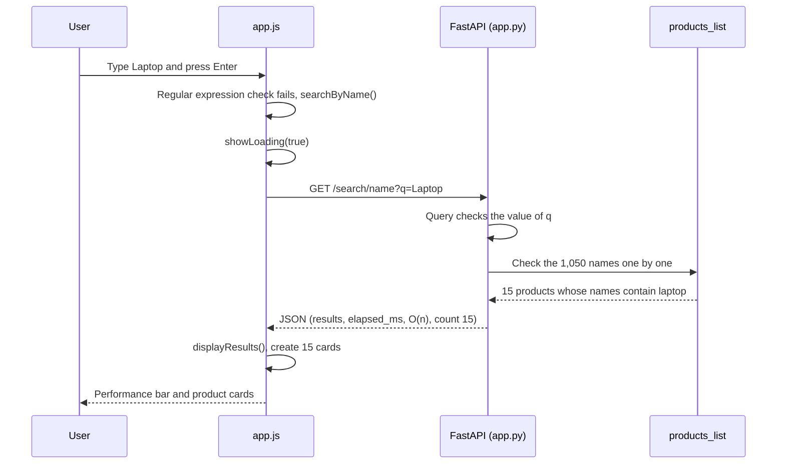

# HW1 Code Walkthrough — Mini Shopping Mall Product Search

[Repository Guide](../../README.md) | [English](Code-Walkthrough.md) | [한국어](Code-Walkthrough.ko.md)

> **Last Updated:** 2026-11-18
>
> Introduction to Algorithms, Cormen, Leiserson, Rivest, and Stein, Ch 2, 3, 11

> **Learning Objectives:**
> 1. Trace line by line how each step of `generate_products()` changes the product list
> 2. Explain how FastAPI decorators, `Query`, `FileResponse`, and `StaticFiles` connect requests to functions and files
> 3. Read the loops and data structure accesses of the three search endpoints and state the time complexity of each function
> 4. Explain how `app.js` turns user input into requests and draws JSON responses as page elements
> 5. Explain how `HttpUser` and `@task` in `locustfile.py` define the behavior of virtual users

---

## Table of Contents

- [1. File Structure](#1-file-structure)
- [2. app.py: Header Comment and Imports](#2-apppy-header-comment-and-imports)
- [3. app.py: Categories and Name Ingredients](#3-apppy-categories-and-name-ingredients)
- [4. app.py: Product Data Generation](#4-apppy-product-data-generation)
  - [4.1 Function Header and Seed](#41-function-header-and-seed)
  - [4.2 Creating Unique Products](#42-creating-unique-products)
  - [4.3 Trimming to the Target Count](#43-trimming-to-the-target-count)
  - [4.4 Inserting Intentional Duplicates](#44-inserting-intentional-duplicates)
  - [4.5 Shuffling and Reassigning IDs](#45-shuffling-and-reassigning-ids)
- [5. app.py: Data Structures Built at Startup](#5-apppy-data-structures-built-at-startup)
- [6. app.py: FastAPI App and the Front Page](#6-apppy-fastapi-app-and-the-front-page)
- [7. app.py: ID Lookup Endpoint](#7-apppy-id-lookup-endpoint)
- [8. app.py: Name Search Endpoint](#8-apppy-name-search-endpoint)
- [9. app.py: Duplicate Detection Endpoint](#9-apppy-duplicate-detection-endpoint)
- [10. app.py: Static Files and Direct Execution](#10-apppy-static-files-and-direct-execution)
- [11. locustfile.py](#11-locustfilepy)
- [12. static/index.html](#12-staticindexhtml)
- [13. static/app.js](#13-staticappjs)
  - [13.1 DOM References](#131-dom-references)
  - [13.2 Event Listeners](#132-event-listeners)
  - [13.3 API Calls](#133-api-calls)
  - [13.4 Displaying Results](#134-displaying-results)
- [14. static/style.css](#14-staticstylecss)
- [15. requirements.txt](#15-requirementstxt)
- [16. Tracing a Request](#16-tracing-a-request)
- [17. Complexity](#17-complexity)
- [Summary](#summary)
- [Self-Check Questions](#self-check-questions)

---

<br>

## 1. File Structure

> **Try It First:** This document contains the complete code and line-by-line explanations. Solve the problems in the [assignment handout](Original/Assignment.md) yourself before reading on.

The companion document, the [HW1 assignment explanation](Assignment-Explanation.md), covers the requirements, design, test results, and the analysis of the load test. This document reads the seven files of `Solution` from beginning to end. All line numbers refer to each file.

| File | Lines | Part | Role |
|:-----|:-----|:-----|:-----|
| `app.py` | 1-14 | Header comment, imports | Backend |
| `app.py` | 16-79 | `CATEGORIES`, `BASE_NAMES`, `ADJECTIVES` | Ingredients for product names and prices |
| `app.py` | 82-122 | `generate_products()` | Creates 1,050 products |
| `app.py` | 125-127 | `products_list`, `products_by_id` | Data structures built at startup |
| `app.py` | 129-140 | `app`, `serve_index()` | FastAPI app and `GET /` |
| `app.py` | 143-162 | `search_by_id()` | `GET /search/id` |
| `app.py` | 165-181 | `search_by_name()` | `GET /search/name` |
| `app.py` | 184-212 | `find_duplicates()` | `GET /search/duplicates` |
| `app.py` | 215-224 | Static file mount, direct execution | Server setup |
| `locustfile.py` | 1-18 | `ShopUser` | Locust load test |
| `static/index.html` | 1-61 | Page structure | Frontend |
| `static/app.js` | 1-118 | DOM references, events, API calls, result display | Frontend |
| `static/style.css` | 1-236 | Variables, layout, buttons, cards, responsive rules | Frontend |
| `requirements.txt` | 1-3 | Dependencies | Installation |

*Table 1. Structure of the solution files*

---

<br>

## 2. app.py: Header Comment and Imports

```python
"""
@file    app.py
@brief   FastAPI product search server for complexity analysis lab
@author  Cheolwon Park
@date    2026-03-18
"""

import time
import random
import os

from fastapi import FastAPI, Query
from fastapi.responses import FileResponse
from fastapi.staticfiles import StaticFiles
```

Lines 1-6 are the module docstring with the file name, description, author, and date. Lines 8-10 import standard library modules: `time` for `perf_counter()`, which measures execution time, `random` for generating random products, and `os` for building file paths. Lines 12-14 import from FastAPI the app class `FastAPI`, the query parameter declaration `Query`, `FileResponse`, which sends a file as the response, and `StaticFiles`, which serves a whole directory.

---

<br>

## 3. app.py: Categories and Name Ingredients

```python
# ---------------------------------------------------------------------------
# Product Data Generation
# ---------------------------------------------------------------------------

CATEGORIES = {
    "Electronics": (50, 2000),
    "Books": (5, 80),
    "Clothing": (10, 300),
    "Home & Kitchen": (15, 500),
    "Sports": (20, 400),
    "Food & Beverages": (3, 50),
    "Toys": (10, 150),
    "Office Supplies": (5, 100),
}

BASE_NAMES = {
    "Electronics": [
        "Laptop", "Wireless Mouse", "Bluetooth Speaker", "USB-C Hub",
        "Mechanical Keyboard", "Monitor Stand", "Webcam", "Headphones",
        "Smartwatch", "Tablet", "Power Bank", "HDMI Cable",
    ],
    "Books": [
        "Python Guide", "Algorithm Textbook", "Data Science Handbook",
        "Machine Learning Intro", "Web Development 101", "AI Ethics",
        "Database Systems", "Operating Systems", "Network Programming",
        "Computer Architecture", "Software Engineering", "Discrete Math",
    ],
    "Clothing": [
        "T-Shirt", "Hoodie", "Jeans", "Sneakers",
        "Jacket", "Cap", "Socks", "Backpack",
        "Sunglasses", "Belt", "Scarf", "Gloves",
    ],
    "Home & Kitchen": [
        "Coffee Maker", "Blender", "Toaster", "Cutting Board",
        "Frying Pan", "Knife Set", "Water Bottle", "Dish Rack",
        "Candle", "Towel Set", "Storage Box", "Apron",
    ],
    "Sports": [
        "Yoga Mat", "Dumbbell", "Running Shoes", "Jump Rope",
        "Resistance Band", "Gym Bag", "Water Bottle", "Fitness Tracker",
        "Tennis Racket", "Basketball", "Cycling Gloves", "Swim Goggles",
    ],
    "Food & Beverages": [
        "Organic Coffee", "Green Tea", "Protein Bar", "Granola",
        "Dark Chocolate", "Olive Oil", "Honey", "Trail Mix",
        "Almond Milk", "Energy Drink", "Dried Fruit", "Peanut Butter",
    ],
    "Toys": [
        "Building Blocks", "Puzzle Set", "Action Figure", "Board Game",
        "Stuffed Animal", "RC Car", "Art Kit", "Card Game",
        "Drone", "Robot Kit", "Science Kit", "Magic Set",
    ],
    "Office Supplies": [
        "Notebook", "Ballpoint Pen", "Desk Lamp", "Sticky Notes",
        "Stapler", "File Folder", "Whiteboard", "Marker Set",
        "Paper Clips", "Tape Dispenser", "Scissors", "Calculator",
    ],
}

ADJECTIVES = [
    "Premium", "Compact", "Pro", "Ultra", "Classic",
    "Deluxe", "Essential", "Advanced", "Budget", "Portable",
    "Modern", "Eco", "Smart", "Mini", "Elite",
]
```

Lines 16-18 are a comment that marks a section. `CATEGORIES` on lines 20-29 is a dictionary with category names as keys and (minimum price, maximum price) tuples as values. Since Python 3.7, dictionaries keep insertion order, so the loop of Section 4.2 visits the categories in this order, from Electronics to Office Supplies. This order determines which categories are cut off in Section 4.3.

| Category | Price range | Remains in the product list |
|:-----|:-----|:-----|
| Electronics | 50-2000 | All 180 remain |
| Books | 5-80 | All 180 remain |
| Clothing | 10-300 | All 180 remain |
| Home & Kitchen | 15-500 | All 180 remain |
| Sports | 20-400 | All 180 remain |
| Food & Beverages | 3-50 | Only the first 100 remain |
| Toys | 10-150 | All cut off |
| Office Supplies | 5-100 | All cut off |

*Table 2. Categories and price ranges in `CATEGORIES`*

`BASE_NAMES` on lines 31-73 holds a list of 12 base names for each category. `"Water Bottle"` appears in both Home & Kitchen (line 50) and Sports (line 55), so the same adjective produces two products with the same name that differ only in category. `ADJECTIVES` on lines 75-79 holds the 15 adjectives placed in front of the base names. Combining 96 base names with 15 adjectives gives 1,440 name candidates.

---

<br>

## 4. app.py: Product Data Generation

### 4.1 Function Header and Seed

```python
def generate_products(target_count: int = 1050, duplicate_count: int = 50) -> list[dict]:
    """Generate product data with intentional duplicates."""
    random.seed(42)
    products: list[dict] = []
    product_id = 1
```

Line 82 declares a function that takes the total number of products `target_count` (default 1,050) and the number of intentional duplicates `duplicate_count` (default 50) and returns a list of dictionaries. Type hints such as `list[dict]` are available from Python 3.9. `random.seed(42)` on line 84 fixes the seed of the random number generator. The later calls to `random.uniform`, `random.choice`, and `random.shuffle` then produce random numbers in the same order every time, so the same product list is created even when the server restarts. Lines 85-86 prepare an empty result list and an ID counter starting at 1.

### 4.2 Creating Unique Products

```python
    # Phase 1 — generate unique products
    for category, (min_price, max_price) in CATEGORIES.items():
        names = BASE_NAMES[category]
        for base_name in names:
            for adj in ADJECTIVES:
                full_name = f"{adj} {base_name}"
                products.append({
                    "id": product_id,
                    "name": full_name,
                    "category": category,
                    "price": round(random.uniform(min_price, max_price), 2),
                })
                product_id += 1
```

Line 89 takes the name and price range of each category (unpacking the tuple into `(min_price, max_price)`), and lines 91 and 92 loop over the 12 base names of that category and the 15 adjectives in turn. The f-string on line 93 joins an adjective and a base name with a space, as in `"Premium Laptop"`. Lines 94-99 append a dictionary with ID, name, category, and price to the list, and the price on line 98 is a real number drawn uniformly from the range and rounded to two decimal places. Line 100 increments the ID each time, so when this step ends the 1,440 products carry IDs 1-1,440, and because the adjectives form the innermost loop, the 15 products with the same base name lie next to each other.

### 4.3 Trimming to the Target Count

```python
    # Trim to target size (minus room for duplicates)
    if len(products) > target_count - duplicate_count:
        products = products[: target_count - duplicate_count]
```

Line 103 checks whether there are more than 1,050 − 50 = 1,000 products, and line 104 keeps only the first 1,000 with a slice. Since the products are in category order, the 900 products of the first five categories and the first 100 of Food & Beverages (90 from the base names `"Organic Coffee"` to `"Olive Oil"` and 10 of `"Honey"`) remain, and Toys and Office Supplies disappear. At this point `product_id` is 1,441.

### 4.4 Inserting Intentional Duplicates

```python
    # Phase 2 — insert deliberate duplicates (same name, different id/price)
    for _ in range(duplicate_count):
        original = random.choice(products[: len(products) // 2])
        products.append({
            "id": product_id,
            "name": original["name"],           # same name → duplicate
            "category": original["category"],
            "price": round(original["price"] * random.uniform(0.8, 1.2), 2),
        })
        product_id += 1
```

The loop on line 107 runs 50 times. The loop variable is not used, so it is named `_`. Line 108 picks one original product at random from the first half of the list. The list has not been shuffled yet and new duplicates are appended at the end, so this range consists of original products from index 0 up to about 520, which contain only Electronics, Books, and part of Clothing. Lines 109-114 append, with a new ID, a product that has the same name and category as the original and a price of 0.8-1.2 times the original price. With seed 42, `"Premium Hoodie"` is picked twice among the 50 draws, so this name ends up with 3 products.

### 4.5 Shuffling and Reassigning IDs

```python
    # Shuffle and reassign sequential IDs
    random.shuffle(products)
    for idx, p in enumerate(products):
        p["id"] = idx + 1

    return products
```

`random.shuffle()` on line 118 shuffles the list in place. Without shuffling, products with the same base name would sit next to each other and all duplicates would be bunched at the end, which is far from the listing of a real shopping mall. Lines 119-120 reassign the IDs from 1 in the shuffled order so that the IDs are the gapless integers 1-1,050. Line 122 returns the finished list.

---

<br>

## 5. app.py: Data Structures Built at Startup

```python
# Build data structures at startup
products_list: list[dict] = generate_products()
products_by_id: dict[int, dict] = {p["id"]: p for p in products_list}
```

Lines 126 and 127 are at module level, so they run only once, when the server imports `app.py`. Line 126 creates the list of 1,050 products, and line 127 uses a dictionary comprehension to build a hash table with IDs as keys and product dictionaries as values. Line 127 runs after the IDs are reassigned in Section 4.5, so the keys agree with the `"id"` values of the products. The values of both data structures refer to the same dictionary objects, and the product data is not copied.

---

<br>

## 6. app.py: FastAPI App and the Front Page

```python
# ---------------------------------------------------------------------------
# FastAPI Application
# ---------------------------------------------------------------------------

app = FastAPI(title="Mini Shopping Mall")


@app.get("/")
def serve_index():
    """Serve the frontend page."""
    html_path = os.path.join(os.path.dirname(__file__), "static", "index.html")
    return FileResponse(html_path)
```

Line 133 creates the FastAPI app object. `title` becomes the title of the API documentation (`/docs`) that FastAPI generates automatically. The `@app.get("/")` decorator on line 136 connects `GET /` requests to the function right below it. Line 139 takes the directory of `__file__` (the path of this `app.py`) to build the path of `static/index.html`, so the same file is found no matter which directory the server runs from. `FileResponse` on line 140 sends that HTML file as the response as it is.

---

<br>

## 7. app.py: ID Lookup Endpoint

```python
@app.get("/search/id")
def search_by_id(id: int = Query(..., description="Product ID")):
    """O(1) lookup by product ID using dict."""
    start = time.perf_counter()
    result = products_by_id.get(id)
    elapsed_ms = (time.perf_counter() - start) * 1000

    if result:
        return {
            "results": [result],
            "elapsed_ms": round(elapsed_ms, 4),
            "algorithm": "O(1)",
            "count": 1,
        }
    return {
        "results": [],
        "elapsed_ms": round(elapsed_ms, 4),
        "algorithm": "O(1)",
        "count": 0,
    }
```

Line 143 connects `GET /search/id` to this function. On line 144 the parameter name `id` pairs with `?id=42` in the query string, and following the type hint `int`, FastAPI converts the string `"42"` to the integer 42. The first argument `...` (Ellipsis) of `Query(...)` means a required parameter with no default, so if `id` is missing or cannot be converted to an integer, FastAPI sends a 422 response without calling the function. `description` is the text shown in the API documentation.

Only line 147, between lines 146 and 148, is inside the measured interval. `products_by_id.get(id)` returns the product if the key exists and `None` otherwise. `if result:` on line 150 distinguishes a product dictionary (true, since it is not empty) from `None` (false). Lines 151-156 and lines 157-162 return responses that differ only in `results` and `count` depending on whether a result exists, with the other keys the same. FastAPI converts the returned dictionary to JSON and sends it.

---

<br>

## 8. app.py: Name Search Endpoint

```python
@app.get("/search/name")
def search_by_name(q: str = Query(..., description="Search keyword")):
    """O(n) linear scan — search products by name substring."""
    start = time.perf_counter()
    q_lower = q.lower()
    results = []
    for product in products_list:
        if q_lower in product["name"].lower():
            results.append(product)
    elapsed_ms = (time.perf_counter() - start) * 1000

    return {
        "results": results,
        "elapsed_ms": round(elapsed_ms, 4),
        "algorithm": "O(n)",
        "count": len(results),
    }
```

`q` on line 166 is a required string query parameter. Line 169 lowercases the keyword only once, before entering the loop. Lines 171-173 visit all 1,050 products, lowercase each name, and append the product to the result if the keyword is a substring of that name. Applied to strings, Python's `in` operator checks whether one string contains another. The measured interval (lines 168-174) includes both the keyword conversion and the loop. Lines 176-181 return the result list and its length as `count`.

`product["name"].lower()` inside the loop creates fresh lowercase copies of the 1,050 names on every request. Storing lowercase names in advance would save this cost, but it only adds a constant amount of work per product, so the complexity remains O(n).

---

<br>

## 9. app.py: Duplicate Detection Endpoint

```python
@app.get("/search/duplicates")
def find_duplicates():
    """O(n^2) duplicate detection using nested loops."""
    start = time.perf_counter()
    duplicates = []
    seen_ids: set[int] = set()
    n = len(products_list)
    comparisons = 0

    for i in range(n):
        for j in range(i + 1, n):
            comparisons += 1
            if products_list[i]["name"] == products_list[j]["name"]:
                if products_list[i]["id"] not in seen_ids:
                    duplicates.append(products_list[i])
                    seen_ids.add(products_list[i]["id"])
                if products_list[j]["id"] not in seen_ids:
                    duplicates.append(products_list[j])
                    seen_ids.add(products_list[j]["id"])

    elapsed_ms = (time.perf_counter() - start) * 1000

    return {
        "results": duplicates,
        "elapsed_ms": round(elapsed_ms, 4),
        "algorithm": "O(n\u00b2)",
        "count": len(duplicates),
        "comparisons": comparisons,
    }
```

The function on line 185 has no parameters. Lines 188-191 prepare the result list, a set `seen_ids` that records the IDs of products already in the result, the number of products `n`, and a comparison counter. The double loop on lines 193 and 194 produces every pair (i, j) with i < j exactly once, and line 195 increments the counter for each pair. If the two names are equal on line 196, lines 197-199 add the i-th product and lines 200-202 add the j-th product to the result, each only if it is not in the result yet.

Without `seen_ids`, when 3 products share a name, each product would enter the result twice through the 3 pairs. IDs differ for every product, so checking by ID filters out only repeats of the same product and keeps every distinct product with the same name. The result is ordered by when the double loop first finds a match, so products with the same name mostly come out next to each other (the first results are the two `"Essential Water Bottle"` products with IDs 7 and 276). `"O(n\u00b2)"` on line 209 is a string that writes the superscript 2 (`²`) with a Unicode escape, and it goes out in the JSON response as `"O(n²)"`. Unlike the other endpoints, line 211 also returns the number of comparisons `comparisons` (550,725 for n = 1,050).

---

<br>

## 10. app.py: Static Files and Direct Execution

```python
# Mount static files AFTER route definitions
app.mount("/static", StaticFiles(directory=os.path.join(os.path.dirname(__file__), "static")), name="static")

# ---------------------------------------------------------------------------
# Run with: python app.py
# ---------------------------------------------------------------------------

if __name__ == "__main__":
    import uvicorn
    uvicorn.run("app:app", host="0.0.0.0", port=8000, reload=True)
```

Line 216 attaches (mounts) the `static` directory at the path `/static`, so that requests such as `/static/style.css` and `/static/app.js` get the files of that directory. FastAPI (Starlette) matches paths in the order they were registered, so registering a mount at a broad path such as `/` first could hide the routes after it. Here the mount path is `/static`, so the order does not change the result, but defining the routes first and the mount afterward, as the comment on line 215 says, is a safe habit.

The condition on line 222 is true only when the file is run directly with `python app.py`. Only then does line 223 import uvicorn, and line 224 runs `"app:app"` (the variable `app` of the module `app`) on port 8000 of all network interfaces (`0.0.0.0`). `reload=True` is a development option that restarts the server automatically when the code changes, and to use it the app must be passed as a string like this rather than as an object. The module name in the string is looked up relative to the current directory, so the command must be run in the `Solution` directory.

---

<br>

## 11. locustfile.py

```python
"""
@file    locustfile.py
@brief   Locust load testing script for product search API
@author  Cheolwon Park
@date    2026-03-18
"""

from locust import HttpUser, task
class ShopUser(HttpUser):
    @task
    def search_by_id(self):
        self.client.get("/search/id?id=42")
    @task
    def search_by_name(self):
        self.client.get("/search/name?q=laptop")
    @task
    def find_duplicates(self):
        self.client.get("/search/duplicates")
```

Lines 1-6 are the module docstring. Line 8 imports `HttpUser`, the base class of virtual users that send HTTP requests, and `task`, the decorator that marks tasks. `ShopUser` on line 9 inherits from `HttpUser`, and Locust creates as many instances of this class as the specified number of users and runs them concurrently. `self.client` is an HTTP client that sends requests relative to the address given with `--host` and records response times.

The three methods on lines 10-18 are marked with `@task`. A `@task` without a weight has weight 1, so each user picks one of the three methods with equal probability every time it chooses a task. The requests go to fixed addresses: ID lookup always asks for ID 42 (`"Pro Python Guide"`), and name search always searches for `laptop` (15 results). The class has no `wait_time`, so Locust's default wait of 0 applies and each user runs the next task as soon as it receives a response.

---

<br>

## 12. static/index.html

```html
<!DOCTYPE html>
<html lang="en">
<head>
    <meta charset="UTF-8">
    <meta name="viewport" content="width=device-width, initial-scale=1.0">
    <title>Mini Shopping Mall</title>
    <link rel="stylesheet" href="/static/style.css">
</head>
<body>
    <header>
        <h1>Mini Shopping Mall</h1>
        <p>Algorithm Complexity Comparison &mdash; O(1) vs O(n) vs O(n&sup2;)</p>
    </header>

    <main>
        <!-- Search Section -->
        <section class="search-section">
            <input
                type="text"
                id="searchInput"
                placeholder="Enter product name or ID..."
                autocomplete="off"
            >
            <div class="button-group">
                <button id="searchIdBtn" class="btn btn-green">Search by ID &mdash; O(1)</button>
                <button id="searchNameBtn" class="btn btn-blue">Search by Name &mdash; O(n)</button>
                <button id="findDuplicatesBtn" class="btn btn-red">Find Duplicates &mdash; O(n&sup2;)</button>
            </div>
        </section>

        <!-- Performance Bar -->
        <section class="performance-bar" id="performanceBar">
            <div class="perf-item">
                <span class="perf-label">Algorithm</span>
                <span class="perf-value" id="algoLabel">-</span>
            </div>
            <div class="perf-item">
                <span class="perf-label">Execution Time</span>
                <span class="perf-value" id="timeLabel">- ms</span>
            </div>
            <div class="perf-item">
                <span class="perf-label">Results Found</span>
                <span class="perf-value" id="countLabel">-</span>
            </div>
        </section>

        <!-- Loading Indicator -->
        <div class="loading" id="loading">Searching...</div>

        <!-- Results Grid -->
        <section class="results-grid" id="resultsGrid"></section>

        <!-- Empty State -->
        <div class="empty-state" id="emptyState">
            <p>Search for products using the buttons above.</p>
        </div>
    </main>

    <script src="/static/app.js"></script>
</body>
</html>
```

The `head` on lines 3-8 sets the character encoding, the scale that fits the mobile screen width, and the tab title, and line 7 loads `/static/style.css` through the mount of Section 10. In the header on lines 10-13, `&mdash;` and `&sup2;` are HTML character references for a long dash and a superscript 2. The elements of the body and the `id` values that `app.js` uses are as follows.

| Lines | Element | `id` | Purpose |
|:-----|:-----|:-----|:-----|
| 17-29 | Search area | `searchInput`, `searchIdBtn`, `searchNameBtn`, `findDuplicatesBtn` | Keyword input and the three search buttons |
| 32-45 | Performance bar | `performanceBar`, `algoLabel`, `timeLabel`, `countLabel` | Shows the algorithm, execution time, and number of results (hidden at first) |
| 48 | Loading message | `loading` | Shows "Searching..." during a request (hidden at first) |
| 51 | Result grid | `resultsGrid` | Empty container that receives the product cards |
| 54-56 | Empty state message | `emptyState` | Shows the initial guide, the no-result message, and error messages |

*Table 3. Elements in the body of `index.html`*

Line 59 loads `app.js` at the very end of `body`. When the script runs, all the elements above already exist, so `document.getElementById()` in `app.js` can find them right away.

```text
┌──────────────────────────────────────────────┐
│ Mini Shopping Mall (header)                  │
├──────────────────────────────────────────────┤
│ [ searchInput                              ] │
│ [Search by ID] [Search by Name] [Find Dups]  │  search-section
├──────────────────────────────────────────────┤
│  Algorithm   Execution Time   Results Found  │  performance-bar
├──────────────────────────────────────────────┤
│ ┌────────┐ ┌────────┐ ┌────────┐ ┌────────┐  │
│ │ card   │ │ card   │ │ card   │ │ card   │  │  results-grid
│ └────────┘ └────────┘ └────────┘ └────────┘  │
└──────────────────────────────────────────────┘
```

*Figure 1. Areas of the page from top to bottom*

---

<br>

## 13. static/app.js

### 13.1 DOM References

```javascript
// ===== DOM References =====
const searchInput = document.getElementById("searchInput");
const searchIdBtn = document.getElementById("searchIdBtn");
const searchNameBtn = document.getElementById("searchNameBtn");
const findDuplicatesBtn = document.getElementById("findDuplicatesBtn");
const performanceBar = document.getElementById("performanceBar");
const algoLabel = document.getElementById("algoLabel");
const timeLabel = document.getElementById("timeLabel");
const countLabel = document.getElementById("countLabel");
const resultsGrid = document.getElementById("resultsGrid");
const loading = document.getElementById("loading");
const emptyState = document.getElementById("emptyState");
```

Lines 2-12 find the 11 elements of Table 3 by `id` and store them in constants. The elements are found only once and the later functions reuse these constants, so the document is not searched again on every search.

### 13.2 Event Listeners

```javascript
// ===== Event Listeners =====
searchIdBtn.addEventListener("click", searchById);
searchNameBtn.addEventListener("click", searchByName);
findDuplicatesBtn.addEventListener("click", findDuplicates);

searchInput.addEventListener("keypress", (e) => {
    if (e.key === "Enter") {
        const value = searchInput.value.trim();
        if (/^\d+$/.test(value)) {
            searchById();
        } else {
            searchByName();
        }
    }
});
```

Lines 15-17 attach the corresponding search function to the click of each of the three buttons. Lines 19-28 are a handler that runs every time a key is pressed in the input box, and it acts only on the Enter key. Line 21 removes the leading and trailing spaces of the input, and the regular expression `/^\d+$/` on line 22 checks whether the whole string (from `^` to `$`) consists only of one or more digits (`\d`). `42` goes to ID lookup, while `laptop` or `USB-C` goes to name search. An empty input fails the regular expression and goes to `searchByName()`, but that function returns immediately on empty input.

### 13.3 API Calls

```javascript
// ===== API Calls =====
async function searchById() {
    const id = searchInput.value.trim();
    if (!id) return;
    await fetchAndDisplay(`/search/id?id=${encodeURIComponent(id)}`);
}

async function searchByName() {
    const q = searchInput.value.trim();
    if (!q) return;
    await fetchAndDisplay(`/search/name?q=${encodeURIComponent(q)}`);
}

async function findDuplicates() {
    await fetchAndDisplay("/search/duplicates");
}

async function fetchAndDisplay(url) {
    showLoading(true);
    try {
        const response = await fetch(url);
        if (!response.ok) {
            throw new Error(`Server error: ${response.status}`);
        }
        const data = await response.json();
        displayResults(data);
    } catch (err) {
        showLoading(false);
        resultsGrid.innerHTML = "";
        performanceBar.classList.remove("visible");
        emptyState.classList.remove("hidden");
        emptyState.querySelector("p").textContent = "Error: " + err.message;
    }
}
```

The two search functions on lines 31-41 do nothing if the input is empty (lines 33 and 39), and otherwise build the address after converting the input into a URL-safe form with `encodeURIComponent()`. For example, if the `&` of `Home & Kitchen` went in as it is, it would be read as a separator between query parameters, so it must be converted to `%26`. Duplicate detection on lines 43-45 needs no input. All three functions pass the address to `fetchAndDisplay()`.

`fetchAndDisplay()` on lines 47-63 is an `async` function, so the page does not freeze while `await` waits for the response. Line 48 shows the loading message, and line 50 sends the request. Lines 51-53 throw an exception if the status code is not in the 200s. For example, entering `abc` in the input box and pressing the "Search by ID" button makes the server respond with 422, which raises this exception. Lines 54-55 read the response body as JSON and draw it on the page. Lines 56-62 catch both server errors and network errors, clear the results and the performance bar, and show a message such as `"Error: Server error: 422"` in place of the empty state message.

### 13.4 Displaying Results

```javascript
// ===== Display =====
function showLoading(visible) {
    loading.classList.toggle("visible", visible);
    if (visible) {
        resultsGrid.innerHTML = "";
        performanceBar.classList.remove("visible");
        emptyState.classList.add("hidden");
    }
}

function displayResults(data) {
    showLoading(false);

    // Update performance bar
    algoLabel.textContent = data.algorithm;
    timeLabel.textContent = data.elapsed_ms.toFixed(4) + " ms";
    countLabel.textContent = data.count;
    performanceBar.classList.add("visible");

    // Render product cards
    resultsGrid.innerHTML = "";

    if (data.results.length === 0) {
        emptyState.classList.remove("hidden");
        emptyState.querySelector("p").textContent = "No products found.";
        return;
    }

    emptyState.classList.add("hidden");

    data.results.forEach((product) => {
        resultsGrid.appendChild(createProductCard(product));
    });
}

function createProductCard(product) {
    const card = document.createElement("div");
    card.className = "product-card";

    card.innerHTML = `
        <div class="card-id">ID: ${product.id}</div>
        <div class="card-name">${escapeHtml(product.name)}</div>
        <span class="card-category">${escapeHtml(product.category)}</span>
        <div class="card-price">$${product.price.toFixed(2)}</div>
    `;

    return card;
}

function escapeHtml(text) {
    const div = document.createElement("div");
    div.textContent = text;
    return div.innerHTML;
}
```

`showLoading()` on lines 66-73 turns the `visible` class of the loading message on or off with `classList.toggle("visible", visible)`. When loading starts, it clears the previous results, the performance bar, and the empty state message so that nothing of the previous search remains on the page. Showing and hiding elements is always done with CSS classes, and the actual display is set by the `.visible` and `.hidden` rules of Section 14.

`displayResults()` on lines 75-98 turns off the loading message (line 76), and lines 79-82 write the `algorithm`, `elapsed_ms` (to four decimal places), and `count` given by the server into the performance bar and show the bar. Lines 87-91 show "No products found." and stop if there are no results. Otherwise, lines 95-97 create a card for each product and append it to the grid.

`createProductCard()` on lines 100-112 creates a `div` and fills it with the card HTML using a template literal. In `$${...}` on line 108, the first `$` is a dollar sign shown on the page as it is, and the following `${...}` is the placeholder that inserts the value. The name and the category go through `escapeHtml()` on lines 114-118. This function puts the string into the `textContent` of a temporary `div` and reads it back through `innerHTML`, which converts characters such as `<`, `>`, and `&` into `&lt;`, `&gt;`, and `&amp;`. The `&` of `Home & Kitchen` is then never misread as the start of an HTML character reference, and a script in a product name is never executed. The ID and the price are numbers, so they are inserted as they are.

---

<br>

## 14. static/style.css

`style.css` has 236 lines and only sets the look of the page; it has nothing to do with the algorithms. The role of each block is as follows.

| Lines | Selectors | Role |
|:-----|:-----|:-----|
| 1-14 | `:root` | Defines the background, text, and button colors, corner radius, and shadow as CSS variables |
| 16-31 | `*`, `body` | Removes default margins, sets `box-sizing: border-box`, the font, and the background color |
| 33-48 | `header`, `header h1`, `header p` | Centered header and the font sizes of the title and subtitle |
| 50-55 | `main` | Centers the content with a maximum width of 1200px |
| 57-110 | `.search-section`, `#searchInput`, `.button-group`, `.btn`, and others | White search box, border color on focus, buttons that stretch horizontally, green, blue, and red button colors |
| 112-146 | `.performance-bar`, `.perf-item`, `.perf-label`, `.perf-value` | `display: none` by default and `display: flex` with `.visible`, placing the three items side by side |
| 148-159 | `.loading`, `.loading.visible` | Hidden by default and shown only with `.visible` |
| 161-166 | `.results-grid` | A grid whose number of columns follows the screen width through `repeat(auto-fill, minmax(260px, 1fr))` |
| 168-209 | `.product-card` and its child classes | Card shadow, a slight lift on mouse hover, and the text style of the ID, name, category badge, and price |
| 211-221 | `.empty-state`, `.empty-state.hidden` | Guide text, hidden with `.hidden` |
| 223-236 | `@media (max-width: 640px)` | On narrow screens, shrinks the title and stacks the buttons vertically |

*Table 4. Blocks of `style.css`*

`app.js` adds and removes two classes, `visible` (performance bar, loading message) and `hidden` (empty state message), and lines 112-127, lines 148-159, and lines 211-221 set how the elements look with those classes.

---

<br>

## 15. requirements.txt

```text
fastapi>=0.100.0
uvicorn[standard]>=0.23.0
locust>=2.20.0
```

Line 1 is the web framework, line 2 the ASGI server (`[standard]` also installs extra packages for better performance), and line 3 the load testing tool. As the handout requires, `locust` is included. `>=` sets only a minimum version, so the latest version at installation time may be installed.

---

<br>

## 16. Tracing a Request

The following traces step by step what happens when `Laptop` is entered in the search bar and Enter is pressed.



*Figure 2. Request flow of the name search for "Laptop"*

1. The regular expression on line 22 (`app.js`) does not treat `Laptop` as digits, so `searchByName()` on line 25 runs.
2. Line 40 builds the address `/search/name?q=Laptop`, line 48 shows the loading message, and line 50 sends the request.
3. On the server, the route on line 165 (`app.py`) receives the request, and `Query` on line 166 passes `q` as the string `"Laptop"`.
4. Line 169 creates `q_lower = "laptop"`, and lines 171-173 check all 1,050 products and collect the 15 whose names contain `laptop` (from ID 84 `"Premium Laptop"` to ID 822 `"Budget Laptop"`).
5. Lines 176-181 respond with `count` 15 and the measured `elapsed_ms`, and FastAPI converts the response to JSON.
6. Line 55 of `app.js` calls `displayResults()`, lines 79-82 draw the performance bar, and lines 95-97 draw the 15 cards.

---

<br>

## 17. Complexity

Let n be the number of products, L the maximum length of a product name, and r the number of results.

| Part | Lines | Time complexity | Reason |
|:-----|:-----|:-----|:-----|
| `generate_products()` | `app.py` 82-122 | O(K + dn) | Creating and trimming K = 1,440 candidates is O(K), copying the first half with a slice for each of the d = 50 duplicates is O(n), and shuffling and assigning IDs is O(n) |
| Building `products_by_id` | `app.py` 127 | O(n) | One dictionary insertion per product (O(1) on average) |
| `search_by_id()` | `app.py` 143-162 | O(1) on average | One hash table lookup |
| `search_by_name()` | `app.py` 165-181 | O(nL) = O(n) | Lowercasing and a substring check per product, with L a small constant |
| `find_duplicates()` | `app.py` 184-212 | Θ(n²) | n(n − 1)/2 name comparisons, no early-exit condition |
| `displayResults()` | `app.js` 75-98 | O(r) | One card created per result |

*Table 5. Time complexity of each part*

Data generation and dictionary building run only once at server startup, so the cost of one request is determined by the complexity of the three search functions. In space, the product list and the dictionary take O(n), and the `seen_ids` set and the result list of duplicate detection also take at most O(n).

---

<br>

## Summary

| Concept | Key Summary |
|:-----|:-----|
| Data ingredients | The order of `CATEGORIES`, 96 base names, and 15 adjectives produce 1,440 candidates, and because of the order the last two categories are cut off. |
| `generate_products()` | It consists of five steps: fixing seed 42, creating unique products, trimming to 1,000, adding 50 duplicates from the first half, and shuffling and reassigning IDs 1-1,050. |
| Data structures at startup | Two module-level lines run once when the server imports the module and build a list and an ID dictionary that refer to the same product objects. |
| FastAPI routes | Decorators connect paths to functions, and `Query(...)` checks the presence and type of required query parameters, responding with 422 on failure. |
| The three search functions | They measure only the algorithm between the `perf_counter()` calls and are O(1), O(n), and Θ(n²) through one dictionary lookup, one loop, and a double loop. |
| Static files and execution | The `/static` mount serves the CSS and JS, and `python app.py` starts uvicorn in auto-reload mode from the `Solution` directory. |
| `app.js` | It branches on the input with a regular expression, handles requests and errors through the single function `fetchAndDisplay()`, and puts names into cards safely with `escapeHtml()`. |
| `locustfile.py` | It defines `ShopUser`, which repeats three equally weighted `@task` methods without any wait. |

---

<br>

## Self-Check Questions

1. **Range of IDs:** What values do the product IDs take when `generate_products()` finishes, and how do they differ from the IDs at the end of Section 4.2?

   <details>
   <summary>Answer</summary>

   They are the gapless integers from 1 to 1,050. At the end of Section 4.2, IDs 1-1,440 were attached in category order, but Section 4.3 cuts off everything from 1,001 on, the duplicates of Section 4.4 receive 1,441-1,490, and Section 4.5 renumbers everything from 1 in the shuffled order.

   </details>

2. **Role of `seen_ids`:** If both products were added to the result without checking `seen_ids` whenever the condition on line 196 is true, how many times would the 3 `"Premium Hoodie"` products enter the result?

   <details>
   <summary>Answer</summary>

   6 times. The 3 products form 3 pairs, and each pair adds both of its products, so each product enters twice. With `seen_ids`, each product enters once, 3 times in total.

   </details>

3. **422 response:** What appears on the page if `abc` is entered in the input box and the "Search by ID" button is pressed?

   <details>
   <summary>Answer</summary>

   `searchById()` requests `/search/id?id=abc` because the input is not empty. FastAPI cannot convert `abc` to an integer and responds with 422, and line 52 of `fetchAndDisplay()` throws an exception, so "Error: Server error: 422" appears in place of the empty state message.

   </details>

4. **Escaping:** If `createProductCard()` inserted `${product.category}` directly without `escapeHtml()`, how would `Home & Kitchen` be handled, and what risk would arise?

   <details>
   <summary>Answer</summary>

   In this case the `&` is followed by a space, so most browsers show it as it is, but if the `&` were followed by a string such as `amp;`, it would be interpreted as a character reference and the text would change. The greater risk is that a name containing `<script>` or a tag with an event attribute would be interpreted as HTML and could be executed. `escapeHtml()` turns such characters into character references so that they appear as literal text.

   </details>
