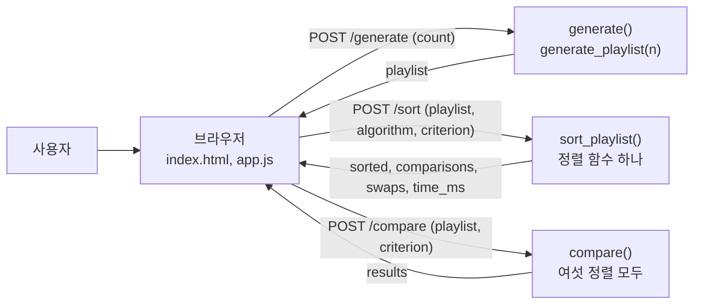
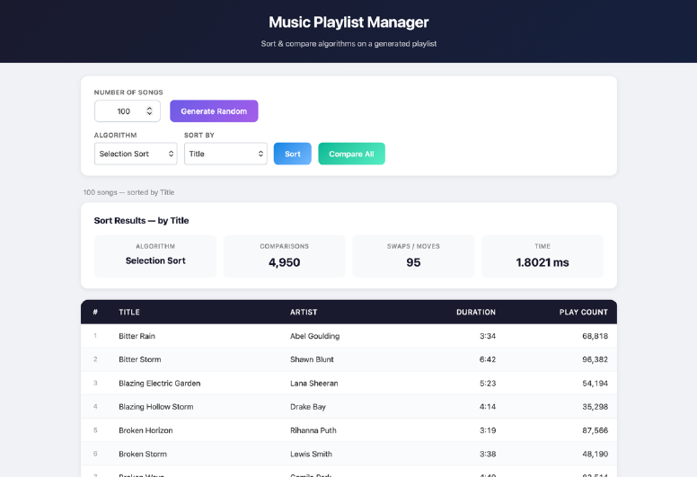

# HW2 과제 해설 — 음악 재생 목록 관리기

[레포지토리 안내](../../README.ko.md) | [English](Assignment-Explanation.md) | [한국어](Assignment-Explanation.ko.md)

> **최종 수정일:** 2026-11-16
>
> Introduction to Algorithms, Cormen, Leiserson, Rivest, and Stein, Ch 2, 6, 7

> **학습 목표:**
> 1. 곡 목록을 사용자가 고른 기준(제목, 아티스트, 재생 시간, 재생 횟수)으로 정렬하도록 키 함수를 설계할 수 있다
> 2. 정렬 알고리즘을 비교 횟수와 교환 및 이동 횟수를 세면서 구현하고, 두 계수기가 알고리즘마다 무엇을 세는지 구분할 수 있다
> 3. 같은 재생 목록에서 여러 정렬 알고리즘을 실행하여 비교 횟수, 교환 및 이동 횟수, 실행 시간을 공정하게 비교할 수 있다
> 4. 입력 크기를 늘려 가며 측정한 값을 O(n²)과 O(n log n)의 이론적 증가율과 대조할 수 있다
> 5. Flask로 생성, 정렬, 비교 API를 제공하고 브라우저에서 결과를 표시하는 웹 앱의 구조를 설명할 수 있다

---

## 목차

- [1. 과제 구성과 실행 방법](#1-과제-구성과-실행-방법)
  - [1.1 과제 개요](#11-과제-개요)
  - [1.2 디렉토리 구성](#12-디렉토리-구성)
  - [1.3 설치와 실행](#13-설치와-실행)
- [2. 요구사항](#2-요구사항)
  - [2.1 정렬 알고리즘과 정렬 기준](#21-정렬-알고리즘과-정렬-기준)
  - [2.2 웹 인터페이스](#22-웹-인터페이스)
  - [2.3 API 엔드포인트](#23-api-엔드포인트)
  - [2.4 보고서와 평가 기준](#24-보고서와-평가-기준)
- [3. 설계](#3-설계)
  - [3.1 전체 구조](#31-전체-구조)
  - [3.2 무작위 재생 목록](#32-무작위-재생-목록)
  - [3.3 정렬 함수의 공통 규약과 키 함수](#33-정렬-함수의-공통-규약과-키-함수)
  - [3.4 계수기가 세는 연산](#34-계수기가-세는-연산)
- [4. 정렬 알고리즘의 구현](#4-정렬-알고리즘의-구현)
  - [4.1 선택 정렬](#41-선택-정렬)
  - [4.2 삽입 정렬](#42-삽입-정렬)
  - [4.3 병합 정렬](#43-병합-정렬)
  - [4.4 버블 정렬](#44-버블-정렬)
  - [4.5 퀵 정렬](#45-퀵-정렬)
  - [4.6 힙 정렬](#46-힙-정렬)
  - [4.7 여섯 정렬의 성질](#47-여섯-정렬의-성질)
- [5. API와 화면](#5-api와-화면)
  - [5.1 재생 목록 생성](#51-재생-목록-생성)
  - [5.2 정렬](#52-정렬)
  - [5.3 전체 비교](#53-전체-비교)
  - [5.4 화면 구성](#54-화면-구성)
- [6. 테스트와 결과](#6-테스트와-결과)
  - [6.1 작은 입력으로 계수기 확인](#61-작은-입력으로-계수기-확인)
  - [6.2 실행 화면](#62-실행-화면)
  - [6.3 크기별 성능 비교](#63-크기별-성능-비교)
  - [6.4 측정값과 이론값의 대조](#64-측정값과-이론값의-대조)
  - [6.5 오류 처리와 경계 상황](#65-오류-처리와-경계-상황)
- [7. 보고서의 분석 질문](#7-보고서의-분석-질문)
  - [7.1 가장 빠른 알고리즘과 그 이유](#71-가장-빠른-알고리즘과-그-이유)
  - [7.2 입력 크기에 따른 증가율](#72-입력-크기에-따른-증가율)
  - [7.3 이차 시간 정렬이 쓸 만한 경우](#73-이차-시간-정렬이-쓸-만한-경우)
- [요약](#요약)
- [점검 문제](#점검-문제)
- [참고 문헌](#참고-문헌)

---

<br>

## 1. 과제 구성과 실행 방법

> **풀어 보기:** 이 문서는 정답과 풀이를 담고 있다. 먼저 [과제 안내문](Original/Assignment.ko.md)의 문제를 직접 풀어 본 뒤 읽는다.

### 1.1 과제 개요

3주차 가정 과제로, 곡 목록을 여러 기준으로 정렬하는 **음악 재생 목록 관리기**(music playlist manager) 웹 앱을 만든다. 서로 다른 정렬 알고리즘으로 재생 목록을 정렬하고, 재생 목록이 커질 때 정렬 성능이 어떻게 달라지는지 비교해야 한다. 백엔드는 Python(FastAPI 또는 Flask), 프런트엔드는 HTML, CSS, JavaScript로 만들며, 소스 코드와 2쪽 이내의 보고서를 제출한다. [3주차 이론](../../Lecture-Notes/Week03_Arrays-Stacks-Queues-and-Basic-Sorting-Algorithms/Concepts_Lecture.ko.md)의 정렬 알고리즘과 이어진다. 문제의 원문은 [과제 안내문](Original/Assignment.ko.md)에 있다.

### 1.2 디렉토리 구성

```text
Coursework/HW02_Arrays-Stacks-Queues-and-Basic-Sorting-Algorithms/
├── Assignment-Explanation.md      # 과제 해설 (영어)
├── Assignment-Explanation.ko.md   # 과제 해설 (한국어, 이 문서)
├── Code-Walkthrough.md            # 코드 총정리 (영어)
├── Code-Walkthrough.ko.md         # 코드 총정리 (한국어)
├── Original/
│   ├── Assignment.md              # 과제 안내문 (영어)
│   └── Assignment.ko.md           # 과제 안내문 (한국어)
└── Solution/
    ├── app.py                     # Flask 백엔드 (곡 생성, 정렬, API)
    ├── requirements.txt           # 의존 패키지 (flask)
    └── static/
        ├── index.html             # 화면 구조
        ├── style.css              # 화면 스타일
        └── app.js                 # API 호출과 결과 표시
```

*그림 1. HW2 과제의 디렉토리 구성*

`Solution/`은 제출한 소스 코드이며, 안내문이 정한 제출 구성(`app.py`, `static/`, `requirements.txt`)을 그대로 따른다.

### 1.3 설치와 실행

```bash
# 레포지토리 루트에서 풀이 디렉토리로 이동
cd Coursework/HW02_Arrays-Stacks-Queues-and-Basic-Sorting-Algorithms/Solution
python3 -m pip install -r requirements.txt
python3 app.py
```

`app.py`를 직접 실행하면 Flask의 개발 서버가 5001번 포트에서 디버그 모드로 뜬다. 브라우저에서 `http://localhost:5001`을 열면 화면이 나타난다. 코드 전체를 파일별로 처음부터 끝까지 읽는 문서는 [HW2 코드 총정리](Code-Walkthrough.ko.md)이다.

---

<br>

## 2. 요구사항

### 2.1 정렬 알고리즘과 정렬 기준

안내문은 다음 세 정렬 알고리즘을 **최소한** 구현하도록 요구한다. 각 정렬은 사용자가 고른 기준인 **제목**, **아티스트**, **재생 시간**, **재생 횟수** 가운데 하나로 재생 목록을 정렬해야 한다.

| 알고리즘 | 최악의 경우 | 구현 위치 (`app.py`) |
|:-----|:-----|:-----|
| 선택 정렬 | O(n²) | 79\~90번 줄 `selection_sort` |
| 삽입 정렬 | O(n²) | 93\~108번 줄 `insertion_sort` |
| 병합 정렬 | O(n log n) | 111\~138번 줄 `merge_sort`, `_merge` |

*표 1. 안내문이 요구하는 정렬 알고리즘과 구현 위치*

풀이는 여기에 버블 정렬(141\~153번 줄), 퀵 정렬(156\~179번 줄), 힙 정렬(182\~208번 줄)을 더해 모두 여섯 정렬을 구현했다. 네 가지 정렬 기준은 225\~235번 줄의 `get_key_function`이 키 함수로 바꾼다.

### 2.2 웹 인터페이스

| 요구 기능 | 구현 위치 |
|:-----|:-----|
| 제목, 아티스트, 재생 시간, 재생 횟수를 보여 주는 재생 목록 표 | `index.html` 63\~83번 줄, `app.js` 39\~68번 줄 `renderPlaylist` |
| N곡짜리 무작위 재생 목록을 만드는 "Generate Random" 버튼 | `index.html` 18\~24번 줄, `app.js` 170\~192번 줄 `generatePlaylist` |
| 정렬 기준과 정렬 알고리즘을 고르는 드롭다운 | `index.html` 26\~46번 줄 |
| 정렬 결과, 비교 횟수, 교환 횟수, 실행 시간을 보여 주는 "Sort" 버튼 | `index.html` 47번 줄, `app.js` 194\~227번 줄 `sortPlaylist`와 79\~110번 줄 `displaySortResults` |
| 모든 알고리즘을 실행하고 비교 표를 보여 주는 "Compare All" 버튼 | `index.html` 48번 줄, `app.js` 229\~254번 줄 `compareAll`과 115\~157번 줄 `displayComparisonTable` |

*표 2. 웹 인터페이스 요구사항과 구현 위치*

### 2.3 API 엔드포인트

| 메서드 | 엔드포인트 | 안내문의 설명 | 구현 위치 (`app.py`) |
|:-----|:-----|:-----|:-----|
| `POST` | `/sort` | 고른 알고리즘과 기준으로 재생 목록을 정렬한다 | 261\~285번 줄 `sort_playlist` |
| `POST` | `/compare` | 모든 알고리즘을 실행하고 비교 데이터를 반환한다 | 288\~311번 줄 `compare` |
| `POST` | `/generate` | N곡의 무작위 재생 목록을 만든다 | 248\~258번 줄 `generate` |
| `GET` | `/` | 프런트엔드 페이지를 제공한다 | 243\~245번 줄 `index` |

*표 3. API 엔드포인트와 구현 위치*

### 2.4 보고서와 평가 기준

보고서는 PDF 한 파일로, 최대 2쪽, 글자 크기 11pt 이상이다. 보고서의 세 항목은 이 문서의 다음 위치에 옮겨 두었다.

| 보고서 항목 | 이 문서의 위치 |
|:-----|:-----|
| 정렬 결과가 보이는 재생 목록 관리기의 화면 캡처 | 6.2절의 그림 4 |
| N = 100, 1000, 5000에서 알고리즘별 비교 횟수, 교환 횟수, 시간을 담은 비교 표 | 6.3절의 표 10 |
| 분석: 가장 빠른 알고리즘과 그 이유, O(n²) 알고리즘이 여전히 쓸 만한 경우 | 7절 |

*표 4. 보고서 항목과 이 문서의 위치*

| 평가 항목 | 비율 |
|:-----|-----:|
| 웹 앱이 실행되고 올바르게 동작한다 | 20% |
| 알고리즘 요구사항을 모두 구현한다 | 40% |
| 보고서 (최대 2쪽, 글자 크기 11 이상) | 40% |

*표 5. 평가 기준*

---

<br>

## 3. 설계

### 3.1 전체 구조

웹 앱은 Flask 서버 하나와 정적 파일 세 개로 이루어진다. 서버는 재생 목록을 저장하지 않는다. 브라우저가 생성된 재생 목록을 `app.js`의 변수 `currentPlaylist`에 들고 있다가, 정렬이나 비교를 요청할 때마다 재생 목록 전체를 JSON으로 보낸다. 서버는 받은 목록을 복사해 정렬하고 결과와 계수기 값을 돌려준다.



*그림 2. 브라우저와 Flask 서버 사이의 요청 흐름*

서버가 상태를 갖지 않으므로 같은 재생 목록을 여러 번 정렬하거나 비교해도 서로 영향을 주지 않는다. 또 "Sort"의 결과는 화면에만 표시되고 `currentPlaylist`에 다시 저장되지 않으므로, 정렬을 여러 번 눌러도 매번 처음 생성된 순서에서 정렬한다(5.4절).

### 3.2 무작위 재생 목록

정렬할 데이터는 서버가 무작위로 만든다. `generate_playlist`는 곡마다 제목, 아티스트, 재생 시간(초), 재생 횟수를 정한다.

```python
def generate_playlist(n):
    """Generate a list of n random songs."""
    playlist = []
    for _ in range(n):
        adj = random.choice(ADJECTIVES)
        noun = random.choice(NOUNS)
        if random.random() < 0.3:
            adj2 = random.choice(ADJECTIVES)
            title = f"{adj} {adj2} {noun}"
        else:
            title = f"{adj} {noun}"

        first = random.choice(FIRST_NAMES)
        last = random.choice(LAST_NAMES)
        artist = f"{first} {last}"

        song = {
            "title": title,
            "artist": artist,
            "duration": random.randint(120, 420),
            "play_count": random.randint(0, 100000),
        }
        playlist.append(song)
    return playlist
```

제목은 형용사 35개(12\~18번 줄)와 명사 35개(20\~26번 줄)로 만든다. 70%의 확률로 "형용사 명사"(1,225가지), 30%의 확률로 형용사를 하나 더 넣은 "형용사 형용사 명사"가 된다. 아티스트는 이름 30개와 성 30개의 조합(900가지)이다. 재생 시간은 120초에서 420초 사이, 재생 횟수는 0에서 100,000 사이의 정수이며, `random.randint`는 양 끝을 포함한다.

> **참고:** 두 단어 제목은 1,225가지뿐이므로 곡이 많아지면 같은 제목이 자주 나온다. 5,000곡을 한 번 만들어 보면 서로 다른 제목은 약 2,600개이다. 재생 시간은 301가지 값밖에 없어 같은 값이 더 흔하다. 같은 키가 많으면 정렬의 **안정성**(stability)이 결과에 드러나고(4.7절), 퀵 정렬의 분할 균형에도 영향을 준다(4.5절).

### 3.3 정렬 함수의 공통 규약과 키 함수

여섯 정렬 함수는 모두 같은 시그니처를 갖는다. 70\~76번 줄의 주석이 이 규약을 밝힌다.

```python
# ---------------------------------------------------------------------------
# Sorting algorithms — each receives (arr, key, stats) where
#   arr  : list of song dicts (mutated in-place for in-place sorts)
#   key  : function  song -> comparable value
#   stats: {"comparisons": 0, "swaps": 0}  (mutated)
# Returns the sorted list.
# ---------------------------------------------------------------------------
```

정렬 함수는 곡 딕셔너리의 리스트 `arr`, 곡에서 비교할 값을 꺼내는 **키 함수**(key function) `key`, 계수기 딕셔너리 `stats`를 받고, 정렬된 리스트를 반환한다. 제자리 정렬은 `arr` 자체를 바꾼 뒤 그것을 반환하고, 병합 정렬은 새 리스트를 반환한다. 키 함수를 인자로 받으므로 정렬 함수는 정렬 기준을 몰라도 된다. 기준을 키 함수로 바꾸는 일은 `get_key_function`이 맡는다.

```python
def get_key_function(criterion):
    if criterion == "title":
        return lambda song: song["title"].lower()
    elif criterion == "artist":
        return lambda song: song["artist"].lower()
    elif criterion == "duration":
        return lambda song: song["duration"]
    elif criterion == "play_count":
        return lambda song: song["play_count"]
    else:
        return lambda song: song["title"].lower()
```

제목과 아티스트는 소문자로 바꾼 문자열을 비교하므로 대소문자를 구분하지 않는 사전순이 되고, 재생 시간과 재생 횟수는 정수를 그대로 비교한다. 알 수 없는 기준은 제목으로 처리한다(234\~235번 줄). 문자열 키는 비교할 때마다 `.lower()`가 새 문자열을 만들기 때문에, 키 함수를 몇 번 부르는지가 실행 시간에 직접 영향을 준다(7.1절).

### 3.4 계수기가 세는 연산

화면과 보고서는 알고리즘마다 **비교 횟수**(comparisons)와 **교환 및 이동 횟수**(swaps / moves)를 보여 준다. 두 계수기는 `stats["comparisons"]`와 `stats["swaps"]`를 1씩 늘리는 문장이 있는 곳에서만 증가하므로, 그 위치가 곧 무엇을 세는지를 정한다.

| 알고리즘 | 비교 횟수를 세는 곳 | 교환 및 이동 횟수를 세는 곳 | 한 번이 뜻하는 일 |
|:-----|:-----|:-----|:-----|
| 선택 정렬 | 최솟값을 찾는 내부 반복의 키 비교마다 (84번 줄) | 실제로 자리를 바꿀 때만 (`min_idx != i`, 89번 줄) | 원소 두 개의 교환 |
| 삽입 정렬 | `while` 반복의 키 비교마다, 반복을 멈추게 한 마지막 비교까지 (100번 줄) | 원소를 오른쪽으로 한 칸 옮길 때마다 (103번 줄) | 원소 한 개의 이동 |
| 병합 정렬 | `_merge`의 첫 `while` 반복의 비교마다 (124번 줄) | 비교 직후 결과에 원소를 하나 붙일 때마다 (131번 줄) | 원소 한 개의 이동 |
| 버블 정렬 | 이웃한 두 원소의 비교마다 (146번 줄) | 이웃한 두 원소를 바꿀 때마다 (149번 줄) | 원소 두 개의 교환 |
| 퀵 정렬 | 분할 반복에서 피벗과의 비교마다 (172번 줄) | 분할 반복 안의 모든 교환 (176번 줄, `i`와 `j`가 같아 자리가 바뀌지 않는 교환 포함)과 마지막 피벗 교환 (178번 줄) | 원소 두 개의 교환 |
| 힙 정렬 | 자식이 있을 때 자식과의 비교마다 (198번, 202번 줄) | 힙 성질을 되살리는 교환 (207번 줄)과 루트를 끝으로 보내는 교환 (188번 줄) | 원소 두 개의 교환 |

*표 6. 정렬 알고리즘별로 두 계수기가 세는 연산*

> **핵심:** "교환 및 이동 횟수"는 알고리즘마다 다른 연산을 센다. 선택, 버블, 퀵, 힙 정렬의 한 번은 원소 두 개를 맞바꾸는 교환이고, 삽입 정렬과 병합 정렬의 한 번은 원소 하나를 옮기는 이동이다. 병합 정렬은 132\~137번 줄에서 남은 원소를 옮기는 일과 슬라이스로 리스트를 복사하는 일을 세지 않으므로, 이 계수기는 항상 비교 횟수와 같다. 따라서 이 열은 알고리즘끼리 견주기보다 한 알고리즘 안에서 입력 크기에 따른 변화를 보는 데 쓰는 것이 알맞다.

삽입 정렬의 이동 횟수와 버블 정렬의 교환 횟수는 같은 재생 목록에서 항상 같다. 이 사실은 역전이라는 개념으로 설명된다.

> **용어 정의:** **역전**(inversion)은 리스트에서 앞에 있는 원소의 키가 뒤에 있는 원소의 키보다 큰 위치 쌍 (i, j), i < j를 말한다. 정렬된 리스트의 역전 수는 0이고, 역순으로 정렬된 리스트의 역전 수는 n(n−1)/2로 최대이다.

버블 정렬이 이웃한 두 원소를 바꾸면 그 두 원소가 이루던 역전 하나만 사라지고 다른 쌍의 순서는 바뀌지 않는다. 삽입 정렬이 원소 하나를 오른쪽으로 옮기는 것도 그 원소와 삽입 중인 원소가 이루던 역전 하나를 없애는 일이다. 두 정렬 모두 역전 수가 0이 될 때 끝나므로, 교환 횟수와 이동 횟수는 모두 처음 재생 목록의 역전 수와 같다. 같은 키를 가진 두 곡은 `>`로 비교하므로 역전으로 세지 않는다.

---

<br>

## 4. 정렬 알고리즘의 구현

여섯 정렬의 방식은 다음과 같다. 이 절의 각 항은 그 정렬이 지키는 규칙을 먼저 밝히고 코드를 보인 뒤 동작과 복잡도를 설명한다.

| 알고리즘 | 최악의 경우 | 유형 | 구현 방식 |
|:-----|:-----|:-----|:-----|
| 선택 정렬 | O(n²) | 제자리 | 정렬되지 않은 부분에서 최솟값을 찾아 앞으로 교환한다 |
| 삽입 정렬 | O(n²) | 제자리 | 원소들을 오른쪽으로 밀어 현재 원소를 제자리에 끼운다 |
| 병합 정렬 | O(n log n) | 제자리 아님 | 재귀적으로 분할 정복하고 병합 단계에서 합친다 |
| 버블 정렬 | O(n²) | 제자리 | 이웃한 원소를 교환하고, 교환이 없으면 일찍 끝낸다 |
| 퀵 정렬 | O(n²) | 제자리 | 마지막 원소를 피벗으로 쓰는 Lomuto 분할 방식이다 |
| 힙 정렬 | O(n log n) | 제자리 | 최대 힙을 만든 뒤 최댓값을 반복해서 꺼낸다 |

*표 7. 구현한 여섯 정렬 알고리즘의 개요*

### 4.1 선택 정렬

**규칙:** i번째 자리에 아직 정렬되지 않은 부분 `arr[i..n−1]`의 최솟값을 놓는다. i를 0부터 n−1까지 늘리면 앞부분이 차례로 정렬된다.

```python
def selection_sort(arr, key, stats):
    n = len(arr)
    for i in range(n):
        min_idx = i
        for j in range(i + 1, n):
            stats["comparisons"] += 1
            if key(arr[j]) < key(arr[min_idx]):
                min_idx = j
        if min_idx != i:
            arr[i], arr[min_idx] = arr[min_idx], arr[i]
            stats["swaps"] += 1
    return arr
```

83\~86번 줄의 내부 반복은 i 다음부터 끝까지 훑으며 가장 작은 키의 위치 `min_idx`를 찾는다. i번째 바깥 반복에서 비교는 n−1−i번이므로, 비교 횟수는 입력의 순서와 관계없이 다음과 같이 정해진다.

$$C_{\text{selection}}(n) = (n-1) + (n-2) + \cdots + 1 + 0 = \frac{n(n-1)}{2}$$

87\~89번 줄은 최솟값이 이미 제자리에 있으면 교환하지 않으므로 교환 횟수는 많아야 n−1이다. 비교 한 번마다 `key(arr[j])`와 `key(arr[min_idx])`를 모두 부르므로 키 함수 호출은 비교 횟수의 두 배이다. 멀리 떨어진 두 원소를 맞바꾸므로 같은 키를 가진 곡의 상대 순서가 바뀔 수 있어 안정 정렬이 아니다. 최선, 평균, 최악이 모두 Θ(n²)이다.

### 4.2 삽입 정렬

**규칙:** 앞부분 `arr[0..i−1]`이 정렬된 상태를 유지하면서 `arr[i]`를 그 안의 알맞은 자리에 끼운다.

```python
def insertion_sort(arr, key, stats):
    n = len(arr)
    for i in range(1, n):
        current = arr[i]
        current_key = key(current)
        j = i - 1
        while j >= 0:
            stats["comparisons"] += 1
            if key(arr[j]) > current_key:
                arr[j + 1] = arr[j]
                stats["swaps"] += 1
                j -= 1
            else:
                break
        arr[j + 1] = current
    return arr
```

96\~97번 줄은 끼울 원소와 그 키를 미리 저장한다. 키를 한 번만 계산해 두므로 비교 한 번에 키 함수 호출은 `key(arr[j])` 하나뿐이다. 99\~106번 줄은 왼쪽으로 가며 `current_key`보다 큰 원소를 한 칸씩 오른쪽으로 옮기고, 크지 않은 원소를 만나면 멈춘다. 107번 줄은 비어 있는 자리 `j + 1`에 원래 원소를 넣는다.

비교는 이동 한 번마다 한 번씩 일어나고, 반복이 `break`로 끝나면 멈추게 한 비교가 한 번 더 일어난다. 처음 재생 목록의 역전 수를 I, 삽입할 원소가 맨 앞까지 가서 `j`가 −1이 된 횟수를 f라 하면 다음이 성립한다.

$$M_{\text{insertion}} = I, \qquad C_{\text{insertion}} = I + (n-1) - f$$

이미 정렬된 입력에서는 I = 0, f = 0이므로 비교는 n−1번, 이동은 0번이고 시간은 Θ(n)이다. 역순 입력에서는 I = n(n−1)/2로 최악이다. 무작위 입력의 역전 수의 기댓값은 서로 다른 키일 때 n(n−1)/4이므로 평균도 Θ(n²)이다. 101번 줄이 `>`로 비교하므로 같은 키를 가진 원소를 넘어가지 않아 안정 정렬이다.

### 4.3 병합 정렬

**규칙:** 리스트를 반으로 나누어 각각 재귀적으로 정렬한 뒤, 정렬된 두 리스트를 앞에서부터 비교하며 하나로 병합한다.

```python
def merge_sort(arr, key, stats):
    if len(arr) <= 1:
        return arr
    mid = len(arr) // 2
    left = merge_sort(arr[:mid], key, stats)
    right = merge_sort(arr[mid:], key, stats)
    return _merge(left, right, key, stats)


def _merge(left, right, key, stats):
    result = []
    i = j = 0
    while i < len(left) and j < len(right):
        stats["comparisons"] += 1
        if key(left[i]) <= key(right[j]):
            result.append(left[i])
            i += 1
        else:
            result.append(right[j])
            j += 1
        stats["swaps"] += 1
    while i < len(left):
        result.append(left[i])
        i += 1
    while j < len(right):
        result.append(right[j])
        j += 1
    return result
```

112\~113번 줄은 원소가 하나 이하이면 이미 정렬된 것으로 보고 그대로 돌려준다. 115\~116번 줄의 슬라이스 `arr[:mid]`와 `arr[mid:]`는 새 리스트를 만들고, `_merge`도 새 리스트 `result`를 만들어 반환하므로 제자리 정렬이 아니다. 이 때문에 `/sort`는 정렬 함수의 반환값을 응답에 쓴다(277번 줄).

`_merge`의 첫 반복(123\~131번 줄)은 두 리스트의 맨 앞 원소를 비교해 작은 쪽을 결과에 붙인다. 한쪽이 바닥나면 132\~137번 줄이 다른 쪽의 남은 원소를 그대로 붙인다. 크기가 a와 b인 두 리스트의 병합은 비교를 많아야 a + b − 1번 하고, 한쪽이 일찍 바닥나면 그보다 적게 한다. 125번 줄이 같은 키에서 왼쪽 원소를 먼저 고르므로(`<=`) 안정 정렬이다. 시간은 다음 점화식을 마스터 정리의 둘째 경우로 풀어 얻는다.

$$T(n) = 2T(n/2) + \Theta(n) = \Theta(n \log n)$$

### 4.4 버블 정렬

**규칙:** 이웃한 두 원소가 순서에 어긋나면 바꾼다. 한 번 훑을 때마다 남은 부분의 최댓값이 맨 끝으로 올라가며, 한 번 훑는 동안 교환이 없으면 이미 정렬된 것이므로 멈춘다.

```python
def bubble_sort(arr, key, stats):
    n = len(arr)
    for i in range(n):
        swapped = False
        for j in range(0, n - i - 1):
            stats["comparisons"] += 1
            if key(arr[j]) > key(arr[j + 1]):
                arr[j], arr[j + 1] = arr[j + 1], arr[j]
                stats["swaps"] += 1
                swapped = True
        if not swapped:
            break
    return arr
```

i번째 훑기는 이웃한 쌍 n−1−i개를 비교한다(145번 줄). 끝의 i개는 이미 최댓값들이 자리 잡은 부분이므로 다시 보지 않는다. 144번 줄의 `swapped`와 151\~152번 줄의 **조기 종료**(early termination) 덕분에 정렬된 입력은 한 번 훑고 끝나 비교 n−1번, 최선 Θ(n)이 된다. 교환 횟수는 3.4절에서 본 대로 역전 수와 같다. 147번 줄이 `>`로 비교하므로 같은 키를 가진 원소를 바꾸지 않아 안정 정렬이다. 비교 한 번에 키 함수를 두 번 부른다.

### 4.5 퀵 정렬

**규칙:** 구간의 마지막 원소를 피벗(pivot)으로 정하고, 피벗 이하인 원소를 앞쪽으로, 피벗보다 큰 원소를 뒤쪽으로 모은 다음 피벗을 그 경계에 놓는다(**Lomuto 분할**). 피벗의 양쪽 구간을 재귀적으로 같은 방법으로 정렬한다.

```python
def quick_sort(arr, key, stats):
    _quick_sort_helper(arr, 0, len(arr) - 1, key, stats)
    return arr


def _quick_sort_helper(arr, low, high, key, stats):
    if low < high:
        pi = _partition(arr, low, high, key, stats)
        _quick_sort_helper(arr, low, pi - 1, key, stats)
        _quick_sort_helper(arr, pi + 1, high, key, stats)


def _partition(arr, low, high, key, stats):
    pivot = key(arr[high])
    i = low - 1
    for j in range(low, high):
        stats["comparisons"] += 1
        if key(arr[j]) <= pivot:
            i += 1
            arr[i], arr[j] = arr[j], arr[i]
            stats["swaps"] += 1
    arr[i + 1], arr[high] = arr[high], arr[i + 1]
    stats["swaps"] += 1
    return i + 1
```

169번 줄은 피벗의 키를 한 번만 계산해 둔다. 171\~176번 줄의 반복은 다음 불변식을 지킨다. `arr[low..i]`는 피벗 이하, `arr[i+1..j−1]`은 피벗보다 크고, `arr[j..high−1]`은 아직 보지 않은 부분이다.

```text
 low        i  i+1        j-1  j            high-1   high
 [   <= p    ][     > p      ][      ?          ]   [ p ]
```

*그림 3. Lomuto 분할의 반복 중 불변식 (p는 피벗의 키, ?는 아직 비교하지 않은 원소)*

`arr[j]`가 피벗 이하이면 `i`를 하나 늘리고 `arr[i]`와 `arr[j]`를 바꿔 왼쪽 구역을 한 칸 넓힌다. 반복이 끝나면 177번 줄이 피벗을 `i + 1`로 옮기고 그 위치를 반환한다. 이때 피벗은 최종 위치에 놓이므로 이후 재귀에서 다시 다루지 않는다. 구간의 길이가 m이면 분할의 비교는 m−1번이고, 비교 한 번에 키 함수는 `key(arr[j])` 하나만 부른다. 175번 줄은 `i`와 `j`가 같아 자리가 바뀌지 않는 교환도 한 번으로 센다.

분할이 매번 반반에 가까우면 T(n) = 2T(n/2) + Θ(n)이 되어 Θ(n log n)이고, 무작위 순서의 입력에서 기대 시간도 Θ(n log n)이다. 그러나 피벗이 매번 구간의 최댓값이나 최솟값이면 한쪽 구간이 비어 T(n) = T(n−1) + Θ(n) = Θ(n²)이 된다. 마지막 원소를 피벗으로 쓰므로 이미 정렬되었거나 역순으로 정렬된 입력이 이 최악의 경우이다. 멀리 떨어진 원소를 교환하므로 안정 정렬이 아니다.

> **주의:** 최악의 경우에는 재귀 깊이도 n이 된다. CPython의 기본 재귀 한도는 1,000이므로, 이미 정렬된 2,000곡을 `/sort`에 퀵 정렬로 보내면 `RecursionError`가 나고 서버는 500 오류를 돌려준다(6.5절). 화면에서는 언제나 무작위로 생성된 순서를 보내므로 이 경우가 생기지 않고, 기대 재귀 깊이는 O(log n)이다. 같은 키가 많은 기준에서는 `<=` 때문에 같은 키가 모두 왼쪽으로 몰려 분할이 한쪽으로 치우친다. 10,000곡을 한 번 만들어 재생 시간 기준으로 정렬하면 비교가 약 27만 번으로, 값이 거의 겹치지 않는 재생 횟수 기준의 약 15만 번보다 많지만 정렬은 정상적으로 끝난다.

### 4.6 힙 정렬

**규칙:** 배열을 **최대 힙**(max-heap)으로 만든 뒤, 루트의 최댓값을 힙의 마지막 원소와 바꾸고 힙의 크기를 하나 줄여 루트에서 힙 성질을 되살리는 일을 반복한다.

```python
def heap_sort(arr, key, stats):
    n = len(arr)
    for i in range(n // 2 - 1, -1, -1):
        _heapify(arr, n, i, key, stats)
    for i in range(n - 1, 0, -1):
        arr[0], arr[i] = arr[i], arr[0]
        stats["swaps"] += 1
        _heapify(arr, i, 0, key, stats)
    return arr


def _heapify(arr, n, i, key, stats):
    largest = i
    left = 2 * i + 1
    right = 2 * i + 2
    if left < n:
        stats["comparisons"] += 1
        if key(arr[left]) > key(arr[largest]):
            largest = left
    if right < n:
        stats["comparisons"] += 1
        if key(arr[right]) > key(arr[largest]):
            largest = right
    if largest != i:
        arr[i], arr[largest] = arr[largest], arr[i]
        stats["swaps"] += 1
        _heapify(arr, n, largest, key, stats)
```

0부터 번호를 매긴 배열에서 노드 i의 자식은 2i+1과 2i+2이다(195\~196번 줄). `_heapify`는 노드 i와 두 자식 가운데 가장 큰 키를 가진 노드를 찾아 i와 바꾸고, 바뀐 자식 쪽으로 내려가며 같은 일을 반복한다. 184\~185번 줄은 마지막 내부 노드 n//2−1부터 루트까지 거꾸로 `_heapify`를 불러 힙을 만들며, 이 단계는 O(n)이다. 186\~189번 줄은 n−1번 루트를 꺼내고 매번 높이 O(log n)만큼 내려가므로 전체는 Θ(n log n)이다. 한 층을 내려갈 때 비교가 최대 두 번이고 비교마다 키 함수를 두 번 부르므로, 같은 Θ(n log n)이라도 비교와 키 호출이 병합 정렬과 퀵 정렬보다 많다. `_heapify`는 재귀로 구현되어 있어 O(log n)의 호출 스택을 쓴다. 루트를 끝으로 보내는 교환이 같은 키의 순서를 바꿀 수 있어 안정 정렬이 아니다.

### 4.7 여섯 정렬의 성질

| 알고리즘 | 최선 | 평균 | 최악 | 추가 공간 (이 구현) | 제자리 | 안정 |
|:-----|:-----|:-----|:-----|:-----|:-----|:-----|
| 선택 정렬 | Θ(n²) | Θ(n²) | Θ(n²) | O(1) | 예 | 아니오 |
| 삽입 정렬 | Θ(n) | Θ(n²) | Θ(n²) | O(1) | 예 | 예 |
| 병합 정렬 | Θ(n log n) | Θ(n log n) | Θ(n log n) | O(n) (슬라이스와 결과 리스트) | 아니오 | 예 |
| 버블 정렬 | Θ(n) | Θ(n²) | Θ(n²) | O(1) | 예 | 예 |
| 퀵 정렬 | Θ(n log n) | Θ(n log n) | Θ(n²) | 재귀 스택 평균 O(log n), 최악 O(n) | 예 | 아니오 |
| 힙 정렬 | Θ(n log n) | Θ(n log n) | Θ(n log n) | 재귀 스택 O(log n) | 예 | 아니오 |

*표 8. 여섯 정렬의 시간 복잡도, 추가 공간, 제자리 여부, 안정성*

표의 최선과 평균은 서로 다른 키를 가정한다. 안정성 열은 원래 위치를 기록한 300곡을 재생 시간 기준으로 정렬해 같은 재생 시간의 곡이 원래 순서를 지키는지 확인한 결과와 일치한다. 삽입, 병합, 버블 정렬은 원래 순서를 지켰고 선택, 퀵, 힙 정렬은 지키지 않았다. 안정 정렬을 쓰면 먼저 아티스트로 정렬하고 다음에 제목으로 정렬했을 때 같은 제목 안에서 아티스트 순서가 유지된다.

---

<br>

## 5. API와 화면

### 5.1 재생 목록 생성

**요구:** `POST /generate`는 N곡의 무작위 재생 목록을 만든다.

```python
@app.route("/generate", methods=["POST"])
def generate():
    data = request.get_json() or {}
    count = data.get("count", 10)
    try:
        count = int(count)
    except (TypeError, ValueError):
        return jsonify({"error": "count must be a number"}), 400
    count = max(1, min(count, 10000))
    playlist = generate_playlist(count)
    return jsonify({"playlist": playlist})
```

본문이 없으면 빈 딕셔너리로 보고(250번 줄), `count`가 없으면 10곡을 만든다. `count`를 정수로 바꿀 수 없으면 400 오류를 돌려주고(252\~255번 줄), 256번 줄이 곡 수를 1 이상 10,000 이하로 자른다. 응답은 `{"playlist": [...]}` 형태이다.

```bash
curl -s -X POST http://localhost:5001/generate -H "Content-Type: application/json" -d '{"count": 1}'
```

```text
{
  "playlist": [
    {
      "artist": "Zara Styles",
      "duration": 183,
      "play_count": 45896,
      "title": "Velvet Shadow"
    }
  ]
}
```

곡은 무작위이므로 실행할 때마다 값이 다르다. Flask의 `jsonify`는 딕셔너리의 키를 사전순으로 정렬해 출력하므로 곡의 필드도 `artist`, `duration`, `play_count`, `title` 순서로 나오며, 디버그 모드에서는 위와 같이 들여쓰기한 JSON을 돌려준다.

### 5.2 정렬

**요구:** `POST /sort`는 고른 알고리즘과 기준으로 재생 목록을 정렬하고, 정렬 결과와 비교 횟수, 교환 횟수, 실행 시간을 돌려준다.

```python
@app.route("/sort", methods=["POST"])
def sort_playlist():
    data = request.get_json() or {}
    playlist = data.get("playlist", [])
    algorithm = data.get("algorithm", "selection")
    criterion = data.get("criterion", "title")

    sort_func = ALGORITHMS.get(algorithm)
    if not sort_func:
        return jsonify({"error": f"Unknown algorithm: {algorithm}"}), 400

    key_func = get_key_function(criterion)
    arr = copy.deepcopy(playlist)
    stats = {"comparisons": 0, "swaps": 0}

    start = time.perf_counter()
    sorted_arr = sort_func(arr, key_func, stats)
    elapsed = time.perf_counter() - start

    return jsonify({
        "sorted": sorted_arr,
        "comparisons": stats["comparisons"],
        "swaps": stats["swaps"],
        "time_ms": round(elapsed * 1000, 4),
    })
```

268번 줄은 215\~222번 줄의 딕셔너리 `ALGORITHMS`에서 이름으로 정렬 함수를 찾고, 없는 이름이면 400 오류를 돌려준다. 273번 줄은 재생 목록을 깊은 복사한 뒤 정렬한다. 시간은 276\~278번 줄에서 정렬 함수를 부르는 부분만 `time.perf_counter()`로 재므로 복사와 JSON 변환에 걸린 시간은 들어가지 않는다. 시간은 밀리초로 바꾸어 소수점 넷째 자리까지 반올림한다.

### 5.3 전체 비교

**요구:** `POST /compare`는 모든 알고리즘을 같은 재생 목록에서 실행하고 비교 데이터를 돌려준다.

```python
@app.route("/compare", methods=["POST"])
def compare():
    data = request.get_json() or {}
    playlist = data.get("playlist", [])
    criterion = data.get("criterion", "title")

    key_func = get_key_function(criterion)
    results = {}

    for name, sort_func in ALGORITHMS.items():
        arr = copy.deepcopy(playlist)
        stats = {"comparisons": 0, "swaps": 0}

        start = time.perf_counter()
        sort_func(arr, key_func, stats)
        elapsed = time.perf_counter() - start

        results[name] = {
            "comparisons": stats["comparisons"],
            "swaps": stats["swaps"],
            "time_ms": round(elapsed * 1000, 4),
        }

    return jsonify({"results": results})
```

298번 줄이 알고리즘마다 원래 재생 목록을 새로 깊은 복사하므로, 앞의 제자리 정렬이 바꾼 순서가 다음 알고리즘의 입력이 되지 않는다. 여섯 알고리즘이 모두 같은 입력, 같은 키 함수에서 실행되므로 비교가 공정하다. `jsonify`가 키를 사전순으로 정렬하므로 결과는 `bubble`, `heap`, `insertion`, `merge`, `quick`, `selection` 순서로 도착하고, 화면의 비교 표도 이 순서로 행을 그린다.

### 5.4 화면 구성

화면은 위에서부터 조작 영역, 재생 목록 정보 줄, 정렬 결과 카드, 비교 결과 카드, 재생 목록 표로 이루어진다. "Generate Random"은 입력한 곡 수로 `/generate`를 부르고 받은 목록을 `currentPlaylist`에 저장한 뒤 표를 다시 그린다. "Sort"는 `currentPlaylist`와 고른 알고리즘, 기준을 `/sort`에 보내고, 정렬된 목록을 표에 그리며 알고리즘, 비교 횟수, 교환 및 이동 횟수, 시간을 카드 네 개로 보여 준다. "Compare All"은 `/compare`의 결과를 표로 그리고 각 열의 최솟값을 초록색 굵은 글씨로 강조한다. 표는 최대 500곡까지만 그리며, 요청이 진행되는 동안에는 버튼을 끄고 로딩 화면을 띄운다. 각 함수의 줄 단위 설명은 [HW2 코드 총정리](Code-Walkthrough.ko.md)에 있다.

---

<br>

## 6. 테스트와 결과

### 6.1 작은 입력으로 계수기 확인

계수기가 3.4절의 설명대로 세는지 리스트 `[5, 2, 4, 6, 1, 3]`으로 확인한다. 키 함수로 원소 자신을 돌려주는 `lambda x: x`를 넘기면 곡 대신 정수를 정렬할 수 있다.

```bash
cd Coursework/HW02_Arrays-Stacks-Queues-and-Basic-Sorting-Algorithms/Solution
python3 -B -c 'import app
for name, f in app.ALGORITHMS.items():
    stats = {"comparisons": 0, "swaps": 0}
    print(name, f([5, 2, 4, 6, 1, 3], lambda x: x, stats), stats)'
```

```text
selection [1, 2, 3, 4, 5, 6] {'comparisons': 15, 'swaps': 3}
insertion [1, 2, 3, 4, 5, 6] {'comparisons': 12, 'swaps': 9}
merge [1, 2, 3, 4, 5, 6] {'comparisons': 11, 'swaps': 11}
bubble [1, 2, 3, 4, 5, 6] {'comparisons': 15, 'swaps': 9}
quick [1, 2, 3, 4, 5, 6] {'comparisons': 9, 'swaps': 7}
heap [1, 2, 3, 4, 5, 6] {'comparisons': 16, 'swaps': 11}
```

`-B`는 `__pycache__`를 만들지 않게 하는 옵션이다. 이 리스트의 역전은 (5, 2), (5, 4), (5, 1), (5, 3), (2, 1), (4, 1), (4, 3), (6, 1), (6, 3)의 9개이다.

| 알고리즘 | 비교 | 교환 및 이동 | 확인 |
|:-----|-----:|-----:|:-----|
| 선택 정렬 | 15 | 3 | 비교는 6 × 5 / 2 = 15이고, 최솟값이 이미 제자리에 있던 단계를 빼면 교환은 세 번이다 |
| 삽입 정렬 | 12 | 9 | 이동은 역전 수 9이고, 2와 1을 넣을 때 맨 앞까지 가므로 f = 2이며, 비교는 9 + 5 − 2 = 12이다 |
| 병합 정렬 | 11 | 11 | 이동 계수기는 비교와 같고, 남은 원소를 옮긴 5번은 세지 않는다 |
| 버블 정렬 | 15 | 9 | 교환은 역전 수 9이고, 다섯 번째 훑기에서 교환이 없어 멈춘다 |
| 퀵 정렬 | 9 | 7 | 분할 네 번의 비교가 5 + 1 + 2 + 1이고, 마지막 분할의 제자리 교환 두 번도 센다 |
| 힙 정렬 | 16 | 11 | 힙을 만드는 데 비교 7번, 교환 2번이 들고 나머지는 루트를 꺼내는 단계에서 생긴다 |

*표 9. 리스트 [5, 2, 4, 6, 1, 3]에서 측정한 계수기 값*

선택 정렬의 비교 15는 n(n−1)/2 = 15와 같고, 삽입 정렬의 이동과 버블 정렬의 교환이 역전 수 9로 같다. 단계별 상태는 [HW2 코드 총정리](Code-Walkthrough.ko.md)의 실행 추적에 있다.

### 6.2 실행 화면



*그림 4. 제목 기준으로 100곡을 선택 정렬한 재생 목록 관리기 화면*

곡 수 100으로 재생 목록을 만들고 선택 정렬과 제목 기준을 골라 "Sort"를 누른 화면이다. 비교는 100 × 99 / 2 = 4,950번이고 교환은 95번, 시간은 1.8021 ms이다. 정보 줄에는 곡 수와 정렬 기준이 표시되고, 표는 대소문자를 구분하지 않는 사전순으로 "Bitter Rain", "Bitter Storm", "Blazing Electric Garden"부터 시작한다. 형용사 목록에 A로 시작하는 낱말이 없으므로 B로 시작하는 제목이 맨 앞에 온다. 화면은 정렬 기준을 드롭다운으로, 곡 수를 숫자 입력으로 고르며, "Compare All"로 여섯 알고리즘을 같은 재생 목록에서 실행해 각 열의 최솟값을 초록색으로 강조한 비교 표를 볼 수 있다.

### 6.3 크기별 성능 비교

각 알고리즘을 무작위로 생성한 재생 목록에서 제목(문자열 비교) 기준으로 시험했고, 시간은 모두 `time.perf_counter()`로 쟀다. 크기마다 하나의 재생 목록을 "Compare All"로 여섯 알고리즘에 똑같이 주었으며, 삽입 정렬의 이동과 버블 정렬의 교환이 같은 값인 것이 그 증거이다(3.4절). 굵은 값은 각 열의 최솟값으로, "Compare All"이 초록색으로 강조하는 값과 같다.

<table>
<thead>
<tr><th rowspan="2">알고리즘</th><th rowspan="2">복잡도</th><th colspan="3">비교 횟수</th><th colspan="3">교환 및 이동 횟수</th><th colspan="3">시간 (ms)</th></tr>
<tr><th>100</th><th>1,000</th><th>5,000</th><th>100</th><th>1,000</th><th>5,000</th><th>100</th><th>1,000</th><th>5,000</th></tr>
</thead>
<tbody>
<tr><td>선택 정렬</td><td>O(n²)</td><td>4,950</td><td>499,500</td><td>12,497,500</td><td><b>95</b></td><td><b>991</b></td><td><b>4,994</b></td><td>2.05</td><td>101.90</td><td>2108.93</td></tr>
<tr><td>삽입 정렬</td><td>O(n²)</td><td>2,452</td><td>247,151</td><td>6,313,596</td><td>2,358</td><td>246,159</td><td>6,308,609</td><td>1.12</td><td>46.05</td><td>1223.36</td></tr>
<tr><td>버블 정렬</td><td>O(n²)</td><td>4,884</td><td>497,015</td><td>12,491,059</td><td>2,358</td><td>246,159</td><td>6,308,609</td><td>2.31</td><td>106.35</td><td>2790.25</td></tr>
<tr><td>병합 정렬</td><td>O(n log n)</td><td><b>546</b></td><td><b>8,723</b></td><td><b>55,183</b></td><td>546</td><td>8,723</td><td>55,183</td><td>0.52</td><td>2.93</td><td>17.42</td></tr>
<tr><td>퀵 정렬</td><td>O(n log n) (평균)</td><td>632</td><td>10,690</td><td>71,471</td><td>413</td><td>5,631</td><td>38,502</td><td><b>0.23</b></td><td><b>1.78</b></td><td><b>12.26</b></td></tr>
<tr><td>힙 정렬</td><td>O(n log n)</td><td>1,026</td><td>16,865</td><td>107,612</td><td>582</td><td>9,098</td><td>57,052</td><td>0.54</td><td>4.25</td><td>28.01</td></tr>
</tbody>
</table>

*표 10. 재생 목록 크기별 성능 비교 (제목 기준)*

퀵 정렬의 복잡도 칸은 무작위 입력에서의 평균이며, 최악은 표 7과 표 8대로 O(n²)이다. 선택 정렬의 교환 횟수가 모든 크기에서 가장 적은 것은 교환을 많아야 n−1번 하기 때문이고(100곡에서 99번 가운데 95번), 병합 정렬의 비교 횟수가 가장 적은 것은 병합이 비교 한 번마다 원소 하나를 확정하기 때문이다. 재생 목록이 무작위이므로 다시 실행하면 값은 조금씩 달라지지만, 크기의 자릿수와 알고리즘의 순위는 같게 나온다.

### 6.4 측정값과 이론값의 대조

표 10의 비교 횟수를 이론값과 대조하면 다음과 같다. 퀵 정렬의 기대 비교 횟수는 서로 다른 키가 무작위 순서로 있을 때, 정렬된 순서에서 i번째와 j번째 원소가 비교될 확률이 2/(j−i+1)임을 이용해 구한다. 여기서 H_n은 n번째 조화수 1 + 1/2 + ... + 1/n이다.

$$E[C_{\text{quick}}] = \sum_{i=1}^{n-1}\sum_{j=i+1}^{n}\frac{2}{j-i+1} = 2(n+1)H_n - 4n \approx 1.39 n \log_2 n$$

| 알고리즘 | 이론값 | n = 100 | n = 1,000 | n = 5,000 | 측정값 (100 / 1,000 / 5,000) |
|:-----|:-----|-----:|-----:|-----:|:-----|
| 선택 정렬 (비교) | n(n−1)/2, 정확히 | 4,950 | 499,500 | 12,497,500 | 4,950 / 499,500 / 12,497,500 |
| 삽입 정렬 (이동) | 역전 수의 기댓값 n(n−1)/4 | 2,475 | 249,750 | 6,248,750 | 2,358 / 246,159 / 6,308,609 |
| 병합 정렬 (비교) | n log₂ n 이하 | 664 | 9,966 | 61,439 | 546 / 8,723 / 55,183 |
| 퀵 정렬 (비교) | 2(n+1)H_n − 4n | 648 | 10,986 | 70,963 | 632 / 10,690 / 71,471 |
| 힙 정렬 (비교) | 2n log₂ n 이하 | 1,329 | 19,932 | 122,877 | 1,026 / 16,865 / 107,612 |

*표 11. 비교 횟수와 이동 횟수의 이론값과 측정값*

선택 정렬은 입력과 관계없이 정확히 일치한다. 삽입 정렬의 이동과 퀵 정렬의 비교는 무작위 입력의 기댓값과 5% 안에서 맞는다. 차이는 무작위 입력에 따른 변동이며, 제목에 같은 값이 섞여 있어(3.2절) 서로 다른 키라는 가정이 정확히 맞지 않는 점도 작용한다. 병합 정렬과 힙 정렬은 상한보다 10%에서 23%까지 적다. 병합은 한쪽이 먼저 바닥나면 비교를 덜 하고, 힙 성질을 되살리는 과정은 아래로 끝까지 내려가기 전에 멈추는 경우가 많기 때문이다.

### 6.5 오류 처리와 경계 상황

Flask 테스트 클라이언트로 다음 경우를 확인했다.

| 요청 | 결과 |
|:-----|:-----|
| `GET /` | 200, `static/index.html`을 돌려준다 |
| `GET /sort` | 405, 정렬 라우트는 `POST`만 받는다 |
| `POST /generate`, 본문 `{"count": "abc"}` | 400, `{"error": "count must be a number"}` |
| `POST /generate`, `count`가 99999 또는 0 | 곡 수를 10,000 또는 1로 자른다 |
| `POST /generate`, 본문 `{}` | 기본값 10곡을 만든다 |
| `POST /sort`, `algorithm`이 `"bogus"` | 400, `{"error": "Unknown algorithm: bogus"}` |
| `POST /sort`, `criterion`이 알 수 없는 값 | 제목 기준으로 정렬한다 |
| `POST /sort`, 이미 정렬된 900곡, 퀵 정렬 | 비교 404,550번, 곧 900 × 899 / 2로 최악의 경우가 된다 |
| `POST /sort`, 이미 정렬된 2,000곡, 퀵 정렬 | `RecursionError`로 500 오류가 난다 |
| `POST /sort`, 이미 정렬된 900곡, 삽입 정렬과 버블 정렬 | 비교 899번, 이동과 교환 0번으로 최선의 경우가 된다 |

*표 12. 오류 처리와 경계 상황의 확인 결과*

이미 정렬된 입력에서 퀵 정렬이 최악, 삽입 정렬과 버블 정렬이 최선이 되는 것은 4.2절, 4.4절, 4.5절의 분석과 같다. 화면은 무작위로 생성한 순서만 보내므로 정렬된 입력은 API를 직접 부를 때만 생긴다.

---

<br>

## 7. 보고서의 분석 질문

### 7.1 가장 빠른 알고리즘과 그 이유

**퀵 정렬**이 모든 크기에서 가장 빨랐다. 시간은 0.23 ms(N = 100), 1.78 ms(N = 1,000), 12.26 ms(N = 5,000)이다. O(n log n)인 세 알고리즘, 곧 퀵, 병합, 힙 정렬은 N = 5,000에서 모두 30 ms 아래였지만 버블 정렬은 2,790 ms가 걸렸다. 버블 정렬은 힙 정렬보다 약 100배, 퀵 정렬보다 약 228배 느리다.

O(n²) 정렬이 느린 이유는 비교 횟수에 있다. 선택 정렬과 버블 정렬은 중첩 반복문으로 거의 모든 쌍을 비교하므로 비교가 약 n²/2번이고(N = 5,000에서 약 1,250만 번), 삽입 정렬도 무작위 입력에서는 그 절반인 약 n²/4번을 비교한다. O(n log n) 정렬은 문제를 나누어 이 비용을 피한다. 퀵 정렬은 분할로 부분 문제를 만들고, 병합 정렬은 나누고 합치며, 힙 정렬은 높이가 log n인 힙을 이용한다. 그 결과 비교 횟수는 n log₂ n의 자릿수(N = 5,000에서 약 5만 5천 ~ 10만 8천 번)에 머문다.

O(n log n) 세 알고리즘 사이의 순서는 비교 한 번에 드는 비용, 특히 키 함수 호출 횟수로 설명된다. 3.3절에서 본 대로 제목 키는 부를 때마다 `.lower()`로 새 문자열을 만들기 때문에, CPython에서는 키 호출 하나가 리스트 원소에 접근하는 비용보다 훨씬 비싸다. 퀵 정렬은 피벗의 키를 한 번만 계산하므로(169번 줄) 비교 한 번에 키를 한 번 부르고, 병합 정렬(125번 줄)과 힙 정렬(199번, 203번 줄)은 두 번 부른다. 키 호출 횟수는 코드에서 비교 횟수로부터 정확히 정해진다.

| 알고리즘 | 비교 (N = 5,000) | 비교 한 번의 키 호출 | 키 호출 (N = 5,000) | 시간 (ms) |
|:-----|-----:|:-----|-----:|-----:|
| 퀵 정렬 | 71,471 | 1번, 분할마다 피벗 1번 추가 | 약 75,000 | 12.26 |
| 병합 정렬 | 55,183 | 2번 | 110,366 | 17.42 |
| 힙 정렬 | 107,612 | 2번 | 215,224 | 28.01 |
| 삽입 정렬 | 6,313,596 | 1번, 삽입할 원소마다 1번 추가 | 6,318,595 | 1223.36 |
| 선택 정렬 | 12,497,500 | 2번 | 24,995,000 | 2108.93 |
| 버블 정렬 | 12,491,059 | 2번 | 24,982,118 | 2790.25 |

*표 13. 비교 횟수, 키 함수 호출 횟수, 실행 시간 (N = 5,000)*

퀵 정렬의 키 호출은 비교 71,471번에 분할 호출 수(n보다 적으며, 다시 실행해 세면 5,000곡에서 약 3,600번)를 더한 값이다. 두 그룹 모두 키 호출이 적을수록 빠르다. O(n²) 그룹에서도 삽입 정렬은 키를 미리 저장해 두므로(97번 줄) 선택 정렬의 4분의 1 정도만 키를 부르고, 버블 정렬은 선택 정렬과 키 호출이 같지만 교환을 약 630만 번 더 하므로 가장 느리다.

> **참고:** 퀵 정렬이 제자리에서 배열을 순차적으로 훑는다는 점은 C 같은 언어에서 캐시 지역성의 이점이 된다. 그러나 CPython의 리스트는 곡 딕셔너리에 대한 참조만 담고, 비교마다 인터프리터가 함수 호출과 문자열 생성을 처리하므로 그 효과를 이 측정에서 따로 떼어 보기 어렵다. 이 구현에서는 표 13의 키 호출 횟수와 병합 정렬의 슬라이스 복사 같은 인터프리터 수준의 작업량이 시간 차이를 더 직접적으로 설명한다.

### 7.2 입력 크기에 따른 증가율

입력을 50배(100 → 5,000)로 늘리자 선택 정렬의 비교는 4,950번에서 12,497,500번으로 약 2,525배가 되었다. 비교 횟수가 n(n−1)/2이므로 이론적인 비는 (5000 × 4999) / (100 × 99) ≈ 2,525로 정확히 맞고, 근사적으로는 50² = 2,500이다. 병합 정렬의 비교는 546번에서 55,183번으로 약 101배가 되었다. n log n의 비는 50 × log 5000 / log 100 ≈ 92.5이다.

실행 시간으로 보면 버블 정렬은 2.31 ms에서 2,790 ms로 약 1,208배, 퀵 정렬은 0.23 ms에서 12.26 ms로 약 53배가 되었다. O(n²)과 O(n log n)의 차이는 입력이 커질수록 빠르게 벌어지며, 이차 시간 정렬은 몇천 곡을 넘으면 웹 앱의 응답 시간으로 쓰기 어려워진다.

> **참고:** O(n²) 정렬의 시간 비(선택 정렬 약 1,029배, 삽입 정렬 약 1,092배, 버블 정렬 약 1,208배)는 비교 횟수의 비 약 2,500배보다 작다. N = 100의 시간은 1\~2 ms 정도로 작아서 측정 잡음과 호출마다 드는 고정 비용의 비중이 크기 때문이다. 증가율은 실행 환경의 영향을 받지 않는 비교 횟수로 판단하는 편이 정확하다.

### 7.3 이차 시간 정렬이 쓸 만한 경우

O(n²) 정렬도 다음 경우에는 여전히 쓸 만하다.

- **작은 n (50개 미만):** N = 100에서도 모든 알고리즘이 2.5 ms 안에 끝났다. 단순한 알고리즘은 상수 계수가 작고 재귀 호출의 오버헤드가 없다.
- **거의 정렬된 데이터:** 삽입 정렬은 최선의 경우 O(n)이므로, 이미 정렬된 목록에 곡을 조금씩 추가하며 순서를 유지하는 데 알맞다. 6.5절에서 정렬된 900곡을 비교 899번, 이동 0번에 처리한 것이 그 예이다. 조기 종료가 있는 버블 정렬도 마찬가지이다.
- **메모리 제약:** 선택 정렬과 삽입 정렬은 추가 공간이 O(1)이고, 병합 정렬은 O(n)이 필요하다. 메모리가 작은 임베디드 시스템에서는 이 차이가 중요하다.
- **쓰기 비용이 큰 저장 장치:** 선택 정렬은 교환을 많아야 n−1번 한다. 표 10에서 선택 정렬의 교환이 모든 크기에서 가장 적었듯이, 원소를 옮기는 비용이 비교보다 훨씬 큰 환경에서는 이 성질이 장점이 된다.
- **혼합 정렬의 일부:** Python의 `sorted`와 `list.sort`가 쓰는 Timsort는 짧은 구간을 이진 삽입 정렬로 최소 길이 minrun(32\~64)까지 늘려 정렬한 뒤 병합 정렬처럼 합친다. 원소가 64개보다 적으면 전체를 이진 삽입 정렬로 처리한다 [1]. 작은 구간에서는 삽입 정렬의 낮은 오버헤드를, 큰 입력에서는 병합의 확장성을 함께 얻는다.

---

<br>

## 요약

| 개념 | 핵심 요약 |
|:-----|:-----|
| 키 함수 | 정렬 함수가 곡에서 비교할 값을 꺼내는 함수이며, `get_key_function`이 네 기준을 키 함수로 바꾼다. |
| 비교 횟수 | 키를 비교할 때마다 늘어나며, 선택 정렬은 입력과 관계없이 정확히 n(n−1)/2이다. |
| 교환 및 이동 횟수 | 알고리즘마다 세는 연산이 다르며, 병합 정렬에서는 항상 비교 횟수와 같다. |
| 역전 | 앞 원소의 키가 뒤 원소보다 큰 쌍이며, 삽입 정렬의 이동과 버블 정렬의 교환은 모두 역전 수와 같다. |
| Lomuto 분할 | 마지막 원소를 피벗으로 삼아 구간을 피벗 이하와 초과로 나누며, 정렬된 입력에서 최악 Θ(n²)과 재귀 깊이 n이 된다. |
| 공정한 비교 | `/compare`는 알고리즘마다 같은 재생 목록을 새로 복사하고 정렬 부분만 시간을 잰다. |
| 안정성 | 삽입, 병합, 버블 정렬은 같은 키의 원래 순서를 지키고 선택, 퀵, 힙 정렬은 지키지 않는다. |
| 시간 차이의 원인 | 같은 복잡도 안에서는 비교 한 번에 부르는 키 함수 호출 수가 CPython의 실행 시간을 크게 좌우한다. |
| 증가율 | 입력이 50배가 되면 O(n²)의 비교는 약 2,500배, O(n log n)의 비교는 약 100배가 된다. |

---

<br>

## 점검 문제

1. **역전과 계수기:** 같은 재생 목록을 삽입 정렬과 버블 정렬로 정렬하면 "교환 및 이동 횟수"가 항상 같다. 그 이유를 쓰라.

   <details>
   <summary>정답</summary>

   두 값이 모두 처음 재생 목록의 역전 수와 같기 때문이다. 버블 정렬의 교환 한 번은 이웃한 두 원소가 이루던 역전 하나만 없애고, 삽입 정렬의 이동 한 번은 옮긴 원소와 삽입 중인 원소가 이루던 역전 하나만 없앤다. 두 정렬은 역전이 0이 될 때 끝나므로 교환 횟수와 이동 횟수가 모두 역전 수가 된다.

   </details>

2. **선택 정렬의 계수기:** 1,000곡을 선택 정렬로 정렬할 때 비교 횟수와 교환 횟수의 범위를 구하라.

   <details>
   <summary>정답</summary>

   비교 횟수는 입력과 관계없이 1000 × 999 / 2 = 499,500번이다. 교환은 최솟값이 이미 제자리에 있지 않을 때만 하므로 0번 이상 999번 이하이다. 표 10의 991번은 이 범위 안에 있다.

   </details>

3. **병합 정렬의 이동 계수기:** 병합 정렬의 "교환 및 이동 횟수"가 비교 횟수와 항상 같은 이유와, 이 계수기가 세지 않는 작업을 쓰라.

   <details>
   <summary>정답</summary>

   `_merge`의 첫 반복에서 비교 한 번마다 원소를 하나 붙이고 그때만 이동 계수기를 늘리기 때문이다(124번 줄과 131번 줄). 한쪽이 바닥난 뒤 남은 원소를 붙이는 132\~137번 줄의 이동과 115\~116번 줄의 슬라이스 복사는 세지 않는다. 따라서 실제로 옮겨지는 원소 수는 이 계수기보다 많다.

   </details>

4. **퀵 정렬의 최악의 경우:** 이미 제목순으로 정렬된 2,000곡을 `/sort`에 퀵 정렬과 제목 기준으로 보내면 어떻게 되는가? 이유와 함께 쓰라.

   <details>
   <summary>정답</summary>

   서버가 `RecursionError`를 내고 500 오류를 돌려준다. 마지막 원소를 피벗으로 쓰므로 정렬된 입력에서는 피벗이 매번 구간의 최댓값이 되어, 한쪽 구간이 비고 다른 쪽은 길이가 하나만 줄어든다. 재귀 깊이가 약 2,000이 되어 CPython의 기본 재귀 한도 1,000을 넘는다. 비교 횟수도 n(n−1)/2로 최악이다.

   </details>

5. **안정성:** 먼저 아티스트로 정렬한 결과를 다시 제목으로 정렬했을 때, 같은 제목 안에서 아티스트 순서가 유지되려면 둘째 정렬로 어떤 알고리즘을 골라야 하는가?

   <details>
   <summary>정답</summary>

   안정 정렬인 삽입 정렬, 병합 정렬, 버블 정렬 가운데 하나를 골라야 한다. 이 셋은 같은 키를 가진 원소의 순서를 바꾸지 않는다(삽입과 버블은 `>`, 병합은 `<=`로 비교한다). 선택, 퀵, 힙 정렬은 멀리 떨어진 원소를 교환하므로 순서가 깨질 수 있다. 다만 화면의 "Sort"는 매번 처음 생성된 순서에서 정렬하므로, 이 연쇄 정렬은 API를 직접 불러야 해 볼 수 있다.

   </details>

---

<br>

## 참고 문헌

1. T. Peters, "listsort.txt," *CPython*, 2002. https://github.com/python/cpython/blob/main/Objects/listsort.txt
