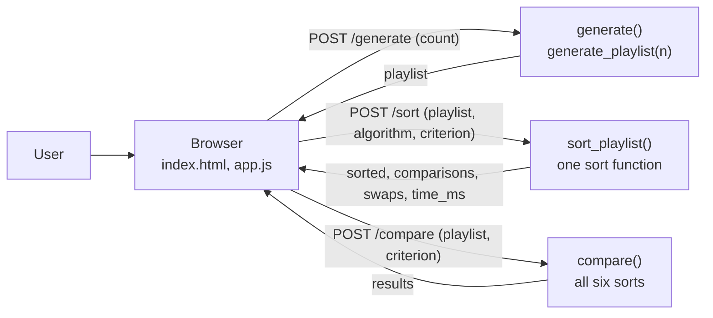

# HW2 Assignment Explanation — Music Playlist Manager

[Repository Guide](../../README.md) | [English](Assignment-Explanation.md) | [한국어](Assignment-Explanation.ko.md)

> **Last Updated:** 2026-11-17
>
> Introduction to Algorithms, Cormen, Leiserson, Rivest, and Stein, Ch 2, 6, 7

> **Learning Objectives:**
> 1. Design key functions that sort a song list by a user-chosen criterion (title, artist, duration, play count)
> 2. Implement sorting algorithms while counting comparisons and swaps/moves, and distinguish what the two counters count in each algorithm
> 3. Compare comparisons, swaps/moves, and execution time fairly by running several sorting algorithms on the same playlist
> 4. Relate values measured at growing input sizes to the theoretical growth rates of O(n²) and O(n log n)
> 5. Explain the structure of a web app that serves generate, sort, and compare APIs with Flask and displays the results in the browser

---

## Table of Contents

- [1. Assignment Structure and How to Run](#1-assignment-structure-and-how-to-run)
  - [1.1 Assignment Overview](#11-assignment-overview)
  - [1.2 Directory Layout](#12-directory-layout)
  - [1.3 Installation and Running](#13-installation-and-running)
- [2. Requirements](#2-requirements)
  - [2.1 Sorting Algorithms and Sort Criteria](#21-sorting-algorithms-and-sort-criteria)
  - [2.2 Web Interface](#22-web-interface)
  - [2.3 API Endpoints](#23-api-endpoints)
  - [2.4 Report and Grading Criteria](#24-report-and-grading-criteria)
- [3. Design](#3-design)
  - [3.1 Overall Structure](#31-overall-structure)
  - [3.2 Random Playlists](#32-random-playlists)
  - [3.3 The Common Contract of the Sort Functions and the Key Function](#33-the-common-contract-of-the-sort-functions-and-the-key-function)
  - [3.4 What the Counters Count](#34-what-the-counters-count)
- [4. Implementation of the Sorting Algorithms](#4-implementation-of-the-sorting-algorithms)
  - [4.1 Selection Sort](#41-selection-sort)
  - [4.2 Insertion Sort](#42-insertion-sort)
  - [4.3 Merge Sort](#43-merge-sort)
  - [4.4 Bubble Sort](#44-bubble-sort)
  - [4.5 Quick Sort](#45-quick-sort)
  - [4.6 Heap Sort](#46-heap-sort)
  - [4.7 Properties of the Six Sorts](#47-properties-of-the-six-sorts)
- [5. API and Screen](#5-api-and-screen)
  - [5.1 Generating a Playlist](#51-generating-a-playlist)
  - [5.2 Sorting](#52-sorting)
  - [5.3 Comparing All](#53-comparing-all)
  - [5.4 Screen Layout](#54-screen-layout)
- [6. Tests and Results](#6-tests-and-results)
  - [6.1 Checking the Counters on a Small Input](#61-checking-the-counters-on-a-small-input)
  - [6.2 Screenshot](#62-screenshot)
  - [6.3 Performance Comparison by Size](#63-performance-comparison-by-size)
  - [6.4 Measured Values Against Theory](#64-measured-values-against-theory)
  - [6.5 Error Handling and Edge Cases](#65-error-handling-and-edge-cases)
- [7. The Report's Analysis Questions](#7-the-reports-analysis-questions)
  - [7.1 The Fastest Algorithm and Why](#71-the-fastest-algorithm-and-why)
  - [7.2 Growth with Input Size](#72-growth-with-input-size)
  - [7.3 When Quadratic Sorts Remain Acceptable](#73-when-quadratic-sorts-remain-acceptable)
- [Summary](#summary)
- [Self-Check Questions](#self-check-questions)
- [References](#references)

---

<br>

## 1. Assignment Structure and How to Run

> **Try It First:** This document contains the answers and solutions. Solve the problems in the [assignment handout](Original/Assignment.md) yourself before reading on.

### 1.1 Assignment Overview

This take-home assignment of Week 3 builds a **music playlist manager** web app that sorts a song list by various criteria. The app sorts the playlist with different sorting algorithms and compares how sorting performance changes as the playlist grows. The backend uses Python (FastAPI or Flask), the frontend uses HTML, CSS, and JavaScript, and the deliverables are the source code and a report of at most two pages. It connects to the sorting algorithms of the [Week 3 Lecture](../../Lecture-Notes/Week03_Arrays-Stacks-Queues-and-Basic-Sorting-Algorithms/Concepts_Lecture.md). The original problem is in the [assignment handout](Original/Assignment.md).

### 1.2 Directory Layout

```text
Coursework/HW02_Arrays-Stacks-Queues-and-Basic-Sorting-Algorithms/
├── Assignment-Explanation.md      # Assignment explanation (English, this document)
├── Assignment-Explanation.ko.md   # Assignment explanation (Korean)
├── Code-Walkthrough.md            # Code walkthrough (English)
├── Code-Walkthrough.ko.md         # Code walkthrough (Korean)
├── Original/
│   ├── Assignment.md              # Assignment handout (English)
│   └── Assignment.ko.md           # Assignment handout (Korean)
└── Solution/
    ├── app.py                     # Flask backend (song generation, sorting, API)
    ├── requirements.txt           # Dependencies (flask)
    └── static/
        ├── index.html             # Page structure
        ├── style.css              # Page style
        └── app.js                 # API calls and result display
```

*Figure 1. Directory layout of HW2*

`Solution/` is the submitted source code, and it follows the submission layout fixed by the handout (`app.py`, `static/`, `requirements.txt`).

### 1.3 Installation and Running

```bash
# Move from the repository root to the solution directory
cd Coursework/HW02_Arrays-Stacks-Queues-and-Basic-Sorting-Algorithms/Solution
python3 -m pip install -r requirements.txt
python3 app.py
```

Running `app.py` directly starts the Flask development server in debug mode on port 5001. Opening `http://localhost:5001` in a browser shows the page. The document that reads the whole code file by file from top to bottom is the [HW2 Code Walkthrough](Code-Walkthrough.md).

---

<br>

## 2. Requirements

### 2.1 Sorting Algorithms and Sort Criteria

The handout requires **at least** the following three sorting algorithms. Each sort must order the playlist by one user-chosen criterion: **title**, **artist**, **duration**, or **play count**.

| Algorithm | Worst case | Location (`app.py`) |
|:-----|:-----|:-----|
| Selection sort | O(n²) | lines 79-90, `selection_sort` |
| Insertion sort | O(n²) | lines 93-108, `insertion_sort` |
| Merge sort | O(n log n) | lines 111-138, `merge_sort`, `_merge` |

*Table 1. Sorting algorithms required by the handout and where they are implemented*

The solution adds bubble sort (lines 141-153), quick sort (lines 156-179), and heap sort (lines 182-208), implementing six sorts in total. `get_key_function` on lines 225-235 turns the four sort criteria into key functions.

### 2.2 Web Interface

| Required feature | Location |
|:-----|:-----|
| A playlist table showing title, artist, duration, and play count | `index.html` lines 63-83, `app.js` lines 39-68 `renderPlaylist` |
| A "Generate Random" button that creates a random playlist of N songs | `index.html` lines 18-24, `app.js` lines 170-192 `generatePlaylist` |
| Dropdowns that choose the sort criterion and the sorting algorithm | `index.html` lines 26-46 |
| A "Sort" button that shows the sorted result, comparisons, swaps, and execution time | `index.html` line 47, `app.js` lines 194-227 `sortPlaylist` and lines 79-110 `displaySortResults` |
| A "Compare All" button that runs every algorithm and shows a comparison table | `index.html` line 48, `app.js` lines 229-254 `compareAll` and lines 115-157 `displayComparisonTable` |

*Table 2. Web interface requirements and where they are implemented*

### 2.3 API Endpoints

| Method | Endpoint | Description in the handout | Location (`app.py`) |
|:-----|:-----|:-----|:-----|
| `POST` | `/sort` | Sorts the playlist with the chosen algorithm and criterion | lines 261-285, `sort_playlist` |
| `POST` | `/compare` | Runs every algorithm and returns comparison data | lines 288-311, `compare` |
| `POST` | `/generate` | Generates a random playlist of N songs | lines 248-258, `generate` |
| `GET` | `/` | Serves the frontend page | lines 243-245, `index` |

*Table 3. API endpoints and where they are implemented*

### 2.4 Report and Grading Criteria

The report is a single PDF of at most two pages with a font size of 11pt or more. Its three items are carried over to the following places in this document.

| Report item | Location in this document |
|:-----|:-----|
| A screenshot of the playlist manager with sorting results | Figure 4 in Section 6.2 |
| A comparison table of comparisons, swaps, and time per algorithm for N = 100, 1000, 5000 | Table 10 in Section 6.3 |
| Analysis: the fastest algorithm and why, and when O(n²) algorithms are still acceptable | Section 7 |

*Table 4. Report items and their location in this document*

| Criterion | Weight |
|:-----|-----:|
| The web app runs and works correctly | 20% |
| The algorithm requirements are fully implemented | 40% |
| Report (at most two pages, font size 11 or more) | 40% |

*Table 5. Grading criteria*

---

<br>

## 3. Design

### 3.1 Overall Structure

The web app consists of one Flask server and three static files. The server does not store the playlist. The browser keeps the generated playlist in the variable `currentPlaylist` of `app.js` and sends the whole playlist as JSON with every sort or compare request. The server copies the received list, sorts it, and returns the result with the counter values.



*Figure 2. Request flow between the browser and the Flask server*

Because the server keeps no state, sorting or comparing the same playlist several times has no side effects between requests. The result of "Sort" is only displayed and is not stored back in `currentPlaylist`, so pressing Sort repeatedly always sorts from the originally generated order (Section 5.4).

### 3.2 Random Playlists

The server generates the data to sort at random. `generate_playlist` picks a title, an artist, a duration in seconds, and a play count for each song.

```python
def generate_playlist(n):
    """Generate a list of n random songs."""
    playlist = []
    for _ in range(n):
        adj = random.choice(ADJECTIVES)
        noun = random.choice(NOUNS)
        if random.random() < 0.3:
            adj2 = random.choice(ADJECTIVES)
            title = f"{adj} {adj2} {noun}"
        else:
            title = f"{adj} {noun}"

        first = random.choice(FIRST_NAMES)
        last = random.choice(LAST_NAMES)
        artist = f"{first} {last}"

        song = {
            "title": title,
            "artist": artist,
            "duration": random.randint(120, 420),
            "play_count": random.randint(0, 100000),
        }
        playlist.append(song)
    return playlist
```

Titles come from 35 adjectives (lines 12-18) and 35 nouns (lines 20-26). With probability 70% a title is "adjective noun" (1,225 possibilities), and with probability 30% it gets one more adjective as "adjective adjective noun". An artist is a combination of 30 first names and 30 last names (900 possibilities). The duration is an integer from 120 to 420 seconds and the play count an integer from 0 to 100,000, and `random.randint` includes both ends.

> **Note:** There are only 1,225 two-word titles, so the same title appears often in a large playlist. Generating 5,000 songs once gives about 2,600 distinct titles. The duration has only 301 possible values, so equal values are even more common. When many keys are equal, the **stability** of a sort shows in the result (Section 4.7) and the balance of quick sort's partitions is affected (Section 4.5).

### 3.3 The Common Contract of the Sort Functions and the Key Function

All six sort functions share the same signature. The comment on lines 70-76 states this contract.

```python
# ---------------------------------------------------------------------------
# Sorting algorithms — each receives (arr, key, stats) where
#   arr  : list of song dicts (mutated in-place for in-place sorts)
#   key  : function  song -> comparable value
#   stats: {"comparisons": 0, "swaps": 0}  (mutated)
# Returns the sorted list.
# ---------------------------------------------------------------------------
```

A sort function receives the list of song dicts `arr`, a **key function** `key` that extracts the value to compare from a song, and the counter dict `stats`, and it returns the sorted list. In-place sorts modify `arr` itself and return it, while merge sort returns a new list. Because the key function is an argument, a sort function does not need to know the sort criterion. Turning a criterion into a key function is the job of `get_key_function`.

```python
def get_key_function(criterion):
    if criterion == "title":
        return lambda song: song["title"].lower()
    elif criterion == "artist":
        return lambda song: song["artist"].lower()
    elif criterion == "duration":
        return lambda song: song["duration"]
    elif criterion == "play_count":
        return lambda song: song["play_count"]
    else:
        return lambda song: song["title"].lower()
```

Titles and artists are compared as lowercased strings, which gives a case-insensitive lexicographic order, and durations and play counts are compared as integers. An unknown criterion is treated as the title (lines 234-235). A string key builds a new string with `.lower()` at every call, so the number of key function calls directly affects the execution time (Section 7.1).

### 3.4 What the Counters Count

The screen and the report show **comparisons** and **swaps / moves** for each algorithm. The two counters increase only where a statement adds 1 to `stats["comparisons"]` or `stats["swaps"]`, so those places determine what they count.

| Algorithm | Where comparisons are counted | Where swaps/moves are counted | What one count means |
|:-----|:-----|:-----|:-----|
| Selection sort | Each key comparison in the inner loop that finds the minimum (line 84) | Only when positions actually change (`min_idx != i`, line 89) | A swap of two elements |
| Insertion sort | Each key comparison of the `while` loop, including the last one that stops the loop (line 100) | Each shift of an element one place to the right (line 103) | A move of one element |
| Merge sort | Each comparison in the first `while` loop of `_merge` (line 124) | Each append of one element right after a comparison (line 131) | A move of one element |
| Bubble sort | Each comparison of two neighbors (line 146) | Each swap of two neighbors (line 149) | A swap of two elements |
| Quick sort | Each comparison with the pivot in the partition loop (line 172) | Every swap inside the partition loop (line 176, including swaps where `i` equals `j` and nothing moves) and the final pivot swap (line 178) | A swap of two elements |
| Heap sort | Each comparison with a child when the child exists (lines 198 and 202) | Swaps that restore the heap property (line 207) and swaps that send the root to the end (line 188) | A swap of two elements |

*Table 6. The operations the two counters count in each sorting algorithm*

> **Key Point:** "Swaps / moves" counts different operations in different algorithms. One count in selection, bubble, quick, and heap sort is a swap of two elements, while one count in insertion and merge sort is a move of one element. Merge sort does not count the copying of leftover elements on lines 132-137 or the copying of lists by slicing, so this counter always equals its comparisons. This column is therefore better used to see how one algorithm changes with input size than to compare algorithms with each other.

The moves of insertion sort and the swaps of bubble sort are always equal on the same playlist. The concept of an inversion explains this fact.

> **Definition:** An **inversion** is a pair of positions (i, j) with i < j in a list where the key of the earlier element is greater than the key of the later one. A sorted list has 0 inversions, and a list sorted in reverse order has the maximum n(n−1)/2.

When bubble sort swaps two neighbors, only the inversion formed by those two elements disappears and the order of every other pair stays the same. When insertion sort shifts one element to the right, it also removes exactly one inversion, the one formed by that element and the element being inserted. Both sorts end when the number of inversions reaches 0, so the swap count and the move count both equal the number of inversions of the initial playlist. Two songs with the same key are compared with `>` and do not count as an inversion.

---

<br>

## 4. Implementation of the Sorting Algorithms

The six sorts work as follows. Each subsection of this section first states the rule the sort maintains, then shows the code, and then explains its behavior and complexity.

| Algorithm | Worst case | Type | Implementation |
|:-----|:-----|:-----|:-----|
| Selection sort | O(n²) | In-place | Finds the minimum in the unsorted portion and swaps it to the front |
| Insertion sort | O(n²) | In-place | Shifts elements right to insert the current item in order |
| Merge sort | O(n log n) | Not in-place | Recursive divide and conquer with a merge step |
| Bubble sort | O(n²) | In-place | Swaps adjacent elements and stops early when no swap occurs |
| Quick sort | O(n²) | In-place | Lomuto partition scheme with the last element as the pivot |
| Heap sort | O(n log n) | In-place | Builds a max-heap and repeatedly extracts the maximum |

*Table 7. Overview of the six implemented sorting algorithms*

### 4.1 Selection Sort

**Rule:** Place the minimum of the still unsorted portion `arr[i..n−1]` at position i. Increasing i from 0 to n−1 sorts the front of the list step by step.

```python
def selection_sort(arr, key, stats):
    n = len(arr)
    for i in range(n):
        min_idx = i
        for j in range(i + 1, n):
            stats["comparisons"] += 1
            if key(arr[j]) < key(arr[min_idx]):
                min_idx = j
        if min_idx != i:
            arr[i], arr[min_idx] = arr[min_idx], arr[i]
            stats["swaps"] += 1
    return arr
```

The inner loop on lines 83-86 scans from i + 1 to the end and finds the position `min_idx` of the smallest key. The i-th outer iteration makes n−1−i comparisons, so the number of comparisons is fixed regardless of the input order.

$$C_{\text{selection}}(n) = (n-1) + (n-2) + \cdots + 1 + 0 = \frac{n(n-1)}{2}$$

Lines 87-89 skip the swap when the minimum is already in place, so there are at most n−1 swaps. Each comparison calls both `key(arr[j])` and `key(arr[min_idx])`, so the key function is called twice as often as there are comparisons. Swapping two distant elements can change the relative order of songs with equal keys, so the sort is not stable. The best, average, and worst cases are all Θ(n²).

### 4.2 Insertion Sort

**Rule:** Keep the front `arr[0..i−1]` sorted and insert `arr[i]` into its proper place within it.

```python
def insertion_sort(arr, key, stats):
    n = len(arr)
    for i in range(1, n):
        current = arr[i]
        current_key = key(current)
        j = i - 1
        while j >= 0:
            stats["comparisons"] += 1
            if key(arr[j]) > current_key:
                arr[j + 1] = arr[j]
                stats["swaps"] += 1
                j -= 1
            else:
                break
        arr[j + 1] = current
    return arr
```

Lines 96-97 save the element to insert and its key in advance. Because the key is computed once, each comparison calls the key function only for `key(arr[j])`. Lines 99-106 move leftward, shifting every element greater than `current_key` one place to the right, and stop at the first element that is not greater. Line 107 puts the saved element into the free slot `j + 1`.

A comparison happens once for every move, and when the loop ends with `break` there is one more comparison that stopped it. Let I be the number of inversions of the initial playlist and f the number of times the element to insert travels all the way to the front so that `j` becomes −1. Then the following holds.

$$M_{\text{insertion}} = I, \qquad C_{\text{insertion}} = I + (n-1) - f$$

On an already sorted input, I = 0 and f = 0, so there are n−1 comparisons and 0 moves, and the time is Θ(n). A reverse-sorted input has I = n(n−1)/2, the worst case. For distinct keys in random order the expected number of inversions is n(n−1)/4, so the average case is also Θ(n²). Line 101 compares with `>`, so an element never passes another element with the same key, and the sort is stable.

### 4.3 Merge Sort

**Rule:** Split the list in half, sort each half recursively, and merge the two sorted lists into one by comparing their front elements.

```python
def merge_sort(arr, key, stats):
    if len(arr) <= 1:
        return arr
    mid = len(arr) // 2
    left = merge_sort(arr[:mid], key, stats)
    right = merge_sort(arr[mid:], key, stats)
    return _merge(left, right, key, stats)


def _merge(left, right, key, stats):
    result = []
    i = j = 0
    while i < len(left) and j < len(right):
        stats["comparisons"] += 1
        if key(left[i]) <= key(right[j]):
            result.append(left[i])
            i += 1
        else:
            result.append(right[j])
            j += 1
        stats["swaps"] += 1
    while i < len(left):
        result.append(left[i])
        i += 1
    while j < len(right):
        result.append(right[j])
        j += 1
    return result
```

Lines 112-113 treat a list of at most one element as already sorted and return it unchanged. The slices `arr[:mid]` and `arr[mid:]` on lines 115-116 create new lists, and `_merge` also builds and returns a new list `result`, so the sort is not in-place. For this reason `/sort` uses the return value of the sort function in the response (line 277).

The first loop of `_merge` (lines 123-131) compares the front elements of the two lists and appends the smaller one to the result. When one side runs out, lines 132-137 append the rest of the other side unchanged. Merging two lists of sizes a and b takes at most a + b − 1 comparisons, and fewer when one side runs out early. Line 125 takes the left element first on equal keys (`<=`), so the sort is stable. The time follows from solving this recurrence with case 2 of the master theorem.

$$T(n) = 2T(n/2) + \Theta(n) = \Theta(n \log n)$$

### 4.4 Bubble Sort

**Rule:** Swap two neighbors when they are out of order. Each pass carries the maximum of the remaining part to its end, and a pass with no swap means the list is already sorted, so the sort stops.

```python
def bubble_sort(arr, key, stats):
    n = len(arr)
    for i in range(n):
        swapped = False
        for j in range(0, n - i - 1):
            stats["comparisons"] += 1
            if key(arr[j]) > key(arr[j + 1]):
                arr[j], arr[j + 1] = arr[j + 1], arr[j]
                stats["swaps"] += 1
                swapped = True
        if not swapped:
            break
    return arr
```

The i-th pass compares n−1−i neighboring pairs (line 145). The last i positions already hold the largest elements and are not visited again. Thanks to `swapped` on line 144 and the **early termination** on lines 151-152, a sorted input ends after one pass with n−1 comparisons, a best case of Θ(n). As Section 3.4 showed, the swap count equals the number of inversions. Line 147 compares with `>`, so elements with equal keys are never swapped and the sort is stable. Each comparison calls the key function twice.

### 4.5 Quick Sort

**Rule:** Take the last element of the range as the pivot, gather the elements less than or equal to the pivot at the front and the larger ones at the back, and put the pivot on the boundary (**Lomuto partition**). Sort the ranges on both sides of the pivot recursively in the same way.

```python
def quick_sort(arr, key, stats):
    _quick_sort_helper(arr, 0, len(arr) - 1, key, stats)
    return arr


def _quick_sort_helper(arr, low, high, key, stats):
    if low < high:
        pi = _partition(arr, low, high, key, stats)
        _quick_sort_helper(arr, low, pi - 1, key, stats)
        _quick_sort_helper(arr, pi + 1, high, key, stats)


def _partition(arr, low, high, key, stats):
    pivot = key(arr[high])
    i = low - 1
    for j in range(low, high):
        stats["comparisons"] += 1
        if key(arr[j]) <= pivot:
            i += 1
            arr[i], arr[j] = arr[j], arr[i]
            stats["swaps"] += 1
    arr[i + 1], arr[high] = arr[high], arr[i + 1]
    stats["swaps"] += 1
    return i + 1
```

Line 169 computes the pivot's key once. The loop on lines 171-176 maintains the following invariant: `arr[low..i]` is at most the pivot, `arr[i+1..j−1]` is greater than the pivot, and `arr[j..high−1]` has not been examined yet.

```text
 low        i  i+1        j-1  j            high-1   high
 [   <= p    ][     > p      ][      ?          ]   [ p ]
```

*Figure 3. Invariant during the Lomuto partition loop (p is the pivot's key, ? marks elements not yet compared)*

If `arr[j]` is at most the pivot, the loop increments `i` and swaps `arr[i]` and `arr[j]`, widening the left region by one. After the loop, line 177 moves the pivot to `i + 1` and returns that position. The pivot is then in its final position and is not touched by later recursion. A range of length m takes m−1 comparisons to partition, and each comparison calls the key function only once, for `key(arr[j])`. Line 175 also counts a swap where `i` equals `j` and nothing moves.

When every partition splits nearly in half, T(n) = 2T(n/2) + Θ(n) gives Θ(n log n), and the expected time on input in random order is also Θ(n log n). If the pivot is always the maximum or minimum of its range, however, one side is empty and T(n) = T(n−1) + Θ(n) = Θ(n²). Because the last element is the pivot, an input that is already sorted or sorted in reverse is this worst case. Swapping distant elements makes the sort unstable.

> **Caution:** In the worst case the recursion depth also reaches n. CPython's default recursion limit is 1,000, so sending 2,000 already sorted songs to `/sort` with quick sort raises `RecursionError` and the server returns a 500 error (Section 6.5). The page always sends a randomly generated order, so this case does not arise there, and the expected recursion depth is O(log n). With a criterion that has many equal keys, `<=` sends every equal key to the left, so partitions become lopsided. Generating 10,000 songs once and sorting them by duration takes about 270,000 comparisons, more than the about 150,000 for play count, whose values hardly repeat, but the sort still finishes normally.

### 4.6 Heap Sort

**Rule:** Turn the array into a **max-heap**, then repeatedly swap the maximum at the root with the last element of the heap, shrink the heap by one, and restore the heap property from the root.

```python
def heap_sort(arr, key, stats):
    n = len(arr)
    for i in range(n // 2 - 1, -1, -1):
        _heapify(arr, n, i, key, stats)
    for i in range(n - 1, 0, -1):
        arr[0], arr[i] = arr[i], arr[0]
        stats["swaps"] += 1
        _heapify(arr, i, 0, key, stats)
    return arr


def _heapify(arr, n, i, key, stats):
    largest = i
    left = 2 * i + 1
    right = 2 * i + 2
    if left < n:
        stats["comparisons"] += 1
        if key(arr[left]) > key(arr[largest]):
            largest = left
    if right < n:
        stats["comparisons"] += 1
        if key(arr[right]) > key(arr[largest]):
            largest = right
    if largest != i:
        arr[i], arr[largest] = arr[largest], arr[i]
        stats["swaps"] += 1
        _heapify(arr, n, largest, key, stats)
```

In an array numbered from 0, the children of node i are 2i+1 and 2i+2 (lines 195-196). `_heapify` finds the node with the largest key among node i and its two children, swaps it with i, and repeats the same step downward on the child it swapped with. Lines 184-185 build the heap by calling `_heapify` backward from the last internal node n//2−1 to the root, a step that takes O(n). Lines 186-189 extract the root n−1 times, each time descending a height of O(log n), so the total is Θ(n log n). Descending one level takes up to two comparisons and each comparison calls the key function twice, so for the same Θ(n log n) heap sort makes more comparisons and key calls than merge sort and quick sort. `_heapify` is recursive and uses an O(log n) call stack. The swap that sends the root to the end can reorder equal keys, so the sort is not stable.

### 4.7 Properties of the Six Sorts

| Algorithm | Best | Average | Worst | Extra space (this implementation) | In-place | Stable |
|:-----|:-----|:-----|:-----|:-----|:-----|:-----|
| Selection sort | Θ(n²) | Θ(n²) | Θ(n²) | O(1) | Yes | No |
| Insertion sort | Θ(n) | Θ(n²) | Θ(n²) | O(1) | Yes | Yes |
| Merge sort | Θ(n log n) | Θ(n log n) | Θ(n log n) | O(n) (slices and result lists) | No | Yes |
| Bubble sort | Θ(n) | Θ(n²) | Θ(n²) | O(1) | Yes | Yes |
| Quick sort | Θ(n log n) | Θ(n log n) | Θ(n²) | Recursion stack O(log n) on average, O(n) in the worst case | Yes | No |
| Heap sort | Θ(n log n) | Θ(n log n) | Θ(n log n) | Recursion stack O(log n) | Yes | No |

*Table 8. Time complexity, extra space, in-place property, and stability of the six sorts*

The best and average columns assume distinct keys. When 300 songs, each tagged with its original position, are sorted by duration, insertion, merge, and bubble sort keep songs with the same duration in their original order, and selection, quick, and heap sort do not, which matches the stability column. With a stable sort, sorting first by artist and then by title keeps the artist order within each title.

---

<br>

## 5. API and Screen

### 5.1 Generating a Playlist

**Requirement:** `POST /generate` creates a random playlist of N songs.

```python
@app.route("/generate", methods=["POST"])
def generate():
    data = request.get_json() or {}
    count = data.get("count", 10)
    try:
        count = int(count)
    except (TypeError, ValueError):
        return jsonify({"error": "count must be a number"}), 400
    count = max(1, min(count, 10000))
    playlist = generate_playlist(count)
    return jsonify({"playlist": playlist})
```

A missing body is treated as an empty dict (line 250), and a missing `count` gives 10 songs. If `count` cannot be converted to an integer the route returns a 400 error (lines 252-255), and line 256 clamps the song count to between 1 and 10,000. The response has the form `{"playlist": [...]}`.

```bash
curl -s -X POST http://localhost:5001/generate -H "Content-Type: application/json" -d '{"count": 1}'
```

```text
{
  "playlist": [
    {
      "artist": "Zara Styles",
      "duration": 183,
      "play_count": 45896,
      "title": "Velvet Shadow"
    }
  ]
}
```

The songs are random, so the values differ on every run. Flask's `jsonify` outputs dictionary keys in sorted order, so the fields of a song also come out as `artist`, `duration`, `play_count`, `title`, and in debug mode it returns indented JSON as above.

### 5.2 Sorting

**Requirement:** `POST /sort` sorts the playlist with the chosen algorithm and criterion and returns the sorted result with the comparisons, swaps, and execution time.

```python
@app.route("/sort", methods=["POST"])
def sort_playlist():
    data = request.get_json() or {}
    playlist = data.get("playlist", [])
    algorithm = data.get("algorithm", "selection")
    criterion = data.get("criterion", "title")

    sort_func = ALGORITHMS.get(algorithm)
    if not sort_func:
        return jsonify({"error": f"Unknown algorithm: {algorithm}"}), 400

    key_func = get_key_function(criterion)
    arr = copy.deepcopy(playlist)
    stats = {"comparisons": 0, "swaps": 0}

    start = time.perf_counter()
    sorted_arr = sort_func(arr, key_func, stats)
    elapsed = time.perf_counter() - start

    return jsonify({
        "sorted": sorted_arr,
        "comparisons": stats["comparisons"],
        "swaps": stats["swaps"],
        "time_ms": round(elapsed * 1000, 4),
    })
```

Line 268 looks up the sort function by name in the dict `ALGORITHMS` on lines 215-222 and returns a 400 error for an unknown name. Line 273 deep-copies the playlist before sorting. Lines 276-278 time only the call to the sort function with `time.perf_counter()`, so the copy and the JSON conversion are not included. The time is converted to milliseconds and rounded to four decimal places.

### 5.3 Comparing All

**Requirement:** `POST /compare` runs every algorithm on the same playlist and returns the comparison data.

```python
@app.route("/compare", methods=["POST"])
def compare():
    data = request.get_json() or {}
    playlist = data.get("playlist", [])
    criterion = data.get("criterion", "title")

    key_func = get_key_function(criterion)
    results = {}

    for name, sort_func in ALGORITHMS.items():
        arr = copy.deepcopy(playlist)
        stats = {"comparisons": 0, "swaps": 0}

        start = time.perf_counter()
        sort_func(arr, key_func, stats)
        elapsed = time.perf_counter() - start

        results[name] = {
            "comparisons": stats["comparisons"],
            "swaps": stats["swaps"],
            "time_ms": round(elapsed * 1000, 4),
        }

    return jsonify({"results": results})
```

Line 298 makes a fresh deep copy of the original playlist for each algorithm, so the order left by one in-place sort never becomes the input of the next algorithm. All six algorithms run on the same input with the same key function, which makes the comparison fair. Because `jsonify` sorts the keys, the results arrive in the order `bubble`, `heap`, `insertion`, `merge`, `quick`, `selection`, and the comparison table on the page draws its rows in that order.

### 5.4 Screen Layout

From top to bottom, the page consists of the control area, the playlist info line, the sort result card, the comparison result card, and the playlist table. "Generate Random" calls `/generate` with the entered song count, stores the received list in `currentPlaylist`, and redraws the table. "Sort" sends `currentPlaylist` with the chosen algorithm and criterion to `/sort`, draws the sorted list in the table, and shows the algorithm, comparisons, swaps/moves, and time in four cards. "Compare All" draws the result of `/compare` as a table and highlights the minimum of each column in bold green. The table draws at most 500 songs, and while a request is in progress the buttons are disabled and a loading overlay appears. The line-by-line description of each function is in the [HW2 Code Walkthrough](Code-Walkthrough.md).

---

<br>

## 6. Tests and Results

### 6.1 Checking the Counters on a Small Input

The list `[5, 2, 4, 6, 1, 3]` checks whether the counters count as described in Section 3.4. Passing `lambda x: x`, which returns the element itself, as the key function lets the sorts order integers instead of songs.

```bash
cd Coursework/HW02_Arrays-Stacks-Queues-and-Basic-Sorting-Algorithms/Solution
python3 -B -c 'import app
for name, f in app.ALGORITHMS.items():
    stats = {"comparisons": 0, "swaps": 0}
    print(name, f([5, 2, 4, 6, 1, 3], lambda x: x, stats), stats)'
```

```text
selection [1, 2, 3, 4, 5, 6] {'comparisons': 15, 'swaps': 3}
insertion [1, 2, 3, 4, 5, 6] {'comparisons': 12, 'swaps': 9}
merge [1, 2, 3, 4, 5, 6] {'comparisons': 11, 'swaps': 11}
bubble [1, 2, 3, 4, 5, 6] {'comparisons': 15, 'swaps': 9}
quick [1, 2, 3, 4, 5, 6] {'comparisons': 9, 'swaps': 7}
heap [1, 2, 3, 4, 5, 6] {'comparisons': 16, 'swaps': 11}
```

`-B` is the option that prevents Python from creating `__pycache__`. The inversions of this list are the nine pairs (5, 2), (5, 4), (5, 1), (5, 3), (2, 1), (4, 1), (4, 3), (6, 1), (6, 3).

| Algorithm | Comparisons | Swaps/moves | Check |
|:-----|-----:|-----:|:-----|
| Selection sort | 15 | 3 | The comparisons are 6 × 5 / 2 = 15, and leaving out the steps where the minimum was already in place gives three swaps |
| Insertion sort | 12 | 9 | The moves equal the 9 inversions, inserting 2 and 1 travels to the front so f = 2, and the comparisons are 9 + 5 − 2 = 12 |
| Merge sort | 11 | 11 | The move counter equals the comparisons, and the 5 moves of leftover elements are not counted |
| Bubble sort | 15 | 9 | The swaps equal the 9 inversions, and the fifth pass makes no swap and stops |
| Quick sort | 9 | 7 | The four partitions make 5 + 1 + 2 + 1 comparisons, and the two swaps in place in the last partition are also counted |
| Heap sort | 16 | 11 | Building the heap takes 7 comparisons and 2 swaps, and the rest come from the steps that extract the root |

*Table 9. Counter values measured on the list [5, 2, 4, 6, 1, 3]*

The 15 comparisons of selection sort equal n(n−1)/2 = 15, and the moves of insertion sort and the swaps of bubble sort both equal the 9 inversions. The step-by-step states are in the execution trace of the [HW2 Code Walkthrough](Code-Walkthrough.md).

### 6.2 Screenshot


*Figure 4. Playlist manager after selection sort of 100 songs by title*

This screen shows a playlist generated with a song count of 100, sorted after choosing selection sort and the title criterion and pressing "Sort". There are 100 × 99 / 2 = 4,950 comparisons and 95 swaps, and the time is 1.8021 ms. The info line shows the song count and the sort criterion, and the table starts in case-insensitive lexicographic order with "Bitter Rain", "Bitter Storm", and "Blazing Electric Garden". The adjective list has no word starting with A, so titles starting with B come first. The page chooses the sort criterion with a dropdown and the song count with a number input, and "Compare All" runs all six algorithms on the same playlist and shows a comparison table with the minimum of each column highlighted in green.

### 6.3 Performance Comparison by Size

Each algorithm was tested on randomly generated playlists sorted by title (string comparison), and all times were measured with `time.perf_counter()`. For each size, one playlist was given to all six algorithms through "Compare All", as the equal moves of insertion sort and swaps of bubble sort confirm (Section 3.4). Bold values are the minimum of each column, the same values that "Compare All" highlights in green.

<table>
<thead>
<tr><th rowspan="2">Algorithm</th><th rowspan="2">Complexity</th><th colspan="3">Comparisons</th><th colspan="3">Swaps / Moves</th><th colspan="3">Time (ms)</th></tr>
<tr><th>100</th><th>1,000</th><th>5,000</th><th>100</th><th>1,000</th><th>5,000</th><th>100</th><th>1,000</th><th>5,000</th></tr>
</thead>
<tbody>
<tr><td>Selection sort</td><td>O(n²)</td><td>4,950</td><td>499,500</td><td>12,497,500</td><td><b>95</b></td><td><b>991</b></td><td><b>4,994</b></td><td>2.05</td><td>101.90</td><td>2108.93</td></tr>
<tr><td>Insertion sort</td><td>O(n²)</td><td>2,452</td><td>247,151</td><td>6,313,596</td><td>2,358</td><td>246,159</td><td>6,308,609</td><td>1.12</td><td>46.05</td><td>1223.36</td></tr>
<tr><td>Bubble sort</td><td>O(n²)</td><td>4,884</td><td>497,015</td><td>12,491,059</td><td>2,358</td><td>246,159</td><td>6,308,609</td><td>2.31</td><td>106.35</td><td>2790.25</td></tr>
<tr><td>Merge sort</td><td>O(n log n)</td><td><b>546</b></td><td><b>8,723</b></td><td><b>55,183</b></td><td>546</td><td>8,723</td><td>55,183</td><td>0.52</td><td>2.93</td><td>17.42</td></tr>
<tr><td>Quick sort</td><td>O(n log n) (average)</td><td>632</td><td>10,690</td><td>71,471</td><td>413</td><td>5,631</td><td>38,502</td><td><b>0.23</b></td><td><b>1.78</b></td><td><b>12.26</b></td></tr>
<tr><td>Heap sort</td><td>O(n log n)</td><td>1,026</td><td>16,865</td><td>107,612</td><td>582</td><td>9,098</td><td>57,052</td><td>0.54</td><td>4.25</td><td>28.01</td></tr>
</tbody>
</table>

*Table 10. Performance comparison across playlist sizes (sorted by title)*

The complexity cell of quick sort is the average on random input, and its worst case is O(n²), as Tables 7 and 8 state. Selection sort has the fewest swaps at every size because it makes at most n−1 swaps (95 of a possible 99 for 100 songs), and merge sort has the fewest comparisons because each merge comparison finalizes one element. The playlists are random, so a rerun gives slightly different values, but the orders of magnitude and the ranking of the algorithms stay the same.

### 6.4 Measured Values Against Theory

Comparing the counts of Table 10 with theory gives the following. The expected number of comparisons of quick sort, for distinct keys in random order, follows from the fact that the i-th and j-th elements in sorted order are compared with probability 2/(j−i+1). Here H_n is the n-th harmonic number 1 + 1/2 + ... + 1/n.

$$E[C_{\text{quick}}] = \sum_{i=1}^{n-1}\sum_{j=i+1}^{n}\frac{2}{j-i+1} = 2(n+1)H_n - 4n \approx 1.39 n \log_2 n$$

| Algorithm | Theory | n = 100 | n = 1,000 | n = 5,000 | Measured (100 / 1,000 / 5,000) |
|:-----|:-----|-----:|-----:|-----:|:-----|
| Selection sort (comparisons) | n(n−1)/2, exactly | 4,950 | 499,500 | 12,497,500 | 4,950 / 499,500 / 12,497,500 |
| Insertion sort (moves) | Expected inversions n(n−1)/4 | 2,475 | 249,750 | 6,248,750 | 2,358 / 246,159 / 6,308,609 |
| Merge sort (comparisons) | At most n log₂ n | 664 | 9,966 | 61,439 | 546 / 8,723 / 55,183 |
| Quick sort (comparisons) | 2(n+1)H_n − 4n | 648 | 10,986 | 70,963 | 632 / 10,690 / 71,471 |
| Heap sort (comparisons) | At most 2n log₂ n | 1,329 | 19,932 | 122,877 | 1,026 / 16,865 / 107,612 |

*Table 11. Theoretical and measured comparisons and moves*

Selection sort matches exactly regardless of the input. The moves of insertion sort and the comparisons of quick sort agree with the expected values for random input within 5%. The difference is the variation of random input, and the presence of equal titles (Section 3.2), which makes the distinct-key assumption inexact, also plays a part. Merge sort and heap sort stay 10% to 23% below their upper bounds. A merge makes fewer comparisons when one side runs out first, and restoring the heap property often stops before reaching the bottom.

### 6.5 Error Handling and Edge Cases

For error handling and edge cases, the server behaves as follows.

| Request | Result |
|:-----|:-----|
| `GET /` | 200, returns `static/index.html` |
| `GET /sort` | 405, the sort route accepts only `POST` |
| `POST /generate` with body `{"count": "abc"}` | 400, `{"error": "count must be a number"}` |
| `POST /generate` with `count` 99999 or 0 | Clamps the song count to 10,000 or 1 |
| `POST /generate` with body `{}` | Generates the default 10 songs |
| `POST /sort` with `algorithm` `"bogus"` | 400, `{"error": "Unknown algorithm: bogus"}` |
| `POST /sort` with an unknown `criterion` | Sorts by title |
| `POST /sort`, 900 already sorted songs, quick sort | 404,550 comparisons, which is 900 × 899 / 2, the worst case |
| `POST /sort`, 2,000 already sorted songs, quick sort | A 500 error from `RecursionError` |
| `POST /sort`, 900 already sorted songs, insertion sort and bubble sort | 899 comparisons and 0 moves or swaps, the best case |

*Table 12. Server behavior in error handling and edge cases*

That an already sorted input is the worst case of quick sort and the best case of insertion and bubble sort matches the analysis of Sections 4.2, 4.4, and 4.5. The page sends only randomly generated orders, so a sorted input arises only when the API is called directly.

---

<br>

## 7. The Report's Analysis Questions

### 7.1 The Fastest Algorithm and Why

**Quick sort** was the fastest at every size, with times of 0.23 ms (N = 100), 1.78 ms (N = 1,000), and 12.26 ms (N = 5,000). The three O(n log n) algorithms, quick, merge, and heap sort, all stayed under 30 ms at N = 5,000, while bubble sort took 2,790 ms. Bubble sort is about 100 times slower than heap sort and about 228 times slower than quick sort.

The O(n²) sorts are slow because of their comparison counts. Selection sort and bubble sort compare almost every pair with nested loops, giving about n²/2 comparisons (about 12.5 million at N = 5,000), and insertion sort also compares about half that, n²/4, on random input. The O(n log n) sorts avoid this cost by dividing the problem. Quick sort creates subproblems by partitioning, merge sort splits and merges, and heap sort uses a heap of height log n. As a result their comparison counts stay on the order of n log₂ n (about 55,000 to 108,000 at N = 5,000).

The order among the three O(n log n) algorithms is explained by the cost of one comparison, especially the number of key function calls. As Section 3.3 showed, the title key builds a new string with `.lower()` at every call, so in CPython one key call costs far more than accessing a list element. Quick sort computes the pivot's key once (line 169) and calls the key once per comparison, while merge sort (line 125) and heap sort (lines 199 and 203) call it twice. The number of key calls is fixed exactly by the comparison count in the code.

| Algorithm | Comparisons (N = 5,000) | Key calls per comparison | Key calls (N = 5,000) | Time (ms) |
|:-----|-----:|:-----|-----:|-----:|
| Quick sort | 71,471 | 1, plus 1 for the pivot of each partition | About 75,000 | 12.26 |
| Merge sort | 55,183 | 2 | 110,366 | 17.42 |
| Heap sort | 107,612 | 2 | 215,224 | 28.01 |
| Insertion sort | 6,313,596 | 1, plus 1 for each element to insert | 6,318,595 | 1223.36 |
| Selection sort | 12,497,500 | 2 | 24,995,000 | 2108.93 |
| Bubble sort | 12,491,059 | 2 | 24,982,118 | 2790.25 |

*Table 13. Comparisons, key function calls, and execution time (N = 5,000)*

The key calls of quick sort are the 71,471 comparisons plus the number of partition calls (fewer than n, about 3,600 for 5,000 songs). In both groups, fewer key calls mean a faster sort. In the O(n²) group, insertion sort saves the key in advance (line 97) and calls the key only about a quarter as often as selection sort, while bubble sort makes as many key calls as selection sort but about 6.3 million more swaps, which makes it the slowest.

> **Note:** That quick sort scans the array sequentially in place is a cache locality advantage in languages such as C. A CPython list, however, holds only references to the song dicts, and the interpreter handles a function call and a string creation for every comparison, so that effect cannot be separated in this measurement. In this implementation, interpreter-level work such as the key call counts of Table 13 and the slice copies of merge sort explains the time differences more directly.

### 7.2 Growth with Input Size

Increasing the input 50 times (100 → 5,000) made the comparisons of selection sort grow from 4,950 to 12,497,500, about 2,525 times. Because the comparison count is n(n−1)/2, the theoretical ratio (5000 × 4999) / (100 × 99) ≈ 2,525 matches exactly, and it is approximately 50² = 2,500. The comparisons of merge sort grew from 546 to 55,183, about 101 times. The ratio of n log n is 50 × log 5000 / log 100 ≈ 92.5.

In execution time, bubble sort went from 2.31 ms to 2,790 ms, about 1,208 times, and quick sort from 0.23 ms to 12.26 ms, about 53 times. The gap between O(n²) and O(n log n) widens rapidly as the input grows, and quadratic sorts become hard to use for a web app's response time beyond a few thousand songs.

> **Note:** The time ratios of the O(n²) sorts (about 1,029 times for selection sort, 1,092 for insertion sort, and 1,208 for bubble sort) are smaller than the comparison ratio of about 2,500. The times at N = 100 are only 1-2 ms, so measurement noise and the fixed cost of each call weigh more. Judging the growth rate by comparison counts, which do not depend on the execution environment, is more accurate.

### 7.3 When Quadratic Sorts Remain Acceptable

O(n²) sorts are still acceptable in the following cases.

- **Small n (under 50):** Even at N = 100, every algorithm finished within 2.5 ms. Simple algorithms have small constant factors and no recursion overhead.
- **Nearly sorted data:** Insertion sort is O(n) in the best case, which suits keeping an already ordered list in order while adding a few songs. Sorting 900 already sorted songs with 899 comparisons and 0 moves in Section 6.5 is an example. Bubble sort with early termination behaves the same way.
- **Memory constraints:** Selection sort and insertion sort need O(1) extra space, while merge sort needs O(n). On embedded systems with little memory this difference matters.
- **Storage with expensive writes:** Selection sort makes at most n−1 swaps. As Table 10 shows with selection sort having the fewest swaps at every size, this property is an advantage where moving an element costs far more than comparing.
- **As part of hybrid sorts:** Timsort, used by Python's `sorted` and `list.sort`, extends short runs to a minimum length minrun (32-64) with binary insertion sort and then merges them like merge sort. A list of fewer than 64 elements is handled entirely by binary insertion sort [1]. It gains the low overhead of insertion sort on small runs and the scalability of merging on large inputs.

---

<br>

## Summary

| Concept | Key Summary |
|:-----|:-----|
| Key function | The function a sort uses to extract the value to compare from a song, and `get_key_function` turns the four criteria into key functions. |
| Comparisons | Increase at every key comparison, and selection sort makes exactly n(n−1)/2 regardless of the input. |
| Swaps/moves | Count a different operation in each algorithm, and always equal the comparisons in merge sort. |
| Inversion | A pair whose earlier element has a greater key than the later one, and the moves of insertion sort and the swaps of bubble sort both equal the number of inversions. |
| Lomuto partition | Splits a range into elements at most and greater than the last element as the pivot, and reaches the worst case Θ(n²) and recursion depth n on sorted input. |
| Fair comparison | `/compare` gives each algorithm a fresh copy of the same playlist and times only the sorting part. |
| Stability | Insertion, merge, and bubble sort keep the original order of equal keys, while selection, quick, and heap sort do not. |
| Cause of time differences | Within the same complexity, the number of key function calls per comparison largely determines the execution time in CPython. |
| Growth rate | When the input grows 50 times, O(n²) comparisons grow about 2,500 times and O(n log n) comparisons about 100 times. |

---

<br>

## Self-Check Questions

1. **Inversions and counters:** Sorting the same playlist with insertion sort and with bubble sort always gives the same "swaps / moves". Explain why.

   <details>
   <summary>Answer</summary>

   Both values equal the number of inversions of the initial playlist. One swap of bubble sort removes only the inversion formed by two neighbors, and one move of insertion sort removes only the inversion formed by the moved element and the element being inserted. Both sorts end when the inversions reach 0, so the swap count and the move count both equal the number of inversions.

   </details>

2. **Selection sort counters:** Find the number of comparisons and the range of the number of swaps when selection sort sorts 1,000 songs.

   <details>
   <summary>Answer</summary>

   The comparisons are 1000 × 999 / 2 = 499,500 regardless of the input. A swap happens only when the minimum is not already in place, so the swaps range from 0 to 999. The 991 of Table 10 lies in this range.

   </details>

3. **Merge sort's move counter:** Explain why merge sort's "swaps / moves" always equals its comparisons, and name the work this counter does not count.

   <details>
   <summary>Answer</summary>

   The first loop of `_merge` appends one element per comparison and increments the move counter only then (lines 124 and 131). The moves on lines 132-137 that append leftover elements after one side runs out, and the slice copies on lines 115-116, are not counted. The number of elements actually moved is therefore larger than this counter.

   </details>

4. **Quick sort's worst case:** What happens when 2,000 songs already sorted by title are sent to `/sort` with quick sort and the title criterion? Explain why.

   <details>
   <summary>Answer</summary>

   The server raises `RecursionError` and returns a 500 error. The last element is the pivot, so on sorted input the pivot is always the maximum of its range, one side is empty, and the other side shrinks by only one. The recursion depth reaches about 2,000 and exceeds CPython's default recursion limit of 1,000. The comparison count is also the worst case, n(n−1)/2.

   </details>

5. **Stability:** After sorting by artist, which algorithm must the second sort by title use so that the artist order is kept within each title?

   <details>
   <summary>Answer</summary>

   It must be one of the stable sorts: insertion sort, merge sort, or bubble sort. These three never reorder elements with equal keys (insertion and bubble compare with `>`, merge with `<=`). Selection, quick, and heap sort swap distant elements and can break the order. The page's "Sort" always sorts from the originally generated order, however, so this chained sort can only be tried by calling the API directly.

   </details>

---

<br>

## References

1. T. Peters, "listsort.txt," *CPython*, 2002. https://github.com/python/cpython/blob/main/Objects/listsort.txt
