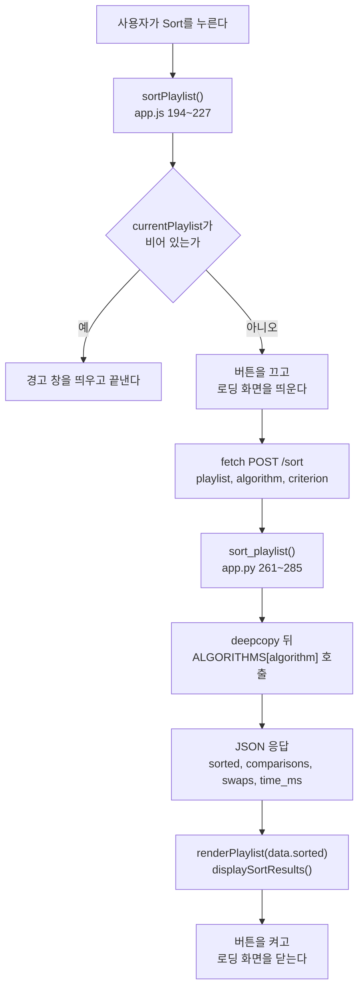
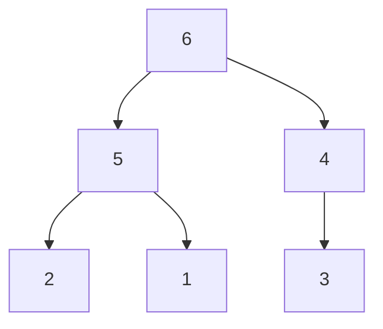

# HW2 코드 총정리 — 음악 재생 목록 관리기

[레포지토리 안내](../../README.ko.md) | [English](Code-Walkthrough.md) | [한국어](Code-Walkthrough.ko.md)

> **최종 수정일:** 2026-11-16
>
> Introduction to Algorithms, Cormen, Leiserson, Rivest, and Stein, Ch 2, 6, 7

> **학습 목표:**
> 1. `app.py`의 데이터 생성 함수, 여섯 정렬 함수, 라우트가 각 줄에서 하는 일을 설명할 수 있다
> 2. 정렬 함수마다 계수기가 증가하는 문장을 찾아 작은 입력에서 계수기 값을 단계별로 추적할 수 있다
> 3. `app.js`가 API를 호출하고 응답으로 표와 카드를 그리는 과정을 설명할 수 있다
> 4. `index.html`과 `style.css`가 화면의 각 영역을 어떻게 구성하는지 설명할 수 있다
> 5. 요청 하나가 브라우저에서 서버를 거쳐 화면에 표시되기까지의 흐름과 각 함수의 복잡도를 설명할 수 있다

---

## 목차

- [1. 파일 구성](#1-파일-구성)
- [2. 임포트와 앱 생성](#2-임포트와-앱-생성)
- [3. 곡 데이터와 재생 목록 생성](#3-곡-데이터와-재생-목록-생성)
- [4. 정렬 함수의 규약과 선택 정렬](#4-정렬-함수의-규약과-선택-정렬)
- [5. 삽입 정렬](#5-삽입-정렬)
- [6. 병합 정렬](#6-병합-정렬)
- [7. 버블 정렬](#7-버블-정렬)
- [8. 퀵 정렬](#8-퀵-정렬)
- [9. 힙 정렬](#9-힙-정렬)
- [10. 알고리즘 표와 키 함수](#10-알고리즘-표와-키-함수)
- [11. 라우트](#11-라우트)
  - [11.1 첫 페이지](#111-첫-페이지)
  - [11.2 재생 목록 생성 라우트](#112-재생-목록-생성-라우트)
  - [11.3 정렬 라우트](#113-정렬-라우트)
  - [11.4 비교 라우트](#114-비교-라우트)
  - [11.5 실행부](#115-실행부)
- [12. 화면 구조](#12-화면-구조)
  - [12.1 머리와 헤더](#121-머리와-헤더)
  - [12.2 조작 영역](#122-조작-영역)
  - [12.3 정보 줄과 결과 카드](#123-정보-줄과-결과-카드)
  - [12.4 재생 목록 표와 로딩 화면](#124-재생-목록-표와-로딩-화면)
- [13. 화면 동작](#13-화면-동작)
  - [13.1 상태와 도우미 함수](#131-상태와-도우미-함수)
  - [13.2 재생 목록 표 그리기](#132-재생-목록-표-그리기)
  - [13.3 정렬 결과 카드](#133-정렬-결과-카드)
  - [13.4 비교 표](#134-비교-표)
  - [13.5 결과 지우기](#135-결과-지우기)
  - [13.6 재생 목록 생성 요청](#136-재생-목록-생성-요청)
  - [13.7 정렬 요청](#137-정렬-요청)
  - [13.8 비교 요청](#138-비교-요청)
  - [13.9 초기화](#139-초기화)
- [14. 화면 스타일](#14-화면-스타일)
- [15. 요청 흐름과 실행 추적](#15-요청-흐름과-실행-추적)
  - [15.1 정렬 요청의 흐름](#151-정렬-요청의-흐름)
  - [15.2 선택, 삽입, 버블 정렬의 추적](#152-선택-삽입-버블-정렬의-추적)
  - [15.3 병합 정렬의 추적](#153-병합-정렬의-추적)
  - [15.4 퀵 정렬의 추적](#154-퀵-정렬의-추적)
  - [15.5 힙 정렬의 추적](#155-힙-정렬의-추적)
- [16. 복잡도](#16-복잡도)
- [요약](#요약)
- [점검 문제](#점검-문제)

---

<br>

## 1. 파일 구성

> **풀어 보기:** 이 문서는 작성한 코드 전체와 줄별 설명을 담고 있다. 먼저 [과제 안내문](Original/Assignment.ko.md)의 문제를 직접 풀어 본 뒤 읽는다.

짝이 되는 문서 [HW2 과제 해설](Assignment-Explanation.ko.md)은 요구사항, 설계, 테스트 결과, 보고서의 분석 질문을 정리한다. 이 문서는 `Solution/`의 다섯 파일을 처음부터 끝까지 읽는다. 줄 번호는 모두 각 파일 기준이다.

| 파일 | 줄 | 부분 | 역할 |
|:-----|:-----|:-----|:-----|
| `app.py` | 1\~6 | 임포트, Flask 앱 생성 | 서버 설정 |
| `app.py` | 8\~67 | 곡 데이터 풀, `generate_playlist` | 무작위 재생 목록 |
| `app.py` | 70\~90 | 정렬 함수 규약 주석, `selection_sort` | 정렬 |
| `app.py` | 93\~108 | `insertion_sort` | 정렬 |
| `app.py` | 111\~138 | `merge_sort`, `_merge` | 정렬 |
| `app.py` | 141\~153 | `bubble_sort` | 정렬 |
| `app.py` | 156\~179 | `quick_sort`, `_quick_sort_helper`, `_partition` | 정렬 |
| `app.py` | 182\~208 | `heap_sort`, `_heapify` | 정렬 |
| `app.py` | 211\~235 | `ALGORITHMS`, `get_key_function` | 도우미 |
| `app.py` | 238\~315 | 라우트 네 개와 실행부 | API |
| `static/index.html` | 1\~94 | 헤더, 조작 영역, 결과 카드, 재생 목록 표, 로딩 화면 | 화면 구조 |
| `static/app.js` | 1\~269 | 상태, 표시 함수, API 호출, 이벤트 연결 | 화면 동작 |
| `static/style.css` | 1\~350 | 카드, 버튼, 표, 로딩 화면의 스타일 | 화면 스타일 |
| `requirements.txt` | 1 | `flask` | 의존 패키지 |

*표 1. 풀이 파일의 구성*

---

<br>

## 2. 임포트와 앱 생성

```python
from flask import Flask, request, jsonify, send_from_directory
import time
import copy
import random

app = Flask(__name__, static_folder="static", static_url_path="/static")
```

1번 줄은 Flask에서 앱 객체 `Flask`, 요청 본문을 읽는 `request`, 딕셔너리를 JSON 응답으로 바꾸는 `jsonify`, 파일을 돌려주는 `send_from_directory`를 가져온다. 2번 줄의 `time`은 정렬 시간을 재는 `time.perf_counter()`에, 3번 줄의 `copy`는 재생 목록을 깊은 복사하는 `copy.deepcopy()`에, 4번 줄의 `random`은 곡을 무작위로 만드는 데 쓴다.

6번 줄은 앱을 만들면서 `static` 폴더의 파일을 `/static` 경로로 제공하도록 정한다. 그래서 `index.html`의 `/static/style.css`와 `/static/app.js`는 따로 라우트를 만들지 않아도 응답된다. Flask는 상대 경로 `static`을 `app.py`가 있는 폴더 기준으로 해석하므로, 서버를 어느 디렉토리에서 실행해도 같은 파일을 찾는다.

외부 의존 패키지는 `requirements.txt`의 한 줄 `flask`뿐이다. 버전을 고정하지 않았으므로 설치 시점의 최신 Flask가 설치된다.

---

<br>

## 3. 곡 데이터와 재생 목록 생성

```python
# ---------------------------------------------------------------------------
# Random song data pools
# ---------------------------------------------------------------------------

ADJECTIVES = [
    "Midnight", "Golden", "Electric", "Broken", "Silent", "Burning", "Crystal",
    "Fading", "Lost", "Eternal", "Neon", "Velvet", "Frozen", "Wild", "Sacred",
    "Hollow", "Crimson", "Silver", "Endless", "Violet", "Bitter", "Gentle",
    "Shattered", "Rising", "Falling", "Hidden", "Wicked", "Tender", "Blazing",
    "Lonely", "Radiant", "Savage", "Scarlet", "Dreamy", "Ghostly",
]

NOUNS = [
    "Dreams", "Heart", "Sky", "Road", "Fire", "Rain", "Shadow", "Light",
    "Storm", "Echo", "Ocean", "River", "Moon", "Star", "Night", "Dawn",
    "Horizon", "Memory", "Flame", "Whisper", "Thunder", "Wave", "Garden",
    "Paradise", "Sunset", "Breeze", "Silence", "Dance", "Kiss", "Soul",
    "Spirit", "Desire", "Illusion", "Fantasy", "Miracle",
]

FIRST_NAMES = [
    "Taylor", "Ed", "Adele", "Bruno", "Ariana", "Drake", "Billie", "Dua",
    "Harry", "Olivia", "Sam", "Rihanna", "Justin", "Selena", "Shawn",
    "Camila", "Charlie", "Demi", "Halsey", "Lizzo", "Post", "Travis",
    "Khalid", "Sia", "Lana", "Abel", "Zara", "Lewis", "Ellie", "James",
]

LAST_NAMES = [
    "Swift", "Sheeran", "Mars", "Grande", "Eilish", "Lipa", "Styles",
    "Rodrigo", "Smith", "Bieber", "Gomez", "Mendes", "Cabello", "Puth",
    "Lovato", "Malone", "Scott", "Del Rey", "Larsson", "Capaldi",
    "Goulding", "Bay", "Blunt", "Arthur", "Kim", "Park", "Lee", "Chen",
    "Wang", "Lopez",
]


def generate_playlist(n):
    """Generate a list of n random songs."""
    playlist = []
    for _ in range(n):
        adj = random.choice(ADJECTIVES)
        noun = random.choice(NOUNS)
        if random.random() < 0.3:
            adj2 = random.choice(ADJECTIVES)
            title = f"{adj} {adj2} {noun}"
        else:
            title = f"{adj} {noun}"

        first = random.choice(FIRST_NAMES)
        last = random.choice(LAST_NAMES)
        artist = f"{first} {last}"

        song = {
            "title": title,
            "artist": artist,
            "duration": random.randint(120, 420),
            "play_count": random.randint(0, 100000),
        }
        playlist.append(song)
    return playlist
```

12\~18번 줄의 `ADJECTIVES`와 20\~26번 줄의 `NOUNS`는 각각 35개, 28\~33번 줄의 `FIRST_NAMES`와 35\~41번 줄의 `LAST_NAMES`는 각각 30개의 낱말이다. 대문자로 쓴 이름은 모듈 전체에서 바꾸지 않는 상수라는 Python의 관례이다.

`generate_playlist(n)`은 `n`번 반복하며 곡 하나씩을 만든다(47번 줄). 48\~49번 줄이 형용사와 명사를 하나씩 고르고, 50번 줄의 `random.random()`은 0 이상 1 미만의 실수를 돌려주므로 30%의 확률로 51\~52번 줄이 형용사를 하나 더 넣은 세 낱말 제목을 만든다. 나머지 70%는 54번 줄의 두 낱말 제목이다. 56\~58번 줄은 이름과 성을 골라 아티스트를 만든다. 60\~65번 줄은 곡을 딕셔너리로 만들며, `random.randint(a, b)`는 a와 b를 모두 포함하므로 재생 시간은 120\~420초, 재생 횟수는 0\~100,000이다. 66번 줄이 곡을 리스트에 붙이고 67번 줄이 리스트를 반환한다. 곡 하나에 상수 시간이 들므로 전체는 Θ(n)이다.

---

<br>

## 4. 정렬 함수의 규약과 선택 정렬

```python
# ---------------------------------------------------------------------------
# Sorting algorithms — each receives (arr, key, stats) where
#   arr  : list of song dicts (mutated in-place for in-place sorts)
#   key  : function  song -> comparable value
#   stats: {"comparisons": 0, "swaps": 0}  (mutated)
# Returns the sorted list.
# ---------------------------------------------------------------------------


def selection_sort(arr, key, stats):
    n = len(arr)
    for i in range(n):
        min_idx = i
        for j in range(i + 1, n):
            stats["comparisons"] += 1
            if key(arr[j]) < key(arr[min_idx]):
                min_idx = j
        if min_idx != i:
            arr[i], arr[min_idx] = arr[min_idx], arr[i]
            stats["swaps"] += 1
    return arr
```

70\~76번 줄의 주석은 여섯 정렬 함수가 따르는 규약이다. 모든 정렬 함수는 곡 리스트 `arr`, 키 함수 `key`, 계수기 딕셔너리 `stats`를 받고 정렬된 리스트를 반환한다. 계수기는 딕셔너리로 넘기므로 함수 안에서 바꾼 값이 호출한 쪽에 그대로 남는다.

`selection_sort`의 80번 줄은 길이를 `n`에 저장한다. 81번 줄의 바깥 반복은 자리 `i`를 0부터 n−1까지 옮기고, 82번 줄은 지금까지의 최솟값 위치를 `i`로 둔다. 83\~86번 줄의 내부 반복은 `i + 1`부터 끝까지 훑으며 84번 줄에서 비교 계수기를 늘리고, 85번 줄에서 더 작은 키를 만나면 86번 줄에서 `min_idx`를 바꾼다. 87번 줄은 최솟값이 이미 제자리에 있으면 교환을 건너뛰고, 그렇지 않으면 88번 줄이 튜플 대입으로 두 원소를 맞바꾸며 89번 줄이 교환 계수기를 늘린다. 90번 줄은 제자리에서 바뀐 `arr`를 반환한다. 마지막 바퀴(i = n−1)는 내부 반복이 비어 있어 비교 없이 지나간다.

---

<br>

## 5. 삽입 정렬

```python
def insertion_sort(arr, key, stats):
    n = len(arr)
    for i in range(1, n):
        current = arr[i]
        current_key = key(current)
        j = i - 1
        while j >= 0:
            stats["comparisons"] += 1
            if key(arr[j]) > current_key:
                arr[j + 1] = arr[j]
                stats["swaps"] += 1
                j -= 1
            else:
                break
        arr[j + 1] = current
    return arr
```

95번 줄의 바깥 반복은 두 번째 원소부터 시작한다. 원소 하나짜리 앞부분은 이미 정렬되어 있기 때문이다. 96번 줄은 끼울 원소를 `current`에, 97번 줄은 그 키를 `current_key`에 저장하고, 98번 줄은 비교할 위치 `j`를 바로 왼쪽에 둔다.

99번 줄의 `while`은 `j`가 0 이상인 동안 반복한다. 100번 줄에서 비교 계수기를 늘리고, 101번 줄에서 `arr[j]`의 키가 `current_key`보다 크면 102번 줄이 `arr[j]`를 한 칸 오른쪽 `arr[j + 1]`로 복사하고 103번 줄이 이동 계수기를 늘리며 104번 줄이 `j`를 줄인다. 크지 않으면 106번 줄의 `break`로 반복을 끝낸다. 반복이 끝나면 `j + 1`이 비어 있는 자리이므로 107번 줄이 저장해 둔 원소를 넣는다. 이 대입은 계수기에 세지 않는다. 키를 97번 줄에서 한 번만 계산하므로 비교 한 번에 키 함수 호출은 101번 줄의 하나뿐이다.

---

<br>

## 6. 병합 정렬

```python
def merge_sort(arr, key, stats):
    if len(arr) <= 1:
        return arr
    mid = len(arr) // 2
    left = merge_sort(arr[:mid], key, stats)
    right = merge_sort(arr[mid:], key, stats)
    return _merge(left, right, key, stats)


def _merge(left, right, key, stats):
    result = []
    i = j = 0
    while i < len(left) and j < len(right):
        stats["comparisons"] += 1
        if key(left[i]) <= key(right[j]):
            result.append(left[i])
            i += 1
        else:
            result.append(right[j])
            j += 1
        stats["swaps"] += 1
    while i < len(left):
        result.append(left[i])
        i += 1
    while j < len(right):
        result.append(right[j])
        j += 1
    return result
```

`merge_sort`의 112\~113번 줄은 재귀의 바닥이다. 원소가 하나 이하이면 그대로 돌려준다. 114번 줄은 가운데 위치를 정수 나눗셈으로 구하고, 115\~116번 줄은 앞쪽 절반 `arr[:mid]`와 뒤쪽 절반 `arr[mid:]`를 새 리스트로 잘라 각각 재귀 호출한다. 117번 줄은 두 결과를 `_merge`로 합친 새 리스트를 반환한다. 원래의 `arr`는 바뀌지 않는다.

`_merge`의 121번 줄은 결과 리스트를, 122번 줄은 두 리스트의 읽기 위치 `i`, `j`를 0으로 만든다. 123번 줄의 반복은 두 리스트에 모두 원소가 남아 있는 동안 계속된다. 124번 줄에서 비교 계수기를 늘리고, 125번 줄에서 왼쪽 원소의 키가 오른쪽 원소의 키 이하이면 126\~127번 줄이 왼쪽 원소를 붙이고 `i`를 늘리며, 아니면 129\~130번 줄이 오른쪽 원소를 붙이고 `j`를 늘린다. 131번 줄은 어느 쪽이든 원소 하나를 붙였으므로 이동 계수기를 늘린다. 132\~134번 줄과 135\~137번 줄은 남은 원소를 붙이되 계수기를 늘리지 않는다. 두 반복 가운데 실제로 도는 것은 많아야 하나이다. 125번 줄의 `<=` 때문에 같은 키에서는 왼쪽, 곧 원래 앞에 있던 원소가 먼저 붙어 안정 정렬이 된다.

---

<br>

## 7. 버블 정렬

```python
def bubble_sort(arr, key, stats):
    n = len(arr)
    for i in range(n):
        swapped = False
        for j in range(0, n - i - 1):
            stats["comparisons"] += 1
            if key(arr[j]) > key(arr[j + 1]):
                arr[j], arr[j + 1] = arr[j + 1], arr[j]
                stats["swaps"] += 1
                swapped = True
        if not swapped:
            break
    return arr
```

143번 줄의 바깥 반복은 최대 n번 훑는다. 144번 줄은 이번 훑기에서 교환이 있었는지를 기록할 `swapped`를 거짓으로 둔다. 145번 줄의 내부 반복은 `j`를 0부터 n−i−2까지 옮기며 이웃한 `arr[j]`와 `arr[j + 1]`을 본다. `i`번의 훑기가 끝나면 큰 원소 `i`개가 끝에 자리 잡으므로 범위를 `n - i - 1`로 줄인다. 146번 줄에서 비교 계수기를 늘리고, 147번 줄에서 앞 원소의 키가 더 크면 148번 줄이 두 원소를 맞바꾸며 149\~150번 줄이 교환 계수기를 늘리고 `swapped`를 참으로 바꾼다. 151\~152번 줄은 한 번 훑는 동안 교환이 없었으면 이미 정렬된 것이므로 바깥 반복을 끝낸다.

---

<br>

## 8. 퀵 정렬

```python
def quick_sort(arr, key, stats):
    _quick_sort_helper(arr, 0, len(arr) - 1, key, stats)
    return arr


def _quick_sort_helper(arr, low, high, key, stats):
    if low < high:
        pi = _partition(arr, low, high, key, stats)
        _quick_sort_helper(arr, low, pi - 1, key, stats)
        _quick_sort_helper(arr, pi + 1, high, key, stats)


def _partition(arr, low, high, key, stats):
    pivot = key(arr[high])
    i = low - 1
    for j in range(low, high):
        stats["comparisons"] += 1
        if key(arr[j]) <= pivot:
            i += 1
            arr[i], arr[j] = arr[j], arr[i]
            stats["swaps"] += 1
    arr[i + 1], arr[high] = arr[high], arr[i + 1]
    stats["swaps"] += 1
    return i + 1
```

`quick_sort`는 전체 구간 `0`부터 `len(arr) - 1`까지로 도우미를 부르고(157번 줄) 제자리에서 정렬된 `arr`를 반환한다. 빈 리스트이면 `high`가 −1이므로 162번 줄의 조건이 거짓이 되어 아무 일도 하지 않는다.

`_quick_sort_helper`의 162번 줄은 구간에 원소가 둘 이상일 때만 진행한다. 163번 줄이 구간을 분할하고 피벗의 최종 위치 `pi`를 받으며, 164\~165번 줄이 피벗을 뺀 왼쪽 구간과 오른쪽 구간을 재귀적으로 정렬한다.

`_partition`의 169번 줄은 마지막 원소의 키를 피벗으로 저장한다. 170번 줄의 `i`는 "피벗 이하 구역"의 마지막 위치이며, 처음에는 구역이 비어 있으므로 `low - 1`이다. 171번 줄의 반복은 `j`를 `low`부터 `high - 1`까지 옮긴다. 172번 줄에서 비교 계수기를 늘리고, 173번 줄에서 `arr[j]`의 키가 피벗 이하이면 174번 줄이 구역을 한 칸 넓히고 175번 줄이 `arr[j]`를 구역의 끝으로 옮기며 176번 줄이 교환 계수기를 늘린다. `i`와 `j`가 같을 때 175번 줄은 원소를 자기 자신과 바꾸지만 176번 줄은 그것도 센다. 177번 줄은 피벗을 구역 바로 뒤 `i + 1`로 옮기고 178번 줄이 이 교환을 세며, 179번 줄이 피벗의 위치를 반환한다.

---

<br>

## 9. 힙 정렬

```python
def heap_sort(arr, key, stats):
    n = len(arr)
    for i in range(n // 2 - 1, -1, -1):
        _heapify(arr, n, i, key, stats)
    for i in range(n - 1, 0, -1):
        arr[0], arr[i] = arr[i], arr[0]
        stats["swaps"] += 1
        _heapify(arr, i, 0, key, stats)
    return arr


def _heapify(arr, n, i, key, stats):
    largest = i
    left = 2 * i + 1
    right = 2 * i + 2
    if left < n:
        stats["comparisons"] += 1
        if key(arr[left]) > key(arr[largest]):
            largest = left
    if right < n:
        stats["comparisons"] += 1
        if key(arr[right]) > key(arr[largest]):
            largest = right
    if largest != i:
        arr[i], arr[largest] = arr[largest], arr[i]
        stats["swaps"] += 1
        _heapify(arr, n, largest, key, stats)
```

`heap_sort`의 184번 줄은 `i`를 n//2−1부터 0까지 거꾸로 옮긴다. n//2−1은 자식이 있는 마지막 노드이고, 그 뒤의 노드는 모두 잎이므로 이미 크기 1의 힙이다. 185번 줄이 각 노드에서 `_heapify`를 불러 그 노드를 루트로 하는 부분 트리를 힙으로 만들며, 아래쪽 부분 트리부터 처리하므로 루트에 도달하면 전체가 최대 힙이 된다.

186번 줄의 반복은 힙의 끝 `i`를 n−1부터 1까지 줄인다. 187번 줄이 최댓값인 루트 `arr[0]`을 힙의 끝과 바꾸어 최종 위치에 놓고, 188번 줄이 이 교환을 세며, 189번 줄이 크기를 `i`로 줄인 힙의 루트에서 `_heapify`를 불러 힙 성질을 되살린다.

`_heapify(arr, n, i, ...)`의 `n`은 배열 길이가 아니라 현재 힙의 크기이다. 194\~196번 줄은 가장 큰 노드의 후보를 `i`로 두고 두 자식의 위치를 계산한다. 197\~200번 줄은 왼쪽 자식이 힙 안에 있을 때 비교를 세고 더 크면 후보를 바꾸며, 201\~204번 줄은 오른쪽 자식에 대해 같은 일을 한다. 205번 줄에서 후보가 `i`가 아니면 206\~207번 줄이 두 노드를 바꾸고 교환을 세며, 208번 줄이 내려간 자리에서 재귀적으로 같은 일을 반복한다. 후보가 `i`이면 이 부분 트리는 이미 힙이므로 끝난다.

---

<br>

## 10. 알고리즘 표와 키 함수

```python
# ---------------------------------------------------------------------------
# Helpers
# ---------------------------------------------------------------------------

ALGORITHMS = {
    "selection": selection_sort,
    "insertion": insertion_sort,
    "merge": merge_sort,
    "bubble": bubble_sort,
    "quick": quick_sort,
    "heap": heap_sort,
}


def get_key_function(criterion):
    if criterion == "title":
        return lambda song: song["title"].lower()
    elif criterion == "artist":
        return lambda song: song["artist"].lower()
    elif criterion == "duration":
        return lambda song: song["duration"]
    elif criterion == "play_count":
        return lambda song: song["play_count"]
    else:
        return lambda song: song["title"].lower()
```

215\~222번 줄의 `ALGORITHMS`는 API에서 쓰는 이름과 정렬 함수를 잇는 딕셔너리이다. Python에서 함수는 값으로 다룰 수 있으므로 `ALGORITHMS["quick"]`은 `quick_sort` 함수 자체이고, `/sort`는 이 딕셔너리로 이름에서 함수를 찾는다. Python 3.7부터 딕셔너리는 넣은 순서를 지키므로 `/compare`는 이 순서(선택, 삽입, 병합, 버블, 퀵, 힙)로 알고리즘을 실행한다.

225\~235번 줄의 `get_key_function`은 기준 이름을 받아 `lambda`로 만든 키 함수를 돌려준다. 제목과 아티스트는 `.lower()`로 소문자로 바꾼 문자열을, 재생 시간과 재생 횟수는 정수를 돌려주며, 알 수 없는 이름에는 제목의 키 함수를 돌려준다(234\~235번 줄). 키 함수를 고르는 비용은 상수이지만, 문자열 키는 부를 때마다 새 문자열을 만들므로 정렬 중 키 함수 호출 수가 실행 시간에 영향을 준다.

---

<br>

## 11. 라우트

### 11.1 첫 페이지

```python
# ---------------------------------------------------------------------------
# Routes
# ---------------------------------------------------------------------------


@app.route("/")
def index():
    return send_from_directory("static", "index.html")
```

243번 줄의 `@app.route("/")`는 `GET /` 요청을 244번 줄의 `index` 함수에 연결한다. `methods`를 쓰지 않으면 `GET`만 받는다. 245번 줄은 `static` 폴더의 `index.html`을 돌려준다.

### 11.2 재생 목록 생성 라우트

```python
@app.route("/generate", methods=["POST"])
def generate():
    data = request.get_json() or {}
    count = data.get("count", 10)
    try:
        count = int(count)
    except (TypeError, ValueError):
        return jsonify({"error": "count must be a number"}), 400
    count = max(1, min(count, 10000))
    playlist = generate_playlist(count)
    return jsonify({"playlist": playlist})
```

248번 줄은 이 라우트가 `POST`만 받도록 정한다. 250번 줄의 `request.get_json()`은 JSON 본문을 파이썬 딕셔너리로 바꾸며, 본문이 비어 `None`이면 `or {}`가 빈 딕셔너리를 대신 쓴다. 251번 줄은 `count`가 없으면 10을 쓴다. 252\~255번 줄은 `int()` 변환이 실패하면(`TypeError`나 `ValueError`) 오류 메시지와 상태 코드 400을 돌려준다. 256번 줄은 `min`과 `max`로 곡 수를 1\~10,000 범위로 자르고, 257\~258번 줄이 재생 목록을 만들어 `{"playlist": [...]}`로 응답한다.

### 11.3 정렬 라우트

```python
@app.route("/sort", methods=["POST"])
def sort_playlist():
    data = request.get_json() or {}
    playlist = data.get("playlist", [])
    algorithm = data.get("algorithm", "selection")
    criterion = data.get("criterion", "title")

    sort_func = ALGORITHMS.get(algorithm)
    if not sort_func:
        return jsonify({"error": f"Unknown algorithm: {algorithm}"}), 400

    key_func = get_key_function(criterion)
    arr = copy.deepcopy(playlist)
    stats = {"comparisons": 0, "swaps": 0}

    start = time.perf_counter()
    sorted_arr = sort_func(arr, key_func, stats)
    elapsed = time.perf_counter() - start

    return jsonify({
        "sorted": sorted_arr,
        "comparisons": stats["comparisons"],
        "swaps": stats["swaps"],
        "time_ms": round(elapsed * 1000, 4),
    })
```

263\~266번 줄은 요청에서 재생 목록, 알고리즘 이름, 기준 이름을 꺼내며, 없으면 빈 리스트, `"selection"`, `"title"`을 쓴다. 268\~270번 줄은 알고리즘 이름으로 정렬 함수를 찾고, 없으면 400 오류를 돌려준다. 272번 줄은 키 함수를 고르고, 273번 줄은 재생 목록을 깊은 복사하며, 274번 줄은 계수기를 0으로 만든다.

276\~278번 줄은 정렬 함수를 부르는 부분만 시간을 잰다. `time.perf_counter()`는 시스템에서 가장 정밀한 단조 증가 시계를 초 단위 실수로 돌려주므로, 두 값의 차가 경과 시간이다. 277번 줄은 정렬 함수의 반환값을 `sorted_arr`에 받는다. 병합 정렬은 새 리스트를 반환하므로 `arr`가 아니라 이 반환값을 써야 한다. 280\~285번 줄은 정렬 결과, 두 계수기, 밀리초로 바꾸어 소수점 넷째 자리까지 반올림한 시간을 JSON으로 돌려준다.

### 11.4 비교 라우트

```python
@app.route("/compare", methods=["POST"])
def compare():
    data = request.get_json() or {}
    playlist = data.get("playlist", [])
    criterion = data.get("criterion", "title")

    key_func = get_key_function(criterion)
    results = {}

    for name, sort_func in ALGORITHMS.items():
        arr = copy.deepcopy(playlist)
        stats = {"comparisons": 0, "swaps": 0}

        start = time.perf_counter()
        sort_func(arr, key_func, stats)
        elapsed = time.perf_counter() - start

        results[name] = {
            "comparisons": stats["comparisons"],
            "swaps": stats["swaps"],
            "time_ms": round(elapsed * 1000, 4),
        }

    return jsonify({"results": results})
```

290\~292번 줄은 재생 목록과 기준을 꺼낸다. 이 라우트는 알고리즘 이름을 받지 않는다. 294번 줄은 키 함수를 한 번 고르고, 295번 줄은 결과를 모을 딕셔너리를 만든다. 297번 줄의 반복은 `ALGORITHMS`의 모든 이름과 함수를 돌며, 298번 줄이 알고리즘마다 원래 재생 목록을 새로 깊은 복사하고 299번 줄이 계수기를 새로 만든다. 301\~303번 줄은 정렬 부분만 시간을 재며, 반환값은 쓰지 않는다. 305\~309번 줄은 알고리즘 이름을 키로 계수기와 시간을 저장하고, 311번 줄이 `{"results": {...}}`로 응답한다. `jsonify`가 키를 사전순으로 정렬하므로 응답 안의 순서는 `bubble`, `heap`, `insertion`, `merge`, `quick`, `selection`이다.

### 11.5 실행부

```python
if __name__ == "__main__":
    app.run(debug=True, port=5001)
```

314번 줄의 조건은 `python3 app.py`로 파일을 직접 실행할 때만 참이다. 다른 모듈이 `import app`으로 가져오면 서버를 띄우지 않는다. 315번 줄은 Flask 개발 서버를 5001번 포트에서 디버그 모드로 실행한다. 디버그 모드는 코드가 바뀌면 서버를 다시 시작하고 오류가 나면 브라우저에 추적 정보를 보여 주므로, 개발할 때만 쓴다.

---

<br>

## 12. 화면 구조

### 12.1 머리와 헤더

```html
<!DOCTYPE html>
<html lang="en">
<head>
    <meta charset="UTF-8" />
    <meta name="viewport" content="width=device-width, initial-scale=1.0" />
    <title>Music Playlist Manager</title>
    <link rel="stylesheet" href="/static/style.css" />
</head>
<body>
    <header>
        <h1>Music Playlist Manager</h1>
        <p>Sort &amp; compare algorithms on a generated playlist</p>
    </header>
```

1\~8번 줄은 문서 형식, 문자 집합 UTF-8, 모바일 화면에 맞춘 뷰포트, 탭 제목, 스타일 시트를 정한다. 10\~13번 줄의 `header`는 제목 "Music Playlist Manager"와 설명 한 줄을 보여 준다. 12번 줄의 `&amp;`는 HTML에서 `&` 문자를 쓰는 방법이다.

### 12.2 조작 영역

```html
    <main class="container">
        <!-- Controls -->
        <section class="card controls">
            <div class="control-row">
                <div class="control-group">
                    <label for="playlist-count">Number of Songs</label>
                    <input type="number" id="playlist-count" value="100" min="1" max="10000" />
                </div>
                <button id="btn-generate" class="btn btn-primary">Generate Random</button>
            </div>

            <div class="control-row">
                <div class="control-group">
                    <label for="algorithm-select">Algorithm</label>
                    <select id="algorithm-select">
                        <option value="selection">Selection Sort</option>
                        <option value="insertion">Insertion Sort</option>
                        <option value="merge">Merge Sort</option>
                        <option value="bubble">Bubble Sort</option>
                        <option value="quick">Quick Sort</option>
                        <option value="heap">Heap Sort</option>
                    </select>
                </div>
                <div class="control-group">
                    <label for="criterion-select">Sort By</label>
                    <select id="criterion-select">
                        <option value="title">Title</option>
                        <option value="artist">Artist</option>
                        <option value="duration">Duration</option>
                        <option value="play_count">Play Count</option>
                    </select>
                </div>
                <button id="btn-sort" class="btn btn-accent">Sort</button>
                <button id="btn-compare" class="btn btn-compare">Compare All</button>
            </div>
        </section>
```

17번 줄의 `section`은 카드 모양의 조작 영역이며, 두 줄로 나뉜다. 첫째 줄(18\~24번 줄)은 곡 수를 입력하는 숫자 상자와 "Generate Random" 버튼이다. 21번 줄의 숫자 상자는 기본값이 100이고 `min`, `max`로 1\~10,000을 권하지만, 이 제한은 브라우저의 입력 도움일 뿐이므로 서버도 256번 줄에서 범위를 다시 자른다. 둘째 줄(26\~49번 줄)은 알고리즘 드롭다운(29\~36번 줄), 기준 드롭다운(40\~45번 줄), "Sort" 버튼(47번 줄), "Compare All" 버튼(48번 줄)이다. 각 `option`의 `value`는 서버의 `ALGORITHMS` 키와 `get_key_function`의 기준 이름과 글자까지 같아야 하며, 화면에 보이는 글자는 그와 별개이다. `label`의 `for` 속성은 같은 `id`의 입력 요소와 연결되어, 라벨을 눌러도 입력 요소가 선택된다.

### 12.3 정보 줄과 결과 카드

```html
        <!-- Playlist info -->
        <div class="playlist-info">
            <span id="playlist-size">No playlist generated</span>
        </div>

        <!-- Sort Results -->
        <section id="sort-results" class="card results-card" style="display:none;"></section>

        <!-- Comparison Results -->
        <section id="comparison-results" class="card results-card" style="display:none;"></section>
```

54번 줄의 `span`은 곡 수와 정렬 기준을 보여 주는 정보 줄이며, 처음에는 "No playlist generated"이다. 58번 줄과 61번 줄의 두 `section`은 정렬 결과 카드와 비교 결과 카드이다. 처음에는 `style="display:none;"`으로 숨겨 두고 내용도 비어 있으며, `app.js`가 결과를 받으면 내용을 채우고 보이게 한다.

### 12.4 재생 목록 표와 로딩 화면

```html
        <!-- Playlist Table -->
        <section class="card table-card">
            <div class="table-wrapper">
                <table id="playlist-table">
                    <thead>
                        <tr>
                            <th>#</th>
                            <th>Title</th>
                            <th>Artist</th>
                            <th>Duration</th>
                            <th>Play Count</th>
                        </tr>
                    </thead>
                    <tbody>
                        <tr>
                            <td colspan="5" class="empty-msg">Generate a playlist to get started</td>
                        </tr>
                    </tbody>
                </table>
            </div>
        </section>
    </main>

    <!-- Loading overlay -->
    <div id="loading-overlay" class="loading-overlay" style="display:none;">
        <div class="spinner"></div>
        <p>Processing...</p>
    </div>

    <script src="/static/app.js"></script>
</body>
</html>
```

66\~81번 줄의 표는 번호, 제목, 아티스트, 재생 시간, 재생 횟수의 다섯 열을 가지며, 처음에는 안내 문구 한 행을 다섯 칸에 걸쳐(`colspan="5"`) 보여 준다. 65번 줄의 `table-wrapper`는 표가 길어지면 이 영역 안에서만 스크롤되게 한다. 87\~90번 줄은 요청 중에 화면 전체를 덮는 로딩 화면으로, 처음에는 숨겨져 있다. 92번 줄은 `body`의 끝에서 `app.js`를 불러오므로, 스크립트가 실행될 때 위의 요소가 모두 만들어져 있다.

---

<br>

## 13. 화면 동작

### 13.1 상태와 도우미 함수

```javascript
// ---------------------------------------------------------------------------
// State
// ---------------------------------------------------------------------------
let currentPlaylist = [];

const CRITERIA_NAMES = {
    title: "Title",
    artist: "Artist",
    duration: "Duration",
    play_count: "Play Count",
};

// ---------------------------------------------------------------------------
// Helpers
// ---------------------------------------------------------------------------
function formatDuration(seconds) {
    const min = Math.floor(seconds / 60);
    const sec = seconds % 60;
    return `${min}:${sec.toString().padStart(2, "0")}`;
}

function formatNumber(n) {
    return n.toLocaleString();
}

function showLoading(visible) {
    document.getElementById("loading-overlay").style.display = visible
        ? "flex"
        : "none";
}

function setButtonsDisabled(disabled) {
    document.querySelectorAll(".btn").forEach((b) => (b.disabled = disabled));
}
```

4번 줄의 `currentPlaylist`는 마지막으로 생성한 재생 목록이며, 화면의 유일한 상태이다. 6\~11번 줄의 `CRITERIA_NAMES`는 기준 이름을 화면에 보일 글자로 바꾼다. 16\~20번 줄의 `formatDuration`은 초를 "분:초"로 바꾸며, `padStart(2, "0")`이 초를 두 자리로 맞춘다(예: 214초는 `3:34`). 22\~24번 줄의 `formatNumber`는 `toLocaleString()`으로 천 단위 구분 기호를 넣는다. 26\~30번 줄의 `showLoading`은 로딩 화면을 `flex`로 보이거나 `none`으로 숨기고, 32\~34번 줄의 `setButtonsDisabled`는 `.btn` 클래스를 가진 모든 버튼을 한꺼번에 끄거나 켠다.

### 13.2 재생 목록 표 그리기

```javascript
// ---------------------------------------------------------------------------
// Render playlist table
// ---------------------------------------------------------------------------
function renderPlaylist(playlist) {
    const tbody = document.querySelector("#playlist-table tbody");
    if (playlist.length === 0) {
        tbody.innerHTML =
            '<tr><td colspan="5" class="empty-msg">Generate a playlist to get started</td></tr>';
        document.getElementById("playlist-size").textContent =
            "No playlist generated";
        return;
    }

    const limit = Math.min(playlist.length, 500);
    let html = "";
    for (let i = 0; i < limit; i++) {
        const s = playlist[i];
        html += `<tr>
            <td>${i + 1}</td>
            <td>${escapeHtml(s.title)}</td>
            <td>${escapeHtml(s.artist)}</td>
            <td>${formatDuration(s.duration)}</td>
            <td>${formatNumber(s.play_count)}</td>
        </tr>`;
    }
    tbody.innerHTML = html;

    let sizeText = `${formatNumber(playlist.length)} songs`;
    if (playlist.length > limit) {
        sizeText += ` (showing first ${limit})`;
    }
    document.getElementById("playlist-size").textContent = sizeText;
}

function escapeHtml(str) {
    const div = document.createElement("div");
    div.textContent = str;
    return div.innerHTML;
}
```

`renderPlaylist`는 목록이 비어 있으면 안내 문구와 "No playlist generated"를 보이고 끝낸다(41\~47번 줄). 49번 줄은 그릴 행 수를 500으로 제한한다. 10,000곡을 모두 DOM에 넣으면 브라우저가 느려지기 때문이다. 51\~60번 줄은 행마다 번호, 제목, 아티스트, 분:초로 바꾼 재생 시간, 천 단위 구분 기호를 넣은 재생 횟수를 템플릿 문자열로 이어 붙이고, 61번 줄이 한 번에 `innerHTML`로 넣는다. 63\~67번 줄은 정보 줄에 곡 수를 쓰고, 500곡을 넘으면 "(showing first 500)"을 덧붙인다.

70\~74번 줄의 `escapeHtml`은 문자열을 `div`의 `textContent`로 넣은 뒤 `innerHTML`로 꺼내, `<`나 `&` 같은 문자를 HTML 엔티티로 바꾼다. 제목과 아티스트를 `innerHTML`에 직접 넣으므로, 이 처리가 없으면 문자열 속의 태그가 HTML로 해석될 수 있다. `/sort`는 클라이언트가 보낸 재생 목록을 그대로 돌려주므로 서버가 만든 문자열만 들어온다고 가정할 수 없다.

### 13.3 정렬 결과 카드

```javascript
// ---------------------------------------------------------------------------
// Display sort results
// ---------------------------------------------------------------------------
function displaySortResults(algorithm, criterion, data) {
    const NAMES = {
        selection: "Selection Sort",
        insertion: "Insertion Sort",
        merge: "Merge Sort",
        bubble: "Bubble Sort",
        quick: "Quick Sort",
        heap: "Heap Sort",
    };
    const container = document.getElementById("sort-results");
    container.style.display = "block";
    container.innerHTML = `
        <h3>Sort Results — by ${CRITERIA_NAMES[criterion] || criterion}</h3>
        <div class="metrics">
            <div class="metric">
                <span class="label">Algorithm</span>
                <span class="value" style="font-size:16px">${NAMES[algorithm] || algorithm}</span>
            </div>
            <div class="metric">
                <span class="label">Comparisons</span>
                <span class="value">${formatNumber(data.comparisons)}</span>
            </div>
            <div class="metric">
                <span class="label">Swaps / Moves</span>
                <span class="value">${formatNumber(data.swaps)}</span>
            </div>
            <div class="metric">
                <span class="label">Time</span>
                <span class="value">${data.time_ms.toFixed(4)} ms</span>
            </div>
        </div>`;
}
```

80\~87번 줄은 알고리즘 이름을 화면에 보일 글자로 바꾸는 표이다. 88\~89번 줄은 정렬 결과 카드를 찾아 보이게 하고, 90\~109번 줄은 제목과 네 칸(알고리즘, 비교 횟수, 교환 및 이동 횟수, 시간)을 템플릿 문자열로 채운다. 107번 줄의 `toFixed(4)`는 시간을 소수점 넷째 자리까지 표시한다. 오류 응답이면 `data.time_ms`가 없어 이 줄에서 예외가 나고, 13.7절의 `catch`가 경고 창을 띄운다.

### 13.4 비교 표

```javascript
// ---------------------------------------------------------------------------
// Display comparison table
// ---------------------------------------------------------------------------
function displayComparisonTable(results, criterion, count) {
    const container = document.getElementById("comparison-results");
    container.style.display = "block";

    const NAMES = {
        selection: "Selection Sort",
        insertion: "Insertion Sort",
        merge: "Merge Sort",
        bubble: "Bubble Sort",
        quick: "Quick Sort",
        heap: "Heap Sort",
    };

    const entries = Object.entries(results);

    const minComp = Math.min(...entries.map(([, r]) => r.comparisons));
    const minSwap = Math.min(...entries.map(([, r]) => r.swaps));
    const minTime = Math.min(...entries.map(([, r]) => r.time_ms));

    let rows = "";
    for (const [algo, data] of entries) {
        rows += `<tr>
            <td>${NAMES[algo] || algo}</td>
            <td class="${data.comparisons === minComp ? "best" : ""}">${formatNumber(data.comparisons)}</td>
            <td class="${data.swaps === minSwap ? "best" : ""}">${formatNumber(data.swaps)}</td>
            <td class="${data.time_ms === minTime ? "best" : ""}">${data.time_ms.toFixed(4)}</td>
        </tr>`;
    }

    container.innerHTML = `
        <h3>Algorithm Comparison — ${formatNumber(count)} songs by ${CRITERIA_NAMES[criterion] || criterion}</h3>
        <table class="comparison-table">
            <thead>
                <tr>
                    <th>Algorithm</th>
                    <th>Comparisons</th>
                    <th>Swaps / Moves</th>
                    <th>Time (ms)</th>
                </tr>
            </thead>
            <tbody>${rows}</tbody>
        </table>`;
}
```

128번 줄은 결과 객체를 `[이름, 값]` 쌍의 배열로 바꾼다. 130\~132번 줄은 비교 횟수, 교환 및 이동 횟수, 시간의 열마다 최솟값을 구한다. `Math.min(...배열)`의 `...`는 배열을 인자 목록으로 펼친다. 135\~142번 줄은 알고리즘마다 행을 만들며, 값이 그 열의 최솟값과 같으면 칸에 `best` 클래스를 붙인다. 최솟값이 같은 알고리즘이 둘 이상이면 모두 강조된다. 144\~156번 줄이 제목과 표를 카드에 넣는다. 행의 순서는 `Object.entries`가 응답의 키 순서를 따르므로 서버가 보낸 사전순이다.

### 13.5 결과 지우기

```javascript
// ---------------------------------------------------------------------------
// Clear results
// ---------------------------------------------------------------------------
function clearResults() {
    document.getElementById("sort-results").style.display = "none";
    document.getElementById("comparison-results").style.display = "none";
}
```

`clearResults`는 두 결과 카드를 숨긴다. 새 재생 목록을 만들면 이전 목록의 결과가 남아 있지 않도록 13.6절의 `generatePlaylist`가 부른다.

### 13.6 재생 목록 생성 요청

```javascript
// ---------------------------------------------------------------------------
// API calls
// ---------------------------------------------------------------------------
async function generatePlaylist() {
    const count =
        parseInt(document.getElementById("playlist-count").value) || 100;
    setButtonsDisabled(true);
    showLoading(true);

    try {
        const res = await fetch("/generate", {
            method: "POST",
            headers: { "Content-Type": "application/json" },
            body: JSON.stringify({ count }),
        });
        const data = await res.json();
        currentPlaylist = data.playlist;
        renderPlaylist(currentPlaylist);
        clearResults();
    } catch (err) {
        alert("Failed to generate playlist: " + err.message);
    } finally {
        setButtonsDisabled(false);
        showLoading(false);
    }
}
```

171\~172번 줄은 입력한 곡 수를 정수로 읽고, 숫자가 아니면 100을 쓴다. 173\~174번 줄이 버튼을 끄고 로딩 화면을 띄운다. 177\~181번 줄의 `fetch`는 `/generate`에 `POST`로 `{count}`를 JSON 본문으로 보내며, `Content-Type` 헤더가 있어야 서버의 `request.get_json()`이 본문을 JSON으로 읽는다. `await`는 응답이 올 때까지 이 함수의 진행을 멈추되 브라우저 전체를 멈추지는 않는다. 182\~185번 줄은 응답을 JSON으로 읽어 `currentPlaylist`에 저장하고 표를 그리며 이전 결과를 지운다. 네트워크 오류는 186\~187번 줄에서 경고 창으로 알리고, 188\~191번 줄의 `finally`는 성공과 실패에 관계없이 버튼을 켜고 로딩 화면을 닫는다.

### 13.7 정렬 요청

```javascript
async function sortPlaylist() {
    if (currentPlaylist.length === 0) {
        alert("Generate a playlist first!");
        return;
    }

    const algorithm = document.getElementById("algorithm-select").value;
    const criterion = document.getElementById("criterion-select").value;

    setButtonsDisabled(true);
    showLoading(true);

    try {
        const res = await fetch("/sort", {
            method: "POST",
            headers: { "Content-Type": "application/json" },
            body: JSON.stringify({
                playlist: currentPlaylist,
                algorithm,
                criterion,
            }),
        });
        const data = await res.json();
        renderPlaylist(data.sorted);
        document.getElementById("playlist-size").textContent +=
            ` — sorted by ${CRITERIA_NAMES[criterion]}`;
        displaySortResults(algorithm, criterion, data);
    } catch (err) {
        alert("Sort failed: " + err.message);
    } finally {
        setButtonsDisabled(false);
        showLoading(false);
    }
}
```

195\~198번 줄은 재생 목록이 없으면 경고 창을 띄우고 끝낸다. 200\~201번 줄은 두 드롭다운에서 알고리즘과 기준을 읽는다. 207\~215번 줄은 `currentPlaylist`, 알고리즘, 기준을 `/sort`에 보낸다. 211\~213번 줄의 `{playlist: currentPlaylist, algorithm, criterion}`에서 `algorithm`과 `criterion`은 같은 이름의 변수를 값으로 쓰는 단축 표기이다. 217번 줄은 정렬된 목록 `data.sorted`를 표에 그리고, 218\~219번 줄은 정보 줄에 정렬 기준을 덧붙이며, 220번 줄이 결과 카드를 채운다. 정렬된 목록을 `currentPlaylist`에 저장하지 않으므로, 다음 정렬과 비교는 언제나 처음 생성된 순서에서 시작한다.

### 13.8 비교 요청

```javascript
async function compareAll() {
    if (currentPlaylist.length === 0) {
        alert("Generate a playlist first!");
        return;
    }

    const criterion = document.getElementById("criterion-select").value;

    setButtonsDisabled(true);
    showLoading(true);

    try {
        const res = await fetch("/compare", {
            method: "POST",
            headers: { "Content-Type": "application/json" },
            body: JSON.stringify({ playlist: currentPlaylist, criterion }),
        });
        const data = await res.json();
        displayComparisonTable(data.results, criterion, currentPlaylist.length);
    } catch (err) {
        alert("Comparison failed: " + err.message);
    } finally {
        setButtonsDisabled(false);
        showLoading(false);
    }
}
```

`compareAll`은 `sortPlaylist`와 같은 구조이며, 알고리즘을 보내지 않고 기준만 보낸다(244번 줄). 247번 줄은 응답의 `results`와 기준, 곡 수로 비교 표를 그린다. 비교 요청은 재생 목록 표를 바꾸지 않는다.

### 13.9 초기화

```javascript
// ---------------------------------------------------------------------------
// Init
// ---------------------------------------------------------------------------
document.addEventListener("DOMContentLoaded", () => {
    document
        .getElementById("btn-generate")
        .addEventListener("click", generatePlaylist);
    document
        .getElementById("btn-sort")
        .addEventListener("click", sortPlaylist);
    document
        .getElementById("btn-compare")
        .addEventListener("click", compareAll);
});
```

259번 줄은 HTML 문서를 다 읽은 뒤(`DOMContentLoaded`) 세 버튼에 클릭 처리 함수를 연결한다. `app.js`는 `body`의 끝에서 불러오므로 이 시점에는 버튼이 이미 있지만, 이벤트를 기다리면 스크립트의 위치와 관계없이 안전하다.

---

<br>

## 14. 화면 스타일

`style.css`(350줄)는 화면의 모양만 정하며 동작에는 관여하지 않는다. 블록별 역할은 다음과 같다.

| 줄 | 선택자 | 역할 |
|:-----|:-----|:-----|
| 1\~8 | `*`, `*::before`, `*::after` | 기본 여백을 없애고 `box-sizing: border-box`로 테두리와 안쪽 여백을 너비에 포함한다 |
| 10\~16 | `body` | 시스템 글꼴, 밝은 회색 배경 `#f0f2f5`, 글자색과 줄 간격을 정한다 |
| 18\~36 | `header`, `header h1`, `header p` | 짙은 남색 그라데이션의 머리글과 제목, 설명 글자 크기를 정한다 |
| 38\~43 | `.container` | 본문 너비를 최대 1000px로 두고 가운데 정렬한다 |
| 45\~52 | `.card` | 흰 배경, 둥근 모서리, 그림자를 가진 카드 모양을 정한다 |
| 54\~80 | `.controls`, `.control-row`, `.control-group`, `.control-group label` | 조작 영역을 flex로 배치하고 줄이 좁으면 감싸며, 라벨을 작은 대문자로 표시한다 |
| 82\~108 | `input[type="number"]`, `select`, `:focus` | 입력 상자와 드롭다운의 높이 40px, 테두리, 포커스 때의 보라색 테두리를 정한다 |
| 110\~152 | `.btn`, `.btn:hover`, `.btn:active`, `.btn:disabled`, `.btn-primary`, `.btn-accent`, `.btn-compare` | 버튼의 공통 모양, 마우스를 올릴 때 떠오르는 효과, 비활성 때의 반투명, 세 버튼의 보라, 파랑, 초록 그라데이션을 정한다 |
| 154\~163 | `.playlist-info` | 정보 줄의 글자 크기와 회색 글자색을 정한다 |
| 165\~200 | `.results-card h3`, `.metrics`, `.metric`, `.metric .label`, `.metric .value` | 정렬 결과 카드의 네 칸을 너비에 맞춰 늘어나는 grid로 배치하고 라벨과 값의 크기를 정한다 |
| 202\~276 | `.table-card`, `.table-wrapper`, `table`, `thead`, `thead th`, `tbody td`, `tbody tr`, `.empty-msg` | 재생 목록 표를 최대 높이 520px 안에서 스크롤하고, 머리 행을 `position: sticky`로 고정하며, 숫자 열을 오른쪽 정렬하고 짝수 행과 마우스를 올린 행의 배경을 바꾼다 |
| 278\~317 | `.comparison-table`, `.comparison-table th`, `.comparison-table td`, `.comparison-table .best` | 비교 표의 정렬과 테두리를 정하고, 최솟값 칸을 초록색 굵은 글씨로 강조한다 |
| 319\~350 | `.loading-overlay`, `.loading-overlay p`, `.spinner`, `@keyframes spin` | 화면 전체를 덮는 반투명 로딩 화면과 0.8초에 한 바퀴 도는 원형 표시를 정한다 |

*표 2. style.css의 블록별 선택자와 역할*

비교 표의 강조는 `app.js`가 칸에 붙이는 `best` 클래스(138\~140번 줄)와 314\~317번 줄의 규칙이 함께 만든다. 로딩 화면은 `showLoading`이 `display`를 `flex`로 바꿀 때 324번 줄의 flex 배치로 회전 표시와 문구를 화면 가운데에 놓는다.

---

<br>

## 15. 요청 흐름과 실행 추적

### 15.1 정렬 요청의 흐름

"Sort"를 누르면 다음 순서로 함수가 이어진다.



*그림 1. "Sort" 버튼을 눌렀을 때 함수가 이어지는 순서*

"Generate Random"과 "Compare All"도 같은 모양이다. 앞의 것은 `/generate`의 응답을 `currentPlaylist`에 저장하고, 뒤의 것은 `/compare`의 응답으로 비교 표를 그린다는 점만 다르다.

### 15.2 선택, 삽입, 버블 정렬의 추적

[HW2 과제 해설](Assignment-Explanation.ko.md)의 6.1절에서 쓴 리스트 `[5, 2, 4, 6, 1, 3]`을 키 함수 `lambda x: x`로 정렬하며, 바깥 반복이 한 번 끝날 때마다 리스트와 누적 계수기를 적는다. 아래 표의 값은 정렬 함수의 문장을 그대로 따라 실행해 얻었다.

| 선택 정렬의 i | 리스트 | 비교 | 교환 | 이 단계의 일 |
|:-----|:-----|-----:|-----:|:-----|
| 0 | [1, 2, 4, 6, 5, 3] | 5 | 1 | 최솟값 1을 0번 자리의 5와 교환 |
| 1 | [1, 2, 4, 6, 5, 3] | 9 | 1 | 최솟값 2가 이미 1번 자리에 있어 교환하지 않음 |
| 2 | [1, 2, 3, 6, 5, 4] | 12 | 2 | 최솟값 3을 4와 교환 |
| 3 | [1, 2, 3, 4, 5, 6] | 14 | 3 | 최솟값 4를 6과 교환 |
| 4 | [1, 2, 3, 4, 5, 6] | 15 | 3 | 5가 이미 제자리 |
| 5 | [1, 2, 3, 4, 5, 6] | 15 | 3 | 내부 반복이 비어 비교 없음 |

*표 3. 선택 정렬의 단계별 상태*

| 삽입 정렬의 i | 리스트 | 비교 | 이동 | 이 단계의 일 |
|:-----|:-----|-----:|-----:|:-----|
| 1 | [2, 5, 4, 6, 1, 3] | 1 | 1 | 2가 5를 넘어 맨 앞으로 감 (j가 −1이 되어 멈춤) |
| 2 | [2, 4, 5, 6, 1, 3] | 3 | 2 | 4가 5를 넘고 2에서 멈춤 |
| 3 | [2, 4, 5, 6, 1, 3] | 4 | 2 | 6이 5보다 커서 비교 한 번으로 멈춤 |
| 4 | [1, 2, 4, 5, 6, 3] | 8 | 6 | 1이 네 원소를 넘어 맨 앞으로 감 |
| 5 | [1, 2, 3, 4, 5, 6] | 12 | 9 | 3이 6, 5, 4를 넘고 2에서 멈춤 |

*표 4. 삽입 정렬의 단계별 상태*

| 버블 정렬의 i | 리스트 | 비교 | 교환 | 이 단계의 일 |
|:-----|:-----|-----:|-----:|:-----|
| 0 | [2, 4, 5, 1, 3, 6] | 5 | 4 | 6이 끝까지 올라감 |
| 1 | [2, 4, 1, 3, 5, 6] | 9 | 6 | 5가 제자리로 감 |
| 2 | [2, 1, 3, 4, 5, 6] | 12 | 8 | 4가 제자리로 감 |
| 3 | [1, 2, 3, 4, 5, 6] | 14 | 9 | 1과 2를 교환 |
| 4 | [1, 2, 3, 4, 5, 6] | 15 | 9 | 교환이 없어 151번 줄에서 멈춤 |

*표 5. 버블 정렬의 단계별 상태*

선택 정렬은 교환 세 번으로 끝나지만 비교는 n(n−1)/2 = 15번을 모두 한다. 삽입 정렬은 비교 12번, 버블 정렬은 조기 종료가 마지막 바퀴에서 일어나 비교 15번이며, 두 정렬의 이동과 교환은 모두 역전 수 9이다.

### 15.3 병합 정렬의 추적

`merge_sort([5, 2, 4, 6, 1, 3])`은 [5, 2, 4]와 [6, 1, 3]으로 나뉘고, [5, 2, 4]는 다시 [5]와 [2, 4]로 나뉜다. `_merge`가 불리는 순서와 각 호출의 계수기 증가는 다음과 같다.

| 순서 | 왼쪽 | 오른쪽 | 결과 | 비교 | 이동 (계수기) | 세지 않은 남은 원소 |
|:-----|:-----|:-----|:-----|-----:|-----:|-----:|
| 1 | [2] | [4] | [2, 4] | 1 | 1 | 1 |
| 2 | [5] | [2, 4] | [2, 4, 5] | 2 | 2 | 1 |
| 3 | [1] | [3] | [1, 3] | 1 | 1 | 1 |
| 4 | [6] | [1, 3] | [1, 3, 6] | 2 | 2 | 1 |
| 5 | [2, 4, 5] | [1, 3, 6] | [1, 2, 3, 4, 5, 6] | 5 | 5 | 1 |

*표 6. 병합 정렬에서 `_merge` 호출의 순서와 계수기*

비교와 이동 계수기는 모두 11이지만, 결과에 실제로 붙은 원소는 2 + 3 + 2 + 3 + 6 = 16개이다. 각 병합에서 마지막 남은 원소 하나씩, 모두 5개가 132\~137번 줄의 반복으로 붙어 계수기에 들어가지 않았다.

### 15.4 퀵 정렬의 추적

`_partition`이 불리는 순서는 다음과 같다. 피벗은 언제나 구간의 마지막 원소이다.

| 순서 | 구간 (low, high) | 피벗 | 분할 전 | 분할 후 | 피벗 위치 | 비교 | 교환 |
|:-----|:-----|-----:|:-----|:-----|-----:|-----:|-----:|
| 1 | (0, 5) | 3 | [5, 2, 4, 6, 1, 3] | [2, 1, 3, 6, 5, 4] | 2 | 5 | 3 |
| 2 | (0, 1) | 1 | [2, 1] | [1, 2] | 0 | 1 | 1 |
| 3 | (3, 5) | 4 | [6, 5, 4] | [4, 5, 6] | 3 | 2 | 1 |
| 4 | (4, 5) | 6 | [5, 6] | [5, 6] | 5 | 1 | 2 |

*표 7. 퀵 정렬에서 `_partition` 호출의 순서와 계수기*

첫 분할에서 2와 1이 피벗 3 이하이므로 175번 줄의 교환이 두 번 일어나 [2, 1, 4, 6, 5, 3]이 되고, 177번 줄이 피벗 3을 2번 자리의 4와 바꾼다. 넷째 분할에서는 5가 피벗 6 이하라 `i`와 `j`가 모두 4인 채로 175번 줄이 원소를 자기 자신과 바꾸고, 177번 줄도 피벗을 자기 자리와 바꾼다. 리스트는 바뀌지 않았지만 교환은 두 번으로 세어진다. 구간 (0, 1)의 왼쪽 (0, −1), 구간 (3, 5)의 왼쪽 (3, 2) 같은 빈 구간과 원소 하나짜리 구간은 162번 줄의 조건에서 걸러져 분할하지 않는다.

### 15.5 힙 정렬의 추적

힙을 만드는 184\~185번 줄은 i = 2, 1, 0에서 `_heapify`를 부른다. i = 2에서는 4가 자식 3보다 커서 그대로이고, i = 1에서는 2가 자식 6과 1 가운데 큰 6과 바뀌며, i = 0에서는 5가 자식 6과 4 가운데 큰 6과 바뀐다. 그 결과 [6, 5, 4, 2, 1, 3]이 되고, 이때까지 비교는 7번, 교환은 2번이다.



*그림 2. 힙을 만든 뒤의 최대 힙 [6, 5, 4, 2, 1, 3]*

| 단계 | 힙의 끝 i | 리스트 (뒤쪽은 확정된 부분) | 비교 | 교환 |
|:-----|-----:|:-----|-----:|-----:|
| 힙 만들기 | | [6, 5, 4, 2, 1, 3] | 7 | 2 |
| 추출 1 | 5 | [5, 3, 4, 2, 1, 6] | 11 | 4 |
| 추출 2 | 4 | [4, 3, 1, 2, 5, 6] | 13 | 6 |
| 추출 3 | 3 | [3, 2, 1, 4, 5, 6] | 15 | 8 |
| 추출 4 | 2 | [2, 1, 3, 4, 5, 6] | 16 | 10 |
| 추출 5 | 1 | [1, 2, 3, 4, 5, 6] | 16 | 11 |

*표 8. 힙 정렬의 단계별 상태*

추출 1에서 루트 6을 끝의 3과 바꾼 뒤, 3이 자식 5와 4 가운데 큰 5와 바뀌고, 내려간 자리에서 자식 2와 1보다 커서 멈춘다. 추출 5에서는 힙의 크기가 1이므로 `_heapify`가 자식을 찾지 못해 비교 없이 끝나고, 루트를 바꾼 교환 하나만 더해진다.

---

<br>

## 16. 복잡도

n은 재생 목록의 곡 수이다. 키 비교는 상수 시간으로 본다. 문자열 키는 엄밀히는 제목 길이에 비례하지만 제목이 몇 낱말로 짧기 때문이다.

| 함수 또는 요청 | 시간 | 추가 공간 |
|:-----|:-----|:-----|
| `generate_playlist(n)` | Θ(n) | Θ(n) (반환하는 리스트) |
| `selection_sort` | Θ(n²) | O(1) |
| `insertion_sort` | 최선 Θ(n), 평균과 최악 Θ(n²) | O(1) |
| `merge_sort` | Θ(n log n) | O(n) (슬라이스와 결과 리스트), 재귀 깊이 O(log n) |
| `bubble_sort` | 최선 Θ(n), 평균과 최악 Θ(n²) | O(1) |
| `quick_sort` | 평균 Θ(n log n), 최악 Θ(n²) | 재귀 깊이 평균 O(log n), 최악 O(n) |
| `heap_sort` | Θ(n log n) | 재귀 깊이 O(log n) |
| `POST /sort` | 깊은 복사와 JSON 변환 Θ(n) + 고른 정렬의 시간 | Θ(n) (복사본과 응답) |
| `POST /compare` | 깊은 복사 6번 Θ(n) + 여섯 정렬의 시간의 합, 곧 O(n²) | Θ(n) |
| `renderPlaylist` | O(min(n, 500)) | O(min(n, 500)) |
| `displayComparisonTable` | O(1) (여섯 행) | O(1) |

*표 9. 함수와 요청의 시간 복잡도와 추가 공간*

`/compare`의 시간은 세 이차 시간 정렬이 지배한다. 화면에서 고를 수 있는 최대 크기 10,000곡이면 선택 정렬과 버블 정렬이 각각 약 5천만 번 비교하므로, 응답까지 수십 초가 걸릴 수 있고 그동안 로딩 화면이 떠 있다.

---

<br>

## 요약

| 개념 | 핵심 요약 |
|:-----|:-----|
| 정렬 함수의 규약 | 여섯 함수가 모두 `(arr, key, stats)`를 받고 정렬된 리스트를 반환하며, 계수기는 딕셔너리로 넘겨 호출한 쪽에 남는다. |
| 계수기의 위치 | 비교와 교환 및 이동은 `stats`를 늘리는 문장이 있는 곳에서만 세며, 병합 정렬의 남은 원소와 삽입 정렬의 마지막 대입은 세지 않는다. |
| 퀵 정렬의 제자리 교환 | 175번 줄은 `i`와 `j`가 같아 아무것도 바뀌지 않는 교환도 한 번으로 센다. |
| 상태 없는 서버 | 재생 목록은 브라우저의 `currentPlaylist`에만 있고, 요청마다 목록 전체를 보낸다. |
| 정렬 결과의 표시 | "Sort"는 정렬된 목록을 그리기만 하고 `currentPlaylist`를 바꾸지 않으므로 다음 정렬도 처음 순서에서 시작한다. |
| 비교 표의 강조 | `app.js`가 열마다 최솟값을 구해 `best` 클래스를 붙이고, `style.css`가 그 칸을 초록색 굵은 글씨로 보인다. |
| 화면의 안전장치 | 표는 500행까지만 그리고, `escapeHtml`로 문자열을 이스케이프하며, 요청 중에는 버튼을 끈다. |

---

<br>

## 점검 문제

1. **정렬 결과와 상태:** 100곡을 만든 뒤 퀵 정렬로 "Sort"를 누르고, 이어서 삽입 정렬로 "Sort"를 누르면 삽입 정렬의 이동 횟수는 0인가? 이유를 쓰라.

   <details>
   <summary>정답</summary>

   0이 아니다. `sortPlaylist`는 정렬된 목록 `data.sorted`를 표에 그리기만 하고(217번 줄) `currentPlaylist`에 저장하지 않으므로, 둘째 요청도 처음 생성된 무작위 순서를 보낸다. 삽입 정렬의 이동 횟수는 그 무작위 순서의 역전 수와 같으며, 100곡이면 대략 2,500 안팎이다.

   </details>

2. **제자리 교환:** 퀵 정렬의 추적(표 7)에서 리스트가 바뀌지 않았는데 교환이 두 번 세어진 분할은 어느 것이며, 어느 줄들이 센 것인가?

   <details>
   <summary>정답</summary>

   넷째 분할, 구간 (4, 5)이다. 5가 피벗 6 이하이므로 `i`가 4가 되어 `j`와 같아지고, 175번 줄이 `arr[4]`를 자기 자신과 바꾼 것을 176번 줄이 센다. 반복이 끝난 뒤 177번 줄이 피벗 `arr[5]`를 `arr[i + 1]`, 곧 자기 자리와 바꾼 것을 178번 줄이 센다.

   </details>

3. **표의 행 수:** 2,000곡을 만들면 재생 목록 표는 몇 행을 그리고 정보 줄에는 무엇이 표시되는가?

   <details>
   <summary>정답</summary>

   49번 줄이 행 수를 500으로 제한하므로 500행을 그린다. 63\~67번 줄이 정보 줄에 "2,000 songs (showing first 500)"을 쓴다. 곡 수의 천 단위 구분 기호는 `formatNumber`의 `toLocaleString()`이 넣으며, 브라우저의 지역 설정에 따라 기호가 다를 수 있다.

   </details>

4. **비교 표의 동점:** "Compare All"의 표에서 한 열의 최솟값을 가진 알고리즘이 둘이면 어떻게 표시되는가? 코드를 근거로 쓰라.

   <details>
   <summary>정답</summary>

   둘 다 강조된다. 138\~140번 줄은 칸의 값이 그 열의 최솟값과 같은지(`===`)만 확인해 `best` 클래스를 붙이므로, 같은 최솟값을 가진 칸은 모두 초록색 굵은 글씨가 된다.

   </details>

5. **병합 정렬의 반환값:** `/sort`가 277번 줄에서 `sort_func`의 반환값 대신 273번 줄의 `arr`를 응답에 넣는다면 어떤 알고리즘의 결과가 틀리게 되는가?

   <details>
   <summary>정답</summary>

   병합 정렬이다. `merge_sort`는 `arr`를 바꾸지 않고 슬라이스와 `_merge`로 만든 새 리스트를 반환하므로, `arr`는 정렬 전 순서 그대로 남는다. 나머지 다섯 정렬은 `arr`를 제자리에서 정렬하고 같은 객체를 반환하므로 어느 쪽을 써도 결과가 같다.

   </details>
