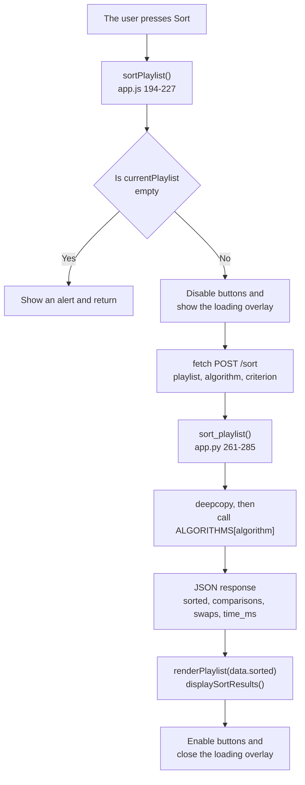
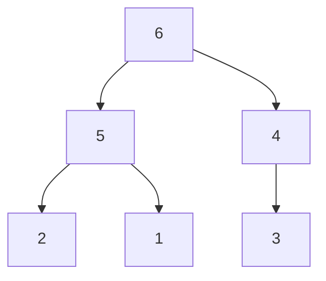

# HW2 Code Walkthrough — Music Playlist Manager

[Repository Guide](../../README.md) | [English](Code-Walkthrough.md) | [한국어](Code-Walkthrough.ko.md)

> **Last Updated:** 2026-11-16
>
> Introduction to Algorithms, Cormen, Leiserson, Rivest, and Stein, Ch 2, 6, 7

> **Learning Objectives:**
> 1. Explain what each line of the data generator, the six sort functions, and the routes in `app.py` does
> 2. Locate the statements that increment the counters in each sort function and trace the counter values step by step on a small input
> 3. Explain how `app.js` calls the API and draws tables and cards from the responses
> 4. Explain how `index.html` and `style.css` build each area of the page
> 5. Explain the flow of one request from the browser through the server back to the page, and the complexity of each function

---

## Table of Contents

- [1. File Layout](#1-file-layout)
- [2. Imports and App Creation](#2-imports-and-app-creation)
- [3. Song Data and Playlist Generation](#3-song-data-and-playlist-generation)
- [4. The Sort Function Contract and Selection Sort](#4-the-sort-function-contract-and-selection-sort)
- [5. Insertion Sort](#5-insertion-sort)
- [6. Merge Sort](#6-merge-sort)
- [7. Bubble Sort](#7-bubble-sort)
- [8. Quick Sort](#8-quick-sort)
- [9. Heap Sort](#9-heap-sort)
- [10. The Algorithm Table and the Key Function](#10-the-algorithm-table-and-the-key-function)
- [11. Routes](#11-routes)
  - [11.1 Front Page](#111-front-page)
  - [11.2 Playlist Generation Route](#112-playlist-generation-route)
  - [11.3 Sort Route](#113-sort-route)
  - [11.4 Compare Route](#114-compare-route)
  - [11.5 Entry Point](#115-entry-point)
- [12. Page Structure](#12-page-structure)
  - [12.1 Head and Header](#121-head-and-header)
  - [12.2 Control Area](#122-control-area)
  - [12.3 Info Line and Result Cards](#123-info-line-and-result-cards)
  - [12.4 Playlist Table and Loading Overlay](#124-playlist-table-and-loading-overlay)
- [13. Page Behavior](#13-page-behavior)
  - [13.1 State and Helper Functions](#131-state-and-helper-functions)
  - [13.2 Drawing the Playlist Table](#132-drawing-the-playlist-table)
  - [13.3 Sort Result Card](#133-sort-result-card)
  - [13.4 Comparison Table](#134-comparison-table)
  - [13.5 Clearing Results](#135-clearing-results)
  - [13.6 Playlist Generation Request](#136-playlist-generation-request)
  - [13.7 Sort Request](#137-sort-request)
  - [13.8 Compare Request](#138-compare-request)
  - [13.9 Initialization](#139-initialization)
- [14. Page Style](#14-page-style)
- [15. Request Flow and Execution Traces](#15-request-flow-and-execution-traces)
  - [15.1 Flow of a Sort Request](#151-flow-of-a-sort-request)
  - [15.2 Traces of Selection, Insertion, and Bubble Sort](#152-traces-of-selection-insertion-and-bubble-sort)
  - [15.3 Trace of Merge Sort](#153-trace-of-merge-sort)
  - [15.4 Trace of Quick Sort](#154-trace-of-quick-sort)
  - [15.5 Trace of Heap Sort](#155-trace-of-heap-sort)
- [16. Complexity](#16-complexity)
- [Summary](#summary)
- [Self-Check Questions](#self-check-questions)

---

<br>

## 1. File Layout

> **Try It First:** This document contains the complete code and line-by-line explanations. Solve the problems in the [assignment handout](Original/Assignment.md) yourself before reading on.

The companion document, the [HW2 Assignment Explanation](Assignment-Explanation.md), covers the requirements, design, test results, and the report's analysis questions. This document reads the five files in `Solution/` from top to bottom. All line numbers refer to each file.

| File | Lines | Part | Role |
|:-----|:-----|:-----|:-----|
| `app.py` | 1-6 | Imports, Flask app creation | Server setup |
| `app.py` | 8-67 | Song data pools, `generate_playlist` | Random playlist |
| `app.py` | 70-90 | Comment on the sort function contract, `selection_sort` | Sorting |
| `app.py` | 93-108 | `insertion_sort` | Sorting |
| `app.py` | 111-138 | `merge_sort`, `_merge` | Sorting |
| `app.py` | 141-153 | `bubble_sort` | Sorting |
| `app.py` | 156-179 | `quick_sort`, `_quick_sort_helper`, `_partition` | Sorting |
| `app.py` | 182-208 | `heap_sort`, `_heapify` | Sorting |
| `app.py` | 211-235 | `ALGORITHMS`, `get_key_function` | Helpers |
| `app.py` | 238-315 | Four routes and the entry point | API |
| `static/index.html` | 1-94 | Header, control area, result cards, playlist table, loading overlay | Page structure |
| `static/app.js` | 1-269 | State, display functions, API calls, event wiring | Page behavior |
| `static/style.css` | 1-350 | Styles of cards, buttons, tables, and the loading overlay | Page style |
| `requirements.txt` | 1 | `flask` | Dependency |

*Table 1. Layout of the solution files*

---

<br>

## 2. Imports and App Creation

```python
from flask import Flask, request, jsonify, send_from_directory
import time
import copy
import random

app = Flask(__name__, static_folder="static", static_url_path="/static")
```

Line 1 imports from Flask the app object `Flask`, `request` for reading the request body, `jsonify` for turning a dict into a JSON response, and `send_from_directory` for returning a file. `time` on line 2 is used for `time.perf_counter()`, which times the sort, `copy` on line 3 for `copy.deepcopy()`, which deep-copies the playlist, and `random` on line 4 for generating songs at random.

Line 6 creates the app and serves the files of the `static` folder under the `/static` path. That is why `/static/style.css` and `/static/app.js` in `index.html` are served without separate routes. Flask resolves the relative path `static` against the folder that contains `app.py`, so the server finds the same files no matter which directory it is started from.

The only external dependency is the single line `flask` in `requirements.txt`. The version is not pinned, so the latest Flask at installation time is installed.

---

<br>

## 3. Song Data and Playlist Generation

```python
# ---------------------------------------------------------------------------
# Random song data pools
# ---------------------------------------------------------------------------

ADJECTIVES = [
    "Midnight", "Golden", "Electric", "Broken", "Silent", "Burning", "Crystal",
    "Fading", "Lost", "Eternal", "Neon", "Velvet", "Frozen", "Wild", "Sacred",
    "Hollow", "Crimson", "Silver", "Endless", "Violet", "Bitter", "Gentle",
    "Shattered", "Rising", "Falling", "Hidden", "Wicked", "Tender", "Blazing",
    "Lonely", "Radiant", "Savage", "Scarlet", "Dreamy", "Ghostly",
]

NOUNS = [
    "Dreams", "Heart", "Sky", "Road", "Fire", "Rain", "Shadow", "Light",
    "Storm", "Echo", "Ocean", "River", "Moon", "Star", "Night", "Dawn",
    "Horizon", "Memory", "Flame", "Whisper", "Thunder", "Wave", "Garden",
    "Paradise", "Sunset", "Breeze", "Silence", "Dance", "Kiss", "Soul",
    "Spirit", "Desire", "Illusion", "Fantasy", "Miracle",
]

FIRST_NAMES = [
    "Taylor", "Ed", "Adele", "Bruno", "Ariana", "Drake", "Billie", "Dua",
    "Harry", "Olivia", "Sam", "Rihanna", "Justin", "Selena", "Shawn",
    "Camila", "Charlie", "Demi", "Halsey", "Lizzo", "Post", "Travis",
    "Khalid", "Sia", "Lana", "Abel", "Zara", "Lewis", "Ellie", "James",
]

LAST_NAMES = [
    "Swift", "Sheeran", "Mars", "Grande", "Eilish", "Lipa", "Styles",
    "Rodrigo", "Smith", "Bieber", "Gomez", "Mendes", "Cabello", "Puth",
    "Lovato", "Malone", "Scott", "Del Rey", "Larsson", "Capaldi",
    "Goulding", "Bay", "Blunt", "Arthur", "Kim", "Park", "Lee", "Chen",
    "Wang", "Lopez",
]


def generate_playlist(n):
    """Generate a list of n random songs."""
    playlist = []
    for _ in range(n):
        adj = random.choice(ADJECTIVES)
        noun = random.choice(NOUNS)
        if random.random() < 0.3:
            adj2 = random.choice(ADJECTIVES)
            title = f"{adj} {adj2} {noun}"
        else:
            title = f"{adj} {noun}"

        first = random.choice(FIRST_NAMES)
        last = random.choice(LAST_NAMES)
        artist = f"{first} {last}"

        song = {
            "title": title,
            "artist": artist,
            "duration": random.randint(120, 420),
            "play_count": random.randint(0, 100000),
        }
        playlist.append(song)
    return playlist
```

`ADJECTIVES` on lines 12-18 and `NOUNS` on lines 20-26 hold 35 words each, and `FIRST_NAMES` on lines 28-33 and `LAST_NAMES` on lines 35-41 hold 30 words each. Names in capitals follow the Python convention for constants that the module never changes.

`generate_playlist(n)` loops `n` times and builds one song per iteration (line 47). Lines 48-49 pick an adjective and a noun, and `random.random()` on line 50 returns a float in [0, 1), so with probability 30% lines 51-52 build a three-word title with one more adjective. The other 70% is the two-word title on line 54. Lines 56-58 pick a first name and a last name to form the artist. Lines 60-65 build the song as a dict, and since `random.randint(a, b)` includes both a and b, the duration is 120-420 seconds and the play count 0-100,000. Line 66 appends the song to the list and line 67 returns the list. Each song takes constant time, so the whole function is Θ(n).

---

<br>

## 4. The Sort Function Contract and Selection Sort

```python
# ---------------------------------------------------------------------------
# Sorting algorithms — each receives (arr, key, stats) where
#   arr  : list of song dicts (mutated in-place for in-place sorts)
#   key  : function  song -> comparable value
#   stats: {"comparisons": 0, "swaps": 0}  (mutated)
# Returns the sorted list.
# ---------------------------------------------------------------------------


def selection_sort(arr, key, stats):
    n = len(arr)
    for i in range(n):
        min_idx = i
        for j in range(i + 1, n):
            stats["comparisons"] += 1
            if key(arr[j]) < key(arr[min_idx]):
                min_idx = j
        if min_idx != i:
            arr[i], arr[min_idx] = arr[min_idx], arr[i]
            stats["swaps"] += 1
    return arr
```

The comment on lines 70-76 is the contract that the six sort functions follow. Every sort function receives the song list `arr`, the key function `key`, and the counter dict `stats`, and returns the sorted list. The counters are passed as a dict, so values changed inside the function remain visible to the caller.

Line 80 of `selection_sort` stores the length in `n`. The outer loop on line 81 moves the position `i` from 0 to n−1, and line 82 sets the position of the minimum so far to `i`. The inner loop on lines 83-86 scans from `i + 1` to the end, incrementing the comparison counter on line 84, and when line 85 finds a smaller key, line 86 updates `min_idx`. Line 87 skips the swap if the minimum is already in place, and otherwise line 88 swaps the two elements with a tuple assignment and line 89 increments the swap counter. Line 90 returns `arr`, which was modified in place. The last iteration (i = n−1) has an empty inner loop and passes without a comparison.

---

<br>

## 5. Insertion Sort

```python
def insertion_sort(arr, key, stats):
    n = len(arr)
    for i in range(1, n):
        current = arr[i]
        current_key = key(current)
        j = i - 1
        while j >= 0:
            stats["comparisons"] += 1
            if key(arr[j]) > current_key:
                arr[j + 1] = arr[j]
                stats["swaps"] += 1
                j -= 1
            else:
                break
        arr[j + 1] = current
    return arr
```

The outer loop on line 95 starts at the second element, because a front part of one element is already sorted. Line 96 saves the element to insert in `current`, line 97 its key in `current_key`, and line 98 sets the comparison position `j` just to its left.

The `while` on line 99 repeats while `j` is at least 0. Line 100 increments the comparison counter, and if the key of `arr[j]` on line 101 is greater than `current_key`, line 102 copies `arr[j]` one place right into `arr[j + 1]`, line 103 increments the move counter, and line 104 decrements `j`. Otherwise the `break` on line 106 ends the loop. When the loop ends, `j + 1` is the free slot, so line 107 puts the saved element there. This assignment is not counted. Because the key is computed once on line 97, each comparison calls the key function only once, on line 101.

---

<br>

## 6. Merge Sort

```python
def merge_sort(arr, key, stats):
    if len(arr) <= 1:
        return arr
    mid = len(arr) // 2
    left = merge_sort(arr[:mid], key, stats)
    right = merge_sort(arr[mid:], key, stats)
    return _merge(left, right, key, stats)


def _merge(left, right, key, stats):
    result = []
    i = j = 0
    while i < len(left) and j < len(right):
        stats["comparisons"] += 1
        if key(left[i]) <= key(right[j]):
            result.append(left[i])
            i += 1
        else:
            result.append(right[j])
            j += 1
        stats["swaps"] += 1
    while i < len(left):
        result.append(left[i])
        i += 1
    while j < len(right):
        result.append(right[j])
        j += 1
    return result
```

Lines 112-113 of `merge_sort` are the base case of the recursion: a list of at most one element is returned unchanged. Line 114 finds the middle position by integer division, and lines 115-116 slice the front half `arr[:mid]` and the back half `arr[mid:]` into new lists and call the function recursively on each. Line 117 returns a new list that `_merge` builds from the two results. The original `arr` is not changed.

Line 121 of `_merge` creates the result list and line 122 sets the read positions `i` and `j` of the two lists to 0. The loop on line 123 continues while both lists still have elements. Line 124 increments the comparison counter, and if the key of the left element is at most the key of the right element on line 125, lines 126-127 append the left element and increment `i`, and otherwise lines 129-130 append the right element and increment `j`. Line 131 increments the move counter because one element was appended either way. Lines 132-134 and lines 135-137 append the leftover elements without touching the counters. At most one of these two loops actually runs. Because of `<=` on line 125, on equal keys the left element, which was originally earlier, is appended first, so the sort is stable.

---

<br>

## 7. Bubble Sort

```python
def bubble_sort(arr, key, stats):
    n = len(arr)
    for i in range(n):
        swapped = False
        for j in range(0, n - i - 1):
            stats["comparisons"] += 1
            if key(arr[j]) > key(arr[j + 1]):
                arr[j], arr[j + 1] = arr[j + 1], arr[j]
                stats["swaps"] += 1
                swapped = True
        if not swapped:
            break
    return arr
```

The outer loop on line 143 makes at most n passes. Line 144 sets `swapped`, which records whether this pass made a swap, to false. The inner loop on line 145 moves `j` from 0 to n−i−2 and looks at the neighbors `arr[j]` and `arr[j + 1]`. After `i` passes the `i` largest elements are in place at the end, so the range shrinks to `n - i - 1`. Line 146 increments the comparison counter, and if the earlier element's key is greater on line 147, line 148 swaps the two elements and lines 149-150 increment the swap counter and set `swapped` to true. Lines 151-152 end the outer loop when a pass made no swap, because the list is then already sorted.

---

<br>

## 8. Quick Sort

```python
def quick_sort(arr, key, stats):
    _quick_sort_helper(arr, 0, len(arr) - 1, key, stats)
    return arr


def _quick_sort_helper(arr, low, high, key, stats):
    if low < high:
        pi = _partition(arr, low, high, key, stats)
        _quick_sort_helper(arr, low, pi - 1, key, stats)
        _quick_sort_helper(arr, pi + 1, high, key, stats)


def _partition(arr, low, high, key, stats):
    pivot = key(arr[high])
    i = low - 1
    for j in range(low, high):
        stats["comparisons"] += 1
        if key(arr[j]) <= pivot:
            i += 1
            arr[i], arr[j] = arr[j], arr[i]
            stats["swaps"] += 1
    arr[i + 1], arr[high] = arr[high], arr[i + 1]
    stats["swaps"] += 1
    return i + 1
```

`quick_sort` calls the helper on the whole range from `0` to `len(arr) - 1` (line 157) and returns `arr`, sorted in place. For an empty list `high` is −1, so the condition on line 162 is false and nothing happens.

Line 162 of `_quick_sort_helper` proceeds only when the range has at least two elements. Line 163 partitions the range and receives the pivot's final position `pi`, and lines 164-165 recursively sort the left and right ranges, excluding the pivot.

Line 169 of `_partition` stores the key of the last element as the pivot. `i` on line 170 is the last position of the "at most the pivot" region, which is empty at first, so it starts at `low - 1`. The loop on line 171 moves `j` from `low` to `high - 1`. Line 172 increments the comparison counter, and if the key of `arr[j]` is at most the pivot on line 173, line 174 widens the region by one, line 175 moves `arr[j]` to the end of the region, and line 176 increments the swap counter. When `i` equals `j`, line 175 swaps an element with itself, and line 176 still counts it. Line 177 moves the pivot to `i + 1`, just after the region, line 178 counts this swap, and line 179 returns the pivot's position.

---

<br>

## 9. Heap Sort

```python
def heap_sort(arr, key, stats):
    n = len(arr)
    for i in range(n // 2 - 1, -1, -1):
        _heapify(arr, n, i, key, stats)
    for i in range(n - 1, 0, -1):
        arr[0], arr[i] = arr[i], arr[0]
        stats["swaps"] += 1
        _heapify(arr, i, 0, key, stats)
    return arr


def _heapify(arr, n, i, key, stats):
    largest = i
    left = 2 * i + 1
    right = 2 * i + 2
    if left < n:
        stats["comparisons"] += 1
        if key(arr[left]) > key(arr[largest]):
            largest = left
    if right < n:
        stats["comparisons"] += 1
        if key(arr[right]) > key(arr[largest]):
            largest = right
    if largest != i:
        arr[i], arr[largest] = arr[largest], arr[i]
        stats["swaps"] += 1
        _heapify(arr, n, largest, key, stats)
```

Line 184 of `heap_sort` moves `i` backward from n//2−1 to 0. n//2−1 is the last node with a child, and every later node is a leaf and therefore already a heap of size 1. Line 185 calls `_heapify` on each node to turn the subtree rooted there into a heap, and because the lower subtrees are handled first, the whole array is a max-heap once the loop reaches the root.

The loop on line 186 shrinks the end of the heap `i` from n−1 to 1. Line 187 swaps the maximum at the root `arr[0]` with the end of the heap, placing it in its final position, line 188 counts this swap, and line 189 calls `_heapify` at the root of the heap shrunk to size `i` to restore the heap property.

The `n` of `_heapify(arr, n, i, ...)` is not the array length but the current heap size. Lines 194-196 set the candidate for the largest node to `i` and compute the positions of the two children. Lines 197-200 count a comparison when the left child is inside the heap and update the candidate if the child is larger, and lines 201-204 do the same for the right child. If the candidate is not `i` on line 205, lines 206-207 swap the two nodes and count the swap, and line 208 repeats the same step recursively at the position it moved down to. If the candidate is `i`, this subtree is already a heap and the call ends.

---

<br>

## 10. The Algorithm Table and the Key Function

```python
# ---------------------------------------------------------------------------
# Helpers
# ---------------------------------------------------------------------------

ALGORITHMS = {
    "selection": selection_sort,
    "insertion": insertion_sort,
    "merge": merge_sort,
    "bubble": bubble_sort,
    "quick": quick_sort,
    "heap": heap_sort,
}


def get_key_function(criterion):
    if criterion == "title":
        return lambda song: song["title"].lower()
    elif criterion == "artist":
        return lambda song: song["artist"].lower()
    elif criterion == "duration":
        return lambda song: song["duration"]
    elif criterion == "play_count":
        return lambda song: song["play_count"]
    else:
        return lambda song: song["title"].lower()
```

`ALGORITHMS` on lines 215-222 is a dict that links the names used by the API to the sort functions. Python treats functions as values, so `ALGORITHMS["quick"]` is the function `quick_sort` itself, and `/sort` uses this dict to look up a function by name. Since Python 3.7 dicts keep insertion order, so `/compare` runs the algorithms in this order (selection, insertion, merge, bubble, quick, heap).

`get_key_function` on lines 225-235 takes a criterion name and returns a key function built with `lambda`. Titles and artists return strings lowercased with `.lower()`, durations and play counts return integers, and an unknown name gets the title's key function (lines 234-235). Choosing the key function costs constant time, but a string key builds a new string at every call, so the number of key calls during a sort affects the execution time.

---

<br>

## 11. Routes

### 11.1 Front Page

```python
# ---------------------------------------------------------------------------
# Routes
# ---------------------------------------------------------------------------


@app.route("/")
def index():
    return send_from_directory("static", "index.html")
```

`@app.route("/")` on line 243 connects `GET /` requests to the function `index` on line 244. Without `methods`, a route accepts only `GET`. Line 245 returns `index.html` from the `static` folder.

### 11.2 Playlist Generation Route

```python
@app.route("/generate", methods=["POST"])
def generate():
    data = request.get_json() or {}
    count = data.get("count", 10)
    try:
        count = int(count)
    except (TypeError, ValueError):
        return jsonify({"error": "count must be a number"}), 400
    count = max(1, min(count, 10000))
    playlist = generate_playlist(count)
    return jsonify({"playlist": playlist})
```

Line 248 makes this route accept only `POST`. `request.get_json()` on line 250 turns the JSON body into a Python dict, and if the body is empty and gives `None`, `or {}` substitutes an empty dict. Line 251 uses 10 when `count` is missing. Lines 252-255 return an error message with status code 400 when the `int()` conversion fails (`TypeError` or `ValueError`). Line 256 clamps the song count to 1-10,000 with `min` and `max`, and lines 257-258 generate the playlist and respond with `{"playlist": [...]}`.

### 11.3 Sort Route

```python
@app.route("/sort", methods=["POST"])
def sort_playlist():
    data = request.get_json() or {}
    playlist = data.get("playlist", [])
    algorithm = data.get("algorithm", "selection")
    criterion = data.get("criterion", "title")

    sort_func = ALGORITHMS.get(algorithm)
    if not sort_func:
        return jsonify({"error": f"Unknown algorithm: {algorithm}"}), 400

    key_func = get_key_function(criterion)
    arr = copy.deepcopy(playlist)
    stats = {"comparisons": 0, "swaps": 0}

    start = time.perf_counter()
    sorted_arr = sort_func(arr, key_func, stats)
    elapsed = time.perf_counter() - start

    return jsonify({
        "sorted": sorted_arr,
        "comparisons": stats["comparisons"],
        "swaps": stats["swaps"],
        "time_ms": round(elapsed * 1000, 4),
    })
```

Lines 263-266 take the playlist, the algorithm name, and the criterion name from the request, using an empty list, `"selection"`, and `"title"` when they are missing. Lines 268-270 look up the sort function by the algorithm name and return a 400 error if there is none. Line 272 chooses the key function, line 273 deep-copies the playlist, and line 274 sets the counters to 0.

Lines 276-278 time only the call to the sort function. `time.perf_counter()` returns the most precise monotonic clock of the system as a float in seconds, so the difference of two readings is the elapsed time. Line 277 receives the sort function's return value in `sorted_arr`. Merge sort returns a new list, so this return value, not `arr`, must be used. Lines 280-285 return the sorted result, the two counters, and the time converted to milliseconds and rounded to four decimal places as JSON.

### 11.4 Compare Route

```python
@app.route("/compare", methods=["POST"])
def compare():
    data = request.get_json() or {}
    playlist = data.get("playlist", [])
    criterion = data.get("criterion", "title")

    key_func = get_key_function(criterion)
    results = {}

    for name, sort_func in ALGORITHMS.items():
        arr = copy.deepcopy(playlist)
        stats = {"comparisons": 0, "swaps": 0}

        start = time.perf_counter()
        sort_func(arr, key_func, stats)
        elapsed = time.perf_counter() - start

        results[name] = {
            "comparisons": stats["comparisons"],
            "swaps": stats["swaps"],
            "time_ms": round(elapsed * 1000, 4),
        }

    return jsonify({"results": results})
```

Lines 290-292 take the playlist and the criterion. This route does not take an algorithm name. Line 294 chooses the key function once, and line 295 creates a dict to collect the results. The loop on line 297 goes through every name and function in `ALGORITHMS`, line 298 makes a fresh deep copy of the original playlist for each algorithm, and line 299 creates new counters. Lines 301-303 time only the sorting part, and the return value is not used. Lines 305-309 store the counters and time under the algorithm's name, and line 311 responds with `{"results": {...}}`. Because `jsonify` sorts the keys, the order inside the response is `bubble`, `heap`, `insertion`, `merge`, `quick`, `selection`.

### 11.5 Entry Point

```python
if __name__ == "__main__":
    app.run(debug=True, port=5001)
```

The condition on line 314 is true only when the file is run directly with `python3 app.py`. When another module imports it with `import app`, no server starts. Line 315 runs the Flask development server on port 5001 in debug mode. Debug mode restarts the server when the code changes and shows a traceback in the browser on errors, so it is for development only.

---

<br>

## 12. Page Structure

### 12.1 Head and Header

```html
<!DOCTYPE html>
<html lang="en">
<head>
    <meta charset="UTF-8" />
    <meta name="viewport" content="width=device-width, initial-scale=1.0" />
    <title>Music Playlist Manager</title>
    <link rel="stylesheet" href="/static/style.css" />
</head>
<body>
    <header>
        <h1>Music Playlist Manager</h1>
        <p>Sort &amp; compare algorithms on a generated playlist</p>
    </header>
```

Lines 1-8 set the document type, the UTF-8 character set, a viewport fitted to mobile screens, the tab title, and the stylesheet. The `header` on lines 10-13 shows the title "Music Playlist Manager" and a one-line description. `&amp;` on line 12 is how HTML writes the `&` character.

### 12.2 Control Area

```html
    <main class="container">
        <!-- Controls -->
        <section class="card controls">
            <div class="control-row">
                <div class="control-group">
                    <label for="playlist-count">Number of Songs</label>
                    <input type="number" id="playlist-count" value="100" min="1" max="10000" />
                </div>
                <button id="btn-generate" class="btn btn-primary">Generate Random</button>
            </div>

            <div class="control-row">
                <div class="control-group">
                    <label for="algorithm-select">Algorithm</label>
                    <select id="algorithm-select">
                        <option value="selection">Selection Sort</option>
                        <option value="insertion">Insertion Sort</option>
                        <option value="merge">Merge Sort</option>
                        <option value="bubble">Bubble Sort</option>
                        <option value="quick">Quick Sort</option>
                        <option value="heap">Heap Sort</option>
                    </select>
                </div>
                <div class="control-group">
                    <label for="criterion-select">Sort By</label>
                    <select id="criterion-select">
                        <option value="title">Title</option>
                        <option value="artist">Artist</option>
                        <option value="duration">Duration</option>
                        <option value="play_count">Play Count</option>
                    </select>
                </div>
                <button id="btn-sort" class="btn btn-accent">Sort</button>
                <button id="btn-compare" class="btn btn-compare">Compare All</button>
            </div>
        </section>
```

The `section` on line 17 is the card-shaped control area, split into two rows. The first row (lines 18-24) holds the number box for the song count and the "Generate Random" button. The number box on line 21 defaults to 100 and suggests 1-10,000 with `min` and `max`, but this limit only helps input in the browser, so the server clamps the range again on line 256. The second row (lines 26-49) holds the algorithm dropdown (lines 29-36), the criterion dropdown (lines 40-45), the "Sort" button (line 47), and the "Compare All" button (line 48). The `value` of each `option` must match the keys of the server's `ALGORITHMS` and the criterion names of `get_key_function` character for character, while the text shown on the page is separate. The `for` attribute of a `label` links it to the input element with the same `id`, so clicking the label also selects the input.

### 12.3 Info Line and Result Cards

```html
        <!-- Playlist info -->
        <div class="playlist-info">
            <span id="playlist-size">No playlist generated</span>
        </div>

        <!-- Sort Results -->
        <section id="sort-results" class="card results-card" style="display:none;"></section>

        <!-- Comparison Results -->
        <section id="comparison-results" class="card results-card" style="display:none;"></section>
```

The `span` on line 54 is the info line that shows the song count and the sort criterion, and it starts as "No playlist generated". The two `section` elements on lines 58 and 61 are the sort result card and the comparison result card. They start hidden with `style="display:none;"` and empty, and `app.js` fills them and makes them visible when results arrive.

### 12.4 Playlist Table and Loading Overlay

```html
        <!-- Playlist Table -->
        <section class="card table-card">
            <div class="table-wrapper">
                <table id="playlist-table">
                    <thead>
                        <tr>
                            <th>#</th>
                            <th>Title</th>
                            <th>Artist</th>
                            <th>Duration</th>
                            <th>Play Count</th>
                        </tr>
                    </thead>
                    <tbody>
                        <tr>
                            <td colspan="5" class="empty-msg">Generate a playlist to get started</td>
                        </tr>
                    </tbody>
                </table>
            </div>
        </section>
    </main>

    <!-- Loading overlay -->
    <div id="loading-overlay" class="loading-overlay" style="display:none;">
        <div class="spinner"></div>
        <p>Processing...</p>
    </div>

    <script src="/static/app.js"></script>
</body>
</html>
```

The table on lines 66-81 has five columns, number, title, artist, duration, and play count, and at first shows one row of guidance text spanning all five cells (`colspan="5"`). The `table-wrapper` on line 65 makes a long table scroll only inside this area. Lines 87-90 are the loading overlay that covers the whole page during a request, hidden at first. Line 92 loads `app.js` at the end of `body`, so all the elements above exist when the script runs.

---

<br>

## 13. Page Behavior

### 13.1 State and Helper Functions

```javascript
// ---------------------------------------------------------------------------
// State
// ---------------------------------------------------------------------------
let currentPlaylist = [];

const CRITERIA_NAMES = {
    title: "Title",
    artist: "Artist",
    duration: "Duration",
    play_count: "Play Count",
};

// ---------------------------------------------------------------------------
// Helpers
// ---------------------------------------------------------------------------
function formatDuration(seconds) {
    const min = Math.floor(seconds / 60);
    const sec = seconds % 60;
    return `${min}:${sec.toString().padStart(2, "0")}`;
}

function formatNumber(n) {
    return n.toLocaleString();
}

function showLoading(visible) {
    document.getElementById("loading-overlay").style.display = visible
        ? "flex"
        : "none";
}

function setButtonsDisabled(disabled) {
    document.querySelectorAll(".btn").forEach((b) => (b.disabled = disabled));
}
```

`currentPlaylist` on line 4 is the most recently generated playlist and the only state of the page. `CRITERIA_NAMES` on lines 6-11 turns criterion names into the text shown on the page. `formatDuration` on lines 16-20 turns seconds into "minutes:seconds", and `padStart(2, "0")` pads the seconds to two digits (for example, 214 seconds becomes `3:34`). `formatNumber` on lines 22-24 inserts thousands separators with `toLocaleString()`. `showLoading` on lines 26-30 shows the loading overlay with `flex` or hides it with `none`, and `setButtonsDisabled` on lines 32-34 disables or enables every button with the `.btn` class at once.

### 13.2 Drawing the Playlist Table

```javascript
// ---------------------------------------------------------------------------
// Render playlist table
// ---------------------------------------------------------------------------
function renderPlaylist(playlist) {
    const tbody = document.querySelector("#playlist-table tbody");
    if (playlist.length === 0) {
        tbody.innerHTML =
            '<tr><td colspan="5" class="empty-msg">Generate a playlist to get started</td></tr>';
        document.getElementById("playlist-size").textContent =
            "No playlist generated";
        return;
    }

    const limit = Math.min(playlist.length, 500);
    let html = "";
    for (let i = 0; i < limit; i++) {
        const s = playlist[i];
        html += `<tr>
            <td>${i + 1}</td>
            <td>${escapeHtml(s.title)}</td>
            <td>${escapeHtml(s.artist)}</td>
            <td>${formatDuration(s.duration)}</td>
            <td>${formatNumber(s.play_count)}</td>
        </tr>`;
    }
    tbody.innerHTML = html;

    let sizeText = `${formatNumber(playlist.length)} songs`;
    if (playlist.length > limit) {
        sizeText += ` (showing first ${limit})`;
    }
    document.getElementById("playlist-size").textContent = sizeText;
}

function escapeHtml(str) {
    const div = document.createElement("div");
    div.textContent = str;
    return div.innerHTML;
}
```

`renderPlaylist` shows the guidance text and "No playlist generated" and returns when the list is empty (lines 41-47). Line 49 limits the number of drawn rows to 500, because putting all 10,000 songs into the DOM slows the browser. Lines 51-60 join, for each row, the number, title, artist, the duration as minutes:seconds, and the play count with thousands separators into a template string, and line 61 inserts them all at once with `innerHTML`. Lines 63-67 write the song count to the info line and append "(showing first 500)" beyond 500 songs.

`escapeHtml` on lines 70-74 puts a string into the `textContent` of a `div` and reads it back through `innerHTML`, turning characters such as `<` and `&` into HTML entities. Titles and artists are inserted directly into `innerHTML`, so without this step a tag inside a string could be interpreted as HTML. `/sort` returns the playlist sent by the client as is, so it cannot be assumed that only strings generated by the server come in.

### 13.3 Sort Result Card

```javascript
// ---------------------------------------------------------------------------
// Display sort results
// ---------------------------------------------------------------------------
function displaySortResults(algorithm, criterion, data) {
    const NAMES = {
        selection: "Selection Sort",
        insertion: "Insertion Sort",
        merge: "Merge Sort",
        bubble: "Bubble Sort",
        quick: "Quick Sort",
        heap: "Heap Sort",
    };
    const container = document.getElementById("sort-results");
    container.style.display = "block";
    container.innerHTML = `
        <h3>Sort Results — by ${CRITERIA_NAMES[criterion] || criterion}</h3>
        <div class="metrics">
            <div class="metric">
                <span class="label">Algorithm</span>
                <span class="value" style="font-size:16px">${NAMES[algorithm] || algorithm}</span>
            </div>
            <div class="metric">
                <span class="label">Comparisons</span>
                <span class="value">${formatNumber(data.comparisons)}</span>
            </div>
            <div class="metric">
                <span class="label">Swaps / Moves</span>
                <span class="value">${formatNumber(data.swaps)}</span>
            </div>
            <div class="metric">
                <span class="label">Time</span>
                <span class="value">${data.time_ms.toFixed(4)} ms</span>
            </div>
        </div>`;
}
```

Lines 80-87 are a table that turns algorithm names into the text shown on the page. Lines 88-89 find the sort result card and make it visible, and lines 90-109 fill the title and four cells (algorithm, comparisons, swaps/moves, time) with a template string. `toFixed(4)` on line 107 shows the time to four decimal places. On an error response `data.time_ms` is missing, this line throws, and the `catch` of Section 13.7 shows an alert.

### 13.4 Comparison Table

```javascript
// ---------------------------------------------------------------------------
// Display comparison table
// ---------------------------------------------------------------------------
function displayComparisonTable(results, criterion, count) {
    const container = document.getElementById("comparison-results");
    container.style.display = "block";

    const NAMES = {
        selection: "Selection Sort",
        insertion: "Insertion Sort",
        merge: "Merge Sort",
        bubble: "Bubble Sort",
        quick: "Quick Sort",
        heap: "Heap Sort",
    };

    const entries = Object.entries(results);

    const minComp = Math.min(...entries.map(([, r]) => r.comparisons));
    const minSwap = Math.min(...entries.map(([, r]) => r.swaps));
    const minTime = Math.min(...entries.map(([, r]) => r.time_ms));

    let rows = "";
    for (const [algo, data] of entries) {
        rows += `<tr>
            <td>${NAMES[algo] || algo}</td>
            <td class="${data.comparisons === minComp ? "best" : ""}">${formatNumber(data.comparisons)}</td>
            <td class="${data.swaps === minSwap ? "best" : ""}">${formatNumber(data.swaps)}</td>
            <td class="${data.time_ms === minTime ? "best" : ""}">${data.time_ms.toFixed(4)}</td>
        </tr>`;
    }

    container.innerHTML = `
        <h3>Algorithm Comparison — ${formatNumber(count)} songs by ${CRITERIA_NAMES[criterion] || criterion}</h3>
        <table class="comparison-table">
            <thead>
                <tr>
                    <th>Algorithm</th>
                    <th>Comparisons</th>
                    <th>Swaps / Moves</th>
                    <th>Time (ms)</th>
                </tr>
            </thead>
            <tbody>${rows}</tbody>
        </table>`;
}
```

Line 128 turns the result object into an array of `[name, value]` pairs. Lines 130-132 compute the minimum of each column: comparisons, swaps/moves, and time. The `...` in `Math.min(...array)` spreads the array into an argument list. Lines 135-142 build a row for each algorithm and add the `best` class to a cell whose value equals the column minimum. If two or more algorithms share the minimum, all of them are highlighted. Lines 144-156 put the title and the table into the card. Because `Object.entries` follows the key order of the response, the rows come in the lexicographic order sent by the server.

### 13.5 Clearing Results

```javascript
// ---------------------------------------------------------------------------
// Clear results
// ---------------------------------------------------------------------------
function clearResults() {
    document.getElementById("sort-results").style.display = "none";
    document.getElementById("comparison-results").style.display = "none";
}
```

`clearResults` hides the two result cards. `generatePlaylist` in Section 13.6 calls it so that no results of the previous list remain after a new playlist is generated.

### 13.6 Playlist Generation Request

```javascript
// ---------------------------------------------------------------------------
// API calls
// ---------------------------------------------------------------------------
async function generatePlaylist() {
    const count =
        parseInt(document.getElementById("playlist-count").value) || 100;
    setButtonsDisabled(true);
    showLoading(true);

    try {
        const res = await fetch("/generate", {
            method: "POST",
            headers: { "Content-Type": "application/json" },
            body: JSON.stringify({ count }),
        });
        const data = await res.json();
        currentPlaylist = data.playlist;
        renderPlaylist(currentPlaylist);
        clearResults();
    } catch (err) {
        alert("Failed to generate playlist: " + err.message);
    } finally {
        setButtonsDisabled(false);
        showLoading(false);
    }
}
```

Lines 171-172 read the entered song count as an integer and use 100 if it is not a number. Lines 173-174 disable the buttons and show the loading overlay. The `fetch` on lines 177-181 sends `{count}` as a JSON body to `/generate` with `POST`, and the `Content-Type` header is needed for the server's `request.get_json()` to read the body as JSON. `await` pauses this function until the response arrives without freezing the whole browser. Lines 182-185 read the response as JSON, store it in `currentPlaylist`, draw the table, and clear the previous results. Lines 186-187 report a network error with an alert, and the `finally` on lines 188-191 enables the buttons and closes the loading overlay whether the request succeeded or failed.

### 13.7 Sort Request

```javascript
async function sortPlaylist() {
    if (currentPlaylist.length === 0) {
        alert("Generate a playlist first!");
        return;
    }

    const algorithm = document.getElementById("algorithm-select").value;
    const criterion = document.getElementById("criterion-select").value;

    setButtonsDisabled(true);
    showLoading(true);

    try {
        const res = await fetch("/sort", {
            method: "POST",
            headers: { "Content-Type": "application/json" },
            body: JSON.stringify({
                playlist: currentPlaylist,
                algorithm,
                criterion,
            }),
        });
        const data = await res.json();
        renderPlaylist(data.sorted);
        document.getElementById("playlist-size").textContent +=
            ` — sorted by ${CRITERIA_NAMES[criterion]}`;
        displaySortResults(algorithm, criterion, data);
    } catch (err) {
        alert("Sort failed: " + err.message);
    } finally {
        setButtonsDisabled(false);
        showLoading(false);
    }
}
```

Lines 195-198 show an alert and return when there is no playlist. Lines 200-201 read the algorithm and the criterion from the two dropdowns. Lines 207-215 send `currentPlaylist`, the algorithm, and the criterion to `/sort`. In `{playlist: currentPlaylist, algorithm, criterion}` on lines 211-213, `algorithm` and `criterion` are shorthand that use the variables of the same name as values. Line 217 draws the sorted list `data.sorted` in the table, lines 218-219 append the sort criterion to the info line, and line 220 fills the result card. The sorted list is not stored in `currentPlaylist`, so the next sort or comparison always starts from the originally generated order.

### 13.8 Compare Request

```javascript
async function compareAll() {
    if (currentPlaylist.length === 0) {
        alert("Generate a playlist first!");
        return;
    }

    const criterion = document.getElementById("criterion-select").value;

    setButtonsDisabled(true);
    showLoading(true);

    try {
        const res = await fetch("/compare", {
            method: "POST",
            headers: { "Content-Type": "application/json" },
            body: JSON.stringify({ playlist: currentPlaylist, criterion }),
        });
        const data = await res.json();
        displayComparisonTable(data.results, criterion, currentPlaylist.length);
    } catch (err) {
        alert("Comparison failed: " + err.message);
    } finally {
        setButtonsDisabled(false);
        showLoading(false);
    }
}
```

`compareAll` has the same structure as `sortPlaylist`, but it sends only the criterion, not an algorithm (line 244). Line 247 draws the comparison table from the response's `results`, the criterion, and the song count. A compare request does not change the playlist table.

### 13.9 Initialization

```javascript
// ---------------------------------------------------------------------------
// Init
// ---------------------------------------------------------------------------
document.addEventListener("DOMContentLoaded", () => {
    document
        .getElementById("btn-generate")
        .addEventListener("click", generatePlaylist);
    document
        .getElementById("btn-sort")
        .addEventListener("click", sortPlaylist);
    document
        .getElementById("btn-compare")
        .addEventListener("click", compareAll);
});
```

Line 259 connects click handlers to the three buttons after the HTML document has been read (`DOMContentLoaded`). `app.js` is loaded at the end of `body`, so the buttons already exist at this point, but waiting for the event is safe regardless of where the script is placed.

---

<br>

## 14. Page Style

`style.css` (350 lines) only sets the look of the page and plays no part in its behavior. The role of each block is as follows.

| Lines | Selectors | Role |
|:-----|:-----|:-----|
| 1-8 | `*`, `*::before`, `*::after` | Removes default margins and includes borders and padding in widths with `box-sizing: border-box` |
| 10-16 | `body` | Sets the system font, the light gray background `#f0f2f5`, the text color, and the line height |
| 18-36 | `header`, `header h1`, `header p` | Sets the dark navy gradient header and the sizes of its title and description |
| 38-43 | `.container` | Limits the body width to 1000px and centers it |
| 45-52 | `.card` | Defines the card look with a white background, rounded corners, and a shadow |
| 54-80 | `.controls`, `.control-row`, `.control-group`, `.control-group label` | Lays out the control area with flex, wraps rows when narrow, and shows labels in small capitals |
| 82-108 | `input[type="number"]`, `select`, `:focus` | Sets the 40px height and border of the input box and dropdowns and the purple border on focus |
| 110-152 | `.btn`, `.btn:hover`, `.btn:active`, `.btn:disabled`, `.btn-primary`, `.btn-accent`, `.btn-compare` | Sets the common button look, the lift effect on hover, the translucency when disabled, and the purple, blue, and green gradients of the three buttons |
| 154-163 | `.playlist-info` | Sets the font size and gray color of the info line |
| 165-200 | `.results-card h3`, `.metrics`, `.metric`, `.metric .label`, `.metric .value` | Lays out the four cells of the sort result card as a grid that stretches with the width and sets the sizes of labels and values |
| 202-276 | `.table-card`, `.table-wrapper`, `table`, `thead`, `thead th`, `tbody td`, `tbody tr`, `.empty-msg` | Scrolls the playlist table within a maximum height of 520px, fixes the header row with `position: sticky`, right-aligns the number columns, and changes the background of even rows and hovered rows |
| 278-317 | `.comparison-table`, `.comparison-table th`, `.comparison-table td`, `.comparison-table .best` | Sets the alignment and borders of the comparison table and highlights minimum cells in bold green |
| 319-350 | `.loading-overlay`, `.loading-overlay p`, `.spinner`, `@keyframes spin` | Defines the translucent overlay that covers the page and a circular indicator that turns once every 0.8 seconds |

*Table 2. Selectors and roles of each block of style.css*

The highlight in the comparison table comes from the `best` class that `app.js` adds to cells (lines 138-140) together with the rule on lines 314-317. When `showLoading` sets `display` to `flex`, the flex layout on line 324 centers the spinner and the text on the screen.

---

<br>

## 15. Request Flow and Execution Traces

### 15.1 Flow of a Sort Request

Pressing "Sort" chains the functions in the following order.



*Figure 1. Order in which functions are chained when the "Sort" button is pressed*

"Generate Random" and "Compare All" have the same shape. The only differences are that the former stores the response of `/generate` in `currentPlaylist` and the latter draws the comparison table from the response of `/compare`.

### 15.2 Traces of Selection, Insertion, and Bubble Sort

The list `[5, 2, 4, 6, 1, 3]` used in Section 6.1 of the [HW2 Assignment Explanation](Assignment-Explanation.md) is sorted with the key function `lambda x: x`, and the list and the cumulative counters are recorded after each outer iteration. The values in the tables below come from executing the statements of the sort functions exactly.

| Selection sort i | List | Comparisons | Swaps | What this step does |
|:-----|:-----|-----:|-----:|:-----|
| 0 | [1, 2, 4, 6, 5, 3] | 5 | 1 | Swaps the minimum 1 with the 5 at position 0 |
| 1 | [1, 2, 4, 6, 5, 3] | 9 | 1 | The minimum 2 is already at position 1, so no swap |
| 2 | [1, 2, 3, 6, 5, 4] | 12 | 2 | Swaps the minimum 3 with 4 |
| 3 | [1, 2, 3, 4, 5, 6] | 14 | 3 | Swaps the minimum 4 with 6 |
| 4 | [1, 2, 3, 4, 5, 6] | 15 | 3 | 5 is already in place |
| 5 | [1, 2, 3, 4, 5, 6] | 15 | 3 | The inner loop is empty, no comparison |

*Table 3. Step-by-step states of selection sort*

| Insertion sort i | List | Comparisons | Moves | What this step does |
|:-----|:-----|-----:|-----:|:-----|
| 1 | [2, 5, 4, 6, 1, 3] | 1 | 1 | 2 passes 5 and reaches the front (stops when j becomes −1) |
| 2 | [2, 4, 5, 6, 1, 3] | 3 | 2 | 4 passes 5 and stops at 2 |
| 3 | [2, 4, 5, 6, 1, 3] | 4 | 2 | 6 is greater than 5, so one comparison stops it |
| 4 | [1, 2, 4, 5, 6, 3] | 8 | 6 | 1 passes four elements and reaches the front |
| 5 | [1, 2, 3, 4, 5, 6] | 12 | 9 | 3 passes 6, 5, and 4 and stops at 2 |

*Table 4. Step-by-step states of insertion sort*

| Bubble sort i | List | Comparisons | Swaps | What this step does |
|:-----|:-----|-----:|-----:|:-----|
| 0 | [2, 4, 5, 1, 3, 6] | 5 | 4 | 6 rises to the end |
| 1 | [2, 4, 1, 3, 5, 6] | 9 | 6 | 5 reaches its place |
| 2 | [2, 1, 3, 4, 5, 6] | 12 | 8 | 4 reaches its place |
| 3 | [1, 2, 3, 4, 5, 6] | 14 | 9 | Swaps 1 and 2 |
| 4 | [1, 2, 3, 4, 5, 6] | 15 | 9 | No swap, so it stops at line 151 |

*Table 5. Step-by-step states of bubble sort*

Selection sort finishes with three swaps but still makes all n(n−1)/2 = 15 comparisons. Insertion sort makes 12 comparisons, bubble sort makes 15 because early termination happens only in the last pass, and the moves and swaps of the two sorts both equal the 9 inversions.

### 15.3 Trace of Merge Sort

`merge_sort([5, 2, 4, 6, 1, 3])` splits into [5, 2, 4] and [6, 1, 3], and [5, 2, 4] splits again into [5] and [2, 4]. The order of the `_merge` calls and the counter increase of each call are as follows.

| Order | Left | Right | Result | Comparisons | Moves (counter) | Uncounted leftovers |
|:-----|:-----|:-----|:-----|-----:|-----:|-----:|
| 1 | [2] | [4] | [2, 4] | 1 | 1 | 1 |
| 2 | [5] | [2, 4] | [2, 4, 5] | 2 | 2 | 1 |
| 3 | [1] | [3] | [1, 3] | 1 | 1 | 1 |
| 4 | [6] | [1, 3] | [1, 3, 6] | 2 | 2 | 1 |
| 5 | [2, 4, 5] | [1, 3, 6] | [1, 2, 3, 4, 5, 6] | 5 | 5 | 1 |

*Table 6. Order of the `_merge` calls in merge sort and their counters*

The comparison and move counters are both 11, but 2 + 3 + 2 + 3 + 6 = 16 elements were actually appended to results. The last leftover element of each merge, 5 in total, was appended by the loops on lines 132-137 and did not enter the counter.

### 15.4 Trace of Quick Sort

The calls to `_partition` come in the following order. The pivot is always the last element of the range.

| Order | Range (low, high) | Pivot | Before | After | Pivot position | Comparisons | Swaps |
|:-----|:-----|-----:|:-----|:-----|-----:|-----:|-----:|
| 1 | (0, 5) | 3 | [5, 2, 4, 6, 1, 3] | [2, 1, 3, 6, 5, 4] | 2 | 5 | 3 |
| 2 | (0, 1) | 1 | [2, 1] | [1, 2] | 0 | 1 | 1 |
| 3 | (3, 5) | 4 | [6, 5, 4] | [4, 5, 6] | 3 | 2 | 1 |
| 4 | (4, 5) | 6 | [5, 6] | [5, 6] | 5 | 1 | 2 |

*Table 7. Order of the `_partition` calls in quick sort and their counters*

In the first partition, 2 and 1 are at most the pivot 3, so the swap on line 175 happens twice and gives [2, 1, 4, 6, 5, 3], and line 177 swaps the pivot 3 with the 4 at position 2. In the fourth partition, 5 is at most the pivot 6, so with both `i` and `j` at 4, line 175 swaps an element with itself, and line 177 also swaps the pivot with its own position. The list does not change, but two swaps are counted. Empty ranges and one-element ranges, such as (0, −1) left of range (0, 1) and (3, 2) left of range (3, 5), are filtered out by the condition on line 162 and not partitioned.

### 15.5 Trace of Heap Sort

Lines 184-185, which build the heap, call `_heapify` at i = 2, 1, 0. At i = 2, 4 is larger than its child 3 and stays, at i = 1, 2 is swapped with the larger of its children 6 and 1, which is 6, and at i = 0, 5 is swapped with the larger of its children 6 and 4, which is 6. The result is [6, 5, 4, 2, 1, 3], with 7 comparisons and 2 swaps so far.



*Figure 2. The max-heap [6, 5, 4, 2, 1, 3] after building the heap*

| Step | Heap end i | List (the back part is final) | Comparisons | Swaps |
|:-----|-----:|:-----|-----:|-----:|
| Build heap | | [6, 5, 4, 2, 1, 3] | 7 | 2 |
| Extract 1 | 5 | [5, 3, 4, 2, 1, 6] | 11 | 4 |
| Extract 2 | 4 | [4, 3, 1, 2, 5, 6] | 13 | 6 |
| Extract 3 | 3 | [3, 2, 1, 4, 5, 6] | 15 | 8 |
| Extract 4 | 2 | [2, 1, 3, 4, 5, 6] | 16 | 10 |
| Extract 5 | 1 | [1, 2, 3, 4, 5, 6] | 16 | 11 |

*Table 8. Step-by-step states of heap sort*

In extract 1, after the root 6 is swapped with the 3 at the end, 3 is swapped with the larger of its children 5 and 4, which is 5, and at its new position it is larger than its children 2 and 1 and stops. In extract 5 the heap has size 1, so `_heapify` finds no child and ends without a comparison, and only the swap of the root is added.

---

<br>

## 16. Complexity

n is the number of songs in the playlist. A key comparison is treated as constant time: strictly, a string key costs time proportional to the title length, but the titles are only a few words long.

| Function or request | Time | Extra space |
|:-----|:-----|:-----|
| `generate_playlist(n)` | Θ(n) | Θ(n) (the returned list) |
| `selection_sort` | Θ(n²) | O(1) |
| `insertion_sort` | Best Θ(n), average and worst Θ(n²) | O(1) |
| `merge_sort` | Θ(n log n) | O(n) (slices and result lists), recursion depth O(log n) |
| `bubble_sort` | Best Θ(n), average and worst Θ(n²) | O(1) |
| `quick_sort` | Average Θ(n log n), worst Θ(n²) | Recursion depth O(log n) on average, O(n) in the worst case |
| `heap_sort` | Θ(n log n) | Recursion depth O(log n) |
| `POST /sort` | Θ(n) for the deep copy and JSON conversion + the time of the chosen sort | Θ(n) (the copy and the response) |
| `POST /compare` | Θ(n) for six deep copies + the sum of the six sorts' times, that is, O(n²) | Θ(n) |
| `renderPlaylist` | O(min(n, 500)) | O(min(n, 500)) |
| `displayComparisonTable` | O(1) (six rows) | O(1) |

*Table 9. Time complexity and extra space of the functions and requests*

The three quadratic sorts dominate the time of `/compare`. At 10,000 songs, the largest size selectable on the page, selection sort and bubble sort each make about 50 million comparisons, so the response can take tens of seconds, during which the loading overlay stays on screen.

---

<br>

## Summary

| Concept | Key Summary |
|:-----|:-----|
| Sort function contract | All six functions take `(arr, key, stats)` and return the sorted list, and the counters are passed as a dict so they remain visible to the caller. |
| Counter locations | Comparisons and swaps/moves are counted only where a statement increments `stats`, and the leftover elements of merge sort and the last assignment of insertion sort are not counted. |
| Swaps in place in quick sort | Line 175 counts even a swap where `i` equals `j` and nothing changes. |
| Stateless server | The playlist exists only in the browser's `currentPlaylist`, and every request sends the whole list. |
| Displaying sort results | "Sort" only draws the sorted list and does not change `currentPlaylist`, so the next sort also starts from the original order. |
| Comparison table highlight | `app.js` computes the minimum of each column and adds the `best` class, and `style.css` shows those cells in bold green. |
| Safeguards of the page | The table draws at most 500 rows, `escapeHtml` escapes strings, and the buttons are disabled during requests. |

---

<br>

## Self-Check Questions

1. **Sort results and state:** After generating 100 songs, pressing "Sort" with quick sort and then pressing "Sort" with insertion sort, is the move count of insertion sort 0? Explain why.

   <details>
   <summary>Answer</summary>

   It is not 0. `sortPlaylist` only draws the sorted list `data.sorted` in the table (line 217) and does not store it in `currentPlaylist`, so the second request also sends the originally generated random order. The move count of insertion sort equals the number of inversions of that random order, roughly around 2,500 for 100 songs.

   </details>

2. **Swaps in place:** In the quick sort trace (Table 7), which partition counted two swaps even though the list did not change, and which lines counted them?

   <details>
   <summary>Answer</summary>

   The fourth partition, range (4, 5). 5 is at most the pivot 6, so `i` becomes 4 and equals `j`, line 175 swaps `arr[4]` with itself, and line 176 counts it. After the loop, line 177 swaps the pivot `arr[5]` with `arr[i + 1]`, that is, with its own position, and line 178 counts it.

   </details>

3. **Number of table rows:** When 2,000 songs are generated, how many rows does the playlist table draw and what does the info line show?

   <details>
   <summary>Answer</summary>

   Line 49 limits the number of rows to 500, so it draws 500 rows. Lines 63-67 write "2,000 songs (showing first 500)" to the info line. The thousands separator in the song count comes from `toLocaleString()` in `formatNumber`, and the symbol can differ with the browser's locale.

   </details>

4. **Ties in the comparison table:** In the "Compare All" table, how is it shown when two algorithms share the minimum of a column? Answer based on the code.

   <details>
   <summary>Answer</summary>

   Both are highlighted. Lines 138-140 only check whether a cell's value equals the column minimum (`===`) before adding the `best` class, so every cell with the same minimum becomes bold green.

   </details>

5. **Merge sort's return value:** If `/sort` put `arr` from line 273 into the response instead of the return value of `sort_func` on line 277, which algorithm's result would be wrong?

   <details>
   <summary>Answer</summary>

   Merge sort. `merge_sort` does not change `arr` and returns a new list built from slices and `_merge`, so `arr` stays in its unsorted order. The other five sorts sort `arr` in place and return the same object, so either choice gives the same result.

   </details>
