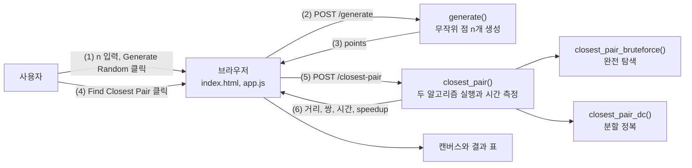
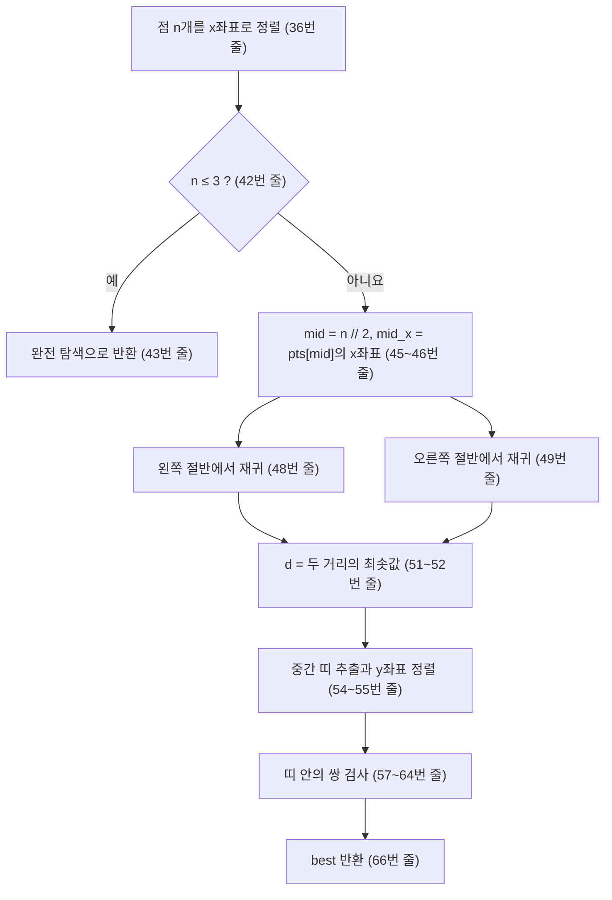
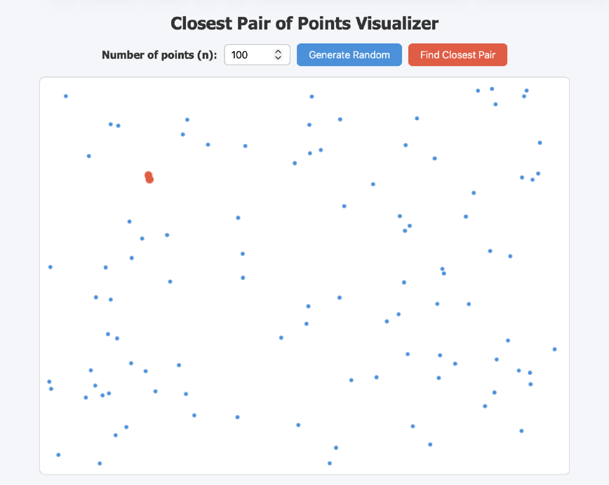

# HW3 과제 해설 — 최근접 점 쌍 시각화 도구

[레포지토리 안내](../../README.ko.md) | [English](Assignment-Explanation.md) | [한국어](Assignment-Explanation.ko.md)

> **최종 수정일:** 2026-11-16
>
> Introduction to Algorithms, Cormen, Leiserson, Rivest, and Stein, Ch 4, 33

> **학습 목표:**
> 1. 2차원 평면의 최근접 점 쌍 문제를 정의하고 완전 탐색이 계산하는 거리의 개수를 구할 수 있다
> 2. x좌표 정렬, 절반 분할, 재귀 호출, 중간 띠 검사로 이루어진 분할 정복 풀이를 코드의 줄 단위로 설명할 수 있다
> 3. 분할 정복 풀이의 점화식을 세우고 재귀 트리로 시간 복잡도를 구할 수 있다
> 4. 중간 띠 검사의 정확성과 비교 횟수의 상한을 기하학적으로 논증할 수 있다
> 5. 실행 시간의 측정값을 이론적 증가율과 비교하여 해석할 수 있다

---

## 목차

- [1. 과제 구성과 실행 방법](#1-과제-구성과-실행-방법)
  - [1.1 과제 개요](#11-과제-개요)
  - [1.2 디렉토리 구성](#12-디렉토리-구성)
  - [1.3 설치와 실행](#13-설치와-실행)
- [2. 요구사항](#2-요구사항)
  - [2.1 기능 요구사항](#21-기능-요구사항)
  - [2.2 API 엔드포인트](#22-api-엔드포인트)
  - [2.3 보고서와 평가 기준](#23-보고서와-평가-기준)
- [3. 문제 정의와 설계](#3-문제-정의와-설계)
  - [3.1 최근접 점 쌍 문제](#31-최근접-점-쌍-문제)
  - [3.2 웹 앱의 구조](#32-웹-앱의-구조)
  - [3.3 무작위 점 생성](#33-무작위-점-생성)
- [4. 풀이](#4-풀이)
  - [4.1 완전 탐색](#41-완전-탐색)
  - [4.2 분할 정복의 전처리와 분할](#42-분할-정복의-전처리와-분할)
  - [4.3 분할 정복의 결합: 중간 띠 검사](#43-분할-정복의-결합-중간-띠-검사)
  - [4.4 실행 시간과 속도 향상 비율](#44-실행-시간과-속도-향상-비율)
  - [4.5 캔버스 시각화](#45-캔버스-시각화)
- [5. 테스트와 결과](#5-테스트와-결과)
  - [5.1 정확성 검증](#51-정확성-검증)
  - [5.2 실행 화면](#52-실행-화면)
  - [5.3 실행 시간 비교](#53-실행-시간-비교)
- [6. 보고서의 분석 질문](#6-보고서의-분석-질문)
  - [6.1 분할 정복의 시간 복잡도](#61-분할-정복의-시간-복잡도)
  - [6.2 중간 띠만 검사해도 되는가](#62-중간-띠만-검사해도-되는가)
- [요약](#요약)
- [점검 문제](#점검-문제)

---

<br>

## 1. 과제 구성과 실행 방법

> **풀어 보기:** 이 문서는 정답과 풀이를 담고 있다. 먼저 [과제 안내문](Original/Assignment.ko.md)의 문제를 직접 풀어 본 뒤 읽는다.

### 1.1 과제 개요

4주차 가정 과제이다. 2차원 평면에 흩어진 n개의 점 가운데 가장 가까운 두 점, 곧 최근접 점 쌍(closest pair of points)을 찾는 웹 앱을 만든다. 앱은 같은 점 집합에 완전 탐색(brute force)과 분할 정복(divide and conquer)의 두 방법을 적용하고, 결과를 2차원 캔버스에 그리며, 두 방법의 실행 시간과 속도 향상 비율(speedup ratio)을 보여 준다. 문제의 원문은 [과제 안내문](Original/Assignment.ko.md)에 있고, 알고리즘의 배경은 [4주차 이론](../../Lecture-Notes/Week04_Divide-and-Conquer-Algorithms/Concepts_Lecture.ko.md)의 6절(최근접 점 쌍 문제)에 있다.

- **백엔드:** Python의 Flask (`Solution/app.py`)
- **프런트엔드:** HTML, CSS, JavaScript와 Canvas (`Solution/static/`)
- **제출물:** 소스 코드(`.zip`)와 2쪽 이내의 보고서(`.pdf`)

### 1.2 디렉토리 구성

```text
Coursework/HW03_Divide-and-Conquer-Algorithms/
├── Assignment-Explanation.md       # 과제 해설 (영어)
├── Assignment-Explanation.ko.md    # 과제 해설 (한국어, 이 문서)
├── Code-Walkthrough.md             # 코드 총정리 (영어)
├── Code-Walkthrough.ko.md          # 코드 총정리 (한국어)
├── Original/
│   ├── Assignment.md               # 과제 안내문 (영어)
│   └── Assignment.ko.md            # 과제 안내문 (한국어)
└── Solution/
    ├── app.py                      # Flask 백엔드: 두 알고리즘과 API 경로
    ├── requirements.txt            # 의존 패키지 (flask>=3.0)
    └── static/
        ├── index.html              # 화면 구조
        ├── style.css               # 화면 스타일
        └── app.js                  # 캔버스 그리기와 API 호출
```

*그림 1. HW3 과제의 디렉토리 구성*

### 1.3 설치와 실행

```bash
# 레포지토리 루트에서 풀이 디렉토리로 이동
cd Coursework/HW03_Divide-and-Conquer-Algorithms/Solution

# 의존 패키지 설치 (Flask 3.0 이상)
pip install -r requirements.txt

# 개발 서버 실행 (http://127.0.0.1:5000)
python app.py
```

브라우저에서 `http://127.0.0.1:5000`을 연다. 점의 개수 n을 입력하고 "Generate Random"을 누르면 점이 캔버스에 흩어지고, "Find Closest Pair"를 누르면 서버가 두 알고리즘을 실행한다.

> **참고:** macOS의 AirPlay 수신 모드는 5000번 포트를 사용한다. 브라우저가 `localhost:5000`을 AirPlay 쪽으로 연결하면 앱 대신 오류 화면이 나오므로, 주소를 `http://127.0.0.1:5000`으로 쓰거나 `Solution`에서 `flask --app app run --port 5001`처럼 Flask 명령으로 다른 포트를 지정해 실행한다.

이 문서는 요구사항, 설계, 풀이, 테스트와 결과, 보고서의 분석 질문을 다룬다. `Solution`의 파일을 처음부터 끝까지 줄 단위로 읽는 설명은 [HW3 코드 총정리](Code-Walkthrough.ko.md)에 있다.

---

<br>

## 2. 요구사항

과제 안내문의 요구사항과, 각 요구사항을 충족하는 코드의 위치는 다음과 같다. 줄 번호는 모두 각 파일 기준이다.

### 2.1 기능 요구사항

| 요구사항 | 구현 위치 |
|:-----|:-----|
| 완전 탐색: 모든 n(n-1)/2 쌍을 검사하고 최소 거리를 기억한다 (O(n²)) | `app.py` 16\~31번 줄의 `dist`, `closest_pair_bruteforce` |
| 분할 정복: x좌표로 나누고, 두 절반에서 재귀하고, 중간 띠를 검사한다 (O(n log² n)) | `app.py` 34\~66번 줄의 `closest_pair_dc`, `_closest_dc` |
| "Generate Random" 버튼으로 사용자가 정한 개수 n의 무작위 점을 흩뿌린다 | `index.html` 13\~15번 줄, `app.js` 47\~61번 줄, `app.py` 78\~87번 줄 |
| "Find Closest Pair" 버튼을 누르면 두 알고리즘을 모두 실행한다 | `index.html` 16번 줄, `app.js` 63\~91번 줄, `app.py` 90\~119번 줄 |
| 2차원 캔버스에 모든 점을 작은 점으로 그린다 | `index.html` 19번 줄, `app.js` 16\~23번 줄 |
| 최근접 점 쌍을 강조하고 두 점을 선으로 잇는다 | `app.js` 25\~43번 줄과 79번 줄 |
| 두 방법의 실행 시간과 속도 향상 비율을 표시한다 | `app.py` 96\~105번 줄, `index.html` 21\~44번 줄, `app.js` 82\~87번 줄 |

*표 1. 기능 요구사항과 구현 위치*

### 2.2 API 엔드포인트

| 메서드 | 엔드포인트 | 요구사항 | 구현 위치 |
|:-----|:-----|:-----|:-----|
| `POST` | `/closest-pair` | 두 방법으로 최근접 점 쌍을 찾고 결과와 실행 시간을 반환한다 | `app.py` 90\~119번 줄의 `closest_pair` |
| `POST` | `/generate` | 무작위 2차원 점 n개를 만든다 | `app.py` 78\~87번 줄의 `generate` |
| `GET` | `/` | 프런트엔드 페이지를 제공한다 | `app.py` 73\~75번 줄의 `index` |

*표 2. API 엔드포인트와 구현 위치*

### 2.3 보고서와 평가 기준

보고서는 PDF 한 파일로 최대 2쪽, 글자 크기 11pt 이상이어야 하며 다음 항목을 담는다.

| 보고서 항목 | 다루는 곳 |
|:-----|:-----|
| 최근접 점 쌍이 캔버스에 강조된 웹 앱의 화면 캡처 | 5.2절 |
| 점 100개, 1,000개, 5,000개에서 완전 탐색과 분할 정복을 비교하는 성능 표 | 5.3절 |
| 분석: 분할 정복이 문제를 O(n²)에서 O(n log² n)으로 줄이는 방식 | 6.1절 |
| 분석: 중간 띠만 검사해도 충분한 이유 | 6.2절 |

*표 3. 보고서 항목과 이 문서에서 다루는 곳*

| 평가 항목 | 비율 |
|:-----|-----:|
| 웹 앱이 실행되고 올바르게 동작한다 | 20% |
| 알고리즘 요구사항을 모두 구현한다 | 40% |
| 보고서 (최대 2쪽, 글자 크기 11 이상) | 40% |

*표 4. 평가 기준*

---

<br>

## 3. 문제 정의와 설계

### 3.1 최근접 점 쌍 문제

> **용어 정의:** **최근접 점 쌍(closest pair of points)** 은 평면 위의 점 n개(n ≥ 2) 가운데 유클리드 거리(Euclidean distance)가 가장 작은 두 점의 쌍이다.

두 점 $`p = (x_p, y_p)`$와 $`q = (x_q, y_q)`$의 유클리드 거리는 다음과 같다.

$$
\mathrm{dist}(p, q) = \sqrt{(x_p - x_q)^2 + (y_p - y_q)^2}
$$

점 n개로 만들 수 있는 쌍은 n(n-1)/2개이다. 같은 좌표의 점이 둘 이상 있으면 거리가 0인 쌍이 생기고, 그 쌍이 최근접 점 쌍이 된다. 거리가 가장 작은 쌍이 여럿이면 최근접 점 쌍은 하나로 정해지지 않는다. 이때 두 방법이 돌려주는 최소 거리는 같지만 쌍은 다를 수 있으므로, 두 방법의 결과는 쌍이 아니라 거리로 비교해야 한다.

### 3.2 웹 앱의 구조

설계의 요점은 세 가지이다. 첫째, 점 집합은 브라우저가 보관한다. 서버는 상태를 저장하지 않고, `/generate`가 만든 점을 브라우저가 받아 두었다가 `/closest-pair`에 다시 보낸다. 둘째, 두 알고리즘은 한 요청 안에서 같은 점 집합에 차례로 실행되므로 실행 시간을 같은 입력으로 비교할 수 있다. 셋째, 계산은 서버가, 그리기는 브라우저가 맡는다.



*그림 2. 브라우저와 Flask 서버 사이의 요청 흐름*

### 3.3 무작위 점 생성

`/generate`의 규칙은 다음과 같다. 요청 본문의 n을 정수로 바꾸어 2 이상 50,000 이하로 제한하고, 800×600 캔버스의 가장자리에서 10픽셀 안쪽인 x ∈ [10, 790], y ∈ [10, 590] 범위에서 균등 분포로 점을 만든다.

```python
@app.route("/generate", methods=["POST"])
def generate():
    data = request.get_json()
    n = int(data.get("n", 50))
    n = max(2, min(n, 50000))
    points = [
        [round(random.uniform(10, 790), 2), round(random.uniform(10, 590), 2)]
        for _ in range(n)
    ]
    return jsonify({"points": points})
```

`app.py`의 78\~87번 줄이다. 80번 줄은 JSON 본문을 읽고, 81번 줄은 `n`이 없으면 50을 쓰며 `"7"` 같은 문자열도 정수로 바꾼다. 82번 줄의 `max(2, min(n, 50000))`은 n을 2 이상 50,000 이하로 자른다. 점이 2개보다 적으면 쌍이 없고, 점이 너무 많으면 완전 탐색이 지나치게 오래 걸리기 때문이다. 상한인 50,000개에서는 완전 탐색만으로 수 분이 걸린다(5.3절의 측정에서 5,000개에 약 2초가 걸렸고, 개수가 10배이면 비교 횟수는 약 100배이다). 83\~86번 줄은 `random.uniform`으로 좌표를 만들고 `round(..., 2)`로 소수 둘째 자리까지 반올림한다. 가장자리의 여백 10픽셀 덕분에 반지름 3픽셀과 6픽셀로 그리는 점이 캔버스 경계에서 잘리지 않는다.

좌표를 반올림하므로 서로 다른 두 점이 같은 좌표를 가질 가능성이 0은 아니다. 그런 경우 최근접 거리는 0이며, 두 알고리즘 모두 이 경우를 올바르게 처리한다(5.1절). 프런트엔드도 입력 칸에 기본값 100, 최솟값 2, 최댓값 50,000을 두고(`index.html` 14번 줄), 입력이 숫자가 아니거나 0이면 50을 보낸다(`app.js` 48번 줄).

---

<br>

## 4. 풀이

### 4.1 완전 탐색

규칙은 모든 쌍 (i, j), i < j의 거리를 계산하고 가장 작은 값과 그 쌍을 기억하는 것이다.

```python
def dist(p1, p2):
    return math.sqrt((p1[0] - p2[0]) ** 2 + (p1[1] - p2[1]) ** 2)


def closest_pair_bruteforce(points):
    """Brute force — O(n^2)."""
    n = len(points)
    min_dist = float("inf")
    pair = None
    for i in range(n):
        for j in range(i + 1, n):
            d = dist(points[i], points[j])
            if d < min_dist:
                min_dist = d
                pair = (points[i], points[j])
    return min_dist, pair
```

`app.py`의 16\~31번 줄이다. 17번 줄의 `dist`는 3.1절의 유클리드 거리를 계산한다. 25\~26번 줄의 이중 반복문은 j를 i + 1부터 시작하므로 각 쌍을 한 번씩만 본다. 바깥 반복이 i일 때 안쪽 반복은 n - 1 - i번 돌므로 거리 계산의 총 횟수는 다음과 같다.

$$
\sum_{i=0}^{n-1} (n - 1 - i) = \frac{n(n-1)}{2}
$$

점 100개, 1,000개, 5,000개에서 이 값은 각각 4,950, 499,500, 12,497,500이다. 28번 줄의 비교가 엄격한 부등호 `<`이므로 거리가 같은 쌍이 여럿이면 먼저 만난 쌍을 유지한다. 23\~24번 줄의 초깃값 `float("inf")`와 `None`은 점이 두 개 이상이면 첫 비교에서 바뀌고, 점이 하나뿐이면 `pair`가 `None`으로 남는다. 반환값 `(min_dist, pair)`는 분할 정복과 같은 형식이며, 이 함수는 분할 정복의 기저 사례(43번 줄)에서도 쓰인다.

### 4.2 분할 정복의 전처리와 분할

규칙은 [4주차 이론](../../Lecture-Notes/Week04_Divide-and-Conquer-Algorithms/Concepts_Lecture.ko.md)의 6.2절과 같다. 점을 x좌표로 한 번 정렬하고, 가운데에서 왼쪽 절반과 오른쪽 절반으로 나누어 각 절반의 최근접 점 쌍을 재귀적으로 구한 뒤, 두 거리 가운데 작은 값을 d로 둔다. 점이 3개 이하이면 완전 탐색으로 바로 푼다.

```python
def closest_pair_dc(points):
    """Divide and conquer — O(n log^2 n)."""
    pts = sorted(points, key=lambda p: p[0])
    return _closest_dc(pts)


def _closest_dc(pts):
    n = len(pts)
    if n <= 3:
        return closest_pair_bruteforce(pts)

    mid = n // 2
    mid_x = pts[mid][0]

    left_result = _closest_dc(pts[:mid])
    right_result = _closest_dc(pts[mid:])

    d = min(left_result[0], right_result[0])
    best = left_result if left_result[0] <= right_result[0] else right_result
```

`app.py`의 34\~52번 줄이다. 각 부분의 역할은 다음과 같다.

- **전처리 (36번 줄):** x좌표를 키로 한 번만 정렬한다. 시간은 O(n log n)이다. 이후의 재귀는 정렬된 리스트를 잘라 넘기므로 각 절반도 x좌표 순서를 유지한다.
- **기저 사례 (42\~43번 줄):** 점이 3개 이하이면 쌍이 최대 3개이므로 완전 탐색으로 푼다. 점이 4개 이상이면 45번 줄의 `mid = n // 2`가 2 이상이고 `n - mid`도 2 이상이므로 두 절반 모두 점이 2개 이상이다. 따라서 쌍이 없는 점 1개짜리 부분 문제는 생기지 않고, 재귀 결과의 쌍은 언제나 실제 두 점이다.
- **분할선 (46번 줄):** `mid_x`는 오른쪽 절반의 첫 점의 x좌표이며 분할선 x = `mid_x`의 역할을 한다. 정렬되어 있으므로 왼쪽 절반의 모든 점은 x ≤ `mid_x`, 오른쪽 절반의 모든 점은 x ≥ `mid_x`를 만족한다.
- **정복 (48\~49번 줄):** 두 절반에서 재귀한다. 슬라이싱 `pts[:mid]`와 `pts[mid:]`는 새 리스트를 만들며 호출마다 O(n) 시간이 든다.
- **d와 best (51\~52번 줄):** d는 두 절반의 최근접 거리 가운데 작은 값이고, `best`는 그 결과 튜플 (거리, 쌍)이다. 두 거리가 같으면 왼쪽 결과를 고른다.



*그림 3. 분할 정복 함수의 실행 순서*

### 4.3 분할 정복의 결합: 중간 띠 검사

규칙은 [4주차 이론](../../Lecture-Notes/Week04_Divide-and-Conquer-Algorithms/Concepts_Lecture.ko.md)의 6.3절과 같다. 왼쪽 점 하나와 오른쪽 점 하나로 이루어진 쌍 가운데 d보다 가까운 쌍이 있다면, 그 두 점은 모두 분할선에서 거리 d 미만에 있다. 그러므로 분할선에서 거리 d 미만인 점만 모아 중간 띠(strip)를 만들고, 띠를 y좌표 순으로 정렬한 뒤, 각 점을 y좌표 차이가 d 미만인 뒤쪽 점들과만 비교한다.

```python
    strip = [p for p in pts if abs(p[0] - mid_x) < d]
    strip.sort(key=lambda p: p[1])

    for i in range(len(strip)):
        j = i + 1
        while j < len(strip) and strip[j][1] - strip[i][1] < d:
            dd = dist(strip[i], strip[j])
            if dd < d:
                d = dd
                best = (dd, (strip[i], strip[j]))
            j += 1

    return best
```

`app.py`의 54\~66번 줄이다.

- **띠 추출 (54번 줄):** 정렬된 `pts` 전체를 한 번 훑어 |x - `mid_x`| < d인 점을 고른다. 시간은 O(n)이고, 띠에는 왼쪽 점과 오른쪽 점이 섞인다.
- **y좌표 정렬 (55번 줄):** 띠를 y좌표로 정렬한다. 이 정렬은 재귀의 모든 호출에서 일어나므로 결합 단계의 비용은 O(n log n)이며, 이것이 전체 시간 복잡도에 log n이 한 번 더 붙는 원인이다(6.1절).
- **띠 검사 (57\~64번 줄):** 바깥 반복은 띠의 각 점 `strip[i]`를 고르고, 안쪽 `while`은 j = i + 1부터 y좌표 차이가 d 미만인 동안만 진행한다. y좌표 차이가 d 이상이면 거리도 d 이상이고, 띠가 y좌표 순이므로 그 뒤의 점은 모두 y좌표 차이가 더 크다. 그래서 여기서 멈추어도 놓치는 쌍이 없다. `strip[i]`보다 앞에 있는 점과의 쌍은 그 점을 바깥 반복에서 처리할 때 이미 검사했다.
- **갱신 (61\~63번 줄):** 더 가까운 쌍을 찾으면 d와 `best`를 갱신한다. d가 줄면 59번 줄의 조건도 그만큼 좁아져 이후의 비교가 줄어든다. d는 언제나 지금까지 찾은 어떤 쌍의 실제 거리이므로, 줄어든 d로 범위를 좁혀도 더 가까운 쌍을 놓치지 않는다.
- **반환 (66번 줄):** (거리, (점, 점)) 형식의 튜플을 돌려준다.

같은 쪽의 두 점도 띠에 함께 들어가 비교될 수 있지만, 같은 쪽 쌍의 거리는 그 절반의 최근접 거리 이상이고 따라서 d 이상이므로 결과를 바꾸지 않는다. 코드는 안쪽 반복의 횟수를 7로 직접 제한하지 않는다. 59번 줄의 y좌표 조건이 반복을 멈추게 하며, 그 반복이 점마다 최대 7번임은 6.2절의 기하학적 논증이 보장한다.

### 4.4 실행 시간과 속도 향상 비율

규칙은 같은 점 집합에 두 알고리즘을 차례로 실행하고 각 실행 시간을 측정하여, 속도 향상 비율을 완전 탐색 시간 ÷ 분할 정복 시간으로 구하는 것이다.

```python
@app.route("/closest-pair", methods=["POST"])
def closest_pair():
    data = request.get_json()
    points = [tuple(p) for p in data["points"]]

    # Brute force
    t0 = time.perf_counter()
    bf_dist, bf_pair = closest_pair_bruteforce(points)
    bf_time = time.perf_counter() - t0

    # Divide & Conquer
    t0 = time.perf_counter()
    dc_dist, dc_pair = closest_pair_dc(points)
    dc_time = time.perf_counter() - t0

    speedup = bf_time / dc_time if dc_time > 0 else float("inf")
```

`app.py`의 90\~105번 줄이다. 93번 줄은 JSON의 좌표 리스트 `[x, y]`를 튜플 `(x, y)`로 바꾼다. 96\~98번 줄과 101\~103번 줄은 각 함수 호출을 `time.perf_counter()`로 감싸 시간을 잰다. 분할 정복의 시간에는 36번 줄의 x좌표 정렬도 들어간다. 측정은 한 번씩만 하므로 n이 작아 실행 시간이 1 ms 안팎이면 운영체제와 인터프리터의 잡음이 상대적으로 크게 섞인다(5.3절). 105번 줄은 속도 향상 비율을 계산하고, 분할 정복의 시간이 0으로 측정되는 경우에 대비해 0으로 나누기를 피한다.

107\~119번 줄의 응답은 방법마다 거리(`distance`), 쌍(`pair`), 밀리초 단위의 시간(`time_ms`, 소수 넷째 자리까지)을 담고, 속도 향상 비율(`speedup`)은 소수 둘째 자리까지 반올림한다. 비율은 반올림 전의 초 단위 시간으로 나눈 값이므로, 화면에 표시된 두 시간으로 다시 나눈 값과 끝자리가 다를 수 있다. 점이 하나뿐인 요청이 오면 `bf_pair`가 `None`이어서 110번 줄에서 오류가 나고 서버는 500을 반환한다. 앱의 정상 흐름에서는 `/generate`가 n ≥ 2를 보장하고 프런트엔드가 점이 2개 미만이면 요청을 보내지 않으므로(`app.js` 64번 줄) 이 경우가 생기지 않는다.

### 4.5 캔버스 시각화

규칙은 모든 점을 그린 뒤 최근접 점 쌍을 강조하고 두 점을 선으로 잇는 것이다.

```javascript
function drawClosestPair(pair) {
  const [p1, p2] = pair;

  // Line
  ctx.strokeStyle = "#e05d44";
  ctx.lineWidth = 2;
  ctx.beginPath();
  ctx.moveTo(p1[0], p1[1]);
  ctx.lineTo(p2[0], p2[1]);
  ctx.stroke();

  // Highlighted points
  ctx.fillStyle = "#e05d44";
  for (const p of pair) {
    ctx.beginPath();
    ctx.arc(p[0], p[1], 6, 0, Math.PI * 2);
    ctx.fill();
  }
}
```

`app.js`의 25\~43번 줄이다. 캔버스의 좌표계는 왼쪽 위가 원점이고 y축이 아래로 향한다. 서버가 만든 좌표는 이미 800×600 캔버스의 픽셀 좌표이므로 변환 없이 그대로 그린다. y축의 방향은 거리에 영향을 주지 않는다. 모든 점은 `drawPoints`(16\~23번 줄)가 반지름 3픽셀의 파란 점(`#4a90d9`)으로 그리고, 최근접 점 쌍은 이 함수가 굵기 2픽셀의 빨간 선(`#e05d44`)과 반지름 6픽셀의 빨간 원으로 덮어 그린다. 79번 줄은 분할 정복의 결과(`data.dc.pair`)를 강조한다.

---

<br>

## 5. 테스트와 결과

### 5.1 정확성 검증

두 알고리즘이 같은 최소 거리를 돌려주는지는 다음 스크립트로 확인할 수 있다. `Solution` 디렉토리에서 실행한다.

```python
import random
from app import closest_pair_bruteforce, closest_pair_dc

random.seed(1)
for trial in range(3000):
    n = random.choice([2, 3, 4, 5, 6, 7, 8, 10, 17, 50, 200])
    if trial % 3 == 0:  # 정수 좌표: 같은 점이 자주 생긴다
        pts = [(random.randint(0, 20), random.randint(0, 20)) for _ in range(n)]
    else:  # /generate와 같은 범위의 실수 좌표
        pts = [(round(random.uniform(10, 790), 2), round(random.uniform(10, 590), 2)) for _ in range(n)]
    assert abs(closest_pair_bruteforce(pts)[0] - closest_pair_dc(pts)[0]) < 1e-9
print("all passed")
```

3,000번의 시행에서 단언문이 모두 통과하고 `all passed`가 출력된다. 시행에는 기저 사례 크기인 n = 2, 3과 같은 좌표가 여러 번 나오는 정수 좌표 입력이 포함된다. 같은 점이 있는 입력에서는 두 방법 모두 거리 0을 돌려준다. 예를 들어 `closest_pair_dc([(1, 1), (5, 5), (1, 1), (9, 9)])`는 `(0.0, ((1, 1), (1, 1)))`이다. Flask의 테스트 클라이언트로 API를 호출한 결과는 다음과 같다.

```text
GET  /                            -> 200, index.html
POST /generate {"n": 5}           -> 5 points
POST /generate {"n": 1}           -> 2 points
POST /generate {"n": 60000}       -> 50000 points
POST /generate {}                 -> 50 points
POST /closest-pair (100 points)   -> bruteforce.distance == dc.distance
POST /closest-pair (1 point)      -> 500
```

### 5.2 실행 화면



*그림 4. n = 100에서 최근접 점 쌍을 빨간색으로 강조한 캔버스*

점의 개수에 100을 넣고 "Generate Random"으로 점을 흩뿌린 뒤 "Find Closest Pair"를 누른 화면이다. 파란 점이 모든 점이고, 빨간 점 두 개가 분할 정복이 찾은 최근접 점 쌍이다. 이 실행에서는 두 점이 매우 가까워 반지름 6픽셀의 빨간 원 두 개가 겹쳐 보이고, 두 점을 잇는 선은 거의 보이지 않는다. 계산이 끝나면 캔버스 아래에 두 방법의 거리, 실행 시간, 속도 향상 비율을 담은 결과 표가 나타난다(`index.html` 21\~44번 줄).

### 5.3 실행 시간 비교

무작위 2차원 점에서 두 방법을 실행하고 `time.perf_counter()`로 잰 시간은 다음과 같다. 시간의 단위는 밀리초이다.

| 점의 개수 | 완전 탐색 (ms) | 분할 정복 (ms) | 속도 향상 |
|---:|---:|---:|---:|
| 100 | 2.1366 | 0.2940 | 7.27× |
| 1,000 | 124.1273 | 1.3770 | 90.15× |
| 5,000 | 2,108.5178 | 7.4540 | 282.87× |

*표 5. 점의 개수에 따른 두 방법의 실행 시간*

n이 커질수록 속도 향상 비율이 급격히 커진다. n = 5,000에서 분할 정복은 완전 탐색보다 약 283배 빠르며, 이 차이는 O(n²)과 O(n log² n)의 증가율 차이를 보여 준다. n = 1,000에서 124.1273 ÷ 1.3770은 약 90.14이지만 표의 비율이 90.15인 이유는, 4.4절에서 보았듯이 비율을 반올림 전의 시간으로 계산하기 때문이다.

n이 100에서 5,000으로 50배가 될 때의 측정된 증가 배율과 이론적 증가 배율은 다음과 같다. 완전 탐색의 이론값은 거리 계산 횟수의 비이고, 분할 정복의 이론값은 n log² n의 비이다(로그의 밑은 비에 영향을 주지 않는다).

| 방법 | 측정된 증가 배율 | 이론적 증가 배율 |
|:-----|---:|---:|
| 완전 탐색 | 2,108.5178 ÷ 2.1366 ≈ 987 | (5,000 × 4,999) ÷ (100 × 99) ≈ 2,525 |
| 분할 정복 | 7.4540 ÷ 0.2940 ≈ 25 | 50 × (log 5,000 ÷ log 100)² ≈ 171 |

*표 6. n이 50배가 될 때의 측정된 증가 배율과 이론적 증가 배율*

두 방법 모두 측정된 증가 배율이 이론값보다 작다. 원인은 n = 100의 측정에 있다. 이 측정은 한 번뿐이고 시간이 수 밀리초 이하여서, 함수 호출, 리스트 생성, 측정 자체의 고정 비용과 잡음이 큰 비중을 차지한다. 분모가 커지면 배율은 작아진다. 점근 표기는 n이 충분히 클 때의 증가율만 말해 주며, 작은 n에서는 상수 계수와 낮은 차수의 항이 결과를 좌우한다. 분할 정복에서는 이 영향이 더 크다. 55번 줄의 정렬은 C로 구현된 Python 내장 정렬이어서 상수가 작으므로, 이 범위의 n에서는 log² n의 효과가 측정값에 거의 드러나지 않는다.

> **참고:** 같은 코드를 여러 번 실행하여 측정값의 중앙값을 쓰면 증가 배율이 이론값에 가까워진다. 예를 들어 7번 측정한 중앙값에서 완전 탐색은 n = 100에서 약 0.9 ms, n = 5,000에서 약 2,200 ms가 걸려 증가 배율이 약 2,600이다. 측정값 자체는 컴퓨터마다 다르지만 증가 배율은 컴퓨터에 크게 좌우되지 않는다.

---

<br>

## 6. 보고서의 분석 질문

### 6.1 분할 정복의 시간 복잡도

질문은 분할 정복이 문제를 O(n²)에서 O(n log² n)으로 줄이는 방식을 설명하라는 것이다. 완전 탐색은 모든 쌍을 검사하므로 n(n-1)/2번 비교하고 O(n²) 시간이 걸린다. 분할 정복은 다음 세 단계로 이를 개선한다.

1. **분할:** 모든 점을 x좌표로 정렬한 뒤 가운데에서 두 절반으로 나눈다. 각 절반에는 약 n/2개의 점이 있다. 정렬은 맨 처음 한 번만 하며(36번 줄) O(n log n) 시간이 든다.
2. **정복:** 왼쪽 절반과 오른쪽 절반에서 최근접 점 쌍을 재귀적으로 찾고, 두 거리 가운데 작은 값을 d로 둔다.
3. **결합:** 분할선에서 거리 d 미만인 점으로 중간 띠를 만들고, y좌표로 정렬한 뒤, 두 절반에 걸친 쌍을 띠 안에서 검사한다. 띠의 y좌표 정렬 때문에 이 단계는 O(n log n) 시간이 든다.

절약은 결합 단계에서 생긴다. 왼쪽 점 하나와 오른쪽 점 하나로 이루어진 쌍은 약 n²/4개에 이르지만, 결합 단계는 띠 안의 점마다 최대 7개의 점과만 비교하므로(6.2절) 이 쌍들을 O(n)번의 비교로 처리한다. 같은 쪽의 쌍은 재귀가 더 작은 문제에서 처리한다. 따라서 점이 n개일 때의 시간 T(n)은 다음 점화식을 따른다.

$$
T(n) = 2T(n/2) + O(n \log n), \qquad T(n) = O(1) \quad (n \le 3)
$$

이 점화식은 [4주차 이론](../../Lecture-Notes/Week04_Divide-and-Conquer-Algorithms/Concepts_Lecture.ko.md) 1.7절의 기본 마스터 정리의 세 경우에 그대로 들어맞지 않는다. a = 2, b = 2이므로 $`n^{\log_b a} = n`$이고, f(n) = n log n은 n보다 빠르게 증가하지만 어떤 양수 ε에 대해서도 $`n^{1+\varepsilon}`$보다는 느리게 증가하여 경우 2도 경우 3도 아니기 때문이다. 대신 재귀 트리에서 깊이별 비용을 직접 더한다. 결합 비용을 c n log n이라 하고 로그의 밑을 2로 두면 다음과 같다.

| 깊이 i | 부분 문제 수 | 부분 문제 크기 | 그 깊이의 결합 비용 합 |
|---:|---:|:-----|:-----|
| 0 | 1 | n | $`c\,n \log n`$ |
| 1 | 2 | n/2 | $`2 \cdot c\,(n/2) \log (n/2) = c\,n(\log n - 1)`$ |
| 2 | 4 | n/4 | $`c\,n(\log n - 2)`$ |
| i | $`2^i`$ | $`n/2^i`$ | $`c\,n(\log n - i)`$ |

*표 7. 재귀 트리의 깊이별 결합 비용*

$$
\sum_{i=0}^{\log n - 1} c n (\log n - i) = c n \cdot \frac{\log n (\log n + 1)}{2} = \Theta(n \log^2 n)
$$

맨 아래 깊이에는 O(n)개의 기저 사례가 각각 O(1) 시간에 풀리고, 처음의 x좌표 정렬 O(n log n)을 더해도 지배항은 n log² n이므로 T(n) = O(n log² n)이다. 같은 결과는 마스터 정리를 확장한 다음 결과에서 k = 1로 놓아도 얻는다(교재의 연습 문제 4.6-2).

$$
f(n) = \Theta(n^{\log_b a} \log^k n) \implies T(n) = \Theta(n^{\log_b a} \log^{k+1} n)
$$

5.3절의 측정에서 n이 50배가 될 때 완전 탐색의 시간은 약 987배, 분할 정복의 시간은 약 25배 늘었다. 두 값은 각각 이론값 2,525와 171보다 작지만 두 방법의 증가율 차이는 분명하다. [4주차 이론](../../Lecture-Notes/Week04_Divide-and-Conquer-Algorithms/Concepts_Lecture.ko.md)의 6.6절처럼 띠를 매번 정렬하지 않고 y좌표 순서를 재귀 과정에서 유지하면 결합 단계가 O(n)이 되어 T(n) = 2T(n/2) + O(n) = O(n log n)으로 더 줄어든다(마스터 정리의 경우 2).

### 6.2 중간 띠만 검사해도 되는가

질문은 중간 띠만 검사해도 충분한 이유를 설명하라는 것이다. 답은 정확성과 효율의 두 부분으로 이루어진다.

**정확성.** 두 절반에 걸친 쌍 가운데 d보다 가까운 쌍이 있다면, 그 쌍의 두 점은 모두 분할선에서 거리 d 미만에 있다. 분할선의 x좌표를 m(코드의 `mid_x`)이라 하고, 왼쪽 점 p와 오른쪽 점 q의 거리가 d보다 작은 경우를 생각한다. 정렬 때문에 $`x_p \le m \le x_q`$이고, 두 점의 거리는 x좌표 차이 이상이므로 다음이 성립한다.

$$
m - x_p \le x_q - x_p \le \mathrm{dist}(p, q) < d, \qquad x_q - m \le x_q - x_p < d
$$

따라서 p와 q는 모두 54번 줄의 조건 |x - `mid_x`| < d를 만족하여 띠에 들어간다. 다시 말해 띠 밖의 점은 반대쪽의 어떤 점과도 수평 거리만으로 d 이상 떨어져 있어, 이미 찾은 최선의 쌍보다 가까울 수 없다. 같은 쪽의 쌍은 재귀가 이미 처리했으므로, 띠만 검사해도 놓치는 쌍이 없다.

**효율.** 띠 검사에서 `strip[i]`와 비교되는 점은 y좌표 차이가 0 이상 d 미만이고 분할선에서 거리 d 미만이므로, `strip[i]`의 y좌표를 y라 할 때 폭 2d, 높이 d인 직사각형 [m - d, m + d] × [y, y + d] 안에 있다. 이 직사각형을 한 변이 d/2인 정사각형 여덟 칸으로 나눈다.

```text
       m-d        m-d/2        m        m+d/2        m+d
y+d     +-----------+-----------+-----------+-----------+
        |     L     |     L     |     R     |     R     |
y+d/2   +-----------+-----------+-----------+-----------+
        |     L     |     L     |     R     |     R     |
y       +-----------+-----------+-----------+-----------+
```

*그림 5. strip[i] 위쪽의 폭 2d, 높이 d인 직사각형을 나눈 여덟 칸*

L 칸에는 왼쪽 절반의 점만, R 칸에는 오른쪽 절반의 점만 센다. 한 칸 안의 두 점은 많아야 칸의 대각선 길이인 d/√2만큼 떨어져 있고 d/√2 < d이지만, 같은 절반의 두 점은 d 이상 떨어져 있다(d가 두 절반의 최근접 거리 가운데 작은 값이기 때문이다). 따라서 칸마다 점이 최대 하나이고, 직사각형 안의 점은 `strip[i]` 자신을 포함해 최대 8개이다. 그러므로 `strip[i]`와 비교되는 점은 최대 7개이고, 59번 줄의 `while`은 점마다 최대 7번 돈다. 띠의 점은 n개 이하이므로 한 호출의 띠 검사는 O(n)번의 비교로 끝나며, 결합 단계의 비용은 55번 줄의 정렬 O(n log n)이 지배한다.

7은 최악의 배치에서도 성립하는 상한이며, 무작위 점에서는 실제 비교가 훨씬 적다. 무작위 점 2,000개로 20번 실행했을 때 안쪽 반복은 점마다 최대 2번이었다. 이 기하학적 상한 덕분에 띠 검사는 올바르면서도 효율적이다.

---

<br>

## 요약

| 개념 | 핵심 요약 |
|:-----|:-----|
| 최근접 점 쌍 문제 | 점 n개 가운데 유클리드 거리가 가장 작은 두 점을 찾는 문제이며, 가능한 쌍은 n(n-1)/2개이다. |
| 완전 탐색 | 모든 쌍을 한 번씩 비교하는 O(n²) 방법이며, 분할 정복의 기저 사례(n ≤ 3)에도 쓰인다. |
| 분할과 정복 | 점을 x좌표로 한 번 정렬하고, 가운데 점의 x좌표를 분할선으로 삼아 두 절반을 재귀적으로 푼 뒤, 작은 거리를 d로 둔다. |
| 중간 띠 검사 | 분할선에서 거리 d 미만인 점만 y좌표로 정렬하고, 각 점을 y좌표 차이가 d 미만인 뒤쪽 점들과만 비교한다. |
| 비교 횟수의 상한 | 폭 2d, 높이 d인 직사각형을 한 변이 d/2인 여덟 칸으로 나누면 칸마다 점이 최대 하나이므로, 점마다 최대 7개의 점과만 비교한다. |
| 시간 복잡도 | 띠를 호출마다 정렬하므로 T(n) = 2T(n/2) + O(n log n)이고, 재귀 트리로 더하면 O(n log² n)이다. |
| 측정 결과의 해석 | n = 5,000에서 분할 정복은 약 283배 빠르며, 작은 n의 한 번뿐인 측정에는 고정 비용과 잡음이 섞여 증가 배율이 이론값보다 작게 나온다. |
| 웹 앱의 구조 | 브라우저가 점 집합을 보관하고, 서버는 상태 없이 점 생성과 두 알고리즘의 계산과 시간 측정을 맡으며, 결과는 캔버스와 표로 그린다. |

---

<br>

## 점검 문제

1. **거리 계산 횟수:** 점 8개에 완전 탐색을 적용하면 거리를 몇 번 계산하는가? 또 `_closest_dc`의 기저 사례가 점 3개를 처리할 때는 몇 번인가?

   <details>
   <summary>정답</summary>

   점 8개에서는 8 × 7 ÷ 2 = 28번, 점 3개에서는 3 × 2 ÷ 2 = 3번이다.

   </details>

2. **기저 사례의 크기:** `_closest_dc`가 기저 사례를 n ≤ 1이 아니라 n ≤ 3으로 두면 어떤 이점이 있는가?

   <details>
   <summary>정답</summary>

   점이 4개 이상이면 45번 줄의 `mid = n // 2`와 `n - mid`가 모두 2 이상이므로 두 절반에 점이 2개 이상씩 들어간다. 그래서 쌍이 없는 점 1개짜리 부분 문제가 생기지 않고, 재귀 결과는 언제나 실제 쌍을 담는다. 또 점 3개 이하에서는 완전 탐색의 비교가 최대 3번이므로 더 나누는 것보다 직접 푸는 편이 간단하다.

   </details>

3. **띠의 조건:** 54번 줄의 `abs(p[0] - mid_x) < d`를 `abs(p[0] - mid_x) <= d`로 바꾸면 반환하는 최소 거리가 달라지는가?

   <details>
   <summary>정답</summary>

   달라지지 않는다. 분할선에서 정확히 d만큼 떨어진 점은 반대쪽의 어떤 점과도 x좌표 차이가 d 이상이므로 거리도 d 이상이다(6.2절의 부등식). 그런 점은 d를 줄일 수 없고, 띠에 점이 몇 개 더 들어갈 뿐이다.

   </details>

4. **개선된 점화식:** 띠를 호출마다 정렬하지 않고 y좌표 순서를 재귀 과정에서 유지하여 결합 단계를 O(n)으로 만들면 점화식과 시간 복잡도는 어떻게 되는가?

   <details>
   <summary>정답</summary>

   T(n) = 2T(n/2) + O(n)이다. a = 2, b = 2에서 $`n^{\log_b a} = n`$이고 f(n) = Θ(n)이므로 마스터 정리의 경우 2에 해당하여 T(n) = O(n log n)이다.

   </details>

5. **속도 향상 비율의 끝자리:** 표 5의 n = 1,000 행에서 124.1273 ÷ 1.3770은 약 90.14인데, 표시된 속도 향상 비율이 90.15인 이유는 무엇인가?

   <details>
   <summary>정답</summary>

   105번 줄은 반올림 전의 초 단위 시간으로 나누어 비율을 구하고, 화면에 표시되는 두 시간은 111번 줄과 116번 줄에서 밀리초 단위의 소수 넷째 자리로 반올림한 값이기 때문이다. 반올림 오차가 비율의 끝자리를 바꾼다.

   </details>
