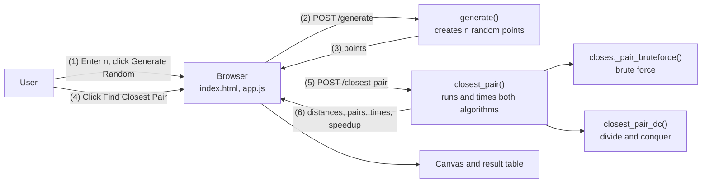
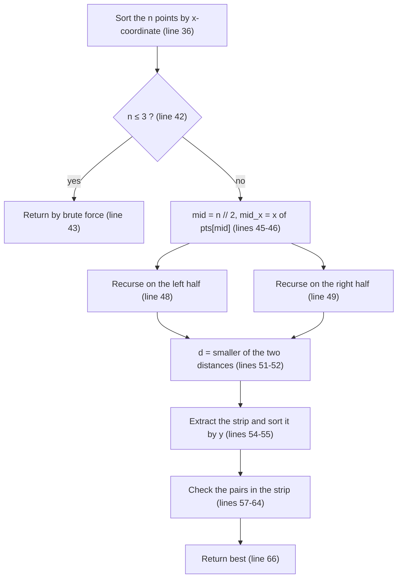
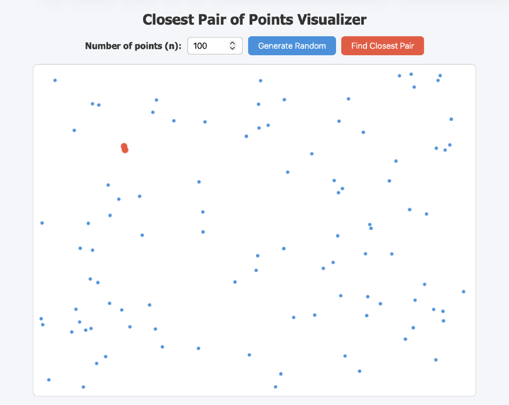

# HW3 Assignment Explanation — Closest Pair of Points Visualizer

[Repository Guide](../../README.md) | [English](Assignment-Explanation.md) | [한국어](Assignment-Explanation.ko.md)

> **Last Updated:** 2026-11-16
>
> Introduction to Algorithms, Cormen, Leiserson, Rivest, and Stein, Ch 4, 33

> **Learning Objectives:**
> 1. Define the closest pair problem in the plane and count the distances that brute force computes
> 2. Explain, line by line in the code, the divide and conquer solution made of an x-sort, a split into halves, recursive calls, and a middle strip check
> 3. Set up the recurrence of the divide and conquer solution and solve it with a recursion tree
> 4. Argue geometrically for the correctness of the strip check and for the upper bound on its comparisons
> 5. Interpret measured running times by comparing them with the theoretical growth rates

---

## Table of Contents

- [1. Assignment Structure and How to Run](#1-assignment-structure-and-how-to-run)
  - [1.1 Assignment Overview](#11-assignment-overview)
  - [1.2 Directory Layout](#12-directory-layout)
  - [1.3 Installation and Running](#13-installation-and-running)
- [2. Requirements](#2-requirements)
  - [2.1 Functional Requirements](#21-functional-requirements)
  - [2.2 API Endpoints](#22-api-endpoints)
  - [2.3 Report and Grading Criteria](#23-report-and-grading-criteria)
- [3. Problem Definition and Design](#3-problem-definition-and-design)
  - [3.1 The Closest Pair Problem](#31-the-closest-pair-problem)
  - [3.2 Structure of the Web App](#32-structure-of-the-web-app)
  - [3.3 Random Point Generation](#33-random-point-generation)
- [4. Solution](#4-solution)
  - [4.1 Brute Force](#41-brute-force)
  - [4.2 Preprocessing and Division in Divide and Conquer](#42-preprocessing-and-division-in-divide-and-conquer)
  - [4.3 Combining in Divide and Conquer: The Strip Check](#43-combining-in-divide-and-conquer-the-strip-check)
  - [4.4 Running Times and the Speedup Ratio](#44-running-times-and-the-speedup-ratio)
  - [4.5 Canvas Visualization](#45-canvas-visualization)
- [5. Tests and Results](#5-tests-and-results)
  - [5.1 Correctness Check](#51-correctness-check)
  - [5.2 Screenshot](#52-screenshot)
  - [5.3 Running Time Comparison](#53-running-time-comparison)
- [6. Analysis Questions of the Report](#6-analysis-questions-of-the-report)
  - [6.1 Time Complexity of Divide and Conquer](#61-time-complexity-of-divide-and-conquer)
  - [6.2 Is Checking Only the Strip Enough](#62-is-checking-only-the-strip-enough)
- [Summary](#summary)
- [Self-Check Questions](#self-check-questions)

---

<br>

## 1. Assignment Structure and How to Run

> **Try It First:** This document contains the answers and solutions. Solve the problems in the [assignment handout](Original/Assignment.md) yourself before reading on.

### 1.1 Assignment Overview

This is the week 4 take-home assignment. It asks for a web app that finds the two closest points, that is, the closest pair of points, among n points scattered in a 2D plane. The app applies two methods, brute force and divide and conquer, to the same point set, draws the result on a 2D canvas, and shows the running time of each method and the speedup ratio. The original problem is in the [assignment handout](Original/Assignment.md), and the background of the algorithm is in Section 6 (Closest Pair Problem) of the [Week 4 Lecture](../../Lecture-Notes/Week04_Divide-and-Conquer-Algorithms/Concepts_Lecture.md).

- **Backend:** Python with Flask (`Solution/app.py`)
- **Frontend:** HTML, CSS, and JavaScript with Canvas (`Solution/static/`)
- **Deliverables:** source code (`.zip`) and a report of at most two pages (`.pdf`)

### 1.2 Directory Layout

```text
Coursework/HW03_Divide-and-Conquer-Algorithms/
├── Assignment-Explanation.md       # Assignment explanation (English, this document)
├── Assignment-Explanation.ko.md    # Assignment explanation (Korean)
├── Code-Walkthrough.md             # Code walkthrough (English)
├── Code-Walkthrough.ko.md          # Code walkthrough (Korean)
├── Original/
│   ├── Assignment.md               # Assignment handout (English)
│   └── Assignment.ko.md            # Assignment handout (Korean)
└── Solution/
    ├── app.py                      # Flask backend: both algorithms and the API routes
    ├── requirements.txt            # Dependencies (flask>=3.0)
    └── static/
        ├── index.html              # Page structure
        ├── style.css               # Page style
        └── app.js                  # Canvas drawing and API calls
```

*Figure 1. Directory layout of HW3*

### 1.3 Installation and Running

```bash
# Move from the repository root to the solution directory
cd Coursework/HW03_Divide-and-Conquer-Algorithms/Solution

# Install the dependencies (Flask 3.0 or later)
pip install -r requirements.txt

# Start the development server (http://127.0.0.1:5000)
python app.py
```

Open `http://127.0.0.1:5000` in a browser. Enter the number of points n and press "Generate Random" to scatter the points on the canvas, then press "Find Closest Pair" to have the server run both algorithms.

> **Note:** The AirPlay Receiver of macOS uses port 5000. If the browser connects `localhost:5000` to AirPlay, an error page appears instead of the app, so use the address `http://127.0.0.1:5000`, or run the app on another port from `Solution` with the Flask command, as in `flask --app app run --port 5001`.

This document covers the requirements, design, solution, tests and results, and the analysis questions of the report. A line-by-line reading of every file in `Solution` from top to bottom is in the [HW3 Code Walkthrough](Code-Walkthrough.md).

---

<br>

## 2. Requirements

The requirements of the assignment handout and the location of the code that meets each requirement are as follows. All line numbers refer to the respective file.

### 2.1 Functional Requirements

| Requirement | Implemented in |
|:-----|:-----|
| Brute force: check all n(n-1)/2 pairs and keep the minimum distance (O(n²)) | `dist` and `closest_pair_bruteforce` in lines 16-31 of `app.py` |
| Divide and conquer: split by x-coordinate, recurse on both halves, and check the strip (O(n log² n)) | `closest_pair_dc` and `_closest_dc` in lines 34-66 of `app.py` |
| The "Generate Random" button scatters n random points, with n chosen by the user | lines 13-15 of `index.html`, lines 47-61 of `app.js`, lines 78-87 of `app.py` |
| Clicking "Find Closest Pair" runs both algorithms | line 16 of `index.html`, lines 63-91 of `app.js`, lines 90-119 of `app.py` |
| All points are plotted as dots on a 2D canvas | line 19 of `index.html`, lines 16-23 of `app.js` |
| The closest pair is highlighted and its two points are connected with a line | lines 25-43 and line 79 of `app.js` |
| The running times of both methods and the speedup ratio are shown | lines 96-105 of `app.py`, lines 21-44 of `index.html`, lines 82-87 of `app.js` |

*Table 1. Functional requirements and where they are implemented*

### 2.2 API Endpoints

| Method | Endpoint | Requirement | Implemented in |
|:-----|:-----|:-----|:-----|
| `POST` | `/closest-pair` | Find the closest pair with both methods and return the results and running times | `closest_pair` in lines 90-119 of `app.py` |
| `POST` | `/generate` | Generate n random 2D points | `generate` in lines 78-87 of `app.py` |
| `GET` | `/` | Serve the frontend page | `index` in lines 73-75 of `app.py` |

*Table 2. API endpoints and where they are implemented*

### 2.3 Report and Grading Criteria

The report must be a single PDF of at most two pages in a font size of 11 pt or more, and it contains the following items.

| Report item | Covered in |
|:-----|:-----|
| A screenshot of the web app with the closest pair highlighted on the canvas | Section 5.2 |
| A performance table comparing brute force and divide and conquer at 100, 1,000, and 5,000 points | Section 5.3 |
| Analysis: how divide and conquer reduces the problem from O(n²) to O(n log² n) | Section 6.1 |
| Analysis: why checking only the strip is sufficient | Section 6.2 |

*Table 3. Report items and where this document covers them*

| Criterion | Weight |
|:-----|-----:|
| The web app runs and works correctly | 20% |
| The algorithm requirements are fully implemented | 40% |
| Report (at most two pages, font size 11 or more) | 40% |

*Table 4. Grading criteria*

---

<br>

## 3. Problem Definition and Design

### 3.1 The Closest Pair Problem

> **Definition:** The **closest pair of points** is the pair of two points with the smallest Euclidean distance among n points (n ≥ 2) in the plane.

The Euclidean distance between two points $`p = (x_p, y_p)`$ and $`q = (x_q, y_q)`$ is as follows.

$$
\mathrm{dist}(p, q) = \sqrt{(x_p - x_q)^2 + (y_p - y_q)^2}
$$

There are n(n-1)/2 pairs among n points. If two or more points share the same coordinates, a pair at distance 0 exists and becomes the closest pair. If several pairs share the smallest distance, the closest pair is not unique. In that case both methods return the same minimum distance but possibly different pairs, so the results of the two methods must be compared by distance, not by pair.

### 3.2 Structure of the Web App

The design has three key points. First, the browser holds the point set. The server stores no state; the browser keeps the points that `/generate` created and sends them back to `/closest-pair`. Second, both algorithms run one after the other on the same point set within one request, so their running times are compared on the same input. Third, the server does the computing and the browser does the drawing.



*Figure 2. Request flow between the browser and the Flask server*

### 3.3 Random Point Generation

The rule of `/generate` is as follows. It converts n in the request body to an integer, clamps it to at least 2 and at most 50,000, and creates points uniformly in the range x ∈ [10, 790], y ∈ [10, 590], which lies 10 pixels inside the edges of the 800×600 canvas.

```python
@app.route("/generate", methods=["POST"])
def generate():
    data = request.get_json()
    n = int(data.get("n", 50))
    n = max(2, min(n, 50000))
    points = [
        [round(random.uniform(10, 790), 2), round(random.uniform(10, 590), 2)]
        for _ in range(n)
    ]
    return jsonify({"points": points})
```

These are lines 78-87 of `app.py`. Line 80 reads the JSON body, and line 81 uses 50 when `n` is missing and also converts a string such as `"7"` to an integer. The expression `max(2, min(n, 50000))` in line 82 clamps n to the range from 2 to 50,000, because fewer than two points have no pair and too many points make brute force take far too long. At the upper limit of 50,000 points, brute force alone takes several minutes (the measurement in Section 5.3 took about 2 seconds for 5,000 points, and ten times as many points means about 100 times as many comparisons). Lines 83-86 create the coordinates with `random.uniform` and round them to two decimal places with `round(..., 2)`. The 10-pixel margin keeps the dots, drawn with radii of 3 and 6 pixels, from being clipped at the canvas border.

Because the coordinates are rounded, two different points can have the same coordinates with nonzero probability. The closest distance is then 0, and both algorithms handle this case correctly (Section 5.1). The frontend also sets a default of 100, a minimum of 2, and a maximum of 50,000 on the input box (line 14 of `index.html`), and it sends 50 when the input is not a number or is 0 (line 48 of `app.js`).

---

<br>

## 4. Solution

### 4.1 Brute Force

The rule is to compute the distance of every pair (i, j) with i < j and keep the smallest value and its pair.

```python
def dist(p1, p2):
    return math.sqrt((p1[0] - p2[0]) ** 2 + (p1[1] - p2[1]) ** 2)


def closest_pair_bruteforce(points):
    """Brute force — O(n^2)."""
    n = len(points)
    min_dist = float("inf")
    pair = None
    for i in range(n):
        for j in range(i + 1, n):
            d = dist(points[i], points[j])
            if d < min_dist:
                min_dist = d
                pair = (points[i], points[j])
    return min_dist, pair
```

These are lines 16-31 of `app.py`. The function `dist` in line 17 computes the Euclidean distance of Section 3.1. The double loop in lines 25-26 starts j at i + 1, so it sees each pair exactly once. When the outer loop is at i, the inner loop runs n - 1 - i times, so the total number of distance computations is as follows.

$$
\sum_{i=0}^{n-1} (n - 1 - i) = \frac{n(n-1)}{2}
$$

For 100, 1,000, and 5,000 points this value is 4,950, 499,500, and 12,497,500, respectively. Because the comparison in line 28 uses the strict inequality `<`, the first pair found is kept when several pairs share the same distance. The initial values `float("inf")` and `None` in lines 23-24 change at the first comparison when there are two or more points, and `pair` stays `None` when there is only one point. The return value `(min_dist, pair)` has the same format as in divide and conquer, and this function also serves as the base case of divide and conquer (line 43).

### 4.2 Preprocessing and Division in Divide and Conquer

The rule is the same as in Section 6.2 of the [Week 4 Lecture](../../Lecture-Notes/Week04_Divide-and-Conquer-Algorithms/Concepts_Lecture.md). Sort the points by x-coordinate once, split them in the middle into a left half and a right half, find the closest pair of each half recursively, and let d be the smaller of the two distances. When there are at most three points, solve directly by brute force.

```python
def closest_pair_dc(points):
    """Divide and conquer — O(n log^2 n)."""
    pts = sorted(points, key=lambda p: p[0])
    return _closest_dc(pts)


def _closest_dc(pts):
    n = len(pts)
    if n <= 3:
        return closest_pair_bruteforce(pts)

    mid = n // 2
    mid_x = pts[mid][0]

    left_result = _closest_dc(pts[:mid])
    right_result = _closest_dc(pts[mid:])

    d = min(left_result[0], right_result[0])
    best = left_result if left_result[0] <= right_result[0] else right_result
```

These are lines 34-52 of `app.py`. Each part does the following.

- **Preprocessing (line 36):** The points are sorted once with the x-coordinate as the key, in O(n log n) time. The later recursion passes slices of the sorted list, so each half also stays in x order.
- **Base case (lines 42-43):** With at most three points there are at most three pairs, so brute force solves the problem. With four or more points, `mid = n // 2` in line 45 is at least 2 and `n - mid` is also at least 2, so both halves have at least two points. Hence no one-point subproblem without a pair arises, and the pair in every recursive result is a real pair of points.
- **Dividing line (line 46):** `mid_x` is the x-coordinate of the first point of the right half and acts as the dividing line x = `mid_x`. Because the list is sorted, every point of the left half satisfies x ≤ `mid_x` and every point of the right half satisfies x ≥ `mid_x`.
- **Conquer (lines 48-49):** The function recurses on both halves. The slices `pts[:mid]` and `pts[mid:]` create new lists and take O(n) time per call.
- **d and best (lines 51-52):** d is the smaller of the closest distances of the two halves, and `best` is the corresponding result tuple (distance, pair). When the two distances are equal, the left result is chosen.



*Figure 3. Execution order of the divide and conquer function*

### 4.3 Combining in Divide and Conquer: The Strip Check

The rule is the same as in Section 6.3 of the [Week 4 Lecture](../../Lecture-Notes/Week04_Divide-and-Conquer-Algorithms/Concepts_Lecture.md). If some pair made of one left point and one right point is closer than d, both of its points lie at a distance less than d from the dividing line. Therefore the code collects only the points at a distance less than d from the dividing line into the middle strip, sorts the strip by y-coordinate, and compares each point only with the following points whose y-coordinate differs by less than d.

```python
    strip = [p for p in pts if abs(p[0] - mid_x) < d]
    strip.sort(key=lambda p: p[1])

    for i in range(len(strip)):
        j = i + 1
        while j < len(strip) and strip[j][1] - strip[i][1] < d:
            dd = dist(strip[i], strip[j])
            if dd < d:
                d = dd
                best = (dd, (strip[i], strip[j]))
            j += 1

    return best
```

These are lines 54-66 of `app.py`.

- **Strip extraction (line 54):** One pass over the whole sorted `pts` picks the points with |x - `mid_x`| < d. This takes O(n) time, and the strip contains both left and right points.
- **Sorting by y (line 55):** The strip is sorted by y-coordinate. This sort happens in every call of the recursion, so the combine step costs O(n log n), which is why the total time complexity carries one more factor of log n (Section 6.1).
- **Strip check (lines 57-64):** The outer loop picks each point `strip[i]` of the strip, and the inner `while` advances from j = i + 1 only while the y difference is less than d. When the y difference is d or more, the distance is also d or more, and since the strip is in y order, every later point has an even larger y difference. Stopping there therefore misses no pair. Pairs with points before `strip[i]` were already checked when the outer loop processed those points.
- **Update (lines 61-63):** When a closer pair is found, d and `best` are updated. A smaller d also narrows the condition in line 59, so fewer comparisons follow. Since d is always the actual distance of some pair found so far, narrowing the range with the smaller d never misses a closer pair.
- **Return (line 66):** The function returns a tuple of the form (distance, (point, point)).

Two points from the same side may also enter the strip and be compared, but the distance of a same-side pair is at least the closest distance of that half and hence at least d, so it does not change the result. The code does not cap the inner loop at seven iterations explicitly. The y condition in line 59 stops the loop, and the geometric argument of Section 6.2 guarantees that the loop runs at most seven times per point.

### 4.4 Running Times and the Speedup Ratio

The rule is to run both algorithms one after the other on the same point set, measure each running time, and compute the speedup ratio as brute force time ÷ divide and conquer time.

```python
@app.route("/closest-pair", methods=["POST"])
def closest_pair():
    data = request.get_json()
    points = [tuple(p) for p in data["points"]]

    # Brute force
    t0 = time.perf_counter()
    bf_dist, bf_pair = closest_pair_bruteforce(points)
    bf_time = time.perf_counter() - t0

    # Divide & Conquer
    t0 = time.perf_counter()
    dc_dist, dc_pair = closest_pair_dc(points)
    dc_time = time.perf_counter() - t0

    speedup = bf_time / dc_time if dc_time > 0 else float("inf")
```

These are lines 90-105 of `app.py`. Line 93 turns each JSON coordinate list `[x, y]` into a tuple `(x, y)`. Lines 96-98 and lines 101-103 wrap each function call with `time.perf_counter()` to measure its time. The time of divide and conquer includes the x-sort of line 36. Each method is measured only once, so when n is small and a run takes around 1 ms, noise from the operating system and the interpreter is relatively large (Section 5.3). Line 105 computes the speedup ratio and avoids a division by zero in case the time of divide and conquer is measured as 0.

The response in lines 107-119 contains, for each method, the distance (`distance`), the pair (`pair`), and the time in milliseconds (`time_ms`, to four decimal places), and it rounds the speedup ratio (`speedup`) to two decimal places. The ratio is computed from the unrounded times in seconds, so it can differ in the last digit from the ratio of the two displayed times. If a request contains only one point, `bf_pair` is `None`, line 110 raises an error, and the server returns 500. In the normal flow of the app this cannot happen, because `/generate` guarantees n ≥ 2 and the frontend sends no request when there are fewer than two points (line 64 of `app.js`).

### 4.5 Canvas Visualization

The rule is to draw all points, then highlight the closest pair and connect its two points with a line.

```javascript
function drawClosestPair(pair) {
  const [p1, p2] = pair;

  // Line
  ctx.strokeStyle = "#e05d44";
  ctx.lineWidth = 2;
  ctx.beginPath();
  ctx.moveTo(p1[0], p1[1]);
  ctx.lineTo(p2[0], p2[1]);
  ctx.stroke();

  // Highlighted points
  ctx.fillStyle = "#e05d44";
  for (const p of pair) {
    ctx.beginPath();
    ctx.arc(p[0], p[1], 6, 0, Math.PI * 2);
    ctx.fill();
  }
}
```

These are lines 25-43 of `app.js`. The coordinate system of the canvas has its origin at the top left, and its y-axis points down. The coordinates from the server are already pixel coordinates of the 800×600 canvas, so they are drawn without any transformation. The direction of the y-axis does not affect distances. `drawPoints` (lines 16-23) draws all points as blue dots (`#4a90d9`) of radius 3 pixels, and this function draws the closest pair on top of them with a red line (`#e05d44`) 2 pixels wide and red circles of radius 6 pixels. Line 79 highlights the result of divide and conquer (`data.dc.pair`).

---

<br>

## 5. Tests and Results

### 5.1 Correctness Check

Whether the two algorithms return the same minimum distance can be checked with the following script. Run it in the `Solution` directory.

```python
import random
from app import closest_pair_bruteforce, closest_pair_dc

random.seed(1)
for trial in range(3000):
    n = random.choice([2, 3, 4, 5, 6, 7, 8, 10, 17, 50, 200])
    if trial % 3 == 0:  # integer coordinates: identical points occur often
        pts = [(random.randint(0, 20), random.randint(0, 20)) for _ in range(n)]
    else:  # real coordinates in the same range as /generate
        pts = [(round(random.uniform(10, 790), 2), round(random.uniform(10, 590), 2)) for _ in range(n)]
    assert abs(closest_pair_bruteforce(pts)[0] - closest_pair_dc(pts)[0]) < 1e-9
print("all passed")
```

All assertions pass in the 3,000 trials, and `all passed` is printed. The trials include the base case sizes n = 2 and 3 and integer-coordinate inputs in which identical coordinates appear several times. On inputs with identical points both methods return distance 0. For example, `closest_pair_dc([(1, 1), (5, 5), (1, 1), (9, 9)])` is `(0.0, ((1, 1), (1, 1)))`. Calling the API with the Flask test client gives the following results.

```text
GET  /                            -> 200, index.html
POST /generate {"n": 5}           -> 5 points
POST /generate {"n": 1}           -> 2 points
POST /generate {"n": 60000}       -> 50000 points
POST /generate {}                 -> 50 points
POST /closest-pair (100 points)   -> bruteforce.distance == dc.distance
POST /closest-pair (1 point)      -> 500
```

### 5.2 Screenshot



*Figure 4. Canvas with the closest pair highlighted in red for n = 100*

This screen shows the app after entering 100 as the number of points, scattering the points with "Generate Random", and pressing "Find Closest Pair". The blue dots are all the points, and the two red dots are the closest pair that divide and conquer found. In this run the two points are so close that the two red circles of radius 6 pixels overlap and the line connecting them is hardly visible. When the computation finishes, a result table with the distance and running time of each method and the speedup ratio appears below the canvas (lines 21-44 of `index.html`).

### 5.3 Running Time Comparison

The times measured with `time.perf_counter()` when running both methods on random 2D points are as follows. The unit of time is milliseconds.

| Number of points | Brute force (ms) | Divide and conquer (ms) | Speedup |
|---:|---:|---:|---:|
| 100 | 2.1366 | 0.2940 | 7.27× |
| 1,000 | 124.1273 | 1.3770 | 90.15× |
| 5,000 | 2,108.5178 | 7.4540 | 282.87× |

*Table 5. Running times of both methods by the number of points*

As n grows, the speedup ratio increases sharply. At n = 5,000 divide and conquer is about 283 times faster than brute force, and this gap reflects the difference in growth between O(n²) and O(n log² n). At n = 1,000, 124.1273 ÷ 1.3770 is about 90.14, but the table shows 90.15 because, as Section 4.4 showed, the ratio is computed from the unrounded times.

The measured and theoretical growth factors when n grows 50 times, from 100 to 5,000, are as follows. The theoretical value of brute force is the ratio of the numbers of distance computations, and that of divide and conquer is the ratio of n log² n (the base of the logarithm does not affect the ratio).

| Method | Measured growth factor | Theoretical growth factor |
|:-----|---:|---:|
| Brute force | 2,108.5178 ÷ 2.1366 ≈ 987 | (5,000 × 4,999) ÷ (100 × 99) ≈ 2,525 |
| Divide and conquer | 7.4540 ÷ 0.2940 ≈ 25 | 50 × (log 5,000 ÷ log 100)² ≈ 171 |

*Table 6. Measured and theoretical growth factors when n grows 50 times*

For both methods the measured growth factor is smaller than the theoretical value. The cause lies in the measurement at n = 100. It was taken once and lasted a few milliseconds or less, so the fixed costs of function calls, list creation, and the measurement itself, together with noise, make up a large share. A larger denominator makes the factor smaller. Asymptotic notation only describes the growth rate when n is large enough, and for small n the constant factors and lower-order terms dominate the result. The effect is larger for divide and conquer. The sort in line 55 is the built-in sort of Python implemented in C and has a small constant, so in this range of n the effect of log² n barely shows in the measurements.

> **Note:** Running the same code several times and taking the median of the measurements brings the growth factors closer to the theoretical values. For example, with the median of seven measurements, brute force takes about 0.9 ms at n = 100 and about 2,200 ms at n = 5,000, a growth factor of about 2,600. The measurements themselves differ from computer to computer, but the growth factors depend little on the computer.

---

<br>

## 6. Analysis Questions of the Report

### 6.1 Time Complexity of Divide and Conquer

The question asks how divide and conquer reduces the problem from O(n²) to O(n log² n). Brute force checks every pair, so it makes n(n-1)/2 comparisons and takes O(n²) time. Divide and conquer improves on this with the following three steps.

1. **Divide:** Sort all points by x-coordinate, then split them in the middle into two halves. Each half has about n/2 points. The sort happens only once at the start (line 36) and takes O(n log n) time.
2. **Conquer:** Recursively find the closest pair in the left half and in the right half, and let d be the smaller of the two distances.
3. **Combine:** Build the middle strip from the points at a distance less than d from the dividing line, sort it by y-coordinate, and check the pairs across the two halves inside the strip. Because of the y-sort of the strip, this step takes O(n log n) time.

The savings come from the combine step. Pairs made of one left point and one right point number about n²/4, but the combine step compares each point in the strip with at most seven other points (Section 6.2), so it handles these pairs with O(n) comparisons. Pairs on the same side are handled by the recursion on smaller problems. The time T(n) for n points therefore follows this recurrence.

$$
T(n) = 2T(n/2) + O(n \log n), \qquad T(n) = O(1) \quad (n \le 3)
$$

This recurrence does not fit the three cases of the basic master theorem in Section 1.7 of the [Week 4 Lecture](../../Lecture-Notes/Week04_Divide-and-Conquer-Algorithms/Concepts_Lecture.md) directly. With a = 2 and b = 2, $`n^{\log_b a} = n`$, and f(n) = n log n grows faster than n but slower than $`n^{1+\varepsilon}`$ for every positive ε, so it is neither case 2 nor case 3. Instead, the costs of the recursion tree are added depth by depth. Let the combine cost be c n log n and take the logarithm to base 2; then the costs are as follows.

| Depth i | Number of subproblems | Subproblem size | Total combine cost at that depth |
|---:|---:|:-----|:-----|
| 0 | 1 | n | $`c\,n \log n`$ |
| 1 | 2 | n/2 | $`2 \cdot c\,(n/2) \log (n/2) = c\,n(\log n - 1)`$ |
| 2 | 4 | n/4 | $`c\,n(\log n - 2)`$ |
| i | $`2^i`$ | $`n/2^i`$ | $`c\,n(\log n - i)`$ |

*Table 7. Combine cost of the recursion tree by depth*

$$
\sum_{i=0}^{\log n - 1} c n (\log n - i) = c n \cdot \frac{\log n (\log n + 1)}{2} = \Theta(n \log^2 n)
$$

At the bottom depth, O(n) base cases are each solved in O(1) time, and even adding the initial x-sort of O(n log n), the dominant term is n log² n, so T(n) = O(n log² n). The same result also follows from the following extension of the master theorem with k = 1 (Exercise 4.6-2 of the textbook).

$$
f(n) = \Theta(n^{\log_b a} \log^k n) \implies T(n) = \Theta(n^{\log_b a} \log^{k+1} n)
$$

In the measurements of Section 5.3, when n grew 50 times, the time of brute force grew about 987 times and that of divide and conquer about 25 times. Both values are smaller than the theoretical values 2,525 and 171, but the difference in growth between the two methods is clear. If, as in Section 6.6 of the [Week 4 Lecture](../../Lecture-Notes/Week04_Divide-and-Conquer-Algorithms/Concepts_Lecture.md), the y order is maintained during the recursion instead of sorting the strip every time, the combine step becomes O(n) and the time drops further to T(n) = 2T(n/2) + O(n) = O(n log n) (case 2 of the master theorem).

### 6.2 Is Checking Only the Strip Enough

The question asks why checking only the strip is sufficient. The answer has two parts, correctness and efficiency.

**Correctness.** If some pair across the two halves is closer than d, both of its points lie at a distance less than d from the dividing line. Let m (the `mid_x` of the code) be the x-coordinate of the dividing line, and consider a left point p and a right point q that are closer than d. Because of the sort, $`x_p \le m \le x_q`$, and the distance of two points is at least their x difference, so the following holds.

$$
m - x_p \le x_q - x_p \le \mathrm{dist}(p, q) < d, \qquad x_q - m \le x_q - x_p < d
$$

Hence both p and q satisfy the condition |x - `mid_x`| < d of line 54 and enter the strip. In other words, a point outside the strip is at least d away from every point on the other side by horizontal distance alone, so it cannot be closer than the best pair already found. Pairs on the same side were already handled by the recursion, so checking only the strip misses no pair.

**Efficiency.** The points compared with `strip[i]` in the strip check have a y difference of at least 0 and less than d and lie at a distance less than d from the dividing line, so, with y the y-coordinate of `strip[i]`, they lie inside the rectangle [m - d, m + d] × [y, y + d] of width 2d and height d. Divide this rectangle into eight square cells with side d/2.

```text
       m-d        m-d/2        m        m+d/2        m+d
y+d     +-----------+-----------+-----------+-----------+
        |     L     |     L     |     R     |     R     |
y+d/2   +-----------+-----------+-----------+-----------+
        |     L     |     L     |     R     |     R     |
y       +-----------+-----------+-----------+-----------+
```

*Figure 5. The eight cells of the rectangle of width 2d and height d above strip[i]*

Only points of the left half are counted in the L cells and only points of the right half in the R cells. Two points in one cell are at most the diagonal d/√2 < d apart, but two points of the same half are at least d apart (because d is the smaller of the closest distances of the two halves). Hence each cell holds at most one point, and the rectangle holds at most eight points, including `strip[i]` itself. Therefore at most seven points are compared with `strip[i]`, and the `while` loop in line 59 runs at most seven times per point. The strip has at most n points, so the strip check of one call finishes with O(n) comparisons, and the cost of the combine step is dominated by the O(n log n) sort in line 55.

Seven is an upper bound that holds even for the worst arrangement, and on random points the actual comparisons are far fewer. In 20 runs with 2,000 random points, the inner loop ran at most twice per point. This geometric bound makes the strip check both correct and efficient.

---

<br>

## Summary

| Concept | Key Summary |
|:-----|:-----|
| Closest pair problem | The problem of finding the two points with the smallest Euclidean distance among n points, which form n(n-1)/2 possible pairs. |
| Brute force | An O(n²) method that compares every pair once, also used as the base case of divide and conquer (n ≤ 3). |
| Divide and conquer | Sort the points by x-coordinate once, use the x-coordinate of the middle point as the dividing line, solve both halves recursively, and let d be the smaller distance. |
| Strip check | Sort only the points at a distance less than d from the dividing line by y-coordinate, and compare each point only with the following points whose y difference is less than d. |
| Bound on comparisons | Dividing the rectangle of width 2d and height d into eight cells with side d/2 leaves at most one point per cell, so each point is compared with at most seven points. |
| Time complexity | Since the strip is sorted in every call, T(n) = 2T(n/2) + O(n log n), and summing the recursion tree gives O(n log² n). |
| Interpreting the measurements | At n = 5,000 divide and conquer is about 283 times faster, and the single measurements at small n contain fixed costs and noise, so the growth factors come out smaller than the theoretical values. |
| Structure of the web app | The browser holds the point set, the stateless server generates points and computes and times both algorithms, and the results are drawn on the canvas and in a table. |

---

<br>

## Self-Check Questions

1. **Number of distance computations:** How many distances does brute force compute for 8 points? How many does the base case of `_closest_dc` compute for 3 points?

   <details>
   <summary>Answer</summary>

   For 8 points it computes 8 × 7 ÷ 2 = 28 distances, and for 3 points 3 × 2 ÷ 2 = 3.

   </details>

2. **Size of the base case:** What is gained by letting `_closest_dc` use n ≤ 3 instead of n ≤ 1 as its base case?

   <details>
   <summary>Answer</summary>

   With four or more points, both `mid = n // 2` in line 45 and `n - mid` are at least 2, so each half receives at least two points. No one-point subproblem without a pair arises, and every recursive result holds a real pair. Also, with three or fewer points brute force needs at most three comparisons, so solving directly is simpler than dividing further.

   </details>

3. **Condition of the strip:** If `abs(p[0] - mid_x) < d` in line 54 is changed to `abs(p[0] - mid_x) <= d`, does the returned minimum distance change?

   <details>
   <summary>Answer</summary>

   It does not change. A point exactly d away from the dividing line has an x difference of at least d from every point on the other side, so its distance to them is also at least d (the inequality of Section 6.2). Such a point cannot reduce d; only a few more points enter the strip.

   </details>

4. **Improved recurrence:** If the y order is maintained during the recursion instead of sorting the strip in every call, so that the combine step takes O(n), what are the recurrence and the time complexity?

   <details>
   <summary>Answer</summary>

   T(n) = 2T(n/2) + O(n). With a = 2 and b = 2, $`n^{\log_b a} = n`$ and f(n) = Θ(n), so case 2 of the master theorem applies and T(n) = O(n log n).

   </details>

5. **Last digit of the speedup ratio:** In the n = 1,000 row of Table 5, 124.1273 ÷ 1.3770 is about 90.14. Why is the displayed speedup ratio 90.15?

   <details>
   <summary>Answer</summary>

   Line 105 computes the ratio from the unrounded times in seconds, whereas the two displayed times are rounded to four decimal places in milliseconds in lines 111 and 116. The rounding error changes the last digit of the ratio.

   </details>
