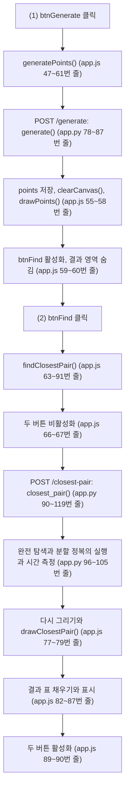
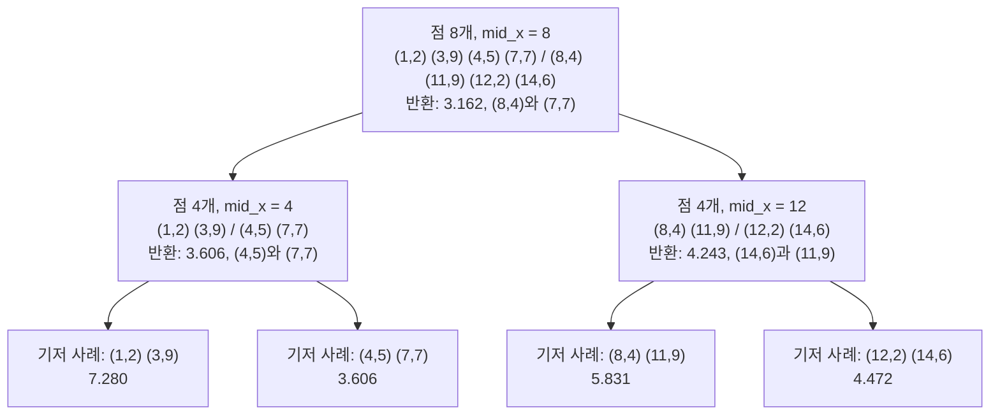

# HW3 코드 총정리 — 최근접 점 쌍 시각화 도구

[레포지토리 안내](../../README.ko.md) | [English](Code-Walkthrough.md) | [한국어](Code-Walkthrough.ko.md)

> **최종 수정일:** 2026-11-16
>
> Introduction to Algorithms, Cormen, Leiserson, Rivest, and Stein, Ch 4, 33

> **학습 목표:**
> 1. `app.py`의 거리 함수, 두 알고리즘 함수, 세 경로가 각각 어느 줄에서 무엇을 하는지 설명할 수 있다
> 2. `_closest_dc`의 재귀 호출과 중간 띠 검사를 작은 입력에서 줄 단위로 추적할 수 있다
> 3. `index.html`, `app.js`, `style.css`가 화면 구성, 캔버스 그리기, API 호출을 나누어 맡는 방식을 설명할 수 있다
> 4. 버튼 클릭에서 캔버스와 결과 표가 갱신되기까지의 요청 흐름을 순서대로 기술할 수 있다
> 5. 코드의 반복문, 정렬, 슬라이싱에서 각 함수의 시간 복잡도를 도출할 수 있다

---

## 목차

- [1. 파일 구성](#1-파일-구성)
- [2. app.py: 모듈 머리와 거리 함수](#2-apppy-모듈-머리와-거리-함수)
- [3. app.py: 완전 탐색](#3-apppy-완전-탐색)
- [4. app.py: 분할 정복](#4-apppy-분할-정복)
  - [4.1 진입 함수](#41-진입-함수)
  - [4.2 기저 사례와 분할](#42-기저-사례와-분할)
  - [4.3 중간 띠 검사](#43-중간-띠-검사)
- [5. app.py: 경로](#5-apppy-경로)
  - [5.1 첫 화면](#51-첫-화면)
  - [5.2 점 생성](#52-점-생성)
  - [5.3 최근접 점 쌍 계산](#53-최근접-점-쌍-계산)
  - [5.4 직접 실행](#54-직접-실행)
- [6. static/index.html](#6-staticindexhtml)
- [7. static/app.js](#7-staticappjs)
  - [7.1 요소 참조와 상태](#71-요소-참조와-상태)
  - [7.2 그리기 함수](#72-그리기-함수)
  - [7.3 API 호출 함수](#73-api-호출-함수)
  - [7.4 이벤트 연결](#74-이벤트-연결)
- [8. static/style.css](#8-staticstylecss)
- [9. requirements.txt](#9-requirementstxt)
- [10. 요청 흐름과 실행 추적](#10-요청-흐름과-실행-추적)
  - [10.1 버튼 클릭에서 화면 갱신까지](#101-버튼-클릭에서-화면-갱신까지)
  - [10.2 점 8개의 재귀 추적](#102-점-8개의-재귀-추적)
- [11. 복잡도](#11-복잡도)
- [요약](#요약)
- [점검 문제](#점검-문제)

---

<br>

## 1. 파일 구성

> **풀어 보기:** 이 문서는 작성한 코드 전체와 줄별 설명을 담고 있다. 먼저 [과제 안내문](Original/Assignment.ko.md)의 문제를 직접 풀어 본 뒤 읽는다.

짝이 되는 문서 [HW3 과제 해설](Assignment-Explanation.ko.md)은 요구사항, 설계, 테스트와 결과, 보고서의 분석 질문을 다룬다. 이 문서는 `Solution`의 다섯 파일을 처음부터 끝까지 읽는다. 줄 번호는 모두 각 파일 기준이다. 서버 쪽은 Python 파일 하나(`app.py`, 123줄)이고, 브라우저 쪽은 `static/`의 세 파일(`index.html` 48줄, `app.js` 96줄, `style.css` 101줄)이다.

| 파일 | 줄 | 부분 | 역할 |
|:-----|:-----|:-----|:-----|
| `app.py` | 1\~9 | 모듈 독스트링, `import`, Flask 앱 생성 | 서버 준비 |
| `app.py` | 12\~17 | `dist` | 두 점의 유클리드 거리 |
| `app.py` | 20\~31 | `closest_pair_bruteforce` | 완전 탐색 |
| `app.py` | 34\~66 | `closest_pair_dc`, `_closest_dc` | 분할 정복 |
| `app.py` | 69\~75 | `index` (`GET /`) | 첫 화면 제공 |
| `app.py` | 78\~87 | `generate` (`POST /generate`) | 무작위 점 생성 |
| `app.py` | 90\~119 | `closest_pair` (`POST /closest-pair`) | 두 알고리즘의 실행과 시간 측정 |
| `app.py` | 122\~123 | `if __name__ == "__main__":` 블록 | 개발 서버 실행 |
| `static/index.html` | 1\~48 | 제목, 입력 칸과 버튼, 캔버스, 결과 표 | 화면 구조 |
| `static/app.js` | 1\~96 | 요소 참조, 그리기 함수, API 호출, 이벤트 연결 | 화면 동작 |
| `static/style.css` | 1\~101 | 배치, 버튼, 캔버스, 결과 표의 스타일 | 화면 모양 |
| `requirements.txt` | 1 | `flask>=3.0` | 의존 패키지 |

*표 1. Solution 파일의 구성*

---

<br>

## 2. app.py: 모듈 머리와 거리 함수

```python
"""Week 04 — Closest Pair of Points Visualizer (Flask backend)"""

import math
import random
import time

from flask import Flask, jsonify, request, send_from_directory

app = Flask(__name__, static_folder="static")


# ---------------------------------------------------------------------------
# Algorithms
# ---------------------------------------------------------------------------

def dist(p1, p2):
    return math.sqrt((p1[0] - p2[0]) ** 2 + (p1[1] - p2[1]) ** 2)
```

1번 줄은 모듈 독스트링으로 파일의 내용을 한 줄로 밝힌다. 3\~5번 줄은 표준 라이브러리를 가져온다. `math`는 17번 줄의 제곱근, `random`은 84번 줄의 좌표 생성, `time`은 96\~103번 줄의 시간 측정에 쓰인다. 7번 줄은 Flask에서 앱 클래스 `Flask`, 사전을 JSON 응답으로 바꾸는 `jsonify`, 요청 본문을 읽는 `request`, 디렉토리 안의 파일을 응답으로 보내는 `send_from_directory`를 가져온다.

9번 줄은 앱 객체를 만든다. `static_folder="static"`은 `app.py`가 있는 디렉토리의 `static/` 폴더를 정적 파일 폴더로 지정한다. 정적 파일의 URL 경로는 폴더 이름을 따라 `/static`이 되므로, `index.html`의 `/static/style.css`(7번 줄)와 `/static/app.js`(46번 줄) 요청은 별도의 경로 함수 없이 Flask가 처리한다.

12\~14번 줄은 알고리즘 부분의 시작을 알리는 구분 주석이다. 16\~17번 줄의 `dist`는 점을 `(x, y)` 순서의 시퀀스로 보고, 인덱스 0을 x좌표, 인덱스 1을 y좌표로 읽어 유클리드 거리를 실수로 돌려준다. 리스트와 튜플 모두 인덱스로 읽을 수 있으므로 두 형식의 점에 모두 쓸 수 있다.

---

<br>

## 3. app.py: 완전 탐색

```python
def closest_pair_bruteforce(points):
    """Brute force — O(n^2)."""
    n = len(points)
    min_dist = float("inf")
    pair = None
    for i in range(n):
        for j in range(i + 1, n):
            d = dist(points[i], points[j])
            if d < min_dist:
                min_dist = d
                pair = (points[i], points[j])
    return min_dist, pair
```

21번 줄의 독스트링이 시간 복잡도 O(n²)를 밝힌다. 22번 줄은 점의 개수를 `n`에 둔다. 23번 줄의 `min_dist`는 양의 무한대 `float("inf")`로 시작하므로 첫 번째 거리가 무엇이든 28번 줄의 비교를 통과한다. 24번 줄의 `pair`는 아직 쌍이 없음을 `None`으로 나타낸다.

25\~26번 줄의 이중 반복문은 i < j인 모든 쌍을 한 번씩 만든다. 27번 줄이 두 점의 거리를 계산하고, 28번 줄은 지금까지의 최솟값보다 엄격하게 작을 때만 29\~30번 줄에서 최솟값과 쌍을 바꾼다. 따라서 거리가 같은 쌍이 여럿이면 먼저 만난 쌍이 남는다. 31번 줄은 `(min_dist, pair)` 튜플을 돌려준다. 이 형식은 분할 정복의 반환 형식과 같아서, 43번 줄이 기저 사례에서 이 함수의 결과를 그대로 돌려줄 수 있다.

거리 계산은 n(n-1)/2번이다. 점이 하나뿐이면 반복문이 한 번도 돌지 않아 `(inf, None)`을 돌려준다.

---

<br>

## 4. app.py: 분할 정복

### 4.1 진입 함수

```python
def closest_pair_dc(points):
    """Divide and conquer — O(n log^2 n)."""
    pts = sorted(points, key=lambda p: p[0])
    return _closest_dc(pts)
```

35번 줄의 독스트링이 시간 복잡도 O(n log² n)를 밝힌다. 36번 줄의 `sorted`는 입력 리스트를 바꾸지 않고 x좌표(`p[0]`) 순으로 정렬한 새 리스트를 만든다. 이 정렬은 전체 실행에서 한 번만 일어난다. 37번 줄은 정렬된 리스트로 재귀 함수 `_closest_dc`를 호출하고 그 결과를 그대로 돌려준다. 함수 이름 앞의 밑줄은 모듈 안에서만 쓰는 보조 함수라는 Python의 관례이다.

### 4.2 기저 사례와 분할

```python
def _closest_dc(pts):
    n = len(pts)
    if n <= 3:
        return closest_pair_bruteforce(pts)

    mid = n // 2
    mid_x = pts[mid][0]

    left_result = _closest_dc(pts[:mid])
    right_result = _closest_dc(pts[mid:])

    d = min(left_result[0], right_result[0])
    best = left_result if left_result[0] <= right_result[0] else right_result
```

41번 줄은 이번 호출이 받은 점의 개수를 `n`에 둔다. 42\~43번 줄은 점이 3개 이하이면 완전 탐색으로 바로 푼다. 점이 4개 이상이면 45번 줄의 `mid = n // 2`와 `n - mid`가 모두 2 이상이므로, 이후의 어떤 호출도 점 1개짜리 부분 문제를 받지 않는다.

46번 줄의 `mid_x`는 오른쪽 절반의 첫 점 `pts[mid]`의 x좌표이다. `pts`가 x좌표 순이므로 왼쪽 절반 `pts[:mid]`의 점은 모두 x ≤ `mid_x`, 오른쪽 절반 `pts[mid:]`의 점은 모두 x ≥ `mid_x`이다. 48\~49번 줄은 두 절반을 슬라이싱으로 잘라 재귀 호출한다. 슬라이싱은 원소를 복사한 새 리스트를 만들며, 각 절반은 여전히 x좌표 순이다.

51번 줄은 두 결과의 거리(튜플의 0번 원소) 가운데 작은 값을 `d`에 두고, 52번 줄은 그 거리를 가진 결과 튜플을 `best`에 둔다. 조건이 `<=`이므로 두 거리가 같으면 왼쪽 결과를 고른다.

### 4.3 중간 띠 검사

```python
    strip = [p for p in pts if abs(p[0] - mid_x) < d]
    strip.sort(key=lambda p: p[1])

    for i in range(len(strip)):
        j = i + 1
        while j < len(strip) and strip[j][1] - strip[i][1] < d:
            dd = dist(strip[i], strip[j])
            if dd < d:
                d = dd
                best = (dd, (strip[i], strip[j]))
            j += 1

    return best
```

54번 줄의 리스트 내포는 `pts`의 모든 점 가운데 분할선 x = `mid_x`와의 수평 거리가 `d` 미만인 점만 모은다. `pts`가 x좌표 순이므로 `strip`도 처음에는 x좌표 순이고, 55번 줄이 이를 y좌표(`p[1]`) 순으로 다시 정렬한다. `list.sort`는 리스트 자체를 바꾸는 정렬이다.

57번 줄의 바깥 반복은 띠의 각 점을 `strip[i]`로 고른다. 58번 줄은 비교 상대의 인덱스 `j`를 바로 다음 점에서 시작하게 한다. 59번 줄의 `while`은 두 조건을 모두 만족하는 동안 돈다. 하나는 `j`가 띠 안에 있다는 것이고, 다른 하나는 `strip[j]`와 `strip[i]`의 y좌표 차이가 `d` 미만이라는 것이다. 띠가 y좌표 순이므로 y좌표 차이는 `j`가 커질수록 커지고, 한 번 `d` 이상이 되면 이후의 점은 모두 `d` 이상 떨어져 있다.

60번 줄이 거리를 계산하고, 61\~63번 줄은 그 거리가 현재의 `d`보다 엄격하게 작으면 `d`와 `best`를 바꾼다. 63번 줄은 `best`를 `(거리, (점, 점))` 형식의 새 튜플로 만든다. 줄어든 `d`는 곧바로 59번 줄의 조건에 반영되어 이후의 비교 범위를 좁힌다. 64번 줄이 `j`를 하나 늘린다. 66번 줄은 두 절반의 결과와 띠의 검사 결과 가운데 가장 가까운 쌍을 돌려준다. 안쪽 반복이 점마다 최대 7번임은 [HW3 과제 해설](Assignment-Explanation.ko.md)의 6.2절이 논증한다.

---

<br>

## 5. app.py: 경로

### 5.1 첫 화면

```python
# ---------------------------------------------------------------------------
# Routes
# ---------------------------------------------------------------------------

@app.route("/")
def index():
    return send_from_directory("static", "index.html")
```

69\~71번 줄은 경로 부분의 시작을 알리는 구분 주석이다. 73번 줄의 데코레이터 `@app.route("/")`는 루트 URL에 대한 `GET` 요청을 74번 줄의 `index` 함수에 연결한다. 75번 줄의 `send_from_directory("static", "index.html")`은 앱의 루트 경로(`app.py`가 있는 디렉토리)를 기준으로 `static/index.html`을 찾아 응답으로 보낸다.

### 5.2 점 생성

```python
@app.route("/generate", methods=["POST"])
def generate():
    data = request.get_json()
    n = int(data.get("n", 50))
    n = max(2, min(n, 50000))
    points = [
        [round(random.uniform(10, 790), 2), round(random.uniform(10, 590), 2)]
        for _ in range(n)
    ]
    return jsonify({"points": points})
```

78번 줄은 `/generate`를 `POST` 요청에만 연결한다. 80번 줄의 `request.get_json()`은 요청 본문의 JSON을 Python 사전으로 바꾼다. 81번 줄은 `n` 키가 없으면 50을 쓰고 `int`로 정수로 바꾸며, 82번 줄은 `n`을 2 이상 50,000 이하로 자른다. 예를 들어 `n`이 1이면 2개, 60,000이면 50,000개의 점을 만든다.

83\~86번 줄의 리스트 내포는 점 `n`개를 만든다. 각 점은 x좌표가 10\~790, y좌표가 10\~590 범위의 균등 분포에서 뽑은 실수를 소수 둘째 자리로 반올림한 `[x, y]` 리스트이다. 85번 줄의 `_`는 쓰지 않는 반복 변수를 나타내는 관례이다. 87번 줄의 `jsonify`는 `{"points": [[x, y], ...]}` 형식의 JSON 응답을 만든다.

### 5.3 최근접 점 쌍 계산

```python
@app.route("/closest-pair", methods=["POST"])
def closest_pair():
    data = request.get_json()
    points = [tuple(p) for p in data["points"]]

    # Brute force
    t0 = time.perf_counter()
    bf_dist, bf_pair = closest_pair_bruteforce(points)
    bf_time = time.perf_counter() - t0

    # Divide & Conquer
    t0 = time.perf_counter()
    dc_dist, dc_pair = closest_pair_dc(points)
    dc_time = time.perf_counter() - t0

    speedup = bf_time / dc_time if dc_time > 0 else float("inf")

    return jsonify({
        "bruteforce": {
            "distance": bf_dist,
            "pair": [list(bf_pair[0]), list(bf_pair[1])],
            "time_ms": round(bf_time * 1000, 4),
        },
        "dc": {
            "distance": dc_dist,
            "pair": [list(dc_pair[0]), list(dc_pair[1])],
            "time_ms": round(dc_time * 1000, 4),
        },
        "speedup": round(speedup, 2),
    })
```

90번 줄은 `/closest-pair`를 `POST` 요청에 연결한다. 92\~93번 줄은 본문의 `points`를 읽고 각 점을 튜플로 바꾼다. 95번 줄과 100번 줄은 두 측정 부분을 나누는 주석이다.

96\~98번 줄은 `time.perf_counter()`로 시작 시각을 기록하고, 완전 탐색을 실행한 뒤, 끝 시각과의 차이를 초 단위로 `bf_time`에 둔다. 97번 줄은 반환 튜플을 `bf_dist`와 `bf_pair`로 풀어 받는다. 101\~103번 줄은 같은 방식으로 분할 정복의 결과와 시간을 얻는다. `perf_counter`는 짧은 구간을 재기 위한 고해상도 단조 시계이다.

105번 줄은 속도 향상 비율을 계산한다. 조건 표현식 `... if dc_time > 0 else float("inf")`는 0으로 나누는 경우를 피한다. 107\~119번 줄은 응답을 만든다. 각 쌍은 튜플 두 개로 된 튜플이므로 110번 줄과 115번 줄이 `list`로 바꾸어 `[[x, y], [x, y]]` 형식으로 보낸다. 시간은 1000을 곱해 밀리초로 바꾸고 소수 넷째 자리로 반올림하며(111번 줄, 116번 줄), 비율은 소수 둘째 자리로 반올림한다(118번 줄). 점 100개로 요청했을 때의 응답을 읽기 쉽게 줄을 나누면 다음과 같다.

```json
{
  "bruteforce": {
    "distance": 7.986451026582465,
    "pair": [[571.53, 70.37], [573.0, 62.52]],
    "time_ms": 0.852
  },
  "dc": {
    "distance": 7.986451026582465,
    "pair": [[571.53, 70.37], [573.0, 62.52]],
    "time_ms": 0.1292
  },
  "speedup": 6.6
}
```

> **주의:** 점이 하나뿐인 요청이 오면 97번 줄의 `bf_pair`가 `None`이어서 110번 줄의 `bf_pair[0]`이 `TypeError`를 일으키고 서버는 500을 반환한다. 정상적인 화면 조작에서는 `/generate`가 점을 2개 이상 만들고 `app.js`의 64번 줄이 점 2개 미만의 요청을 막으므로 이 경우가 생기지 않는다.

### 5.4 직접 실행

```python
if __name__ == "__main__":
    app.run(debug=True, port=5000)
```

`python app.py`로 파일을 직접 실행하면 `__name__`이 `"__main__"`이므로 123번 줄이 Flask의 개발 서버를 5000번 포트에서 시작한다. `debug=True`는 코드가 바뀌면 서버를 다시 시작하고 오류가 나면 브라우저에 디버거를 보여 준다. 다른 모듈이 `app.py`를 가져올 때는 이 블록이 실행되지 않는다.

---

<br>

## 6. static/index.html

```html
<!DOCTYPE html>
<html lang="en">
<head>
  <meta charset="UTF-8" />
  <meta name="viewport" content="width=device-width, initial-scale=1.0" />
  <title>Closest Pair of Points Visualizer</title>
  <link rel="stylesheet" href="/static/style.css" />
</head>
<body>
  <h1>Closest Pair of Points Visualizer</h1>

  <div class="controls">
    <label for="numPoints">Number of points (n):</label>
    <input id="numPoints" type="number" value="100" min="2" max="50000" />
    <button id="btnGenerate">Generate Random</button>
    <button id="btnFind" disabled>Find Closest Pair</button>
  </div>

  <canvas id="canvas" width="800" height="600"></canvas>

  <div id="results" class="results hidden">
    <table>
      <thead>
        <tr>
          <th>Algorithm</th>
          <th>Distance</th>
          <th>Time (ms)</th>
        </tr>
      </thead>
      <tbody>
        <tr>
          <td>Brute Force</td>
          <td id="bfDist">—</td>
          <td id="bfTime">—</td>
        </tr>
        <tr>
          <td>Divide &amp; Conquer</td>
          <td id="dcDist">—</td>
          <td id="dcTime">—</td>
        </tr>
      </tbody>
    </table>
    <p class="speedup">Speedup ratio: <strong id="speedup">—</strong></p>
  </div>

  <script src="/static/app.js"></script>
</body>
</html>
```

- **1\~8번 줄:** HTML5 문서 선언과 머리 부분이다. 4번 줄은 문자 인코딩을 UTF-8로, 5번 줄은 모바일 화면의 폭을 기기 폭에 맞춘다. 6번 줄은 브라우저 탭의 제목이고, 7번 줄은 9번 줄의 정적 파일 설정에 따라 제공되는 스타일 시트를 불러온다.
- **10번 줄:** 화면 맨 위의 제목이다.
- **12\~17번 줄:** 입력 영역이다. 13번 줄의 `label`은 `for="numPoints"`로 14번 줄의 입력 칸과 연결된다. 14번 줄의 숫자 입력 칸은 기본값 100, 최솟값 2, 최댓값 50000을 가진다. 15번 줄의 "Generate Random" 버튼은 점을 만들고, 16번 줄의 "Find Closest Pair" 버튼은 `disabled`로 시작하므로 점을 만들기 전에는 누를 수 없다.
- **19번 줄:** 800×600 픽셀의 캔버스이다. `width`와 `height` 속성은 그리기 영역의 픽셀 크기를 정하며, 서버가 만드는 좌표 범위와 맞는다.
- **21\~44번 줄:** 결과 영역이다. 21번 줄의 `div`는 `results`와 `hidden` 두 클래스를 가지므로 처음에는 보이지 않는다(`style.css` 77\~79번 줄). 22\~42번 줄의 표는 알고리즘, 거리, 시간의 세 열과 완전 탐색, 분할 정복의 두 행으로 이루어지고, 값이 들어갈 칸에는 `bfDist`, `bfTime`, `dcDist`, `dcTime`이라는 `id`가 있다. 칸의 처음 값은 자리 표시용 문자이며, 결과 영역이 보일 때는 이미 실제 값으로 바뀌어 있다. 37번 줄의 `&amp;`는 `&` 문자를 나타내는 HTML 엔티티이다. 43번 줄은 속도 향상 비율을 `id="speedup"`인 `strong` 요소에 보여 준다.
- **46번 줄:** 스크립트를 `body`의 맨 끝에서 불러온다. 이 시점에는 위의 요소가 모두 만들어져 있으므로 `app.js`의 `getElementById`가 요소를 찾을 수 있다.

---

<br>

## 7. static/app.js

### 7.1 요소 참조와 상태

```javascript
const canvas = document.getElementById("canvas");
const ctx = canvas.getContext("2d");
const btnGenerate = document.getElementById("btnGenerate");
const btnFind = document.getElementById("btnFind");
const numInput = document.getElementById("numPoints");
const resultsDiv = document.getElementById("results");

let points = [];
```

1\~6번 줄은 화면의 요소를 한 번 찾아 상수에 둔다. 2번 줄의 `ctx`는 캔버스의 2차원 그리기 컨텍스트로, 이후의 모든 그리기 명령이 이 객체를 통해 이루어진다. 8번 줄의 `points`는 마지막으로 생성한 점 집합을 보관하는 전역 상태이다. 서버는 점을 저장하지 않으므로 브라우저가 이 배열을 들고 있다가 `/closest-pair`에 보낸다.

### 7.2 그리기 함수

```javascript
// ---------- Drawing helpers ----------

function clearCanvas() {
  ctx.clearRect(0, 0, canvas.width, canvas.height);
}

function drawPoints(pts) {
  ctx.fillStyle = "#4a90d9";
  for (const [x, y] of pts) {
    ctx.beginPath();
    ctx.arc(x, y, 3, 0, Math.PI * 2);
    ctx.fill();
  }
}

function drawClosestPair(pair) {
  const [p1, p2] = pair;

  // Line
  ctx.strokeStyle = "#e05d44";
  ctx.lineWidth = 2;
  ctx.beginPath();
  ctx.moveTo(p1[0], p1[1]);
  ctx.lineTo(p2[0], p2[1]);
  ctx.stroke();

  // Highlighted points
  ctx.fillStyle = "#e05d44";
  for (const p of pair) {
    ctx.beginPath();
    ctx.arc(p[0], p[1], 6, 0, Math.PI * 2);
    ctx.fill();
  }
}
```

12\~14번 줄의 `clearCanvas`는 캔버스 전체를 지운다. 16\~23번 줄의 `drawPoints`는 채우기 색을 파란색(`#4a90d9`)으로 정하고, 각 점을 구조 분해 `[x, y]`로 받아 반지름 3픽셀의 원을 채운다. 원마다 `beginPath`를 새로 호출하므로 원들이 하나의 경로로 이어지지 않는다. `ctx.arc(x, y, 3, 0, Math.PI * 2)`는 중심 (x, y), 반지름 3, 시작각 0, 끝각 2π의 원이다.

25\~43번 줄의 `drawClosestPair`는 쌍을 `p1`, `p2`로 풀어 받는다(26번 줄). 29\~34번 줄은 선 색을 빨간색(`#e05d44`), 굵기를 2픽셀로 정하고 `moveTo`와 `lineTo`로 두 점을 잇는 선을 그린다. 37\~42번 줄은 같은 빨간색으로 두 점 위에 반지름 6픽셀의 원을 채워, 반지름 3픽셀의 파란 점을 덮는다.

### 7.3 API 호출 함수

```javascript
// ---------- API calls ----------

async function generatePoints() {
  const n = parseInt(numInput.value, 10) || 50;
  const res = await fetch("/generate", {
    method: "POST",
    headers: { "Content-Type": "application/json" },
    body: JSON.stringify({ n }),
  });
  const data = await res.json();
  points = data.points;

  clearCanvas();
  drawPoints(points);
  btnFind.disabled = false;
  resultsDiv.classList.add("hidden");
}

async function findClosestPair() {
  if (points.length < 2) return;

  btnFind.disabled = true;
  btnGenerate.disabled = true;

  const res = await fetch("/closest-pair", {
    method: "POST",
    headers: { "Content-Type": "application/json" },
    body: JSON.stringify({ points }),
  });
  const data = await res.json();

  // Redraw
  clearCanvas();
  drawPoints(points);
  drawClosestPair(data.dc.pair);

  // Show results
  document.getElementById("bfDist").textContent = data.bruteforce.distance.toFixed(4);
  document.getElementById("bfTime").textContent = data.bruteforce.time_ms.toFixed(4);
  document.getElementById("dcDist").textContent = data.dc.distance.toFixed(4);
  document.getElementById("dcTime").textContent = data.dc.time_ms.toFixed(4);
  document.getElementById("speedup").textContent = data.speedup + "x";
  resultsDiv.classList.remove("hidden");

  btnFind.disabled = false;
  btnGenerate.disabled = false;
}
```

47\~61번 줄의 `generatePoints`는 "Generate Random"을 누르면 실행된다.

- **48번 줄:** 입력 칸의 문자열을 10진수 정수로 바꾼다. 결과가 `NaN`이거나 0이면 `|| 50`이 50을 쓴다.
- **49\~53번 줄:** `fetch`로 `/generate`에 `POST` 요청을 보낸다. 본문은 `JSON.stringify({ n })`이며, `{ n }`은 `{ n: n }`의 축약 표기이다. `await`는 응답이 올 때까지 함수의 실행을 멈춘다.
- **54\~55번 줄:** 응답 본문을 JSON으로 읽어 `points`에 둔다.
- **57\~60번 줄:** 캔버스를 지우고 새 점을 그린 뒤, "Find Closest Pair" 버튼을 활성화하고 이전 결과 표를 숨긴다. 이전 결과는 새 점 집합과 맞지 않기 때문이다.

63\~91번 줄의 `findClosestPair`는 "Find Closest Pair"를 누르면 실행된다.

- **64번 줄:** 점이 2개 미만이면 요청하지 않는다.
- **66\~67번 줄:** 계산이 끝날 때까지 두 버튼을 비활성화한다. 같은 요청이 겹치거나, 계산 도중에 점 집합이 바뀌어 화면과 결과가 어긋나는 일을 막는다.
- **69\~74번 줄:** 현재 점 집합을 `/closest-pair`에 보내고 응답을 받는다.
- **77\~79번 줄:** 캔버스를 지우고 모든 점을 다시 그린 뒤 분할 정복의 결과 쌍을 강조한다. 먼저 지우므로 이전 계산의 강조 표시가 남지 않는다.
- **82\~87번 줄:** 두 방법의 거리와 시간을 `toFixed(4)`로 소수 넷째 자리까지 표에 넣고, 속도 향상 비율 뒤에 `"x"`를 붙인 뒤 결과 영역의 `hidden` 클래스를 지워 보이게 한다.
- **89\~90번 줄:** 두 버튼을 다시 활성화한다.

> **참고:** `findClosestPair`에는 오류 처리가 없다. 서버가 500을 반환하거나 연결이 끊기면 74번 줄의 `res.json()`이나 `fetch`가 예외를 던지고 함수가 그 자리에서 끝나므로, 66\~67번 줄에서 비활성화한 두 버튼이 페이지를 새로 고칠 때까지 비활성 상태로 남는다.

### 7.4 이벤트 연결

```javascript
// ---------- Events ----------

btnGenerate.addEventListener("click", generatePoints);
btnFind.addEventListener("click", findClosestPair);
```

95\~96번 줄은 두 버튼의 `click` 이벤트에 각각 `generatePoints`와 `findClosestPair`를 연결한다. 두 함수는 `async` 함수이므로 클릭할 때마다 Promise를 돌려주며, 브라우저는 이 값을 쓰지 않는다.

---

<br>

## 8. static/style.css

`style.css`의 각 규칙과 역할은 다음과 같다.

| 줄 | 선택자 | 역할 |
|:-----|:-----|:-----|
| 1\~5 | `*` | 모든 요소의 기본 바깥 여백과 안쪽 여백을 없애고, 폭에 테두리와 안쪽 여백을 포함한다(`box-sizing: border-box`) |
| 7\~15 | `body` | 글꼴, 배경색 `#f4f6f9`, 글자색을 정하고, 세로 방향 flex 배치로 모든 요소를 가운데에 놓는다 |
| 17\~20 | `h1` | 제목의 크기와 아래 여백 |
| 22\~29 | `.controls` | 라벨, 입력 칸, 버튼을 가로로 늘어놓고(간격 10px), 폭이 좁으면 다음 줄로 넘긴다 |
| 31\~33 | `.controls label` | 라벨을 굵게 한다 |
| 35\~41 | `.controls input` | 입력 칸의 폭 100px, 테두리, 둥근 모서리 |
| 43\~51 | `.controls button` | 버튼의 공통 모양과 흰 글자, 투명도가 0.2초 동안 바뀌는 전환 효과 |
| 53\~56 | `.controls button:disabled` | 비활성 버튼을 반투명하게 하고 커서를 `not-allowed`로 바꾼다 |
| 58\~60 | `#btnGenerate` | 파란 배경 `#4a90d9`이며, 캔버스의 점과 같은 색이다 |
| 62\~64 | `#btnFind` | 빨간 배경 `#e05d44`이며, 강조한 쌍과 같은 색이다 |
| 66\~70 | `canvas` | 회색 테두리, 둥근 모서리, 흰 배경 |
| 72\~75 | `.results` | 결과 영역의 위 여백과 가운데 정렬 |
| 77\~79 | `.results.hidden` | `display: none`으로 결과 영역을 숨긴다 |
| 81\~84 | `.results table` | 칸 테두리를 하나로 합치고 표를 가운데에 놓는다 |
| 86\~91 | `.results th`, `.results td` | 칸의 테두리, 안쪽 여백, 가운데 정렬 |
| 93\~96 | `.results th` | 머리 칸의 파란 배경과 흰 글자 |
| 98\~101 | `.speedup` | 속도 향상 비율 문단의 글자 크기와 위 여백 |

*표 2. style.css의 규칙과 역할*

---

<br>

## 9. requirements.txt

```text
flask>=3.0
```

의존 패키지는 Flask 하나이며 버전 3.0 이상을 요구한다. Flask가 쓰는 Werkzeug, Jinja2 같은 패키지는 Flask를 설치할 때 함께 설치된다. 나머지 모듈(`math`, `random`, `time`)은 표준 라이브러리이다.

---

<br>

## 10. 요청 흐름과 실행 추적

### 10.1 버튼 클릭에서 화면 갱신까지



*그림 1. 버튼 클릭에서 화면 갱신까지의 실행 순서*

### 10.2 점 8개의 재귀 추적

점 8개 `[(7, 7), (12, 2), (1, 2), (11, 9), (4, 5), (14, 6), (3, 9), (8, 4)]`로 `closest_pair_dc`를 실행하는 과정을 따라간다. 36번 줄의 정렬 뒤 점의 순서는 (1, 2), (3, 9), (4, 5), (7, 7), (8, 4), (11, 9), (12, 2), (14, 6)이다. 재귀 호출의 구조와 각 호출의 반환값은 다음과 같다. 거리는 소수 셋째 자리까지 적는다.



*그림 2. 점 8개에 대한 분할 정복의 재귀 호출 트리*

점이 2개인 네 호출은 43번 줄의 기저 사례에서 거리 하나만 계산한다. 점이 4개 이상인 세 호출의 띠 검사는 다음과 같다. 비교 칸에는 59번 줄의 조건을 통과해 60번 줄에서 계산한 쌍만 적는다.

| 호출 | d | 띠 (y좌표 순) | 비교한 쌍과 거리 | 결과 |
|:-----|---:|:-----|:-----|:-----|
| 점 4개, mid_x = 4 | 3.606 | (1,2), (4,5), (7,7), (3,9) | (1,2)와 (4,5): 4.243, (4,5)와 (7,7): 3.606, (7,7)과 (3,9): 4.472 | 갱신 없음, 3.606 |
| 점 4개, mid_x = 12 | 4.472 | (12,2), (8,4), (14,6), (11,9) | (12,2)와 (8,4): 4.472, (12,2)와 (14,6): 4.472, (8,4)와 (14,6): 6.325, (14,6)과 (11,9): 4.243 | 4.243으로 갱신 |
| 점 8개, mid_x = 8 | 3.606 | (8,4), (7,7), (11,9) | (8,4)와 (7,7): 3.162, (7,7)과 (11,9): 4.472 | 3.162로 갱신 |

*표 3. 세 호출의 중간 띠 검사*

- **왼쪽 4개:** 두 기저 사례의 거리 7.280과 3.606 가운데 작은 3.606이 d이다. 분할선 x = 4에서 3.606 미만으로 떨어진 점은 넷 모두이다. (1,2)는 (4,5)와 비교한 뒤 (7,7)과의 y좌표 차이가 5여서 반복을 멈춘다. (4,5)와 (7,7)의 거리 3.606은 d와 같고 61번 줄의 비교가 엄격한 부등호이므로 `best`는 바뀌지 않는다.
- **오른쪽 4개:** d = min(5.831, 4.472) = 4.472이다. (8,4)는 분할선 x = 12와의 수평 거리가 4로 4.472보다 작아 띠에 들어간다. (12,2)와 (14,6)은 같은 쪽의 쌍이며 거리가 d와 같아 결과를 바꾸지 않는다. 마지막 비교에서 서로 다른 절반에 속한 (14,6)과 (11,9)가 4.243으로 d보다 가까우므로 d와 `best`가 바뀐다.
- **전체 8개:** d = min(3.606, 4.243) = 3.606이고 `best`는 왼쪽 결과이다. 분할선 x = 8에서 3.606 미만으로 떨어진 점은 (7,7), (8,4), (11,9)뿐이다. (4,5)와 (12,2)는 수평 거리가 4여서 빠진다. (8,4)와 (7,7)의 거리 3.162가 d보다 작아 최종 결과가 된다. 이 쌍은 두 절반에 걸쳐 있으므로 재귀만으로는 찾을 수 없고 띠 검사에서만 발견된다.

같은 입력에 완전 탐색을 실행해도 거리 3.162의 같은 쌍을 얻는다. 완전 탐색은 원래 입력 순서대로 비교하므로 쌍을 `((7, 7), (8, 4))`의 순서로 돌려주고, 분할 정복은 `((8, 4), (7, 7))`의 순서로 돌려준다.

---

<br>

## 11. 복잡도

| 부분 | 줄 | 시간 |
|:-----|:-----|:-----|
| `dist` | `app.py` 16\~17 | O(1) |
| `closest_pair_bruteforce` | `app.py` 20\~31 | O(n²), 거리 계산 n(n-1)/2번 |
| x좌표 정렬 | `app.py` 36 | O(n log n), 전체에서 한 번 |
| 두 절반의 슬라이싱 | `app.py` 48\~49 | 호출마다 O(n) |
| 띠 추출 | `app.py` 54 | 호출마다 O(n) |
| 띠의 y좌표 정렬 | `app.py` 55 | 호출마다 O(n log n) |
| 띠 검사 | `app.py` 57\~64 | 호출마다 O(n), 점마다 비교 최대 7번 |
| `_closest_dc` 전체 | `app.py` 40\~66 | T(n) = 2T(n/2) + O(n log n) = O(n log² n) |
| `generate` | `app.py` 78\~87 | O(n) |
| `closest_pair` 경로 | `app.py` 90\~119 | O(n²), 완전 탐색이 지배한다 |
| `drawPoints` | `app.js` 16\~23 | O(n) |

*표 4. 코드 각 부분의 시간 복잡도*

`_closest_dc`의 재귀 깊이는 약 log₂ n이므로, 상한인 50,000개에서도 깊이는 16 정도이고 Python의 재귀 한도에 닿지 않는다. 공간은 O(n)이다. 48번 줄의 슬라이스는 재귀 경로를 따라 크기가 n/2, n/4, ...로 줄어 합이 O(n)이고, 띠는 두 재귀 호출이 끝난 뒤에 만들어지므로 한 번에 하나의 호출에서만 살아 있다. 요청 하나의 시간은 완전 탐색이 지배하므로, 점이 많을수록 응답이 늦어지는 원인은 분할 정복이 아니라 비교용으로 함께 실행하는 완전 탐색이다.

---

<br>

## 요약

| 개념 | 핵심 요약 |
|:-----|:-----|
| 파일의 역할 | `app.py`가 두 알고리즘과 세 경로를 담고, `index.html`, `app.js`, `style.css`가 화면의 구조, 동작, 모양을 맡는다. |
| 완전 탐색 함수 | 20\~31번 줄의 이중 반복문이 i < j인 모든 쌍의 거리를 계산하고, 엄격한 부등호로 처음 만난 최소 쌍을 유지한다. |
| 분할 정복 함수 | 36번 줄에서 한 번 정렬한 뒤, `_closest_dc`가 3개 이하면 완전 탐색으로 풀고 그 밖에는 가운데에서 나누어 재귀한다. |
| 띠 검사 코드 | 54\~55번 줄이 분할선에서 d 미만인 점을 y좌표 순으로 모으고, 57\~64번 줄이 y좌표 차이가 d 미만인 동안만 비교하며 d를 줄여 나간다. |
| 시간 측정과 응답 | `perf_counter`로 두 함수를 각각 재고, 반올림 전의 시간으로 비율을 구한 뒤 거리, 쌍, 밀리초 시간, 비율을 JSON으로 돌려준다. |
| 프런트엔드 흐름 | 브라우저가 점 집합을 보관하고, 계산 중에는 버튼을 비활성화하며, 응답이 오면 캔버스를 다시 그리고 결과 표를 채운다. |
| 복잡도 | 분할 정복은 O(n log² n), 완전 탐색과 요청 전체는 O(n²)이고, 재귀 깊이는 약 log₂ n, 공간은 O(n)이다. |

---

<br>

## 점검 문제

1. **정적 파일 경로:** `index.html`의 7번 줄이 요청하는 `/static/style.css`는 `app.py`에 그 경로의 함수가 없는데도 어떻게 제공되는가?

   <details>
   <summary>정답</summary>

   9번 줄의 `Flask(__name__, static_folder="static")`이 `static/` 폴더를 정적 파일 폴더로 지정하고, 정적 파일의 URL 경로가 폴더 이름을 따라 `/static`이 되기 때문이다. Flask가 `/static/<파일 이름>` 요청을 그 폴더의 파일로 자동으로 응답한다.

   </details>

2. **같은 거리의 쌍:** 10.2절의 오른쪽 호출에서 (12,2)와 (8,4)의 거리 4.472는 그때의 d와 같다. 이 비교 뒤에 `best`가 바뀌지 않는 이유는 무엇인가?

   <details>
   <summary>정답</summary>

   61번 줄의 조건 `dd < d`가 엄격한 부등호이므로 거리가 d와 같으면 62\~63번 줄이 실행되지 않는다. d보다 엄격하게 가까운 쌍만 결과를 바꾼다.

   </details>

3. **자리 표시용 문자:** `index.html`의 결과 표에는 값 대신 자리 표시용 문자가 들어 있다. 사용자가 이 문자를 보지 못하는 이유는 무엇인가?

   <details>
   <summary>정답</summary>

   21번 줄의 결과 영역이 `hidden` 클래스로 시작하고, `style.css` 77\~79번 줄의 `.results.hidden`이 `display: none`으로 숨기기 때문이다. `app.js`는 82\~86번 줄에서 칸을 실제 값으로 채운 다음에야 87번 줄에서 `hidden`을 지운다.

   </details>

4. **점 하나의 요청:** 점 하나만 담은 요청을 `/closest-pair`에 직접 보내면 어떻게 되는가? 화면에서는 왜 이 경우가 생기지 않는가?

   <details>
   <summary>정답</summary>

   완전 탐색이 `(inf, None)`을 돌려주어 110번 줄의 `bf_pair[0]`이 `TypeError`를 일으키고 서버는 500을 반환한다. 화면에서는 `/generate`가 82번 줄에서 점을 2개 이상 만들고 `app.js` 64번 줄이 점이 2개 미만이면 요청하지 않으므로 생기지 않는다.

   </details>
