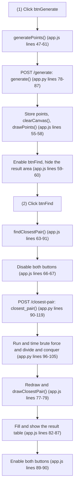
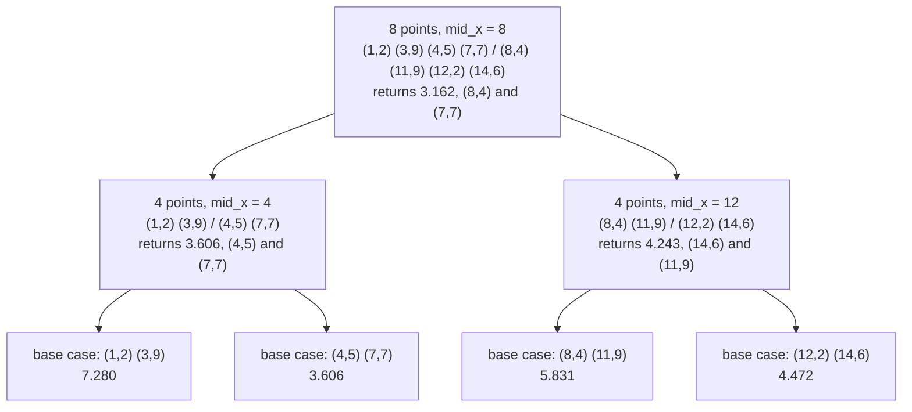

# HW3 Code Walkthrough — Closest Pair of Points Visualizer

[Repository Guide](../../README.md) | [English](Code-Walkthrough.md) | [한국어](Code-Walkthrough.ko.md)

> **Last Updated:** 2026-11-16
>
> Introduction to Algorithms, Cormen, Leiserson, Rivest, and Stein, Ch 4, 33

> **Learning Objectives:**
> 1. Explain in which lines and how the distance function, the two algorithm functions, and the three routes of `app.py` do their work
> 2. Trace the recursive calls and the strip check of `_closest_dc` line by line on a small input
> 3. Explain how `index.html`, `app.js`, and `style.css` divide the page structure, canvas drawing, and API calls among themselves
> 4. Describe in order the request flow from a button click to the update of the canvas and the result table
> 5. Derive the time complexity of each function from the loops, sorts, and slices in the code

---

## Table of Contents

- [1. File Structure](#1-file-structure)
- [2. app.py: Module Header and the Distance Function](#2-apppy-module-header-and-the-distance-function)
- [3. app.py: Brute Force](#3-apppy-brute-force)
- [4. app.py: Divide and Conquer](#4-apppy-divide-and-conquer)
  - [4.1 Entry Function](#41-entry-function)
  - [4.2 Base Case and Division](#42-base-case-and-division)
  - [4.3 Strip Check](#43-strip-check)
- [5. app.py: Routes](#5-apppy-routes)
  - [5.1 Front Page](#51-front-page)
  - [5.2 Point Generation](#52-point-generation)
  - [5.3 Closest Pair Computation](#53-closest-pair-computation)
  - [5.4 Direct Execution](#54-direct-execution)
- [6. static/index.html](#6-staticindexhtml)
- [7. static/app.js](#7-staticappjs)
  - [7.1 Element References and State](#71-element-references-and-state)
  - [7.2 Drawing Functions](#72-drawing-functions)
  - [7.3 API Call Functions](#73-api-call-functions)
  - [7.4 Event Wiring](#74-event-wiring)
- [8. static/style.css](#8-staticstylecss)
- [9. requirements.txt](#9-requirementstxt)
- [10. Request Flow and Execution Trace](#10-request-flow-and-execution-trace)
  - [10.1 From a Button Click to the Screen Update](#101-from-a-button-click-to-the-screen-update)
  - [10.2 Recursion Trace on Eight Points](#102-recursion-trace-on-eight-points)
- [11. Complexity](#11-complexity)
- [Summary](#summary)
- [Self-Check Questions](#self-check-questions)

---

<br>

## 1. File Structure

> **Try It First:** This document contains the complete code and line-by-line explanations. Solve the problems in the [assignment handout](Original/Assignment.md) yourself before reading on.

The companion document, the [HW3 Assignment Explanation](Assignment-Explanation.md), covers the requirements, design, tests and results, and the analysis questions of the report. This document reads the five files in `Solution` from top to bottom. All line numbers refer to the respective file. The server side is a single Python file (`app.py`, 123 lines), and the browser side consists of the three files in `static/` (`index.html` with 48 lines, `app.js` with 96 lines, and `style.css` with 101 lines).

| File | Lines | Part | Role |
|:-----|:-----|:-----|:-----|
| `app.py` | 1-9 | Module docstring, `import`, creation of the Flask app | Server setup |
| `app.py` | 12-17 | `dist` | Euclidean distance of two points |
| `app.py` | 20-31 | `closest_pair_bruteforce` | Brute force |
| `app.py` | 34-66 | `closest_pair_dc`, `_closest_dc` | Divide and conquer |
| `app.py` | 69-75 | `index` (`GET /`) | Serving the front page |
| `app.py` | 78-87 | `generate` (`POST /generate`) | Random point generation |
| `app.py` | 90-119 | `closest_pair` (`POST /closest-pair`) | Running and timing both algorithms |
| `app.py` | 122-123 | `if __name__ == "__main__":` block | Starting the development server |
| `static/index.html` | 1-48 | Title, input box and buttons, canvas, result table | Page structure |
| `static/app.js` | 1-96 | Element references, drawing functions, API calls, event wiring | Page behavior |
| `static/style.css` | 1-101 | Styles for the layout, buttons, canvas, and result table | Page appearance |
| `requirements.txt` | 1 | `flask>=3.0` | Dependency |

*Table 1. Structure of the Solution files*

---

<br>

## 2. app.py: Module Header and the Distance Function

```python
"""Week 04 — Closest Pair of Points Visualizer (Flask backend)"""

import math
import random
import time

from flask import Flask, jsonify, request, send_from_directory

app = Flask(__name__, static_folder="static")


# ---------------------------------------------------------------------------
# Algorithms
# ---------------------------------------------------------------------------

def dist(p1, p2):
    return math.sqrt((p1[0] - p2[0]) ** 2 + (p1[1] - p2[1]) ** 2)
```

Line 1 is the module docstring and states the content of the file in one line. Lines 3-5 import standard library modules: `math` is used for the square root in line 17, `random` for the coordinate generation in line 84, and `time` for the time measurement in lines 96-103. Line 7 imports from Flask the app class `Flask`, `jsonify`, which turns a dictionary into a JSON response, `request`, which reads the request body, and `send_from_directory`, which sends a file inside a directory as the response.

Line 9 creates the app object. `static_folder="static"` designates the `static/` folder in the directory of `app.py` as the folder of static files. The URL path of the static files follows the folder name and becomes `/static`, so the requests for `/static/style.css` (line 7) and `/static/app.js` (line 46) in `index.html` are handled by Flask without a separate route function.

Lines 12-14 are a separator comment that marks the start of the algorithm part. The function `dist` in lines 16-17 treats a point as a sequence in `(x, y)` order, reads index 0 as the x-coordinate and index 1 as the y-coordinate, and returns the Euclidean distance as a float. Both lists and tuples can be read by index, so the function works for points in either form.

---

<br>

## 3. app.py: Brute Force

```python
def closest_pair_bruteforce(points):
    """Brute force — O(n^2)."""
    n = len(points)
    min_dist = float("inf")
    pair = None
    for i in range(n):
        for j in range(i + 1, n):
            d = dist(points[i], points[j])
            if d < min_dist:
                min_dist = d
                pair = (points[i], points[j])
    return min_dist, pair
```

The docstring in line 21 states the time complexity O(n²). Line 22 stores the number of points in `n`. `min_dist` in line 23 starts at positive infinity, `float("inf")`, so the first distance passes the comparison in line 28 whatever its value. `pair` in line 24 uses `None` to indicate that there is no pair yet.

The double loop in lines 25-26 produces every pair with i < j exactly once. Line 27 computes the distance of the two points, and only when it is strictly smaller than the minimum so far, line 28 lets lines 29-30 replace the minimum and the pair. Hence, when several pairs share the same distance, the first one found remains. Line 31 returns the tuple `(min_dist, pair)`. This format is the same as the return format of divide and conquer, so line 43 can return the result of this function directly in the base case.

The distance is computed n(n-1)/2 times. With only one point, the loop never runs and the function returns `(inf, None)`.

---

<br>

## 4. app.py: Divide and Conquer

### 4.1 Entry Function

```python
def closest_pair_dc(points):
    """Divide and conquer — O(n log^2 n)."""
    pts = sorted(points, key=lambda p: p[0])
    return _closest_dc(pts)
```

The docstring in line 35 states the time complexity O(n log² n). `sorted` in line 36 leaves the input list unchanged and creates a new list sorted by x-coordinate (`p[0]`). This sort happens only once in the whole run. Line 37 calls the recursive function `_closest_dc` with the sorted list and returns its result as is. The leading underscore of the function name is the Python convention for a helper function used only inside the module.

### 4.2 Base Case and Division

```python
def _closest_dc(pts):
    n = len(pts)
    if n <= 3:
        return closest_pair_bruteforce(pts)

    mid = n // 2
    mid_x = pts[mid][0]

    left_result = _closest_dc(pts[:mid])
    right_result = _closest_dc(pts[mid:])

    d = min(left_result[0], right_result[0])
    best = left_result if left_result[0] <= right_result[0] else right_result
```

Line 41 stores in `n` the number of points this call received. Lines 42-43 solve directly by brute force when there are at most three points. With four or more points, both `mid = n // 2` in line 45 and `n - mid` are at least 2, so no later call ever receives a one-point subproblem.

`mid_x` in line 46 is the x-coordinate of `pts[mid]`, the first point of the right half. Since `pts` is in x order, every point of the left half `pts[:mid]` has x ≤ `mid_x`, and every point of the right half `pts[mid:]` has x ≥ `mid_x`. Lines 48-49 slice the two halves and call the function recursively on them. Slicing creates new lists with copied elements, and each half is still in x order.

Line 51 stores in `d` the smaller of the distances of the two results (element 0 of each tuple), and line 52 stores in `best` the result tuple that has that distance. The condition is `<=`, so when the two distances are equal, the left result is chosen.

### 4.3 Strip Check

```python
    strip = [p for p in pts if abs(p[0] - mid_x) < d]
    strip.sort(key=lambda p: p[1])

    for i in range(len(strip)):
        j = i + 1
        while j < len(strip) and strip[j][1] - strip[i][1] < d:
            dd = dist(strip[i], strip[j])
            if dd < d:
                d = dd
                best = (dd, (strip[i], strip[j]))
            j += 1

    return best
```

The list comprehension in line 54 collects, among all points of `pts`, only those whose horizontal distance from the dividing line x = `mid_x` is less than `d`. Since `pts` is in x order, `strip` is also in x order at first, and line 55 sorts it again by y-coordinate (`p[1]`). `list.sort` sorts the list in place.

The outer loop in line 57 picks each point of the strip as `strip[i]`. Line 58 starts the index `j` of the comparison partner at the very next point. The `while` in line 59 runs as long as both conditions hold. One is that `j` is inside the strip, and the other is that the y difference between `strip[j]` and `strip[i]` is less than `d`. Since the strip is in y order, the y difference grows as `j` grows, and once it reaches `d`, every later point is at least `d` away.

Line 60 computes the distance, and lines 61-63 replace `d` and `best` when that distance is strictly smaller than the current `d`. Line 63 makes `best` a new tuple of the form `(distance, (point, point))`. The reduced `d` immediately takes effect in the condition of line 59 and narrows the range of later comparisons. Line 64 increments `j`. Line 66 returns the closest pair among the results of the two halves and the result of the strip check. Section 6.2 of the [HW3 Assignment Explanation](Assignment-Explanation.md) argues that the inner loop runs at most seven times per point.

---

<br>

## 5. app.py: Routes

### 5.1 Front Page

```python
# ---------------------------------------------------------------------------
# Routes
# ---------------------------------------------------------------------------

@app.route("/")
def index():
    return send_from_directory("static", "index.html")
```

Lines 69-71 are a separator comment that marks the start of the route part. The decorator `@app.route("/")` in line 73 connects `GET` requests for the root URL to the function `index` in line 74. `send_from_directory("static", "index.html")` in line 75 finds `static/index.html` relative to the root path of the app (the directory of `app.py`) and sends it as the response.

### 5.2 Point Generation

```python
@app.route("/generate", methods=["POST"])
def generate():
    data = request.get_json()
    n = int(data.get("n", 50))
    n = max(2, min(n, 50000))
    points = [
        [round(random.uniform(10, 790), 2), round(random.uniform(10, 590), 2)]
        for _ in range(n)
    ]
    return jsonify({"points": points})
```

Line 78 connects `/generate` to `POST` requests only. `request.get_json()` in line 80 turns the JSON of the request body into a Python dictionary. Line 81 uses 50 when the key `n` is missing and converts the value to an integer with `int`, and line 82 clamps `n` to at least 2 and at most 50,000. For example, an `n` of 1 yields 2 points and an `n` of 60,000 yields 50,000 points.

The list comprehension in lines 83-86 creates `n` points. Each point is a list `[x, y]` of floats drawn from uniform distributions over 10-790 for x and 10-590 for y and rounded to two decimal places. The `_` in line 85 is the convention for a loop variable that is not used. `jsonify` in line 87 creates a JSON response of the form `{"points": [[x, y], ...]}`.

### 5.3 Closest Pair Computation

```python
@app.route("/closest-pair", methods=["POST"])
def closest_pair():
    data = request.get_json()
    points = [tuple(p) for p in data["points"]]

    # Brute force
    t0 = time.perf_counter()
    bf_dist, bf_pair = closest_pair_bruteforce(points)
    bf_time = time.perf_counter() - t0

    # Divide & Conquer
    t0 = time.perf_counter()
    dc_dist, dc_pair = closest_pair_dc(points)
    dc_time = time.perf_counter() - t0

    speedup = bf_time / dc_time if dc_time > 0 else float("inf")

    return jsonify({
        "bruteforce": {
            "distance": bf_dist,
            "pair": [list(bf_pair[0]), list(bf_pair[1])],
            "time_ms": round(bf_time * 1000, 4),
        },
        "dc": {
            "distance": dc_dist,
            "pair": [list(dc_pair[0]), list(dc_pair[1])],
            "time_ms": round(dc_time * 1000, 4),
        },
        "speedup": round(speedup, 2),
    })
```

Line 90 connects `/closest-pair` to `POST` requests. Lines 92-93 read `points` from the body and turn each point into a tuple. Lines 95 and 100 are comments that separate the two measured parts.

Lines 96-98 record the start time with `time.perf_counter()`, run brute force, and store the difference from the end time, in seconds, in `bf_time`. Line 97 unpacks the returned tuple into `bf_dist` and `bf_pair`. Lines 101-103 obtain the result and time of divide and conquer in the same way. `perf_counter` is a high-resolution monotonic clock meant for measuring short intervals.

Line 105 computes the speedup ratio. The conditional expression `... if dc_time > 0 else float("inf")` avoids a division by zero. Lines 107-119 build the response. Each pair is a tuple of two tuples, so lines 110 and 115 convert it with `list` and send it in the form `[[x, y], [x, y]]`. The times are multiplied by 1000 to convert them to milliseconds and rounded to four decimal places (lines 111 and 116), and the ratio is rounded to two decimal places (line 118). The response to a request with 100 points, split into lines for readability, is as follows.

```json
{
  "bruteforce": {
    "distance": 7.986451026582465,
    "pair": [[571.53, 70.37], [573.0, 62.52]],
    "time_ms": 0.852
  },
  "dc": {
    "distance": 7.986451026582465,
    "pair": [[571.53, 70.37], [573.0, 62.52]],
    "time_ms": 0.1292
  },
  "speedup": 6.6
}
```

> **Caution:** If a request contains only one point, `bf_pair` from line 97 is `None`, so `bf_pair[0]` in line 110 raises a `TypeError` and the server returns 500. In normal use of the page this cannot happen, because `/generate` creates at least two points and line 64 of `app.js` blocks requests with fewer than two points.

### 5.4 Direct Execution

```python
if __name__ == "__main__":
    app.run(debug=True, port=5000)
```

When the file is run directly with `python app.py`, `__name__` is `"__main__"`, so line 123 starts the Flask development server on port 5000. `debug=True` restarts the server when the code changes and shows a debugger in the browser when an error occurs. When another module imports `app.py`, this block does not run.

---

<br>

## 6. static/index.html

```html
<!DOCTYPE html>
<html lang="en">
<head>
  <meta charset="UTF-8" />
  <meta name="viewport" content="width=device-width, initial-scale=1.0" />
  <title>Closest Pair of Points Visualizer</title>
  <link rel="stylesheet" href="/static/style.css" />
</head>
<body>
  <h1>Closest Pair of Points Visualizer</h1>

  <div class="controls">
    <label for="numPoints">Number of points (n):</label>
    <input id="numPoints" type="number" value="100" min="2" max="50000" />
    <button id="btnGenerate">Generate Random</button>
    <button id="btnFind" disabled>Find Closest Pair</button>
  </div>

  <canvas id="canvas" width="800" height="600"></canvas>

  <div id="results" class="results hidden">
    <table>
      <thead>
        <tr>
          <th>Algorithm</th>
          <th>Distance</th>
          <th>Time (ms)</th>
        </tr>
      </thead>
      <tbody>
        <tr>
          <td>Brute Force</td>
          <td id="bfDist">—</td>
          <td id="bfTime">—</td>
        </tr>
        <tr>
          <td>Divide &amp; Conquer</td>
          <td id="dcDist">—</td>
          <td id="dcTime">—</td>
        </tr>
      </tbody>
    </table>
    <p class="speedup">Speedup ratio: <strong id="speedup">—</strong></p>
  </div>

  <script src="/static/app.js"></script>
</body>
</html>
```

- **Lines 1-8:** The HTML5 document declaration and the head. Line 4 sets the character encoding to UTF-8, and line 5 fits the page width to the device width on mobile screens. Line 6 is the title of the browser tab, and line 7 loads the style sheet, which is served according to the static file setting of line 9 of `app.py`.
- **Line 10:** The heading at the top of the page.
- **Lines 12-17:** The input area. The `label` in line 13 is tied to the input box in line 14 by `for="numPoints"`. The number input in line 14 has a default of 100, a minimum of 2, and a maximum of 50000. The "Generate Random" button in line 15 creates points, and the "Find Closest Pair" button in line 16 starts out `disabled`, so it cannot be pressed before points exist.
- **Line 19:** An 800×600-pixel canvas. The `width` and `height` attributes set the pixel size of the drawing area, which matches the coordinate range the server creates.
- **Lines 21-44:** The result area. The `div` in line 21 has the two classes `results` and `hidden`, so it is invisible at first (lines 77-79 of `style.css`). The table in lines 22-42 has three columns (algorithm, distance, time) and two rows (brute force, divide and conquer), and the cells that receive values carry the `id`s `bfDist`, `bfTime`, `dcDist`, and `dcTime`. The initial content of these cells is a placeholder character, which has already been replaced by real values by the time the result area becomes visible. `&amp;` in line 37 is the HTML entity for the character `&`. Line 43 shows the speedup ratio in the `strong` element with `id="speedup"`.
- **Line 46:** The script is loaded at the very end of `body`. At that point all the elements above already exist, so `getElementById` in `app.js` can find them.

---

<br>

## 7. static/app.js

### 7.1 Element References and State

```javascript
const canvas = document.getElementById("canvas");
const ctx = canvas.getContext("2d");
const btnGenerate = document.getElementById("btnGenerate");
const btnFind = document.getElementById("btnFind");
const numInput = document.getElementById("numPoints");
const resultsDiv = document.getElementById("results");

let points = [];
```

Lines 1-6 look up the page elements once and keep them in constants. `ctx` in line 2 is the 2D drawing context of the canvas, and every later drawing command goes through this object. `points` in line 8 is the global state that holds the most recently generated point set. Since the server stores no points, the browser keeps this array and sends it to `/closest-pair`.

### 7.2 Drawing Functions

```javascript
// ---------- Drawing helpers ----------

function clearCanvas() {
  ctx.clearRect(0, 0, canvas.width, canvas.height);
}

function drawPoints(pts) {
  ctx.fillStyle = "#4a90d9";
  for (const [x, y] of pts) {
    ctx.beginPath();
    ctx.arc(x, y, 3, 0, Math.PI * 2);
    ctx.fill();
  }
}

function drawClosestPair(pair) {
  const [p1, p2] = pair;

  // Line
  ctx.strokeStyle = "#e05d44";
  ctx.lineWidth = 2;
  ctx.beginPath();
  ctx.moveTo(p1[0], p1[1]);
  ctx.lineTo(p2[0], p2[1]);
  ctx.stroke();

  // Highlighted points
  ctx.fillStyle = "#e05d44";
  for (const p of pair) {
    ctx.beginPath();
    ctx.arc(p[0], p[1], 6, 0, Math.PI * 2);
    ctx.fill();
  }
}
```

`clearCanvas` in lines 12-14 erases the whole canvas. `drawPoints` in lines 16-23 sets the fill color to blue (`#4a90d9`), receives each point by the destructuring `[x, y]`, and fills a circle of radius 3 pixels. It calls `beginPath` anew for every circle, so the circles are not joined into one path. `ctx.arc(x, y, 3, 0, Math.PI * 2)` is a circle with center (x, y), radius 3, start angle 0, and end angle 2π.

`drawClosestPair` in lines 25-43 unpacks the pair into `p1` and `p2` (line 26). Lines 29-34 set the stroke color to red (`#e05d44`) and the width to 2 pixels and draw the line connecting the two points with `moveTo` and `lineTo`. Lines 37-42 fill circles of radius 6 pixels over the two points in the same red, covering the blue dots of radius 3 pixels.

### 7.3 API Call Functions

```javascript
// ---------- API calls ----------

async function generatePoints() {
  const n = parseInt(numInput.value, 10) || 50;
  const res = await fetch("/generate", {
    method: "POST",
    headers: { "Content-Type": "application/json" },
    body: JSON.stringify({ n }),
  });
  const data = await res.json();
  points = data.points;

  clearCanvas();
  drawPoints(points);
  btnFind.disabled = false;
  resultsDiv.classList.add("hidden");
}

async function findClosestPair() {
  if (points.length < 2) return;

  btnFind.disabled = true;
  btnGenerate.disabled = true;

  const res = await fetch("/closest-pair", {
    method: "POST",
    headers: { "Content-Type": "application/json" },
    body: JSON.stringify({ points }),
  });
  const data = await res.json();

  // Redraw
  clearCanvas();
  drawPoints(points);
  drawClosestPair(data.dc.pair);

  // Show results
  document.getElementById("bfDist").textContent = data.bruteforce.distance.toFixed(4);
  document.getElementById("bfTime").textContent = data.bruteforce.time_ms.toFixed(4);
  document.getElementById("dcDist").textContent = data.dc.distance.toFixed(4);
  document.getElementById("dcTime").textContent = data.dc.time_ms.toFixed(4);
  document.getElementById("speedup").textContent = data.speedup + "x";
  resultsDiv.classList.remove("hidden");

  btnFind.disabled = false;
  btnGenerate.disabled = false;
}
```

`generatePoints` in lines 47-61 runs when "Generate Random" is pressed.

- **Line 48:** Converts the string in the input box to a base-10 integer. If the result is `NaN` or 0, `|| 50` uses 50.
- **Lines 49-53:** Sends a `POST` request to `/generate` with `fetch`. The body is `JSON.stringify({ n })`, where `{ n }` is shorthand for `{ n: n }`. `await` suspends the function until the response arrives.
- **Lines 54-55:** Reads the response body as JSON and stores it in `points`.
- **Lines 57-60:** Erases the canvas and draws the new points, then enables the "Find Closest Pair" button and hides the previous result table, because the previous results do not match the new point set.

`findClosestPair` in lines 63-91 runs when "Find Closest Pair" is pressed.

- **Line 64:** Sends no request when there are fewer than two points.
- **Lines 66-67:** Disables both buttons until the computation ends. This prevents overlapping requests and keeps the point set from changing during the computation, which would make the screen and the results disagree.
- **Lines 69-74:** Sends the current point set to `/closest-pair` and receives the response.
- **Lines 77-79:** Erases the canvas, redraws all points, and highlights the pair found by divide and conquer. Because the canvas is erased first, no highlight from a previous computation remains.
- **Lines 82-87:** Fills the table with the distances and times of both methods to four decimal places using `toFixed(4)`, appends `"x"` to the speedup ratio, and removes the `hidden` class of the result area to show it.
- **Lines 89-90:** Enables both buttons again.

> **Note:** `findClosestPair` has no error handling. If the server returns 500 or the connection drops, `res.json()` in line 74 or `fetch` throws an exception and the function ends at that point, so the two buttons disabled in lines 66-67 stay disabled until the page is reloaded.

### 7.4 Event Wiring

```javascript
// ---------- Events ----------

btnGenerate.addEventListener("click", generatePoints);
btnFind.addEventListener("click", findClosestPair);
```

Lines 95-96 connect `generatePoints` and `findClosestPair` to the `click` events of the two buttons. Both functions are `async` functions, so they return a Promise on every click, and the browser does not use that value.

---

<br>

## 8. static/style.css

The rules of `style.css` and their roles are as follows.

| Lines | Selector | Role |
|:-----|:-----|:-----|
| 1-5 | `*` | Removes the default margins and paddings of all elements and includes borders and padding in the width (`box-sizing: border-box`) |
| 7-15 | `body` | Sets the font, the background color `#f4f6f9`, and the text color, and centers all elements with a vertical flex layout |
| 17-20 | `h1` | Size and bottom margin of the heading |
| 22-29 | `.controls` | Lays out the label, input box, and buttons in a row (gap 10px) and wraps them to the next line when the width is narrow |
| 31-33 | `.controls label` | Makes the label bold |
| 35-41 | `.controls input` | Width of 100px, border, and rounded corners of the input box |
| 43-51 | `.controls button` | Common button appearance with white text and a 0.2-second transition of opacity |
| 53-56 | `.controls button:disabled` | Makes disabled buttons semi-transparent and changes the cursor to `not-allowed` |
| 58-60 | `#btnGenerate` | Blue background `#4a90d9`, the same color as the dots on the canvas |
| 62-64 | `#btnFind` | Red background `#e05d44`, the same color as the highlighted pair |
| 66-70 | `canvas` | Gray border, rounded corners, and white background |
| 72-75 | `.results` | Top margin and centered text of the result area |
| 77-79 | `.results.hidden` | Hides the result area with `display: none` |
| 81-84 | `.results table` | Merges the cell borders into one and centers the table |
| 86-91 | `.results th`, `.results td` | Borders, padding, and centered text of the cells |
| 93-96 | `.results th` | Blue background and white text of the header cells |
| 98-101 | `.speedup` | Font size and top margin of the speedup paragraph |

*Table 2. Rules of style.css and their roles*

---

<br>

## 9. requirements.txt

```text
flask>=3.0
```

The only dependency is Flask, version 3.0 or later. Packages that Flask uses, such as Werkzeug and Jinja2, are installed together with Flask. The other modules (`math`, `random`, and `time`) belong to the standard library.

---

<br>

## 10. Request Flow and Execution Trace

### 10.1 From a Button Click to the Screen Update



*Figure 1. Execution order from a button click to the screen update*

### 10.2 Recursion Trace on Eight Points

Let us follow `closest_pair_dc` on the eight points `[(7, 7), (12, 2), (1, 2), (11, 9), (4, 5), (14, 6), (3, 9), (8, 4)]`. After the sort in line 36, the order of the points is (1, 2), (3, 9), (4, 5), (7, 7), (8, 4), (11, 9), (12, 2), (14, 6). The structure of the recursive calls and the return value of each call are as follows. Distances are written to three decimal places.



*Figure 2. Recursion tree of divide and conquer on eight points*

The four calls with two points compute a single distance in the base case of line 43. The strip checks of the three calls with four or more points are as follows. The comparison column lists only the pairs that passed the condition of line 59 and whose distance line 60 computed.

| Call | d | Strip (in y order) | Compared pairs and distances | Result |
|:-----|---:|:-----|:-----|:-----|
| 4 points, mid_x = 4 | 3.606 | (1,2), (4,5), (7,7), (3,9) | (1,2) and (4,5): 4.243, (4,5) and (7,7): 3.606, (7,7) and (3,9): 4.472 | No update, 3.606 |
| 4 points, mid_x = 12 | 4.472 | (12,2), (8,4), (14,6), (11,9) | (12,2) and (8,4): 4.472, (12,2) and (14,6): 4.472, (8,4) and (14,6): 6.325, (14,6) and (11,9): 4.243 | Updated to 4.243 |
| 8 points, mid_x = 8 | 3.606 | (8,4), (7,7), (11,9) | (8,4) and (7,7): 3.162, (7,7) and (11,9): 4.472 | Updated to 3.162 |

*Table 3. Strip checks of the three calls*

- **Left four points:** d is 3.606, the smaller of the base case distances 7.280 and 3.606. All four points lie less than 3.606 from the dividing line x = 4. After (1,2) is compared with (4,5), its y difference to (7,7) is 5, so the loop stops. The distance 3.606 of (4,5) and (7,7) equals d, and the comparison in line 61 is strict, so `best` does not change.
- **Right four points:** d = min(5.831, 4.472) = 4.472. The horizontal distance of (8,4) from the dividing line x = 12 is 4, less than 4.472, so it enters the strip. (12,2) and (14,6) form a same-side pair whose distance equals d, so they do not change the result. In the last comparison, (14,6) and (11,9), which belong to different halves, are closer than d at 4.243, so d and `best` change.
- **All eight points:** d = min(3.606, 4.243) = 3.606, and `best` is the left result. Only (7,7), (8,4), and (11,9) lie less than 3.606 from the dividing line x = 8. (4,5) and (12,2) are excluded because their horizontal distance is 4. The distance 3.162 of (8,4) and (7,7) is smaller than d and becomes the final result. This pair spans the two halves, so the recursion alone cannot find it; only the strip check discovers it.

Running brute force on the same input yields the same pair at distance 3.162. Brute force compares in the original input order, so it returns the pair in the order `((7, 7), (8, 4))`, while divide and conquer returns it in the order `((8, 4), (7, 7))`.

---

<br>

## 11. Complexity

| Part | Lines | Time |
|:-----|:-----|:-----|
| `dist` | `app.py` 16-17 | O(1) |
| `closest_pair_bruteforce` | `app.py` 20-31 | O(n²), n(n-1)/2 distance computations |
| x-sort | `app.py` 36 | O(n log n), once in total |
| Slicing of the two halves | `app.py` 48-49 | O(n) per call |
| Strip extraction | `app.py` 54 | O(n) per call |
| y-sort of the strip | `app.py` 55 | O(n log n) per call |
| Strip check | `app.py` 57-64 | O(n) per call, at most seven comparisons per point |
| Whole `_closest_dc` | `app.py` 40-66 | T(n) = 2T(n/2) + O(n log n) = O(n log² n) |
| `generate` | `app.py` 78-87 | O(n) |
| `closest_pair` route | `app.py` 90-119 | O(n²), dominated by brute force |
| `drawPoints` | `app.js` 16-23 | O(n) |

*Table 4. Time complexity of each part of the code*

The recursion depth of `_closest_dc` is about log₂ n, so even at the upper limit of 50,000 points the depth is around 16 and stays far below the recursion limit of Python. The space is O(n). The slices of line 48 shrink along the recursion path to sizes n/2, n/4, ..., which sum to O(n), and a strip is created only after both recursive calls finish, so it is alive in only one call at a time. Brute force dominates the time of one request, so the response slows down with more points not because of divide and conquer but because of brute force, which runs alongside it for comparison.

---

<br>

## Summary

| Concept | Key Summary |
|:-----|:-----|
| Roles of the files | `app.py` holds both algorithms and the three routes, and `index.html`, `app.js`, and `style.css` take care of the structure, behavior, and appearance of the page. |
| Brute force function | The double loop in lines 20-31 computes the distance of every pair with i < j and keeps the first minimum pair through the strict inequality. |
| Divide and conquer function | After a single sort in line 36, `_closest_dc` solves at most three points by brute force and otherwise splits in the middle and recurses. |
| Strip check code | Lines 54-55 collect the points less than d from the dividing line in y order, and lines 57-64 compare only while the y difference is less than d, reducing d along the way. |
| Timing and response | Each function is timed with `perf_counter`, the ratio is computed from the unrounded times, and the distances, pairs, times in milliseconds, and ratio are returned as JSON. |
| Frontend flow | The browser holds the point set, disables the buttons during the computation, and redraws the canvas and fills the result table when the response arrives. |
| Complexity | Divide and conquer is O(n log² n), brute force and the whole request are O(n²), the recursion depth is about log₂ n, and the space is O(n). |

---

<br>

## Self-Check Questions

1. **Static file path:** How is `/static/style.css`, requested in line 7 of `index.html`, served even though `app.py` has no function for that path?

   <details>
   <summary>Answer</summary>

   `Flask(__name__, static_folder="static")` in line 9 designates the `static/` folder as the folder of static files, and the URL path of the static files follows the folder name and becomes `/static`. Flask automatically answers requests for `/static/<file name>` with the files in that folder.

   </details>

2. **Pair at the same distance:** In the right call of Section 10.2, the distance 4.472 of (12,2) and (8,4) equals the d of that moment. Why does `best` not change after this comparison?

   <details>
   <summary>Answer</summary>

   The condition `dd < d` in line 61 is a strict inequality, so lines 62-63 do not run when the distance equals d. Only a pair strictly closer than d changes the result.

   </details>

3. **Placeholder characters:** The result table in `index.html` contains placeholder characters instead of values. Why does the user never see them?

   <details>
   <summary>Answer</summary>

   The result area in line 21 starts with the class `hidden`, and `.results.hidden` in lines 77-79 of `style.css` hides it with `display: none`. `app.js` removes `hidden` in line 87 only after it has filled the cells with real values in lines 82-86.

   </details>

4. **Request with one point:** What happens if a request with only one point is sent directly to `/closest-pair`? Why does this case not arise on the page?

   <details>
   <summary>Answer</summary>

   Brute force returns `(inf, None)`, so `bf_pair[0]` in line 110 raises a `TypeError` and the server returns 500. On the page it does not arise, because `/generate` creates at least two points in line 82 and line 64 of `app.js` sends no request when there are fewer than two points.

   </details>
