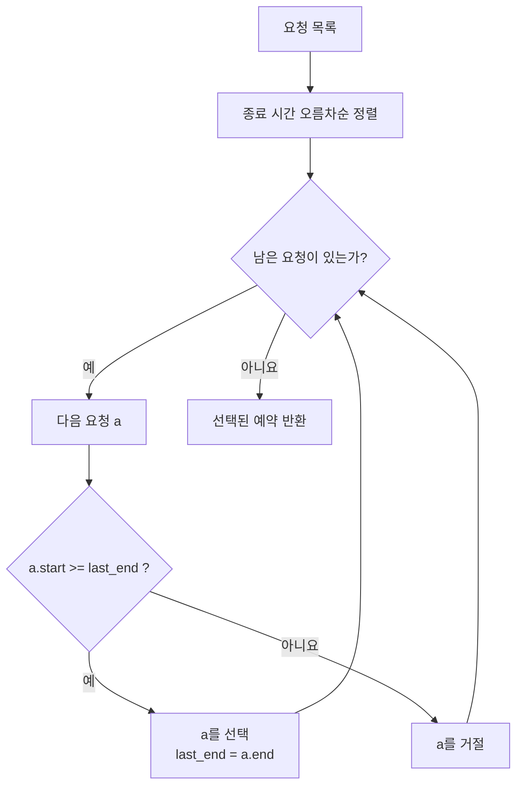
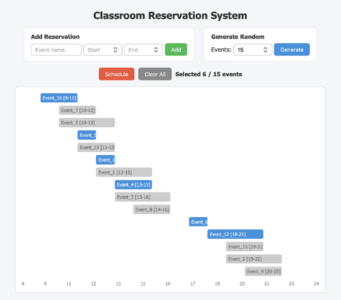

# HW4 과제 해설 — 강의실 예약 시스템

[레포지토리 안내](../../README.ko.md) | [English](Assignment-Explanation.md) | [한국어](Assignment-Explanation.ko.md)

> **최종 수정일:** 2026-11-17
>
> Introduction to Algorithms, Cormen, Leiserson, Rivest, and Stein, Ch 16

> **학습 목표:**
> 1. 강의실 예약 요청을 시작 시간과 종료 시간으로 이루어진 반열린 구간으로 나타내고, 두 예약이 겹치는지 판정할 수 있다
> 2. 활동 선택 문제를 정의하고, 종료 시간 기준 그리디 알고리즘의 각 단계를 단계별 추적표로 기록할 수 있다
> 3. 그리디 선택 성질과 최적 부분 구조로 그리디 알고리즘이 최적해를 내는지 논증할 수 있다
> 4. 정렬 기준이 최적해를 보장하지 않을 때 그 사실을 보이는 반례를 구성할 수 있다
> 5. Flask 백엔드와 JavaScript 프런트엔드가 예약 데이터와 선택 결과를 주고받는 구조를 설명할 수 있다

---

## 목차

- [1. 과제 구성과 실행 방법](#1-과제-구성과-실행-방법)
- [2. 요구사항](#2-요구사항)
  - [2.1 기능 요구사항](#21-기능-요구사항)
  - [2.2 API 엔드포인트](#22-api-엔드포인트)
  - [2.3 보고서와 평가 기준](#23-보고서와-평가-기준)
- [3. 문제 모델링](#3-문제-모델링)
  - [3.1 예약 요청과 반열린 구간](#31-예약-요청과-반열린-구간)
  - [3.2 활동 선택 문제](#32-활동-선택-문제)
  - [3.3 종료 시간 기준 그리디 전략](#33-종료-시간-기준-그리디-전략)
- [4. 해결 방법](#4-해결-방법)
  - [4.1 종료 시간 기준 정렬](#41-종료-시간-기준-정렬)
  - [4.2 겹치지 않는 예약의 선택](#42-겹치지-않는-예약의-선택)
  - [4.3 단계별 추적 기록](#43-단계별-추적-기록)
  - [4.4 무작위 예약 생성](#44-무작위-예약-생성)
  - [4.5 타임라인 시각화와 추적표](#45-타임라인-시각화와-추적표)
- [5. 테스트와 결과](#5-테스트와-결과)
  - [5.1 실행 화면](#51-실행-화면)
  - [5.2 표본 입력의 단계별 그리디 추적](#52-표본-입력의-단계별-그리디-추적)
  - [5.3 정확성 테스트](#53-정확성-테스트)
- [6. 보고서의 분석 질문](#6-보고서의-분석-질문)
  - [6.1 종료 시간 정렬의 최적성](#61-종료-시간-정렬의-최적성)
  - [6.2 다른 정렬 기준의 검토](#62-다른-정렬-기준의-검토)
- [요약](#요약)
- [점검 문제](#점검-문제)

---

<br>

## 1. 과제 구성과 실행 방법

> **풀어 보기:** 이 문서는 정답과 풀이를 담고 있다. 먼저 [과제 안내문](Original/Assignment.ko.md)의 문제를 직접 풀어 본 뒤 읽는다.

5주차 가정 과제는 강의실 하나에 들어온 예약 요청 가운데 서로 겹치지 않는 예약을 가능한 한 많이 고르는 **강의실 예약 시스템** 웹 앱을 만드는 과제이다. 선택에는 그리디 활동 선택 알고리즘을 쓰고, 웹 화면에서 예약을 직접 추가하거나 무작위로 만든 뒤 스케줄링 결과를 타임라인과 단계별 추적표로 보여 주어야 한다. 백엔드는 Python(FastAPI 또는 Flask), 프런트엔드는 HTML, CSS, JavaScript로 만들며, 소스 코드와 2쪽 이내의 보고서를 함께 제출한다. 활동 선택 문제의 이론은 [5주차 이론 5절](../../Lecture-Notes/Week05_Greedy-Algorithms/Concepts_Lecture.ko.md#5-활동-선택-문제)에, 같은 문제를 다루는 회의실 예약 시스템 예제는 [5주차 실습 3.1절](../../Lecture-Notes/Week05_Greedy-Algorithms/Concepts_Lab.ko.md#31-b-1-회의실-예약-시스템)에 있다.

```text
Coursework/HW04_Greedy-Algorithms/
├── Assignment-Explanation.md       # 과제 해설 (영어)
├── Assignment-Explanation.ko.md    # 과제 해설 (한국어, 이 파일)
├── Code-Walkthrough.md             # 코드 총정리 (영어)
├── Code-Walkthrough.ko.md          # 코드 총정리 (한국어)
├── Original/
│   ├── Assignment.md               # 과제 안내문 (영어)
│   └── Assignment.ko.md            # 과제 안내문 (한국어)
└── Solution/
    ├── app.py                      # Flask 백엔드: 활동 선택, 무작위 생성, API 라우트
    ├── requirements.txt            # 의존성 (Flask)
    └── static/
        ├── index.html              # 화면 구조
        ├── style.css               # 화면 스타일
        └── app.js                  # 사용자 동작 처리, 타임라인과 추적표 그리기
```

*그림 1. HW4 과제의 디렉토리 구성*

```bash
# 레포지토리 루트에서 풀이 디렉토리로 이동
cd Coursework/HW04_Greedy-Algorithms/Solution

# 의존성 설치 (Flask)
pip install -r requirements.txt

# 개발 서버 실행 후 브라우저에서 http://localhost:5000 접속
python app.py
```

`python app.py`는 디버그 모드의 Flask 개발 서버를 5000번 포트에서 띄운다. 브라우저에서 예약을 추가하거나 **Generate**로 무작위 예약을 만든 뒤 **Schedule**을 누르면 스케줄링 결과가 나타난다.

> **참고:** macOS 12 이후에서는 AirPlay 수신 모드가 5000번 포트를 쓰므로 서버가 뜨지 않거나 다른 프로그램의 응답이 돌아올 수 있다. 이때는 AirPlay 수신 모드를 끄거나 `flask --app app run --port 5001`처럼 다른 포트로 실행한다.

각 파일을 처음부터 끝까지 읽는 설명은 [HW4 코드 총정리](Code-Walkthrough.ko.md)에 있다.

---

<br>

## 2. 요구사항

### 2.1 기능 요구사항

과제 안내문이 요구하는 기능과 각 기능을 구현한 위치는 다음과 같다. 줄 번호는 각 파일 기준이다.

| 영역 | 요구사항 | 구현 위치 |
|:-----|:-----|:-----|
| 알고리즘 | 입력: 시작 시간과 종료 시간이 있는 예약 요청 목록 | `app.py` 76번 줄 (`/schedule`이 받는 `activities`) |
| 알고리즘 | 종료 시간 기준으로 정렬한다 | `app.py` 19번 줄 |
| 알고리즘 | 겹치지 않는 예약을 그리디하게 선택한다 | `app.py` 22\~38번 줄 |
| 알고리즘 | 출력: 수용할 수 있는 예약의 최대 집합 | `app.py` 40번 줄, 78\~83번 줄 |
| 화면 | 예약 이름, 시작 시간, 종료 시간을 입력해 예약을 추가한다 | `index.html` 13\~19번 줄, `app.js` 62\~78번 줄 |
| 화면 | 표본 데이터(예: 무작위 예약 15개)를 만드는 Generate Random 버튼 | `index.html` 20\~25번 줄, `app.js` 82\~95번 줄, `app.py` 43\~52번 줄, 64\~70번 줄 |
| 화면 | Schedule 버튼으로 그리디 알고리즘을 실행한다 | `index.html` 29번 줄, `app.js` 99\~129번 줄 |
| 화면 | 타임라인: 모든 요청은 회색, 선택된 예약은 강조 | `app.js` 14\~54번 줄, `style.css` 137\~144번 줄 |
| 화면 | 선택된 예약 수와 전체 요청 수 | `app.js` 112번 줄 |
| 화면 | 그리디 선택 순서의 단계별 추적 | `index.html` 36\~50번 줄, `app.js` 114\~128번 줄 |

*표 1. 기능 요구사항과 구현 위치*

### 2.2 API 엔드포인트

| 메서드 | 엔드포인트 | 설명 | 구현 위치 |
|:-----|:-----|:-----|:-----|
| `POST` | `/schedule` | 활동 선택을 실행하고 선택된 예약을 돌려준다 | `app.py` 73\~83번 줄 |
| `POST` | `/generate` | 무작위 예약 요청을 만든다 | `app.py` 64\~70번 줄 |
| `GET` | `/` | 프런트엔드 페이지를 제공한다 | `app.py` 59\~61번 줄 |

*표 2. API 엔드포인트와 구현 위치*

두 `POST` 엔드포인트는 JSON을 주고받는다. 예약 하나는 `{"name": "Event_1", "start": 9, "end": 11}`처럼 이름, 시작 시간, 종료 시간을 가진 객체이고, 시간은 정수(시)이다.

| 엔드포인트 | 요청 본문 | 응답 본문 |
|:-----|:-----|:-----|
| `/generate` | `{"n": 15}` | `{"activities": [...]}` |
| `/schedule` | `{"activities": [...]}` | `{"selected": [...], "total": ..., "selected_count": ..., "trace": [...]}` |

*표 3. 엔드포인트별 요청과 응답의 JSON 형식*

### 2.3 보고서와 평가 기준

보고서는 PDF 파일 하나로, 최대 2쪽이고 글자 크기는 11pt 이상이다. 보고서에 들어갈 항목과 이 문서에서 다루는 위치는 다음과 같다.

| 보고서 항목 | 이 문서의 위치 |
|:-----|:-----|
| 표본 입력(예약 10개 이상)을 넣은 예약 시스템의 화면 캡처 | 5.1절 |
| 표본 입력에 대한 그리디 선택의 단계별 추적 | 5.2절 |
| 분석: 종료 시간 기준 정렬은 왜 최적해를 보장하는가? 시작 시간이나 길이로 정렬해도 되는가? | 6절 |

*표 4. 보고서 항목과 이 문서의 위치*

| 평가 항목 | 비율 |
|:-----|-----:|
| 웹 앱이 실행되고 올바르게 동작한다 | 20% |
| 알고리즘 요구사항을 모두 구현한다 | 40% |
| 보고서 (최대 2쪽, 글자 크기 11 이상) | 40% |

*표 5. 평가 기준*

---

<br>

## 3. 문제 모델링

### 3.1 예약 요청과 반열린 구간

> **용어 정의:** **활동(activity)** 은 하나의 자원(여기서는 강의실)을 시작 시간부터 종료 시간 직전까지 점유하는 요청이다. 시작 시간이 $s$, 종료 시간이 $f$인 활동은 반열린 구간 $`[s, f)`$로 나타낸다.

반열린 구간은 시작 시각을 포함하고 종료 시각을 포함하지 않는다. 따라서 [9, 11)과 [11, 12)는 11시에 한쪽이 끝나고 다른 쪽이 시작할 뿐 겹치지 않는다. 일반적으로 두 활동 $`a_i = [s_i, f_i)`$와 $`a_j = [s_j, f_j)`$는 다음 조건을 만족할 때 **양립 가능(compatible)** 하다고 한다.

$$
f_i \le s_j \quad \text{또는} \quad f_j \le s_i
$$

즉 한 활동이 끝난 뒤에 다른 활동이 시작해야 한다. 이 앱에서 예약 시간은 정수 시(hour)이고, 화면의 추적표는 구간을 [9, 11)처럼 반열린 구간으로 표기한다(`app.js` 122번 줄). 선택 조건 `act["start"] >= last_end`(`app.py` 25번 줄)가 등호를 포함하는 것도 이 약속에 따른 것으로, 앞 예약의 종료 시간과 다음 예약의 시작 시간이 같으면 겹치지 않는 것으로 본다. 타임라인 막대의 글자는 `Event_10 [9-11]`처럼 하이픈으로 적지만(`app.js` 38번 줄) 같은 반열린 구간을 가리킨다.

### 3.2 활동 선택 문제

활동 $n$개의 집합 $`S = \lbrace a_1, a_2, \dots, a_n \rbrace`$이 주어질 때, 서로 양립 가능한 활동으로만 이루어진 부분집합 가운데 원소가 가장 많은 것을 찾는 문제를 **활동 선택 문제(activity-selection problem)** 라 한다. 강의실 예약 시스템에서 활동은 예약 요청이고, 답은 강의실 하나에 받아들일 수 있는 예약의 최대 집합이다.

모든 부분집합을 확인하는 완전 탐색(brute force)은 부분집합 $2^n$개를 살펴야 한다. 요청이 15개이면 32,768개, 이 앱이 만들 수 있는 최대인 100개이면 $`2^{100}`$개이므로 요청이 조금만 많아져도 쓸 수 없다.

> **주의:** 최대(maximum) 집합은 크기가 가장 큰 집합이다. 더 이상 예약을 추가할 수 없는 극대(maximal) 집합과 구별해야 한다. 극대 집합은 최대 집합이 아닐 수 있으며, 6.2절의 반례는 모두 극대이지만 최대가 아닌 집합을 만든다.

### 3.3 종료 시간 기준 그리디 전략

과제 안내문은 다음 전략을 지정한다. 요청을 종료 시간 오름차순으로 정렬하고, 앞에서부터 차례로 보면서 지금까지 고른 예약과 겹치지 않으면 고른다. 고른 결정은 다시 바꾸지 않는다.

```text
GREEDY-ACTIVITY-SELECTION(S)
    sort S by finish time in ascending order
    selected = empty list
    last_end = -infinity
    for each activity a in sorted order
        if a.start >= last_end
            append a to selected
            last_end = a.end
    return selected
```

`last_end`는 마지막으로 고른 활동의 종료 시간이다. 처음에는 아무것도 고르지 않았으므로 어떤 시작 시간보다도 작은 값으로 둔다.



*그림 2. 종료 시간 기준 그리디 선택의 흐름*

정렬에 $`O(n \log n)`$, 반복문에 $O(n)$ 시간이 들어 전체 시간 복잡도는 $`O(n \log n)`$이다. 이 전략이 왜 최적해를 주는지는 보고서의 분석 질문이므로 6.1절에서 다룬다.

---

<br>

## 4. 해결 방법

### 4.1 종료 시간 기준 정렬

**규칙:** 예약 요청을 종료 시간 오름차순으로 정렬한다.

```python
    sorted_acts = sorted(activities, key=lambda a: a["end"])
```

`activity_selection`의 19번 줄은 `sorted`에 `key=lambda a: a["end"]`를 주어 종료 시간이 이른 예약부터 늘어놓은 새 목록 `sorted_acts`를 만든다. 원래 목록 `activities`는 바뀌지 않는다. Python의 `sorted`는 안정 정렬(stable sort)이므로 종료 시간이 같은 예약끼리는 요청 목록에 들어온 순서를 유지한다. 예를 들어 5.2절의 표본에서 종료 시간이 12인 Event_7과 Event_14는 요청 목록의 순서대로 Event_7이 먼저 온다.

> **참고:** **동점 처리.** 종료 시간이 같은 예약의 순서는 선택되는 예약의 수에 영향을 주지 않는다. 6.1절의 논증은 종료 시간이 가장 이른 활동 가운데 어느 것을 골라도 성립하기 때문이다. 다만 어떤 예약이 뽑히는지는 달라질 수 있다. X = [3, 5), Y = [4, 5), Z = [5, 6)을 X, Y, Z 순서로 보내면 X와 Z가, Y, X, Z 순서로 보내면 Y와 Z가 선택되며 둘 다 2개이다.

### 4.2 겹치지 않는 예약의 선택

**규칙:** 정렬된 순서로 예약을 보면서, 마지막으로 고른 예약의 종료 시간 이후에 시작하는 예약을 고른다.

```python
    selected = []
    trace = []
    last_end = -1

    for act in sorted_acts:
        if act["start"] >= last_end:
            selected.append(act)
            trace.append({
                "action": "select",
                "activity": act,
                "reason": f"start={act['start']} >= last_end={last_end}",
            })
            last_end = act["end"]
        else:
            trace.append({
                "action": "reject",
                "activity": act,
                "reason": f"start={act['start']} < last_end={last_end}",
            })

    return selected, trace
```

20번 줄과 21번 줄은 선택된 예약과 추적 기록을 담을 빈 목록을 만들고, 22번 줄은 `last_end`를 -1로 둔다. 24번 줄의 반복문은 종료 시간 순서로 예약을 하나씩 보고, 25번 줄은 그 예약의 시작 시간이 `last_end` 이상인지 확인한다. 조건이 참이면 26번 줄에서 예약을 `selected`에 넣고 32번 줄에서 `last_end`를 그 예약의 종료 시간으로 바꾼다. 조건이 거짓이면 33\~38번 줄에서 거절 기록만 남긴다. 40번 줄은 선택된 예약과 추적 기록을 함께 돌려준다.

새 예약을 지금까지 고른 예약 전부와 비교하지 않고 `last_end` 하나와만 비교해도 되는 이유는 다음과 같다. 예약을 종료 시간 순서로 고르므로 이미 고른 예약은 모두 `last_end` 이전에 끝난다. 따라서 새 예약의 시작 시간이 `last_end` 이상이면 고른 예약 전부와 양립 가능하다. 반대로 시작 시간이 `last_end`보다 작으면, 새 예약은 정렬 순서상 `last_end` 이후에 끝나므로 마지막으로 고른 예약과 반드시 겹친다. 한 번의 비교로 겹침 여부가 정확히 판정되므로 반복문 전체가 $O(n)$ 시간에 끝난다.

> **주의:** `last_end = -1`은 모든 예약의 시작 시간이 -1 이상일 때만 "아직 고른 예약이 없다"는 뜻으로 동작한다. 무작위 생성은 9 이상의 시작 시간만 만들고 입력란에도 `min="0"`이 있어 보통은 문제가 없지만, 입력란의 `min`은 음수를 직접 입력하는 것을 막지 않고 서버도 값을 검사하지 않는다. 예를 들어 [-3, -2) 하나만 보내면 `start=-3 < last_end=-1`로 거절되어 아무 예약도 고르지 않는다. 의사코드처럼 초깃값을 음의 무한대(`float("-inf")`)로 두면 이 가정이 필요 없다.

### 4.3 단계별 추적 기록

**규칙:** 화면에 그리디 선택 순서를 단계별로 보여 준다.

반복문은 예약을 하나 볼 때마다 `trace`에 항목을 하나씩 추가한다(27\~31번 줄, 34\~38번 줄). 항목은 종료 시간 순서대로 쌓이므로 `trace`의 위치가 곧 단계 번호이다.

| 필드 | 값 | 예 |
|:-----|:-----|:-----|
| `action` | `"select"` 또는 `"reject"` | `"select"` |
| `activity` | 그 단계에서 본 예약 객체 | `{"name": "Event_10", "start": 9, "end": 11}` |
| `reason` | 판정에 쓴 비교식 | `"start=9 >= last_end=-1"` |

*표 6. 추적 항목의 필드*

`reason`은 f-문자열로 만든 비교식이며, 판정 순간의 `last_end` 값을 담는다. `/schedule` 라우트는 이 결과를 그대로 JSON으로 돌려준다.

```python
@app.route("/schedule", methods=["POST"])
def schedule():
    data = request.get_json()
    activities = data["activities"]
    selected, trace = activity_selection(activities)
    return jsonify({
        "selected": selected,
        "total": len(activities),
        "selected_count": len(selected),
        "trace": trace,
    })
```

75번 줄은 요청 본문의 JSON을 읽고, 76번 줄은 예약 목록을 꺼낸다. 77번 줄이 활동 선택을 실행하고, 78\~83번 줄이 선택된 예약, 전체 요청 수, 선택된 예약 수, 추적 기록을 응답으로 묶는다. 화면의 "Selected k / n events"는 `selected_count`와 `total`로 만든다.

### 4.4 무작위 예약 생성

**규칙:** Generate Random 버튼으로 표본 데이터(예: 무작위 예약 15개)를 만든다.

```python
def generate_activities(n=15):
    """Generate n random activities with start/end times."""
    activities = []
    for i in range(n):
        start = random.randint(9, 20)
        end = start + random.randint(1, 3)
        if end > 22:
            end = 22
        activities.append({"name": f"Event_{i+1}", "start": start, "end": end})
    return activities
```

47번 줄은 시작 시간을 9\~20의 정수에서 고르게 고르고(`random.randint`는 양 끝을 포함한다), 48번 줄은 길이를 1\~3시간에서 골라 종료 시간을 정한다. 49\~50번 줄은 종료 시간이 22시를 넘지 않게 자른다. 시작 시간이 20 이하이므로 잘라도 종료 시간은 항상 시작 시간보다 크다. 결과적으로 시작 시간은 9\~20, 종료 시간은 10\~22, 길이는 1\~3시간이다. 51번 줄은 생성 순서대로 Event_1, Event_2, ...라는 이름을 붙인다.

```python
@app.route("/generate", methods=["POST"])
def generate():
    data = request.get_json()
    n = int(data.get("n", 15))
    n = max(1, min(n, 100))
    activities = generate_activities(n)
    return jsonify({"activities": activities})
```

67번 줄은 요청의 `n`을 정수로 읽고 값이 없으면 15를 쓴다. 68번 줄은 `n`을 1\~100으로 제한하므로 0을 보내면 1개, 500을 보내면 100개가 만들어진다. 화면의 입력란(`index.html` 23번 줄)도 같은 범위(`min="1"`, `max="100"`)를 갖는다.

### 4.5 타임라인 시각화와 추적표

**규칙:** 모든 요청을 회색으로, 선택된 예약을 강조색으로 그린 타임라인, 선택 수와 전체 수, 단계별 추적을 화면에 보여 준다.

프런트엔드의 `refreshTimeline`(`app.js` 14\~54번 줄)은 8시부터 24시까지의 고정된 16시간 범위에 예약을 막대로 그린다. 막대의 왼쪽 위치와 너비는 다음과 같이 백분율로 정한다.

```math
\text{left} = \frac{s - 8}{16} \times 100\%, \qquad \text{width} = \max\left(\frac{f - s}{16} \times 100\%,\ 2\%\right)
```

화면의 막대는 시작 시간 순서(같으면 종료 시간 순서)로 위에서 아래로 놓인다(25번 줄). 이 순서는 알고리즘이 예약을 보는 종료 시간 순서와 다르다. 이름이 선택된 예약 목록에 있으면 `selected` 클래스(파란색 `#4a90d9`), 없으면 `rejected` 클래스(회색 `#ccc`)를 붙인다(34\~35번 줄, `style.css` 137\~144번 줄). 이 판정은 예약 이름으로 하므로 이름이 같은 예약이 둘 있으면 하나만 선택되어도 둘 다 파랗게 칠해진다.

시간축의 눈금은 47\~52번 줄이 만든다. 범위 16시간을 12등분하여 13개의 눈금을 같은 간격으로 놓고, 각 눈금에 $`8 + 16i/12`$를 반올림한 값을 적는다. 그래서 눈금은 8, 9, 11, 12, 13, 15, 16, 17, 19, 20, 21, 23, 24로 표시되며, 예를 들어 "9"라고 적힌 눈금의 실제 위치는 9시 20분이다. 막대의 위치는 정확하지만 눈금 숫자는 근삿값이다.

Schedule을 누르면 99\~129번 줄이 `/schedule`에 예약 목록을 보내고, 응답으로 타임라인을 다시 그린 뒤 요약 문구 `Selected k / n events`를 쓰고(112번 줄), 추적 항목마다 표의 행을 하나씩 만든다(116\~127번 줄). 선택 행은 연두색(`row-select`), 거절 행은 연회색(`row-reject`)이고, 구간은 [9, 11)처럼, 판정은 `SELECT`, `REJECT`처럼 대문자로 적는다.

---

<br>

## 5. 테스트와 결과

### 5.1 실행 화면

다음은 무작위 예약 15개(9\~22시 범위)를 만들고 Schedule을 누른 뒤의 화면이다.



*그림 3. 무작위 예약 15개를 스케줄링한 뒤의 강의실 예약 시스템 화면*

위쪽에는 예약 추가 입력란(이름, 시작, 종료)과 무작위 생성 입력란이 있고, 그 아래에 Schedule, Clear All 버튼과 요약 문구 "Selected 6 / 15 events"가 있다. 타임라인에서 파란 막대 6개가 선택된 예약이고 회색 막대 9개가 거절된 예약이다. 길이가 1시간인 막대는 너비가 범위의 1/16밖에 되지 않아 `Event_14 [11-12]` 같은 글자가 `Event_1`처럼 잘려 보인다(`style.css` 134번 줄의 `overflow: hidden`). 아래쪽 눈금이 9, 11처럼 건너뛰는 이유는 4.5절에서 설명했다.

### 5.2 표본 입력의 단계별 그리디 추적

그림 3의 예약 15개에 그리디 알고리즘을 적용한 추적은 다음과 같다. 행은 종료 시간 순서이고, `last_end`는 가장 최근에 고른 예약의 종료 시간이다. 근거 열은 앱이 출력하는 `reason` 문자열 그대로이다.

| 단계 | 예약 | 구간 | 판정 | 근거 |
|:---:|:-----|:-----|:-----|:-----|
| 1 | Event_10 | [9, 11) | SELECT | `start=9 >= last_end=-1` |
| 2 | Event_7 | [10, 12) | REJECT | `start=10 < last_end=11` |
| 3 | Event_14 | [11, 12) | SELECT | `start=11 >= last_end=11` |
| 4 | Event_5 | [10, 13) | REJECT | `start=10 < last_end=12` |
| 5 | Event_11 | [12, 13) | SELECT | `start=12 >= last_end=12` |
| 6 | Event_13 | [11, 13) | REJECT | `start=11 < last_end=13` |
| 7 | Event_1 | [12, 15) | REJECT | `start=12 < last_end=13` |
| 8 | Event_4 | [13, 15) | SELECT | `start=13 >= last_end=13` |
| 9 | Event_3 | [13, 16) | REJECT | `start=13 < last_end=15` |
| 10 | Event_8 | [14, 16) | REJECT | `start=14 < last_end=15` |
| 11 | Event_6 | [17, 18) | SELECT | `start=17 >= last_end=15` |
| 12 | Event_12 | [18, 21) | SELECT | `start=18 >= last_end=18` |
| 13 | Event_15 | [19, 21) | REJECT | `start=19 < last_end=21` |
| 14 | Event_2 | [19, 22) | REJECT | `start=19 < last_end=21` |
| 15 | Event_9 | [20, 22) | REJECT | `start=20 < last_end=21` |

*표 7. 표본 예약 15개에 대한 그리디 추적 (15개 중 6개 선택)*

같은 예약을 종료 시간 순서로 늘어놓고 선택된 예약을 `###`, 거절된 예약을 `---`로 그리면 다음과 같다. 한 칸 세 글자가 1시간이다.

```text
          9  10 11 12 13 14 15 16 17 18 19 20 21 22
Event_10  ######
Event_7      ------
Event_14        ###
Event_5      ---------
Event_11           ###
Event_13        ------
Event_1            ---------
Event_4               ######
Event_3               ---------
Event_8                  ------
Event_6                           ###
Event_12                             #########
Event_15                                ------
Event_2                                 ---------
Event_9                                    ------
```

*그림 4. 종료 시간 순서로 나열한 표본 예약과 선택 결과*

선택된 예약은 Event_10 [9, 11), Event_14 [11, 12), Event_11 [12, 13), Event_4 [13, 15), Event_6 [17, 18), Event_12 [18, 21)의 6개이다. 처음 네 예약과 마지막 두 예약은 앞 예약이 끝나는 시각에 바로 시작하며, 이는 반열린 구간의 약속 덕분에 허용된다. 거절된 예약은 모두 마지막으로 고른 예약이 끝나기 전에 시작한다. 15개 예약의 부분집합 32,768개를 모두 확인하면 서로 겹치지 않는 예약은 최대 6개이고, 크기가 6인 최대 집합은 12가지이다. 그리디가 찾은 집합은 그중 하나이다. 예를 들어 단계 12의 Event_12 [18, 21) 대신 종료 시간이 같은 Event_15 [19, 21)을 골라도 6개가 되지만, Event_12가 요청 목록에서 먼저 왔으므로 안정 정렬에 따라 Event_12가 먼저 검사되어 선택되었다.

### 5.3 정확성 테스트

`Solution/` 디렉토리에서 다음 스크립트를 실행하면 Flask 테스트 클라이언트로 `/schedule`을 호출하여 위 추적을 재현하고, 작은 무작위 입력에서 그리디의 결과를 완전 탐색과 비교한다.

```python
import itertools, random
from app import app, activity_selection

client = app.test_client()
ev = {10: (9, 11), 7: (10, 12), 14: (11, 12), 5: (10, 13), 11: (12, 13),
      13: (11, 13), 1: (12, 15), 4: (13, 15), 3: (13, 16), 8: (14, 16),
      6: (17, 18), 12: (18, 21), 15: (19, 21), 2: (19, 22), 9: (20, 22)}
acts = [{"name": f"Event_{i}", "start": s, "end": e} for i, (s, e) in sorted(ev.items())]
res = client.post("/schedule", json={"activities": acts}).get_json()
print(res["selected_count"], [a["name"] for a in res["selected"]])

def compatible(sub):
    sub = sorted(sub, key=lambda a: (a["start"], a["end"]))
    return all(x["end"] <= y["start"] for x, y in zip(sub, sub[1:]))

def brute(acts):
    for k in range(len(acts), 0, -1):
        if any(compatible(c) for c in itertools.combinations(acts, k)):
            return k
    return 0

random.seed(123)
bad = 0
for _ in range(3000):
    acts = []
    for i in range(random.randint(0, 9)):
        s = random.randint(0, 12)
        acts.append({"name": f"E{i}", "start": s, "end": s + random.randint(1, 4)})
    sel, _ = activity_selection(acts)
    bad += len(sel) != brute(acts) or not compatible(sel)
print("mismatches:", bad)
```

```text
6 ['Event_10', 'Event_14', 'Event_11', 'Event_4', 'Event_6', 'Event_12']
mismatches: 0
```

첫 줄은 표 7의 선택 결과와 같고, 둘째 줄은 예약 0\~9개로 이루어진 무작위 입력 3,000개에서 그리디가 고른 예약 수가 완전 탐색의 최댓값과 모두 같고 고른 예약끼리 겹치지 않았다는 뜻이다. 경계 경우도 다음과 같이 확인할 수 있다.

| 입력 | 결과 | 확인한 점 |
|:-----|:-----|:-----|
| 빈 목록 | `selected_count` 0, `trace` 빈 목록 | 요청이 없어도 오류 없이 응답한다 |
| [1, 4), [4, 6) | 둘 다 선택 | 끝과 시작이 맞닿은 예약은 겹치지 않는다 |
| X = [3, 5), Y = [4, 5), Z = [5, 6) | 순서에 따라 X, Z 또는 Y, Z | 동점의 순서는 선택된 예약만 바꾸고 수는 바꾸지 않는다 |
| [-3, -2) | 아무것도 선택하지 않음 | 초깃값 -1이 음수 시작 시간을 거절한다 (4.2절) |
| `/generate`에 `n` = 0, 500, 생략 | 1개, 100개, 15개 | 생성 개수를 1\~100으로 제한하고 기본값은 15이다 |

*표 8. 경계 경우의 확인 결과*

---

<br>

## 6. 보고서의 분석 질문

### 6.1 종료 시간 정렬의 최적성

**질문:** 종료 시간 기준 정렬은 왜 최적해를 보장하는가?

직관적으로는 가장 먼저 끝나는 활동을 고르면 이후 활동을 위해 남는 시간이 가장 길어진다. 이 직관을 증명으로 만들려면 [5주차 이론 1.2절](../../Lecture-Notes/Week05_Greedy-Algorithms/Concepts_Lecture.ko.md#12-그리디-정확성을-위한-핵심-성질)의 두 성질, 곧 그리디 선택 성질과 최적 부분 구조를 보이면 된다. 아래에서는 모든 활동이 $`s_i < f_i`$를 만족한다고 가정하고, 활동에 종료 시간 순서 $`f_1 \le f_2 \le \dots \le f_n`$으로 번호를 매긴다. 이 앱에서도 입력란은 종료 시간이 시작 시간보다 커야 예약을 받고, 무작위 생성은 길이가 1시간 이상인 예약만 만든다.

**그리디 선택 성질.** 종료 시간이 가장 이른 활동 $`a_1`$을 포함하는 최적해가 존재한다(교재의 정리 16.1). 최적해 $A$를 하나 잡고, $A$의 활동 가운데 종료 시간이 가장 이른 것을 $`a_k`$로 둔다. $`a_k = a_1`$이면 증명할 것이 없다. 그렇지 않으면 $`a_k`$를 $`a_1`$로 바꾼 집합

$$
A' = (A \setminus \lbrace a_k \rbrace) \cup \lbrace a_1 \rbrace
$$

을 생각한다. $A$의 다른 활동 $`a_j`$는 $`a_k`$보다 먼저 끝나지 않으므로, $`a_k`$와 양립 가능하려면 $`a_k`$가 끝난 뒤에 시작해야 한다. 즉 $`s_j \ge f_k`$이다. 또 $`a_1`$은 모든 활동 가운데 가장 먼저 끝나므로 $`f_1 \le f_k \le s_j`$이고, $`a_1`$은 $`A'`$의 다른 모든 활동과 양립 가능하다. $`\lvert A' \rvert = \lvert A \rvert`$이므로 $`A'`$도 최적해이며 $`a_1`$을 포함한다. 이 교환 논증에서 바꾸는 대상은 최적해에서 가장 먼저 끝나는 활동이며, 바꾼 뒤에도 겹침이 생기지 않는 근거는 $`f_1 \le f_k`$라는 한 부등식이다.

**최적 부분 구조.** $`a_1`$을 고른 뒤 남는 문제는 $`a_1`$이 끝난 뒤에 시작하는 활동들의 집합

$$
S' = \lbrace a_j \in S : s_j \ge f_1 \rbrace
$$

에서 같은 문제를 푸는 것이다. 위에서 본 최적해 $`A'`$에서 $`a_1`$을 뺀 나머지는 모두 $`S'`$에 속하므로 $`\mathrm{OPT}(S') \ge \mathrm{OPT}(S) - 1`$이다. 반대로 $`S'`$의 해에 $`a_1`$을 더하면 $S$의 해가 되므로 $`\mathrm{OPT}(S) \ge 1 + \mathrm{OPT}(S')`$이다. 따라서 $`\mathrm{OPT}(S) = 1 + \mathrm{OPT}(S')`$이다.

**알고리즘의 최적성.** 코드는 $`a_1`$을 고른 뒤 `last_end`를 $`f_1`$로 바꾸고, 시작 시간이 $`f_1`$보다 작은 활동, 곧 $`S'`$에 속하지 않는 활동을 모두 거절한다. 다음으로 선택되는 활동은 $`S'`$에서 종료 시간이 가장 이른 활동이므로, 알고리즘은 $`S'`$에 대해 같은 그리디를 다시 실행하는 것과 같다. 활동 수에 대한 귀납법으로 $`S'`$에서 그리디가 고른 개수가 $`\mathrm{OPT}(S')`$라 하면, $S$에서 그리디가 고른 집합 $G(S)$의 크기는 다음과 같다.

$$
\lvert G(S) \rvert = 1 + \lvert G(S') \rvert = 1 + \mathrm{OPT}(S') = \mathrm{OPT}(S)
$$

따라서 종료 시간 기준 그리디는 항상 최대 집합을 찾는다. 증명은 $`a_1`$이 종료 시간이 가장 이른 활동이라는 사실만 쓰므로, 종료 시간이 같은 활동 가운데 어느 것을 먼저 보아도 성립한다.

> **핵심:** 종료 시간 기준 그리디의 정확성은 "가장 먼저 끝나는 활동을 최적해의 첫 활동 자리에 넣어도 겹침이 생기지 않는다"는 교환 논증과, 그 선택 뒤에 남는 문제가 같은 꼴이라는 최적 부분 구조에서 나온다.

### 6.2 다른 정렬 기준의 검토

**질문:** 시작 시간이나 길이(duration)로 정렬해도 되는가?

두 기준 모두 최적해를 보장하지 않는다. 각각 그리디가 최대가 아닌 집합을 고르는 반례가 있다. 아래 반례는 앱과 같은 선택 규칙(정렬한 순서로 보면서 `start >= last_end`이면 선택)에서 정렬 기준만 바꾼 것이다.

**시작 시간 기준.** 활동 [0, 100), [1, 3), [4, 6)을 생각한다. 시작 시간 순서로 보면 [0, 100)을 먼저 고르고, 나머지 두 활동은 100 이전에 시작하므로 모두 거절되어 1개만 고른다. 최적해는 {[1, 3), [4, 6)}의 2개이다.

```text
          0   1   2   3   4   5   6   7   ...   100
[0, 100)  [===============================...===)
[1, 3)        [=======)
[4, 6)                    [=======)
```

*그림 5. 시작 시간 기준 그리디의 반례 (100까지의 구간은 줄여서 그림)*

가장 먼저 시작하는 활동은 얼마든지 길 수 있으므로, 그 활동 하나가 짧은 활동 여러 개를 막을 수 있다.

**길이 기준.** 활동 [0, 4), [3, 6), [5, 9)를 생각한다. 길이는 각각 4, 3, 4이므로 길이 순서로 보면 [3, 6)을 먼저 고른다. 그러면 `last_end`가 6이 되고, [0, 4)는 시작 시간 0이, [5, 9)는 시작 시간 5가 6보다 작으므로 둘 다 [3, 6)과 겹쳐 거절되어 1개만 고른다. 최적해는 {[0, 4), [5, 9)}의 2개이다.

```text
        0  1  2  3  4  5  6  7  8  9
[0, 4)  [===========)
[3, 6)           [========)
[5, 9)                 [===========)
```

*그림 6. 길이 기준 그리디의 반례*

가운데에 놓인 짧은 활동은 양쪽에 있는 서로 겹치지 않는 활동 두 개와 동시에 겹칠 수 있다.

| 정렬 기준 | [0, 100), [1, 3), [4, 6) | [0, 4), [3, 6), [5, 9) | 최적해 보장 |
|:-----|:-----|:-----|:-----|
| 종료 시간 오름차순 | {[1, 3), [4, 6)}, 2개 | {[0, 4), [5, 9)}, 2개 | 보장한다 |
| 시작 시간 오름차순 | {[0, 100)}, 1개 | {[0, 4), [5, 9)}, 2개 | 보장하지 않는다 |
| 길이 오름차순 | {[1, 3), [4, 6)}, 2개 | {[3, 6)}, 1개 | 보장하지 않는다 |

*표 9. 정렬 기준별 그리디 선택 결과*

두 기준이 실패하는 까닭은 6.1절의 교환 논증에서 찾을 수 있다. 교환이 성립하려면 그리디가 고른 활동이 최적해의 첫 활동보다 늦게 끝나지 않아야 한다($`f_1 \le f_k`$). 가장 먼저 시작하는 활동이나 가장 짧은 활동은 이 부등식을 보장하지 않으므로, 최적해의 첫 활동 자리에 넣었을 때 다음 활동과 겹칠 수 있다.

> **참고:** 시작 시간을 쓰더라도 방향을 바꾸면 최적해를 얻는다. 시작 시간이 가장 늦은 활동부터 고르고, 고른 활동이 시작하기 전에 끝나는 활동만 받아들이는 전략은 시간축을 뒤집었을 때의 종료 시간 기준 그리디와 같으므로 최적해를 준다(교재의 연습 문제 16.1-2). 교재의 연습 문제 16.1-3은 길이 기준과 시작 시간 기준에 더해, 남은 활동과 가장 적게 겹치는 활동을 고르는 기준도 최적해를 보장하지 않는다는 반례를 요구한다.

---

<br>

## 요약

| 개념 | 핵심 요약 |
|:-----|:-----|
| 반열린 구간 | 예약 [s, f)는 시작 시각을 포함하고 종료 시각을 포함하지 않으므로, 한 예약이 끝나는 시각에 다음 예약이 시작해도 겹치지 않는다. |
| 활동 선택 문제 | 서로 양립 가능한 활동으로만 이루어진 부분집합 가운데 크기가 가장 큰 것을 찾는 문제이며, 완전 탐색은 $2^n$개의 부분집합을 살펴야 한다. |
| 종료 시간 기준 그리디 | 종료 시간 오름차순으로 정렬한 뒤 `start >= last_end`인 예약을 차례로 고르며, 시간 복잡도는 정렬이 지배하는 $`O(n \log n)`$이다. |
| last_end 하나와의 비교 | 종료 시간 순서로 고르므로 마지막으로 고른 예약의 종료 시간 하나와 비교하면 겹침 여부가 정확히 판정된다. |
| 초깃값 -1 | 모든 시작 시간이 -1 이상이라는 가정 아래에서만 "아직 고른 예약이 없음"을 나타내며, 음수 시작 시간이 들어오면 잘못 거절한다. |
| 단계별 추적 | 반복마다 판정, 예약, 비교식을 기록하므로 `trace`의 위치가 곧 단계 번호이다. |
| 최적성 증명 | 가장 먼저 끝나는 활동을 최적해의 첫 활동 자리에 넣는 교환 논증(그리디 선택 성질)과 남은 문제가 같은 꼴이라는 최적 부분 구조로 증명한다. |
| 다른 정렬 기준 | 시작 시간 오름차순과 길이 오름차순은 반례가 있어 최적해를 보장하지 않고, 시작 시간이 가장 늦은 활동부터 고르는 전략은 최적이다. |
| 타임라인 표시 | 막대는 8\~24시 범위에 정확한 비율로 놓이지만, 눈금 숫자는 16시간을 12등분한 위치를 반올림한 근삿값이다. |

---

<br>

## 점검 문제

1. **양립 판정:** 예약 [1, 4)와 [4, 6)은 양립 가능한가? 이 앱의 선택 조건 `act["start"] >= last_end`와 연결하여 답하라.

   <details>
   <summary>정답</summary>

   양립 가능하다. 반열린 구간 [1, 4)는 4시를 포함하지 않으므로 [4, 6)과 겹치는 시각이 없다. 양립 조건 $`f_i \le s_j`$가 4 ≤ 4로 성립하며, 앱의 조건도 `4 >= 4`로 참이 되어 두 예약을 모두 고른다. 조건을 `>`로 쓰면 맞닿은 예약을 겹치는 것으로 보게 된다.

   </details>

2. **추적:** 예약 A = [2, 5), B = [1, 3), C = [4, 7), D = [6, 8), E = [3, 9)에 종료 시간 기준 그리디를 적용할 때, 검사 순서와 각 단계의 판정, 선택된 예약을 쓰라.

   <details>
   <summary>정답</summary>

   종료 시간 순서는 B(3), A(5), C(7), D(8), E(9)이다. B는 `start=1 >= last_end=-1`로 선택되어 `last_end`가 3이 된다. A는 `start=2 < last_end=3`으로 거절된다. C는 `start=4 >= last_end=3`으로 선택되어 `last_end`가 7이 된다. D는 `start=6 < last_end=7`, E는 `start=3 < last_end=7`로 거절된다. 선택된 예약은 B와 C의 2개이며, 이보다 많이 고를 수는 없다.

   </details>

3. **비교 횟수:** 새 예약을 지금까지 고른 모든 예약과 비교하지 않고 `last_end` 하나와만 비교해도 되는 이유를 설명하라.

   <details>
   <summary>정답</summary>

   예약을 종료 시간 순서로 고르므로 이미 고른 예약은 모두 `last_end` 이전에 끝난다. 새 예약의 시작 시간이 `last_end` 이상이면 고른 예약 전부와 양립 가능하다. 시작 시간이 `last_end`보다 작으면, 새 예약은 정렬 순서상 `last_end` 이후에 끝나므로 마지막으로 고른 예약과 겹친다. 따라서 한 번의 비교로 판정이 정확하고 반복문은 $O(n)$ 시간이 걸린다.

   </details>

4. **조건의 변경:** 25번 줄의 조건을 `act["start"] > last_end`로 바꾸어 5.2절의 표본 15개에 적용하면 몇 개를 고르는가? 이 결과는 최적해가 아니라는 뜻인가?

   <details>
   <summary>정답</summary>

   Event_10 [9, 11), Event_11 [12, 13), Event_8 [14, 16), Event_6 [17, 18), Event_15 [19, 21)의 5개를 고른다. 끝과 시작이 맞닿은 예약도 겹치는 것으로 보기 때문이다. 이는 구간을 닫힌 구간 [s, f]로 보는 다른 문제를 푼 결과이며, 그 문제에서는 5개가 최적이다. 반열린 구간을 쓰는 이 과제의 문제에서는 최댓값이 6이므로 `>=`가 맞다.

   </details>

5. **반례:** 길이가 가장 짧은 활동부터 고르는 그리디가 최적해를 놓치는 예를 하나 들고, 6.1절의 교환 논증이 이 기준에서 성립하지 않는 이유를 설명하라.

   <details>
   <summary>정답</summary>

   [0, 4), [3, 6), [5, 9)에서 길이 기준 그리디는 길이 3인 [3, 6)을 먼저 골라 양쪽의 두 활동을 모두 막고 1개만 고르지만, 최적해는 {[0, 4), [5, 9)}의 2개이다. 교환 논증은 그리디가 고른 활동이 최적해의 첫 활동보다 늦게 끝나지 않는다는 부등식 $`f_1 \le f_k`$에 기대는데, 가장 짧은 활동 [3, 6)은 최적해의 첫 활동 [0, 4)보다 늦게 끝나므로 그 자리에 넣으면 다음 활동 [5, 9)와 겹친다.

   </details>
