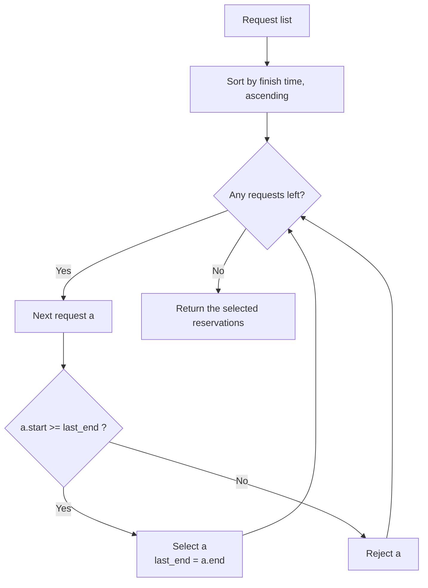
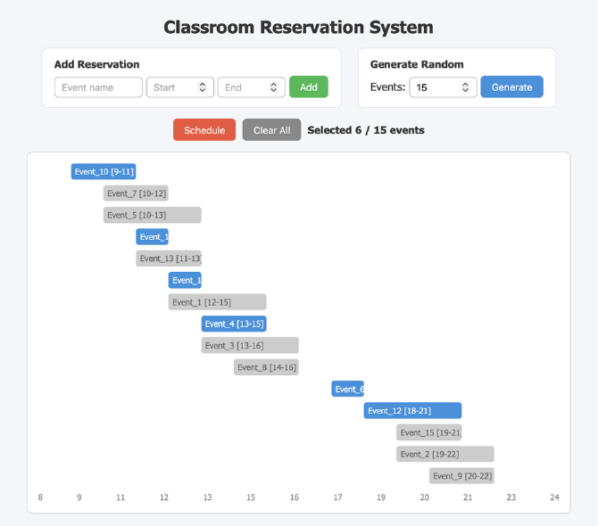

# HW4 Assignment Explanation — Classroom Reservation System

[Repository Guide](../../README.md) | [English](Assignment-Explanation.md) | [한국어](Assignment-Explanation.ko.md)

> **Last Updated:** 2026-11-17
>
> Introduction to Algorithms, Cormen, Leiserson, Rivest, and Stein, Ch 16

> **Learning Objectives:**
> 1. Represent classroom reservation requests as half-open intervals made of a start time and a finish time, and decide whether two reservations overlap
> 2. Define the activity-selection problem and record each step of the finish-time greedy algorithm in a step-by-step trace table
> 3. Argue whether a greedy algorithm produces an optimal solution using the greedy-choice property and optimal substructure
> 4. Construct a counter-example that shows a sorting criterion does not guarantee an optimal solution
> 5. Explain how the Flask backend and the JavaScript frontend exchange reservation data and selection results

---

## Table of Contents

- [1. Assignment Overview and How to Run](#1-assignment-overview-and-how-to-run)
- [2. Requirements](#2-requirements)
  - [2.1 Functional Requirements](#21-functional-requirements)
  - [2.2 API Endpoints](#22-api-endpoints)
  - [2.3 Report and Grading Criteria](#23-report-and-grading-criteria)
- [3. Modeling the Problem](#3-modeling-the-problem)
  - [3.1 Reservation Requests and Half-Open Intervals](#31-reservation-requests-and-half-open-intervals)
  - [3.2 The Activity-Selection Problem](#32-the-activity-selection-problem)
  - [3.3 The Finish-Time Greedy Strategy](#33-the-finish-time-greedy-strategy)
- [4. Solution](#4-solution)
  - [4.1 Sorting by Finish Time](#41-sorting-by-finish-time)
  - [4.2 Selecting Non-Overlapping Reservations](#42-selecting-non-overlapping-reservations)
  - [4.3 Recording the Step-by-Step Trace](#43-recording-the-step-by-step-trace)
  - [4.4 Generating Random Reservations](#44-generating-random-reservations)
  - [4.5 Timeline Visualization and Trace Table](#45-timeline-visualization-and-trace-table)
- [5. Tests and Results](#5-tests-and-results)
  - [5.1 Screen Capture](#51-screen-capture)
  - [5.2 Step-by-Step Greedy Trace on the Sample Input](#52-step-by-step-greedy-trace-on-the-sample-input)
  - [5.3 Correctness Tests](#53-correctness-tests)
- [6. Analysis Questions of the Report](#6-analysis-questions-of-the-report)
  - [6.1 Optimality of Sorting by Finish Time](#61-optimality-of-sorting-by-finish-time)
  - [6.2 Examining Other Sorting Criteria](#62-examining-other-sorting-criteria)
- [Summary](#summary)
- [Self-Check Questions](#self-check-questions)

---

<br>

## 1. Assignment Overview and How to Run

> **Try It First:** This document contains the answers and solutions. Solve the problems in the [assignment handout](Original/Assignment.md) yourself before reading on.

The week 5 take-home assignment is to build a **classroom reservation system** web app that picks as many mutually non-overlapping reservations as possible from the requests made for one classroom. The selection must use the greedy activity selection algorithm, and the web page must let the user add reservations by hand or generate them at random and then show the scheduling result as a timeline and a step-by-step trace table. The backend is written in Python (FastAPI or Flask) and the frontend in HTML, CSS, and JavaScript, and the source code is submitted together with a report of at most two pages. The theory of the activity-selection problem is in [Week 5 Lecture, Section 5](../../Lecture-Notes/Week05_Greedy-Algorithms/Concepts_Lecture.md#5-activity-selection), and a meeting room reservation example on the same problem is in [Week 5 Lab, Section 3.1](../../Lecture-Notes/Week05_Greedy-Algorithms/Concepts_Lab.md#31-b-1-meeting-room-reservation-system).

```text
Coursework/HW04_Greedy-Algorithms/
├── Assignment-Explanation.md       # Assignment explanation (English, this file)
├── Assignment-Explanation.ko.md    # Assignment explanation (Korean)
├── Code-Walkthrough.md             # Code walkthrough (English)
├── Code-Walkthrough.ko.md          # Code walkthrough (Korean)
├── Original/
│   ├── Assignment.md               # Assignment handout (English)
│   └── Assignment.ko.md            # Assignment handout (Korean)
└── Solution/
    ├── app.py                      # Flask backend: activity selection, random generation, API routes
    ├── requirements.txt            # Dependencies (Flask)
    └── static/
        ├── index.html              # Page structure
        ├── style.css               # Page style
        └── app.js                  # User actions, drawing the timeline and the trace table
```

*Figure 1. Directory layout of HW4*

```bash
# Move from the repository root to the solution directory
cd Coursework/HW04_Greedy-Algorithms/Solution

# Install the dependencies (Flask)
pip install -r requirements.txt

# Start the development server, then open http://localhost:5000 in a browser
python app.py
```

`python app.py` starts the Flask development server in debug mode on port 5000. Add reservations in the browser or generate random ones with **Generate**, then press **Schedule** to see the scheduling result.

> **Note:** On macOS 12 and later, AirPlay Receiver uses port 5000, so the server may fail to start or a response from another program may come back. In that case, turn off AirPlay Receiver or run the app on another port, as in `flask --app app run --port 5001`.

A top-to-bottom reading of every file is in the [HW4 Code Walkthrough](Code-Walkthrough.md).

---

<br>

## 2. Requirements

### 2.1 Functional Requirements

The features required by the assignment handout and where each one is implemented are as follows. Line numbers refer to each file.

| Area | Requirement | Implemented in |
|:-----|:-----|:-----|
| Algorithm | Input: a list of reservation requests, each with a start time and a finish time | `app.py` line 76 (`activities` received by `/schedule`) |
| Algorithm | Sort by finish time | `app.py` line 19 |
| Algorithm | Greedily select non-overlapping reservations | `app.py` lines 22-38 |
| Algorithm | Output: the maximum set of reservations that can be accommodated | `app.py` line 40, lines 78-83 |
| Page | Add a reservation by entering the event name, start time, and finish time | `index.html` lines 13-19, `app.js` lines 62-78 |
| Page | A Generate Random button for sample data (for example, 15 random reservations) | `index.html` lines 20-25, `app.js` lines 82-95, `app.py` lines 43-52, lines 64-70 |
| Page | Run the greedy algorithm with the Schedule button | `index.html` line 29, `app.js` lines 99-129 |
| Page | Timeline: all requests in gray, selected reservations highlighted | `app.js` lines 14-54, `style.css` lines 137-144 |
| Page | Number of selected reservations against the total number of requests | `app.js` line 112 |
| Page | Step-by-step trace of the greedy selection order | `index.html` lines 36-50, `app.js` lines 114-128 |

*Table 1. Functional requirements and where they are implemented*

### 2.2 API Endpoints

| Method | Endpoint | Description | Implemented in |
|:-----|:-----|:-----|:-----|
| `POST` | `/schedule` | Runs activity selection and returns the selected reservations | `app.py` lines 73-83 |
| `POST` | `/generate` | Generates random reservation requests | `app.py` lines 64-70 |
| `GET` | `/` | Serves the frontend page | `app.py` lines 59-61 |

*Table 2. API endpoints and where they are implemented*

The two `POST` endpoints exchange JSON. A reservation is an object with a name, a start time, and a finish time, such as `{"name": "Event_1", "start": 9, "end": 11}`, and times are integers (hours).

| Endpoint | Request body | Response body |
|:-----|:-----|:-----|
| `/generate` | `{"n": 15}` | `{"activities": [...]}` |
| `/schedule` | `{"activities": [...]}` | `{"selected": [...], "total": ..., "selected_count": ..., "trace": [...]}` |

*Table 3. JSON formats of the request and response of each endpoint*

### 2.3 Report and Grading Criteria

The report is a single PDF file of at most two pages with a font size of 11pt or larger. The items of the report and where this document covers them are as follows.

| Report item | Location in this document |
|:-----|:-----|
| Screen capture of the reservation system with a sample input (10 or more reservations) | Section 5.1 |
| Step-by-step trace of the greedy selection on the sample input | Section 5.2 |
| Analysis: why does sorting by finish time guarantee the optimal solution? Could sorting by start time or duration work instead? | Section 6 |

*Table 4. Report items and their location in this document*

| Criterion | Weight |
|:-----|-----:|
| The web app runs and works correctly | 20% |
| The algorithm requirements are fully implemented | 40% |
| Report (at most two pages, font size 11 or larger) | 40% |

*Table 5. Grading criteria*

---

<br>

## 3. Modeling the Problem

### 3.1 Reservation Requests and Half-Open Intervals

> **Definition:** An **activity** is a request that occupies one resource (here, the classroom) from its start time until just before its finish time. An activity with start time $s$ and finish time $f$ is written as the half-open interval $`[s, f)`$.

A half-open interval includes its start time and excludes its finish time. Therefore [9, 11) and [11, 12) do not overlap: one ends at 11 and the other starts at 11. In general, two activities $`a_i = [s_i, f_i)`$ and $`a_j = [s_j, f_j)`$ are called **compatible** when they satisfy the following condition.

$$
f_i \le s_j \quad \text{or} \quad f_j \le s_i
$$

In other words, one activity must start after the other one ends. In this app, reservation times are integer hours, and the trace table on the page writes each interval as a half-open interval such as [9, 11) (`app.js` line 122). The selection condition `act["start"] >= last_end` (`app.py` line 25) includes equality for the same reason: when the finish time of one reservation equals the start time of the next, the two are treated as non-overlapping. The labels of the timeline bars use a hyphen, as in `Event_10 [9-11]` (`app.js` line 38), but they denote the same half-open interval.

### 3.2 The Activity-Selection Problem

Given a set of $n$ activities $`S = \lbrace a_1, a_2, \dots, a_n \rbrace`$, the problem of finding a subset with the most elements among those consisting only of mutually compatible activities is called the **activity-selection problem**. In the classroom reservation system, the activities are the reservation requests, and the answer is a maximum set of reservations that one classroom can accept.

A brute force search that checks every subset must examine $2^n$ subsets. That is 32,768 subsets for 15 requests and $`2^{100}`$ subsets for 100 requests, the most this app can generate, so it becomes unusable as soon as the requests grow even a little.

> **Caution:** A maximum set is a set of the largest size. It must be distinguished from a maximal set, to which no further reservation can be added. A maximal set may not be a maximum set, and every counter-example in Section 6.2 produces a set that is maximal but not maximum.

### 3.3 The Finish-Time Greedy Strategy

The assignment handout prescribes the following strategy. Sort the requests in ascending order of finish time, look at them from the front, and select a request whenever it does not overlap the reservations selected so far. A selection, once made, is never revisited.

```text
GREEDY-ACTIVITY-SELECTION(S)
    sort S by finish time in ascending order
    selected = empty list
    last_end = -infinity
    for each activity a in sorted order
        if a.start >= last_end
            append a to selected
            last_end = a.end
    return selected
```

`last_end` is the finish time of the most recently selected activity. Since nothing has been selected at first, it starts at a value smaller than any start time.



*Figure 2. Flow of the finish-time greedy selection*

Sorting takes $`O(n \log n)`$ time and the loop takes $O(n)$ time, so the overall time complexity is $`O(n \log n)`$. Why this strategy gives an optimal solution is one of the analysis questions of the report and is covered in Section 6.1.

---

<br>

## 4. Solution

### 4.1 Sorting by Finish Time

**Rule:** Sort the reservation requests in ascending order of finish time.

```python
    sorted_acts = sorted(activities, key=lambda a: a["end"])
```

Line 19 of `activity_selection` passes `key=lambda a: a["end"]` to `sorted` and builds a new list `sorted_acts` that lists the reservations from the earliest finish time onward. The original list `activities` is not changed. Python's `sorted` is a stable sort, so reservations with the same finish time keep the order in which they appeared in the request list. For example, in the sample of Section 5.2, Event_7 and Event_14 both finish at 12, and Event_7 comes first, following the order of the request list.

> **Note:** **Tie-breaking.** The order of reservations with the same finish time does not affect the number of reservations selected, because the argument of Section 6.1 holds whichever of the earliest-finishing activities is chosen. Which reservations are picked can differ, however. If X = [3, 5), Y = [4, 5), and Z = [5, 6) are sent in the order X, Y, Z, then X and Z are selected, and in the order Y, X, Z, Y and Z are selected; both have two reservations.

### 4.2 Selecting Non-Overlapping Reservations

**Rule:** Look at the reservations in sorted order and select those that start at or after the finish time of the most recently selected reservation.

```python
    selected = []
    trace = []
    last_end = -1

    for act in sorted_acts:
        if act["start"] >= last_end:
            selected.append(act)
            trace.append({
                "action": "select",
                "activity": act,
                "reason": f"start={act['start']} >= last_end={last_end}",
            })
            last_end = act["end"]
        else:
            trace.append({
                "action": "reject",
                "activity": act,
                "reason": f"start={act['start']} < last_end={last_end}",
            })

    return selected, trace
```

Lines 20 and 21 create empty lists for the selected reservations and the trace, and line 22 sets `last_end` to -1. The loop on line 24 looks at the reservations one by one in finish-time order, and line 25 checks whether the start time of the reservation is at least `last_end`. If the condition is true, line 26 adds the reservation to `selected` and line 32 sets `last_end` to its finish time. If the condition is false, lines 33-38 only record a rejection. Line 40 returns the selected reservations together with the trace.

It is enough to compare a new reservation only with `last_end`, rather than with every reservation selected so far, for the following reason. Since reservations are selected in finish-time order, every reservation already selected ends by `last_end`. Therefore, if the start time of the new reservation is at least `last_end`, it is compatible with all selected reservations. Conversely, if its start time is less than `last_end`, the new reservation ends at or after `last_end` because of the sorted order, so it necessarily overlaps the most recently selected reservation. One comparison decides the overlap exactly, so the whole loop finishes in $O(n)$ time.

> **Caution:** `last_end = -1` works as "no reservation has been selected yet" only when every start time is -1 or larger. Random generation produces only start times of 9 or more and the input field has `min="0"`, so this is normally not a problem, but the `min` of an input field does not stop the user from typing a negative number, and the server does not check the values either. For example, sending only [-3, -2) rejects it with `start=-3 < last_end=-1`, and no reservation is selected. Setting the initial value to negative infinity (`float("-inf")`), as in the pseudocode, removes this assumption.

### 4.3 Recording the Step-by-Step Trace

**Rule:** Show the greedy selection order on the page step by step.

The loop appends one entry to `trace` every time it looks at a reservation (lines 27-31 and 34-38). The entries accumulate in finish-time order, so the position of an entry in `trace` is its step number.

| Field | Value | Example |
|:-----|:-----|:-----|
| `action` | `"select"` or `"reject"` | `"select"` |
| `activity` | The reservation object looked at in that step | `{"name": "Event_10", "start": 9, "end": 11}` |
| `reason` | The comparison used for the decision | `"start=9 >= last_end=-1"` |

*Table 6. Fields of a trace entry*

`reason` is a comparison built with an f-string and holds the value of `last_end` at the moment of the decision. The `/schedule` route returns this result as JSON without change.

```python
@app.route("/schedule", methods=["POST"])
def schedule():
    data = request.get_json()
    activities = data["activities"]
    selected, trace = activity_selection(activities)
    return jsonify({
        "selected": selected,
        "total": len(activities),
        "selected_count": len(selected),
        "trace": trace,
    })
```

Line 75 reads the JSON of the request body, and line 76 takes out the list of reservations. Line 77 runs activity selection, and lines 78-83 bundle the selected reservations, the total number of requests, the number of selected reservations, and the trace into the response. The text "Selected k / n events" on the page is built from `selected_count` and `total`.

### 4.4 Generating Random Reservations

**Rule:** Generate sample data (for example, 15 random reservations) with the Generate Random button.

```python
def generate_activities(n=15):
    """Generate n random activities with start/end times."""
    activities = []
    for i in range(n):
        start = random.randint(9, 20)
        end = start + random.randint(1, 3)
        if end > 22:
            end = 22
        activities.append({"name": f"Event_{i+1}", "start": start, "end": end})
    return activities
```

Line 47 picks the start time uniformly from the integers 9-20 (`random.randint` includes both ends), and line 48 picks a duration of 1-3 hours to set the finish time. Lines 49-50 cut the finish time so that it does not exceed 22. Since the start time is at most 20, the finish time is always greater than the start time even after the cut. As a result, start times are 9-20, finish times are 10-22, and durations are 1-3 hours. Line 51 names the reservations Event_1, Event_2, ... in the order of generation.

```python
@app.route("/generate", methods=["POST"])
def generate():
    data = request.get_json()
    n = int(data.get("n", 15))
    n = max(1, min(n, 100))
    activities = generate_activities(n)
    return jsonify({"activities": activities})
```

Line 67 reads `n` of the request as an integer and uses 15 when it is missing. Line 68 limits `n` to 1-100, so sending 0 generates one reservation and sending 500 generates 100. The input field on the page (`index.html` line 23) has the same range (`min="1"`, `max="100"`).

### 4.5 Timeline Visualization and Trace Table

**Rule:** Show on the page a timeline that draws all requests in gray and the selected reservations in a highlight color, the number selected against the total, and the step-by-step trace.

`refreshTimeline` in the frontend (`app.js` lines 14-54) draws each reservation as a bar on a fixed 16-hour range from 8 to 24. The left position and the width of a bar are set as percentages as follows.

```math
\text{left} = \frac{s - 8}{16} \times 100\%, \qquad \text{width} = \max\left(\frac{f - s}{16} \times 100\%,\ 2\%\right)
```

The bars on the page are placed from top to bottom in order of start time (then finish time) (line 25). This order differs from the finish-time order in which the algorithm looks at the reservations. A bar gets the `selected` class (blue `#4a90d9`) if its name is in the list of selected reservations, and the `rejected` class (gray `#ccc`) otherwise (lines 34-35, `style.css` lines 137-144). Because this decision uses the reservation name, if two reservations share a name, both are painted blue even when only one is selected.

Lines 47-52 make the ticks of the time axis. They divide the 16-hour range into 12 parts, place 13 ticks at equal spacing, and label each tick with $`8 + 16i/12`$ rounded to an integer. The ticks therefore read 8, 9, 11, 12, 13, 15, 16, 17, 19, 20, 21, 23, 24; for example, the tick labeled "9" actually sits at 9:20. The bars are positioned exactly, but the tick numbers are approximations.

When Schedule is pressed, lines 99-129 send the reservation list to `/schedule`, redraw the timeline from the response, write the summary `Selected k / n events` (line 112), and build one table row per trace entry (lines 116-127). Selected rows are light green (`row-select`) and rejected rows light gray (`row-reject`); intervals are written as [9, 11), and decisions in capitals, as `SELECT` and `REJECT`.

---

<br>

## 5. Tests and Results

### 5.1 Screen Capture

The following is the page after generating 15 random reservations (in the range 9-22) and pressing Schedule.



*Figure 3. Classroom reservation system after scheduling 15 random reservations*

At the top are the input fields for adding a reservation (name, start, end) and for random generation, and below them are the Schedule and Clear All buttons and the summary "Selected 6 / 15 events". In the timeline, the six blue bars are the selected reservations and the nine gray bars the rejected ones. A one-hour bar is only 1/16 of the range wide, so a label such as `Event_14 [11-12]` is cut off and appears as `Event_1` (`overflow: hidden` on line 134 of `style.css`). Section 4.5 explains why the ticks at the bottom skip numbers, as in 9 and 11.

### 5.2 Step-by-Step Greedy Trace on the Sample Input

The trace of the greedy algorithm on the 15 reservations of Figure 3 is as follows. Rows are in finish-time order, and `last_end` is the finish time of the most recently selected reservation. The reason column is the `reason` string printed by the app, unchanged.

| Step | Reservation | Interval | Decision | Reason |
|:---:|:-----|:-----|:-----|:-----|
| 1 | Event_10 | [9, 11) | SELECT | `start=9 >= last_end=-1` |
| 2 | Event_7 | [10, 12) | REJECT | `start=10 < last_end=11` |
| 3 | Event_14 | [11, 12) | SELECT | `start=11 >= last_end=11` |
| 4 | Event_5 | [10, 13) | REJECT | `start=10 < last_end=12` |
| 5 | Event_11 | [12, 13) | SELECT | `start=12 >= last_end=12` |
| 6 | Event_13 | [11, 13) | REJECT | `start=11 < last_end=13` |
| 7 | Event_1 | [12, 15) | REJECT | `start=12 < last_end=13` |
| 8 | Event_4 | [13, 15) | SELECT | `start=13 >= last_end=13` |
| 9 | Event_3 | [13, 16) | REJECT | `start=13 < last_end=15` |
| 10 | Event_8 | [14, 16) | REJECT | `start=14 < last_end=15` |
| 11 | Event_6 | [17, 18) | SELECT | `start=17 >= last_end=15` |
| 12 | Event_12 | [18, 21) | SELECT | `start=18 >= last_end=18` |
| 13 | Event_15 | [19, 21) | REJECT | `start=19 < last_end=21` |
| 14 | Event_2 | [19, 22) | REJECT | `start=19 < last_end=21` |
| 15 | Event_9 | [20, 22) | REJECT | `start=20 < last_end=21` |

*Table 7. Greedy trace on the 15 sample reservations (6 selected out of 15)*

Listing the same reservations in finish-time order and drawing the selected ones as `###` and the rejected ones as `---` gives the following. Each cell of three characters is one hour.

```text
          9  10 11 12 13 14 15 16 17 18 19 20 21 22
Event_10  ######
Event_7      ------
Event_14        ###
Event_5      ---------
Event_11           ###
Event_13        ------
Event_1            ---------
Event_4               ######
Event_3               ---------
Event_8                  ------
Event_6                           ###
Event_12                             #########
Event_15                                ------
Event_2                                 ---------
Event_9                                    ------
```

*Figure 4. Sample reservations listed in finish-time order with the selection result*

The selected reservations are the six reservations Event_10 [9, 11), Event_14 [11, 12), Event_11 [12, 13), Event_4 [13, 15), Event_6 [17, 18), and Event_12 [18, 21). The first four and the last two each start at the moment the previous one ends, which the half-open interval convention allows. Every rejected reservation starts before the most recently selected reservation ends. Checking all 32,768 subsets of the 15 reservations shows that at most six reservations can be mutually non-overlapping and that there are 12 maximum sets of size six. The set found by the greedy algorithm is one of them. For example, choosing Event_15 [19, 21), which has the same finish time, instead of Event_12 [18, 21) in step 12 also gives six, but Event_12 came earlier in the request list, so the stable sort examined it first and selected it.

### 5.3 Correctness Tests

Running the following script in the `Solution/` directory calls `/schedule` through the Flask test client to reproduce the trace above, and compares the result of the greedy algorithm with a brute force search on small random inputs.

```python
import itertools, random
from app import app, activity_selection

client = app.test_client()
ev = {10: (9, 11), 7: (10, 12), 14: (11, 12), 5: (10, 13), 11: (12, 13),
      13: (11, 13), 1: (12, 15), 4: (13, 15), 3: (13, 16), 8: (14, 16),
      6: (17, 18), 12: (18, 21), 15: (19, 21), 2: (19, 22), 9: (20, 22)}
acts = [{"name": f"Event_{i}", "start": s, "end": e} for i, (s, e) in sorted(ev.items())]
res = client.post("/schedule", json={"activities": acts}).get_json()
print(res["selected_count"], [a["name"] for a in res["selected"]])

def compatible(sub):
    sub = sorted(sub, key=lambda a: (a["start"], a["end"]))
    return all(x["end"] <= y["start"] for x, y in zip(sub, sub[1:]))

def brute(acts):
    for k in range(len(acts), 0, -1):
        if any(compatible(c) for c in itertools.combinations(acts, k)):
            return k
    return 0

random.seed(123)
bad = 0
for _ in range(3000):
    acts = []
    for i in range(random.randint(0, 9)):
        s = random.randint(0, 12)
        acts.append({"name": f"E{i}", "start": s, "end": s + random.randint(1, 4)})
    sel, _ = activity_selection(acts)
    bad += len(sel) != brute(acts) or not compatible(sel)
print("mismatches:", bad)
```

```text
6 ['Event_10', 'Event_14', 'Event_11', 'Event_4', 'Event_6', 'Event_12']
mismatches: 0
```

The first line matches the selection of Table 7, and the second line means that on 3,000 random inputs of 0-9 reservations, the number of reservations chosen by the greedy algorithm always equaled the maximum found by brute force, and the chosen reservations never overlapped. Boundary cases can be checked as follows.

| Input | Result | What it confirms |
|:-----|:-----|:-----|
| Empty list | `selected_count` 0, empty `trace` | The app responds without error even with no requests |
| [1, 4), [4, 6) | Both selected | Reservations whose end and start touch do not overlap |
| X = [3, 5), Y = [4, 5), Z = [5, 6) | X, Z or Y, Z depending on the order | The order of ties changes only which reservations are selected, not how many |
| [-3, -2) | Nothing selected | The initial value -1 rejects a negative start time (Section 4.2) |
| `n` = 0, 500, or omitted for `/generate` | 1, 100, and 15 reservations | The number generated is limited to 1-100, with a default of 15 |

*Table 8. Results of the boundary-case checks*

---

<br>

## 6. Analysis Questions of the Report

### 6.1 Optimality of Sorting by Finish Time

**Question:** Why does sorting by finish time guarantee the optimal solution?

Intuitively, selecting the activity that finishes first leaves the most time for the remaining activities. To turn this intuition into a proof, it suffices to show the two properties of [Week 5 Lecture, Section 1.2](../../Lecture-Notes/Week05_Greedy-Algorithms/Concepts_Lecture.md#12-key-properties-for-greedy-correctness): the greedy-choice property and optimal substructure. Below, assume that every activity satisfies $`s_i < f_i`$, and number the activities in finish-time order $`f_1 \le f_2 \le \dots \le f_n`$. In this app as well, the input form accepts a reservation only if its finish time is greater than its start time, and random generation produces only reservations of one hour or longer.

**Greedy-choice property.** There exists an optimal solution that contains the earliest-finishing activity $`a_1`$ (Theorem 16.1 of the textbook). Take an optimal solution $A$, and let $`a_k`$ be the activity of $A$ with the earliest finish time. If $`a_k = a_1`$, there is nothing to prove. Otherwise, consider the set obtained by replacing $`a_k`$ with $`a_1`$:

$$
A' = (A \setminus \lbrace a_k \rbrace) \cup \lbrace a_1 \rbrace
$$

Every other activity $`a_j`$ of $A$ finishes no earlier than $`a_k`$, so to be compatible with $`a_k`$ it must start after $`a_k`$ ends. That is, $`s_j \ge f_k`$. Moreover, $`a_1`$ finishes first among all activities, so $`f_1 \le f_k \le s_j`$, and $`a_1`$ is compatible with every other activity of $`A'`$. Since $`\lvert A' \rvert = \lvert A \rvert`$, $`A'`$ is also an optimal solution, and it contains $`a_1`$. The activity replaced in this exchange argument is the one that finishes first in the optimal solution, and the reason no overlap appears after the replacement is the single inequality $`f_1 \le f_k`$.

**Optimal substructure.** After $`a_1`$ is selected, the remaining problem is the same problem on the set of activities that start after $`a_1`$ ends:

$$
S' = \lbrace a_j \in S : s_j \ge f_1 \rbrace
$$

All activities of the optimal solution $`A'`$ above other than $`a_1`$ belong to $`S'`$, so $`\mathrm{OPT}(S') \ge \mathrm{OPT}(S) - 1`$. Conversely, adding $`a_1`$ to a solution of $`S'`$ gives a solution of $S$, so $`\mathrm{OPT}(S) \ge 1 + \mathrm{OPT}(S')`$. Therefore $`\mathrm{OPT}(S) = 1 + \mathrm{OPT}(S')`$.

**Optimality of the algorithm.** After selecting $`a_1`$, the code sets `last_end` to $`f_1`$ and rejects every activity whose start time is less than $`f_1`$, that is, every activity not in $`S'`$. The next activity selected is the earliest-finishing activity of $`S'`$, so the algorithm is equivalent to running the same greedy algorithm again on $`S'`$. If, by induction on the number of activities, the greedy algorithm selects $`\mathrm{OPT}(S')`$ activities from $`S'`$, then the size of the set $G(S)$ chosen by the greedy algorithm on $S$ is as follows.

$$
\lvert G(S) \rvert = 1 + \lvert G(S') \rvert = 1 + \mathrm{OPT}(S') = \mathrm{OPT}(S)
$$

Therefore the finish-time greedy algorithm always finds a maximum set. The proof uses only the fact that $`a_1`$ has the earliest finish time, so it holds no matter which of several activities with the same finish time is looked at first.

> **Key Point:** The correctness of the finish-time greedy algorithm comes from the exchange argument that "putting the earliest-finishing activity in place of the first activity of an optimal solution creates no overlap" and from the optimal substructure that the problem remaining after that choice has the same form.

### 6.2 Examining Other Sorting Criteria

**Question:** Could sorting by start time or by duration work instead?

Neither criterion guarantees an optimal solution. Each has a counter-example in which the greedy algorithm picks a set that is not maximum. The counter-examples below keep the selection rule of the app (look at the activities in sorted order and select one if `start >= last_end`) and change only the sorting criterion.

**By start time.** Consider the activities [0, 100), [1, 3), and [4, 6). In order of start time, [0, 100) is selected first, and the other two activities start before 100, so both are rejected and only one is selected. The optimal solution is {[1, 3), [4, 6)}, with two activities.

```text
          0   1   2   3   4   5   6   7   ...   100
[0, 100)  [===============================...===)
[1, 3)        [=======)
[4, 6)                    [=======)
```

*Figure 5. Counter-example for the start-time greedy algorithm (the interval up to 100 is drawn shortened)*

The activity that starts first can be arbitrarily long, so that single activity can block several short activities.

**By duration.** Consider the activities [0, 4), [3, 6), and [5, 9). Their durations are 4, 3, and 4, so in order of duration [3, 6) is selected first. Then `last_end` becomes 6, and the start times of [0, 4) and [5, 9), 0 and 5, are both less than 6, so both overlap [3, 6) and are rejected, and only one is selected. The optimal solution is {[0, 4), [5, 9)}, with two activities.

```text
        0  1  2  3  4  5  6  7  8  9
[0, 4)  [===========)
[3, 6)           [========)
[5, 9)                 [===========)
```

*Figure 6. Counter-example for the duration greedy algorithm*

A short activity in the middle can overlap two mutually non-overlapping activities on either side at the same time.

| Sorting criterion | [0, 100), [1, 3), [4, 6) | [0, 4), [3, 6), [5, 9) | Guarantees an optimal solution |
|:-----|:-----|:-----|:-----|
| Finish time, ascending | {[1, 3), [4, 6)}, 2 | {[0, 4), [5, 9)}, 2 | Yes |
| Start time, ascending | {[0, 100)}, 1 | {[0, 4), [5, 9)}, 2 | No |
| Duration, ascending | {[1, 3), [4, 6)}, 2 | {[3, 6)}, 1 | No |

*Table 9. Greedy selection results for each sorting criterion*

The reason both criteria fail can be found in the exchange argument of Section 6.1. For the exchange to hold, the activity chosen by the greedy algorithm must not finish later than the first activity of the optimal solution ($`f_1 \le f_k`$). Neither the activity that starts first nor the shortest activity guarantees this inequality, so putting it in place of the first activity of an optimal solution can create an overlap with the next activity.

> **Note:** Even with start times, reversing the direction gives an optimal solution. The strategy that selects the activity that starts last and accepts only activities that end before the selected activity starts is the same as the finish-time greedy algorithm on a reversed time axis, so it gives an optimal solution (Exercise 16.1-2 of the textbook). Exercise 16.1-3 of the textbook asks for counter-examples showing that, in addition to the duration and start-time criteria, the criterion of selecting the activity that overlaps the fewest remaining activities does not guarantee an optimal solution either.

---

<br>

## Summary

| Concept | Key Summary |
|:-----|:-----|
| Half-open interval | A reservation [s, f) includes its start time and excludes its finish time, so the next reservation may start at the moment the previous one ends without overlap. |
| Activity-selection problem | It asks for a largest subset consisting only of mutually compatible activities, and a brute force search must examine $2^n$ subsets. |
| Finish-time greedy algorithm | It sorts by finish time in ascending order and selects each reservation with `start >= last_end`, and its time complexity is $`O(n \log n)`$, dominated by sorting. |
| Comparing only with last_end | Since reservations are selected in finish-time order, comparing with the single finish time of the most recently selected reservation decides the overlap exactly. |
| Initial value -1 | It means "no reservation selected yet" only under the assumption that every start time is -1 or larger, and it wrongly rejects a negative start time. |
| Step-by-step trace | Each iteration records the decision, the reservation, and the comparison, so the position in `trace` is the step number. |
| Proof of optimality | It is proved by the exchange argument that puts the earliest-finishing activity in place of the first activity of an optimal solution (greedy-choice property) and by the optimal substructure that the remaining problem has the same form. |
| Other sorting criteria | Ascending start time and ascending duration have counter-examples and do not guarantee an optimal solution, while the strategy that selects the activity that starts last first is optimal. |
| Timeline display | Bars are placed in exact proportion on the range 8-24, but the tick numbers are rounded approximations of positions that divide 16 hours into 12 parts. |

---

<br>

## Self-Check Questions

1. **Compatibility:** Are the reservations [1, 4) and [4, 6) compatible? Answer with reference to the selection condition `act["start"] >= last_end` of this app.

   <details>
   <summary>Answer</summary>

   Yes. The half-open interval [1, 4) does not include 4, so it shares no moment with [4, 6). The compatibility condition $`f_i \le s_j`$ holds as 4 ≤ 4, and the condition of the app is also true as `4 >= 4`, so both reservations are selected. Writing the condition with `>` would treat touching reservations as overlapping.

   </details>

2. **Trace:** Apply the finish-time greedy algorithm to the reservations A = [2, 5), B = [1, 3), C = [4, 7), D = [6, 8), and E = [3, 9). Write the order of examination, the decision at each step, and the selected reservations.

   <details>
   <summary>Answer</summary>

   The finish-time order is B (3), A (5), C (7), D (8), E (9). B is selected with `start=1 >= last_end=-1`, and `last_end` becomes 3. A is rejected with `start=2 < last_end=3`. C is selected with `start=4 >= last_end=3`, and `last_end` becomes 7. D is rejected with `start=6 < last_end=7`, and E with `start=3 < last_end=7`. The selected reservations are B and C, two in total, and no larger selection is possible.

   </details>

3. **Number of comparisons:** Explain why it is enough to compare a new reservation only with `last_end` rather than with every reservation selected so far.

   <details>
   <summary>Answer</summary>

   Since reservations are selected in finish-time order, every reservation already selected ends by `last_end`. If the start time of the new reservation is at least `last_end`, it is compatible with all selected reservations. If its start time is less than `last_end`, the new reservation ends at or after `last_end` because of the sorted order, so it overlaps the most recently selected reservation. Therefore one comparison decides exactly, and the loop takes $O(n)$ time.

   </details>

4. **Changing the condition:** If the condition on line 25 is changed to `act["start"] > last_end` and applied to the 15 samples of Section 5.2, how many reservations are selected? Does this result mean the original selection is not optimal?

   <details>
   <summary>Answer</summary>

   Five are selected: Event_10 [9, 11), Event_11 [12, 13), Event_8 [14, 16), Event_6 [17, 18), and Event_15 [19, 21). The reason is that reservations whose end and start touch are also treated as overlapping. This solves a different problem in which intervals are closed intervals [s, f], and in that problem five is optimal. In the problem of this assignment, which uses half-open intervals, the maximum is six, so `>=` is correct.

   </details>

5. **Counter-example:** Give an example in which the greedy algorithm that selects the shortest activity first misses the optimal solution, and explain why the exchange argument of Section 6.1 does not hold for this criterion.

   <details>
   <summary>Answer</summary>

   For [0, 4), [3, 6), and [5, 9), the duration greedy algorithm first selects [3, 6), of duration 3, which blocks the two activities on either side, so it selects only one, while the optimal solution is {[0, 4), [5, 9)}, with two. The exchange argument relies on the inequality $`f_1 \le f_k`$, which says that the activity chosen by the greedy algorithm finishes no later than the first activity of the optimal solution, but the shortest activity [3, 6) finishes later than the first activity [0, 4) of the optimal solution, so putting it in that place makes it overlap the next activity [5, 9).

   </details>
