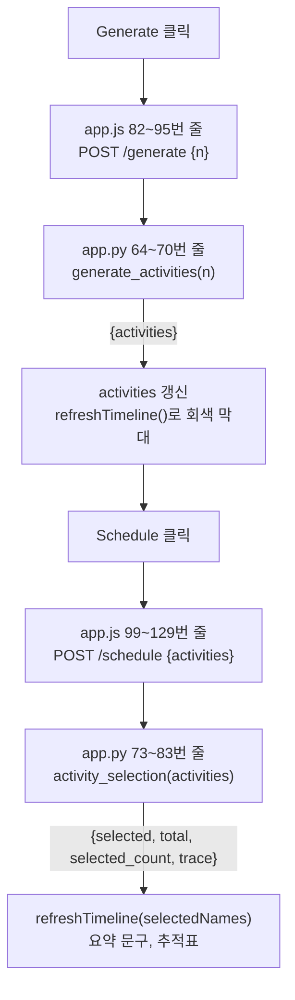

# HW4 코드 총정리 — 강의실 예약 시스템

[레포지토리 안내](../../README.ko.md) | [English](Code-Walkthrough.md) | [한국어](Code-Walkthrough.ko.md)

> **최종 수정일:** 2026-11-16
>
> Introduction to Algorithms, Cormen, Leiserson, Rivest, and Stein, Ch 16

> **학습 목표:**
> 1. `app.py`의 함수와 라우트가 하는 일을 줄 단위로 설명할 수 있다
> 2. `activity_selection`의 반복문이 `selected`, `trace`, `last_end`를 바꾸는 과정을 추적할 수 있다
> 3. 프런트엔드가 `fetch`로 두 API를 호출하고 응답으로 타임라인과 추적표를 그리는 흐름을 설명할 수 있다
> 4. 타임라인 막대의 위치와 너비, 시간축 눈금을 계산하는 방식을 설명할 수 있다
> 5. 백엔드와 프런트엔드 각 부분의 시간 복잡도를 분석할 수 있다

---

## 목차

- [1. 파일 구성](#1-파일-구성)
- [2. app.py](#2-apppy)
  - [2.1 모듈 머리와 Flask 앱 객체](#21-모듈-머리와-flask-앱-객체)
  - [2.2 activity_selection](#22-activity_selection)
  - [2.3 generate_activities](#23-generate_activities)
  - [2.4 페이지 라우트](#24-페이지-라우트)
  - [2.5 /generate 라우트](#25-generate-라우트)
  - [2.6 /schedule 라우트](#26-schedule-라우트)
  - [2.7 실행 진입점](#27-실행-진입점)
- [3. static/index.html](#3-staticindexhtml)
  - [3.1 문서 머리](#31-문서-머리)
  - [3.2 제목과 입력 영역](#32-제목과-입력-영역)
  - [3.3 실행 버튼과 요약](#33-실행-버튼과-요약)
  - [3.4 타임라인, 추적표, 스크립트](#34-타임라인-추적표-스크립트)
- [4. static/app.js](#4-staticappjs)
  - [4.1 DOM 참조와 상태](#41-dom-참조와-상태)
  - [4.2 refreshTimeline](#42-refreshtimeline)
  - [4.3 updateButtons](#43-updatebuttons)
  - [4.4 예약 추가](#44-예약-추가)
  - [4.5 무작위 생성](#45-무작위-생성)
  - [4.6 스케줄 실행과 추적표](#46-스케줄-실행과-추적표)
  - [4.7 전체 지우기](#47-전체-지우기)
- [5. static/style.css](#5-staticstylecss)
- [6. requirements.txt](#6-requirementstxt)
- [7. 요청 흐름 추적](#7-요청-흐름-추적)
- [8. 복잡도](#8-복잡도)
- [요약](#요약)
- [점검 문제](#점검-문제)

---

<br>

## 1. 파일 구성

> **풀어 보기:** 이 문서는 작성한 코드 전체와 줄별 설명을 담고 있다. 먼저 [과제 안내문](Original/Assignment.ko.md)의 문제를 직접 풀어 본 뒤 읽는다.

짝이 되는 문서 [HW4 과제 해설](Assignment-Explanation.ko.md)은 요구사항, 설계, 테스트, 보고서의 분석 질문을 정리한다. 이 문서는 `Solution`의 다섯 파일을 처음부터 끝까지 읽는다. 줄 번호는 모두 각 파일 기준이다. `app.py`(87줄)는 Flask 백엔드, `static/index.html`(54줄)은 화면 구조, `static/app.js`(139줄)는 화면의 동작, `static/style.css`(188줄)는 화면 스타일, `requirements.txt`(1줄)는 의존성 목록이다.

| 파일 | 줄 | 부분 | 역할 |
|:-----|:-----|:-----|:-----|
| `app.py` | 1\~7 | 모듈 설명, `import`, Flask 앱 객체 | 백엔드 준비 |
| `app.py` | 10\~40 | `activity_selection` | 그리디 활동 선택과 추적 기록 |
| `app.py` | 43\~52 | `generate_activities` | 무작위 예약 생성 |
| `app.py` | 55\~61 | 라우트 구역 주석, `/` | 페이지 제공 |
| `app.py` | 64\~70 | `/generate` | 무작위 예약 API |
| `app.py` | 73\~83 | `/schedule` | 스케줄링 API |
| `app.py` | 86\~87 | `if __name__ == "__main__":` | 개발 서버 실행 |
| `static/index.html` | 1\~8 | 문서 머리 | 제목, 스타일 시트 연결 |
| `static/index.html` | 9\~26 | 제목, 예약 추가 입력란, 무작위 생성 입력란 | 입력 |
| `static/index.html` | 28\~32 | Schedule, Clear All 버튼과 요약 | 실행 |
| `static/index.html` | 34\~54 | 타임라인 영역, 추적표, 스크립트 로드 | 출력 |
| `static/app.js` | 1\~10 | DOM 참조와 `activities` 상태 | 준비 |
| `static/app.js` | 12\~54 | `refreshTimeline` | 타임라인 그리기 |
| `static/app.js` | 56\~58 | `updateButtons` | Schedule 버튼 활성화 |
| `static/app.js` | 60\~78 | Add 버튼 처리 | 예약 추가 |
| `static/app.js` | 80\~95 | Generate 버튼 처리 | `/generate` 호출 |
| `static/app.js` | 97\~129 | Schedule 버튼 처리 | `/schedule` 호출, 추적표 그리기 |
| `static/app.js` | 131\~139 | Clear All 버튼 처리 | 초기화 |
| `static/style.css` | 1\~188 | 전체 스타일 | 배치와 색 (5절) |
| `requirements.txt` | 1 | `flask>=3.0` | 의존성 |

*표 1. 다섯 파일의 구성*

---

<br>

## 2. app.py

### 2.1 모듈 머리와 Flask 앱 객체

```python
"""Week 05 — Classroom Reservation System (Flask backend)"""

import random

from flask import Flask, jsonify, request, send_from_directory

app = Flask(__name__, static_folder="static")
```

1번 줄은 모듈 설명 문자열이다. 3번 줄의 `random`은 무작위 예약을 만드는 `generate_activities`가 쓴다. 5번 줄은 Flask에서 네 가지를 가져온다. `Flask`는 웹 앱 객체를 만드는 클래스, `jsonify`는 Python의 딕셔너리와 리스트를 JSON 응답으로 바꾸는 함수, `request`는 현재 요청(본문, 헤더)에 접근하는 객체, `send_from_directory`는 디렉토리 안의 파일을 응답으로 보내는 함수이다.

7번 줄은 앱 객체를 만든다. `static_folder="static"`은 `app.py`가 있는 디렉토리의 `static/`을 정적 파일 폴더로 지정하며, 그 안의 파일은 `/static/...` 주소로 제공된다. `index.html`이 `/static/style.css`와 `/static/app.js`를 불러올 수 있는 것은 이 설정 덕분이다. `__name__`은 Flask가 앱의 루트 디렉토리(`app.root_path`)를 `app.py`가 있는 위치로 정하는 데 쓰인다.

### 2.2 activity_selection

```python
# ---------------------------------------------------------------------------
# Greedy Activity Selection
# ---------------------------------------------------------------------------

def activity_selection(activities):
    """
    Greedy activity selection — sort by finish time, greedily pick non-overlapping.
    Returns (selected list, trace of selection steps).
    """
    sorted_acts = sorted(activities, key=lambda a: a["end"])
    selected = []
    trace = []
    last_end = -1

    for act in sorted_acts:
        if act["start"] >= last_end:
            selected.append(act)
            trace.append({
                "action": "select",
                "activity": act,
                "reason": f"start={act['start']} >= last_end={last_end}",
            })
            last_end = act["end"]
        else:
            trace.append({
                "action": "reject",
                "activity": act,
                "reason": f"start={act['start']} < last_end={last_end}",
            })

    return selected, trace
```

10\~12번 줄은 구역을 나누는 주석이다. 14번 줄의 `activity_selection`은 예약 딕셔너리(`name`, `start`, `end`)의 리스트를 받고, 15\~18번 줄의 설명 문자열대로 선택된 예약 리스트와 선택 과정의 추적 기록을 튜플로 돌려준다.

- **19번 줄:** `sorted`는 `key` 함수 `lambda a: a["end"]`의 값, 곧 종료 시간을 기준으로 새 리스트를 만든다. 원래 리스트는 그대로이고, 안정 정렬이므로 종료 시간이 같은 예약은 입력 순서를 유지한다.
- **20\~22번 줄:** 선택된 예약을 담을 `selected`, 단계별 기록을 담을 `trace`, 마지막으로 고른 예약의 종료 시간 `last_end`를 준비한다. `last_end`의 초깃값 -1은 "아직 고른 예약이 없음"을 나타내며, 모든 시작 시간이 -1 이상이라는 가정 아래에서만 첫 예약을 반드시 통과시킨다.
- **24\~25번 줄:** 정렬된 순서로 예약을 하나씩 꺼내 시작 시간이 `last_end` 이상인지 확인한다. 등호를 포함하므로 앞 예약이 끝나는 시각에 시작하는 예약도 받아들인다.
- **26\~32번 줄:** 조건이 참이면 예약을 `selected`에 넣고, `"select"` 판정과 비교식을 `trace`에 기록한 뒤, `last_end`를 이 예약의 종료 시간으로 바꾼다. 30번 줄의 f-문자열은 바꾸기 전의 `last_end`를 담으므로 판정의 근거가 그대로 남는다.
- **33\~38번 줄:** 조건이 거짓이면 `"reject"` 판정과 비교식만 기록하고 `last_end`는 그대로 둔다.
- **40번 줄:** 두 리스트를 튜플로 돌려준다. `selected`와 `trace`의 `activity`는 입력 딕셔너리를 복사하지 않고 같은 객체를 가리킨다.

예약 A = [2, 5), B = [1, 3), C = [4, 7), D = [6, 8), E = [3, 9)를 넣으면 변수는 다음과 같이 바뀐다.

| 반복 | `act` | 25번 줄의 비교 | 판정 | `selected` | `last_end` (반복 후) |
|:---:|:-----|:-----|:-----|:-----|:---:|
| 시작 전 | | | | [] | -1 |
| 1 | B [1, 3) | 1 >= -1 | select | [B] | 3 |
| 2 | A [2, 5) | 2 >= 3 거짓 | reject | [B] | 3 |
| 3 | C [4, 7) | 4 >= 3 | select | [B, C] | 7 |
| 4 | D [6, 8) | 6 >= 7 거짓 | reject | [B, C] | 7 |
| 5 | E [3, 9) | 3 >= 7 거짓 | reject | [B, C] | 7 |

*표 2. 예약 다섯 개에 대한 activity_selection의 변수 변화*

### 2.3 generate_activities

```python
def generate_activities(n=15):
    """Generate n random activities with start/end times."""
    activities = []
    for i in range(n):
        start = random.randint(9, 20)
        end = start + random.randint(1, 3)
        if end > 22:
            end = 22
        activities.append({"name": f"Event_{i+1}", "start": start, "end": end})
    return activities
```

43번 줄의 `generate_activities`는 예약 `n`개(기본값 15)를 만든다. 47번 줄은 시작 시간을 9 이상 20 이하의 정수에서 고르게 고른다. `random.randint(a, b)`는 양 끝 `a`와 `b`를 모두 포함한다. 48번 줄은 1\~3시간의 길이를 더해 종료 시간을 정하고, 49\~50번 줄은 종료 시간이 22를 넘으면 22로 자른다. 시작 시간이 20 이하이므로 자른 뒤에도 종료 시간은 시작 시간보다 크다. 51번 줄은 `i`가 0부터 시작하므로 `i+1`을 써서 `Event_1`부터 이름을 붙이고, 52번 줄은 리스트를 돌려준다. 시작 시간은 9\~20, 종료 시간은 10\~22, 길이는 1\~3시간이 된다.

### 2.4 페이지 라우트

```python
# ---------------------------------------------------------------------------
# Routes
# ---------------------------------------------------------------------------

@app.route("/")
def index():
    return send_from_directory("static", "index.html")
```

55\~57번 줄은 구역 주석이다. 59번 줄의 `@app.route("/")`는 루트 주소의 `GET` 요청을 60번 줄의 `index` 함수에 연결한다. 61번 줄은 `static/index.html`을 응답으로 보낸다. 상대 경로 `"static"`은 현재 작업 디렉토리가 아니라 `app.root_path`(`app.py`가 있는 디렉토리) 기준이므로, 다른 디렉토리에서 `python Solution/app.py`처럼 실행해도 페이지가 제공된다.

### 2.5 /generate 라우트

```python
@app.route("/generate", methods=["POST"])
def generate():
    data = request.get_json()
    n = int(data.get("n", 15))
    n = max(1, min(n, 100))
    activities = generate_activities(n)
    return jsonify({"activities": activities})
```

64번 줄은 `/generate`의 `POST` 요청만 받는다. 66번 줄의 `request.get_json()`은 요청 본문의 JSON을 딕셔너리로 읽는다. 요청의 `Content-Type`이 JSON이 아니면 Flask는 415 오류로 응답하는데, 프런트엔드는 항상 `application/json`으로 보내므로 문제가 되지 않는다. 67번 줄은 `n`이 없으면 15를 쓰고 `int`로 바꾸며, 68번 줄은 `min`과 `max`로 `n`을 1\~100 범위에 가둔다. 69번 줄이 예약을 만들고 70번 줄이 `{"activities": [...]}`로 돌려준다.

### 2.6 /schedule 라우트

```python
@app.route("/schedule", methods=["POST"])
def schedule():
    data = request.get_json()
    activities = data["activities"]
    selected, trace = activity_selection(activities)
    return jsonify({
        "selected": selected,
        "total": len(activities),
        "selected_count": len(selected),
        "trace": trace,
    })
```

73번 줄은 `/schedule`의 `POST` 요청을 받는다. 75번 줄이 본문의 JSON을 읽고 76번 줄이 예약 리스트를 꺼낸다. 본문에 `activities`가 없으면 `KeyError`로 500 오류가 나며, 예약의 값(정수인지, 종료 시간이 시작 시간보다 큰지)은 서버에서 검사하지 않는다. 화면에서 보낸 예약은 프런트엔드가 이미 걸렀다는 것을 전제로 한다. 77번 줄이 활동 선택을 실행하고, 78\~83번 줄이 선택된 예약, 전체 수, 선택된 수, 추적 기록을 JSON으로 묶는다. `jsonify`는 딕셔너리의 키를 알파벳 순서로 출력하지만, 프런트엔드는 키 이름으로 값을 읽으므로 순서는 상관없다.

### 2.7 실행 진입점

```python
if __name__ == "__main__":
    app.run(debug=True, port=5000)
```

86번 줄의 조건은 `python app.py`로 직접 실행할 때만 참이다. 87번 줄은 개발 서버를 5000번 포트에서 띄운다. `host`를 지정하지 않았으므로 같은 컴퓨터(`127.0.0.1`)에서만 접속할 수 있다. `debug=True`는 코드가 바뀌면 서버를 다시 시작하는 리로더와, 오류가 나면 브라우저에 추적 정보를 보여 주는 디버거를 켠다.

---

<br>

## 3. static/index.html

### 3.1 문서 머리

```html
<!DOCTYPE html>
<html lang="en">
<head>
  <meta charset="UTF-8" />
  <meta name="viewport" content="width=device-width, initial-scale=1.0" />
  <title>Classroom Reservation System</title>
  <link rel="stylesheet" href="/static/style.css" />
</head>
```

1\~2번 줄은 HTML5 문서임을 선언하고 언어를 영어로 둔다. 4번 줄은 문자 인코딩, 5번 줄은 모바일 화면에서의 폭 설정, 6번 줄은 브라우저 탭의 제목이다. 7번 줄은 2.1절의 정적 파일 설정에 따라 `/static/style.css`를 불러온다.

### 3.2 제목과 입력 영역

```html
<body>
  <h1>Classroom Reservation System</h1>

  <div class="controls">
    <div class="add-form">
      <h3>Add Reservation</h3>
      <input id="eventName" type="text" placeholder="Event name" />
      <input id="eventStart" type="number" placeholder="Start" min="0" />
      <input id="eventEnd" type="number" placeholder="End" min="1" />
      <button id="btnAdd">Add</button>
    </div>
    <div class="generate-form">
      <h3>Generate Random</h3>
      <label for="numEvents">Events:</label>
      <input id="numEvents" type="number" value="15" min="1" max="100" />
      <button id="btnGenerate">Generate</button>
    </div>
  </div>
```

10번 줄은 화면 제목이다. 12\~26번 줄의 `controls` 영역에는 입력 상자가 두 개 있다. 13\~19번 줄의 예약 추가 상자는 이름(`eventName`), 시작 시간(`eventStart`), 종료 시간(`eventEnd`) 입력란과 Add 버튼을 가진다. 시작과 종료 입력란의 `min`은 화살표로 값을 줄일 때의 하한일 뿐, 음수를 직접 입력하는 것을 막지는 않는다. 20\~25번 줄의 무작위 생성 상자는 생성할 개수(`numEvents`, 기본값 15, 범위 1\~100) 입력란과 Generate 버튼을 가진다. 각 요소의 `id`는 `app.js`가 요소를 찾는 데 쓴다.

### 3.3 실행 버튼과 요약

```html
  <div class="actions">
    <button id="btnSchedule" disabled>Schedule</button>
    <button id="btnClear">Clear All</button>
    <span id="summary" class="summary"></span>
  </div>
```

29번 줄의 Schedule 버튼은 `disabled` 상태로 시작한다. 예약이 하나도 없으면 스케줄링할 것이 없기 때문이며, 예약이 생기면 `app.js`의 `updateButtons`가 버튼을 켠다. 30번 줄은 모든 예약을 지우는 버튼이고, 31번 줄의 `summary`는 "Selected 6 / 15 events" 같은 요약 문구가 들어갈 자리이다.

### 3.4 타임라인, 추적표, 스크립트

```html
  <div id="timeline" class="timeline"></div>

  <div id="traceSection" class="trace-section hidden">
    <h3>Step-by-step Greedy Trace</h3>
    <table id="traceTable">
      <thead>
        <tr>
          <th>Step</th>
          <th>Event</th>
          <th>Interval</th>
          <th>Action</th>
          <th>Reason</th>
        </tr>
      </thead>
      <tbody></tbody>
    </table>
  </div>

  <script src="/static/app.js"></script>
</body>
</html>
```

34번 줄의 `timeline`은 비어 있는 상자이며 `app.js`가 막대를 채운다. 36\~50번 줄의 추적표 영역은 `hidden` 클래스로 숨긴 채 시작하고, 스케줄링이 끝나면 클래스를 지워 보인다. 표의 머리(40\~46번 줄)는 단계, 예약, 구간, 판정, 근거의 다섯 열이고, 48번 줄의 빈 `tbody`에 행이 들어간다. 52번 줄은 본문의 요소가 모두 만들어진 뒤에 `app.js`를 불러오므로, 스크립트가 `getElementById`로 요소를 바로 찾을 수 있다.

---

<br>

## 4. static/app.js

### 4.1 DOM 참조와 상태

```javascript
const btnAdd = document.getElementById("btnAdd");
const btnGenerate = document.getElementById("btnGenerate");
const btnSchedule = document.getElementById("btnSchedule");
const btnClear = document.getElementById("btnClear");
const summaryEl = document.getElementById("summary");
const timelineEl = document.getElementById("timeline");
const traceSection = document.getElementById("traceSection");
const traceBody = document.querySelector("#traceTable tbody");

let activities = [];
```

1\~8번 줄은 자주 쓰는 화면 요소를 한 번만 찾아 상수에 담는다. 8번 줄의 `querySelector("#traceTable tbody")`는 추적표 안의 `tbody`를 CSS 선택자로 찾는다. 10번 줄의 `activities`는 화면에 올라온 예약의 목록이며, 브라우저 쪽의 유일한 상태이다. 서버는 상태를 저장하지 않고, 스케줄링할 때마다 이 목록 전체를 받는다.

### 4.2 refreshTimeline

```javascript
// ---------- Helpers ----------

function refreshTimeline(selectedNames) {
  selectedNames = selectedNames || [];
  timelineEl.innerHTML = "";

  if (activities.length === 0) return;

  const minStart = 8;
  const maxEnd = 24;
  const range = maxEnd - minStart;

  // Sort by start for display
  const sorted = [...activities].sort((a, b) => a.start - b.start || a.end - b.end);

  for (const act of sorted) {
    const row = document.createElement("div");
    row.className = "timeline-row";

    const bar = document.createElement("div");
    const leftPct = ((act.start - minStart) / range) * 100;
    const widthPct = ((act.end - act.start) / range) * 100;
    bar.className =
      "timeline-bar " + (selectedNames.includes(act.name) ? "selected" : "rejected");
    bar.style.left = leftPct + "%";
    bar.style.width = Math.max(widthPct, 2) + "%";
    bar.textContent = `${act.name} [${act.start}-${act.end}]`;

    row.appendChild(bar);
    timelineEl.appendChild(row);
  }

  // Axis
  const axis = document.createElement("div");
  axis.className = "timeline-axis";
  const steps = Math.min(range, 12);
  for (let i = 0; i <= steps; i++) {
    const span = document.createElement("span");
    span.textContent = Math.round(minStart + (range * i) / steps);
    axis.appendChild(span);
  }
  timelineEl.appendChild(axis);
}
```

14번 줄의 `refreshTimeline`은 선택된 예약 이름의 배열을 받아 타임라인을 처음부터 다시 그린다. 15번 줄은 인자가 없으면 빈 배열을 써서 모든 막대를 회색으로 그리게 하고, 16번 줄은 이전 그림을 지우며, 18번 줄은 예약이 없으면 바로 끝낸다.

- **20\~22번 줄:** 화면의 시간 범위를 8시\~24시의 16시간으로 고정한다. 예약 시간이 이 범위를 벗어나면 막대가 상자 밖으로 나간다.
- **25번 줄:** 원래 배열을 바꾸지 않도록 복사(`[...activities]`)한 뒤 시작 시간, 같으면 종료 시간 순서로 정렬한다. `a.start - b.start`가 0이면 `||` 뒤의 `a.end - b.end`가 쓰인다. 화면의 막대 순서는 알고리즘이 예약을 보는 종료 시간 순서와 다르다.
- **27\~42번 줄:** 예약마다 행(`timeline-row`)과 막대(`timeline-bar`)를 만든다. 32번 줄은 막대의 왼쪽 위치를 $`(s - 8)/16 \times 100\%`$로, 33번 줄은 너비를 $`(f - s)/16 \times 100\%`$로 계산한다. 34\~35번 줄은 이름이 `selectedNames`에 있으면 `selected`, 없으면 `rejected` 클래스를 붙인다. 37번 줄은 너무 짧은 막대가 사라지지 않게 너비를 최소 2%로 둔다. 38번 줄은 `Event_10 [9-11]` 같은 글자를 `textContent`로 넣으므로 이름에 HTML 태그가 있어도 글자 그대로 표시된다.
- **45\~53번 줄:** 시간축을 만든다. 47번 줄의 `steps`는 `min(16, 12)` = 12이므로 눈금은 13개이고, 50번 줄은 각 눈금에 $`8 + 16i/12`$를 반올림한 값을 적는다. 눈금은 CSS의 `justify-content: space-between`으로 같은 간격에 놓인다.

| `i` | 0 | 1 | 2 | 3 | 4 | 5 | 6 | 7 | 8 | 9 | 10 | 11 | 12 |
|:-----|:---:|:---:|:---:|:---:|:---:|:---:|:---:|:---:|:---:|:---:|:---:|:---:|:---:|
| 정확한 위치(시) | 8 | 9.33 | 10.67 | 12 | 13.33 | 14.67 | 16 | 17.33 | 18.67 | 20 | 21.33 | 22.67 | 24 |
| 표시되는 숫자 | 8 | 9 | 11 | 12 | 13 | 15 | 16 | 17 | 19 | 20 | 21 | 23 | 24 |

*표 3. 시간축 눈금의 위치와 표시 숫자*

눈금 숫자는 반올림한 값이므로 10, 14, 18, 22는 표시되지 않고, "9"라고 적힌 눈금은 실제로 9시 20분 위치에 있다. 막대의 위치는 32번 줄의 식으로 정확하게 정해지므로, 막대를 읽을 때는 막대 글자의 `[시작-종료]`를 보는 편이 정확하다.

### 4.3 updateButtons

```javascript
function updateButtons() {
  btnSchedule.disabled = activities.length === 0;
}
```

56\~58번 줄은 예약이 하나도 없을 때만 Schedule 버튼을 끈다. 예약을 추가하거나, 생성하거나, 지운 뒤에 호출된다.

### 4.4 예약 추가

```javascript
// ---------- Add ----------

btnAdd.addEventListener("click", () => {
  const name = document.getElementById("eventName").value.trim() || `Event_${activities.length + 1}`;
  const start = parseInt(document.getElementById("eventStart").value, 10);
  const end = parseInt(document.getElementById("eventEnd").value, 10);
  if (isNaN(start) || isNaN(end) || end <= start) {
    alert("Enter valid start / end times (end > start).");
    return;
  }
  activities.push({ name, start, end });
  document.getElementById("eventName").value = "";
  document.getElementById("eventStart").value = "";
  document.getElementById("eventEnd").value = "";
  refreshTimeline();
  traceSection.classList.add("hidden");
  summaryEl.textContent = `${activities.length} event(s) added`;
  updateButtons();
});
```

62번 줄은 Add 버튼의 클릭에 화살표 함수를 연결한다. 63번 줄은 이름 입력란의 앞뒤 공백을 지우고, 비어 있으면 `Event_{현재 개수 + 1}`을 이름으로 쓴다. 64\~65번 줄은 시작과 종료 시간을 10진 정수로 읽는다. 66\~69번 줄은 숫자가 아니거나 종료 시간이 시작 시간 이하이면 경고창을 띄우고 추가하지 않는다. 그래서 화면에서 추가한 예약은 항상 $`s < f`$를 만족한다. 70번 줄은 `{ name, start, end }`(속성 이름 축약)를 목록에 넣고, 71\~73번 줄은 입력란을 비운다. 74번 줄은 모든 막대를 회색으로 다시 그리고, 75번 줄은 이전 추적표를 숨기며, 76번 줄은 예약 수를 요약에 쓰고, 77번 줄은 버튼 상태를 갱신한다. 예약이 바뀌면 이전 스케줄링 결과가 더는 맞지 않으므로 선택 표시와 추적표를 지우는 것이다.

### 4.5 무작위 생성

```javascript
// ---------- Generate ----------

btnGenerate.addEventListener("click", async () => {
  const n = parseInt(document.getElementById("numEvents").value, 10) || 15;
  const res = await fetch("/generate", {
    method: "POST",
    headers: { "Content-Type": "application/json" },
    body: JSON.stringify({ n }),
  });
  const data = await res.json();
  activities = data.activities;
  refreshTimeline();
  traceSection.classList.add("hidden");
  summaryEl.textContent = `${activities.length} event(s) generated`;
  updateButtons();
});
```

82번 줄의 처리 함수는 `async`이므로 안에서 `await`로 서버의 응답을 기다릴 수 있다. 83번 줄은 생성 개수를 읽고, 숫자가 아니거나 0이면 15를 쓴다. 84\~88번 줄은 `{"n": ...}`을 JSON 본문으로 `/generate`에 보내고, 89번 줄은 응답 본문을 JSON으로 읽는다. 90번 줄은 기존 목록을 생성된 예약으로 바꾼다. 직접 추가한 예약이 있었다면 사라진다. 91\~94번 줄은 4.4절과 같이 화면을 갱신한다.

### 4.6 스케줄 실행과 추적표

```javascript
// ---------- Schedule ----------

btnSchedule.addEventListener("click", async () => {
  if (activities.length === 0) return;

  const res = await fetch("/schedule", {
    method: "POST",
    headers: { "Content-Type": "application/json" },
    body: JSON.stringify({ activities }),
  });
  const data = await res.json();

  const selectedNames = data.selected.map((a) => a.name);
  refreshTimeline(selectedNames);

  summaryEl.textContent = `Selected ${data.selected_count} / ${data.total} events`;

  // Build trace table
  traceBody.innerHTML = "";
  data.trace.forEach((t, i) => {
    const tr = document.createElement("tr");
    tr.className = t.action === "select" ? "row-select" : "row-reject";
    tr.innerHTML = `
      <td>${i + 1}</td>
      <td>${t.activity.name}</td>
      <td>[${t.activity.start}, ${t.activity.end})</td>
      <td><strong>${t.action.toUpperCase()}</strong></td>
      <td>${t.reason}</td>
    `;
    traceBody.appendChild(tr);
  });
  traceSection.classList.remove("hidden");
});
```

100번 줄은 예약이 없으면 아무것도 하지 않는다. 버튼이 꺼져 있어 보통은 일어나지 않지만 한 번 더 막아 둔 것이다. 102\~106번 줄은 현재 예약 목록 전체를 `/schedule`에 보내고, 107번 줄은 응답을 읽는다.

- **109\~110번 줄:** 선택된 예약의 이름만 모아 `refreshTimeline`에 넘겨, 선택된 막대를 파랗게 다시 그린다.
- **112번 줄:** `Selected 6 / 15 events` 같은 요약 문구를 `selected_count`와 `total`로 만든다.
- **115\~127번 줄:** 이전 행을 지우고, 추적 항목마다 행을 하나씩 만든다. `forEach`의 둘째 인자 `i`는 0부터 시작하므로 단계 번호는 `i + 1`이다. 118번 줄은 판정에 따라 행의 클래스를 정하고, 122번 줄은 구간을 반열린 구간 표기 `[s, e)`로, 123번 줄은 판정을 대문자로 적는다.
- **128번 줄:** 숨겨 두었던 추적표 영역을 보인다.

> **참고:** 119\~125번 줄은 `innerHTML`에 예약 이름을 그대로 넣으므로, 이름에 `<b>` 같은 태그를 쓰면 태그로 해석된다. 예약 이름은 사용자가 자기 화면에서 입력한 값이라 이 앱에서는 피해가 자기 화면에 그치지만, 남이 입력한 값을 보여 주는 앱이라면 4.2절의 막대처럼 `textContent`로 칸을 채우는 편이 안전하다.

### 4.7 전체 지우기

```javascript
// ---------- Clear ----------

btnClear.addEventListener("click", () => {
  activities = [];
  refreshTimeline();
  traceSection.classList.add("hidden");
  summaryEl.textContent = "";
  updateButtons();
});
```

133\~139번 줄은 예약 목록을 비우고, 타임라인을 지우고(18번 줄에서 바로 끝나므로 빈 상자가 남는다), 추적표를 숨기고, 요약을 지운 뒤 Schedule 버튼을 끈다.

---

<br>

## 5. static/style.css

스타일 시트는 화면의 배치와 색을 정한다. 알고리즘과 직접 관련된 부분은 선택과 거절을 구분하는 색(137\~144번 줄), 막대의 절대 위치 배치(118\~135번 줄), 추적표 영역의 숨김(160\~162번 줄)이다.

| 줄 | 선택자 | 역할 |
|:-----|:-----|:-----|
| 1\~5 | `*` | 모든 요소의 기본 여백을 없애고 `box-sizing: border-box`로 너비에 안쪽 여백과 테두리를 포함한다 |
| 7\~15 | `body` | 글꼴, 밝은 회색 배경, 세로 방향 flex 배치로 내용을 가운데 정렬한다 |
| 17\~25 | `h1`, `h3` | 제목의 크기와 아래 여백 |
| 27\~34 | `.controls` | 두 입력 상자를 가로로 늘어놓고, 좁은 화면에서는 줄을 바꾼다 |
| 36\~42 | `.add-form`, `.generate-form` | 흰 배경, 테두리, 둥근 모서리의 입력 상자 |
| 44\~55 | 입력 상자의 `input` | 입력란의 여백과 너비 (이름 입력란은 130px, 나머지는 100px) |
| 57\~71 | `.controls button`, `.actions button` | 버튼의 공통 모양과 마우스를 올렸을 때의 투명도 |
| 73\~79 | `#btnAdd`, `#btnGenerate` | Add는 초록색, Generate는 파란색 |
| 81\~87 | `.actions` | 실행 버튼과 요약을 가로로 늘어놓는다 |
| 89\~100 | `#btnSchedule`, `#btnClear` | Schedule은 주황빛 빨간색이고 꺼졌을 때 반투명, Clear All은 회색 |
| 102\~105 | `.summary` | 요약 문구를 굵게 한다 |
| 107\~116 | `.timeline` | 너비 800px의 흰 타임라인 상자, `position: relative` |
| 118\~122 | `.timeline-row` | 높이 28px의 행, 막대 위치의 기준(`position: relative`) |
| 124\~135 | `.timeline-bar` | 행 안에서 `position: absolute`로 놓이는 막대, 넘치는 글자는 잘라 숨긴다(`overflow: hidden`) |
| 137\~144 | `.timeline-bar.rejected`, `.timeline-bar.selected` | 거절된 막대는 회색 `#ccc`, 선택된 막대는 파란색 `#4a90d9` |
| 146\~152 | `.timeline-axis` | 눈금을 `justify-content: space-between`으로 같은 간격에 놓는다 |
| 154\~162 | `.trace-section`, `.trace-section.hidden` | 추적표 영역의 너비와 위 여백, `hidden`이면 `display: none` |
| 164\~180 | 추적표의 `table`, `th`, `td` | 표 테두리, 가운데 정렬, 파란 머리 행 |
| 182\~188 | `tr.row-select`, `tr.row-reject` | 선택 행은 연두색, 거절 행은 연회색 배경 |

*표 4. style.css의 구성*

막대는 행 안에서 `left`와 `width`를 백분율로 받으므로(4.2절), 백분율의 기준은 행의 너비, 곧 타임라인 상자의 내용 너비이다. 시간축도 같은 내용 너비에 눈금을 펼치므로 막대와 눈금의 양 끝이 맞는다.

---

<br>

## 6. requirements.txt

```text
flask>=3.0
```

의존성은 Flask 3.0 이상 하나이다. `pip install -r requirements.txt`가 Flask와 함께 Werkzeug, Jinja2 같은 Flask의 의존성을 설치한다. 프런트엔드는 외부 라이브러리 없이 브라우저의 기본 기능(`fetch`, DOM API)만 쓴다.

---

<br>

## 7. 요청 흐름 추적

무작위 예약을 만들고 스케줄링할 때 브라우저와 서버 사이에서 일어나는 일은 다음과 같다.



*그림 1. 예약 생성과 스케줄링의 요청 흐름*

1. 사용자가 Generate를 누르면 `app.js`가 `{"n": 15}`를 `/generate`에 보낸다.
2. 서버는 `generate_activities(15)`로 예약 15개를 만들어 `{"activities": [...]}`로 돌려준다. 서버는 이 목록을 저장하지 않는다.
3. 브라우저는 받은 목록을 `activities`에 담고 모든 막대를 회색으로 그린다.
4. 사용자가 Schedule을 누르면 브라우저가 `activities` 전체를 `/schedule`에 보낸다.
5. 서버는 `activity_selection`으로 종료 시간 순서의 그리디 선택을 실행하고, 선택 결과와 추적 기록을 돌려준다.
6. 브라우저는 선택된 이름으로 막대를 다시 칠하고, 요약 문구를 쓰고, 추적표를 채운다.

서버가 상태를 갖지 않으므로 같은 목록으로 Schedule을 여러 번 눌러도 결과는 항상 같다.

---

<br>

## 8. 복잡도

예약 수를 $n$, 선택된 예약 수를 $k$라 하면 각 부분의 복잡도는 다음과 같다.

| 부분 | 시간 | 공간 | 근거 |
|:-----|:-----|:-----|:-----|
| `activity_selection` 19번 줄 | $`O(n \log n)`$ | $O(n)$ | 정렬된 새 리스트를 만든다 |
| `activity_selection` 24\~38번 줄 | $O(n)$ | $O(n)$ | 예약마다 비교 한 번, `selected`와 `trace`에 기록 |
| `generate_activities` | $O(n)$ | $O(n)$ | 예약마다 난수 두 개 ($`n \le 100`$) |
| `/schedule` 전체 | $`O(n \log n)`$ | $O(n)$ | JSON 읽기와 쓰기는 $O(n)$, 정렬이 지배한다 |
| `refreshTimeline` | $`O(n \log n + nk)`$ | $O(n)$ | 정렬과, 막대마다 `selectedNames.includes`의 $O(k)$ 탐색 |
| 추적표 그리기 | $O(n)$ | $O(n)$ | 추적 항목마다 행 하나 |

*표 5. 각 부분의 시간 복잡도와 공간 복잡도*

서버의 활동 선택은 정렬이 지배하는 $`O(n \log n)`$이다. 화면 쪽의 `refreshTimeline`은 막대마다 선택된 이름 배열을 처음부터 훑으므로 $k$가 $n$에 비례하면 $`O(n^2)`$까지 커진다. 생성 개수가 100 이하인 이 앱에서는 차이가 드러나지 않지만, 이름을 `Set`에 담아 확인하면 $O(1)$ 조회로 줄일 수 있다.

---

<br>

## 요약

| 개념 | 핵심 요약 |
|:-----|:-----|
| app.py의 구성 | 활동 선택 함수, 무작위 생성 함수, `/`, `/generate`, `/schedule` 세 라우트, 개발 서버 실행부로 이루어진다. |
| activity_selection | 종료 시간으로 안정 정렬한 뒤 `start >= last_end`인 예약을 고르고, 단계마다 판정과 비교식을 `trace`에 남긴다. |
| 초깃값 -1 | 시작 시간이 모두 -1 이상일 때만 첫 예약을 통과시키며, 화면의 입력과 무작위 생성은 이 가정을 만족한다. |
| generate_activities | 시작 시간 9\~20, 길이 1\~3시간, 종료 시간 상한 22로 예약을 만들고, 라우트가 개수를 1\~100으로 제한한다. |
| 상태가 없는 서버 | 서버는 예약을 저장하지 않고, 브라우저가 `activities` 목록 전체를 매번 보낸다. |
| refreshTimeline | 8\~24시 범위에 막대를 백분율로 놓고 이름으로 선택 여부를 칠하며, 눈금 숫자는 12등분 위치를 반올림한 값이다. |
| 추적표 | 추적 항목마다 행을 만들고, 구간은 반열린 구간 `[s, e)`로, 판정은 대문자로 표시한다. |
| 복잡도 | 서버의 활동 선택은 $`O(n \log n)`$이고, 화면의 막대 칠하기는 이름 배열 탐색 때문에 $`O(n \log n + nk)`$이다. |

---

<br>

## 점검 문제

1. **정렬의 안정성:** 예약 P = [3, 5), Q = [1, 5), R = [5, 7)을 이 순서로 `/schedule`에 보내면 어떤 예약이 선택되는가? Q, P, R 순서로 보내면 어떻게 달라지는가?

   <details>
   <summary>정답</summary>

   P와 Q는 종료 시간이 5로 같고 `sorted`는 안정 정렬이므로 입력 순서를 유지한다. P, Q, R 순서이면 P가 먼저 검사되어 선택되고(`last_end` = 5), Q는 `start=1 < last_end=5`로 거절되며, R은 `start=5 >= last_end=5`로 선택되어 {P, R}이 된다. Q, P, R 순서이면 같은 이유로 {Q, R}이 된다. 어느 쪽이든 2개이며, 선택되는 예약만 달라진다.

   </details>

2. **추적의 근거 문자열:** 30번 줄의 f-문자열이 32번 줄보다 먼저 실행된다는 사실은 추적표에 어떻게 드러나는가?

   <details>
   <summary>정답</summary>

   `reason`은 `last_end`를 바꾸기 전에 만들어지므로 판정 순간에 비교한 값을 담는다. 예를 들어 첫 단계의 근거는 `start=9 >= last_end=-1`이고, 그 단계에서 선택한 예약의 종료 시간 11은 다음 단계의 근거 `start=10 < last_end=11`에 나타난다. 순서가 반대였다면 첫 단계의 근거가 `last_end=11`로 기록되어 판정과 맞지 않았을 것이다.

   </details>

3. **시간축 눈금:** 47번 줄을 `const steps = range;`로 바꾸면 시간축 눈금은 어떻게 표시되는가?

   <details>
   <summary>정답</summary>

   `steps`가 16이 되어 눈금이 17개 생기고, 각 눈금의 값은 $`8 + 16i/16 = 8 + i`$로 정수이므로 반올림 없이 8, 9, 10, ..., 24가 한 시간 간격으로 표시된다. 현재 코드는 눈금을 12개 간격으로 제한하므로 10, 14, 18, 22가 빠지고 나머지 숫자도 실제 위치와 최대 20분 어긋난다.

   </details>

4. **입력 검사의 위치:** 화면의 Add 버튼은 종료 시간이 시작 시간 이하인 예약을 막는다. 같은 예약을 `/schedule`에 직접 보내면 어떻게 되는가?

   <details>
   <summary>정답</summary>

   서버는 값을 검사하지 않으므로 그대로 활동 선택에 들어간다. 예를 들어 [5, 5)는 길이가 0이지만 `start >= last_end`를 만족하면 선택되고, [-3, -2)처럼 시작 시간이 -1보다 작으면 초깃값 -1 때문에 거절된다. 입력 검사(66\~69번 줄)가 프런트엔드에만 있으므로, 서버를 직접 호출하는 경우까지 보장하려면 서버에서도 시작 시간과 종료 시간을 검사해야 한다.

   </details>
