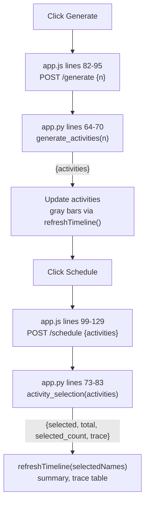

# HW4 Code Walkthrough — Classroom Reservation System

[Repository Guide](../../README.md) | [English](Code-Walkthrough.md) | [한국어](Code-Walkthrough.ko.md)

> **Last Updated:** 2026-11-16
>
> Introduction to Algorithms, Cormen, Leiserson, Rivest, and Stein, Ch 16

> **Learning Objectives:**
> 1. Explain line by line what the functions and routes of `app.py` do
> 2. Trace how the loop of `activity_selection` changes `selected`, `trace`, and `last_end`
> 3. Explain how the frontend calls the two APIs with `fetch` and draws the timeline and the trace table from the responses
> 4. Explain how the position and width of the timeline bars and the ticks of the time axis are computed
> 5. Analyze the time complexity of each part of the backend and the frontend

---

## Table of Contents

- [1. File Layout](#1-file-layout)
- [2. app.py](#2-apppy)
  - [2.1 Module Header and the Flask App Object](#21-module-header-and-the-flask-app-object)
  - [2.2 activity_selection](#22-activity_selection)
  - [2.3 generate_activities](#23-generate_activities)
  - [2.4 Page Route](#24-page-route)
  - [2.5 The /generate Route](#25-the-generate-route)
  - [2.6 The /schedule Route](#26-the-schedule-route)
  - [2.7 Entry Point](#27-entry-point)
- [3. static/index.html](#3-staticindexhtml)
  - [3.1 Document Head](#31-document-head)
  - [3.2 Title and Input Area](#32-title-and-input-area)
  - [3.3 Action Buttons and Summary](#33-action-buttons-and-summary)
  - [3.4 Timeline, Trace Table, and Script](#34-timeline-trace-table-and-script)
- [4. static/app.js](#4-staticappjs)
  - [4.1 DOM References and State](#41-dom-references-and-state)
  - [4.2 refreshTimeline](#42-refreshtimeline)
  - [4.3 updateButtons](#43-updatebuttons)
  - [4.4 Adding a Reservation](#44-adding-a-reservation)
  - [4.5 Random Generation](#45-random-generation)
  - [4.6 Running the Schedule and the Trace Table](#46-running-the-schedule-and-the-trace-table)
  - [4.7 Clearing Everything](#47-clearing-everything)
- [5. static/style.css](#5-staticstylecss)
- [6. requirements.txt](#6-requirementstxt)
- [7. Tracing the Request Flow](#7-tracing-the-request-flow)
- [8. Complexity](#8-complexity)
- [Summary](#summary)
- [Self-Check Questions](#self-check-questions)

---

<br>

## 1. File Layout

> **Try It First:** This document contains the complete code and line-by-line explanations. Solve the problems in the [assignment handout](Original/Assignment.md) yourself before reading on.

The companion document, the [HW4 Assignment Explanation](Assignment-Explanation.md), covers the requirements, design, tests, and the analysis questions of the report. This document reads the five files of `Solution` from top to bottom. All line numbers refer to each file. `app.py` (87 lines) is the Flask backend, `static/index.html` (54 lines) the page structure, `static/app.js` (139 lines) the page behavior, `static/style.css` (188 lines) the page style, and `requirements.txt` (1 line) the list of dependencies.

| File | Lines | Part | Role |
|:-----|:-----|:-----|:-----|
| `app.py` | 1-7 | Module description, `import`, Flask app object | Backend setup |
| `app.py` | 10-40 | `activity_selection` | Greedy activity selection and trace recording |
| `app.py` | 43-52 | `generate_activities` | Random reservation generation |
| `app.py` | 55-61 | Route section comment, `/` | Serving the page |
| `app.py` | 64-70 | `/generate` | Random reservation API |
| `app.py` | 73-83 | `/schedule` | Scheduling API |
| `app.py` | 86-87 | `if __name__ == "__main__":` | Running the development server |
| `static/index.html` | 1-8 | Document head | Title, stylesheet link |
| `static/index.html` | 9-26 | Title, reservation input box, random generation box | Input |
| `static/index.html` | 28-32 | Schedule and Clear All buttons and summary | Actions |
| `static/index.html` | 34-54 | Timeline area, trace table, script loading | Output |
| `static/app.js` | 1-10 | DOM references and the `activities` state | Setup |
| `static/app.js` | 12-54 | `refreshTimeline` | Drawing the timeline |
| `static/app.js` | 56-58 | `updateButtons` | Enabling the Schedule button |
| `static/app.js` | 60-78 | Add button handler | Adding a reservation |
| `static/app.js` | 80-95 | Generate button handler | Calling `/generate` |
| `static/app.js` | 97-129 | Schedule button handler | Calling `/schedule`, drawing the trace table |
| `static/app.js` | 131-139 | Clear All button handler | Reset |
| `static/style.css` | 1-188 | Entire style | Layout and colors (Section 5) |
| `requirements.txt` | 1 | `flask>=3.0` | Dependency |

*Table 1. Layout of the five files*

---

<br>

## 2. app.py

### 2.1 Module Header and the Flask App Object

```python
"""Week 05 — Classroom Reservation System (Flask backend)"""

import random

from flask import Flask, jsonify, request, send_from_directory

app = Flask(__name__, static_folder="static")
```

Line 1 is the module docstring. The `random` module of line 3 is used by `generate_activities`, which creates random reservations. Line 5 imports four names from Flask. `Flask` is the class that creates the web app object, `jsonify` is the function that turns Python dictionaries and lists into a JSON response, `request` is the object that gives access to the current request (body, headers), and `send_from_directory` is the function that sends a file in a directory as the response.

Line 7 creates the app object. `static_folder="static"` designates `static/` in the directory of `app.py` as the static file folder, and its files are served at `/static/...`. This setting is what lets `index.html` load `/static/style.css` and `/static/app.js`. Flask uses `__name__` to set the root directory of the app (`app.root_path`) to the location of `app.py`.

### 2.2 activity_selection

```python
# ---------------------------------------------------------------------------
# Greedy Activity Selection
# ---------------------------------------------------------------------------

def activity_selection(activities):
    """
    Greedy activity selection — sort by finish time, greedily pick non-overlapping.
    Returns (selected list, trace of selection steps).
    """
    sorted_acts = sorted(activities, key=lambda a: a["end"])
    selected = []
    trace = []
    last_end = -1

    for act in sorted_acts:
        if act["start"] >= last_end:
            selected.append(act)
            trace.append({
                "action": "select",
                "activity": act,
                "reason": f"start={act['start']} >= last_end={last_end}",
            })
            last_end = act["end"]
        else:
            trace.append({
                "action": "reject",
                "activity": act,
                "reason": f"start={act['start']} < last_end={last_end}",
            })

    return selected, trace
```

Lines 10-12 are a comment that marks the section. `activity_selection` on line 14 takes a list of reservation dictionaries (`name`, `start`, `end`) and, as its docstring on lines 15-18 says, returns a tuple of the list of selected reservations and the trace of the selection steps.

- **Line 19:** `sorted` builds a new list ordered by the value of the `key` function `lambda a: a["end"]`, that is, by finish time. The original list is unchanged, and because the sort is stable, reservations with the same finish time keep their input order.
- **Lines 20-22:** These prepare `selected` for the selected reservations, `trace` for the step records, and `last_end` for the finish time of the most recently selected reservation. The initial value -1 of `last_end` means "no reservation selected yet", and it is guaranteed to let the first reservation through only under the assumption that every start time is -1 or larger.
- **Lines 24-25:** The loop takes the reservations one by one in sorted order and checks whether the start time is at least `last_end`. Because the condition includes equality, a reservation that starts at the moment the previous one ends is accepted.
- **Lines 26-32:** If the condition is true, the reservation is added to `selected`, the `"select"` decision and the comparison are recorded in `trace`, and `last_end` is set to the finish time of this reservation. The f-string on line 30 holds `last_end` from before the update, so the basis of the decision is kept as it was.
- **Lines 33-38:** If the condition is false, only the `"reject"` decision and the comparison are recorded, and `last_end` is left as it is.
- **Line 40:** The two lists are returned as a tuple. The entries of `selected` and the `activity` of `trace` refer to the same input dictionaries without copying them.

For the reservations A = [2, 5), B = [1, 3), C = [4, 7), D = [6, 8), and E = [3, 9), the variables change as follows.

| Iteration | `act` | Comparison on line 25 | Decision | `selected` | `last_end` (after) |
|:---:|:-----|:-----|:-----|:-----|:---:|
| Before | | | | [] | -1 |
| 1 | B [1, 3) | 1 >= -1 | select | [B] | 3 |
| 2 | A [2, 5) | 2 >= 3 false | reject | [B] | 3 |
| 3 | C [4, 7) | 4 >= 3 | select | [B, C] | 7 |
| 4 | D [6, 8) | 6 >= 7 false | reject | [B, C] | 7 |
| 5 | E [3, 9) | 3 >= 7 false | reject | [B, C] | 7 |

*Table 2. Variable changes of activity_selection for five reservations*

### 2.3 generate_activities

```python
def generate_activities(n=15):
    """Generate n random activities with start/end times."""
    activities = []
    for i in range(n):
        start = random.randint(9, 20)
        end = start + random.randint(1, 3)
        if end > 22:
            end = 22
        activities.append({"name": f"Event_{i+1}", "start": start, "end": end})
    return activities
```

`generate_activities` on line 43 creates `n` reservations (15 by default). Line 47 picks the start time uniformly from the integers from 9 to 20. `random.randint(a, b)` includes both ends `a` and `b`. Line 48 adds a duration of 1-3 hours to set the finish time, and lines 49-50 cut the finish time to 22 if it exceeds 22. Since the start time is at most 20, the finish time is still greater than the start time after the cut. Line 51 uses `i+1` because `i` starts at 0, so the names begin at `Event_1`, and line 52 returns the list. Start times are 9-20, finish times 10-22, and durations 1-3 hours.

### 2.4 Page Route

```python
# ---------------------------------------------------------------------------
# Routes
# ---------------------------------------------------------------------------

@app.route("/")
def index():
    return send_from_directory("static", "index.html")
```

Lines 55-57 are a section comment. `@app.route("/")` on line 59 connects `GET` requests for the root address to the `index` function on line 60. Line 61 sends `static/index.html` as the response. The relative path `"static"` is resolved against `app.root_path` (the directory of `app.py`), not the current working directory, so the page is served even when the app is started from another directory, as in `python Solution/app.py`.

### 2.5 The /generate Route

```python
@app.route("/generate", methods=["POST"])
def generate():
    data = request.get_json()
    n = int(data.get("n", 15))
    n = max(1, min(n, 100))
    activities = generate_activities(n)
    return jsonify({"activities": activities})
```

Line 64 accepts only `POST` requests to `/generate`. `request.get_json()` on line 66 reads the JSON of the request body as a dictionary. If the `Content-Type` of the request is not JSON, Flask responds with error 415, but the frontend always sends `application/json`, so this is not a problem. Line 67 uses 15 when `n` is missing and converts it with `int`, and line 68 confines `n` to the range 1-100 with `min` and `max`. Line 69 creates the reservations, and line 70 returns them as `{"activities": [...]}`.

### 2.6 The /schedule Route

```python
@app.route("/schedule", methods=["POST"])
def schedule():
    data = request.get_json()
    activities = data["activities"]
    selected, trace = activity_selection(activities)
    return jsonify({
        "selected": selected,
        "total": len(activities),
        "selected_count": len(selected),
        "trace": trace,
    })
```

Line 73 accepts `POST` requests to `/schedule`. Line 75 reads the JSON of the body, and line 76 takes out the list of reservations. If the body has no `activities`, a `KeyError` causes error 500, and the values of the reservations (whether they are integers, whether the finish time exceeds the start time) are not checked on the server. The route assumes that the frontend has already filtered the reservations sent from the page. Line 77 runs activity selection, and lines 78-83 bundle the selected reservations, the total count, the selected count, and the trace into JSON. `jsonify` writes the keys of a dictionary in alphabetical order, but the frontend reads values by key name, so the order does not matter.

### 2.7 Entry Point

```python
if __name__ == "__main__":
    app.run(debug=True, port=5000)
```

The condition on line 86 is true only when the file is run directly with `python app.py`. Line 87 starts the development server on port 5000. Since `host` is not given, the server can be reached only from the same computer (`127.0.0.1`). `debug=True` turns on the reloader, which restarts the server when the code changes, and the debugger, which shows traceback information in the browser when an error occurs.

---

<br>

## 3. static/index.html

### 3.1 Document Head

```html
<!DOCTYPE html>
<html lang="en">
<head>
  <meta charset="UTF-8" />
  <meta name="viewport" content="width=device-width, initial-scale=1.0" />
  <title>Classroom Reservation System</title>
  <link rel="stylesheet" href="/static/style.css" />
</head>
```

Lines 1-2 declare an HTML5 document and set the language to English. Line 4 is the character encoding, line 5 the width setting for mobile screens, and line 6 the title of the browser tab. Line 7 loads `/static/style.css` according to the static file setting of Section 2.1.

### 3.2 Title and Input Area

```html
<body>
  <h1>Classroom Reservation System</h1>

  <div class="controls">
    <div class="add-form">
      <h3>Add Reservation</h3>
      <input id="eventName" type="text" placeholder="Event name" />
      <input id="eventStart" type="number" placeholder="Start" min="0" />
      <input id="eventEnd" type="number" placeholder="End" min="1" />
      <button id="btnAdd">Add</button>
    </div>
    <div class="generate-form">
      <h3>Generate Random</h3>
      <label for="numEvents">Events:</label>
      <input id="numEvents" type="number" value="15" min="1" max="100" />
      <button id="btnGenerate">Generate</button>
    </div>
  </div>
```

Line 10 is the page title. The `controls` area on lines 12-26 has two input boxes. The reservation box on lines 13-19 has input fields for the name (`eventName`), the start time (`eventStart`), and the finish time (`eventEnd`), and an Add button. The `min` of the start and end fields is only the lower bound when the value is decreased with the arrows; it does not stop the user from typing a negative number. The random generation box on lines 20-25 has an input field for the number to generate (`numEvents`, default 15, range 1-100) and a Generate button. The `id` of each element is what `app.js` uses to find it.

### 3.3 Action Buttons and Summary

```html
  <div class="actions">
    <button id="btnSchedule" disabled>Schedule</button>
    <button id="btnClear">Clear All</button>
    <span id="summary" class="summary"></span>
  </div>
```

The Schedule button on line 29 starts in the `disabled` state. With no reservations there is nothing to schedule, and once reservations exist, `updateButtons` in `app.js` enables the button. Line 30 is the button that clears all reservations, and `summary` on line 31 is the place for a summary such as "Selected 6 / 15 events".

### 3.4 Timeline, Trace Table, and Script

```html
  <div id="timeline" class="timeline"></div>

  <div id="traceSection" class="trace-section hidden">
    <h3>Step-by-step Greedy Trace</h3>
    <table id="traceTable">
      <thead>
        <tr>
          <th>Step</th>
          <th>Event</th>
          <th>Interval</th>
          <th>Action</th>
          <th>Reason</th>
        </tr>
      </thead>
      <tbody></tbody>
    </table>
  </div>

  <script src="/static/app.js"></script>
</body>
</html>
```

`timeline` on line 34 is an empty box that `app.js` fills with bars. The trace area on lines 36-50 starts hidden with the `hidden` class, and the class is removed to show it when scheduling finishes. The header of the table (lines 40-46) has five columns: step, reservation, interval, decision, and reason, and the rows go into the empty `tbody` on line 48. Line 52 loads `app.js` after every element of the body has been created, so the script can find the elements with `getElementById` right away.

---

<br>

## 4. static/app.js

### 4.1 DOM References and State

```javascript
const btnAdd = document.getElementById("btnAdd");
const btnGenerate = document.getElementById("btnGenerate");
const btnSchedule = document.getElementById("btnSchedule");
const btnClear = document.getElementById("btnClear");
const summaryEl = document.getElementById("summary");
const timelineEl = document.getElementById("timeline");
const traceSection = document.getElementById("traceSection");
const traceBody = document.querySelector("#traceTable tbody");

let activities = [];
```

Lines 1-8 look up frequently used page elements once and keep them in constants. `querySelector("#traceTable tbody")` on line 8 finds the `tbody` inside the trace table with a CSS selector. `activities` on line 10 is the list of reservations on the page and the only state on the browser side. The server stores no state and receives this whole list every time it schedules.

### 4.2 refreshTimeline

```javascript
// ---------- Helpers ----------

function refreshTimeline(selectedNames) {
  selectedNames = selectedNames || [];
  timelineEl.innerHTML = "";

  if (activities.length === 0) return;

  const minStart = 8;
  const maxEnd = 24;
  const range = maxEnd - minStart;

  // Sort by start for display
  const sorted = [...activities].sort((a, b) => a.start - b.start || a.end - b.end);

  for (const act of sorted) {
    const row = document.createElement("div");
    row.className = "timeline-row";

    const bar = document.createElement("div");
    const leftPct = ((act.start - minStart) / range) * 100;
    const widthPct = ((act.end - act.start) / range) * 100;
    bar.className =
      "timeline-bar " + (selectedNames.includes(act.name) ? "selected" : "rejected");
    bar.style.left = leftPct + "%";
    bar.style.width = Math.max(widthPct, 2) + "%";
    bar.textContent = `${act.name} [${act.start}-${act.end}]`;

    row.appendChild(bar);
    timelineEl.appendChild(row);
  }

  // Axis
  const axis = document.createElement("div");
  axis.className = "timeline-axis";
  const steps = Math.min(range, 12);
  for (let i = 0; i <= steps; i++) {
    const span = document.createElement("span");
    span.textContent = Math.round(minStart + (range * i) / steps);
    axis.appendChild(span);
  }
  timelineEl.appendChild(axis);
}
```

`refreshTimeline` on line 14 takes an array of the names of the selected reservations and redraws the timeline from scratch. Line 15 uses an empty array when no argument is given, so that every bar is drawn in gray; line 16 clears the previous drawing; and line 18 returns immediately if there are no reservations.

- **Lines 20-22:** The time range of the page is fixed to the 16 hours from 8 to 24. If a reservation time falls outside this range, its bar extends outside the box.
- **Line 25:** The array is copied (`[...activities]`) so that the original is not changed, and the copy is sorted by start time and then by finish time. When `a.start - b.start` is 0, `a.end - b.end` after `||` is used. The order of the bars on the page differs from the finish-time order in which the algorithm looks at the reservations.
- **Lines 27-42:** For each reservation a row (`timeline-row`) and a bar (`timeline-bar`) are created. Line 32 computes the left position of the bar as $`(s - 8)/16 \times 100\%`$, and line 33 the width as $`(f - s)/16 \times 100\%`$. Lines 34-35 give the bar the `selected` class if its name is in `selectedNames` and the `rejected` class otherwise. Line 37 keeps the width at least 2% so that very short bars do not disappear. Line 38 sets text such as `Event_10 [9-11]` through `textContent`, so even if a name contains HTML tags, it is shown as plain text.
- **Lines 45-53:** These build the time axis. `steps` on line 47 is `min(16, 12)` = 12, so there are 13 ticks, and line 50 labels each tick with $`8 + 16i/12`$ rounded to an integer. The ticks are placed at equal spacing by `justify-content: space-between` in the CSS.

| `i` | 0 | 1 | 2 | 3 | 4 | 5 | 6 | 7 | 8 | 9 | 10 | 11 | 12 |
|:-----|:---:|:---:|:---:|:---:|:---:|:---:|:---:|:---:|:---:|:---:|:---:|:---:|:---:|
| Exact position (hour) | 8 | 9.33 | 10.67 | 12 | 13.33 | 14.67 | 16 | 17.33 | 18.67 | 20 | 21.33 | 22.67 | 24 |
| Displayed number | 8 | 9 | 11 | 12 | 13 | 15 | 16 | 17 | 19 | 20 | 21 | 23 | 24 |

*Table 3. Positions and displayed numbers of the time axis ticks*

Because the tick numbers are rounded, 10, 14, 18, and 22 are not displayed, and the tick labeled "9" actually sits at the 9:20 position. The positions of the bars are set exactly by the formula on line 32, so when reading a bar, the `[start-end]` in its label is the more accurate source.

### 4.3 updateButtons

```javascript
function updateButtons() {
  btnSchedule.disabled = activities.length === 0;
}
```

Lines 56-58 disable the Schedule button only when there are no reservations. The function is called after reservations are added, generated, or cleared.

### 4.4 Adding a Reservation

```javascript
// ---------- Add ----------

btnAdd.addEventListener("click", () => {
  const name = document.getElementById("eventName").value.trim() || `Event_${activities.length + 1}`;
  const start = parseInt(document.getElementById("eventStart").value, 10);
  const end = parseInt(document.getElementById("eventEnd").value, 10);
  if (isNaN(start) || isNaN(end) || end <= start) {
    alert("Enter valid start / end times (end > start).");
    return;
  }
  activities.push({ name, start, end });
  document.getElementById("eventName").value = "";
  document.getElementById("eventStart").value = "";
  document.getElementById("eventEnd").value = "";
  refreshTimeline();
  traceSection.classList.add("hidden");
  summaryEl.textContent = `${activities.length} event(s) added`;
  updateButtons();
});
```

Line 62 attaches an arrow function to the click of the Add button. Line 63 trims spaces from both ends of the name field and, if it is empty, uses `Event_{current count + 1}` as the name. Lines 64-65 read the start and finish times as decimal integers. Lines 66-69 show an alert and do not add anything if a value is not a number or the finish time is not greater than the start time. Reservations added from the page therefore always satisfy $`s < f`$. Line 70 adds `{ name, start, end }` (shorthand property names) to the list, and lines 71-73 clear the input fields. Line 74 redraws all bars in gray, line 75 hides the previous trace table, line 76 writes the number of reservations into the summary, and line 77 updates the button state. When the reservations change, the previous scheduling result no longer applies, so the selection marks and the trace table are cleared.

### 4.5 Random Generation

```javascript
// ---------- Generate ----------

btnGenerate.addEventListener("click", async () => {
  const n = parseInt(document.getElementById("numEvents").value, 10) || 15;
  const res = await fetch("/generate", {
    method: "POST",
    headers: { "Content-Type": "application/json" },
    body: JSON.stringify({ n }),
  });
  const data = await res.json();
  activities = data.activities;
  refreshTimeline();
  traceSection.classList.add("hidden");
  summaryEl.textContent = `${activities.length} event(s) generated`;
  updateButtons();
});
```

The handler on line 82 is `async`, so it can wait for the server response with `await`. Line 83 reads the number to generate and uses 15 if the value is not a number or is 0. Lines 84-88 send `{"n": ...}` as a JSON body to `/generate`, and line 89 reads the response body as JSON. Line 90 replaces the existing list with the generated reservations, so any reservations added by hand are lost. Lines 91-94 update the page as in Section 4.4.

### 4.6 Running the Schedule and the Trace Table

```javascript
// ---------- Schedule ----------

btnSchedule.addEventListener("click", async () => {
  if (activities.length === 0) return;

  const res = await fetch("/schedule", {
    method: "POST",
    headers: { "Content-Type": "application/json" },
    body: JSON.stringify({ activities }),
  });
  const data = await res.json();

  const selectedNames = data.selected.map((a) => a.name);
  refreshTimeline(selectedNames);

  summaryEl.textContent = `Selected ${data.selected_count} / ${data.total} events`;

  // Build trace table
  traceBody.innerHTML = "";
  data.trace.forEach((t, i) => {
    const tr = document.createElement("tr");
    tr.className = t.action === "select" ? "row-select" : "row-reject";
    tr.innerHTML = `
      <td>${i + 1}</td>
      <td>${t.activity.name}</td>
      <td>[${t.activity.start}, ${t.activity.end})</td>
      <td><strong>${t.action.toUpperCase()}</strong></td>
      <td>${t.reason}</td>
    `;
    traceBody.appendChild(tr);
  });
  traceSection.classList.remove("hidden");
});
```

Line 100 does nothing if there are no reservations. This normally cannot happen because the button is disabled, but it is guarded once more. Lines 102-106 send the whole current list of reservations to `/schedule`, and line 107 reads the response.

- **Lines 109-110:** Only the names of the selected reservations are collected and passed to `refreshTimeline`, which redraws the selected bars in blue.
- **Line 112:** A summary such as `Selected 6 / 15 events` is built from `selected_count` and `total`.
- **Lines 115-127:** The previous rows are cleared, and one row is created per trace entry. The second argument `i` of `forEach` starts at 0, so the step number is `i + 1`. Line 118 sets the class of the row according to the decision, line 122 writes the interval in the half-open notation `[s, e)`, and line 123 writes the decision in capitals.
- **Line 128:** The hidden trace area is shown.

> **Note:** Lines 119-125 put the reservation name into `innerHTML` as it is, so if a name contains a tag such as `<b>`, it is interpreted as a tag. In this app, reservation names are values that users type on their own page, so any harm stays on their own page, but in an app that shows values typed by others, filling the cells with `textContent`, as for the bars in Section 4.2, is safer.

### 4.7 Clearing Everything

```javascript
// ---------- Clear ----------

btnClear.addEventListener("click", () => {
  activities = [];
  refreshTimeline();
  traceSection.classList.add("hidden");
  summaryEl.textContent = "";
  updateButtons();
});
```

Lines 133-139 empty the list of reservations, clear the timeline (it returns early on line 18, leaving an empty box), hide the trace table, clear the summary, and disable the Schedule button.

---

<br>

## 5. static/style.css

The stylesheet sets the layout and colors of the page. The parts directly related to the algorithm are the colors that distinguish selection from rejection (lines 137-144), the absolute positioning of the bars (lines 118-135), and hiding the trace area (lines 160-162).

| Lines | Selector | Role |
|:-----|:-----|:-----|
| 1-5 | `*` | Removes the default spacing of every element and includes padding and border in the width with `box-sizing: border-box` |
| 7-15 | `body` | Font, light gray background, and a vertical flex layout that centers the content |
| 17-25 | `h1`, `h3` | Size and bottom margin of the headings |
| 27-34 | `.controls` | Places the two input boxes side by side and wraps them on narrow screens |
| 36-42 | `.add-form`, `.generate-form` | Input boxes with a white background, a border, and rounded corners |
| 44-55 | `input` in the input boxes | Padding and width of the fields (130px for the name field, 100px for the others) |
| 57-71 | `.controls button`, `.actions button` | Common look of the buttons and their opacity on hover |
| 73-79 | `#btnAdd`, `#btnGenerate` | Add is green and Generate is blue |
| 81-87 | `.actions` | Places the action buttons and the summary side by side |
| 89-100 | `#btnSchedule`, `#btnClear` | Schedule is orange-red and translucent when disabled, and Clear All is gray |
| 102-105 | `.summary` | Makes the summary bold |
| 107-116 | `.timeline` | An 800px-wide white timeline box with `position: relative` |
| 118-122 | `.timeline-row` | A 28px-high row that is the reference for the bar position (`position: relative`) |
| 124-135 | `.timeline-bar` | A bar placed in the row with `position: absolute`, with overflowing text clipped (`overflow: hidden`) |
| 137-144 | `.timeline-bar.rejected`, `.timeline-bar.selected` | Rejected bars are gray `#ccc`, and selected bars are blue `#4a90d9` |
| 146-152 | `.timeline-axis` | Places the ticks at equal spacing with `justify-content: space-between` |
| 154-162 | `.trace-section`, `.trace-section.hidden` | Width and top margin of the trace area, and `display: none` when `hidden` |
| 164-180 | `table`, `th`, `td` of the trace table | Table borders, centered text, and a blue header row |
| 182-188 | `tr.row-select`, `tr.row-reject` | Light green background for selected rows and light gray for rejected rows |

*Table 4. Layout of style.css*

Because a bar takes `left` and `width` as percentages within its row (Section 4.2), the percentages are relative to the width of the row, that is, the content width of the timeline box. The time axis spreads its ticks over the same content width, so the two ends of the bars and the ticks line up.

---

<br>

## 6. requirements.txt

```text
flask>=3.0
```

The only dependency is Flask 3.0 or later. `pip install -r requirements.txt` installs Flask together with its own dependencies, such as Werkzeug and Jinja2. The frontend uses no external library, only built-in browser features (`fetch`, the DOM API).

---

<br>

## 7. Tracing the Request Flow

What happens between the browser and the server when random reservations are generated and scheduled is as follows.



*Figure 1. Request flow of generating and scheduling reservations*

1. When the user presses Generate, `app.js` sends `{"n": 15}` to `/generate`.
2. The server creates 15 reservations with `generate_activities(15)` and returns them as `{"activities": [...]}`. The server does not store this list.
3. The browser keeps the received list in `activities` and draws every bar in gray.
4. When the user presses Schedule, the browser sends the whole `activities` list to `/schedule`.
5. The server runs the greedy selection in finish-time order with `activity_selection` and returns the selection result and the trace.
6. The browser repaints the bars by the selected names, writes the summary, and fills the trace table.

Because the server holds no state, pressing Schedule several times with the same list always gives the same result.

---

<br>

## 8. Complexity

With $n$ reservations and $k$ selected reservations, the complexity of each part is as follows.

| Part | Time | Space | Reason |
|:-----|:-----|:-----|:-----|
| `activity_selection` line 19 | $`O(n \log n)`$ | $O(n)$ | Builds a new sorted list |
| `activity_selection` lines 24-38 | $O(n)$ | $O(n)$ | One comparison per reservation, recorded in `selected` and `trace` |
| `generate_activities` | $O(n)$ | $O(n)$ | Two random numbers per reservation ($`n \le 100`$) |
| Whole `/schedule` | $`O(n \log n)`$ | $O(n)$ | Reading and writing JSON is $O(n)$, and sorting dominates |
| `refreshTimeline` | $`O(n \log n + nk)`$ | $O(n)$ | Sorting, and an $O(k)$ search with `selectedNames.includes` for each bar |
| Drawing the trace table | $O(n)$ | $O(n)$ | One row per trace entry |

*Table 5. Time and space complexity of each part*

Activity selection on the server is $`O(n \log n)`$, dominated by sorting. `refreshTimeline` on the page scans the array of selected names from the beginning for every bar, so it can grow to $`O(n^2)`$ when $k$ is proportional to $n$. The difference does not show in this app, which generates at most 100 reservations, but putting the names in a `Set` would reduce each check to an $O(1)$ lookup.

---

<br>

## Summary

| Concept | Key Summary |
|:-----|:-----|
| Layout of app.py | It consists of the activity selection function, the random generation function, the three routes `/`, `/generate`, and `/schedule`, and the part that runs the development server. |
| activity_selection | It stably sorts by finish time, selects each reservation with `start >= last_end`, and records the decision and the comparison of every step in `trace`. |
| Initial value -1 | It lets the first reservation through only when every start time is -1 or larger, and the input form and random generation of the page satisfy this assumption. |
| generate_activities | It creates reservations with start times 9-20, durations of 1-3 hours, and a finish time cap of 22, and the route limits the count to 1-100. |
| Stateless server | The server stores no reservations, and the browser sends the whole `activities` list every time. |
| refreshTimeline | It places bars as percentages on the range 8-24 and colors them by name, and the tick numbers are rounded values of positions that divide the range into 12 parts. |
| Trace table | It creates one row per trace entry and shows intervals in the half-open notation `[s, e)` and decisions in capitals. |
| Complexity | Activity selection on the server is $`O(n \log n)`$, and coloring the bars on the page is $`O(n \log n + nk)`$ because of the search through the name array. |

---

<br>

## Self-Check Questions

1. **Stability of the sort:** If the reservations P = [3, 5), Q = [1, 5), and R = [5, 7) are sent to `/schedule` in this order, which reservations are selected? How does the result change if they are sent in the order Q, P, R?

   <details>
   <summary>Answer</summary>

   P and Q have the same finish time 5, and `sorted` is a stable sort, so their input order is kept. In the order P, Q, R, P is examined first and selected (`last_end` = 5), Q is rejected with `start=1 < last_end=5`, and R is selected with `start=5 >= last_end=5`, giving {P, R}. In the order Q, P, R, the same reasoning gives {Q, R}. Either way two are selected; only which reservations are selected differs.

   </details>

2. **The reason string of the trace:** How does the fact that the f-string on line 30 runs before line 32 show up in the trace table?

   <details>
   <summary>Answer</summary>

   `reason` is built before `last_end` changes, so it holds the value compared at the moment of the decision. For example, the reason of the first step is `start=9 >= last_end=-1`, and the finish time 11 of the reservation selected in that step appears in the reason of the next step, `start=10 < last_end=11`. If the order were reversed, the reason of the first step would be recorded as `last_end=11`, which would not match the decision.

   </details>

3. **Time axis ticks:** If line 47 is changed to `const steps = range;`, how are the ticks of the time axis displayed?

   <details>
   <summary>Answer</summary>

   `steps` becomes 16, so 17 ticks are created, and the value of each tick is $`8 + 16i/16 = 8 + i`$, an integer, so 8, 9, 10, ..., 24 are displayed at one-hour intervals without rounding. The current code limits the ticks to 12 intervals, so 10, 14, 18, and 22 are missing and the other numbers are off from their actual positions by up to 20 minutes.

   </details>

4. **Where input is checked:** The Add button on the page blocks reservations whose finish time is not greater than the start time. What happens if the same reservation is sent directly to `/schedule`?

   <details>
   <summary>Answer</summary>

   The server does not check the values, so the reservation goes into activity selection as it is. For example, [5, 5) has length 0 but is selected if it satisfies `start >= last_end`, and a reservation such as [-3, -2), whose start time is less than -1, is rejected because of the initial value -1. The input check (lines 66-69) exists only in the frontend, so guaranteeing correct behavior even when the server is called directly would require checking the start and finish times on the server as well.

   </details>
