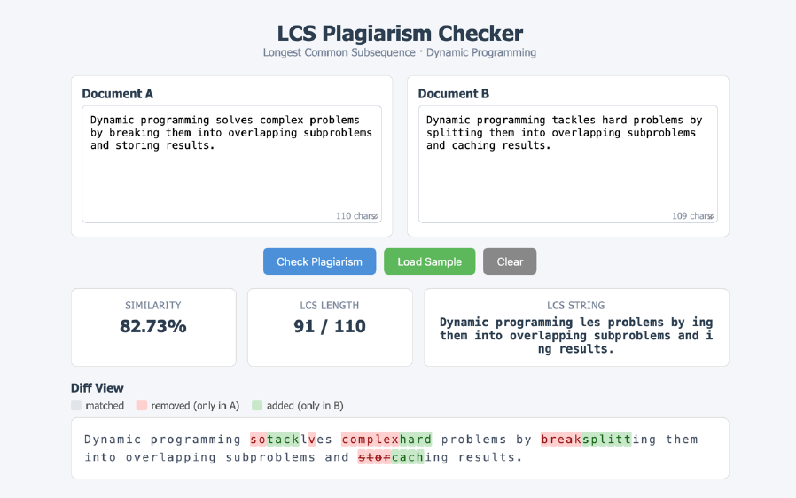

# HW5 과제 해설 — 표절 검사기

[레포지토리 안내](../../README.ko.md) | [English](Assignment-Explanation.md) | [한국어](Assignment-Explanation.ko.md)

> **최종 수정일:** 2026-11-17
>
> Introduction to Algorithms, Cormen, Leiserson, Rivest, and Stein, Ch 15

> **학습 목표:**
> 1. 부분 수열과 LCS(최장 공통 부분 수열)를 정의하고, 상향식 동적 프로그래밍으로 두 문자열의 DP 표를 채울 수 있다
> 2. DP 표를 역추적하여 LCS 문자열을 복원하고, 값이 같은 두 이웃 중 하나를 고르는 규칙이 결과에 주는 영향을 설명할 수 있다
> 3. DP 표로 두 텍스트의 문자 단위 diff를 만들어 각 문자를 일치, 삭제, 추가로 분류할 수 있다
> 4. LCS 길이로 정의한 유사도 점수를 계산하고 그 의미와 한계를 설명할 수 있다
> 5. LCS 알고리즘의 시간 복잡도와 공간 복잡도를 분석하고 실제 비교 도구의 방식과 연결할 수 있다

---

## 목차

- [1. 과제 구성과 실행 방법](#1-과제-구성과-실행-방법)
- [2. 요구사항](#2-요구사항)
  - [2.1 기능 요구사항](#21-기능-요구사항)
  - [2.2 API 엔드포인트와 응답 형식](#22-api-엔드포인트와-응답-형식)
  - [2.3 보고서와 평가 기준](#23-보고서와-평가-기준)
- [3. 문제 모델링](#3-문제-모델링)
  - [3.1 부분 수열과 LCS](#31-부분-수열과-lcs)
  - [3.2 LCS의 점화식](#32-lcs의-점화식)
  - [3.3 유사도 점수와 diff의 정의](#33-유사도-점수와-diff의-정의)
- [4. 해결 방법](#4-해결-방법)
  - [4.1 상향식 DP 표 채우기](#41-상향식-dp-표-채우기)
  - [4.2 역추적으로 LCS 문자열 복원](#42-역추적으로-lcs-문자열-복원)
  - [4.3 문자 단위 diff 생성](#43-문자-단위-diff-생성)
  - [4.4 유사도 점수 계산](#44-유사도-점수-계산)
  - [4.5 /check 엔드포인트와 화면 표시](#45-check-엔드포인트와-화면-표시)
- [5. 테스트와 결과](#5-테스트와-결과)
  - [5.1 실행 화면](#51-실행-화면)
  - [5.2 ALGORITHM과 ALTRUISTIC의 DP 표](#52-algorithm과-altruistic의-dp-표)
  - [5.3 동작 확인](#53-동작-확인)
- [6. 보고서의 분석 질문](#6-보고서의-분석-질문)
  - [6.1 LCS의 시간 복잡도와 공간 복잡도](#61-lcs의-시간-복잡도와-공간-복잡도)
  - [6.2 git diff, 표절 검사 서비스와의 관계](#62-git-diff-표절-검사-서비스와의-관계)
- [요약](#요약)
- [점검 문제](#점검-문제)
- [참고 문헌](#참고-문헌)

---

<br>

## 1. 과제 구성과 실행 방법

> **풀어 보기:** 이 문서는 정답과 풀이를 담고 있다. 먼저 [과제 안내문](Original/Assignment.ko.md)의 문제를 직접 풀어 본 뒤 읽는다.

6주차 가정 과제는 두 문서를 비교하여 LCS(최장 공통 부분 수열, Longest Common Subsequence) 알고리즘으로 유사도를 계산하는 **표절 검사기** 웹 앱을 만드는 과제이다. 동적 프로그래밍으로 두 텍스트의 DP 표를 만들고, 표를 역추적하여 LCS를 찾고, 유사도 점수와 색으로 구분한 diff 보기를 화면에 보여 주어야 한다. 백엔드는 Python(FastAPI 또는 Flask), 프런트엔드는 HTML, CSS, JavaScript로 만들며, 소스 코드와 2쪽 이내의 보고서를 함께 제출한다. LCS의 정의와 점화식은 [6주차 이론 2.1\~2.4절](../../Lecture-Notes/Week06_Dynamic-Programming/Concepts_Lecture.ko.md#21-lcs-문제-정의)에, DP 표를 출력하는 실습은 [6주차 실습 2.2절](../../Lecture-Notes/Week06_Dynamic-Programming/Concepts_Lab.ko.md#22-a-2-lcs와-dp-테이블-시각화)에, LCS 기반 diff 뷰어 예제는 [6주차 실습 3.1절](../../Lecture-Notes/Week06_Dynamic-Programming/Concepts_Lab.ko.md#31-b-1-텍스트-diff-뷰어)에 있다.

```text
Coursework/HW05_Dynamic-Programming/
├── Assignment-Explanation.md       # 과제 해설 (영어)
├── Assignment-Explanation.ko.md    # 과제 해설 (한국어, 이 파일)
├── Code-Walkthrough.md             # 코드 총정리 (영어)
├── Code-Walkthrough.ko.md          # 코드 총정리 (한국어)
├── Original/
│   ├── Assignment.md               # 과제 안내문 (영어)
│   └── Assignment.ko.md            # 과제 안내문 (한국어)
└── Solution/
    ├── app.py                      # Flask 백엔드: LCS, 역추적, 유사도, diff, API 라우트
    ├── requirements.txt            # 의존성 (Flask)
    └── static/
        ├── index.html              # 화면 구조
        ├── style.css               # 화면 스타일
        └── app.js                  # 사용자 동작 처리, 결과와 diff 그리기
```

*그림 1. HW5 과제의 디렉토리 구성*

```bash
# 레포지토리 루트에서 풀이 디렉토리로 이동
cd Coursework/HW05_Dynamic-Programming/Solution

# 의존성 설치 (Flask)
pip install -r requirements.txt

# 개발 서버 실행 후 브라우저에서 http://localhost:5000 접속
python app.py
```

`python app.py`는 디버그 모드의 Flask 개발 서버를 5000번 포트에서 띄운다. 브라우저에서 두 텍스트 영역에 문서를 넣고 **Check Plagiarism**을 누르면 결과가 나타나며, **Load Sample**은 예시 문장 두 개를 채우고 **Clear**는 입력과 결과를 지운다.

> **참고:** macOS 12 이후에서는 AirPlay 수신 모드가 5000번 포트를 쓰므로 서버가 뜨지 않거나 다른 프로그램의 응답이 돌아올 수 있다. 이때는 AirPlay 수신 모드를 끄거나 `flask --app app run --port 5001`처럼 다른 포트로 실행한다.

각 파일을 처음부터 끝까지 읽는 설명은 [HW5 코드 총정리](Code-Walkthrough.ko.md)에 있다.

---

<br>

## 2. 요구사항

### 2.1 기능 요구사항

과제 안내문이 요구하는 기능과 각 기능을 구현한 위치는 다음과 같다. 줄 번호는 각 파일 기준이다.

| 영역 | 요구사항 | 구현 위치 |
|:-----|:-----|:-----|
| 알고리즘 | 입력된 두 텍스트에 대해 DP 표를 만든다 | `app.py` 12\~25번 줄 (`lcs`) |
| 알고리즘 | 역추적으로 LCS를 찾는다 | `app.py` 28\~41번 줄 (`backtrack_lcs`) |
| 알고리즘 | 유사도 점수를 `LCS length / max(len(A), len(B)) * 100%`로 계산한다 | `app.py` 44\~50번 줄 (`similarity_score`), 95번 줄 |
| 알고리즘 | 각 부분을 일치, 추가, 삭제로 표시하는 diff 보기를 만든다 | `app.py` 53\~71번 줄 (`generate_diff`) |
| 화면 | 문서 A와 문서 B를 입력하는 두 텍스트 영역 | `index.html` 13\~24번 줄 |
| 화면 | 표절 분석을 실행하는 Check 버튼 | `index.html` 27번 줄, `app.js` 22\~52번 줄 |
| 화면 | 유사도 점수(백분율) | `index.html` 34\~37번 줄, `app.js` 37번 줄 |
| 화면 | LCS 길이와 실제 LCS 문자열 | `index.html` 38\~45번 줄, `app.js` 38\~39번 줄 |
| 화면 | 일치(회색), 삭제(빨간색), 추가(초록색)로 색을 구분한 diff 보기 | `index.html` 48\~54번 줄, `app.js` 41\~49번 줄, `style.css` 179\~181번 줄, 202\~204번 줄 |
| 화면 (추가) | 글자 수 표시, 예시 문장을 채우는 Load Sample, 입력을 지우는 Clear | `index.html` 17번, 22번, 28\~29번 줄, `app.js` 14\~20번 줄, 54\~67번 줄 |

*표 1. 기능 요구사항과 구현 위치*

### 2.2 API 엔드포인트와 응답 형식

| 메서드 | 엔드포인트 | 요구사항 | 구현 위치 |
|:-----|:-----|:-----|:-----|
| `POST` | `/check` | 두 텍스트를 비교하고 유사도 점수와 diff를 반환한다 | `app.py` 83\~101번 줄 |
| `GET` | `/` | 프런트엔드 페이지를 제공한다 | `app.py` 78\~80번 줄 |

*표 2. API 엔드포인트와 구현 위치*

`/check`는 JSON 본문 `{"text_a": ..., "text_b": ...}`를 받아 다음 필드를 담은 JSON을 돌려준다.

| 필드 | 형식 | 내용 |
|:-----|:-----|:-----|
| `similarity` | 실수 | 유사도 점수(%)를 소수 둘째 자리에서 반올림한 값 |
| `lcs_length` | 정수 | LCS의 길이 |
| `lcs_string` | 문자열 | 역추적으로 복원한 LCS |
| `len_a`, `len_b` | 정수 | 두 텍스트의 글자 수 |
| `diff` | 객체 배열 | 문자마다 `{"char": 문자, "status": "match" 또는 "removed" 또는 "added"}` |

*표 3. /check 응답의 필드*

### 2.3 보고서와 평가 기준

보고서는 PDF로 2쪽 이내, 글자 크기 11pt 이상이어야 하며 다음 세 항목을 담는다. 각 항목의 내용은 이 문서의 해당 절에 옮겨 두었다.

| 보고서 항목 | 이 문서의 위치 |
|:-----|:-----|
| 두 예시 텍스트를 비교하는 표절 검사기의 화면 캡처 | 5.1절 |
| 짧은 예시(예: ALGORITHM과 ALTRUISTIC)의 DP 표 | 5.2절 |
| 분석: LCS의 시간 복잡도와 공간 복잡도, `git diff`나 Turnitin 같은 도구와의 관계 | 6절 |

*표 4. 보고서 항목과 이 문서의 위치*

평가는 웹 앱이 실행되고 올바르게 동작하는지(20%), 알고리즘 요구사항을 모두 구현했는지(40%), 보고서(40%)로 이루어진다.

---

<br>

## 3. 문제 모델링

### 3.1 부분 수열과 LCS

> **용어 정의:** **부분 수열(subsequence)** 은 수열에서 원소 0개 이상을 지우고 나머지의 순서를 그대로 둔 수열이다. 지운 원소 사이의 원소가 연속할 필요는 없다.

> **용어 정의:** **최장 공통 부분 수열(Longest Common Subsequence, LCS)** 은 두 수열 모두의 부분 수열인 수열 가운데 가장 긴 것이다.

예를 들어 X = `ABCB`, Y = `BDCAB`에서 `BB`는 X의 둘째, 넷째 글자와 Y의 첫째, 다섯째 글자로 만들 수 있으므로 공통 부분 수열이다. `BCB`도 공통 부분 수열이며, 길이가 4인 공통 부분 수열은 없으므로 `BCB`는 LCS이고 LCS의 길이는 3이다. LCS는 하나가 아닐 수 있다. X = `CA`, Y = `AC`에서는 `C`와 `A`가 모두 길이 1인 LCS이다.

표절 검사기는 텍스트를 글자 하나를 원소로 하는 수열로 본다. 두 문서가 많이 겹칠수록 LCS가 길어지므로, LCS의 길이는 두 문서가 얼마나 비슷한지를 재는 척도가 된다. 부분 수열은 연속할 필요가 없으므로 단어 몇 개를 바꾸거나 끼워 넣어도 나머지 공통 부분은 LCS에 그대로 남는다.

### 3.2 LCS의 점화식

X의 앞 i글자와 Y의 앞 j글자의 LCS 길이를 $c(i, j)$로 나타낸다. X의 길이가 m, Y의 길이가 n이면 구하는 값은 $c(m, n)$이고, 다음 점화식이 성립한다.

```math
c(i, j) = \begin{cases} 0 & i = 0 \text{ 또는 } j = 0 \\ c(i-1, j-1) + 1 & i, j > 0 \text{ 이고 } x_i = y_j \\ \max\bigl(c(i-1, j),\ c(i, j-1)\bigr) & i, j > 0 \text{ 이고 } x_i \neq y_j \end{cases}
```

- **빈 접두사:** 한쪽이 빈 문자열이면 공통 부분 수열은 빈 수열뿐이므로 길이는 0이다.
- **마지막 글자가 같을 때:** $x_i = y_j$이면 그 글자를 LCS의 마지막 글자로 쓰는 최적해가 있다. 따라서 두 접두사에서 마지막 글자를 뺀 문제의 답에 1을 더한다.
- **마지막 글자가 다를 때:** 두 글자를 모두 LCS의 마지막 글자로 쓸 수는 없으므로, $x_i$를 빼거나 $y_j$를 뺀 두 부분 문제 가운데 더 긴 쪽을 택한다.

큰 문제의 최적해가 작은 접두사들의 최적해로 이루어지므로 LCS는 **최적 부분 구조**(optimal substructure)를 가진다. 또 $c(i-1, j-1)$은 $c(i-1, j)$를 구할 때도, $c(i, j-1)$을 구할 때도 다시 필요하므로 **중복 부분 문제**(overlapping subproblems)가 생긴다. 점화식을 그대로 재귀 호출하면 같은 부분 문제를 지수적으로 많이 다시 풀지만, 모든 $(i, j)$의 값을 표에 한 번씩 저장하면 $(m+1)(n+1)$개의 칸만 계산하면 된다. 이것이 6주차 이론에서 다룬 **동적 프로그래밍**의 핵심이다.

### 3.3 유사도 점수와 diff의 정의

과제 안내문은 유사도 점수를 다음과 같이 정의한다. $|A|$는 문서 A의 글자 수이다.

```math
\text{similarity}(A, B) = \frac{\text{LCS 길이}}{\max(|A|, |B|)} \times 100\ (\%)
```

LCS의 길이는 짧은 문서의 길이를 넘지 못하므로 점수는 0 이상 100 이하이다. 점수가 100이려면 LCS의 길이가 긴 문서의 길이와 같아야 하고, 그러면 짧은 문서도 그만큼 길어야 하므로 두 문서가 같을 때만 100이 된다. 분모에 짧은 쪽이 아니라 긴 쪽의 길이를 쓰기 때문에, 짧은 문서가 긴 문서의 일부와 같아도 긴 문서의 나머지가 많으면 점수가 낮아진다.

**diff**는 두 텍스트의 글자를 다음 세 가지로 나눈 목록이다.

- **일치(match):** 공통 부분 수열에 속하여 두 텍스트에 모두 남는 글자
- **삭제(removed):** A에만 있는 글자
- **추가(added):** B에만 있는 글자

일치하는 글자로 LCS를 쓰면 삭제는 $|A| - L$개, 추가는 $|B| - L$개가 된다(L은 LCS의 길이). 삽입과 삭제만으로 A를 B로 바꾸는 데 필요한 최소 연산 수는 $|A| + |B| - 2L$이므로, LCS를 기준으로 만든 diff가 가장 짧은 diff이다.

---

<br>

## 4. 해결 방법

풀이는 Flask 백엔드의 함수 네 개로 이루어진다. 사용자가 **Check Plagiarism**을 누르면 서버는 상향식 동적 프로그래밍으로 LCS의 DP 표를 채우고, 표를 역추적하여 LCS 문자열과 문자 단위 diff를 복원한 다음, 유사도 점수와 diff를 돌려준다. 화면은 이를 받아 색으로 구분한 diff 보기로 그린다.

| 단계 | 내용 | 함수 |
|:-----|:-----|:-----|
| 1. DP 표 채우기 | 일치하면 `dp[i][j] = dp[i-1][j-1]+1`, 아니면 `max(dp[i-1][j], dp[i][j-1])` | `lcs` |
| 2. 역추적 | `(m, n)`에서 출발하여 일치하면 대각선으로, 아니면 값이 큰 이웃으로 이동한다 | `backtrack_lcs`, `generate_diff` |
| 3. 점수와 diff | 유사도 = `dp[m][n] / max(m, n) × 100%`, diff는 각 글자를 match, removed, added로 표시한다 | `similarity_score`, `generate_diff` |

*표 5. 풀이의 세 단계*

### 4.1 상향식 DP 표 채우기

**규칙:** 3.2절의 점화식을 작은 접두사부터 차례로 계산하여 $(m+1) \times (n+1)$ 표를 채운다.

```python
def lcs(text_a, text_b):
    """
    Longest Common Subsequence length using bottom-up DP.
    Returns: (lcs_length, dp_table)
    """
    m, n = len(text_a), len(text_b)
```

```python
    for i in range(1, m + 1):
        for j in range(1, n + 1):
            if text_a[i - 1] == text_b[j - 1]:
                dp[i][j] = dp[i - 1][j - 1] + 1
            else:
                dp[i][j] = max(dp[i - 1][j], dp[i][j - 1])
    return dp[m][n], dp
```

17번 줄은 두 텍스트의 길이를 구하고, 18번 줄은 모든 칸이 0인 $(m+1) \times (n+1)$ 크기의 2차원 리스트 `dp`를 만든다. 0행과 0열은 빈 접두사에 해당하므로 0으로 남겨 두면 점화식의 기저 사례가 그대로 채워진다. 19\~24번 줄은 행 i를 1부터 m까지, 각 행 안에서 열 j를 1부터 n까지 차례로 돌며 칸을 채운다. `dp[i][j]`를 계산할 때 쓰는 세 칸 `dp[i-1][j-1]`, `dp[i-1][j]`, `dp[i][j-1]`은 모두 앞선 행이나 같은 행의 왼쪽에 있어 이미 채워져 있다. 이처럼 작은 부분 문제부터 표를 채워 올라가는 방식이 **상향식**(bottom-up) 동적 프로그래밍이다.

Python 문자열의 인덱스는 0부터 시작하므로, 표의 i행에 대응하는 A의 i번째 글자는 `text_a[i - 1]`이다(21번 줄). 25번 줄은 LCS의 길이 `dp[m][n]`과 함께 표 전체를 돌려주는데, 역추적과 diff 생성이 이 표를 다시 쓰기 때문이다.

### 4.2 역추적으로 LCS 문자열 복원

**규칙:** 표의 오른쪽 아래 칸 $(m, n)$에서 출발하여, 두 글자가 같으면 그 글자를 LCS에 넣고 대각선 위로, 다르면 값이 큰 이웃으로 이동한다.

```python
def backtrack_lcs(dp, text_a, text_b):
    """Backtrack through the DP table to recover the actual LCS string."""
    i, j = len(text_a), len(text_b)
    result = []
    while i > 0 and j > 0:
        if text_a[i - 1] == text_b[j - 1]:
            result.append(text_a[i - 1])
            i -= 1
            j -= 1
        elif dp[i - 1][j] >= dp[i][j - 1]:
            i -= 1
        else:
            j -= 1
    return "".join(reversed(result))
```

- **33\~36번 줄:** 두 글자가 같으면 점화식의 둘째 경우로 그 칸의 값이 정해졌으므로, 글자를 `result`에 넣고 i와 j를 함께 줄인다.
- **37\~40번 줄:** 두 글자가 다르면 그 칸의 값은 위 칸과 왼쪽 칸 중 큰 값에서 왔으므로 큰 쪽으로 이동한다. 두 값이 같으면 37번 줄의 `>=` 때문에 위 칸(A의 글자를 빼는 쪽)으로 이동한다.
- **32번 줄:** 한쪽 접두사가 비면 더 이상 공통 글자가 없으므로 멈춘다.
- **41번 줄:** 글자를 끝에서부터 모았으므로 뒤집어서 이어 붙인다.

매번 i나 j 가운데 적어도 하나가 1씩 줄어들므로 반복은 최대 $m + n$번이고, 시간은 $O(m + n)$이다.

> **참고:** LCS가 여러 개이면 값이 같은 두 이웃 중 어느 쪽으로 가는지에 따라 복원되는 LCS가 달라진다. 이 함수는 위쪽을 고르는 규칙을 일관되게 쓰므로 언제나 같은 LCS를 돌려준다. 5.2절의 ALGORITHM과 ALTRUISTIC는 길이 5인 LCS가 하나뿐이어서 어느 규칙을 써도 같은 문자열이 나온다.

### 4.3 문자 단위 diff 생성

**규칙:** 역추적과 같은 방식으로 표를 거꾸로 걸으며, 대각선 이동은 일치, 위로 가는 이동은 A의 글자 삭제, 왼쪽으로 가는 이동은 B의 글자 추가로 기록한다. 한쪽 접두사가 비어도 멈추지 않고 $(0, 0)$까지 걸어 남은 글자를 모두 분류한다.

```python
def generate_diff(dp, text_a, text_b):
    """
    Walk the DP table from (m, n) to (0, 0) and classify each character as
    'match' (in LCS), 'removed' (only in A), or 'added' (only in B).
    """
    i, j = len(text_a), len(text_b)
    diff = []
    while i > 0 or j > 0:
        if i > 0 and j > 0 and text_a[i - 1] == text_b[j - 1]:
            diff.append({"char": text_a[i - 1], "status": "match"})
            i -= 1
            j -= 1
        elif j > 0 and (i == 0 or dp[i][j - 1] >= dp[i - 1][j]):
            diff.append({"char": text_b[j - 1], "status": "added"})
            j -= 1
        else:
            diff.append({"char": text_a[i - 1], "status": "removed"})
            i -= 1
    return list(reversed(diff))
```

- **60번 줄:** 조건이 `or`이므로 A와 B의 글자가 모두 소진될 때까지 반복한다.
- **61\~64번 줄:** 두 글자가 같으면 일치로 기록하고 대각선으로 이동한다.
- **65\~67번 줄:** A가 다 소진되었거나(`i == 0`), 왼쪽 칸의 값이 위 칸 이상이면 B의 글자를 추가로 기록하고 왼쪽으로 이동한다.
- **68\~70번 줄:** 그 밖의 경우, 곧 B가 다 소진되었거나 위 칸의 값이 더 크면 A의 글자를 삭제로 기록하고 위로 이동한다.
- **71번 줄:** 끝에서부터 기록했으므로 뒤집어서 앞에서부터의 순서로 돌려준다.

모든 글자가 한 번씩 기록되므로 diff에서 추가가 아닌 글자를 차례로 이으면 A가, 삭제가 아닌 글자를 이으면 B가 된다. 값이 같을 때 이 함수는 추가(왼쪽)를 먼저 고르는데, 목록을 끝에서부터 만든 뒤 뒤집으므로 바뀐 구간 안에서는 삭제된 글자가 추가된 글자보다 앞에 놓인다. 예를 들어 `solves`가 `tackles`로 바뀐 부분은 `so` 삭제, `tack` 추가, `l` 일치, `v` 삭제, `es` 일치 순으로 표시된다. `git diff`가 바뀐 줄을 `-` 줄 다음에 `+` 줄로 보여 주는 것과 같은 순서이다.

> **주의:** `backtrack_lcs`는 값이 같으면 위쪽으로(37번 줄), `generate_diff`는 왼쪽으로(65번 줄) 이동하므로, LCS가 여러 개인 입력에서는 화면의 LCS String 칸과 diff 보기의 일치 글자가 길이는 같지만 서로 다른 LCS를 보여 줄 수 있다. 가장 작은 예는 A = `CA`, B = `AC`이다. LCS String은 `C`이지만 diff 보기는 `C` 삭제, `A` 일치, `C` 추가로 표시하여 `A`를 일치 글자로 보여 준다. 알파벳 A, B, C로 만든 길이 7 이하의 무작위 문자열 쌍 20,000개 가운데 2,928개에서 두 결과가 달랐다. 5.1절과 5.2절의 두 예에서는 두 결과가 같다. 두 함수가 같은 규칙을 쓰게 하거나 LCS 문자열을 diff의 일치 글자에서 만들면 항상 일치한다.

### 4.4 유사도 점수 계산

**규칙:** 과제 안내문의 정의대로 LCS 길이를 두 텍스트 중 긴 쪽의 길이로 나누어 백분율로 나타낸다.

```python
def similarity_score(text_a, text_b, lcs_length):
    """Similarity = LCS length / max(len(A), len(B)) * 100."""
    if not text_a and not text_b:
        return 100.0
    if not text_a or not text_b:
        return 0.0
    return lcs_length / max(len(text_a), len(text_b)) * 100
```

46\~47번 줄은 두 텍스트가 모두 비었을 때 0으로 나누는 것을 막고, 두 빈 문자열은 같은 문서로 보아 100.0을 돌려준다. 48\~49번 줄은 한쪽만 비었을 때 0.0을 돌려주는데, 이때 LCS 길이는 0이므로 50번 줄의 식으로 계산해도 같은 값이다. 50번 줄이 과제 안내문의 정의 그대로이며, `/check`가 95번 줄에서 소수 둘째 자리로 반올림한다.

글자를 그대로 비교하므로 점수는 대소문자를 구별하고, 공백과 문장 부호도 한 글자로 센다. `abc`와 `ABC`의 유사도는 0이다.

### 4.5 /check 엔드포인트와 화면 표시

**규칙:** `/check`는 두 텍스트를 받아 앞의 네 함수를 차례로 부르고, 화면은 그 결과로 세 지표 칸과 diff 보기를 그린다.

```python
@app.route("/check", methods=["POST"])
def check():
    data = request.get_json() or {}
    text_a = data.get("text_a", "")
    text_b = data.get("text_b", "")

    length, dp = lcs(text_a, text_b)
    lcs_str = backtrack_lcs(dp, text_a, text_b)
    score = similarity_score(text_a, text_b, length)
    diff = generate_diff(dp, text_a, text_b)

    return jsonify({
        "similarity": round(score, 2),
        "lcs_length": length,
        "lcs_string": lcs_str,
        "len_a": len(text_a),
        "len_b": len(text_b),
        "diff": diff,
    })
```

85\~87번 줄은 JSON 본문에서 두 텍스트를 꺼내며, 키가 없으면 빈 문자열을 쓴다. `or {}`는 본문이 JSON `null`일 때를 처리한다. 요청의 `Content-Type`이 JSON이 아니면 Flask 3의 `request.get_json()`이 415 오류를 돌려주므로 함수 본문은 실행되지 않는다. 89\~92번 줄이 DP 표를 한 번만 만들고 역추적, 유사도, diff가 그 표를 함께 쓴다.

화면 쪽의 `app.js`는 **Check Plagiarism**을 누르면 두 텍스트를 `/check`로 보내고, 유사도를 `82.73%`처럼, LCS 길이를 `91 / 110`처럼 LCS 길이와 긴 문서의 길이로, LCS 문자열을 그대로 표시한다(37\~39번 줄). diff의 글자마다 `diff-char match`, `diff-char removed`, `diff-char added` 클래스를 가진 `<span>`을 만들고(43\~49번 줄), `style.css`가 일치 글자는 회색 글씨로, 삭제 글자는 빨간 배경에 취소선으로, 추가 글자는 초록 배경으로 칠한다(202\~204번 줄). 두 텍스트가 모두 비었으면 서버에 보내지 않고 경고창을 띄운다(25\~28번 줄).

---

<br>

## 5. 테스트와 결과

### 5.1 실행 화면

**Load Sample**이 채우는 두 문장(110자와 109자)을 비교한 화면은 다음과 같다. 두 문장은 같은 내용을 단어 몇 개만 바꾸어 쓴 것이다.



*그림 2. 바꿔 쓴 두 문장을 비교한 표절 검사기 화면*

- **Similarity:** LCS의 길이가 91이고 긴 문장이 110자이므로 91 / 110 × 100 = 82.727...이며, 반올림하여 82.73%이다.
- **LCS Length:** `91 / 110`은 LCS 길이와 분모로 쓴 긴 문장의 길이이다.
- **LCS String:** `Dynamic programming les  problems by ing them into overlapping subproblems and ing results.`이다. `les`와 `problems` 사이에는 공백이 두 개 있지만, 지표 칸은 HTML의 기본 공백 처리 때문에 하나로 보인다. diff 보기는 `white-space: pre-wrap`을 쓰므로 공백을 그대로 보여 준다.
- **Diff View:** `solves`/`tackles`, `complex`/`hard`, `breaking`/`splitting`, `storing`/`caching`의 네 곳에서 A의 글자가 빨간 취소선으로, B의 글자가 초록 배경으로 표시된다. 나머지 글자는 모두 일치한다.

### 5.2 ALGORITHM과 ALTRUISTIC의 DP 표

A = `ALGORITHM`(m = 9)과 B = `ALTRUISTIC`(n = 10)의 DP 표 전체는 다음과 같다. 행은 A의 글자, 열은 B의 글자이고, ∅는 빈 접두사이다. 굵은 칸은 역추적 경로에서 두 글자가 일치하여 대각선으로 이동한 칸, 곧 LCS에 들어간 글자이다.

| | ∅ | A | L | T | R | U | I | S | T | I | C |
|:-:|:-:|:-:|:-:|:-:|:-:|:-:|:-:|:-:|:-:|:-:|:-:|
| ∅ | 0 | 0 | 0 | 0 | 0 | 0 | 0 | 0 | 0 | 0 | 0 |
| A | 0 | **1** | 1 | 1 | 1 | 1 | 1 | 1 | 1 | 1 | 1 |
| L | 0 | 1 | **2** | 2 | 2 | 2 | 2 | 2 | 2 | 2 | 2 |
| G | 0 | 1 | 2 | 2 | 2 | 2 | 2 | 2 | 2 | 2 | 2 |
| O | 0 | 1 | 2 | 2 | 2 | 2 | 2 | 2 | 2 | 2 | 2 |
| R | 0 | 1 | 2 | 2 | **3** | 3 | 3 | 3 | 3 | 3 | 3 |
| I | 0 | 1 | 2 | 2 | 3 | 3 | **4** | 4 | 4 | 4 | 4 |
| T | 0 | 1 | 2 | 3 | 3 | 3 | 4 | 4 | **5** | 5 | 5 |
| H | 0 | 1 | 2 | 3 | 3 | 3 | 4 | 4 | 5 | 5 | 5 |
| M | 0 | 1 | 2 | 3 | 3 | 3 | 4 | 4 | 5 | 5 | 5 |

*표 6. ALGORITHM과 ALTRUISTIC의 LCS DP 표*

`backtrack_lcs`는 오른쪽 아래의 (M, C) 칸에서 출발하여 다음 순서로 이동한다. 칸은 (A의 글자, B의 글자)로 나타내고, ↑는 위, ←는 왼쪽, ↖는 일치하여 대각선으로 이동하며 그 글자를 모은 것이다. 위와 왼쪽의 값이 같을 때는 위로 간다.

```text
(M, C) ↑ (H, C) ↑ (T, C) ← (T, I) ← (T, T) ↖ T
(I, S) ← (I, I) ↖ I
(R, U) ← (R, R) ↖ R
(O, T) ↑ (G, T) ↑ (L, T) ← (L, L) ↖ L
(A, A) ↖ A
```

*그림 3. ALGORITHM과 ALTRUISTIC의 역추적 경로*

대각선으로 이동하며 모은 글자 T, I, R, L, A를 뒤집으면 LCS `ALRIT`이 되고, 길이는 표의 오른쪽 아래 값과 같은 5이다. 유사도는 5 / max(9, 10) × 100 = 50.00%이다. 같은 입력의 diff는 다음과 같다(`-`는 삭제, `+`는 추가).

```text
A L -G -O +T R +U I +S T -H -M +I +C
```

삭제가 4개, 추가가 5개이며, 각각 $|A| - L = 9 - 5$, $|B| - L = 10 - 5$와 같다. 일치 글자 A, L, R, I, T는 역추적으로 얻은 LCS와 같다.

### 5.3 동작 확인

레포지토리 루트에서 다음 스크립트를 실행하면 Flask의 테스트 클라이언트로 `/check`를 호출하여 결과를 확인할 수 있다.

```python
import sys
sys.path.insert(0, "Coursework/HW05_Dynamic-Programming/Solution")
from app import app

client = app.test_client()
cases = [
    ("ALGORITHM", "ALTRUISTIC"),
    ("abc", "ABC"),
    ("", "abc"),
    ("", ""),
]
for a, b in cases:
    r = client.post("/check", json={"text_a": a, "text_b": b}).get_json()
    print(repr(a), repr(b), r["similarity"], r["lcs_length"], repr(r["lcs_string"]))
print(client.post("/check", data="text").status_code)
```

```text
'ALGORITHM' 'ALTRUISTIC' 50.0 5 'ALRIT'
'abc' 'ABC' 0.0 0 ''
'' 'abc' 0.0 0 ''
'' '' 100.0 0 ''
415
```

| 입력 | 결과 | 확인한 점 |
|:-----|:-----|:-----|
| `ALGORITHM`, `ALTRUISTIC` | 50.0%, 길이 5, `ALRIT` | 5.2절의 표와 같다 |
| **Load Sample**의 두 문장 | 82.73%, 길이 91 | 5.1절의 화면과 같다 |
| `abc`, `ABC` | 0.0% | 대소문자를 구별한다 |
| 빈 문자열, `abc` | 0.0%, diff는 `a`, `b`, `c` 모두 추가 | 한쪽이 비면 0이다 |
| 빈 문자열 두 개 | 100.0% | 두 빈 문서는 같다고 본다 (화면에서는 경고창으로 막는다) |
| JSON이 아닌 본문 | HTTP 415 | `request.get_json()`이 요청을 거부한다 |

*표 7. /check의 동작 확인*

어떤 입력 쌍에서도 복원한 LCS의 길이와 diff의 일치 글자 수는 DP 표의 값과 같고, diff에서 추가가 아닌 글자를 이으면 A, 삭제가 아닌 글자를 이으면 B가 된다.

---

<br>

## 6. 보고서의 분석 질문

### 6.1 LCS의 시간 복잡도와 공간 복잡도

DP 표의 칸은 $(m+1)(n+1)$개이고 칸마다 비교 한 번과, 덧셈 한 번 또는 최댓값 계산 한 번으로 값을 정하므로, 표를 채우는 시간은 $\Theta(mn)$이다. 역추적과 diff 생성은 각각 $O(m + n)$이므로 전체 시간도 $\Theta(mn)$이다.

이 풀이는 표 전체를 저장하므로 공간도 $\Theta(mn)$이다. 표 전체가 필요한 이유는 diff 보기가 표를 역추적하여 어떤 글자가 일치, 삭제, 추가인지 알아내기 때문이다. LCS의 길이만 필요하다면 i행의 값은 i−1행과 i행의 왼쪽 칸만으로 정해지므로 두 행만 번갈아 쓰면 되고, 짧은 텍스트를 열로 두면 공간은 $\Theta(\min(m, n))$으로 줄어든다. 분할 정복을 함께 쓰는 Hirschberg의 알고리즘은 시간을 $O(mn)$으로 유지하면서 LCS 자체도 선형 공간으로 복원한다 [1].

이차 비용은 긴 입력에서 병목이 된다. 100,000자 문서 두 개를 비교하면 표의 칸이 $10^{10}$개이다. 이 풀이처럼 Python 리스트에 칸을 저장하면 칸마다 적어도 8바이트의 참조가 필요하므로 메모리만 80GB가 넘고, 칸 하나를 약 0.1마이크로초에 채운다고 해도 표를 채우는 데만 15분 이상이 걸린다. 실제 도구가 6.2절의 경험적 기법을 쓰는 이유가 여기에 있다.

| 작업 | 시간 | 공간 |
|:-----|:-----|:-----|
| DP 표 채우기 (`lcs`) | $\Theta(mn)$ | $\Theta(mn)$ |
| LCS 문자열 역추적 (`backtrack_lcs`) | $O(m + n)$ | $O(\min(m, n))$ (결과 문자열) |
| diff 생성 (`generate_diff`) | $O(m + n)$ | $O(m + n)$ (diff 목록) |
| LCS 길이만 구할 때 (두 행만 유지) | $\Theta(mn)$ | $\Theta(\min(m, n))$ |

*표 8. 작업별 시간 복잡도와 공간 복잡도*

### 6.2 git diff, 표절 검사 서비스와의 관계

`git diff`는 줄 단위의 LCS 문제를 푼다. 두 파일을 줄의 수열로 보고, 공통 부분 수열에 들어가지 않는 줄을 삭제(`-`)와 추가(`+`)로 보고한다. Myers의 알고리즘은 삽입과 삭제만으로 이루어진 가장 짧은 편집 스크립트를 찾으며, 그 길이 D는 $m + n - 2L$로 LCS와 맞물려 있다 [2]. 이 알고리즘은 $O((m + n)D)$ 시간에 동작하므로, 두 버전이 비슷하여 D가 작을 때 $\Theta(mn)$보다 훨씬 빠르다 [2]. 버전 관리에서는 대개 파일의 일부만 바뀌므로 이 경우가 흔하며, Git은 Myers의 알고리즘을 기본 diff 알고리즘으로 쓴다 [3]. 이 과제의 문자 단위 DP와 Git의 줄 단위 diff는 같은 수학적 원리를 쓰고, 비교의 단위(토큰)만 다르다.

Turnitin 같은 표절 검사 서비스는 제출물 하나를 수십억 개의 문서와 비교해야 하므로 모든 문서와 전체 DP를 수행할 수 없다. 상용 서비스의 내부 구현은 공개되어 있지 않지만, 이런 대규모 표절 검사에 널리 알려진 방법은 문서의 k-gram(연속한 k개의 토큰)을 해시하여 **지문**(fingerprint)을 만들고, winnowing으로 그중 일부만 골라 색인에 저장하는 방식이다. 새 문서의 지문을 색인에서 찾아 겹치는 지문이 많은 후보만 추리고, 그 후보에 대해서만 정밀한 정렬을 수행한다. 표절 검사 시스템 MOSS가 winnowing을 쓴다 [4]. 이 과제의 검사기는 마지막 단계인 정밀 정렬에 해당하며, 실제 서비스의 비용은 그 앞의 색인 단계에 있다.

> **핵심:** LCS는 diff와 표절 검사의 공통 원리이다. 실제 도구는 비교 단위를 줄이나 토큰으로 바꾸고(git diff), 두 입력이 비슷하다는 점을 이용하거나(Myers), 비교할 후보를 미리 줄여(지문과 winnowing) $\Theta(mn)$의 비용을 피한다.

---

<br>

## 요약

| 개념 | 핵심 요약 |
|:-----|:---------|
| LCS | 두 수열 모두의 부분 수열인 수열 가운데 가장 긴 것이며, 하나가 아닐 수 있다. |
| LCS의 점화식 | 마지막 글자가 같으면 대각선 값에 1을 더하고, 다르면 위와 왼쪽 값 중 큰 값을 택한다. |
| 상향식 DP | 작은 접두사부터 $(m+1) \times (n+1)$ 표를 채우며, 시간과 공간이 모두 $\Theta(mn)$이다. |
| 역추적 | 오른쪽 아래 칸에서 출발하여 일치하면 대각선으로, 아니면 큰 이웃으로 이동하며, 값이 같을 때의 규칙에 따라 복원되는 LCS가 달라질 수 있다. |
| 문자 단위 diff | 대각선 이동은 일치, 위로 가는 이동은 삭제, 왼쪽으로 가는 이동은 추가이며, LCS를 일치로 쓰면 가장 짧은 diff가 된다. |
| 유사도 점수 | LCS 길이를 긴 텍스트의 길이로 나눈 백분율이며, 두 텍스트가 같을 때만 100이다. |
| 실제 도구 | git diff는 줄 단위 LCS를 Myers의 알고리즘으로 풀고, 대규모 표절 검사는 지문과 winnowing으로 후보를 줄인 뒤 정밀 비교한다. |

---

<br>

## 점검 문제

1. **역추적 규칙:** A = `CA`, B = `AC`일 때 `backtrack_lcs`가 돌려주는 LCS 문자열과 `generate_diff`가 일치로 표시하는 글자를 각각 구하라.

   <details>
   <summary>정답</summary>

   DP 표의 오른쪽 아래 값은 1이고, 그 칸에서 두 글자 A와 C가 다르며 위 칸과 왼쪽 칸이 모두 1이다. `backtrack_lcs`는 값이 같으면 위로 가므로 A의 `A`를 버리고 (1, 2) 칸으로 이동한 뒤 `C`와 `C`가 일치하여 LCS `C`를 돌려준다. `generate_diff`는 값이 같으면 왼쪽으로 가므로 B의 `C`를 추가로 기록하고 (2, 1) 칸으로 이동한 뒤 `A`와 `A`를 일치로, 마지막으로 A의 `C`를 삭제로 기록한다. 따라서 diff는 `C` 삭제, `A` 일치, `C` 추가이고 일치 글자는 `A`이다. 두 결과는 길이가 같은 서로 다른 LCS이다.

   </details>

2. **유사도:** A = `abcd`일 때 B = `abxd`와 B = `ab`의 유사도 점수를 각각 구하라. 분모로 짧은 쪽의 길이를 쓰면 어떤 문제가 생기는가?

   <details>
   <summary>정답</summary>

   `abcd`와 `abxd`의 LCS는 `abd`로 길이 3이므로 3 / 4 × 100 = 75%이다. `abcd`와 `ab`의 LCS는 `ab`로 길이 2이므로 2 / 4 × 100 = 50%이다. 분모로 짧은 쪽의 길이를 쓰면 `ab`의 점수가 2 / 2 × 100 = 100%가 되어, 긴 문서의 앞부분만 같은 짧은 문서도 완전히 같은 문서로 판정된다.

   </details>

3. **공간 최적화:** LCS 길이만 구할 때는 두 행만 유지하여 공간을 $\Theta(\min(m, n))$으로 줄일 수 있다. 이 풀이에서 그 방법을 그대로 쓸 수 없는 이유는 무엇인가?

   <details>
   <summary>정답</summary>

   `backtrack_lcs`와 `generate_diff`가 오른쪽 아래 칸에서 왼쪽 위로 표를 거꾸로 걸으며 각 칸의 위, 왼쪽 값을 비교하기 때문이다. 두 행만 남기면 이미 지운 행의 값이 필요해 역추적을 할 수 없다. 선형 공간으로 LCS 자체를 복원하려면 Hirschberg의 알고리즘처럼 분할 정복을 함께 써야 한다.

   </details>

4. **diff의 길이:** ALGORITHM을 ALTRUISTIC로 바꾸는 가장 짧은 편집 스크립트(삽입과 삭제만 허용)의 길이를 LCS로 구하라.

   <details>
   <summary>정답</summary>

   LCS의 길이가 5이므로 $9 + 10 - 2 \times 5 = 9$이다. A에서 LCS에 들지 않는 G, O, H, M 4글자를 지우고, B에서 LCS에 들지 않는 T, U, S, I, C 5글자를 넣으면 된다. 5.2절의 diff가 정확히 이 4개의 삭제와 5개의 추가로 이루어진다.

   </details>

---

<br>

## 참고 문헌

1. D. S. Hirschberg, "A linear space algorithm for computing maximal common subsequences," *Commun. ACM*, vol. 18, no. 6, pp. 341-343, 1975.
2. E. W. Myers, "An O(ND) difference algorithm and its variations," *Algorithmica*, vol. 1, no. 1-4, pp. 251-266, 1986.
3. "git-diff Documentation," *Git*. https://git-scm.com/docs/git-diff
4. S. Schleimer, D. S. Wilkerson, and A. Aiken, "Winnowing: Local algorithms for document fingerprinting," in *Proc. ACM SIGMOD Int. Conf. Management of Data*, 2003, pp. 76-85.
