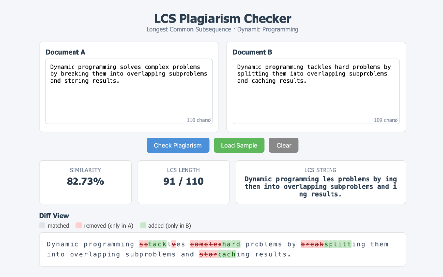

# HW5 Assignment Explanation — Plagiarism Checker

[Repository Guide](../../README.md) | [English](Assignment-Explanation.md) | [한국어](Assignment-Explanation.ko.md)

> **Last Updated:** 2026-11-17
>
> Introduction to Algorithms, Cormen, Leiserson, Rivest, and Stein, Ch 15

> **Learning Objectives:**
> 1. Define a subsequence and the LCS (longest common subsequence), and fill the DP table of two strings with bottom-up dynamic programming
> 2. Recover the LCS string by backtracking through the DP table, and explain how the rule for choosing between two neighbors with equal values affects the result
> 3. Build a character-level diff of two texts from the DP table and classify each character as matched, removed, or added
> 4. Compute the similarity score defined by the LCS length and explain its meaning and limits
> 5. Analyze the time and space complexity of the LCS algorithm and relate it to how real comparison tools work

---

## Table of Contents

- [1. Assignment Overview and How to Run](#1-assignment-overview-and-how-to-run)
- [2. Requirements](#2-requirements)
  - [2.1 Functional Requirements](#21-functional-requirements)
  - [2.2 API Endpoints and Response Format](#22-api-endpoints-and-response-format)
  - [2.3 Report and Grading Criteria](#23-report-and-grading-criteria)
- [3. Modeling the Problem](#3-modeling-the-problem)
  - [3.1 Subsequences and the LCS](#31-subsequences-and-the-lcs)
  - [3.2 The LCS Recurrence](#32-the-lcs-recurrence)
  - [3.3 Defining the Similarity Score and the Diff](#33-defining-the-similarity-score-and-the-diff)
- [4. Solution](#4-solution)
  - [4.1 Filling the DP Table Bottom-Up](#41-filling-the-dp-table-bottom-up)
  - [4.2 Recovering the LCS String by Backtracking](#42-recovering-the-lcs-string-by-backtracking)
  - [4.3 Generating the Character-Level Diff](#43-generating-the-character-level-diff)
  - [4.4 Computing the Similarity Score](#44-computing-the-similarity-score)
  - [4.5 The /check Endpoint and the Display](#45-the-check-endpoint-and-the-display)
- [5. Tests and Results](#5-tests-and-results)
  - [5.1 Screenshot](#51-screenshot)
  - [5.2 The DP Table for ALGORITHM and ALTRUISTIC](#52-the-dp-table-for-algorithm-and-altruistic)
  - [5.3 Behavior Checks](#53-behavior-checks)
- [6. The Report's Analysis Questions](#6-the-reports-analysis-questions)
  - [6.1 Time and Space Complexity of LCS](#61-time-and-space-complexity-of-lcs)
  - [6.2 Relation to git diff and Plagiarism Detection Services](#62-relation-to-git-diff-and-plagiarism-detection-services)
- [Summary](#summary)
- [Self-Check Questions](#self-check-questions)
- [References](#references)

---

<br>

## 1. Assignment Overview and How to Run

> **Try It First:** This document contains the answers and solutions. Solve the problems in the [assignment handout](Original/Assignment.md) yourself before reading on.

The week 6 take-home assignment is to build a **plagiarism checker** web app that compares two documents and calculates their similarity with the LCS (Longest Common Subsequence) algorithm. It must build the DP table of the two texts with dynamic programming, backtrack through the table to find the LCS, and display the similarity score and a color-coded diff view. The backend uses Python (FastAPI or Flask) and the frontend uses HTML, CSS, and JavaScript, and the source code is submitted together with a report of at most two pages. The definition and recurrence of LCS are in [Sections 2.1-2.4 of the Week 6 Lecture](../../Lecture-Notes/Week06_Dynamic-Programming/Concepts_Lecture.md#21-lcs-problem-definition), the lab that prints a DP table is in [Section 2.2 of the Week 6 Lab](../../Lecture-Notes/Week06_Dynamic-Programming/Concepts_Lab.md#22-a-2-lcs-and-dp-table-visualization), and an LCS-based diff viewer example is in [Section 3.1 of the Week 6 Lab](../../Lecture-Notes/Week06_Dynamic-Programming/Concepts_Lab.md#31-b-1-text-diff-viewer).

```text
Coursework/HW05_Dynamic-Programming/
├── Assignment-Explanation.md       # Assignment explanation (English, this file)
├── Assignment-Explanation.ko.md    # Assignment explanation (Korean)
├── Code-Walkthrough.md             # Code walkthrough (English)
├── Code-Walkthrough.ko.md          # Code walkthrough (Korean)
├── Original/
│   ├── Assignment.md               # Assignment handout (English)
│   └── Assignment.ko.md            # Assignment handout (Korean)
└── Solution/
    ├── app.py                      # Flask backend: LCS, backtracking, similarity, diff, API routes
    ├── requirements.txt            # Dependency (Flask)
    └── static/
        ├── index.html              # Page structure
        ├── style.css               # Page style
        └── app.js                  # User actions, drawing the results and the diff
```

*Figure 1. Directory layout of HW5*

```bash
# Move from the repository root to the solution directory
cd Coursework/HW05_Dynamic-Programming/Solution

# Install the dependency (Flask)
pip install -r requirements.txt

# Start the development server, then open http://localhost:5000 in a browser
python app.py
```

`python app.py` starts the Flask development server in debug mode on port 5000. Putting documents into the two text areas in the browser and clicking **Check Plagiarism** shows the results; **Load Sample** fills in two example sentences, and **Clear** erases the input and the results.

> **Note:** On macOS 12 and later, the AirPlay Receiver uses port 5000, so the server may fail to start or another program may answer. In that case, turn off the AirPlay Receiver or run on another port, for example `flask --app app run --port 5001`.

A top-to-bottom reading of every file is in the [HW5 Code Walkthrough](Code-Walkthrough.md).

---

<br>

## 2. Requirements

### 2.1 Functional Requirements

The features the assignment handout requires and where each is implemented are as follows. Line numbers refer to each file.

| Area | Requirement | Implemented at |
|:-----|:-----|:-----|
| Algorithm | Build the DP table for the two input texts | `app.py` lines 12-25 (`lcs`) |
| Algorithm | Backtrack to find the LCS | `app.py` lines 28-41 (`backtrack_lcs`) |
| Algorithm | Calculate the similarity score as `LCS length / max(len(A), len(B)) * 100%` | `app.py` lines 44-50 (`similarity_score`), line 95 |
| Algorithm | Generate a diff view that marks each part as matched, added, or removed | `app.py` lines 53-71 (`generate_diff`) |
| Display | Two text areas for Document A and Document B | `index.html` lines 13-24 |
| Display | A Check button that runs the plagiarism analysis | `index.html` line 27, `app.js` lines 22-52 |
| Display | The similarity score (percentage) | `index.html` lines 34-37, `app.js` line 37 |
| Display | The LCS length and the actual LCS string | `index.html` lines 38-45, `app.js` lines 38-39 |
| Display | A diff view colored matched (gray), removed (red), and added (green) | `index.html` lines 48-54, `app.js` lines 41-49, `style.css` lines 179-181 and 202-204 |
| Display (extra) | Character counts, Load Sample to fill example sentences, Clear to erase the input | `index.html` lines 17, 22, and 28-29, `app.js` lines 14-20 and 54-67 |

*Table 1. Functional requirements and where they are implemented*

### 2.2 API Endpoints and Response Format

| Method | Endpoint | Requirement | Implemented at |
|:-----|:-----|:-----|:-----|
| `POST` | `/check` | Compare two texts and return the similarity score and the diff | `app.py` lines 83-101 |
| `GET` | `/` | Serve the frontend page | `app.py` lines 78-80 |

*Table 2. API endpoints and where they are implemented*

`/check` receives the JSON body `{"text_a": ..., "text_b": ...}` and returns JSON with the following fields.

| Field | Type | Contents |
|:-----|:-----|:-----|
| `similarity` | float | The similarity score (%) rounded to two decimal places |
| `lcs_length` | integer | The length of the LCS |
| `lcs_string` | string | The LCS recovered by backtracking |
| `len_a`, `len_b` | integer | The character counts of the two texts |
| `diff` | array of objects | For each character, `{"char": character, "status": "match" or "removed" or "added"}` |

*Table 3. Fields of the /check response*

### 2.3 Report and Grading Criteria

The report must be a PDF of at most two pages with a font size of 11pt or larger and contain the following three items. The contents of each item are carried over into the corresponding section of this document.

| Report item | Location in this document |
|:-----|:-----|
| A screenshot of the plagiarism checker comparing two sample texts | Section 5.1 |
| A DP table for a short example (e.g., ALGORITHM and ALTRUISTIC) | Section 5.2 |
| Analysis: the time and space complexity of LCS, and its relation to tools like `git diff` or Turnitin | Section 6 |

*Table 4. Report items and their location in this document*

Grading consists of whether the web app runs and works correctly (20%), whether the algorithm requirements are fully implemented (40%), and the report (40%).

---

<br>

## 3. Modeling the Problem

### 3.1 Subsequences and the LCS

> **Definition:** A **subsequence** is a sequence obtained from a sequence by deleting zero or more elements while keeping the order of the rest. The remaining elements need not be consecutive.

> **Definition:** The **longest common subsequence (LCS)** of two sequences is the longest among the sequences that are subsequences of both.

For example, with X = `ABCB` and Y = `BDCAB`, `BB` is a common subsequence because it can be formed from the second and fourth characters of X and the first and fifth characters of Y. `BCB` is also a common subsequence, and since no common subsequence of length 4 exists, `BCB` is an LCS and the LCS length is 3. The LCS need not be unique. With X = `CA` and Y = `AC`, both `C` and `A` are LCSs of length 1.

The plagiarism checker views a text as a sequence whose elements are single characters. The more two documents overlap, the longer their LCS, so the LCS length serves as a measure of how similar the two documents are. Because a subsequence need not be consecutive, changing or inserting a few words leaves the rest of the common part in the LCS.

### 3.2 The LCS Recurrence

Let $c(i, j)$ be the LCS length of the first i characters of X and the first j characters of Y. If X has length m and Y has length n, the desired value is $c(m, n)$, and the following recurrence holds.

```math
c(i, j) = \begin{cases} 0 & i = 0 \text{ or } j = 0 \\ c(i-1, j-1) + 1 & i, j > 0 \text{ and } x_i = y_j \\ \max\bigl(c(i-1, j),\ c(i, j-1)\bigr) & i, j > 0 \text{ and } x_i \neq y_j \end{cases}
```

- **Empty prefix:** If one side is the empty string, the only common subsequence is the empty sequence, so the length is 0.
- **Equal last characters:** If $x_i = y_j$, there is an optimal solution that uses that character as the last character of the LCS. So 1 is added to the answer of the problem with the last character removed from both prefixes.
- **Different last characters:** Both characters cannot be the last character of the LCS, so the longer of the two subproblems, one without $x_i$ and one without $y_j$, is taken.

The optimal solution of a larger problem consists of optimal solutions for smaller prefixes, so LCS has **optimal substructure**. Also, $c(i-1, j-1)$ is needed again both for computing $c(i-1, j)$ and for computing $c(i, j-1)$, so **overlapping subproblems** arise. Calling the recurrence recursively as it stands solves the same subproblems an exponential number of times, but storing the value of every $(i, j)$ in a table once requires computing only $(m+1)(n+1)$ cells. This is the core of **dynamic programming** covered in the Week 6 Lecture.

### 3.3 Defining the Similarity Score and the Diff

The assignment handout defines the similarity score as follows, where $|A|$ is the number of characters in document A.

```math
\text{similarity}(A, B) = \frac{\text{LCS length}}{\max(|A|, |B|)} \times 100\ (\%)
```

The LCS length cannot exceed the length of the shorter document, so the score is between 0 and 100. For the score to be 100, the LCS length must equal the length of the longer document, which forces the shorter document to be that long as well, so the score is 100 only when the two documents are identical. Because the denominator is the length of the longer document rather than the shorter one, even if the short document equals a part of the long one, the score drops when the rest of the long document is large.

A **diff** is a list that sorts the characters of two texts into three kinds.

- **Matched (match):** a character that belongs to the common subsequence and remains in both texts
- **Removed (removed):** a character only in A
- **Added (added):** a character only in B

If the matched characters form an LCS, there are $|A| - L$ removed and $|B| - L$ added characters, where L is the LCS length. The minimum number of operations to turn A into B with only insertions and deletions is $|A| + |B| - 2L$, so a diff built on an LCS is the shortest diff.

---

<br>

## 4. Solution

The solution consists of four functions in the Flask backend. When the user clicks **Check Plagiarism**, the server fills the LCS DP table with bottom-up dynamic programming, backtracks through the table to recover the LCS string and the character-level diff, and returns the similarity score and the diff. The page receives them and draws a color-coded diff view.

| Step | Description | Function |
|:-----|:-----|:-----|
| 1. Fill the DP table | `dp[i][j] = dp[i-1][j-1]+1` on a match, otherwise `max(dp[i-1][j], dp[i][j-1])` | `lcs` |
| 2. Backtrack | Start from `(m, n)`, move diagonally on a match, otherwise to the larger neighbor | `backtrack_lcs`, `generate_diff` |
| 3. Score and diff | Similarity = `dp[m][n] / max(m, n) × 100%`, and the diff tags each character as match, removed, or added | `similarity_score`, `generate_diff` |

*Table 5. The three steps of the solution*

### 4.1 Filling the DP Table Bottom-Up

**Rule:** Compute the recurrence of Section 3.2 in order from the smallest prefixes to fill an $(m+1) \times (n+1)$ table.

```python
def lcs(text_a, text_b):
    """
    Longest Common Subsequence length using bottom-up DP.
    Returns: (lcs_length, dp_table)
    """
    m, n = len(text_a), len(text_b)
```

```python
    for i in range(1, m + 1):
        for j in range(1, n + 1):
            if text_a[i - 1] == text_b[j - 1]:
                dp[i][j] = dp[i - 1][j - 1] + 1
            else:
                dp[i][j] = max(dp[i - 1][j], dp[i][j - 1])
    return dp[m][n], dp
```

Line 17 gets the lengths of the two texts, and line 18 creates `dp`, an $(m+1) \times (n+1)$ two-dimensional list whose cells are all 0. Row 0 and column 0 correspond to empty prefixes, so leaving them at 0 fills in the base cases of the recurrence directly. Lines 19-24 fill the cells by going through rows i from 1 to m and, within each row, columns j from 1 to n. The three cells used to compute `dp[i][j]`, namely `dp[i-1][j-1]`, `dp[i-1][j]`, and `dp[i][j-1]`, all lie in the previous row or to the left in the same row, so they are already filled. Filling the table upward from small subproblems in this way is **bottom-up** dynamic programming.

Python string indices start at 0, so the i-th character of A, which corresponds to row i of the table, is `text_a[i - 1]` (line 21). Line 25 returns the LCS length `dp[m][n]` together with the whole table, because backtracking and diff generation use the table again.

### 4.2 Recovering the LCS String by Backtracking

**Rule:** Start from the bottom-right cell $(m, n)$; if the two characters are equal, add the character to the LCS and move diagonally up, otherwise move to the neighbor with the larger value.

```python
def backtrack_lcs(dp, text_a, text_b):
    """Backtrack through the DP table to recover the actual LCS string."""
    i, j = len(text_a), len(text_b)
    result = []
    while i > 0 and j > 0:
        if text_a[i - 1] == text_b[j - 1]:
            result.append(text_a[i - 1])
            i -= 1
            j -= 1
        elif dp[i - 1][j] >= dp[i][j - 1]:
            i -= 1
        else:
            j -= 1
    return "".join(reversed(result))
```

- **Lines 33-36:** If the two characters are equal, the cell's value was set by the second case of the recurrence, so the character goes into `result` and i and j decrease together.
- **Lines 37-40:** If the two characters differ, the cell's value came from the larger of the cell above and the cell to the left, so the walk moves toward the larger one. If the two values are equal, the `>=` on line 37 moves it to the cell above (the side that drops A's character).
- **Line 32:** When one prefix becomes empty, there are no more common characters, so the walk stops.
- **Line 41:** The characters were collected from the end, so they are reversed and joined.

Each iteration decreases at least one of i and j by 1, so there are at most $m + n$ iterations and the time is $O(m + n)$.

> **Note:** When several LCSs exist, the LCS recovered depends on which of two equal neighbors the walk takes. This function consistently applies the rule of going up, so it always returns the same LCS. ALGORITHM and ALTRUISTIC in Section 5.2 have only one LCS of length 5, so any rule produces the same string.

### 4.3 Generating the Character-Level Diff

**Rule:** Walk the table backward in the same way as backtracking, recording a diagonal move as a match, an upward move as a removal of A's character, and a leftward move as an addition of B's character. Even when one prefix becomes empty, the walk does not stop but goes on to $(0, 0)$ to classify every remaining character.

```python
def generate_diff(dp, text_a, text_b):
    """
    Walk the DP table from (m, n) to (0, 0) and classify each character as
    'match' (in LCS), 'removed' (only in A), or 'added' (only in B).
    """
    i, j = len(text_a), len(text_b)
    diff = []
    while i > 0 or j > 0:
        if i > 0 and j > 0 and text_a[i - 1] == text_b[j - 1]:
            diff.append({"char": text_a[i - 1], "status": "match"})
            i -= 1
            j -= 1
        elif j > 0 and (i == 0 or dp[i][j - 1] >= dp[i - 1][j]):
            diff.append({"char": text_b[j - 1], "status": "added"})
            j -= 1
        else:
            diff.append({"char": text_a[i - 1], "status": "removed"})
            i -= 1
    return list(reversed(diff))
```

- **Line 60:** The condition uses `or`, so the loop repeats until the characters of both A and B are used up.
- **Lines 61-64:** If the two characters are equal, the walk records a match and moves diagonally.
- **Lines 65-67:** If A is used up (`i == 0`) or the cell to the left is at least the cell above, the walk records B's character as added and moves left.
- **Lines 68-70:** Otherwise, that is, if B is used up or the cell above is larger, the walk records A's character as removed and moves up.
- **Line 71:** The entries were recorded from the end, so the list is reversed into front-to-back order.

Every character is recorded exactly once, so concatenating the characters of the diff that are not added gives A, and concatenating those that are not removed gives B. On ties this function chooses an addition (left) first, and because the list is built from the end and then reversed, removed characters come before added characters within a changed segment. For example, the part where `solves` becomes `tackles` is shown in the order `so` removed, `tack` added, `l` matched, `v` removed, `es` matched. This is the same order in which `git diff` shows a changed line as a `-` line followed by a `+` line.

> **Caution:** `backtrack_lcs` moves up on ties (line 37) while `generate_diff` moves left (line 65), so for inputs with several LCSs, the LCS String card and the matched characters of the diff view can show two different LCSs of the same length. The smallest example is A = `CA`, B = `AC`. The LCS String is `C`, but the diff view shows `C` removed, `A` matched, `C` added, presenting `A` as the matched character. Among 20,000 random pairs of strings of length at most 7 over the letters A, B, and C, the two results differed in 2,928. In the two examples of Sections 5.1 and 5.2 the two results agree. Making both functions use the same rule, or building the LCS string from the matched characters of the diff, would make them always agree.

### 4.4 Computing the Similarity Score

**Rule:** As the assignment handout defines it, divide the LCS length by the length of the longer of the two texts and express the result as a percentage.

```python
def similarity_score(text_a, text_b, lcs_length):
    """Similarity = LCS length / max(len(A), len(B)) * 100."""
    if not text_a and not text_b:
        return 100.0
    if not text_a or not text_b:
        return 0.0
    return lcs_length / max(len(text_a), len(text_b)) * 100
```

Lines 46-47 prevent division by zero when both texts are empty, treating two empty strings as identical documents and returning 100.0. Lines 48-49 return 0.0 when only one side is empty; the LCS length is then 0, so the formula on line 50 would give the same value. Line 50 is exactly the definition in the assignment handout, and `/check` rounds it to two decimal places on line 95.

Because characters are compared as they are, the score is case-sensitive and counts spaces and punctuation as characters. The similarity of `abc` and `ABC` is 0.

### 4.5 The /check Endpoint and the Display

**Rule:** `/check` receives the two texts and calls the four functions above in turn, and the page uses the result to draw three metric cards and the diff view.

```python
@app.route("/check", methods=["POST"])
def check():
    data = request.get_json() or {}
    text_a = data.get("text_a", "")
    text_b = data.get("text_b", "")

    length, dp = lcs(text_a, text_b)
    lcs_str = backtrack_lcs(dp, text_a, text_b)
    score = similarity_score(text_a, text_b, length)
    diff = generate_diff(dp, text_a, text_b)

    return jsonify({
        "similarity": round(score, 2),
        "lcs_length": length,
        "lcs_string": lcs_str,
        "len_a": len(text_a),
        "len_b": len(text_b),
        "diff": diff,
    })
```

Lines 85-87 take the two texts from the JSON body, using the empty string when a key is missing. The `or {}` handles a body that is JSON `null`. If the request's `Content-Type` is not JSON, `request.get_json()` in Flask 3 returns a 415 error, so the function body does not run. Lines 89-92 build the DP table only once, and backtracking, the similarity, and the diff all share it.

On the page side, when **Check Plagiarism** is clicked, `app.js` sends the two texts to `/check` and shows the similarity like `82.73%`, the LCS length like `91 / 110` as the LCS length over the length of the longer document, and the LCS string as is (lines 37-39). For each character of the diff it creates a `<span>` with the class `diff-char match`, `diff-char removed`, or `diff-char added` (lines 43-49), and `style.css` paints matched characters in gray text, removed characters with a red background and a strike-through, and added characters with a green background (lines 202-204). If both texts are empty, it shows an alert instead of sending them to the server (lines 25-28).

---

<br>

## 5. Tests and Results

### 5.1 Screenshot

The screen comparing the two sentences that **Load Sample** fills in (110 and 109 characters) is shown below. The two sentences say the same thing with only a few words changed.



*Figure 2. The plagiarism checker comparing two paraphrased sentences*

- **Similarity:** The LCS length is 91 and the longer sentence has 110 characters, so 91 / 110 × 100 = 82.727..., which rounds to 82.73%.
- **LCS Length:** `91 / 110` is the LCS length and the length of the longer sentence used as the denominator.
- **LCS String:** It is `Dynamic programming les  problems by ing them into overlapping subproblems and ing results.`. There are two spaces between `les` and `problems`, but the metric card shows one because of HTML's default whitespace handling. The diff view uses `white-space: pre-wrap`, so it shows the spaces as they are.
- **Diff View:** At four places, `solves`/`tackles`, `complex`/`hard`, `breaking`/`splitting`, and `storing`/`caching`, A's characters are shown with a red strike-through and B's characters with a green background. All other characters match.

### 5.2 The DP Table for ALGORITHM and ALTRUISTIC

The full DP table for A = `ALGORITHM` (m = 9) and B = `ALTRUISTIC` (n = 10) is as follows. Rows are the characters of A, columns the characters of B, and ∅ is the empty prefix. Bold cells are those on the backtrack path where the two characters matched and the walk moved diagonally, that is, the characters that went into the LCS.

| | ∅ | A | L | T | R | U | I | S | T | I | C |
|:-:|:-:|:-:|:-:|:-:|:-:|:-:|:-:|:-:|:-:|:-:|:-:|
| ∅ | 0 | 0 | 0 | 0 | 0 | 0 | 0 | 0 | 0 | 0 | 0 |
| A | 0 | **1** | 1 | 1 | 1 | 1 | 1 | 1 | 1 | 1 | 1 |
| L | 0 | 1 | **2** | 2 | 2 | 2 | 2 | 2 | 2 | 2 | 2 |
| G | 0 | 1 | 2 | 2 | 2 | 2 | 2 | 2 | 2 | 2 | 2 |
| O | 0 | 1 | 2 | 2 | 2 | 2 | 2 | 2 | 2 | 2 | 2 |
| R | 0 | 1 | 2 | 2 | **3** | 3 | 3 | 3 | 3 | 3 | 3 |
| I | 0 | 1 | 2 | 2 | 3 | 3 | **4** | 4 | 4 | 4 | 4 |
| T | 0 | 1 | 2 | 3 | 3 | 3 | 4 | 4 | **5** | 5 | 5 |
| H | 0 | 1 | 2 | 3 | 3 | 3 | 4 | 4 | 5 | 5 | 5 |
| M | 0 | 1 | 2 | 3 | 3 | 3 | 4 | 4 | 5 | 5 | 5 |

*Table 6. The LCS DP table for ALGORITHM and ALTRUISTIC*

`backtrack_lcs` starts at the bottom-right cell (M, C) and moves in the following order. A cell is written as (character of A, character of B); ↑ is a move up, ← a move left, and ↖ a diagonal move on a match that collects that character. When the values above and to the left are equal, it goes up.

```text
(M, C) ↑ (H, C) ↑ (T, C) ← (T, I) ← (T, T) ↖ T
(I, S) ← (I, I) ↖ I
(R, U) ← (R, R) ↖ R
(O, T) ↑ (G, T) ↑ (L, T) ← (L, L) ↖ L
(A, A) ↖ A
```

*Figure 3. The backtrack path for ALGORITHM and ALTRUISTIC*

Reversing the characters T, I, R, L, A collected on the diagonal moves gives the LCS `ALRIT`, whose length is 5, equal to the bottom-right value of the table. The similarity is 5 / max(9, 10) × 100 = 50.00%. The diff of the same input is as follows (`-` is removed, `+` is added).

```text
A L -G -O +T R +U I +S T -H -M +I +C
```

There are 4 removed and 5 added characters, equal to $|A| - L = 9 - 5$ and $|B| - L = 10 - 5$. The matched characters A, L, R, I, T are the same as the LCS obtained by backtracking.

### 5.3 Behavior Checks

Running the following script from the repository root calls `/check` through Flask's test client and shows the results.

```python
import sys
sys.path.insert(0, "Coursework/HW05_Dynamic-Programming/Solution")
from app import app

client = app.test_client()
cases = [
    ("ALGORITHM", "ALTRUISTIC"),
    ("abc", "ABC"),
    ("", "abc"),
    ("", ""),
]
for a, b in cases:
    r = client.post("/check", json={"text_a": a, "text_b": b}).get_json()
    print(repr(a), repr(b), r["similarity"], r["lcs_length"], repr(r["lcs_string"]))
print(client.post("/check", data="text").status_code)
```

```text
'ALGORITHM' 'ALTRUISTIC' 50.0 5 'ALRIT'
'abc' 'ABC' 0.0 0 ''
'' 'abc' 0.0 0 ''
'' '' 100.0 0 ''
415
```

| Input | Result | What it confirms |
|:-----|:-----|:-----|
| `ALGORITHM`, `ALTRUISTIC` | 50.0%, length 5, `ALRIT` | Same as the table in Section 5.2 |
| The two sentences of **Load Sample** | 82.73%, length 91 | Same as the screen in Section 5.1 |
| `abc`, `ABC` | 0.0% | It is case-sensitive |
| Empty string, `abc` | 0.0%, diff with `a`, `b`, `c` all added | One empty side gives 0 |
| Two empty strings | 100.0% | Two empty documents count as identical (the page blocks this with an alert) |
| A body that is not JSON | HTTP 415 | `request.get_json()` rejects the request |

*Table 7. Behavior checks of /check*

For every input pair, the length of the recovered LCS and the number of matched characters in the diff equal the value in the DP table, and concatenating the diff characters that are not added gives A and those that are not removed gives B.

---

<br>

## 6. The Report's Analysis Questions

### 6.1 Time and Space Complexity of LCS

The DP table has $(m+1)(n+1)$ cells, and each cell's value is set with one comparison and one addition or maximum, so filling the table takes $\Theta(mn)$ time. Backtracking and diff generation each take $O(m + n)$, so the total time is also $\Theta(mn)$.

This solution stores the whole table, so the space is also $\Theta(mn)$. The whole table is needed because the diff view backtracks through it to find which characters are matched, removed, or added. If only the LCS length were needed, the values of row i depend only on row i−1 and the cells to the left in row i, so keeping two alternating rows suffices, and putting the shorter text in the columns reduces the space to $\Theta(\min(m, n))$. Hirschberg's algorithm, which adds divide and conquer, keeps the time at $O(mn)$ while recovering the LCS itself in linear space [1].

The quadratic cost becomes the bottleneck for long inputs. Comparing two 100,000-character documents means $10^{10}$ cells. Storing the cells in a Python list as this solution does needs at least an 8-byte reference per cell, so the memory alone exceeds 80 GB, and even at about 0.1 microseconds per cell, filling the table alone takes more than 15 minutes. This is why real tools use the heuristics of Section 6.2.

| Task | Time | Space |
|:-----|:-----|:-----|
| Filling the DP table (`lcs`) | $\Theta(mn)$ | $\Theta(mn)$ |
| Backtracking the LCS string (`backtrack_lcs`) | $O(m + n)$ | $O(\min(m, n))$ (result string) |
| Generating the diff (`generate_diff`) | $O(m + n)$ | $O(m + n)$ (diff list) |
| LCS length only (keeping two rows) | $\Theta(mn)$ | $\Theta(\min(m, n))$ |

*Table 8. Time and space complexity of each task*

### 6.2 Relation to git diff and Plagiarism Detection Services

`git diff` solves a line-level LCS problem. It views the two files as sequences of lines and reports the lines not in the common subsequence as deletions (`-`) and insertions (`+`). Myers' algorithm finds the shortest edit script consisting only of insertions and deletions, whose length D equals $m + n - 2L$ and is thus tied to the LCS [2]. The algorithm runs in $O((m + n)D)$ time, so it is far faster than $\Theta(mn)$ when the two versions are similar and D is small [2]. In version control usually only part of a file changes, so this case is common, and Git uses Myers' algorithm as its default diff algorithm [3]. The character-level DP of this assignment and Git's line-level diff share the same mathematical core; only the unit of comparison (the token) differs.

A plagiarism detection service such as Turnitin must compare one submission against billions of documents, so it cannot run a full DP against every document. The internals of commercial services are not public, but a widely known method for such large-scale plagiarism detection hashes the k-grams (k consecutive tokens) of a document into **fingerprints** and uses winnowing to select only some of them for storage in an index. The fingerprints of a new document are looked up in the index to shortlist the candidates that share many fingerprints, and detailed alignment runs only on those candidates. The plagiarism detection system MOSS uses winnowing [4]. The checker of this assignment corresponds to the final step, the detailed alignment, and the real cost of such services lies in the indexing step before it.

> **Key Point:** LCS is the common principle behind diff and plagiarism detection. Real tools avoid the $\Theta(mn)$ cost by changing the unit of comparison to lines or tokens (git diff), by exploiting the similarity of the two inputs (Myers), or by narrowing down the candidates in advance (fingerprints and winnowing).

---

<br>

## Summary

| Concept | Key Summary |
|:-----|:---------|
| LCS | The longest among the sequences that are subsequences of both sequences, and it need not be unique. |
| The LCS recurrence | If the last characters are equal, add 1 to the diagonal value; otherwise take the larger of the values above and to the left. |
| Bottom-up DP | Fills an $(m+1) \times (n+1)$ table from the smallest prefixes, with both time and space $\Theta(mn)$. |
| Backtracking | Starts from the bottom-right cell and moves diagonally on a match and otherwise to the larger neighbor, and the LCS recovered can depend on the rule used for ties. |
| Character-level diff | A diagonal move is a match, an upward move a removal, and a leftward move an addition, and using an LCS as the matches gives the shortest diff. |
| Similarity score | The percentage of the LCS length over the length of the longer text, which is 100 only when the two texts are identical. |
| Real tools | git diff solves a line-level LCS with Myers' algorithm, and large-scale plagiarism detection narrows down candidates with fingerprints and winnowing before a detailed comparison. |

---

<br>

## Self-Check Questions

1. **Backtracking rule:** For A = `CA` and B = `AC`, find the LCS string that `backtrack_lcs` returns and the character that `generate_diff` marks as matched.

   <details>
   <summary>Answer</summary>

   The bottom-right value of the DP table is 1; at that cell the two characters A and C differ, and the cells above and to the left are both 1. `backtrack_lcs` goes up on ties, so it drops A's `A`, moves to cell (1, 2), finds that `C` and `C` match, and returns the LCS `C`. `generate_diff` goes left on ties, so it records B's `C` as added, moves to cell (2, 1), records `A` and `A` as a match, and finally records A's `C` as removed. The diff is therefore `C` removed, `A` matched, `C` added, and the matched character is `A`. The two results are different LCSs of the same length.

   </details>

2. **Similarity:** With A = `abcd`, find the similarity score for B = `abxd` and for B = `ab`. What problem arises if the length of the shorter side is used as the denominator?

   <details>
   <summary>Answer</summary>

   The LCS of `abcd` and `abxd` is `abd` with length 3, so the score is 3 / 4 × 100 = 75%. The LCS of `abcd` and `ab` is `ab` with length 2, so the score is 2 / 4 × 100 = 50%. With the shorter length as the denominator, `ab` would score 2 / 2 × 100 = 100%, and a short document that only equals the beginning of a long document would be judged identical to it.

   </details>

3. **Space optimization:** When only the LCS length is needed, keeping only two rows reduces the space to $\Theta(\min(m, n))$. Why can this solution not use that method as it stands?

   <details>
   <summary>Answer</summary>

   Because `backtrack_lcs` and `generate_diff` walk the table backward from the bottom-right cell toward the top-left, comparing the values above and to the left of each cell. If only two rows are kept, backtracking needs values from rows already discarded and cannot be done. Recovering the LCS itself in linear space requires adding divide and conquer, as in Hirschberg's algorithm.

   </details>

4. **Length of the diff:** Using the LCS, find the length of the shortest edit script (insertions and deletions only) that turns ALGORITHM into ALTRUISTIC.

   <details>
   <summary>Answer</summary>

   The LCS length is 5, so it is $9 + 10 - 2 \times 5 = 9$. Delete the 4 characters G, O, H, M of A that are not in the LCS and insert the 5 characters T, U, S, I, C of B that are not in the LCS. The diff in Section 5.2 consists of exactly these 4 removals and 5 additions.

   </details>

---

<br>

## References

1. D. S. Hirschberg, "A linear space algorithm for computing maximal common subsequences," *Commun. ACM*, vol. 18, no. 6, pp. 341-343, 1975.
2. E. W. Myers, "An O(ND) difference algorithm and its variations," *Algorithmica*, vol. 1, no. 1-4, pp. 251-266, 1986.
3. "git-diff Documentation," *Git*. https://git-scm.com/docs/git-diff
4. S. Schleimer, D. S. Wilkerson, and A. Aiken, "Winnowing: Local algorithms for document fingerprinting," in *Proc. ACM SIGMOD Int. Conf. Management of Data*, 2003, pp. 76-85.
