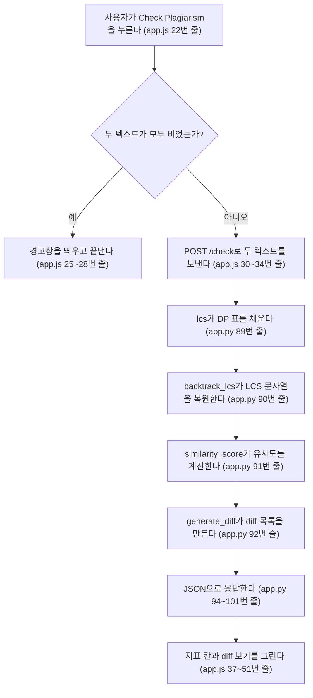

# HW5 코드 총정리 — 표절 검사기

[레포지토리 안내](../../README.ko.md) | [English](Code-Walkthrough.md) | [한국어](Code-Walkthrough.ko.md)

> **최종 수정일:** 2026-11-16
>
> Introduction to Algorithms, Cormen, Leiserson, Rivest, and Stein, Ch 15

> **학습 목표:**
> 1. `app.py`의 네 함수가 DP 표를 만들고 다시 쓰는 순서를 줄 번호와 함께 설명할 수 있다
> 2. **Check Plagiarism**을 누른 뒤 요청이 서버를 거쳐 화면에 그려지기까지의 흐름을 추적할 수 있다
> 3. 짧은 두 문자열에 대해 DP 표를 채우고 역추적과 diff 생성을 손으로 따라갈 수 있다
> 4. `index.html`, `app.js`, `style.css`가 지표 칸과 diff 보기를 구성하는 방법을 설명할 수 있다
> 5. 각 함수의 시간 복잡도와 공간 복잡도를 코드에서 읽어 낼 수 있다

---

## 목차

- [1. 파일 구성](#1-파일-구성)
- [2. 모듈 머리말과 Flask 앱](#2-모듈-머리말과-flask-앱)
- [3. lcs](#3-lcs)
- [4. backtrack_lcs](#4-backtrack_lcs)
- [5. similarity_score](#5-similarity_score)
- [6. generate_diff](#6-generate_diff)
- [7. 라우트와 서버 실행](#7-라우트와-서버-실행)
- [8. index.html](#8-indexhtml)
- [9. app.js](#9-appjs)
- [10. style.css와 requirements.txt](#10-stylecss와-requirementstxt)
- [11. 요청 흐름과 실행 추적](#11-요청-흐름과-실행-추적)
  - [11.1 요청 처리 흐름](#111-요청-처리-흐름)
  - [11.2 ABCB와 BDCAB의 실행 추적](#112-abcb와-bdcab의-실행-추적)
- [12. 복잡도](#12-복잡도)
- [요약](#요약)
- [점검 문제](#점검-문제)

---

<br>

## 1. 파일 구성

> **풀어 보기:** 이 문서는 작성한 코드 전체와 줄별 설명을 담고 있다. 먼저 [과제 안내문](Original/Assignment.ko.md)의 문제를 직접 풀어 본 뒤 읽는다.

짝이 되는 문서 [HW5 과제 해설](Assignment-Explanation.ko.md)은 요구사항, 설계, 테스트 결과, 보고서의 분석 질문을 정리한다. 이 문서는 `Solution`의 다섯 파일을 처음부터 끝까지 읽는다. 줄 번호는 모두 각 파일 기준이다.

| 파일 | 줄 | 부분 | 역할 |
|:-----|:-----|:-----|:-----|
| `app.py` | 1\~5 | 모듈 docstring, import, Flask 앱 생성 | 백엔드 준비 |
| `app.py` | 8\~25 | `lcs` | 상향식 DP로 표 채우기 |
| `app.py` | 28\~41 | `backtrack_lcs` | 역추적으로 LCS 문자열 복원 |
| `app.py` | 44\~50 | `similarity_score` | 유사도 점수 계산 |
| `app.py` | 53\~71 | `generate_diff` | 문자 단위 diff 생성 |
| `app.py` | 74\~101 | `/`, `/check` 라우트 | 페이지 제공과 분석 API |
| `app.py` | 104\~105 | `__main__` 블록 | 개발 서버 실행 |
| `requirements.txt` | 1 | `flask>=3.0` | 의존성 |
| `static/index.html` | 1\~59 | 입력 칸, 버튼, 지표 칸, diff 보기 | 화면 구조 |
| `static/app.js` | 1\~69 | 이벤트 처리, `/check` 호출, 결과 그리기 | 화면 동작 |
| `static/style.css` | 1\~204 | 배치, 색, diff 글자 스타일 | 화면 스타일 |

*표 1. Solution의 파일 구성*

---

<br>

## 2. 모듈 머리말과 Flask 앱

```python
"""Week 06 — Plagiarism Checker (Flask backend, LCS via DP)"""

from flask import Flask, jsonify, request, send_from_directory

app = Flask(__name__, static_folder="static")
```

1번 줄은 모듈의 목적을 밝히는 docstring이다. 3번 줄은 Flask에서 네 이름을 가져온다. `Flask`는 웹 앱 객체를 만드는 클래스, `jsonify`는 Python 딕셔너리를 JSON 응답으로 바꾸는 함수, `request`는 처리 중인 요청을 가리키는 객체, `send_from_directory`는 지정한 디렉토리의 파일을 응답으로 보내는 함수이다.

5번 줄은 앱 객체를 만든다. `__name__`은 Flask가 앱의 기준 디렉토리(`app.py`가 있는 디렉토리)를 찾는 데 쓰이고, `static_folder="static"`은 그 아래의 `static` 디렉토리를 정적 파일 폴더로 지정한다. 정적 파일은 기본 URL 경로 `/static`으로 제공되므로 `index.html`의 `/static/style.css`와 `/static/app.js`가 이 폴더의 파일을 가리킨다. Flask의 기본 정적 폴더 이름도 `static`이므로 이 인자는 기본값을 명시한 것이다.

---

<br>

## 3. lcs

```python
# ---------------------------------------------------------------------------
# LCS — Dynamic Programming
# ---------------------------------------------------------------------------

def lcs(text_a, text_b):
    """
    Longest Common Subsequence length using bottom-up DP.
    Returns: (lcs_length, dp_table)
    """
    m, n = len(text_a), len(text_b)
    dp = [[0] * (n + 1) for _ in range(m + 1)]
    for i in range(1, m + 1):
        for j in range(1, n + 1):
            if text_a[i - 1] == text_b[j - 1]:
                dp[i][j] = dp[i - 1][j - 1] + 1
            else:
                dp[i][j] = max(dp[i - 1][j], dp[i][j - 1])
    return dp[m][n], dp
```

8\~10번 줄은 LCS 부분을 구분하는 주석이다. `lcs`는 두 텍스트를 받아 LCS의 길이와 DP 표 전체를 돌려준다(13\~16번 줄의 docstring).

- **17번 줄:** 두 텍스트의 길이 m, n을 구한다.
- **18번 줄:** $(m+1) \times (n+1)$ 크기의 2차원 리스트를 만들고 모든 칸을 0으로 둔다. 0행과 0열은 빈 접두사이므로 이 0이 점화식의 기저 사례가 된다. 리스트 컴프리헨션이 행마다 새 리스트 `[0] * (n + 1)`을 만드는 점이 중요하다. `[[0] * (n + 1)] * (m + 1)`로 쓰면 모든 행이 같은 리스트 객체를 가리켜 한 칸을 바꾸면 모든 행의 같은 열이 함께 바뀐다.
- **19\~20번 줄:** 행 i를 1부터 m까지, 각 행 안에서 열 j를 1부터 n까지 돈다. 위쪽 행과 같은 행의 왼쪽 칸이 먼저 채워지므로 점화식이 쓰는 세 칸은 항상 준비되어 있다.
- **21\~22번 줄:** A의 i번째 글자 `text_a[i - 1]`과 B의 j번째 글자 `text_b[j - 1]`이 같으면 왼쪽 위 대각선 칸에 1을 더한다. 표의 인덱스는 1부터, 문자열의 인덱스는 0부터 세므로 1을 뺀다.
- **23\~24번 줄:** 두 글자가 다르면 위 칸과 왼쪽 칸 중 큰 값을 쓴다.
- **25번 줄:** 오른쪽 아래 칸 `dp[m][n]`이 전체 LCS의 길이이다. 표도 함께 돌려주어 역추적과 diff 생성이 다시 쓰게 한다.

---

<br>

## 4. backtrack_lcs

```python
def backtrack_lcs(dp, text_a, text_b):
    """Backtrack through the DP table to recover the actual LCS string."""
    i, j = len(text_a), len(text_b)
    result = []
    while i > 0 and j > 0:
        if text_a[i - 1] == text_b[j - 1]:
            result.append(text_a[i - 1])
            i -= 1
            j -= 1
        elif dp[i - 1][j] >= dp[i][j - 1]:
            i -= 1
        else:
            j -= 1
    return "".join(reversed(result))
```

`backtrack_lcs`는 `lcs`가 만든 표를 받아 실제 LCS 문자열을 복원한다.

- **30\~31번 줄:** 오른쪽 아래 칸 $(m, n)$에서 출발하고, 모은 글자를 담을 리스트를 준비한다.
- **32번 줄:** 두 접두사 중 하나라도 비면 더 모을 공통 글자가 없으므로 반복을 끝낸다.
- **33\~36번 줄:** 두 글자가 같으면 그 글자를 LCS에 넣고 대각선으로 이동한다.
- **37\~40번 줄:** 두 글자가 다르면 위 칸(`dp[i - 1][j]`)과 왼쪽 칸(`dp[i][j - 1]`) 중 큰 쪽으로 이동한다. `>=`이므로 두 값이 같으면 위로 이동한다.
- **41번 줄:** 글자를 끝에서부터 모았으므로 `reversed`로 뒤집고 `"".join`으로 하나의 문자열로 잇는다.

| 칸의 상태 | 이동 | 의미 |
|:-----|:-----|:-----|
| 두 글자가 같다 | 대각선 (i와 j를 1씩 줄인다) | 그 글자가 LCS에 들어간다 |
| 두 글자가 다르고 위 칸 ≥ 왼쪽 칸 | 위 (i를 1 줄인다) | A의 글자를 버린다 |
| 두 글자가 다르고 위 칸 < 왼쪽 칸 | 왼쪽 (j를 1 줄인다) | B의 글자를 버린다 |

*표 2. backtrack_lcs의 이동 규칙*

---

<br>

## 5. similarity_score

```python
def similarity_score(text_a, text_b, lcs_length):
    """Similarity = LCS length / max(len(A), len(B)) * 100."""
    if not text_a and not text_b:
        return 100.0
    if not text_a or not text_b:
        return 0.0
    return lcs_length / max(len(text_a), len(text_b)) * 100
```

- **46\~47번 줄:** 빈 문자열은 거짓으로 평가되므로 `not text_a and not text_b`는 두 텍스트가 모두 비었다는 뜻이다. 이때 분모가 0이 되므로 나누지 않고 두 빈 문서를 같은 문서로 보아 100.0을 돌려준다.
- **48\~49번 줄:** 한쪽만 비었으면 공통 글자가 없으므로 0.0을 돌려준다.
- **50번 줄:** LCS 길이를 두 길이 중 큰 값으로 나누고 100을 곱한다. Python 3의 `/`는 정수끼리도 실수 나눗셈을 하므로 91 / 110은 0.827...이 된다.

---

<br>

## 6. generate_diff

```python
def generate_diff(dp, text_a, text_b):
    """
    Walk the DP table from (m, n) to (0, 0) and classify each character as
    'match' (in LCS), 'removed' (only in A), or 'added' (only in B).
    """
    i, j = len(text_a), len(text_b)
    diff = []
    while i > 0 or j > 0:
        if i > 0 and j > 0 and text_a[i - 1] == text_b[j - 1]:
            diff.append({"char": text_a[i - 1], "status": "match"})
            i -= 1
            j -= 1
        elif j > 0 and (i == 0 or dp[i][j - 1] >= dp[i - 1][j]):
            diff.append({"char": text_b[j - 1], "status": "added"})
            j -= 1
        else:
            diff.append({"char": text_a[i - 1], "status": "removed"})
            i -= 1
    return list(reversed(diff))
```

`generate_diff`는 표를 거꾸로 걸으며 두 텍스트의 모든 글자를 일치, 삭제, 추가로 분류한다(54\~57번 줄의 docstring).

- **58\~59번 줄:** 오른쪽 아래 칸에서 출발하고 결과 목록을 준비한다.
- **60번 줄:** `backtrack_lcs`와 달리 `or`이므로, 한쪽이 소진되어도 다른 쪽에 글자가 남아 있으면 계속 돈다.
- **61\~64번 줄:** 두 접두사가 모두 비어 있지 않고 두 글자가 같으면 `{"char": 글자, "status": "match"}`를 넣고 대각선으로 이동한다.
- **65\~67번 줄:** B에 글자가 남아 있고, A가 소진되었거나 왼쪽 칸이 위 칸 이상이면 B의 글자를 `added`로 넣고 왼쪽으로 이동한다. `i == 0`을 먼저 검사하는 것이 중요하다. i가 0일 때 `dp[i - 1][j]`를 계산하면 `dp[-1]`이 되어, 오류 없이 표의 마지막 행을 읽어 버리기 때문이다. `or`는 앞의 조건이 참이면 뒤를 계산하지 않으므로 이 접근이 일어나지 않는다.
- **68\~70번 줄:** 나머지 경우, 곧 B가 소진되었거나(이때 반복 조건 때문에 i > 0이다) 위 칸이 더 크면 A의 글자를 `removed`로 넣고 위로 이동한다.
- **71번 줄:** 끝에서부터 쌓았으므로 뒤집어서 돌려준다.

| 조건 | 기록 | 이동 |
|:-----|:-----|:-----|
| i > 0, j > 0이고 두 글자가 같다 | A의 글자를 `match`로 | 대각선 |
| j > 0이고 (i = 0 또는 왼쪽 칸 ≥ 위 칸) | B의 글자를 `added`로 | 왼쪽 |
| 그 밖의 경우 (j = 0 또는 위 칸 > 왼쪽 칸) | A의 글자를 `removed`로 | 위 |

*표 3. generate_diff의 분기*

값이 같을 때 `backtrack_lcs`는 위로, `generate_diff`는 왼쪽으로 가므로, LCS가 여러 개인 입력에서는 두 함수가 서로 다른 LCS를 고를 수 있다. 그 영향은 [과제 해설 4.3절](Assignment-Explanation.ko.md#43-문자-단위-diff-생성)에서 다룬다.

---

<br>

## 7. 라우트와 서버 실행

```python
# ---------------------------------------------------------------------------
# Routes
# ---------------------------------------------------------------------------

@app.route("/")
def index():
    return send_from_directory("static", "index.html")


@app.route("/check", methods=["POST"])
def check():
    data = request.get_json() or {}
    text_a = data.get("text_a", "")
    text_b = data.get("text_b", "")

    length, dp = lcs(text_a, text_b)
    lcs_str = backtrack_lcs(dp, text_a, text_b)
    score = similarity_score(text_a, text_b, length)
    diff = generate_diff(dp, text_a, text_b)

    return jsonify({
        "similarity": round(score, 2),
        "lcs_length": length,
        "lcs_string": lcs_str,
        "len_a": len(text_a),
        "len_b": len(text_b),
        "diff": diff,
    })


if __name__ == "__main__":
    app.run(debug=True, port=5000)
```

- **78\~80번 줄:** `GET /` 요청에 `static/index.html`을 그대로 보낸다. `send_from_directory`의 상대 경로 `"static"`은 앱의 기준 디렉토리를 기준으로 해석된다.
- **83\~84번 줄:** `/check`는 `POST` 요청만 받는다. 다른 메서드로 요청하면 Flask가 405 오류를 돌려준다.
- **85번 줄:** 요청 본문을 JSON으로 해석한다. 본문이 JSON `null`이면 `None`이 되므로 `or {}`로 빈 딕셔너리로 바꾼다. `Content-Type`이 JSON이 아니면 Flask 3이 이 줄에서 415 오류로 요청을 끝낸다.
- **86\~87번 줄:** 두 텍스트를 꺼내며, 키가 없으면 빈 문자열을 쓴다.
- **89\~92번 줄:** DP 표를 한 번 만들고, 같은 표로 LCS 문자열, 유사도, diff를 차례로 구한다.
- **94\~101번 줄:** 결과를 JSON으로 돌려준다. 유사도는 `round(score, 2)`로 소수 둘째 자리까지 반올림한다. `len_a`, `len_b`는 화면이 LCS 길이 옆에 분모를 표시하는 데 쓴다.
- **104\~105번 줄:** `python app.py`로 직접 실행하면 디버그 모드의 개발 서버를 5000번 포트에서 띄운다. 디버그 모드는 코드를 고치면 서버를 다시 시작하고 오류가 나면 브라우저에 디버거를 보여 주므로 개발할 때만 쓴다.

---

<br>

## 8. index.html

```html
<!DOCTYPE html>
<html lang="en">
<head>
  <meta charset="UTF-8" />
  <meta name="viewport" content="width=device-width, initial-scale=1.0" />
  <title>LCS Plagiarism Checker</title>
  <link rel="stylesheet" href="/static/style.css" />
</head>
<body>
  <h1>LCS Plagiarism Checker</h1>
  <p class="subtitle">Longest Common Subsequence &middot; Dynamic Programming</p>
```

1\~8번 줄은 문서 형식, 문자 인코딩(UTF-8), 모바일 화면 폭 설정, 제목, 스타일시트 연결을 정한다. 10\~11번 줄은 페이지 제목과 부제이며, `&middot;`는 가운뎃점을 나타내는 HTML 문자 참조이다.

```html
  <div class="inputs">
    <div class="doc-col">
      <h3>Document A</h3>
      <textarea id="textA" rows="8" placeholder="Paste the first document..."></textarea>
      <span id="lenA" class="char-count">0 chars</span>
    </div>
    <div class="doc-col">
      <h3>Document B</h3>
      <textarea id="textB" rows="8" placeholder="Paste the second document..."></textarea>
      <span id="lenB" class="char-count">0 chars</span>
    </div>
  </div>

  <div class="actions">
    <button id="btnCheck">Check Plagiarism</button>
    <button id="btnSample">Load Sample</button>
    <button id="btnClear">Clear</button>
  </div>
```

13\~24번 줄은 문서 A와 B를 입력하는 두 칸이다. 각 칸은 제목, 8줄 높이의 `<textarea>`, 글자 수를 보여 줄 `<span>`으로 이루어지며, `app.js`가 `id`로 이 요소들을 찾는다. 26\~30번 줄은 세 버튼으로, 각각 분석 실행, 예시 문장 채우기, 입력 지우기를 맡는다.

```html
  <div id="results" class="results hidden">
    <div class="scoreboard">
      <div class="metric">
        <div class="metric-label">Similarity</div>
        <div id="similarity" class="metric-value">0%</div>
      </div>
      <div class="metric">
        <div class="metric-label">LCS Length</div>
        <div id="lcsLength" class="metric-value">0</div>
      </div>
      <div class="metric metric-wide">
        <div class="metric-label">LCS String</div>
        <div id="lcsString" class="metric-value metric-mono">&mdash;</div>
      </div>
    </div>

    <h3>Diff View</h3>
    <div class="legend">
      <span class="legend-item"><span class="swatch match"></span>matched</span>
      <span class="legend-item"><span class="swatch removed"></span>removed (only in A)</span>
      <span class="legend-item"><span class="swatch added"></span>added (only in B)</span>
    </div>
    <div id="diffView" class="diff-view"></div>
  </div>

  <script src="/static/app.js"></script>
</body>
</html>
```

32\~55번 줄은 결과 영역이다. 처음에는 `hidden` 클래스가 붙어 있어 보이지 않고, 분석이 끝나면 `app.js`가 이 클래스를 뗀다. 33\~46번 줄은 Similarity, LCS Length, LCS String의 세 지표 칸이며, LCS String 칸은 `metric-wide` 클래스로 다른 칸보다 넓다. 48\~53번 줄은 diff 보기의 제목과 세 색의 범례, 54번 줄은 diff 글자가 들어갈 빈 상자이다. 57번 줄은 스크립트를 `<body>` 끝에서 불러오므로, 스크립트가 실행될 때 위의 요소들은 이미 만들어져 있다.

---

<br>

## 9. app.js

```javascript
const textA = document.getElementById("textA");
const textB = document.getElementById("textB");
const lenA = document.getElementById("lenA");
const lenB = document.getElementById("lenB");
const btnCheck = document.getElementById("btnCheck");
const btnSample = document.getElementById("btnSample");
const btnClear = document.getElementById("btnClear");
const resultsEl = document.getElementById("results");
const similarityEl = document.getElementById("similarity");
const lcsLengthEl = document.getElementById("lcsLength");
const lcsStringEl = document.getElementById("lcsString");
const diffViewEl = document.getElementById("diffView");

function updateCounts() {
  lenA.textContent = `${textA.value.length} chars`;
  lenB.textContent = `${textB.value.length} chars`;
}

textA.addEventListener("input", updateCounts);
textB.addEventListener("input", updateCounts);
```

1\~12번 줄은 `index.html`의 요소를 `id`로 찾아 상수에 담는다. 14\~17번 줄의 `updateCounts`는 두 입력 칸의 글자 수를 표시하고, 19\~20번 줄은 입력할 때마다(`input` 이벤트) 이 함수를 부른다.

> **참고:** JavaScript 문자열의 `length`는 UTF-16 코드 단위의 수이고 Python의 `len`은 유니코드 코드 포인트의 수이다. 한글과 영문은 두 값이 같지만, 이모지처럼 기본 다국어 평면 밖의 문자는 화면의 글자 수가 2, 서버의 `len_a`가 1처럼 달라질 수 있다.

```javascript
btnCheck.addEventListener("click", async () => {
  const a = textA.value;
  const b = textB.value;
  if (!a && !b) {
    alert("Please enter text in at least one document.");
    return;
  }

  const res = await fetch("/check", {
    method: "POST",
    headers: { "Content-Type": "application/json" },
    body: JSON.stringify({ text_a: a, text_b: b }),
  });
  const data = await res.json();

  similarityEl.textContent = `${data.similarity.toFixed(2)}%`;
  lcsLengthEl.textContent = `${data.lcs_length} / ${Math.max(data.len_a, data.len_b)}`;
  lcsStringEl.textContent = data.lcs_string || "—";

  // Build diff view
  diffViewEl.innerHTML = "";
  for (const item of data.diff) {
    const span = document.createElement("span");
    span.className = `diff-char ${item.status}`;
    // Preserve whitespace visibility
    span.textContent = item.char;
    diffViewEl.appendChild(span);
  }

  resultsEl.classList.remove("hidden");
});
```

- **22번 줄:** **Check Plagiarism** 버튼에 비동기 함수를 연결한다. `async`이므로 안에서 `await`로 서버 응답을 기다릴 수 있다.
- **25\~28번 줄:** 두 칸이 모두 비었으면 경고창을 띄우고 끝낸다. 그래서 서버의 "두 빈 문서는 100%" 분기는 화면에서는 쓰이지 않는다.
- **30\~35번 줄:** 두 텍스트를 JSON으로 `/check`에 보내고 응답을 JSON으로 해석한다. `Content-Type`을 `application/json`으로 지정하므로 서버의 `request.get_json()`이 본문을 읽을 수 있다.
- **37번 줄:** 유사도를 `toFixed(2)`로 소수 둘째 자리까지 표시한다. 서버가 이미 반올림했지만, 50.0을 `50.00%`처럼 자릿수를 맞추어 보여 준다.
- **38번 줄:** LCS 길이를 `91 / 110`처럼 두 텍스트 중 긴 쪽의 길이와 함께 보여 준다. 이 분모는 유사도 점수의 분모와 같다.
- **39번 줄:** LCS가 빈 문자열이면 대신 대시 문자를 보여 준다.
- **42\~49번 줄:** diff 상자를 비운 뒤 diff의 글자마다 `<span>`을 만들고, 클래스를 `diff-char match`처럼 상태에 맞게 붙여 색을 입힌다. 글자는 `textContent`로 넣으므로 `<`나 `&` 같은 글자도 HTML로 해석되지 않고 그대로 보인다. 공백이 화면에 보이는 것은 `style.css`의 `white-space: pre-wrap` 덕분이다.
- **51번 줄:** 결과 영역의 `hidden` 클래스를 떼어 화면에 보인다.

> **참고:** 이 처리기는 오류를 다루지 않는다. 서버가 꺼져 있거나 오류 페이지를 돌려주면 `fetch`나 `res.json()`이 예외를 던지고, 화면은 바뀌지 않은 채 브라우저 콘솔에만 오류가 남는다.

```javascript
btnSample.addEventListener("click", () => {
  textA.value =
    "Dynamic programming solves complex problems by breaking them into overlapping subproblems and storing results.";
  textB.value =
    "Dynamic programming tackles hard problems by splitting them into overlapping subproblems and caching results.";
  updateCounts();
});

btnClear.addEventListener("click", () => {
  textA.value = "";
  textB.value = "";
  updateCounts();
  resultsEl.classList.add("hidden");
});

updateCounts();
```

54\~60번 줄의 **Load Sample**은 같은 뜻을 단어 몇 개만 바꾸어 쓴 두 문장(110자와 109자)을 채운다. 과제 해설 5.1절의 실행 화면이 이 두 문장을 비교한 결과이다. 62\~67번 줄의 **Clear**는 두 칸을 비우고 결과 영역을 다시 숨긴다. 값을 코드로 바꾸면 `input` 이벤트가 생기지 않으므로 두 처리기 모두 `updateCounts()`를 직접 부른다. 69번 줄은 페이지를 처음 열 때 글자 수를 `0 chars`로 맞춘다.

---

<br>

## 10. style.css와 requirements.txt

`style.css`의 각 부분이 맡는 역할은 다음과 같다.

| 줄 | 선택자 | 역할 |
|:-----|:-----|:-----|
| 1\~5 | `*` | 모든 요소의 기본 여백을 없애고 `box-sizing: border-box`로 크기 계산을 맞춘다 |
| 7\~15 | `body` | 글꼴, 연한 회청색 배경(`#f4f6f9`), 내용을 세로로 쌓아 가운데 정렬 |
| 17\~32 | `h1`, `.subtitle`, `h3` | 제목과 부제의 크기와 색 |
| 34\~50 | `.inputs`, `.doc-col` | 두 입력 칸을 폭 860px 안에 가로로 나란히 놓은 흰 카드, 글자 수 배치를 위한 `position: relative` |
| 52\~65 | `textarea`, `textarea:focus` | 고정폭 글꼴, 세로로만 크기 조절, 포커스 시 파란 테두리 |
| 67\~73 | `.char-count` | 글자 수를 카드 오른쪽 아래에 절대 위치로 표시 |
| 75\~106 | `.actions`, `.actions button`, `#btnCheck`, `#btnSample`, `#btnClear` | 버튼을 가로로 배치하고 파랑, 초록, 회색으로 칠하며, 마우스를 올리면 조금 투명해진다 |
| 108\~116 | `.results`, `.results.hidden` | 결과 영역의 폭, `hidden` 클래스가 있으면 `display: none` |
| 118\~155 | `.scoreboard`, `.metric`, `.metric-wide`, `.metric-label`, `.metric-value`, `.metric-mono` | 세 지표 칸을 가로로 놓고 LCS String 칸을 두 배 폭으로, LCS 문자열은 고정폭 글꼴과 `word-break: break-all` |
| 157\~181 | `.legend`, `.legend-item`, `.swatch` | 범례와 세 색의 견본 (회색, 연한 빨강, 연한 초록) |
| 183\~195 | `.diff-view` | diff 상자: 흰 카드, 고정폭 글꼴, `white-space: pre-wrap`으로 공백과 줄바꿈 유지 |
| 197\~204 | `.diff-char`, `.diff-char.match`, `.diff-char.removed`, `.diff-char.added` | 일치 글자는 회색 글씨, 삭제 글자는 빨간 배경과 취소선, 추가 글자는 초록 배경 |

*표 4. style.css의 구성*

`.metric-mono`의 `word-break: break-all`(154번 줄) 때문에 긴 LCS 문자열은 단어 중간에서도 줄을 바꾼다. 과제 해설 5.1절의 화면에서 `and i`와 `ng`가 나뉘어 보이는 이유이다. 지표 칸에는 `white-space` 지정이 없으므로 연속한 공백은 하나로 보이고, diff 상자는 `pre-wrap`(192번 줄)이므로 공백을 그대로 보여 준다.

`requirements.txt`는 `flask>=3.0` 한 줄이며, `pip install -r requirements.txt`가 Flask 3.0 이상과 Flask가 의존하는 Werkzeug 등을 함께 설치한다. JSON이 아닌 본문에 415 오류가 나는 동작(과제 해설 5.3절)은 Flask 3.1.3에서 확인한 것이다.

---

<br>

## 11. 요청 흐름과 실행 추적

### 11.1 요청 처리 흐름

**Check Plagiarism**을 누른 뒤의 처리 과정은 다음과 같다.



*그림 1. Check Plagiarism을 누른 뒤의 처리 흐름*

### 11.2 ABCB와 BDCAB의 실행 추적

A = `ABCB`, B = `BDCAB`로 `/check`를 호출하면 `lcs`가 채우는 표는 다음과 같다. 굵은 칸은 `backtrack_lcs`가 대각선으로 이동하며 글자를 모은 칸이다.

| | ∅ | B | D | C | A | B |
|:-:|:-:|:-:|:-:|:-:|:-:|:-:|
| ∅ | 0 | 0 | 0 | 0 | 0 | 0 |
| A | 0 | 0 | 0 | 0 | 1 | 1 |
| B | 0 | **1** | 1 | 1 | 1 | 2 |
| C | 0 | 1 | 1 | **2** | 2 | 2 |
| B | 0 | 1 | 1 | 2 | 2 | **3** |

*표 5. ABCB와 BDCAB의 DP 표*

예를 들어 (C, C) 칸은 두 글자가 같으므로 왼쪽 위 (B, D) 칸의 1에 1을 더해 2가 되고, (A, A) 칸 바로 오른쪽의 (A, B) 칸은 두 글자가 다르므로 위 칸 0과 왼쪽 칸 1 중 큰 1이 된다. 오른쪽 아래 값 3이 LCS의 길이이다.

`backtrack_lcs`는 (4, 5) 칸에서 출발하여 다음과 같이 움직인다. 칸은 (i, j)로 나타낸다.

| 단계 | 칸 (i, j) | 비교하는 두 글자 | 판단 | 동작 |
|:-----|:-----|:-----|:-----|:-----|
| 1 | (4, 5) | B, B | 같다 | B를 모으고 대각선으로 |
| 2 | (3, 4) | C, A | 위 1 ≥ 왼쪽 2가 거짓 | 왼쪽으로 |
| 3 | (3, 3) | C, C | 같다 | C를 모으고 대각선으로 |
| 4 | (2, 2) | B, D | 위 0 ≥ 왼쪽 1이 거짓 | 왼쪽으로 |
| 5 | (2, 1) | B, B | 같다 | B를 모으고 대각선으로 |
| 6 | (1, 0) | 없음 | j = 0 | 반복 종료 |

*표 6. backtrack_lcs의 실행 추적*

모은 글자 B, C, B를 뒤집으면 LCS `BCB`가 된다. `generate_diff`는 같은 칸에서 출발하지만 한쪽이 소진되어도 멈추지 않는다.

| 단계 | 칸 (i, j) | 비교하는 두 글자 | 판단 | 기록 |
|:-----|:-----|:-----|:-----|:-----|
| 1 | (4, 5) | B, B | 같다 | B `match` |
| 2 | (3, 4) | C, A | 왼쪽 2 ≥ 위 1 | A `added` |
| 3 | (3, 3) | C, C | 같다 | C `match` |
| 4 | (2, 2) | B, D | 왼쪽 1 ≥ 위 0 | D `added` |
| 5 | (2, 1) | B, B | 같다 | B `match` |
| 6 | (1, 0) | 없음 | j = 0 | A `removed` |

*표 7. generate_diff의 실행 추적*

목록을 뒤집으면 diff는 `A` 삭제, `B` 일치, `D` 추가, `C` 일치, `A` 추가, `B` 일치가 된다. 일치 글자 B, C, B가 `backtrack_lcs`의 결과와 같고, 유사도는 3 / max(4, 5) × 100 = 60.00%이다.

```text
-A B +D C +A B
```

*그림 2. ABCB와 BDCAB의 diff (-는 삭제, +는 추가)*

---

<br>

## 12. 복잡도

텍스트의 길이를 m, n, LCS의 길이를 L이라 하면 각 부분의 비용은 다음과 같다.

| 부분 | 시간 | 추가 공간 | 근거 |
|:-----|:-----|:-----|:-----|
| `lcs` | $\Theta(mn)$ | $\Theta(mn)$ | 19\~24번 줄의 이중 반복이 칸마다 상수 시간, 18번 줄의 표가 $(m+1)(n+1)$칸 |
| `backtrack_lcs` | $O(m + n)$ | $O(L)$ | 반복마다 i나 j가 1 이상 줄고, 모은 글자는 L개 |
| `similarity_score` | $O(1)$ | $O(1)$ | Python의 `len`은 상수 시간 |
| `generate_diff` | $O(m + n)$ | $O(m + n)$ | 반복마다 i나 j가 1 줄어 정확히 $m + n - L$번 반복하고, diff 항목도 그만큼 |
| `/check` 전체 | $\Theta(mn)$ | $\Theta(mn)$ | DP 표가 지배 |
| `app.js`의 diff 그리기 | $O(m + n)$ | $O(m + n)$ | diff 항목마다 `<span>` 하나 |

*표 8. 부분별 시간 복잡도와 공간 복잡도*

`generate_diff`의 반복 횟수는 일치 L번, 삭제 $m - L$번, 추가 $n - L$번을 더한 $m + n - L$이다. 11.2절의 예에서는 $4 + 5 - 3 = 6$번이다. DP 표가 메모리를 가장 많이 쓰며, 두 텍스트가 길어지면 이 표가 먼저 한계에 닿는다. 긴 입력에서의 비용은 [과제 해설 6.1절](Assignment-Explanation.ko.md#61-lcs의-시간-복잡도와-공간-복잡도)에서 다룬다.

---

<br>

## 요약

| 개념 | 핵심 요약 |
|:-----|:---------|
| `lcs` | 행마다 새 리스트를 만든 $(m+1) \times (n+1)$ 표를 위에서 아래로, 왼쪽에서 오른쪽으로 채우고 길이와 표를 함께 돌려준다. |
| `backtrack_lcs` | 한쪽 접두사가 빌 때까지 대각선, 위, 왼쪽으로 이동하며 일치 글자를 모으고, 값이 같으면 위로 간다. |
| `similarity_score` | 두 텍스트가 모두 비면 100, 한쪽만 비면 0, 그 밖에는 LCS 길이를 긴 쪽 길이로 나눈 백분율을 돌려준다. |
| `generate_diff` | $(0, 0)$까지 걸으며 모든 글자를 `match`, `added`, `removed`로 기록하고, 값이 같으면 왼쪽(추가)으로 간다. |
| `/check` | JSON 본문에서 두 텍스트를 읽어 표를 한 번 만들고, 네 함수의 결과를 JSON으로 돌려준다. |
| 화면 | `app.js`가 지표 칸 세 개를 채우고 diff 글자마다 상태 클래스를 붙인 `<span>`을 만들며, `style.css`가 색과 취소선을 입힌다. |

---

<br>

## 점검 문제

1. **표 만들기:** 18번 줄을 `dp = [[0] * (n + 1)] * (m + 1)`로 바꾸면 어떤 문제가 생기는가?

   <details>
   <summary>정답</summary>

   바깥 리스트의 원소 m+1개가 모두 같은 내부 리스트 객체를 가리키게 된다. 22번 줄이나 24번 줄에서 한 행의 칸을 바꾸면 모든 행의 같은 열이 함께 바뀌므로, 위 칸과 대각선 칸이 사실상 같은 행의 값이 되어 점화식이 틀어지고 LCS 길이와 역추적 결과가 잘못된다. 원래 코드의 리스트 컴프리헨션은 행마다 새 리스트를 만들어 이 문제를 피한다.

   </details>

2. **경계 조건:** `generate_diff`의 65번 줄에서 `i == 0` 검사를 빼고 `dp[i][j - 1] >= dp[i - 1][j]`만 남기면 어떤 일이 생길 수 있는가?

   <details>
   <summary>정답</summary>

   A가 다 소진되어 i가 0인데 B에 글자가 남아 있으면 `dp[i - 1][j]`가 `dp[-1][j]`가 된다. Python의 음수 인덱스는 끝에서부터 세므로 오류 없이 표의 마지막 행을 읽는다. 그 값이 왼쪽 칸보다 크면 else 분기로 가서 `text_a[-1]`, 곧 A의 마지막 글자를 다시 `removed`로 기록하고 i를 -1로 만든다. 예를 들어 A = `A`, B = `AA`의 올바른 diff는 `A` 추가, `A` 일치이지만, 검사를 빼면 `A` 추가, `A` 삭제, `A` 일치가 되어 A에 없는 삭제가 하나 더 생긴다. `i == 0`을 먼저 검사하면 남은 B의 글자가 모두 `added`로 기록된다.

   </details>

3. **화면 표시:** LCS Length 칸이 `91 / 110`으로 표시될 때 110은 무엇이며, 유사도 점수와 어떤 관계인가?

   <details>
   <summary>정답</summary>

   110은 `Math.max(data.len_a, data.len_b)`, 곧 두 텍스트 중 긴 쪽의 글자 수이다(38번 줄). 유사도 점수의 분모도 같은 값이므로 두 수의 비 91 / 110에 100을 곱한 82.73%가 Similarity 칸의 값이다.

   </details>

4. **반복 횟수:** 길이가 1,000인 두 텍스트의 LCS 길이가 600일 때, `lcs`가 채우는 칸의 수와 `generate_diff`의 반복 횟수를 구하라.

   <details>
   <summary>정답</summary>

   `lcs`는 0행과 0열을 포함한 $1{,}001 \times 1{,}001 = 1{,}002{,}001$칸의 표를 만들고, 그중 1,000,000칸을 19\~24번 줄에서 계산한다. `generate_diff`는 일치 600번, 삭제 400번, 추가 400번으로 $1{,}000 + 1{,}000 - 600 = 1{,}400$번 반복한다.

   </details>
