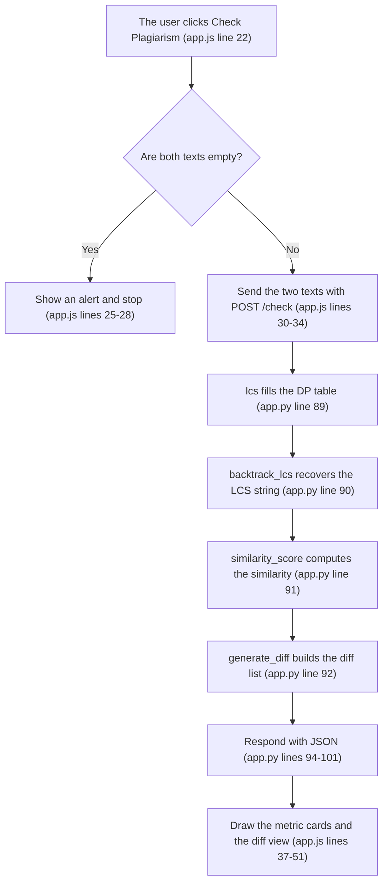

# HW5 Code Walkthrough — Plagiarism Checker

[Repository Guide](../../README.md) | [English](Code-Walkthrough.md) | [한국어](Code-Walkthrough.ko.md)

> **Last Updated:** 2026-11-16
>
> Introduction to Algorithms, Cormen, Leiserson, Rivest, and Stein, Ch 15

> **Learning Objectives:**
> 1. Explain, with line numbers, the order in which the four functions of `app.py` build and reuse the DP table
> 2. Trace the flow from clicking **Check Plagiarism** through the server to drawing the result on the page
> 3. Fill the DP table for two short strings and follow backtracking and diff generation by hand
> 4. Explain how `index.html`, `app.js`, and `style.css` build the metric cards and the diff view
> 5. Read the time and space complexity of each function from the code

---

## Table of Contents

- [1. Files](#1-files)
- [2. Module Header and the Flask App](#2-module-header-and-the-flask-app)
- [3. lcs](#3-lcs)
- [4. backtrack_lcs](#4-backtrack_lcs)
- [5. similarity_score](#5-similarity_score)
- [6. generate_diff](#6-generate_diff)
- [7. Routes and Running the Server](#7-routes-and-running-the-server)
- [8. index.html](#8-indexhtml)
- [9. app.js](#9-appjs)
- [10. style.css and requirements.txt](#10-stylecss-and-requirementstxt)
- [11. Request Flow and Execution Trace](#11-request-flow-and-execution-trace)
  - [11.1 Request Processing Flow](#111-request-processing-flow)
  - [11.2 Execution Trace for ABCB and BDCAB](#112-execution-trace-for-abcb-and-bdcab)
- [12. Complexity](#12-complexity)
- [Summary](#summary)
- [Self-Check Questions](#self-check-questions)

---

<br>

## 1. Files

> **Try It First:** This document contains the complete code and line-by-line explanations. Solve the problems in the [assignment handout](Original/Assignment.md) yourself before reading on.

The companion document, the [HW5 Assignment Explanation](Assignment-Explanation.md), covers the requirements, the design, the test results, and the report's analysis questions. This document reads the five files in `Solution` from top to bottom. All line numbers refer to each file.

| File | Lines | Part | Role |
|:-----|:-----|:-----|:-----|
| `app.py` | 1-5 | Module docstring, imports, creating the Flask app | Backend setup |
| `app.py` | 8-25 | `lcs` | Filling the table with bottom-up DP |
| `app.py` | 28-41 | `backtrack_lcs` | Recovering the LCS string by backtracking |
| `app.py` | 44-50 | `similarity_score` | Computing the similarity score |
| `app.py` | 53-71 | `generate_diff` | Generating the character-level diff |
| `app.py` | 74-101 | `/` and `/check` routes | Serving the page and the analysis API |
| `app.py` | 104-105 | `__main__` block | Running the development server |
| `requirements.txt` | 1 | `flask>=3.0` | Dependency |
| `static/index.html` | 1-59 | Input areas, buttons, metric cards, diff view | Page structure |
| `static/app.js` | 1-69 | Event handling, calling `/check`, drawing the results | Page behavior |
| `static/style.css` | 1-204 | Layout, colors, diff character styles | Page style |

*Table 1. Files in Solution*

---

<br>

## 2. Module Header and the Flask App

```python
"""Week 06 — Plagiarism Checker (Flask backend, LCS via DP)"""

from flask import Flask, jsonify, request, send_from_directory

app = Flask(__name__, static_folder="static")
```

Line 1 is a docstring stating the purpose of the module. Line 3 imports four names from Flask. `Flask` is the class that creates the web app object, `jsonify` is a function that turns a Python dictionary into a JSON response, `request` is the object that refers to the request being processed, and `send_from_directory` is a function that sends a file from a given directory as the response.

Line 5 creates the app object. Flask uses `__name__` to find the app's base directory (the directory containing `app.py`), and `static_folder="static"` designates the `static` directory under it as the static file folder. Static files are served at the default URL path `/static`, so `/static/style.css` and `/static/app.js` in `index.html` refer to files in this folder. Flask's default static folder name is also `static`, so this argument states the default explicitly.

---

<br>

## 3. lcs

```python
# ---------------------------------------------------------------------------
# LCS — Dynamic Programming
# ---------------------------------------------------------------------------

def lcs(text_a, text_b):
    """
    Longest Common Subsequence length using bottom-up DP.
    Returns: (lcs_length, dp_table)
    """
    m, n = len(text_a), len(text_b)
    dp = [[0] * (n + 1) for _ in range(m + 1)]
    for i in range(1, m + 1):
        for j in range(1, n + 1):
            if text_a[i - 1] == text_b[j - 1]:
                dp[i][j] = dp[i - 1][j - 1] + 1
            else:
                dp[i][j] = max(dp[i - 1][j], dp[i][j - 1])
    return dp[m][n], dp
```

Lines 8-10 are a comment that marks off the LCS part. `lcs` takes two texts and returns the LCS length together with the whole DP table (the docstring on lines 13-16).

- **Line 17:** Gets the lengths m and n of the two texts.
- **Line 18:** Creates an $(m+1) \times (n+1)$ two-dimensional list with every cell set to 0. Row 0 and column 0 are empty prefixes, so these zeros become the base cases of the recurrence. It matters that the list comprehension creates a new list `[0] * (n + 1)` for each row. Writing `[[0] * (n + 1)] * (m + 1)` would make every row point to the same list object, so changing one cell would change the same column in every row.
- **Lines 19-20:** Go through rows i from 1 to m and, within each row, columns j from 1 to n. The rows above and the cells to the left in the same row are filled first, so the three cells the recurrence uses are always ready.
- **Lines 21-22:** If the i-th character of A, `text_a[i - 1]`, equals the j-th character of B, `text_b[j - 1]`, add 1 to the upper-left diagonal cell. Table indices count from 1 and string indices from 0, so 1 is subtracted.
- **Lines 23-24:** If the two characters differ, use the larger of the cell above and the cell to the left.
- **Line 25:** The bottom-right cell `dp[m][n]` is the length of the whole LCS. The table is returned as well so that backtracking and diff generation can reuse it.

---

<br>

## 4. backtrack_lcs

```python
def backtrack_lcs(dp, text_a, text_b):
    """Backtrack through the DP table to recover the actual LCS string."""
    i, j = len(text_a), len(text_b)
    result = []
    while i > 0 and j > 0:
        if text_a[i - 1] == text_b[j - 1]:
            result.append(text_a[i - 1])
            i -= 1
            j -= 1
        elif dp[i - 1][j] >= dp[i][j - 1]:
            i -= 1
        else:
            j -= 1
    return "".join(reversed(result))
```

`backtrack_lcs` takes the table built by `lcs` and recovers the actual LCS string.

- **Lines 30-31:** Start from the bottom-right cell $(m, n)$ and prepare a list for the collected characters.
- **Line 32:** When either prefix becomes empty, there are no more common characters to collect, so the loop ends.
- **Lines 33-36:** If the two characters are equal, put the character into the LCS and move diagonally.
- **Lines 37-40:** If the two characters differ, move toward the larger of the cell above (`dp[i - 1][j]`) and the cell to the left (`dp[i][j - 1]`). Because of `>=`, the walk moves up when the two values are equal.
- **Line 41:** The characters were collected from the end, so `reversed` flips them and `"".join` joins them into one string.

| State of the cell | Move | Meaning |
|:-----|:-----|:-----|
| The two characters are equal | Diagonal (decrease i and j by 1) | The character goes into the LCS |
| The characters differ and above ≥ left | Up (decrease i by 1) | A's character is dropped |
| The characters differ and above < left | Left (decrease j by 1) | B's character is dropped |

*Table 2. Movement rules of backtrack_lcs*

---

<br>

## 5. similarity_score

```python
def similarity_score(text_a, text_b, lcs_length):
    """Similarity = LCS length / max(len(A), len(B)) * 100."""
    if not text_a and not text_b:
        return 100.0
    if not text_a or not text_b:
        return 0.0
    return lcs_length / max(len(text_a), len(text_b)) * 100
```

- **Lines 46-47:** An empty string evaluates to false, so `not text_a and not text_b` means both texts are empty. The denominator would then be 0, so instead of dividing, the function treats two empty documents as identical and returns 100.0.
- **Lines 48-49:** If only one side is empty, there are no common characters, so it returns 0.0.
- **Line 50:** Divides the LCS length by the larger of the two lengths and multiplies by 100. In Python 3, `/` performs float division even between integers, so 91 / 110 becomes 0.827....

---

<br>

## 6. generate_diff

```python
def generate_diff(dp, text_a, text_b):
    """
    Walk the DP table from (m, n) to (0, 0) and classify each character as
    'match' (in LCS), 'removed' (only in A), or 'added' (only in B).
    """
    i, j = len(text_a), len(text_b)
    diff = []
    while i > 0 or j > 0:
        if i > 0 and j > 0 and text_a[i - 1] == text_b[j - 1]:
            diff.append({"char": text_a[i - 1], "status": "match"})
            i -= 1
            j -= 1
        elif j > 0 and (i == 0 or dp[i][j - 1] >= dp[i - 1][j]):
            diff.append({"char": text_b[j - 1], "status": "added"})
            j -= 1
        else:
            diff.append({"char": text_a[i - 1], "status": "removed"})
            i -= 1
    return list(reversed(diff))
```

`generate_diff` walks the table backward and classifies every character of the two texts as matched, removed, or added (the docstring on lines 54-57).

- **Lines 58-59:** Start from the bottom-right cell and prepare the result list.
- **Line 60:** Unlike `backtrack_lcs`, the condition uses `or`, so the loop continues as long as characters remain on either side, even after one side is used up.
- **Lines 61-64:** If neither prefix is empty and the two characters are equal, append `{"char": character, "status": "match"}` and move diagonally.
- **Lines 65-67:** If B still has characters and either A is used up or the cell to the left is at least the cell above, append B's character as `added` and move left. Checking `i == 0` first matters. Computing `dp[i - 1][j]` when i is 0 gives `dp[-1]`, which silently reads the last row of the table without an error. Because `or` does not evaluate the right side when the left side is true, this access never happens.
- **Lines 68-70:** In the remaining case, that is, when B is used up (then i > 0 by the loop condition) or the cell above is larger, append A's character as `removed` and move up.
- **Line 71:** The list was built from the end, so it is reversed before being returned.

| Condition | Record | Move |
|:-----|:-----|:-----|
| i > 0, j > 0, and the two characters are equal | A's character as `match` | Diagonal |
| j > 0 and (i = 0 or left ≥ above) | B's character as `added` | Left |
| Otherwise (j = 0 or above > left) | A's character as `removed` | Up |

*Table 3. Branches of generate_diff*

On ties, `backtrack_lcs` goes up and `generate_diff` goes left, so for inputs with several LCSs the two functions can choose different LCSs. The consequence is discussed in [Section 4.3 of the Assignment Explanation](Assignment-Explanation.md#43-generating-the-character-level-diff).

---

<br>

## 7. Routes and Running the Server

```python
# ---------------------------------------------------------------------------
# Routes
# ---------------------------------------------------------------------------

@app.route("/")
def index():
    return send_from_directory("static", "index.html")


@app.route("/check", methods=["POST"])
def check():
    data = request.get_json() or {}
    text_a = data.get("text_a", "")
    text_b = data.get("text_b", "")

    length, dp = lcs(text_a, text_b)
    lcs_str = backtrack_lcs(dp, text_a, text_b)
    score = similarity_score(text_a, text_b, length)
    diff = generate_diff(dp, text_a, text_b)

    return jsonify({
        "similarity": round(score, 2),
        "lcs_length": length,
        "lcs_string": lcs_str,
        "len_a": len(text_a),
        "len_b": len(text_b),
        "diff": diff,
    })


if __name__ == "__main__":
    app.run(debug=True, port=5000)
```

- **Lines 78-80:** Answer a `GET /` request by sending `static/index.html` as it is. The relative path `"static"` in `send_from_directory` is resolved against the app's base directory.
- **Lines 83-84:** `/check` accepts only `POST` requests. A request with another method gets a 405 error from Flask.
- **Line 85:** Parses the request body as JSON. A body of JSON `null` gives `None`, so `or {}` replaces it with an empty dictionary. If the `Content-Type` is not JSON, Flask 3 ends the request on this line with a 415 error.
- **Lines 86-87:** Take out the two texts, using the empty string if a key is missing.
- **Lines 89-92:** Build the DP table once, then compute the LCS string, the similarity, and the diff in turn from the same table.
- **Lines 94-101:** Return the results as JSON. The similarity is rounded to two decimal places with `round(score, 2)`. The page uses `len_a` and `len_b` to show the denominator next to the LCS length.
- **Lines 104-105:** Running the file directly with `python app.py` starts the development server in debug mode on port 5000. Debug mode restarts the server when the code changes and shows a debugger in the browser on errors, so it is used only during development.

---

<br>

## 8. index.html

```html
<!DOCTYPE html>
<html lang="en">
<head>
  <meta charset="UTF-8" />
  <meta name="viewport" content="width=device-width, initial-scale=1.0" />
  <title>LCS Plagiarism Checker</title>
  <link rel="stylesheet" href="/static/style.css" />
</head>
<body>
  <h1>LCS Plagiarism Checker</h1>
  <p class="subtitle">Longest Common Subsequence &middot; Dynamic Programming</p>
```

Lines 1-8 set the document type, the character encoding (UTF-8), the viewport width for mobile screens, the title, and the stylesheet link. Lines 10-11 are the page title and subtitle, and `&middot;` is the HTML character reference for the middle dot.

```html
  <div class="inputs">
    <div class="doc-col">
      <h3>Document A</h3>
      <textarea id="textA" rows="8" placeholder="Paste the first document..."></textarea>
      <span id="lenA" class="char-count">0 chars</span>
    </div>
    <div class="doc-col">
      <h3>Document B</h3>
      <textarea id="textB" rows="8" placeholder="Paste the second document..."></textarea>
      <span id="lenB" class="char-count">0 chars</span>
    </div>
  </div>

  <div class="actions">
    <button id="btnCheck">Check Plagiarism</button>
    <button id="btnSample">Load Sample</button>
    <button id="btnClear">Clear</button>
  </div>
```

Lines 13-24 are the two areas for entering documents A and B. Each consists of a heading, an eight-row `<textarea>`, and a `<span>` for the character count, and `app.js` finds these elements by `id`. Lines 26-30 are the three buttons, which run the analysis, fill in the example sentences, and clear the input, respectively.

```html
  <div id="results" class="results hidden">
    <div class="scoreboard">
      <div class="metric">
        <div class="metric-label">Similarity</div>
        <div id="similarity" class="metric-value">0%</div>
      </div>
      <div class="metric">
        <div class="metric-label">LCS Length</div>
        <div id="lcsLength" class="metric-value">0</div>
      </div>
      <div class="metric metric-wide">
        <div class="metric-label">LCS String</div>
        <div id="lcsString" class="metric-value metric-mono">&mdash;</div>
      </div>
    </div>

    <h3>Diff View</h3>
    <div class="legend">
      <span class="legend-item"><span class="swatch match"></span>matched</span>
      <span class="legend-item"><span class="swatch removed"></span>removed (only in A)</span>
      <span class="legend-item"><span class="swatch added"></span>added (only in B)</span>
    </div>
    <div id="diffView" class="diff-view"></div>
  </div>

  <script src="/static/app.js"></script>
</body>
</html>
```

Lines 32-55 are the results area. It starts with the `hidden` class and is not visible, and `app.js` removes the class when the analysis finishes. Lines 33-46 are the three metric cards Similarity, LCS Length, and LCS String, and the LCS String card is wider than the others through the `metric-wide` class. Lines 48-53 are the diff view heading and the legend of three colors, and line 54 is the empty box that receives the diff characters. Line 57 loads the script at the end of `<body>`, so the elements above already exist when the script runs.

---

<br>

## 9. app.js

```javascript
const textA = document.getElementById("textA");
const textB = document.getElementById("textB");
const lenA = document.getElementById("lenA");
const lenB = document.getElementById("lenB");
const btnCheck = document.getElementById("btnCheck");
const btnSample = document.getElementById("btnSample");
const btnClear = document.getElementById("btnClear");
const resultsEl = document.getElementById("results");
const similarityEl = document.getElementById("similarity");
const lcsLengthEl = document.getElementById("lcsLength");
const lcsStringEl = document.getElementById("lcsString");
const diffViewEl = document.getElementById("diffView");

function updateCounts() {
  lenA.textContent = `${textA.value.length} chars`;
  lenB.textContent = `${textB.value.length} chars`;
}

textA.addEventListener("input", updateCounts);
textB.addEventListener("input", updateCounts);
```

Lines 1-12 find the elements of `index.html` by `id` and store them in constants. `updateCounts` on lines 14-17 shows the character counts of the two input areas, and lines 19-20 call it on every input (the `input` event).

> **Note:** The `length` of a JavaScript string is the number of UTF-16 code units, while Python's `len` is the number of Unicode code points. The two are equal for Korean and English text, but for characters outside the Basic Multilingual Plane such as emoji, the count on the page can be 2 while the server's `len_a` is 1.

```javascript
btnCheck.addEventListener("click", async () => {
  const a = textA.value;
  const b = textB.value;
  if (!a && !b) {
    alert("Please enter text in at least one document.");
    return;
  }

  const res = await fetch("/check", {
    method: "POST",
    headers: { "Content-Type": "application/json" },
    body: JSON.stringify({ text_a: a, text_b: b }),
  });
  const data = await res.json();

  similarityEl.textContent = `${data.similarity.toFixed(2)}%`;
  lcsLengthEl.textContent = `${data.lcs_length} / ${Math.max(data.len_a, data.len_b)}`;
  lcsStringEl.textContent = data.lcs_string || "—";

  // Build diff view
  diffViewEl.innerHTML = "";
  for (const item of data.diff) {
    const span = document.createElement("span");
    span.className = `diff-char ${item.status}`;
    // Preserve whitespace visibility
    span.textContent = item.char;
    diffViewEl.appendChild(span);
  }

  resultsEl.classList.remove("hidden");
});
```

- **Line 22:** Attaches an asynchronous function to the **Check Plagiarism** button. Because it is `async`, it can wait for the server response with `await` inside.
- **Lines 25-28:** If both areas are empty, show an alert and stop. As a result, the server's "two empty documents score 100%" branch is never used from the page.
- **Lines 30-35:** Send the two texts as JSON to `/check` and parse the response as JSON. The `Content-Type` is set to `application/json`, so the server's `request.get_json()` can read the body.
- **Line 37:** Shows the similarity to two decimal places with `toFixed(2)`. The server has already rounded it, but this pads the digits, showing 50.0 as `50.00%`.
- **Line 38:** Shows the LCS length together with the length of the longer text, like `91 / 110`. This denominator is the same as the denominator of the similarity score.
- **Line 39:** If the LCS is the empty string, shows a dash character instead.
- **Lines 42-49:** Empty the diff box, then create a `<span>` for each character of the diff and color it by attaching a class matching its status, such as `diff-char match`. The character is inserted with `textContent`, so characters like `<` and `&` are shown as they are instead of being interpreted as HTML. Spaces are visible thanks to `white-space: pre-wrap` in `style.css`.
- **Line 51:** Removes the `hidden` class from the results area to show it.

> **Note:** This handler does not handle errors. If the server is down or returns an error page, `fetch` or `res.json()` throws, the page stays unchanged, and the error appears only in the browser console.

```javascript
btnSample.addEventListener("click", () => {
  textA.value =
    "Dynamic programming solves complex problems by breaking them into overlapping subproblems and storing results.";
  textB.value =
    "Dynamic programming tackles hard problems by splitting them into overlapping subproblems and caching results.";
  updateCounts();
});

btnClear.addEventListener("click", () => {
  textA.value = "";
  textB.value = "";
  updateCounts();
  resultsEl.classList.add("hidden");
});

updateCounts();
```

**Load Sample** on lines 54-60 fills in two sentences (110 and 109 characters) that say the same thing with a few words changed. The screenshot in Section 5.1 of the Assignment Explanation is the result of comparing these two sentences. **Clear** on lines 62-67 empties both areas and hides the results area again. Changing a value from code does not fire an `input` event, so both handlers call `updateCounts()` directly. Line 69 sets the counts to `0 chars` when the page first opens.

---

<br>

## 10. style.css and requirements.txt

The role of each part of `style.css` is as follows.

| Lines | Selectors | Role |
|:-----|:-----|:-----|
| 1-5 | `*` | Removes the default spacing of every element and aligns size calculation with `box-sizing: border-box` |
| 7-15 | `body` | Font, a light gray-blue background (`#f4f6f9`), and stacking the content vertically and centering it |
| 17-32 | `h1`, `.subtitle`, `h3` | Size and color of the headings and the subtitle |
| 34-50 | `.inputs`, `.doc-col` | White cards placing the two input areas side by side within a width of 860px, with `position: relative` for placing the character count |
| 52-65 | `textarea`, `textarea:focus` | Monospace font, vertical-only resizing, and a blue border on focus |
| 67-73 | `.char-count` | Shows the character count at the bottom right of the card with absolute positioning |
| 75-106 | `.actions`, `.actions button`, `#btnCheck`, `#btnSample`, `#btnClear` | Lays out the buttons horizontally, colors them blue, green, and gray, and makes them slightly transparent on hover |
| 108-116 | `.results`, `.results.hidden` | Width of the results area, and `display: none` when the `hidden` class is present |
| 118-155 | `.scoreboard`, `.metric`, `.metric-wide`, `.metric-label`, `.metric-value`, `.metric-mono` | Places the three metric cards side by side with the LCS String card twice as wide, and gives the LCS string a monospace font and `word-break: break-all` |
| 157-181 | `.legend`, `.legend-item`, `.swatch` | The legend and the swatches of the three colors (gray, light red, light green) |
| 183-195 | `.diff-view` | The diff box: a white card with a monospace font that keeps spaces and line breaks with `white-space: pre-wrap` |
| 197-204 | `.diff-char`, `.diff-char.match`, `.diff-char.removed`, `.diff-char.added` | Matched characters in gray text, removed characters with a red background and a strike-through, added characters with a green background |

*Table 4. Structure of style.css*

Because of `word-break: break-all` in `.metric-mono` (line 154), a long LCS string wraps even in the middle of a word. This is why `and i` and `ng` appear split in the screenshot in Section 5.1 of the Assignment Explanation. The metric cards have no `white-space` setting, so consecutive spaces appear as one, while the diff box uses `pre-wrap` (line 192) and shows the spaces as they are.

`requirements.txt` is the single line `flask>=3.0`, and `pip install -r requirements.txt` installs Flask 3.0 or later together with Werkzeug and the other packages Flask depends on. The 415 error for a body that is not JSON (Section 5.3 of the Assignment Explanation) was confirmed with Flask 3.1.3.

---

<br>

## 11. Request Flow and Execution Trace

### 11.1 Request Processing Flow

The processing after clicking **Check Plagiarism** is as follows.



*Figure 1. Processing flow after clicking Check Plagiarism*

### 11.2 Execution Trace for ABCB and BDCAB

When `/check` is called with A = `ABCB` and B = `BDCAB`, the table that `lcs` fills is as follows. Bold cells are those where `backtrack_lcs` moved diagonally and collected a character.

| | ∅ | B | D | C | A | B |
|:-:|:-:|:-:|:-:|:-:|:-:|:-:|
| ∅ | 0 | 0 | 0 | 0 | 0 | 0 |
| A | 0 | 0 | 0 | 0 | 1 | 1 |
| B | 0 | **1** | 1 | 1 | 1 | 2 |
| C | 0 | 1 | 1 | **2** | 2 | 2 |
| B | 0 | 1 | 1 | 2 | 2 | **3** |

*Table 5. DP table for ABCB and BDCAB*

For example, the cell (C, C) has equal characters, so it adds 1 to the 1 in the upper-left cell (B, D) and becomes 2, and the cell (A, B) just to the right of (A, A) has different characters, so it takes the larger of the cell above, 0, and the cell to the left, 1, which is 1. The bottom-right value 3 is the LCS length.

`backtrack_lcs` starts at cell (4, 5) and moves as follows. Cells are written as (i, j).

| Step | Cell (i, j) | Characters compared | Decision | Action |
|:-----|:-----|:-----|:-----|:-----|
| 1 | (4, 5) | B, B | Equal | Collect B and move diagonally |
| 2 | (3, 4) | C, A | above 1 ≥ left 2 is false | Move left |
| 3 | (3, 3) | C, C | Equal | Collect C and move diagonally |
| 4 | (2, 2) | B, D | above 0 ≥ left 1 is false | Move left |
| 5 | (2, 1) | B, B | Equal | Collect B and move diagonally |
| 6 | (1, 0) | None | j = 0 | End the loop |

*Table 6. Execution trace of backtrack_lcs*

Reversing the collected characters B, C, B gives the LCS `BCB`. `generate_diff` starts from the same cell but does not stop when one side is used up.

| Step | Cell (i, j) | Characters compared | Decision | Record |
|:-----|:-----|:-----|:-----|:-----|
| 1 | (4, 5) | B, B | Equal | B `match` |
| 2 | (3, 4) | C, A | left 2 ≥ above 1 | A `added` |
| 3 | (3, 3) | C, C | Equal | C `match` |
| 4 | (2, 2) | B, D | left 1 ≥ above 0 | D `added` |
| 5 | (2, 1) | B, B | Equal | B `match` |
| 6 | (1, 0) | None | j = 0 | A `removed` |

*Table 7. Execution trace of generate_diff*

Reversing the list gives the diff `A` removed, `B` matched, `D` added, `C` matched, `A` added, `B` matched. The matched characters B, C, B are the same as the result of `backtrack_lcs`, and the similarity is 3 / max(4, 5) × 100 = 60.00%.

```text
-A B +D C +A B
```

*Figure 2. The diff of ABCB and BDCAB (- is removed, + is added)*

---

<br>

## 12. Complexity

With text lengths m and n and LCS length L, the cost of each part is as follows.

| Part | Time | Extra space | Reason |
|:-----|:-----|:-----|:-----|
| `lcs` | $\Theta(mn)$ | $\Theta(mn)$ | The double loop on lines 19-24 spends constant time per cell, and the table on line 18 has $(m+1)(n+1)$ cells |
| `backtrack_lcs` | $O(m + n)$ | $O(L)$ | Each iteration decreases i or j by at least 1, and L characters are collected |
| `similarity_score` | $O(1)$ | $O(1)$ | Python's `len` takes constant time |
| `generate_diff` | $O(m + n)$ | $O(m + n)$ | Each iteration decreases i or j by 1 for exactly $m + n - L$ iterations, with as many diff entries |
| `/check` overall | $\Theta(mn)$ | $\Theta(mn)$ | Dominated by the DP table |
| Drawing the diff in `app.js` | $O(m + n)$ | $O(m + n)$ | One `<span>` per diff entry |

*Table 8. Time and space complexity of each part*

The number of iterations of `generate_diff` is $m + n - L$, the sum of L matches, $m - L$ removals, and $n - L$ additions. In the example of Section 11.2 it is $4 + 5 - 3 = 6$. The DP table uses the most memory, and as the two texts grow, this table reaches the limit first. The cost for long inputs is discussed in [Section 6.1 of the Assignment Explanation](Assignment-Explanation.md#61-time-and-space-complexity-of-lcs).

---

<br>

## Summary

| Concept | Key Summary |
|:-----|:---------|
| `lcs` | Fills an $(m+1) \times (n+1)$ table with a new list per row from top to bottom and left to right, and returns the length together with the table. |
| `backtrack_lcs` | Moves diagonally, up, or left until one prefix is empty, collecting matched characters, and goes up on ties. |
| `similarity_score` | Returns 100 if both texts are empty, 0 if only one is, and otherwise the percentage of the LCS length over the longer length. |
| `generate_diff` | Walks to $(0, 0)$ recording every character as `match`, `added`, or `removed`, and goes left (addition) on ties. |
| `/check` | Reads the two texts from the JSON body, builds the table once, and returns the results of the four functions as JSON. |
| The page | `app.js` fills the three metric cards and creates a `<span>` with a status class for each diff character, and `style.css` applies the colors and the strike-through. |

---

<br>

## Self-Check Questions

1. **Building the table:** What problem arises if line 18 is changed to `dp = [[0] * (n + 1)] * (m + 1)`?

   <details>
   <summary>Answer</summary>

   All m+1 elements of the outer list would point to the same inner list object. Changing a cell of one row on line 22 or line 24 would change the same column in every row, so the cell above and the diagonal cell would effectively hold values of the same row, the recurrence would break, and the LCS length and the backtracking result would be wrong. The list comprehension in the original code avoids this by creating a new list for each row.

   </details>

2. **Boundary condition:** What can happen if the `i == 0` check is removed from line 65 of `generate_diff`, leaving only `dp[i][j - 1] >= dp[i - 1][j]`?

   <details>
   <summary>Answer</summary>

   When A is used up so that i is 0 while B still has characters, `dp[i - 1][j]` becomes `dp[-1][j]`. Python's negative indices count from the end, so it reads the last row of the table without an error. If that value is larger than the cell to the left, the walk goes to the else branch, records `text_a[-1]`, the last character of A, as `removed` again, and makes i equal to -1. For example, the correct diff of A = `A` and B = `AA` is `A` added, `A` matched, but without the check it becomes `A` added, `A` removed, `A` matched, with an extra removal that is not in A. Checking `i == 0` first records all the remaining characters of B as `added`.

   </details>

3. **Display:** When the LCS Length card shows `91 / 110`, what is 110, and how does it relate to the similarity score?

   <details>
   <summary>Answer</summary>

   110 is `Math.max(data.len_a, data.len_b)`, the number of characters in the longer of the two texts (line 38). The denominator of the similarity score is the same value, so the ratio 91 / 110 multiplied by 100, 82.73%, is the value in the Similarity card.

   </details>

4. **Number of iterations:** For two texts of length 1,000 whose LCS length is 600, find the number of cells `lcs` fills and the number of iterations of `generate_diff`.

   <details>
   <summary>Answer</summary>

   `lcs` builds a table of $1{,}001 \times 1{,}001 = 1{,}002{,}001$ cells including row 0 and column 0, and computes 1,000,000 of them on lines 19-24. `generate_diff` iterates $1{,}000 + 1{,}000 - 600 = 1{,}400$ times, with 600 matches, 400 removals, and 400 additions.

   </details>
