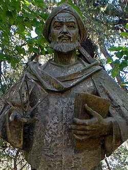
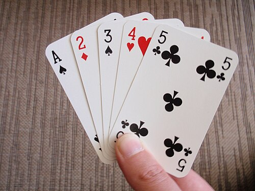
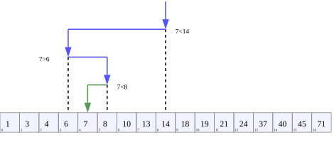
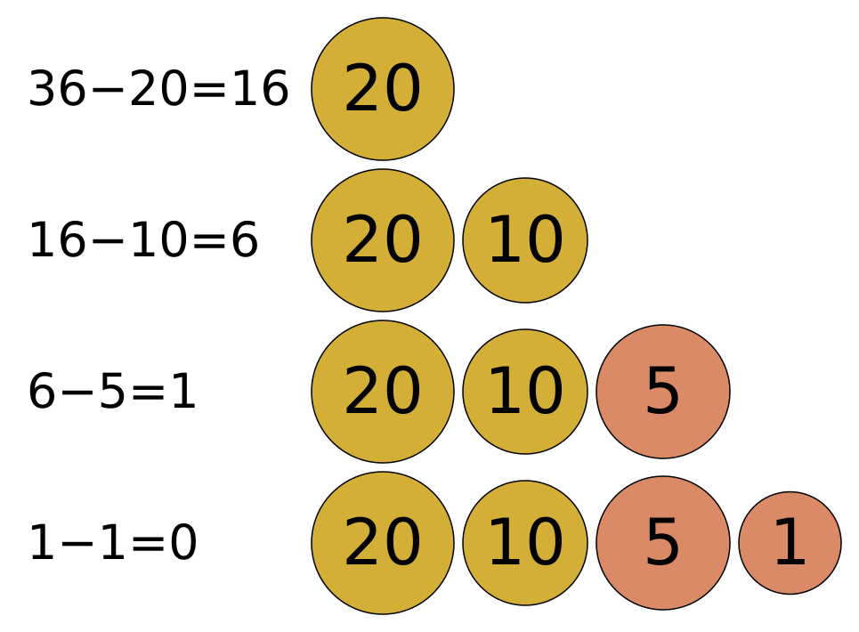
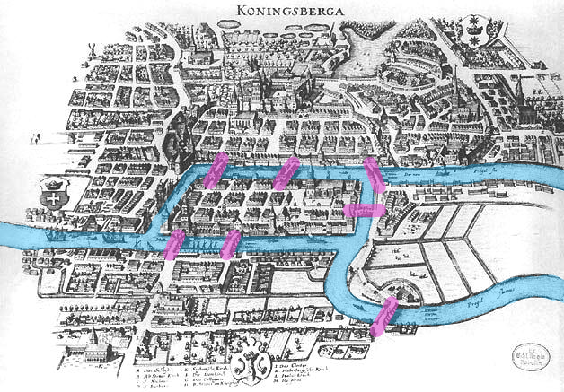
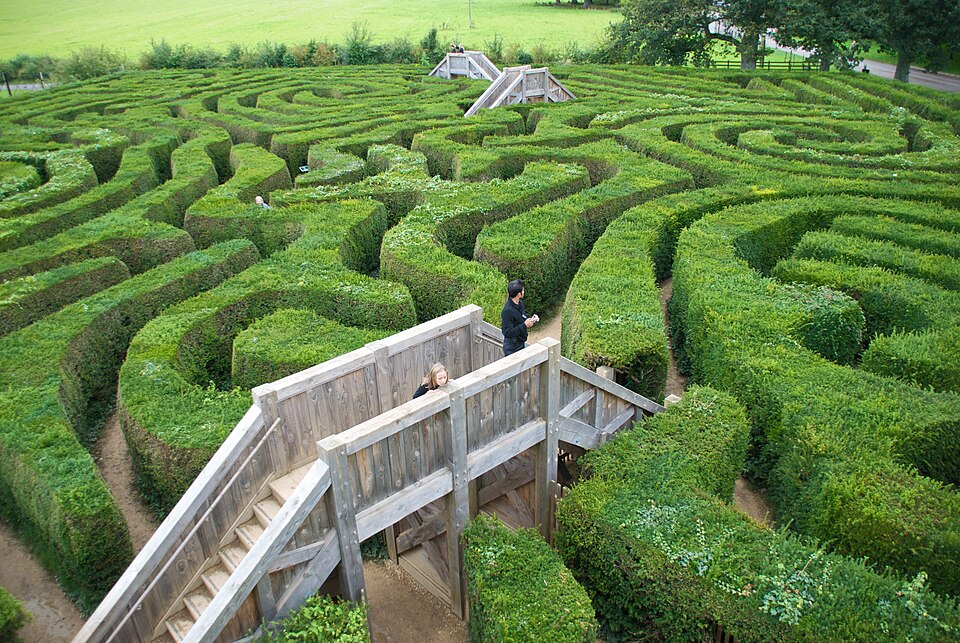
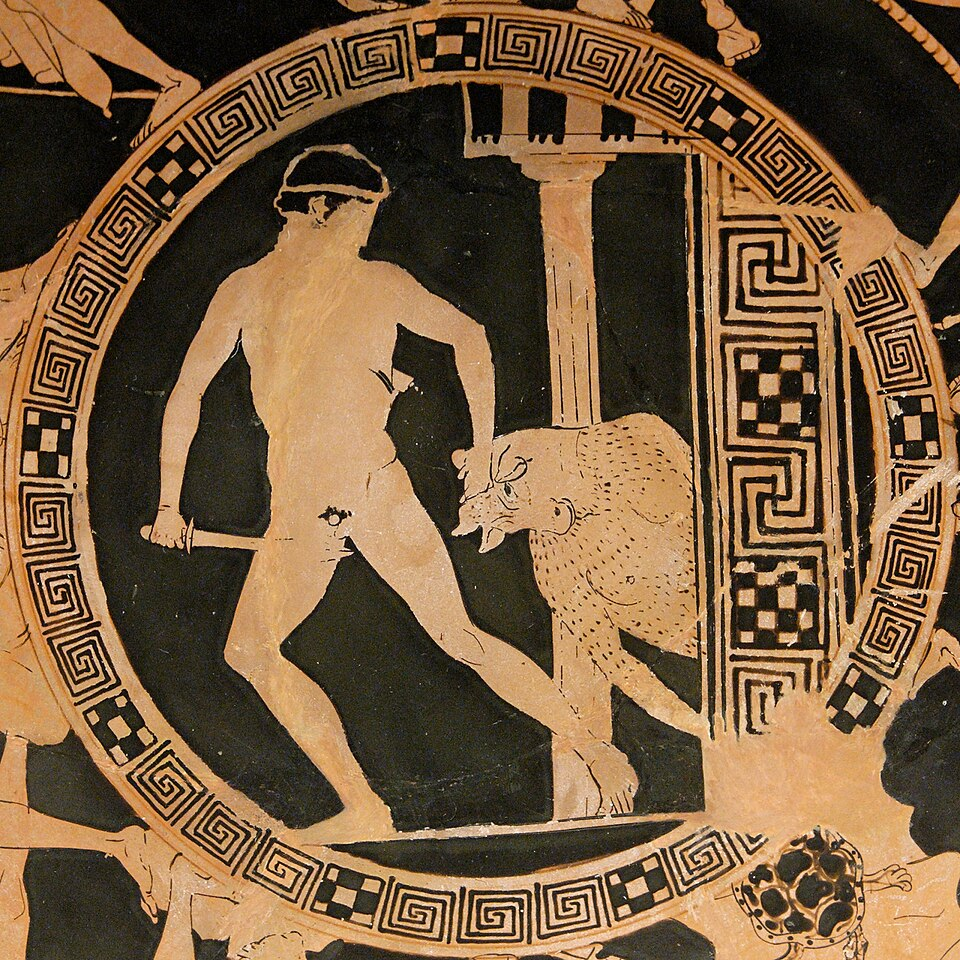
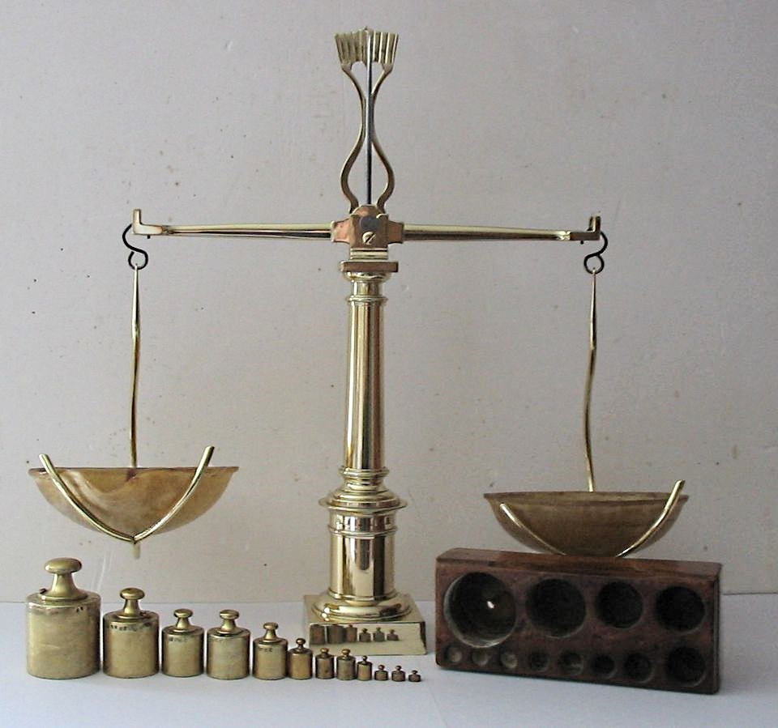
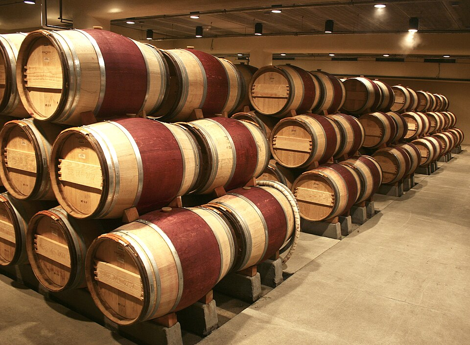

# Week 1 Lecture — Introduction to Algorithms

[Repository Guide](../../README.md) | [English](Concepts_Lecture.md) | [한국어](Concepts_Lecture.ko.md)

> **Last Updated:** 2026-10-19
>
> Introduction to Algorithms, Cormen, Leiserson, Rivest, and Stein, Ch 1, 2

> **Learning Objectives:**
> 1. Explain what an algorithm is and describe its key properties (finiteness, correctness, unambiguity)
> 2. Trace through classic problems (finding max, binary search, coin change) step by step
> 3. Recognize the difference between brute-force and efficient approaches
> 4. Understand the condition for an Euler circuit and the basic strategy for traversal
> 5. Explain how binary encoding solves the poisoned wine problem using only log₂(n) servants
> 6. Identify the recurring theme of log₂(n) in halving algorithms

---

## Table of Contents

- [1. What Is an Algorithm?](#1-what-is-an-algorithm)
  - [1.1 Why Study Algorithms?](#11-why-study-algorithms)
  - [1.2 What Do We Learn?](#12-what-do-we-learn)
  - [1.3 Definition of an Algorithm](#13-definition-of-an-algorithm)
  - [1.4 Algorithm vs Data Structure](#14-algorithm-vs-data-structure)
  - [1.5 Origin of the Word "Algorithm"](#15-origin-of-the-word-algorithm)
  - [1.6 Euclidean GCD Algorithm](#16-euclidean-gcd-algorithm)
- [2. Classical Problems](#2-classical-problems)
  - [2.1 Finding the Maximum](#21-finding-the-maximum)
  - [2.2 Finding a Specific Number (Binary Search)](#22-finding-a-specific-number-binary-search)
  - [2.3 Coin Change Problem](#23-coin-change-problem)
  - [2.4 Euler Path (One-Stroke Drawing)](#24-euler-path-one-stroke-drawing)
  - [2.5 Maze Solving](#25-maze-solving)
  - [2.6 Counterfeit Coin Problem](#26-counterfeit-coin-problem)
  - [2.7 Poisoned Wine Problem](#27-poisoned-wine-problem)
- [Summary](#summary)
- [Self-Check Questions](#self-check-questions)
- [References](#references)

---

<br>

## 1. What Is an Algorithm?

### 1.1 Why Study Algorithms?

- Algorithms are one of the **most important subjects** in computer science.
- Algorithms train you in **how to think** as a programmer.
- The **thought process** behind each algorithm is more important than the algorithm itself.

**Application Areas:**
- Design of all programs
- Formal representation of problems and solutions
- Analysis of program efficiency and complexity

### 1.2 What Do We Learn?

- Various algorithms for various problems
  - Greedy, Dynamic Programming, Divide and Conquer, Graph Algorithms, and so on
- Systematic thinking through algorithmic problem solving
- **Formal representation** of solutions
  - Flowcharts and pseudocode
- **Efficiency and complexity analysis**
  - How execution time changes with input size

### 1.3 Definition of an Algorithm

> **Definition:** An **algorithm** is a systematic description of a procedure for solving a problem.

- Given an **input** (problem), it produces the desired **output** (result) through a **finite number of steps**.

```text
┌───────┐      ┌─────────────┐      ┌────────┐
│ Input  │ ───► │  Algorithm   │ ───► │ Output │
│(Problem)│      │(Finite Steps)│      │(Result)│
└───────┘      └─────────────┘      └────────┘
```

*Figure 1. An algorithm turning input into output through finite steps*

**Requirements:**
- Input and output must be clearly specified.
- The algorithm describes the process of transforming input into output.
- The algorithm must be correct. That is, for every valid input, it must eventually terminate and produce the correct output.

> **Note:** Each step of an algorithm must be **unambiguous**. That is, what action to take in any given situation must not be vague. An expression like "handle appropriately according to the situation" is not an algorithm.

### 1.4 Algorithm vs Data Structure

| | Data Structure | Algorithm |
|:---|:---|:---|
| **Core Question** | How to **store** information? | How to **solve** the problem? |
| **Analogy** | Parts and modules of a car | How to build a car |
| **Prerequisites** | - | Basic Programming, Data Structures |

*Table 1. Comparison of data structures and algorithms*

> **Key Point:** **Algorithm + Data Structure = Program**
>
> This equation was put forward by Niklaus Wirth.

**Example: English Dictionary**
- Unsorted words → Sequential search (slow)
- Sorted words → Binary search (fast)
- The **data structure** (whether sorted or not) determines which **algorithm** is efficient.

> **Note:** Niklaus Wirth (1934-2024) was a Swiss computer scientist who created the programming language Pascal and received the Turing Award in 1984. His book title "Algorithms + Data Structures = Programs" is a famous quote summarizing the essence of programming, emphasizing that algorithms and data structures are the two pillars of programming.

> **[Data Structures]** A data structure is a structural method for efficiently storing and accessing data. Representative examples include arrays, linked lists, stacks, queues, trees, hash tables, and graphs. The concepts learned in the Data Structures course form the foundation for the Algorithms course. For example, a sorted array data structure is required to apply the binary search algorithm.

### 1.5 Origin of the Word "Algorithm"



*Figure 2. Monument to al-Khwarizmi in Madrid*

- The word **"algorithm"** derives from the name of the 9th-century Persian mathematician **al-Khwarizmi** (Figure 2 [1]).
- **One of the earliest known algorithms** is Euclid's GCD algorithm from around 300 BCE.
- Algorithms have existed for more than **2,300 years** before computers.

**Question:** Given two numbers 48 and 18, how do you find the **greatest common divisor (GCD)**?

### 1.6 Euclidean GCD Algorithm

**Idea:** Given two numbers (a, b), compute the remainder of a divided by b, and repeatedly replace (a, b) with (b, a mod b).

```python
def gcd(a, b):
    while b != 0:
        a, b = b, a % b
    return a
```

```text
Example: gcd(48, 18)
  48, 18 -> 18, 12 -> 12, 6 -> 6, 0 -> return 6
```

The algorithm is simple, finite, and correct. These are the hallmarks of a good algorithm.

> **Note:** `a % b` is the remainder of dividing a by b. This algorithm works because of the mathematical property GCD(a, b) = GCD(b, a mod b). When b becomes 0, the value of a at that point is the greatest common divisor. This algorithm converges very quickly; even in the worst case, approximately log(min(a,b)) iterations are sufficient.

---

<br>

## 2. Classical Problems

This section explores several classical problems that illustrate fundamental algorithmic strategies. Each problem introduces a different way of thinking that recurs throughout this course, such as sequential scanning, divide and conquer, greedy choices, graph traversal, and information-theoretic encoding.

### 2.1 Finding the Maximum

**Problem:** Among face-down number cards (Figure 3 [2]), find the card with the largest number.



*Figure 3. Playing cards*

**Approach:**
1. Look at the first card and remember its number.
2. Look at the next card, and if it is larger, update the remembered number.
3. Repeat until all cards have been checked.
4. The remembered number is the maximum.

```python
def find_max(cards):
    max_val = cards[0]          # Step 1: Remember the first card
    for i in range(1, len(cards)):
        if cards[i] > max_val:  # Step 2: Compare
            max_val = cards[i]  # Update if larger
    return max_val              # Step 4: Return the maximum
```

Reading cards one by one in order like this is **Sequential Search**.

> **[Data Structures]** In the code above, `cards` is an array (list), and the `for` loop iterates from index 1 to the end. As learned in Data Structures, arrays allow O(1) access by index. This algorithm visits every element once, so the time complexity is **O(n)**. This is the minimum time required to find the maximum in an unsorted array, because every element must be checked at least once.

> **Note:** We write O(n) to describe how an algorithm's running time grows with input size n. This notation will be covered rigorously in Week 2. Informally, O(n) means roughly proportional to n, and O(log n) means roughly proportional to log n.

### 2.2 Finding a Specific Number (Binary Search)

**Problem:** Among sorted cards, find the number **85**.



*Figure 4. Binary search visualization*

**Sequential search** checks one by one: 15 → 20 → 25 → ... → 85. **9 comparisons** are needed.

Since the data is **sorted**, a more efficient method is possible.

**Core idea of binary search:** Compare with the **middle** element, then search only **one half** (Figure 4 [3]).

```text
Finding 85: [15, 20, 25, 35, 45, 55, 60, 75, 85, 90]

Step 1: middle = 45  ->  85 > 45  ->  search the right half
       [55, 60, 75, 85, 90]

Step 2: middle = 75  ->  85 > 75  ->  search the right half
       [85, 90]

Step 3: middle = 85  ->  85 == 85 ->  found!
```

It finds the value with only **3 comparisons** instead of 9.

> **[Data Structures]** Binary search can only be used on **sorted arrays**. As learned in Data Structures, finding an element in unsorted data requires sequential search (O(n)). Binary search is possible because comparing with the middle value lets you eliminate the other half at once. Since the search range halves at every step, the time complexity is **O(log₂ n)**.

**Code:**

```python
def binary_search(arr, target):
    left, right = 0, len(arr) - 1

    while left <= right:
        mid = (left + right) // 2
        if arr[mid] == target:
            return mid              # Found!
        elif arr[mid] < target:
            left = mid + 1          # Search the right half
        else:
            right = mid - 1         # Search the left half

    return -1                       # Not found
```

**Comparison:**

| Method | Requires Sorting? | Worst Case (n items) |
|:-------|:-----------------|:---------------------|
| Sequential Search | No | n comparisons |
| Binary Search | Yes | log₂(n) comparisons |

*Table 2. Comparison of sequential search and binary search*

For n = 1,000,000, sequential search makes up to 1,000,000 comparisons and binary search about 20.

> **Note:** `(left + right) // 2` computes the middle index using integer division. `left` and `right` are the indices of both ends of the current search range. It returns the index if found, and -1 if not found. In practice, binary search is used very frequently, and Python's standard library provides it via the `bisect` module.

> **Note:** The reason `left <= right` includes the equality (=) is that when the search range has narrowed to a single element (`left == right`), that element still needs to be checked. Removing the equality (`left < right`) would cause a bug where the last element is not examined, and a present value would not be found. Boundary conditions in binary search are a common source of mistakes in coding tests.

### 2.3 Coin Change Problem

**Problem:** Give change for **730 won** (Figure 5 [4]) using the **minimum number of coins**.


*Figure 5. South Korean coins and banknotes*

**Greedy approach:** Always choose the **largest** coin that does not exceed the remaining amount (Figure 6 [5]).



*Figure 6. Greedy coin selection for 36 cents*

```text
Remaining amount: 730
  -> 500 won x 1  (remaining: 230)
  -> 100 won x 2  (remaining:  30)
  ->  10 won x 3  (remaining:   0)

Total coins: 1 + 2 + 3 = 6 (minimum!)
```

Notice that the 50-won coin is not used because the remaining amount (30) after using 100-won coins is less than 50. The algorithm naturally skips denominations that are too large for the remaining amount.

> **Definition:** A **greedy algorithm** is a method that makes the **locally optimal choice** at each step, hoping to achieve a **globally optimal solution**.

```python
def coin_change(amount, coins=[500, 100, 50, 10]):
    result = []
    for coin in coins:                # Coins in descending order
        count = amount // coin
        if count > 0:
            result.append((coin, count))
            amount -= coin * count
    return result

# coin_change(730) -> [(500, 1), (100, 2), (10, 3)]
```

**Important question:** How can we **prove** that this greedy approach always guarantees the minimum for the Korean won coin system?
- This will be rigorously covered in **Week 5 (Greedy Algorithms)**.

> **Key Point:** The greedy algorithm does not always guarantee an optimal solution. It works well with the Korean won coin system (500, 100, 50, 10), but if the coins are [1, 3, 4] won and you need to make change for 6 won, the greedy approach selects 4+1+1 = 3 coins, while the optimal solution is 3+3 = 2 coins. For a greedy algorithm to guarantee optimality, specific conditions (the greedy choice property and optimal substructure) must be satisfied.

### 2.4 Euler Path (One-Stroke Drawing)

An Euler *path* traverses every edge exactly once. If it also returns to the starting vertex, it is called an Euler *circuit* (or *cycle*). The problem here asks for an Euler circuit specifically.

**Problem:** Starting from a vertex, traverse **every edge exactly once** and return to the starting vertex. Vertices may be revisited.



*Figure 7. The seven bridges of Konigsberg*

> **[Data Structures]** A graph is a core concept learned in Data Structures. It consists of a set of **vertices (nodes)** and a set of **edges** connecting them. The Euler path problem historically originates from the famous Konigsberg bridge problem (Figure 7 [6]). Euler proved that for a path traversing every edge exactly once (Euler path) to exist in a connected graph, the number of vertices with **odd degree** must be either 0 or 2. Degree refers to the number of edges connected to a vertex.

The following graph (vertices 1-10) is used in the worked example below.

```text
        1
       / \
      2   10
      |     \
      3---9--7
      |   |  |
      4   8  6
       \ /  /
        5--+
```

*Figure 8. The ten-vertex graph used in the worked example*

**Key Insight:**

At a vertex with multiple choices, which edge should be taken?

**Rule:** Only move to a neighbor if a **cycle** exists that returns to the current vertex through that neighbor. Avoid **bridges**, that is, edges whose removal disconnects the graph. For instance, if removing edge (7,10) would leave vertex 10 unreachable from the rest of the graph, then (7,10) is a bridge. Crossing a bridge too early can strand you, leaving edges you can never traverse.

**Example:** At vertex 7, should you go to 6, 9, or 10?
- Vertex 6: A cycle exists via 5, 4, 3, 9, 7 → **Safe**
- Vertex 9: A cycle exists via 3, 4, 5, 6, 7 → **Safe**
- Vertex 10: Only leads to vertex 1 with no return cycle → **Dead end**

> **Note:** Read literally, the graph in Figure 8 has four vertices of degree 3 (odd): 3, 5, 7, and 9, so the whole graph has no Euler circuit. Also, 7, 10, 1, 2, 3, 9, 7 is a cycle, so the judgment above that vertex 10 is a dead end and (7,10) is a bridge holds only in the remaining graph after an edge on the path back to 7 through vertex 10 (for example, (1,2)) has already been traversed.

**Algorithm:**
1. If only one unvisited edge is adjacent to the current vertex, take it even if it is a bridge.
2. Otherwise, move to a neighbor through which a **cycle** back to the current vertex exists.

Cycle detection can be performed using **Depth-First Search (DFS)**.

The key insight is that crossing a bridge prematurely can split the graph into disconnected parts, making it impossible to traverse the remaining edges. By always choosing an edge that keeps the graph connected, you ensure all edges remain reachable.

> **[Data Structures]** DFS is a graph traversal method learned in Data Structures. It explores as far as possible along one path before backtracking. It is implemented using a stack or recursive calls. Conversely, BFS (Breadth-First Search) explores nodes level by level starting from the nearest, using a queue. DFS is used for cycle detection here because, in a DFS of an undirected graph, encountering an already-visited node other than the immediate predecessor (parent) means a cycle exists.

> **Note:** The principle of cycle detection via DFS is as follows. Starting DFS from the current node, if an **already-visited node is encountered** during traversal, other than by going back along the edge just used, a cycle exists. For example, starting from node 7 and following 6→5→4→3→9→7 confirms a cycle. Since DFS digs as deep as possible and then backtracks, it naturally checks whether the path returns to the starting point.

### 2.5 Maze Solving

**Greek myth of Theseus:** He took a **ball of thread** into the labyrinth to find his way back (Figure 9 [7], Figure 10 [8]).



*Figure 9. Longleat hedge maze*



*Figure 10. Theseus and the Minotaur*

How do you **reliably** find the exit without thread or a map?

**Right-Hand Rule:**
1. Place your right hand on the wall.
2. Walk forward without lifting your right hand off the wall.
3. In a simple maze whose walls are all connected, you will **always** reach the exit.

It is a simple and elegant algorithm that needs no markings or thread.

**Why does it work?** If all walls are connected, the wall forms one connected boundary. Following the wall traverses the entire boundary, including the exit, so you will inevitably reach it.

> **Note:** The right-hand rule does not always work. It can fail when there are **independent islands (disconnected wall segments)** inside the maze. In such mazes, more sophisticated maze-solving algorithms like the Tremaux algorithm are needed. However, for simple mazes where all walls are connected, the right-hand rule works reliably.

> **Note:** From a graph-theoretic perspective, the right-hand rule is a **variant of DFS (Depth-First Search)**. Following the wall corresponds to traversing edges of a graph in one direction, and turning back at dead ends corresponds to DFS backtracking.

### 2.6 Counterfeit Coin Problem

**Problem:** Among n coins, **one** is counterfeit (slightly lighter). Using a **balance scale** (Figure 11 [9]), find the counterfeit coin with the minimum number of weighings.



*Figure 11. Balance scale*

What strategy minimizes the number of weighings for **1,024 coins**?

**Three Approaches:**

| Approach | Method | Worst Case (n coins) |
|:---------|:-------|:---------------------|
| **Approach A** | Compare one coin against each of the rest | n - 1 |
| **Approach B** | Compare coins in pairs | n / 2 |
| **Approach C** | Split the pile in half and compare both sides | log₂(n) |

*Table 3. Three approaches to finding the counterfeit coin*

**Approach A (One by One):**

Place one coin on the left, and compare the rest one by one on the right.

```text
Coin 1 vs Coin 2  ->  balanced
Coin 1 vs Coin 3  ->  balanced
Coin 1 vs Coin 4  ->  balanced
  ...
Coin 1 vs Coin k  ->  lighter! (Coin k is counterfeit)
```

- **Best case:** 1 weighing (if lucky)
- **Worst case:** n - 1 weighings
- With 1,024 coins, it takes up to **1,023 weighings**.

**Approach B (In Pairs):**

Group coins into pairs and compare each pair.

```text
(Coin 1, Coin 2)  ->  balanced (both genuine)
(Coin 3, Coin 4)  ->  balanced (both genuine)
  ...
(Coin k, Coin k+1) -> unbalanced! (one is counterfeit)
```

- **Worst case:** n / 2 weighings
- With 1,024 coins, it takes up to **512 weighings**.
- It is better, but still linear.

Once an unbalanced pair is found, the counterfeit is known to be lighter, so the coin on the higher pan is the counterfeit and no extra weighing is needed. Only when it is unknown whether the counterfeit is lighter or heavier does one more weighing against a known-genuine coin become necessary; the worst case is then n/2 + 1 weighings for even n.

**Approach C (Split in Half):**

Split the pile in half and place both halves on the scale. The lighter side contains the counterfeit.

```text
n = 1024 coins

Step 1:   512 vs 512  ->  left is lighter
Step 2:   256 vs 256  ->  right is lighter
Step 3:   128 vs 128  ->  left is lighter
  ...
Step 10:    1 vs   1  ->  left is lighter -> found!
```

- If n is a power of 2, it **always** takes log₂(n) weighings.
- With 1,024 coins, it takes exactly **10 weighings**.

This is the **Divide and Conquer** strategy, covered in depth in **Week 4**.

> **Note:** There is an even more efficient method. If you split into thirds instead of halves, it takes log₃(n) weighings (split coins into 3 groups, place only 2 groups on the scale, and the lighter group can be identified). But the key point here is the principle of divide and conquer: reducing the problem size by a constant ratio at each step yields logarithmic performance.

**Comparison:**

For n = 1,024 coins:

| Approach | Worst Case | Strategy |
|:---------|:-----------|:---------|
| A (one by one) | **1,023** | Brute Force |
| B (in pairs) | **512** | Slightly smarter |
| C (split in half) | **10** | Divide and Conquer |

*Table 4. Worst-case weighings of the three approaches for 1,024 coins*

**Why is Approach C so good?**
- Each weighing **eliminates half** of the remaining coins.
- The number of weighings is log₂(n).

> **Key Point:** The **logarithmic function** is extremely important in algorithm analysis. Intuitively, log₂(n) is the number of times n can be divided by 2 until it becomes 1. For example, log₂(1024) = 10 because dividing 1024 by 2 ten times yields 1. This concept appears repeatedly throughout algorithms: binary search, divide and conquer, tree height, and so on.

### 2.7 Poisoned Wine Problem

**Story:** A king has several wine jars (Figure 12 [10]). A spy has poisoned **exactly one** jar. The poison kills after exactly **one week**, even from a single sip.



*Figure 12. Wine barrels*

**The King's Command:**
- Find the poisoned jar within exactly **one week**.
- **Minimize** the number of tasting servants.

How many servants are needed for **8** jars? What about **1,000**?

**Small Case: 2 jars, 1 servant**

| Servant tastes | If servant dies | If servant lives |
|:---------------|:---------------|:-----------------|
| Jar 1 | Jar 1 is poisoned | Jar 2 is poisoned |

*Table 5. The case of 2 jars and 1 servant*

1 servant can identify the poisoned jar among **2** jars.

**Can 4 jars be handled with 2 servants?**

Assign a 2-bit binary number to each jar.

| Jar | Binary | Servant A tastes? | Servant B tastes? |
|:----|:-------|:-----------------|:-----------------|
| 0 | 00 | No | No |
| 1 | 01 | No | Yes |
| 2 | 10 | Yes | No |
| 3 | 11 | Yes | Yes |

*Table 6. Tasting plan assigning 2-bit binary numbers to 4 jars*

**Rule:** Servant A tastes all jars where **bit 1 = 1**. Servant B tastes all jars where **bit 0 = 1**.

> **[Discrete Mathematics]** Binary is a number system using only two digits, 0 and 1. For example, decimal 5 is 101 in binary (= 1×4 + 0×2 + 1×1). All data inside computers is represented in binary. The reason binary is key to this problem is that k-bit binary numbers can represent $2^k$ different states. That is, k servants (each with 2 states: alive or dead) can distinguish among $2^k$ jars.

**Reading the Results:**

After one week, check who died.

| A died? | B died? | Binary | Poisoned Jar |
|:--------|:--------|:-------|:-------------|
| No | No | 00 | Jar 0 |
| No | Yes | 01 | Jar 1 |
| Yes | No | 10 | Jar 2 |
| Yes | Yes | 11 | Jar 3 |

*Table 7. Death patterns of 2 servants and the poisoned jar*

The **death pattern** directly encodes the **binary number** of the poisoned jar.

**8 jars (3 servants):**

| Jar | Binary | A tastes? | B tastes? | C tastes? |
|:----|:-------|:----------|:----------|:----------|
| 0 | 000 | No | No | No |
| 1 | 001 | No | No | Yes |
| 2 | 010 | No | Yes | No |
| 3 | 011 | No | Yes | Yes |
| 4 | 100 | Yes | No | No |
| 5 | 101 | Yes | No | Yes |
| 6 | 110 | Yes | Yes | No |
| 7 | 111 | Yes | Yes | Yes |

*Table 8. Tasting plan for 8 jars and 3 servants*

Each servant tastes **4** jars. If jar 7 is poisoned, **all 3 servants die** (111).

**General Solution:**

**For n jars:**
- If n is a power of 2, the number of servants needed is **log₂(n)**.
- Assign each jar a unique binary number from 0 to n-1.
- The k-th servant tastes all jars whose k-th bit is 1.
- After one week, the binary pattern of dead servants is the number of the poisoned jar.

```text
n = 1000 jars  ->  log_2(1000) = ~10 servants
n = 1,000,000  ->  log_2(1,000,000) = ~20 servants
```

This is the power of **binary encoding**, a fundamentally different way of thinking.

> **Note:** This problem is related to **Information Theory**. Each servant provides 1 bit of information: alive or dead. To distinguish among n jars, log₂(n) bits of information are needed, so at least log₂(n) servants are required. In this way, a logarithm can also be interpreted as the minimum amount of information needed to distinguish the cases.

> **Note:** When n is not exactly a power of 2, **⌈log₂(n)⌉** (ceiling) servants are needed. For example, if n=5, log₂(5) ≈ 2.32, so 3 servants are needed. 3 bits (8 states) can distinguish among 5 jars. The remaining 3 states (binary 101, 110, 111) are simply unused.

> **Note:** For the 5-jar case specifically, assign binary numbers 000-100 to jars 0-4, using 3 servants. Binary numbers 101(5), 110(6), 111(7) are unused. If only Servant A dies (100), jar 4 is poisoned; if nobody dies (000), jar 0 is poisoned. In this way, with k servants, as long as $2^k$ exceeds the number of jars, some codes remain unused but the scheme works without issues.

---

<br>

## Summary

| Concept | Key Summary |
|:--------|:------------|
| Finding the Maximum | It uses sequential search, scanning every element once, in O(n) time. |
| Finding a Specific Value | It uses binary search, repeatedly splitting sorted data in half, in O(log n) time. |
| Coin Change | It uses the greedy method of choosing the largest coin first, and the conditions under which greedy is optimal are covered in Week 5. |
| Euler Path | It finds an Euler circuit by following cycles and avoiding bridges, using DFS to detect cycles. |
| Maze Solving | It uses the right-hand rule of following the wall, which is a variant of DFS. |
| Counterfeit Coin | It uses divide and conquer (Week 4), splitting the pile in half, to find the coin in O(log n) weighings. |
| Poisoned Wine | It uses binary encoding, assigning binary numbers to jars, so ⌈log₂(n)⌉ servants suffice. |
| Recurring Theme | The log₂(n) function appears in binary search, the counterfeit coin problem, and the poisoned wine problem, and algorithms that halve the problem size at every step achieve logarithmic performance. |

---

<br>

## Self-Check Questions

Try answering each question yourself before expanding the folded answer.

1. **What are the three essential properties of an algorithm?** How does an algorithm differ from a general procedure?

   <details>
   <summary>Answer</summary>

   Every algorithm must be **finite** (it terminates after a bounded number of steps), **correct** (for every valid input it produces the right output), and **unambiguous** (each step prescribes exactly one well-defined action). A general procedure may be vague, as in "handle appropriately according to the situation," or may never terminate. An algorithm rules this out: each step must be **mechanically executable**, and the whole process must finish.

   </details>

2. **Binary Search:** If you have a sorted array of 1,000,000 elements, at most how many comparisons does binary search need? Why?

   <details>
   <summary>Answer</summary>

   At most **⌈log₂(1,000,000)⌉ = 20** comparisons. Each comparison halves the remaining search range, so after k comparisons the range has size $n / 2^k$; we stop when this reaches 1, giving $k = \log_2 n$. Since $2^{19} = 524{,}288 < 1{,}000{,}000 \leq 2^{20} = 1{,}048{,}576$, 20 comparisons suffice. That is an overwhelming difference from the up to 1,000,000 comparisons of sequential search.

   </details>

3. **Coin Change:** Why does the greedy approach work for Korean won denominations (500, 100, 50, 10, 1) but fail if a 160-won coin is added?

   <details>
   <summary>Answer</summary>

   Greedy works on **(500, 100, 50, 10, 1)** because each denomination is a multiple of the next smaller one, so the system satisfies the **greedy choice property** and picking the largest coin never blocks an optimal completion. Adding **160** breaks this structure. To make 200 won, greedy picks `160 + 10 + 10 + 10 + 10` (5 coins) instead of the optimal `100 + 100` (2 coins). Greedy is guaranteed to be optimal only when the coin system has a **canonical** structure, which Week 5 covers rigorously.

   </details>

4. **Euler Circuit:** What condition must a graph satisfy for an Euler circuit to exist? Why should you avoid crossing bridges early?

   <details>
   <summary>Answer</summary>

   A connected graph has an **Euler circuit** if and only if **every vertex has even degree**. Each visit to a vertex must use one edge in and one edge out, so degrees must pair up. (An Euler **path**, which need not return, requires exactly 0 or 2 odd-degree vertices.) A **bridge** is an edge whose removal disconnects the graph; crossing it prematurely strands you on one side with edges on the other side you can no longer reach. Therefore, always prefer an edge that lies on a **cycle** back to the current vertex, which can be verified via **DFS**.

   </details>

5. **Poisoned Wine:** With 1,000 jars and the binary encoding strategy, what is the minimum number of servants needed? Show how jar #37 would be encoded.

   <details>
   <summary>Answer</summary>

   **⌈log₂(1000)⌉ = 10** servants are needed. 10 bits encode $2^{10} = 1024 \geq 1000$ distinct death patterns. Jar **#37** in binary is `0000100101` (32 + 4 + 1 = 37), so it is tasted by the servants at **bit positions 0, 2, and 5**. After one week, exactly those three servants die, and their death pattern reads back as `37`. Each servant contributes one bit of information (alive or dead), so `log₂(n)` bits are information-theoretically necessary to distinguish n jars.

   </details>

6. **Counterfeit Coin:** Compare Approach B (pairwise comparison) and Approach C (divide in half). How many weighings does each need for 16 coins?

   <details>
   <summary>Answer</summary>

   **Approach B** weighs coins in pairs to locate the unbalanced pair, and since the counterfeit is known to be lighter, the lighter coin of that pair is the counterfeit. The worst case is therefore `16/2 = 8` weighings. (If it were unknown whether the counterfeit is lighter or heavier, one more weighing against a genuine coin would be needed, giving 9.) **Approach C** splits the pile in half and keeps only the lighter side, so `log₂(16) = 4` weighings suffice. B is linear in `n` and C is logarithmic, the same gap as sequential search vs binary search. This is the power of **divide and conquer**, covered in Week 4.

   </details>

7. **log₂(n) Theme:** Three problems in this unit involve log₂(n). Name them and explain why halving leads to logarithmic performance.

   <details>
   <summary>Answer</summary>

   **(1) Binary Search** halves the sorted range at each comparison. **(2) Counterfeit Coin (Approach C)** halves the candidate pile at each weighing. **(3) Poisoned Wine** uses `log₂(n)` servants to encode `n` jars in binary. In all three cases, each step doubles progress, so reducing `n` items to one takes `log₂(n)` steps. This is the inverse of repeated doubling and follows the recurrence `T(n) = T(n/2) + O(1)`, which solves to `T(n) = O(log n)`. The same pattern recurs throughout the course.

   </details>

---

<br>

## References

1. Zarateman, "Madrid - Ciudad Universitaria, Monumento a Muhammad al-Juarismi (cropped)," *Wikimedia Commons*, Oct. 2022. License: CC0 1.0. https://commons.wikimedia.org/wiki/File:Madrid_-_Ciudad_Universitaria%2C_Monumento_a_Muhammad_al-Juarismi_%28cropped%29.jpg
2. R. Maijen, "AcetoFive," *Wikimedia Commons*, May 2011. License: CC BY-SA 3.0. https://commons.wikimedia.org/wiki/File:AcetoFive.JPG
3. AlwaysAngry, "Binary Search Depiction," *Wikimedia Commons*, Nov. 2016. License: CC BY-SA 4.0. https://commons.wikimedia.org/wiki/File:Binary_Search_Depiction.svg
4. The Bank of Korea, "Currency South Korea," *Wikimedia Commons*. License: South Korean currency (Bank of Korea reproduction guidelines). https://commons.wikimedia.org/wiki/File:Currency_South_Korea.jpg
5. Nandhp, "Greedy algorithm 36 cents," *Wikimedia Commons*, May 2010. License: Public domain. https://commons.wikimedia.org/wiki/File:Greedy_algorithm_36_cents.svg
6. Twotwos, "Bridges of Konigsberg," *Wikimedia Commons*, Sep. 2025. License: CC BY-SA 4.0. https://commons.wikimedia.org/wiki/File:Bridges_of_Konigsberg.png
7. N. Odolphie, "Longleat-maze," *Wikimedia Commons*, Sep. 2008. License: CC BY 2.0. https://commons.wikimedia.org/wiki/File:Longleat-maze.jpg
8. M.-L. Nguyen, "Theseus Minotaur BM Vase E84," *Wikimedia Commons*, 2007. License: CC BY 2.5. https://commons.wikimedia.org/wiki/File:Theseus_Minotaur_BM_Vase_E84.jpg
9. Poussin jean, "Balance à tabac 1850," *Wikimedia Commons*, Feb. 2007. License: CC BY-SA 3.0. https://commons.wikimedia.org/wiki/File:Balance_%C3%A0_tabac_1850.JPG
10. S. Acharya, "Wine Barrels," *Wikimedia Commons*, Aug. 2008. License: CC BY-SA 3.0. https://commons.wikimedia.org/wiki/File:Wine_Barrels.jpg
