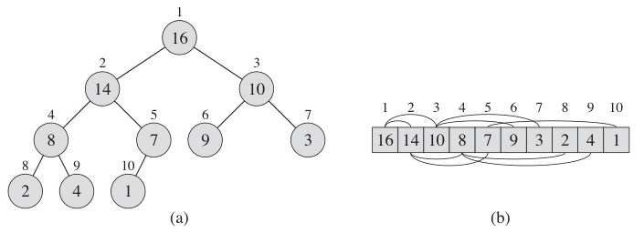
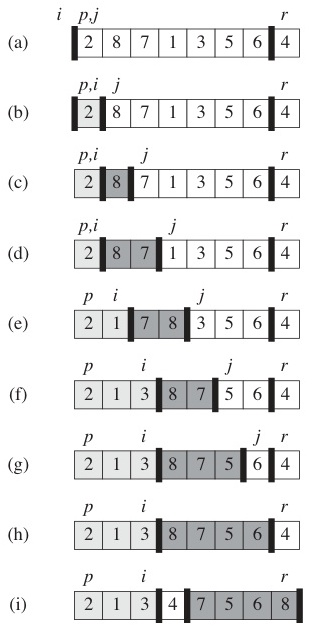
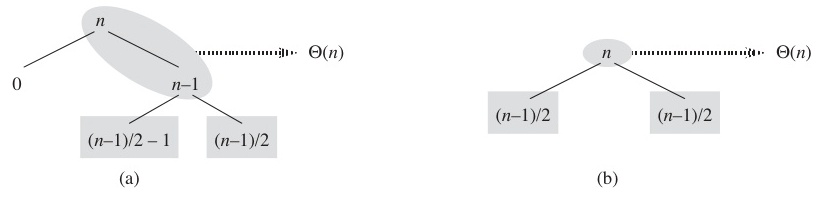
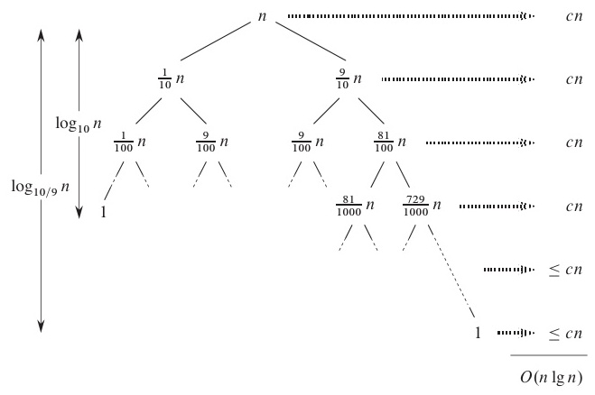
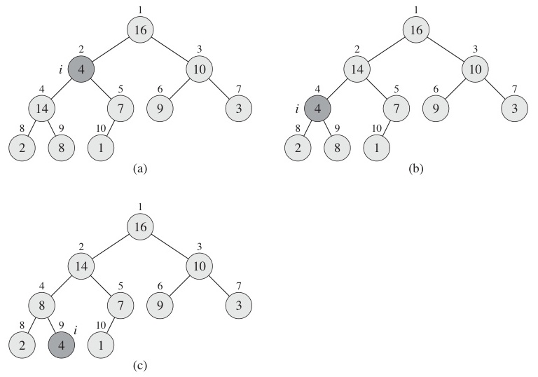
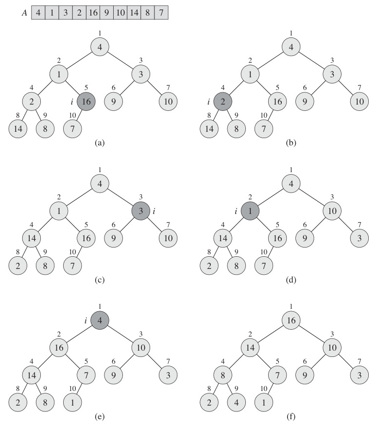
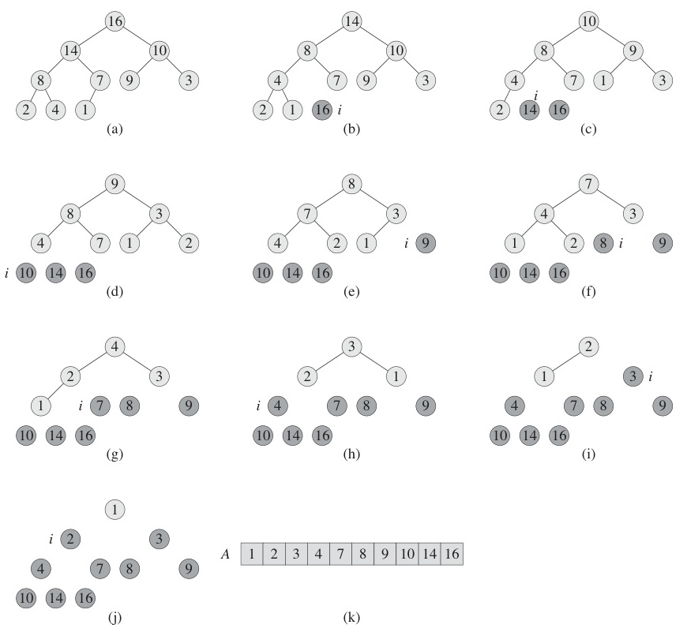

# Week 3 Lecture — Arrays, Stacks, Queues, and Basic Sorting Algorithms

[Repository Guide](../../README.md) | [English](Concepts_Lecture.md) | [한국어](Concepts_Lecture.ko.md)

> **Last Updated:** 2026-10-18
>
> Introduction to Algorithms, Cormen, Leiserson, Rivest, and Stein, Ch 6, 7, 8, 10

> **Learning Objectives:**
> 1. Explain the structure and basic operations of linked lists, stacks, queues, and heaps
> 2. Trace elementary sorting algorithms and analyze their O(n²) complexity
> 3. Trace advanced sorting algorithms and analyze their O(n log n) complexity
> 4. Explain how linear-time sorting works and the conditions that make it possible
> 5. Identify the **recursive (inductive) structure** of sorting algorithms
> 6. Compare the complexities of sorting algorithms

---

## Table of Contents

- [1. Basic Data Structures and Elementary Sorting](#1-basic-data-structures-and-elementary-sorting)
  - [1.1 Linked List](#11-linked-list)
  - [1.2 Stack](#12-stack)
  - [1.3 Queue](#13-queue)
  - [1.4 Heap](#14-heap)
  - [1.5 Sorting Algorithms: Bird's-Eye View](#15-sorting-algorithms-birds-eye-view)
- [2. Elementary Sorting: O(n²)](#2-elementary-sorting-on²)
  - [2.1 Selection Sort: Idea](#21-selection-sort-idea)
  - [2.2 Selection Sort: Pseudocode](#22-selection-sort-pseudocode)
  - [2.3 Selection Sort: Step-by-Step Example](#23-selection-sort-step-by-step-example)
  - [2.4 Bubble Sort: Idea](#24-bubble-sort-idea)
  - [2.5 Bubble Sort: Pseudocode](#25-bubble-sort-pseudocode)
  - [2.6 Bubble Sort: Step-by-Step Example](#26-bubble-sort-step-by-step-example)
  - [2.7 Insertion Sort: Idea](#27-insertion-sort-idea)
  - [2.8 Insertion Sort: Pseudocode](#28-insertion-sort-pseudocode)
  - [2.9 Insertion Sort: Inductive Proof of Correctness](#29-insertion-sort-inductive-proof-of-correctness)
  - [2.10 Recursive Structure of Elementary Sorts](#210-recursive-structure-of-elementary-sorts)
- [3. Advanced Sorting: O(n log n)](#3-advanced-sorting-on-log-n)
  - [3.1 Merge Sort: Idea](#31-merge-sort-idea)
  - [3.2 Merge Sort: Pseudocode](#32-merge-sort-pseudocode)
  - [3.3 Merge Sort: Merge Process Example](#33-merge-sort-merge-process-example)
  - [3.4 Merge Sort: Complexity Analysis](#34-merge-sort-complexity-analysis)
  - [3.5 Quick Sort: Idea](#35-quick-sort-idea)
  - [3.6 Quick Sort: Pseudocode](#36-quick-sort-pseudocode)
  - [3.7 Quick Sort: Partition Example](#37-quick-sort-partition-example)
  - [3.8 Quick Sort: Complexity Analysis](#38-quick-sort-complexity-analysis)
  - [3.9 Quick Sort: Why the Average Is O(n log n)](#39-quick-sort-why-the-average-is-on-log-n)
  - [3.10 Heap Sort: Heap Review](#310-heap-sort-heap-review)
  - [3.11 Heap Sort: Algorithm](#311-heap-sort-algorithm)
  - [3.12 Heap Sort: buildHeap and heapify](#312-heap-sort-buildheap-and-heapify)
  - [3.13 Heap Sort: buildHeap Example](#313-heap-sort-buildheap-example)
  - [3.14 Heap Sort: Sorting Phase](#314-heap-sort-sorting-phase)
  - [3.15 Heap Sort: Complexity](#315-heap-sort-complexity)
- [4. Linear-Time Sorting: O(n)](#4-linear-time-sorting-on)
  - [4.1 Lower Bound for Comparison-Based Sorting](#41-lower-bound-for-comparison-based-sorting)
  - [4.2 Radix Sort](#42-radix-sort)
  - [4.3 Radix Sort: Example](#43-radix-sort-example)
  - [4.4 Counting Sort](#44-counting-sort)
  - [4.5 Counting Sort: Example](#45-counting-sort-example)
  - [4.6 Complexity Comparison: All Sorting Algorithms](#46-complexity-comparison-all-sorting-algorithms)
- [5. Appendix](#5-appendix)
- [Summary](#summary)
- [Self-Check Questions](#self-check-questions)

---

<br>

## 1. Basic Data Structures and Elementary Sorting

### 1.1 Linked List

- A linked list is a sequence of **nodes**, and each node contains data and a pointer to the next node.

```text
┌──────┬───┐    ┌──────┬───┐    ┌──────┬───┐
│ data │  ─┼───►│ data │  ─┼───►│ data │ / │
└──────┴───┘    └──────┴───┘    └──────┴───┘
```

*Figure 1. Node links of a linked list*

```c
typedef int element;

typedef struct ListNode {
    element data;
    struct ListNode *link;
} ListNode;
```

> **Note:** In Python, linked lists are implemented using classes.
> ```python
> class ListNode:
>     def __init__(self, data, next=None):
>         self.data = data
>         self.next = next  # Reference to the next node
> ```
> C's pointer (`*link`) corresponds to Python's object reference (`self.next`).

- The operations are insertion, deletion, and search, and all of them are O(n) in the worst case when the cost of searching for the position is included.
- Visualization: [https://visualgo.net/en/list](https://visualgo.net/en/list)

> **[Data Structures]** The key differences between linked lists and arrays are as follows.
> - **Array**: Elements are stored contiguously in memory; index access is O(1), and insertion and deletion are O(n) because elements must be shifted.
> - **Linked List**: Nodes are scattered in memory; access is O(n) because the list must be traversed from the beginning, and insertion and deletion are O(1) when the position is already known because only pointers change.
>
> In the code above, `link` is the pointer to the next node, and the last node's link is NULL (`/`).

### 1.2 Stack

- A stack is a **LIFO** (Last In, First Out) structure.
- `push()`: Adds an element to the top.
- `pop()`: Removes an element from the top.

```text
         ┌─────┐
   top → │  C  │
         ├─────┤
         │  B  │
         ├─────┤
bottom → │  A  │
         └─────┘
```

*Figure 2. Top and bottom of a stack*

- Applications: function call stack, expression evaluation, backtracking
- Visualization: [https://visualgo.net/en/list](https://visualgo.net/en/list)

> **[Data Structures]** Stacks are used when the most recent item must be processed first. Representative applications include:
> - **Function call stack**: As seen with GCD recursion in Week 2, nested function calls are managed via a stack.
> - **Parenthesis matching**: In `({[]})`, push opening brackets and pop when a closing bracket appears to check for matching.
> - **Undo**: Web browser back navigation is also stack-based.

### 1.3 Queue

- A queue is a **FIFO** (First In, First Out) structure.
- `enqueue()`: Adds an element to the rear.
- `dequeue()`: Removes an element from the front.

```text
  dequeue ◄── [ A | B | C | D ] ◄── enqueue
              front        rear
```

*Figure 3. Deletion at the front and insertion at the rear of a queue*

- Applications: BFS, scheduling, buffering
- Visualization: [https://visualgo.net/en/list](https://visualgo.net/en/list)

> **[Data Structures]** Queues are used when the first arrived item must be processed first.
> - **BFS (Breadth-First Search)**: Uses a queue to explore the nearest nodes first in a graph.
> - **Printer queue**: Documents are printed in the order they were requested.
> - **OS process scheduling**: Distributes CPU time fairly.
>
> Remember that stacks (LIFO) and queues (FIFO) are opposite concepts.

### 1.4 Heap

- A **complete binary tree** satisfying the heap property. The heap property ensures the root always holds the extreme value (max or min), enabling efficient extraction of the maximum or minimum element.
  - **Max Heap**: key(parent) >= key(child)
  - **Min Heap**: key(parent) <= key(child)
- Heaps are stored in an **array** (no pointers needed).
  - Children of A[i]: **A[2i]**, **A[2i+1]**
  - Parent of A[i]: **A[floor(i/2)]**
- Applications: priority queue, heap sort
- Visualization: [visualgo.net/en/heap](https://visualgo.net/en/heap)



*Figure 4. Tree and array representations of a heap*

> **[Data Structures]** Reviewing complete binary trees and heaps from Data Structures:
> - **Complete binary tree**: All levels except the last are completely filled, and the last level is filled from left to right.
> - **Storing a heap in an array**: Place the root at index 1, then node i's left child is 2i, right child is 2i+1, and parent is floor(i/2). This allows traversing the tree using only array index calculations, with no pointers needed, which makes it very efficient.
> - **Priority queue**: The key application of heaps. The largest (Max Heap) or smallest (Min Heap) element can be extracted in O(log n).

### 1.5 Sorting Algorithms: Bird's-Eye View

- Most sorting algorithms fall between **O(n²)** and **O(n log n)**.
- If the input has special properties, **O(n)** sorting is also possible.

| Category | Algorithms | Complexity |
|:---------|:-----------|:-----------|
| Elementary | Selection, Bubble, Insertion | O(n²) |
| Advanced | Merge, Quick, Heap | O(n log n) |
| Linear-Time | Radix, Counting | O(n) |

*Table 1. Classification of sorting algorithms by complexity*

> **Note:** There are two perspectives on understanding algorithms.
> - **Flow-based**: Follow the execution steps one by one.
> - **Relational**: Observe how each step transforms the state (deeper understanding).

> **Key Point:** Sorting algorithms are a core topic in algorithms courses because (1) they are the most frequently used operation in practice, (2) they encompass core concepts like divide and conquer, recursion, and complexity analysis, and (3) there is the theoretically important result of the lower bound for comparison-based sorting (Ω(n log n)).

---

<br>

## 2. Elementary Sorting: O(n²)

### 2.1 Selection Sort: Idea

Both directions work for selection sort. You can either find the **minimum** and place it at the front, or find the **maximum** and place it at the back. The core principle is the same: one element is fixed in its final position each round. The pseudocode below uses the **max variant** (find the largest and swap it to the end), while many textbooks and labs use the min variant.

In each iteration:
1. Find the **minimum** (or maximum) value in the unsorted portion.
2. **Swap** it with the first (or last) element of the unsorted portion.
3. **Exclude** that element (it is now in its final position).
4. Repeat until one element remains.

```text
[15, 11, 29, 20, 65, 3, 73, 48, 31, 8]    Find minimum (3)
[3 | 11, 29, 20, 65, 15, 73, 48, 31, 8]   Swap 3↔15, exclude 3
[3, 8 | 29, 20, 65, 15, 73, 48, 31, 11]   Find min(8), swap 8↔11, exclude
  ...
[3, 8, 11, 15, 20, 29, 31, 48, 65, 73]    Sorting complete!
```

*Figure 5. Progress of min-variant selection sort*

- Each round **selects** the minimum (or maximum) value.

### 2.2 Selection Sort: Pseudocode

```text
selectionSort(A[], n)          ▷ Sort A[1...n]
{
    for last ← n downto 2 {                           ── ①
        Find the largest element A[k] in A[1...last]; ── ②
        A[k] ↔ A[last];   ▷ Swap A[k] and A[last]     ── ③
    }
}
```

**Complexity Analysis:**
- Loop ① executes **n - 1** times.
- Finding the maximum ② requires n-1, n-2, ..., 2, 1 comparisons.
- Swap ③ is constant time.

$$T(n) = (n-1) + (n-2) + \cdots + 2 + 1 = \frac{n(n-1)}{2} = \Theta(n^2)$$

- **Worst case**: Θ(n²), **Average case**: Θ(n²)

> **Key Point:** The key characteristic of selection sort is that regardless of the input state (already sorted, reversed, random), it is **always Θ(n²)**. Best, average, and worst cases are all the same. The number of comparisons is always n(n-1)/2, and only the number of swaps varies (up to n-1, or 0 if already sorted).

> **Note:** This note explains selection sort as finding the maximum and sending it to the back, while Week 3 Lab finds the minimum and brings it to the front. Both are selection sort with the same complexity. Only the direction differs; the core principle (fixing one element per round) is the same.

### 2.3 Selection Sort: Step-by-Step Example

| Step | Array State | Action |
|:-----|:-----------|:-------|
| 0 | `[15, 11, 29, 20, 65, 3, 73, 48, 31, 8]` | Initial array |
| 1 | `[15, 11, 29, 20, 65, 3, \|8\|, 48, 31 \| 73]` | max=73, swap 73↔8 |
| 2 | `[15, 11, 29, 20, \|31\|, 3, 8, 48 \| 65, 73]` | max=65, swap 65↔31 |
| 3 | `[15, 11, 29, 20, 31, 3, 8 \| 48, 65, 73]` | max=48, no swap needed |
| 4 | `[15, 11, 29, 20, \|8\|, 3 \| 31, 48, 65, 73]` | max=31, swap 31↔8 |
| 5 | `[15, 11, \|3\|, 20, 8 \| 29, 31, 48, 65, 73]` | max=29, swap 29↔3 |
| 6 | `[15, 11, 3, \|8\| \| 20, 29, 31, 48, 65, 73]` | max=20, swap 20↔8 |
| 7 | `[\|8\|, 11, 3 \| 15, 20, 29, 31, 48, 65, 73]` | max=15, swap 15↔8 |
| 8 | `[8, \|3\| \| 11, 15, 20, 29, 31, 48, 65, 73]` | max=11, swap 11↔3 |
| 9 | `[3, 8, 11, 15, 20, 29, 31, 48, 65, 73]` | Sorting complete |

*Table 2. Array state at each step of max-variant selection sort*

Animation: [https://visualgo.net/en/sorting](https://visualgo.net/en/sorting)

### 2.4 Bubble Sort: Idea

In each iteration:
1. Start from the left and compare **adjacent pairs**.
2. **Swap** them if they are in the wrong order.
3. The largest element **bubbles up** to the rightmost position.
4. Exclude the rightmost element and repeat.

```text
[15, 65, 29, 20, 11, 8, 73, 48, 31, 3]    Compare adjacent pairs
[15, 29, 20, 11, 8, 65, 48, 31, 3, |73|]  73 bubbles to end, excluded
[15, 20, 11, 8, 29, 48, 31, 3, |65, 73|]  65 bubbles up, excluded
  ...
[3, 8, 11, 15, 20, 29, 31, 48, 65, 73]    Sorting complete!
```

*Figure 6. Progress of bubble sort*

- Each round, the **maximum** bubbles up to the end.

> **Note:** "Bubble sort" gets its name from how the largest element rises to the top (right) like a bubble rising in water.

### 2.5 Bubble Sort: Pseudocode

```text
bubbleSort(A[], n)             ▷ Sort A[1...n]
{
    for last ← n downto 2                            ── ①
        for i ← 1 to last-1                          ── ②
            if (A[i] > A[i+1]) then A[i] ↔ A[i+1];   ── ③
}
```

**Complexity Analysis:**
- Loop ① executes **n - 1** times.
- Loop ② executes n-1, n-2, ..., 2, 1 times respectively.
- Swap ③ is constant time.

$$T(n) = (n-1) + (n-2) + \cdots + 2 + 1 = \frac{n(n-1)}{2} = \Theta(n^2)$$

- **Worst case**: Θ(n²), **Average case**: Θ(n²)

> **Note:** Bubble sort has a useful optimization. If **no swaps occur** during an entire pass, the array is already sorted and can terminate immediately. With this optimization, the **best case (already sorted input) becomes Θ(n)**. The `swapped` flag in the Python code of Week 3 Lab is precisely this optimization.

### 2.6 Bubble Sort: Step-by-Step Example

| Pass | Array After Pass | Bubbled Element |
|:-----|:----------------|:----------------|
| 0 | `[15, 65, 29, 20, 11, 8, 73, 48, 31, 3]` | (initial) |
| 1 | `[15, 29, 20, 11, 8, 65, 48, 31, 3, \|73\|]` | 73 |
| 2 | `[15, 20, 11, 8, 29, 48, 31, 3, \|65, 73\|]` | 65 |
| 3 | `[15, 11, 8, 20, 29, 31, 3, \|48, 65, 73\|]` | 48 |
| ... | ... | ... |
| 9 | `[3, 8, 11, 15, 20, 29, 31, 48, 65, 73]` | Complete |

*Table 3. Array state after each pass of bubble sort*

Within each pass, adjacent elements are compared left to right and swapped if out of order.

Animation: [https://visualgo.net/en/sorting](https://visualgo.net/en/sorting)

### 2.7 Insertion Sort: Idea

In each iteration:
1. Take the next element (**key**) from the unsorted portion.
2. **Shift** larger elements in the sorted portion to the right.
3. **Insert** the element at the correct position.

```text
[29]  10  14  37  13           29 is trivially sorted
[10, 29]  14  37  13           Insert 10: shift 29, place 10
[10, 14, 29]  37  13           Insert 14: shift 29, place 14
[10, 14, 29, 37]  13           Insert 37: already in place
[10, 13, 14, 29, 37]           Insert 13: shift 37,29,14, place 13
```

*Figure 7. Progress of insertion sort*

- Each element is inserted into the already **sorted** subarray.

> **Note:** Insertion sort works the same way as sorting the cards in your hand during a card game. When you receive a new card, you insert it into the correct position among the already sorted cards. This intuitive approach is precisely insertion sort.

### 2.8 Insertion Sort: Pseudocode

```text
insertionSort(A[], n)          ▷ Sort A[1...n]
{
    for i ← 2 to n                                      ── ①
        Insert A[i] into its proper place in A[1...i];  ── ②
}
```

**Complexity Analysis:**
- Loop ① executes **n - 1** times.
- Insertion ② requires at most i - 1 comparisons.

| Case | Comparisons | Complexity |
|:-----|:-----------|:-----------|
| **Worst** (reverse sorted) | 1 + 2 + ... + (n-1) | Θ(n²) |
| **Average** | 1/2 (1 + 2 + ... + (n-1)) | Θ(n²) |
| **Best** (already sorted) | 1 + 1 + ... + 1 | **Θ(n)** |

*Table 4. Comparisons and complexity of insertion sort by case*

Insertion sort is the **fastest** among elementary sorts for nearly sorted data.

> **Key Point:** The reason insertion sort is Θ(n) in the best case: when already sorted, inserting each element requires only **1 comparison** (comparing with the element directly in front confirms it is already in the correct position). Total n-1 times × 1 comparison = Θ(n). This is why insertion sort is frequently used in practice for **nearly sorted, small-scale data**. Python's Timsort also uses insertion sort internally for small segments.

### 2.9 Insertion Sort: Inductive Proof of Correctness

**Loop Invariant**: At the start of the i-th iteration, subarray A[1...i-1] is sorted.

- **Base case** (n = 1): A single element A[1] is trivially sorted.
- **Inductive step**: If A[1...k] is sorted (P(k) holds), inserting A[k+1] at the correct position yields sorted A[1...k+1] (P(k+1) holds).
- **Conclusion**: After the n-th iteration, the entire array A[1...n] is sorted.

> **[Discrete Mathematics]** This is exactly the same as applying **mathematical induction** (learned in high school) to algorithms.

> **Note:** **Exam tip.** A **loop invariant** is a key tool for proving algorithm correctness. It is a condition that remains true at every iteration of the loop. Its structure is identical to mathematical induction.
> - Base case = true before the loop starts
> - Inductive step = still true after one iteration
> - Conclusion = the desired property holds after the loop terminates
>
> When exam questions ask for correctness proofs, using loop invariants is the standard approach.

### 2.10 Recursive Structure of Elementary Sorts

All three elementary sorts share the **same recursive structure**.

```text
T(n) = T(n-1) + Theta(n)
```

| Algorithm | Recursive Form | Work Per Level |
|:----------|:--------------|:-----------------|
| **Insertion Sort** | Sort A[1...n-1], then insert A[n] | insert(n) = Θ(n) |
| **Selection Sort** | Find max and swap, then sort A[1...n-1] | maxSwap(n) = Θ(n) |
| **Bubble Sort** | Bubble max to end, then sort A[1...n-1] | bubble(n) = Θ(n) |

*Table 5. Recursive forms and work per level of elementary sorts*

```text
insertionSort(A, n) {       selectionSort(A, n) {       bubbleSort(A, n) {
  if (n == 1) return;         if (n == 1) return;         if (n == 1) return;
  insertionSort(A, n-1);      maxSwap(A, n);              bubble(A, n);
  insert(A, n);               selectionSort(A, n-1);      bubbleSort(A, n-1);
}                           }                           }
```

> **Note:** The key difference among the three algorithms is that insertion sort does its work **after** the recursive call, while selection sort and bubble sort do their work **before** the recursive call.

> **Key Point:** This recursive structure is very important. All three algorithms follow the same recurrence $T(n) = T(n-1) + \Theta(n)$, which solves to $T(n) = \Theta(n) + \Theta(n-1) + ... + \Theta(1) = \Theta(n^2)$. The fundamental cause of O(n²) is the structure where **the problem size decreases by only 1 at each step**. O(n log n) algorithms (merge, quick) split the problem **in half** (quick sort when the partition is balanced), giving $T(n) = 2T(n/2) + \Theta(n)$, which is much faster.

---

<br>

## 3. Advanced Sorting: O(n log n)

As Section 2.10 showed, elementary sorts reduce the problem by 1 element each step, leading to O(n²). Merge sort splits the problem in half at each step, and quick sort splits it into two parts around a pivot (close to balanced on average), achieving O(n log n). This divide and conquer strategy is the key idea behind these two algorithms, while heap sort achieves O(n log n) by using the heap data structure.

### 3.1 Merge Sort: Idea

**Divide and Conquer**:
1. **Divide**: Split the array into two halves.
2. **Conquer**: Recursively sort each half.
3. **Combine**: Merge the two sorted halves.

```text
[31, 3, 65, 73, 8, 11, 20, 29, 48, 15]     Original

[31, 3, 65, 73, 8] | [11, 20, 29, 48, 15]  ① Divide

[3, 8, 31, 65, 73] | [11, 15, 20, 29, 48]  ②③ Sort each half

[3, 8, 11, 15, 20, 29, 31, 48, 65, 73]     ④ Merge
```

*Figure 8. Divide, sort, and merge steps of merge sort*

### 3.2 Merge Sort: Pseudocode

```text
mergeSort(A[], p, r)             ▷ Sort A[p...r]
{
    if (p < r) then {
        q ← floor((p + r) / 2);  ▷ Midpoint
        mergeSort(A, p, q);      ▷ Sort left half
        mergeSort(A, q+1, r);    ▷ Sort right half
        merge(A, p, q, r);       ▷ Merge the two sorted halves
    }
}
```

```text
merge(A[], p, q, r)              ▷ Merge A[p...q] and A[q+1...r]
{
    i ← p; j ← q+1; t ← 1;
    while (i ≤ q and j ≤ r) {
        if (A[i] ≤ A[j])
            tmp[t++] ← A[i++];
        else
            tmp[t++] ← A[j++];
    }
    Copy remaining elements to tmp[];  ▷ Copy remaining elements to tmp[]
    Copy tmp[] back to A[p...r];       ▷ Copy tmp[] back to A[p...r]
}
```

> **Key Point:** The core of the merge function is combining two **already sorted** arrays. It compares elements from the front of both arrays and places the smaller one into the result array. Since both sides are sorted, this process completes in O(n). This merge is precisely the Combine step.

### 3.3 Merge Sort: Merge Process Example

Merging `[3, 8, 31, 65, 73]` and `[11, 15, 20, 29, 48]`:

```text
 i                      j                       tmp
[3, 8, 31, 65, 73]     [11, 15, 20, 29, 48]     []

Step 1: 3 < 11  → tmp = [3],         advance i
Step 2: 8 < 11  → tmp = [3, 8],      advance i
Step 3: 31 > 11 → tmp = [3, 8, 11],  advance j
Step 4: 31 > 15 → tmp = [3, 8, 11, 15],  advance j
Step 5: 31 > 20 → tmp = [3, 8, 11, 15, 20],  advance j
Step 6: 31 > 29 → tmp = [3, 8, 11, 15, 20, 29],  advance j
Step 7: 31 < 48 → tmp = [3, 8, 11, 15, 20, 29, 31],  advance i
Step 8: 65 > 48 → tmp = [3, 8, 11, 15, 20, 29, 31, 48],  advance j
Step 9-10: Copy remaining [65, 73]

Result: [3, 8, 11, 15, 20, 29, 31, 48, 65, 73]
```

*Figure 9. Merging two sorted arrays*

### 3.4 Merge Sort: Complexity Analysis

**Recurrence**:

$$T(n) = 2T\left(\frac{n}{2}\right) + \Theta(n)$$

**Recursion Tree**: Total work at each level is Θ(n), and there are log₂(n) levels.

```text
Level 0:         n            → n work
Level 1:     n/2   n/2        → n work
Level 2:   n/4 n/4 n/4 n/4    → n work
  ...
Level h:   1  1  1  ...  1    → n work

h = log₂n levels  →  Total: n × log₂n
```

*Figure 10. Work per level of the merge sort recursion tree*

$$T(n) = \Theta(n \log n)$$

> **Key Point:** Merge sort is **always** Θ(n log n); worst, average, and best cases are all the same.
> The trade-off is that **O(n) extra space** is needed for the temporary array.

> **Note:** Applying the Master Theorem from Week 2 to this recurrence: a=2, b=2, f(n)=n, so $n^{\log_2 2} = n$, and $f(n) = \Theta(n^{\log_b a})$, giving **Case 2**. Therefore $T(n) = \Theta(n \log n)$. Whether solved by repeated substitution or the Master Theorem, the result is the same.

### 3.5 Quick Sort: Idea

1. Select a **pivot** element (e.g., the last element).
2. **Partition**: Rearrange elements so those smaller than the pivot go left and larger ones go right.
3. The pivot is now in its **final sorted position**.
4. Recursively sort the left and right subarrays.

```text
[31, 8, 48, 73, 11, 3, 20, 29, 65, 15]    pivot = 15

[8, 11, 3, |15|, 31, 48, 20, 29, 65, 73]  After partition

[3, 8, 11, |15|, 20, 29, 31, 48, 65, 73]  Left & right recursively sorted
```

*Figure 11. Quick sort around pivot 15*

> **Key Point:** The key differences between merge sort and quick sort are as follows.
> - **Merge sort**: Divide first (division is simple), do work when combining (merge is complex).
> - **Quick sort**: Do work when dividing (partition is complex); combining is unnecessary (already in place).
>
> In other words, merge sort's core is combining while quick sort's core is dividing.

### 3.6 Quick Sort: Pseudocode

```text
quickSort(A[], p, r)             ▷ Sort A[p...r]
{
    if (p < r) then {
        q ← partition(A, p, r);  ▷ Partition around pivot
        quickSort(A, p, q-1);    ▷ Sort left subarray
        quickSort(A, q+1, r);    ▷ Sort right subarray
    }
}
```

```text
partition(A[], p, r)
{
    pivot ← A[r];                ▷ Choose last element as pivot
    i ← p - 1;
    for j ← p to r-1 {
        if (A[j] ≤ pivot) {
            i ← i + 1;
            A[i] ↔ A[j];
        }
    }
    A[i+1] ↔ A[r];               ▷ Place pivot in its final position
    return i + 1;
}
```

> **Note:** `i` marks the boundary: all elements from index p through `i` are <= pivot.
> `j` scans the array from left to right.

**Partition Invariant**: At every point during the loop, elements A[p..i] are <= pivot, elements A[i+1..j-1] are > pivot, and elements A[j..r-1] are unexamined.


*Figure 12. Partition invariant of PARTITION*

> **Note:** An intuitive way to understand the partition function: `i` points to the end of the region <= pivot, and `j` points to the start of the unexamined region. When A[j] <= pivot, i is incremented to expand the <= pivot region, and A[j] is swapped into that position. At the end, placing the pivot at position i+1 ensures everything to its left is <= pivot and everything to its right is > pivot.

> **Note:** The reason `i = p - 1` for initialization: i tracks the last index of the <= pivot region. Initially, no elements have been identified as <= pivot, so the end of the region is placed **just before** the array start (p-1). When the first element with A[j] <= pivot is found, i increases to p, finally pointing to a valid index.

### 3.7 Quick Sort: Partition Example

Partitioning `[31, 8, 48, 73, 11, 3, 20, 29, 65, 15]` with pivot = 15:

```text
pivot = A[10] = 15,  i = 0

j=1: A[1]=31 > 15   → skip
j=2: A[2]=8  ≤ 15   → i=1, swap A[1]↔A[2]
j=3: A[3]=48 > 15   → skip
j=4: A[4]=73 > 15   → skip
j=5: A[5]=11 ≤ 15   → i=2, swap A[2]↔A[5]
j=6: A[6]=3  ≤ 15   → i=3, swap A[3]↔A[6]
j=7~9: > 15         → skip

Final: swap A[4]↔A[10]
→ [8, 11, 3, |15|, 31, 48, 20, 29, 65, 73]
```

*Figure 13. Trace of PARTITION with pivot 15*



*Figure 14. Step-by-step operation of PARTITION*

Animation: [visualgo.net/en/sorting](https://visualgo.net/en/sorting)

### 3.8 Quick Sort: Complexity Analysis

**Recurrence**: T(n) = T(i - 1) + T(n - i) + Θ(n), where i is the pivot's final position.

| Case | Partition Balance | Recurrence | Complexity |
|:-----|:-----------------|:-----------|:-----------|
| **Worst** | 0 : n-1 (sorted input) | T(n) = T(n-1) + Θ(n) | **Θ(n²)** |
| **Best** | n/2 : n/2 (perfect split) | T(n) = 2T(n/2) + Θ(n) | **Θ(n log n)** |
| **Average** | Random split | See below | **Θ(n log n)** |

*Table 6. Partition balance and complexity of quick sort by case*

**Worst case**: The input is already sorted, so the pivot is always the minimum or maximum.

```text
T(n) = T(0) + T(n-1) + Theta(n) = T(n-1) + Theta(n)
     = Theta(n) + Theta(n-1) + ... + Theta(1) = Theta(n^2)
```



*Figure 15. Worst-case and best-case partitions of quick sort*

> **Note:** Practical techniques to avoid quick sort's worst-case O(n²) are as follows.
> 1. **Randomized Pivot**: Choosing the pivot randomly makes the probability of worst-case occurrence extremely low.
> 2. **Median-of-Three**: Choose the median of the first, middle, and last elements as the pivot.
> 3. **Introsort**: Switch to heap sort when recursion depth becomes too deep (this is how `std::sort` works in major C++ standard library implementations such as GCC's libstdc++).

### 3.9 Quick Sort: Why the Average Is O(n log n)

**Key Insight**: Even with a partition ratio that is **any constant ratio** (1:9, 1:99), the depth remains O(log n).

- Longest path: n → 9n/10 → (9/10)²n → ... → 1
- Depth = $\log_{10/9} n = O(\log n)$
- Total work at each level is still O(n).



*Figure 16. Recursion tree of a 1/10 : 9/10 split*

**Average Analysis Proof** (using induction):
- Assume $T(i) \le c \cdot i \log i$ for all i < n.
- Averaging over all possible pivot positions gives $T(n) = \frac{1}{n} \sum_{i=0}^{n-1} [T(i) + T(n-i-1)] + \Theta(n)$.
- Integral approximation shows $T(n) \le c \cdot n \log n$.
- Therefore T(n) = **O(n log n)** (average).

The full proof involves summing over all possible pivot positions and using integral approximation. The key takeaway is that random pivot selection makes the expected number of comparisons $O(n \log n)$, the same order as merge sort's guaranteed performance.

> **Note:** Why an unbalanced split like 1:9 is acceptable: even when the problem size shrinks by 9/10 each time, solving $n \times (9/10)^k = 1$ gives $k = \log_{10/9}(n)$, which is $O(\log n)$ (only the base differs). What actually causes problems is when an **extreme imbalance** like 0:(n-1) repeats every time.

### 3.10 Heap Sort: Heap Review

**Heap**: A complete binary tree with the heap property, stored in an array.

```text
   Min Heap Example      Max Heap Example
          3                     9
        /   \                 /   \
       6     4               7     8
      / \   /               / \   /
     8   9 7               3   6 4
```

*Figure 17. Examples of a min heap and a max heap*

**Array Representation** (1-indexed):
- Children of A[i]: **A[2i]** and **A[2i + 1]**
- Parent of A[i]: **A[floor(i/2)]**
- Sibling of A[i]: **A[i-1]** (when i is odd and greater than 1), **A[i+1]** (when i is even)



*Figure 18. MAX-HEAPIFY operation*

### 3.11 Heap Sort: Algorithm

```text
heapSort(A[], n)              ▷ Sort A[1...n]
{
    buildHeap(A, n);          ▷ Build a min heap (or max heap)
    for i ← n downto 2 {
        A[1] ↔ A[i];          ▷ Swap root (min/max) with last element
        heapify(A, 1, i-1);   ▷ Restore heap property
    }
}
```

**Two Key Subroutines:**
1. `buildHeap`: Transforms an arbitrary array into a heap. **O(n)**
2. `heapify`: Fixes the heap property at a single node. **O(log n)**

> **Key Point:** O(n log n) is guaranteed even in the **worst case**, which is a difference from quick sort.

> **Note:** How heap sort works: (1) Turn the entire array into a heap (buildHeap). (2) Move the heap's root (min or max) to the end of the array. (3) Reduce the heap size by 1 and restore the heap property (heapify). Repeating this sorts the array.

> **Note:** This implementation uses a **min heap** (producing descending order). For **ascending** sort, use a **max heap** instead and replace min comparisons with max comparisons. The textbook (CLRS) uses a max heap for ascending sort.

### 3.12 Heap Sort: buildHeap and heapify

```text
buildHeap(A[], n)
{
    for i ← floor(n/2) downto 1      ▷ Start from the last internal node
        heapify(A, i, n);
}
```

```text
heapify(A[], k, n)                   ▷ Fix heap rooted at A[k]
{                                    ▷ Subtrees of A[k] are already heaps
    left ← 2k;  right ← 2k + 1;
    if (right ≤ n) then {            ▷ Two children
        if (A[left] < A[right])
            smaller ← left;
        else smaller ← right;
    }
    else if (left ≤ n) then          ▷ Only left child exists
        smaller ← left;
    else return;                     ▷ Leaf node

    if (A[smaller] < A[k]) then {    ▷ Heap property violated
        A[k] ↔ A[smaller];
        heapify(A, smaller, n);      ▷ Recurse downward
    }
}
```

> **Note:** The reason buildHeap is O(n) is not intuitive. The rationale for why it is O(n) rather than O(n log n): leaf nodes (half of all nodes) require no heapify, height-1 nodes only go down 1 level, height-2 nodes only go down 2 levels. The total sum is $\sum_{h=0}^{\log n} \frac{n}{2^{h+1}} \cdot h$, and this series sums to O(n). A mathematically rigorous proof is in Section 6.3 of the textbook (CLRS).

> **Note:** The reason for starting at `floor(n/2)`: Nodes from index floor(n/2)+1 through n are all **leaf nodes** (nodes with no children). Leaf nodes are trivially heaps of size 1, so heapify is unnecessary. Therefore, applying heapify in reverse order from the last internal node floor(n/2) down to root (1) propagates the heap property from bottom to top.

### 3.13 Heap Sort: buildHeap Example

Building a min heap from `A = [7, 9, 4, 8, 6, 3]`:

```text
(a) Start          (b) heapify(3)   (c) heapify(2)
     7                 7                7
   /   \             /   \            /   \
  9     4           9     3          6     3
 / \   /           / \   /          / \   /
8   6 3           8   6 4          8   9 4

(d) heapify(1)   (e) Final Heap
     3                 3
   /   \             /   \
  6     4           6     4
 / \   /           / \   /
8   9 7           8   9 7
```

*Figure 19. Building a min heap with buildHeap*

> **Note:** buildHeap processes nodes **bottom-up** (from floor(n/2) to 1).



*Figure 20. Operation of BUILD-MAX-HEAP*

### 3.14 Heap Sort: Sorting Phase

After buildHeap, repeatedly extract the minimum.

```text
(a) [3,6,4,8,9,7]  Swap A[1]↔A[6], heapify → [4,6,7,8,9,|3]
(b) [4,6,7,8,9,|3] Swap A[1]↔A[5], heapify → [6,8,7,9,|4,3]
(c) [6,8,7,9,|4,3] Swap A[1]↔A[4], heapify → [7,8,9,|6,4,3]
(d) [7,8,9,|6,4,3] Swap A[1]↔A[3], heapify → [8,9,|7,6,4,3]
(e) [8,9,|7,6,4,3] Swap A[1]↔A[2] → Done!

Result (descending): [9, 8, 7, 6, 4, 3]
```

*Figure 21. Sorting phase of heap sort with a min heap*

> **Key Point:** Min heap → **descending** order.
> Max heap → **ascending** order.

> **Note:** With a min heap, the smallest element is extracted first and placed at the end of the array. After all extractions, the array is in descending order because the smallest elements, which are extracted first, occupy the rightmost positions.



*Figure 22. Sorting phase of HEAPSORT*

### 3.15 Heap Sort: Complexity

```text
heapSort(A[], n)
{
    buildHeap(A, n);          → O(n)  [tighter analysis] or O(n log n)
    for i ← n downto 2 {      → n - 1 iterations
        A[1] ↔ A[i];          → O(1)
        heapify(A, 1, i-1);   → O(log n)
    }
}
```

| Phase | Complexity |
|:------|:-----------|
| buildHeap | O(n) |
| Sorting loop | (n-1) × O(log n) = **O(n log n)** |
| **Total** | **O(n log n)** |

*Table 7. Complexity of each phase of heap sort*

> **Key Point:** Heap sort is **O(n log n) even in the worst case**, with no degenerate inputs like those of quick sort.
> It is also **in-place** (unlike merge sort, no extra array is needed).

> **Note:** **Exam tip.** Comparison of the three O(n log n) sorts:
>
> | | Merge Sort | Quick Sort | Heap Sort |
> |:---|:---|:---|:---|
> | Worst | O(n log n) | **O(n²)** | O(n log n) |
> | Extra space | **O(n)** | O(log n) | O(1) |
> | Practical speed | Fast | **Fastest** | Average |
> | Stability | **Stable** | Unstable | Unstable |
>
> The reason quick sort is most commonly used in practice despite its worst-case O(n²) is its excellent cache efficiency and small constant factors.

---

<br>

## 4. Linear-Time Sorting: O(n)

### 4.1 Lower Bound for Comparison-Based Sorting

**Theorem**: Any comparison-based sorting algorithm requires at least **Ω(n log n)** comparisons in the worst case.

> **Key Point:** This means selection, bubble, insertion, merge, quick, and heap sort **cannot be faster than** O(n log n) in the worst case as long as they use only comparisons.

**However**: If elements have **special properties**, comparisons can be bypassed entirely.

| Algorithm | Condition | Complexity |
|:----------|:---------|:-----------|
| **Radix Sort** | Elements have at most k digits (k = constant) | Θ(n) |
| **Counting Sort** | Element values range in [-O(n), O(n)] | Θ(n) |

*Table 8. Conditions and complexity of linear-time sorts*

> **Key Point:** This lower bound theorem is proven using the **decision tree** model. A comparison-based sort asks `A[i] <= A[j]?` (yes/no) at each step. Since there are n! possible orderings of n elements, at least log₂(n!) comparisons are needed to distinguish them all. By Stirling's approximation, log₂(n!) = Θ(n log n). That is, **a sort that uses only comparisons cannot finish with fewer than Ω(n log n) comparisons in the worst case**.

> **Note:** Stirling's approximation states that $n! \approx (n/e)^n \cdot \sqrt{2\pi n}$, so $\log_2(n!) \approx n \cdot \log_2(n) - n \cdot \log_2(e)$, which is $\Theta(n \log n)$.

> **Note:** To understand the decision tree concretely, consider sorting n=3 elements [a, b, c]. There are 3! = 6 possible orderings. Each comparison (`a <= b?`) is an internal node of the tree, and each leaf is one permutation (sorting result). The minimum height of a binary tree with 6 leaves is ⌈log₂ 6⌉ = 3, so at least 3 comparisons are needed. In general, the height of a binary tree with n! leaves is at least log₂(n!) = Θ(n log n).

### 4.2 Radix Sort

Sort by each digit position, from the **least significant digit (LSD)** to the **most significant digit (MSD)**, using a **stable sort**.

```text
radixSort(A[], n, k)           ▷ Elements have at most k digits
{
    for i ← 1 to k
        Stable-sort A[1...n] on the i-th digit;
                               ▷ Stable sort on the i-th digit
}
```

**Stable Sort**: A sort that preserves the **original relative order** of elements with equal keys.

> **Note:** Why stability is important in radix sort: After sorting by the 1's digit, when sorting by the 10's digit, elements with the same 10's digit must already be ordered by their 1's digit. If the sort is not stable, this order breaks and the final result becomes incorrect.

> **Note:** Processing from LSD to MSD works because each round's stable sort preserves the ordering established by all previous rounds. After sorting by the i-th digit, elements are correctly ordered by the combination of digits 1 through i.

### 4.3 Radix Sort: Example

Sort: `[0123, 2154, 0222, 0004, 0283, 1560, 1061, 2150]`

```text
 Original   1st digit    2nd digit    3rd digit    4th digit
 0123         1560         0004         0004         0004
 2154         2150         0222         1061         0123
 0222         1061         0123         0123         0222
 0004         0222         2150         2150         0283
 0283         0123         2154         2154         1061
 1560         0283         1560         0222         1560
 1061         2154         1061         0283         2150
 2150         0004         0283         1560         2154
```

*Figure 23. Digit-by-digit progress of LSD radix sort*

- Each column shows the result of applying a **stable sort** on the highlighted digit.
- After processing all k = 4 digits, the array is fully sorted.

$$T(n) = k \cdot \Theta(n) = \Theta(n) \quad \text{(when }k\text{ is constant)}$$

### 4.4 Counting Sort

Used when element values are within a range. All values must be in `{1, 2, ..., k}` (k = O(n)).

```text
countingSort(A[], B[], n)        ▷ A[1...n]: input, B[1...n]: output
{
    for i ← 1 to k
        C[i] ← 0;                ▷ Initialize counts

    for j ← 1 to n
        C[A[j]]++;               ▷ Count occurrences

    // C[i] now holds the number of elements equal to i

    for i ← 2 to k
        C[i] ← C[i] + C[i-1];    ▷ Cumulative sum

    // C[i] now holds the number of elements ≤ i

    for j ← n downto 1 {
        B[C[A[j]]] ← A[j];       ▷ Place element
        C[A[j]]--;               ▷ Decrement count
    }
}
```

> **Key Point:** The core idea of counting sort: (1) Count how many times each value appears. (2) Compute the cumulative sum, which directly tells where each value should go in the result array. (3) Traverse the original array from back to front, placing each element in its correct position in the result array (traversing from back to front ensures stability). Since no comparisons are made, the Ω(n log n) lower bound is bypassed.

> **Note:** Why traversing from back to front ensures stability: The cumulative sum C[v] points to the last position where a value v should go. By traversing from back to front, among elements with the same value, **the one later in the original** is placed first at the later position in the result array, and C[v] decrements to leave earlier positions for the rest. Traversing from front to back would reverse the relative order. Since radix sort depends on counting sort's stability, this traversal direction is very important.

### 4.5 Counting Sort: Example

Sort `A = [3, 1, 2, 1, 1, 4, 2, 3, 1, 2]` with k = 4:

```text
Step 1: Count occurrences               Step 2: Cumulative sum
C = [4, 3, 2, 1]                  C = [4, 7, 9, 10]
     1  2  3  4                        1  2  3  4

     ↑                                 ↑
     1 appears 4 times, 2 three times,    Elements ≤ 1: 4
     3 two times, 4 one time              Elements ≤ 2: 7
                                          Elements ≤ 3: 9
                                          Elements ≤ 4: 10

Step 3: Place elements (right to left for stability)
j=10: A[10]=2, C[2]=7 → B[7]=2, C[2]=6
j=9:  A[9]=1,  C[1]=4 → B[4]=1, C[1]=3
j=8:  A[8]=3,  C[3]=9 → B[9]=3, C[3]=8
  ...

B = [1, 1, 1, 1, 2, 2, 2, 3, 3, 4]     ← Sorting complete!
```

*Figure 24. Step-by-step progress of counting sort*

$$T(n) = \Theta(n + k) = \Theta(n) \quad \text{(when }k = O(n)\text{)}$$

### 4.6 Complexity Comparison: All Sorting Algorithms

| Algorithm | Worst | Average | Best | Space | Stable? | Note |
|:----------|:------|:--------|:-----|:------|:--------|:-----|
| **Selection Sort** | Θ(n²) | Θ(n²) | Θ(n²) | O(1) | No | Always same complexity |
| **Bubble Sort** | Θ(n²) | Θ(n²) | Θ(n) | O(1) | Yes | Best Θ(n) with optimization |
| **Insertion Sort** | Θ(n²) | Θ(n²) | **Θ(n)** | O(1) | Yes | Optimal for nearly sorted data |
| **Merge Sort** | Θ(n log n) | Θ(n log n) | Θ(n log n) | **O(n)** | Yes | Stable and always guaranteed |
| **Quick Sort** | **Θ(n²)** | Θ(n log n) | Θ(n log n) | O(log n) | No | Fastest in practice |
| **Heap Sort** | Θ(n log n) | Θ(n log n) | Θ(n log n) | O(1) | No | In-place, worst-case guaranteed |
| **Counting Sort** | Θ(n + k) | Θ(n + k) | Θ(n + k) | O(k) | Yes | Requires limited value range |
| **Radix Sort** | Θ(nk) | Θ(nk) | Θ(nk) | O(n + k) | Yes | Θ(n) when digit count k is constant |

*Table 9. Complexity, space, and stability of all sorting algorithms*

> **Key Point:** The lower bound for comparison-based sorting is **Ω(n log n)**.
> Linear-time sorts bypass this by exploiting input structure rather than comparisons.

> **Note:** The k in Table 9 means different things for different algorithms. For counting sort, k is the value range, and in the Θ(nk) time of radix sort, k is the number of digits. The O(n + k) space of radix sort refers to the output and count arrays of the counting sort used for each digit, so there k should be read as the number of values one digit can take (the base). Also, the O(k) space of counting sort counts only the count array; including the output array B, it is O(n + k).

> **Note:** **Exam tip.** This table is a key summary frequently tested on exams. What to memorize:
> - Always O(n²): Selection sort
> - Best-case O(n) among elementary sorts: Bubble (with optimization), Insertion
> - Always O(n log n): Merge, Heap
> - Worst-case O(n²) among advanced sorts: Quick (but average is the fastest)
> - Requires O(n) extra space: Merge
> - In-place: Selection, Bubble, Insertion, Heap
> - Stable: Bubble, Insertion, Merge, Counting, Radix

---

<br>

## 5. Appendix

- **[Week 4 Lecture](../Week04_Divide-and-Conquer-Algorithms/Concepts_Lecture.md)**: Covers divide and conquer algorithms, a more advanced algorithm paradigm.

---

<br>

## Summary

| Concept | Key Summary |
|:--------|:-------------|
| Data Structures | Lists, stacks (LIFO), queues (FIFO), and heaps (complete binary trees) each have their own core operations and applications. |
| Sorting Algorithm Categories | Sorting algorithms fall into three groups: elementary O(n²), advanced O(n log n), and linear O(n). |
| Selection Sort | It finds the maximum each round and swaps it, and its best, average, and worst cases are all Θ(n²). |
| Bubble Sort | It compares adjacent pairs and bubbles the maximum to the end, running in Θ(n²) with a best case of Θ(n) when optimized. |
| Insertion Sort | It inserts each element into the sorted portion, and its best case of **Θ(n)** makes it best suited to nearly sorted data. |
| Recursive Structure of Elementary Sorts | All three follow $T(n) = T(n-1) + \Theta(n) = \Theta(n^2)$, and the cause is that the problem size decreases by only 1. |
| Merge Sort | It uses divide and conquer and is a stable sort that always runs in Θ(n log n) but needs O(n) extra space. |
| Quick Sort | It partitions around a pivot, runs in Θ(n log n) on average and Θ(n²) in the worst case, and is the fastest in practice. |
| Heap Sort | It consists of buildHeap in O(n) and sorting in O(n log n), and it is an in-place sort that guarantees O(n log n) even in the worst case. |
| Comparison-Based Lower Bound | The lower bound for comparison-based sorting is **Ω(n log n)**, which is proven with the decision tree model. |
| Radix Sort | It repeats a stable sort for each digit and runs in Θ(n) when the digit count k is constant. |
| Counting Sort | It uses no comparisons and runs in Θ(n) when the value range is O(n). |
| Sorting Algorithm Comparison | The worst, average, and best complexities, space, and stability of all sorting algorithms are listed in Table 9 of Section 4.6. |

---

<br>

## Self-Check Questions

1. **Selection Sort:** Why is selection sort always O(n²) regardless of the input? Why can it not have a better best case like bubble sort or insertion sort?

   <details>
   <summary>Answer</summary>

   Each pass must find the extreme value in the unsorted suffix, which forces a **full scan** regardless of how the data is arranged, so there is no shortcut that an already sorted input could exploit. The recurrence is $T(n) = T(n-1) + \Theta(n)$, summing to $\Theta(n^2)$ for **best, average, and worst** alike. Bubble and insertion sort can short-circuit (no swaps in a pass, or `a[j] > key` immediately false), but selection sort has no such early-exit signal. The comparison count is always exactly $n(n-1)/2$.

   </details>

2. **Stability:** Give a concrete example where sorting stability matters. (Hint: think about sorting a spreadsheet by two different columns.)

   <details>
   <summary>Answer</summary>

   Sort a spreadsheet of students first by **name** (alphabetical), then by **grade**. With a **stable** sort, students sharing the same grade remain alphabetized within their grade group, so the result is grouped by grade and sub-sorted by name. With an **unstable** sort, the second pass scrambles the name ordering inside each grade. **Radix sort** depends critically on this property. Each digit pass must preserve the order from previous digits, otherwise the multi-digit result is wrong.

   </details>

3. **Merge Sort vs Quick Sort:** Both are O(n log n) on average, but quick sort is generally faster in practice. Why? What is quick sort's weakness?

   <details>
   <summary>Answer</summary>

   Quick sort works **in-place**, has small constant factors, and offers **excellent cache locality** because partitioning scans memory sequentially. Merge sort allocates and copies to a temporary array, using $O(n)$ extra space and memory bandwidth. Quick sort's **weakness** is its $\Theta(n^2)$ worst case when partitions are highly unbalanced, as with sorted input and a first- or last-element pivot. Randomized pivots, median-of-three selection, and introsort (which falls back to heap sort at deep recursion) make that worst case extremely unlikely.

   </details>

4. **Partition:** Given the array [3, 8, 2, 5, 1, 4, 7, 6] with pivot = 6 (last element), trace through the CLRS partition procedure. What is the final array state?

   <details>
   <summary>Answer</summary>

   With `pivot = 6`, `i = 0` initially. Scanning `j = 1..7`: `A[1]=3 ≤ 6` → i=1, swap A[1]↔A[1]; `A[2]=8 > 6` skip; `A[3]=2 ≤ 6` → i=2, swap A[2]↔A[3] → `[3,2,8,5,1,4,7,6]`; `A[4]=5 ≤ 6` → i=3, swap A[3]↔A[4] → `[3,2,5,8,1,4,7,6]`; `A[5]=1 ≤ 6` → i=4, swap A[4]↔A[5] → `[3,2,5,1,8,4,7,6]`; `A[6]=4 ≤ 6` → i=5, swap A[5]↔A[6] → `[3,2,5,1,4,8,7,6]`; `A[7]=7 > 6` skip. Final swap A[i+1]↔A[r] = A[6]↔A[8] → **`[3, 2, 5, 1, 4, 6, 7, 8]`**, pivot returns at index **6**.

   </details>

5. **Heap Sort:** Why does building a max heap take O(n) instead of O(n log n)? (Hint: most nodes are near the bottom of the tree.)

   <details>
   <summary>Answer</summary>

   A naive bound says about $n/2$ calls to `heapify` × $O(\log n)$ each = $O(n \log n)$, but this is loose because **`heapify` cost is proportional to the node's height, not the tree's height**. Half the nodes are leaves (height 0, zero work), a quarter have height 1, an eighth have height 2, and so on. The total work is $\sum_{h=0}^{\log n} \frac{n}{2^{h+1}} \cdot h$, and the series $\sum h/2^h$ converges to a constant, yielding $\Theta(n)$. Most nodes do almost no work; only the few near the root do $O(\log n)$.

   </details>

6. **Lower Bound:** Why can no comparison-based sorting algorithm do better than O(n log n)? What does the decision tree model tell us?

   <details>
   <summary>Answer</summary>

   Any comparison-based sort can be modeled as a **binary decision tree** where each internal node is a comparison `A[i] ≤ A[j]?` and each leaf is one of the $n!$ possible output permutations. The algorithm's worst-case comparison count equals the tree's **height**. A binary tree with $n!$ leaves must have height at least $\lceil \log_2(n!) \rceil$, and by **Stirling's approximation** $\log_2(n!) = \Theta(n \log n)$. Therefore no algorithm that learns about its input only through comparisons can avoid $\Omega(n \log n)$ comparisons in the worst case.

   </details>

7. **Counting Sort:** Why does counting sort require the value range k to be small? What happens to its complexity when k = n²?

   <details>
   <summary>Answer</summary>

   Counting sort allocates a count array `C[1..k]` and runs three loops of length $k$ or $n$, giving $\Theta(n + k)$ time and $\Theta(k)$ space. When $k = O(n)$, both become $\Theta(n)$, beating the comparison lower bound. When **$k = n^2$**, time becomes $\Theta(n^2)$, worse than merge sort, and the count array alone uses $\Theta(n^2)$ memory. Counting sort is therefore most useful when values fit in a **small, dense range**.

   </details>

8. **Radix Sort:** Why must radix sort process digits from LSD to MSD (not MSD to LSD)? What property of the sub-sort makes this work?

   <details>
   <summary>Answer</summary>

   Processing from **LSD to MSD** with a **stable** per-digit sort means each pass refines the previous ordering: after sorting by digit $i$, elements are correctly ordered by digits $1..i$ combined, because **stability preserves the lower-digit order** among elements tied on the current digit. Going MSD to LSD would have the opposite effect. The lower-digit sort would scramble the higher-digit ordering already established, requiring complex bucket-recursion to fix. The whole scheme relies on the inner sort (typically **counting sort**) being stable.

   </details>

---
