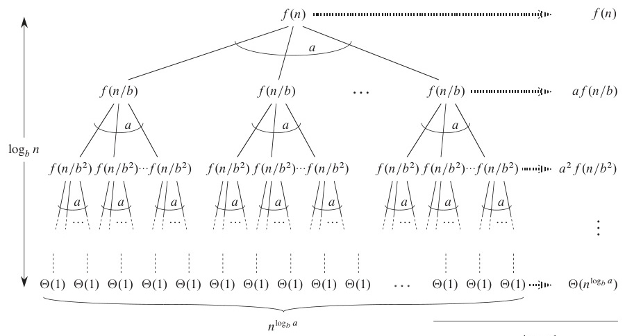
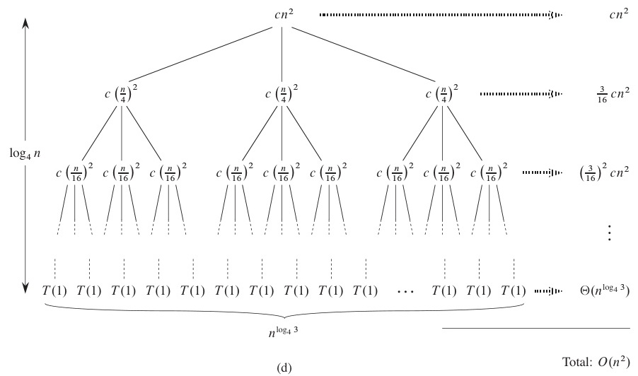
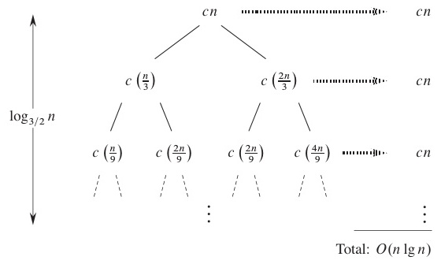
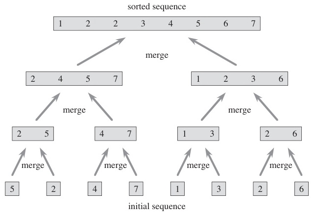
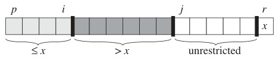
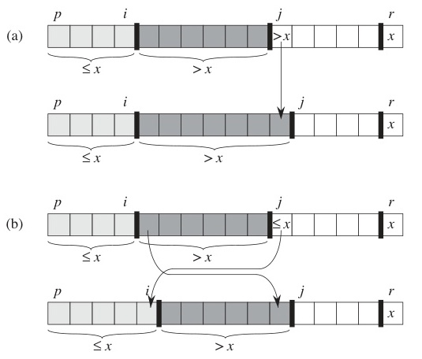
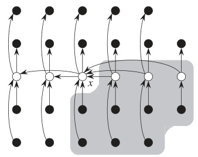

# Week 4 Lecture — Divide and Conquer Algorithms

[Repository Guide](../../README.md) | [English](Concepts_Lecture.md) | [한국어](Concepts_Lecture.ko.md)

> **Last Updated:** 2026-10-18
>
> Introduction to Algorithms, Cormen, Leiserson, Rivest, and Stein, Ch 4, 7, 9, 33

> **Learning Objectives:**
> 1. Describe the divide-and-conquer paradigm (divide, conquer, combine) and identify it in algorithms
> 2. Apply the Master Theorem to determine the time complexity of D&C recurrences
> 3. Trace merge sort, binary search, quick sort, and selection algorithms step by step, and analyze how the PARTITION procedure works and quick sort's best, average, and worst cases
> 4. Explain why the Median of Medians algorithm guarantees $O(n)$ selection even in the worst case
> 5. Apply the closest pair algorithm and explain the middle strip analysis
> 6. Recognize when divide and conquer is inappropriate (overlapping subproblems) and decide when dynamic programming should be used instead

---

## Table of Contents

- [1. Divide and Conquer Concepts](#1-divide-and-conquer-concepts)
  - [1.1 Divide and Conquer Paradigm](#11-divide-and-conquer-paradigm)
  - [1.2 Divide and Conquer Diagram](#12-divide-and-conquer-diagram)
  - [1.3 Divide Step](#13-divide-step)
  - [1.4 Conquer and Combine](#14-conquer-and-combine)
  - [1.5 Classification of Divide and Conquer Algorithms](#15-classification-of-divide-and-conquer-algorithms)
  - [1.6 Master Theorem: Recursion Tree Intuition](#16-master-theorem-recursion-tree-intuition)
  - [1.7 Master Theorem: Three Cases](#17-master-theorem-three-cases)
  - [1.8 Other Divide and Conquer Recurrence Patterns](#18-other-divide-and-conquer-recurrence-patterns)
- [2. Merge Sort](#2-merge-sort)
  - [2.1 Merge Sort: Overview](#21-merge-sort-overview)
  - [2.2 Merge Sort: Recurrence and Analysis](#22-merge-sort-recurrence-and-analysis)
  - [2.3 Merge Sort: Step-by-Step Example](#23-merge-sort-step-by-step-example)
- [3. Binary Search](#3-binary-search)
  - [3.1 Binary Search: Algorithm](#31-binary-search-algorithm)
  - [3.2 Binary Search: Analysis](#32-binary-search-analysis)
  - [3.3 Binary Search: Step-by-Step Example](#33-binary-search-step-by-step-example)
- [4. Quick Sort](#4-quick-sort)
  - [4.1 Quick Sort: Overview](#41-quick-sort-overview)
  - [4.2 Partition Procedure](#42-partition-procedure)
  - [4.3 Partition: Step-by-Step Example](#43-partition-step-by-step-example)
  - [4.4 Quick Sort: Analysis](#44-quick-sort-analysis)
- [5. Selection Problem](#5-selection-problem)
  - [5.1 Selection Problem: Definition](#51-selection-problem-definition)
  - [5.2 Randomized Selection](#52-randomized-selection)
  - [5.3 Selection Example 1: 2nd Smallest Element](#53-selection-example-1-2nd-smallest-element)
  - [5.4 Selection Example 2: 7th Smallest Element](#54-selection-example-2-7th-smallest-element)
  - [5.5 Selection: Average Time Analysis](#55-selection-average-time-analysis)
  - [5.6 Selection: Worst-Case Time Analysis](#56-selection-worst-case-time-analysis)
  - [5.7 Linear Time Selection (Median of Medians)](#57-linear-time-selection-median-of-medians)
  - [5.8 Median of Medians: Step-by-Step Example](#58-median-of-medians-step-by-step-example)
  - [5.9 Median of Medians: Why Balance Is Guaranteed](#59-median-of-medians-why-balance-is-guaranteed)
  - [5.10 Linear Selection: Time Complexity](#510-linear-selection-time-complexity)
- [6. Closest Pair Problem](#6-closest-pair-problem)
  - [6.1 Closest Pair: Problem Definition](#61-closest-pair-problem-definition)
  - [6.2 Closest Pair: Divide and Conquer Approach](#62-closest-pair-divide-and-conquer-approach)
  - [6.3 Closest Pair: Middle Strip](#63-closest-pair-middle-strip)
  - [6.4 Closest Pair: Pseudocode](#64-closest-pair-pseudocode)
  - [6.5 Closest Pair: Execution Example](#65-closest-pair-execution-example)
  - [6.6 Closest Pair: Time Complexity](#66-closest-pair-time-complexity)
- [7. When Divide and Conquer Is Inappropriate](#7-when-divide-and-conquer-is-inappropriate)
  - [7.1 D&C Failure Case: Fibonacci](#71-dc-failure-case-fibonacci)
  - [7.2 Fibonacci: Bottom-Up Solution](#72-fibonacci-bottom-up-solution)
  - [7.3 Considerations When Applying Divide and Conquer](#73-considerations-when-applying-divide-and-conquer)
- [Summary](#summary)
- [Self-Check Questions](#self-check-questions)

---

<br>

## 1. Divide and Conquer Concepts

### 1.1 Divide and Conquer Paradigm

Consider sorting a shuffled deck of 52 cards. One natural approach is to split the deck in half, sort each half, and then merge them. This is the divide-and-conquer strategy, one of the most powerful ideas in computer science.

An algorithm that **divides** the input of a given problem and **conquers (solves)** each part.

**Three steps:**
1. **Divide:** Split the problem into smaller subproblems.
2. **Conquer:** Solve each subproblem recursively.
3. **Combine:** Merge the subsolutions to obtain the solution to the original problem.

**Key terms:**
- **Subproblem**: A problem defined on the divided input.
- **Subsolution**: The solution to a subproblem.
- Subproblems are recursively divided until they can no longer be split (base case).

> **Key Point:** The essence of divide and conquer is the idea that breaking a large problem into smaller ones makes each one easier. However, simply dividing is not enough; the method for **combining** subsolutions must be efficient for the overall algorithm to be efficient.

### 1.2 Divide and Conquer Diagram

```text
          ┌──────────┐
          │ Problem  │
          └────┬─────┘
               ↓ Divide
       ┌───────┴───────┐
  ┌────┴────┐     ┌────┴────┐
  │Subprob 1│     │Subprob 2│
  └────┬────┘     └────┬────┘
       ↓ Conquer       ↓ Conquer
  ┌────┴────┐     ┌────┴────┐
  │Subsol 1 │     │Subsol 2 │
  └────┬────┘     └────┬────┘
       └───────┬───────┘
               ↓ Combine
          ┌────┴─────┐
          │ Solution │
          └──────────┘
```

*Figure 1. Divide, conquer, and combine steps of divide and conquer*

### 1.3 Divide Step

**Example:** Dividing input of size $n$ into 2 subproblems, each of size $n/2$.

Each division halves the subproblem size:
- After 1 division: each size $= n/2$
- After 2 divisions: each size $= n/2^2$
- ...
- After $k$ divisions: each size $= n/2^k$

**When does the division stop?**
$$n/2^k = 1 \implies k = \log_2 n$$

Total number of divisions $= \log_2 n$

> **[Discrete Mathematics]** The reason $\log_2 n$ appears repeatedly is that halving a size-$n$ input $\log_2 n$ times reduces it to size 1. This is the fundamental reason why $\log n$ always appears in halving structures like binary search and merge sort.

### 1.4 Conquer and Combine

- Simply dividing the input is **not sufficient** to solve most problems.
- The subproblems must be **conquered**, that is, subsolutions must be obtained.
- Subsolutions are **combined (merged)** to construct the solution to the larger subproblem.

The method of conquering depends on the specific problem.

> **Note:** **Concrete Examples of Combine.** In merge sort, combine means merging two sorted lists ($O(n)$). In binary search, combine is trivial (just return the result). In the closest pair problem, combine requires a careful strip analysis. The combine step often determines the overall complexity of the algorithm.

### 1.5 Classification of Divide and Conquer Algorithms

General recurrence form:

$$T(n) = a \cdot T(n/b) + O(f(n))$$

- $a$ = number of subproblems after division
- $n/b$ = size of each subproblem
- $f(n)$ = cost of division and combination

| $a$ | $b$ | Algorithm |
|:-----|:-----|:-----------|
| 2 | 2 | Merge Sort, Closest Pair |
| 3 | 2 | Large Integer Multiplication (covered in CLRS Ch. 4; not covered in this course) |
| 7 | 2 | Strassen Matrix Multiplication (covered in CLRS Ch. 4; not covered in this course) |

*Table 1. Divide and conquer algorithms by the number of subproblems a and the size ratio b*

> **Key Point:** In this recurrence, $a$, $b$, and $f(n)$ determine the time complexity of the algorithm. A larger $a$ means more subproblems and higher cost, while a larger $b$ means subproblem sizes decrease faster. $f(n)$ is the divide and combine overhead.

### 1.6 Master Theorem: Recursion Tree Intuition

For $T(n) = a \cdot T(n/b) + O(f(n))$:

**Cost at each level of the recursion tree:**

| Level | Problem Size | # Problems | Cost |
|:------|:----------|:--------|:-----|
| 0 (root) | $n$ | 1 | $f(n)$ |
| 1 | $n/b$ | $a$ | $a \cdot f(n/b)$ |
| $k$ | $n/b^k$ | $a^k$ | $a^k \cdot f(n/b^k)$ |

*Table 2. Problem size, number of problems, and cost at each level of the recursion tree*

**Depth:** $k = \log_b n$ &nbsp; **Number of leaves:** $n^{\log_b a}$



*Figure 2. Recursion tree of the Master Theorem*

> **Note:** The recursion tree is a key tool for visually understanding divide and conquer recurrences. Summing the costs from root to leaves across all levels gives the total time complexity. The Master Theorem simplifies this summation into a comparison between $f(n)$ and $n^{\log_b a}$.

### 1.7 Master Theorem: Three Cases

For $T(n) = a \cdot T(n/b) + O(f(n))$, compare $f(n)$ with $n^{\log_b a}$:

**Case 1:** $f(n) = O(n^{\log_b a - \varepsilon})$. Leaf cost dominates.
$$T(n) = \Theta(n^{\log_b a})$$

**Case 2:** $f(n) = \Theta(n^{\log_b a})$. The costs are balanced.
$$T(n) = \Theta(n^{\log_b a} \log n)$$

**Case 3:** $f(n) = \Omega(n^{\log_b a + \varepsilon})$. Combine cost dominates.
$$T(n) = \Theta(f(n))$$

Here $\varepsilon$ is some positive constant ($\varepsilon > 0$) for which the condition holds. The condition means $f(n)$ must be **polynomially** smaller (or larger) than $n^{\log_b a}$, not just slightly smaller.



*Figure 3. Recursion tree of T(n) = 3T(n/4) + cn²*

> **Note:** **Regularity Condition for Case 3.** Case 3 also requires the *regularity condition*: for some constant $c < 1$ and all sufficiently large $n$, $a \cdot f(n/b) \le c \cdot f(n)$ must hold.

**Worked Example:** For $T(n) = 3T(n/4) + cn^2$: $a=3$, $b=4$, $f(n)=cn^2$. Compute $n^{\log_4 3} \approx n^{0.79}$. Since $f(n) = cn^2$ grows polynomially faster than $n^{0.79}$ (i.e., $f(n) = \Omega(n^{\log_4 3 + \varepsilon})$ for $\varepsilon \approx 1.21$), this is **Case 3**, giving $T(n) = \Theta(n^2)$. The regularity condition also holds because $3f(n/4) = \frac{3}{16}f(n)$.

> **Note:** **Exam Tip.** The procedure for applying the Master Theorem is as follows.
> 1. Identify $a$, $b$, and $f(n)$ from the recurrence.
> 2. Compute $n^{\log_b a}$.
> 3. Compare $f(n)$ with $n^{\log_b a}$ to determine Case 1, 2, or 3.
> 4. Apply the formula for the corresponding case.
>
> Exam problems frequently give a recurrence and ask for the time complexity, so this procedure must be thoroughly understood.

### 1.8 Other Divide and Conquer Recurrence Patterns

| Recurrence | Description | Example |
|:--------|:------|:------|
| $T(n) = \frac{1}{n}\sum[T(i) + T(n-i)] + O(?)$ | 2 parts, unequal sizes | Quick Sort |
| $T(n) = T(n/2) + O(?)$ | 2 parts, only 1 needed, half size | Binary Search |
| $T(n) = \max\{T(i), T(n-i)\} + O(?)$ | 2 parts, only 1 needed, unequal sizes | Selection |
| $T(n) = T(n-1) + O(?)$ | Size decreases by 1 | Insertion Sort, Fibonacci |

*Table 3. Other divide and conquer recurrence patterns and examples*



*Figure 4. Recursion tree of an unequal partition*

> **Key Point:** The Master Theorem can only be directly applied to recurrences of the form $T(n) = aT(n/b) + f(n)$. For cases like Quick Sort where the partition is unequal, or Insertion Sort where the size decreases by only 1, separate analysis is required.

---

<br>

## 2. Merge Sort

### 2.1 Merge Sort: Overview

**Divide:** Split an array of $n$ elements into two halves of size $n/2$ each.

**Conquer:** Recursively sort each half.

**Combine:** Merge the two sorted halves into one sorted array.

```text
MERGE-SORT(A, p, r)
  if p < r
    q = floor((p + r) / 2)
    MERGE-SORT(A, p, q)       // Sort left half
    MERGE-SORT(A, q+1, r)     // Sort right half
    MERGE(A, p, q, r)         // Merge two halves
```

The textbook's Figure 2.4 shows merge sort merging sorted subarrays from the bottom up, with their lengths growing at each level.



*Figure 5. Operation tree of merge sort*

> **[Data Structures]** The key to merge sort is the MERGE process. To merge two sorted arrays into one, repeatedly compare the first elements of each array, place the smaller one into the result array, and advance the pointer. This process takes $\Theta(n)$.

**MERGE Procedure:**

```text
MERGE(A, p, q, r)
  n1 = q - p + 1          // size of left half
  n2 = r - q              // size of right half
  create arrays L[1..n1+1] and R[1..n2+1]
  for i = 1 to n1: L[i] = A[p + i - 1]
  for j = 1 to n2: R[j] = A[q + j]
  L[n1+1] = ∞             // sentinel
  R[n2+1] = ∞             // sentinel
  i = 1, j = 1
  for k = p to r:
    if L[i] <= R[j]:
      A[k] = L[i]; i++
    else:
      A[k] = R[j]; j++
```

**Merge Trace: merging [27, 38] and [3, 43]**

| Step | Compare | Action | Result so far | i | j |
|------|---------|--------|--------------|---|---|
| 1 | L[1]=27 vs R[1]=3 | 3 < 27, take R | [3] | 1 | 2 |
| 2 | L[1]=27 vs R[2]=43 | 27 < 43, take L | [3, 27] | 2 | 2 |
| 3 | L[2]=38 vs R[2]=43 | 38 < 43, take L | [3, 27, 38] | 3 | 2 |
| 4 | L[3]=∞ vs R[2]=43 | 43 < ∞, take R | [3, 27, 38, 43] | 3 | 3 |

*Table 4. Merge trace of [27, 38] and [3, 43]*

> **[Data Structures]** The sentinel value ∞ eliminates the need for boundary checks. When one array is exhausted, the sentinel ensures the remaining elements of the other array are copied in order.

### 2.2 Merge Sort: Recurrence and Analysis

**Recurrence:**
$$T(n) = 2T(n/2) + \Theta(n)$$

- Divide: $O(1)$ (compute the midpoint only)
- Conquer: $2T(n/2)$ (two recursive calls, one on each half)
- Combine: $\Theta(n)$ (merge the two sorted arrays)

**Applying the Master Theorem:** $a=2, b=2, f(n)=\Theta(n)$
$$n^{\log_b a} = n^{\log_2 2} = n^1 = n$$
$$f(n) = \Theta(n) = \Theta(n^{\log_b a}) \implies \text{Case 2}$$

$$T(n) = \Theta(n \log n)$$

**Space complexity:** $O(n)$ (auxiliary array for merging)

> **Note:** Merge sort is always $\Theta(n \log n)$. Unlike quick sort, it has no worst case, which is an advantage, but the $O(n)$ extra space requirement is a disadvantage.

### 2.3 Merge Sort: Step-by-Step Example

```text
Original: [38, 27, 43, 3, 9, 82, 10]
                   ↙ Divide ↘
     [38, 27, 43, 3]        [9, 82, 10]
        ↙ Divide ↘           ↙ Divide ↘
    [38, 27]   [43, 3]    [9, 82]   [10]
         ↙↘        ↙↘        ↙↘
      [38] [27] [43] [3]   [9] [82]
         ↘↙         ↘↙        ↘↙
      [27, 38]   [3, 43]    [9, 82]  [10]
            ↘ Merge ↙          ↘ Merge ↙
        [3, 27, 38, 43]       [9, 10, 82]
                      ↘ Merge ↙
             [3, 9, 10, 27, 38, 43, 82]
```

*Figure 6. Divide and merge steps of merge sort on [38, 27, 43, 3, 9, 82, 10]*

---

<br>

## 3. Binary Search

### 3.1 Binary Search: Algorithm

**Idea:** Repeatedly halve the search space in a **sorted** array.

```text
BINARY-SEARCH(A, p, r, key)
  if p > r
    return NOT_FOUND
  mid = floor((p + r) / 2)
  if A[mid] == key
    return mid
  else if A[mid] > key
    return BINARY-SEARCH(A, p, mid-1, key)
  else
    return BINARY-SEARCH(A, mid+1, r, key)
```

**Divide and Conquer structure:**
- **Divide:** Compare key with the middle element
- **Conquer:** Recurse on only one half
- **Combine:** Trivial (return the result as is)

> **Key Point:** Binary search is a special form of divide and conquer where only **one** of the two subproblems needs to be conquered. This is why the recurrence becomes $T(n) = T(n/2) + O(1)$, achieving the very fast time complexity of $\Theta(\log n)$.

### 3.2 Binary Search: Analysis

**Recurrence:**
$$T(n) = T(n/2) + O(1)$$

- Only **1** subproblem of size $n/2$ is needed
- $O(1)$ work at each level (1 comparison)

**Applying the Master Theorem:** $a=1, b=2, f(n)=O(1)$
$$n^{\log_b a} = n^{\log_2 1} = n^0 = 1$$
$$f(n) = O(1) = \Theta(n^{\log_b a}) \implies \text{Case 2}$$

$$T(n) = \Theta(\log n)$$

### 3.3 Binary Search: Step-by-Step Example

Searching for key = **23** in a sorted array:

```text
Index: 0   1   2   3   4   5   6   7   8   9
Value: [3,  8, 11, 15, 20, 23, 29, 31, 48, 65]

Step 1: p=0, r=9, mid=4 → A[4]=20 < 23 → search right
       [                   23, 29, 31, 48, 65]
Step 2: p=5, r=9, mid=7 → A[7]=31 > 23 → search left
       [23, 29]
Step 3: p=5, r=6, mid=5 → A[5]=23 == 23 → found at index 5!
```

Found in **3 comparisons** out of 10 elements (the maximum is $\lfloor\log_2 10\rfloor + 1 = 4$).

> **Note:** Binary search can only be used on **sorted arrays**. To apply it to unsorted data, sorting at $O(n \log n)$ is required first, so for a single search, linear search ($O(n)$) may actually be more efficient. Sorting + binary search becomes advantageous when multiple searches are performed.

---

<br>

## 4. Quick Sort

### 4.1 Quick Sort: Overview

**Divide:** Partition the array around a **pivot** element.

**Conquer:** Recursively sort the two sub-arrays.

**Combine:** Trivial. Because partitioning is done in place, the whole array is already sorted once the two sub-arrays are sorted.

```text
QUICKSORT(A, p, r)
  if p < r
    q = PARTITION(A, p, r)
    QUICKSORT(A, p, q-1)    // Sort left of pivot
    QUICKSORT(A, q+1, r)    // Sort right of pivot
```

> **Key Point:** The key difference between merge sort and quick sort is as follows. Merge sort has a simple divide (split in half) and a difficult combine (merge). In contrast, quick sort has a difficult divide (pivot-based partition) and a trivial combine.

### 4.2 Partition Procedure

Select the **last element** as the pivot. Rearrange so that:
- Elements $\le$ pivot go to the left
- Elements $>$ pivot go to the right

```text
PARTITION(A, p, r)
  pivot = A[r]
  i = p - 1
  for j = p to r - 1
    if A[j] <= pivot
      i = i + 1
      swap A[i] and A[j]
  swap A[i+1] and A[r]
  return i + 1
```

Returns the final index of the pivot. The textbook's Figure 7.2 shows the four regions that PARTITION maintains on a subarray $A[p..r]$ (elements ≤ pivot, elements > pivot, elements not yet examined, and the pivot), and Figure 7.3 shows what one iteration does when `A[j]` is greater than the pivot and when it is less than or equal to the pivot.



*Figure 7. Four regions maintained by the partition procedure*



*Figure 8. Two cases in one iteration of the partition procedure*

> **Note:** Variable `i` tracks the last index of the region of elements ≤ pivot. As `j` scans the array, whenever an element ≤ pivot is found, `i` is incremented and `A[i]` and `A[j]` are swapped to include that element in the left region.

### 4.3 Partition: Step-by-Step Example

Partitioning `A = [31, 8, 48, 73, 11, 3, 20, 29, 65, 15]` with pivot = **15**:

```text
pivot = A[9] = 15,  i = -1

j=0: A[0]=31 > 15         → skip              [31, 8, 48, 73, 11, 3, 20, 29, 65, 15]
j=1: A[1]=8  <= 15 → i=0  → swap(A[0],A[1]) [ 8, 31, 48, 73, 11, 3, 20, 29, 65, 15]
j=2: A[2]=48 > 15         → skip              [ 8, 31, 48, 73, 11, 3, 20, 29, 65, 15]
j=3: A[3]=73 > 15         → skip              [ 8, 31, 48, 73, 11, 3, 20, 29, 65, 15]
j=4: A[4]=11 <= 15 → i=1  → swap(A[1],A[4]) [ 8, 11, 48, 73, 31, 3, 20, 29, 65, 15]
j=5: A[5]=3  <= 15 → i=2  → swap(A[2],A[5]) [ 8, 11,  3, 73, 31, 48, 20, 29, 65, 15]
j=6: A[6]=20 > 15         → skip              [ 8, 11,  3, 73, 31, 48, 20, 29, 65, 15]
j=7: A[7]=29 > 15         → skip              [ 8, 11,  3, 73, 31, 48, 20, 29, 65, 15]
j=8: A[8]=65 > 15         → skip              [ 8, 11,  3, 73, 31, 48, 20, 29, 65, 15]

Final: swap A[i+1]=A[3] and A[r]=A[9]:
     [ 8, 11,  3, 15, 31, 48, 20, 29, 65, 73]
                   ^pivot (index 3)
```

Result: `[8, 11, 3 | 15 | 31, 48, 20, 29, 65, 73]`

### 4.4 Quick Sort: Analysis

**Best/Average case:**
- When the pivot splits the array roughly in half each time
$$T(n) = 2T(n/2) + \Theta(n) \implies T(n) = \Theta(n \log n)$$

**Worst case:**
- When the pivot is always the smallest or largest element
- Partition results in sizes 0 and $n-1$
$$T(n) = T(n-1) + \Theta(n) \implies T(n) = \Theta(n^2)$$

**Average case (formal analysis):**
$$T(n) = \frac{1}{n}\sum_{i=0}^{n-1}[T(i) + T(n-1-i)] + \Theta(n) = \Theta(n \log n)$$

**Space:** $O(\log n)$ average (recursion stack), $O(n)$ worst case

> **Note:** **Exam Tip.** The worst case of quick sort occurs when selecting the last element as pivot on an already sorted (or reverse-sorted) array. To prevent this, in practice strategies such as **random pivot** and **median-of-three** are used.

**Randomized Partition:** Pick a random index $r'$ in $[p..r]$, swap $A[r']$ with $A[r]$, then call PARTITION as before. This simple modification avoids worst-case behavior on sorted or nearly-sorted input.

---

<br>

## 5. Selection Problem

### 5.1 Selection Problem: Definition

**Problem:** Given an unsorted array $A[p \ldots r]$, find the $i$-th smallest element.

**Two algorithms:**
1. Randomized Select: average $\Theta(n)$
2. Median of Medians (Linear Select): worst-case $\Theta(n)$

**Divide and Conquer structure:**
- **Divide:** Partition the array by pivot, check the pivot's rank
- **Conquer:** Recurse on only **one** sub-array
- **Combine:** Trivial

$$T(n) \le \max\{T(k-1),\ T(n-k)\} + \Theta(n)$$

> **Note:** The selection problem asks "can we find the $i$-th element without sorting the entire array?" Sorting takes $O(n \log n)$, but selection algorithms solve it in $O(n)$.

### 5.2 Randomized Selection

```text
SELECT(A, p, r, i)
  // Find the i-th smallest element in A[p..r]
  if p == r
    return A[p]             // Only one element
  q = PARTITION(A, p, r)    // Pivot is placed at index q
  k = q - p + 1             // Pivot is the k-th smallest in A[p..r]
  if i < k
    return SELECT(A, p, q-1, i)       // Search left
  else if i == k
    return A[q]                       // Pivot is the answer
  else
    return SELECT(A, q+1, r, i-k)     // Search right
```

- **Average time:** $\Theta(n)$
- **Worst-case time:** $\Theta(n^2)$

> **Key Point:** This algorithm is structurally similar to quick sort, but the critical difference is that it recurses on only **one** sub-array. Quick sort recurses on both sides, but selection only recurses on the side containing the desired rank, making it faster.

### 5.3 Selection Example 1: 2nd Smallest Element

```text
Input: [31, 8, 48, 73, 11, 3, 20, 29, 65, 15]   Find: i=2

Step 1: PARTITION with pivot=15
  Result: [8, 11, 3 | 15 | 31, 48, 20, 29, 65, 73]
  Pivot position k=4 (4th smallest element)

  i=2 < k=4 → search left group [8, 11, 3]

Step 2: PARTITION [8, 11, 3] with pivot=3
  Result: [3 | 8, 11]
  Pivot position k=1

  i=2 > k=1 → search right group [8, 11] for (2-1)=1st smallest

Step 3: PARTITION [8, 11] with pivot=11
  Result: [8 | 11]
  Pivot position k=2

  i=1 < k=2 → search left group [8]

Step 4: Only one element → return 8
```

> **Note:** Step 2 of the trace above writes the result as [3 | 8, 11], but applying the PARTITION of Section 4.2 to [8, 11, 3] exactly swaps the pivot 3 with the first element 8, giving [3 | 11, 8]. In that case, Step 3 partitions [11, 8] around the pivot 8 to get [8 | 11] with k = 1, and since i = 1 = k, it returns the pivot 8 immediately. Either way, the answer is 8.

### 5.4 Selection Example 2: 7th Smallest Element

```text
Input: [31, 8, 48, 73, 11, 3, 20, 29, 65, 15]   Find: i=7

Step 1: PARTITION with pivot=15
  Result: [8, 11, 3 | 15 | 31, 48, 20, 29, 65, 73]
  Left group has 3 elements, pivot is k=4

  i=7 > k=4 → search right group [31, 48, 20, 29, 65, 73]
              for (7-4)=3rd smallest element

Step 2: Recurse on [31, 48, 20, 29, 65, 73], find 3rd smallest
  PARTITION with pivot=73
  Result: [31, 48, 20, 29, 65 | 73]
  Pivot position k=6

  i=3 < k=6 → search left group [31, 48, 20, 29, 65]

Step 3: Recurse on [31, 48, 20, 29, 65], find 3rd smallest
  PARTITION with pivot=65
  Result: [31, 48, 20, 29 | 65]
  Pivot position k=5

  i=3 < k=5 → search left group [31, 48, 20, 29]

Step 4: Recurse on [31, 48, 20, 29], find 3rd smallest
  PARTITION with pivot=29
  Result: [20 | 29 | 31, 48]
  Pivot position k=2

  i=3 > k=2 → search right group [31, 48] for (3-2)=1st smallest

Step 5: Recurse on [31, 48], find 1st smallest
  PARTITION with pivot=48
  Result: [31 | 48]
  Pivot position k=2

  i=1 < k=2 → search left group [31]

Step 6: Only one element → return 31

Answer: The 7th smallest element is 31.
```

### 5.5 Selection: Average Time Analysis

Assume that the desired element is always in the **larger** partition (the worst scenario in the average-case analysis).

$$T(n) \le T(3n/4) + \Theta(n)$$

A random pivot falls in the middle 50% of the elements (between the 25th and 75th percentiles) with probability 1/2, and in that case the larger partition has at most $3/4$ of the original size. The expected number of partitioning steps until such a pivot appears is 2, so the cost grows only by a constant factor, and the expected time can be analyzed with the recurrence above.

Expanding:
$$T(n) \le cn + c \cdot \frac{3n}{4} + c \cdot \left(\frac{3}{4}\right)^2 n + \cdots$$
$$= cn \sum_{k=0}^{\infty}\left(\frac{3}{4}\right)^k = cn \cdot \frac{1}{1 - 3/4} = 4cn$$

$$\therefore T(n) = O(n)$$

$T(n) = \Omega(n)$ is trivial (every element must be examined), so:

$$T(n) = \Theta(n)$$

> **[Discrete Mathematics]** The infinite geometric series $\sum_{k=0}^{\infty} r^k = \frac{1}{1-r}$ ($|r| < 1$) is used here. Since $r = 3/4 < 1$, the series converges to the constant $4c$. Such geometric decrease appears very frequently in divide and conquer analysis.

### 5.6 Selection: Worst-Case Time Analysis

**Worst case:** Partition always splits into sizes 0 and $n-1$

$$T(n) = T(n-1) + \Theta(n) = \Theta(n^2)$$

Can we guarantee linear time even in the worst case?

**Yes.** Use the **Median-of-Medians** algorithm.

### 5.7 Linear Time Selection (Median of Medians)

```text
LINEAR-SELECT(A, p, r, i)
  // Find the i-th smallest element in A[p..r]
  1. if |A| <= 5: sort and return the i-th element
  2. Divide elements into groups of 5 → ceil(n/5) groups
  3. Find the median of each group → m_1, m_2, ..., m_{ceil(n/5)}
  4. M = LINEAR-SELECT(medians, 1, ceil(n/5), ceil(n/10))
     // Recursively find the median of medians
  5. Partition A around M
  6. Recurse on the appropriate side
```

**Key insight:** M is **guaranteed to be a balanced pivot**. Roughly $3n/10$ or more elements are smaller than M, and roughly $3n/10$ or more are larger.

> **Note:** The reason for grouping by 5 is that grouping by 3 yields a recurrence $T(n) = T(n/3) + T(2n/3) + \Theta(n)$, which does not achieve linear time, while 7 or more unnecessarily increases the within-group sorting cost. 5 is the smallest group size that guarantees linear time.

### 5.8 Median of Medians: Step-by-Step Example

**Step 2:** Divide 37 elements into groups of 5:

```text
Group 1: [5, 1, 2, 9, 24]       Group 5: [34, 6, 20, 32, 4]
Group 2: [17, 33, 18, 16, 26]   Group 6: [35, 15, 25, 11, 8]
Group 3: [30, 13, 10, 21, 29]   Group 7: [28, 23, 27, 22, 19]
Group 4: [3, 36, 7, 37, 12]     Group 8: [31, 14]  (fewer than 5)
```

**Step 3:** Sort each group and take the median (3rd element):

```text
Group 1: [1,2,5,9,24]      → median = 5
Group 2: [16,17,18,26,33]  → median = 18
Group 3: [10,13,21,29,30]  → median = 21
Group 4: [3,7,12,36,37]    → median = 12
Group 5: [4,6,20,32,34]    → median = 20
Group 6: [8,11,15,25,35]   → median = 15
Group 7: [19,22,23,27,28]  → median = 23
Group 8: [14,31]           → median = 14
```

**Step 4:** Find the median of $\{5, 18, 21, 12, 20, 15, 23, 14\}$.

Recursively call LINEAR-SELECT on these 8 medians to find the $\lceil 37/10 \rceil = 4$th smallest. Sorted, the medians are 5, 12, 14, 15, 18, 20, 21, 23, so the result is as follows.

$$M = 15$$

**Step 5:** Partition the entire array around $M = 15$.
- Left group ($\le 15$): the 15 elements ≤ 15
- Right group ($> 15$): the 22 elements > 15

**Step 6:** Recurse on the side containing the desired rank.

### 5.9 Median of Medians: Why Balance Is Guaranteed

- At least half of the $\lceil n/5 \rceil$ medians are $\le M$
- For each such median, at least 3 elements in its group are $\le M$
- Therefore, at least $3 \times \lceil n/10 \rceil \approx 3n/10$ elements are $\le M$
- Similarly, at least $3n/10$ elements are $\ge M$
- **Worst case:** recurse on at most $7n/10$ elements

In the textbook's Figure 9.1, each column is a group of 5, the white circles are the group medians, and the shaded region holds the elements guaranteed to be at least the median of medians $x$ ($M$ in this note).



*Figure 9. Balance analysis of the median of medians*

### 5.10 Linear Selection: Time Complexity

**Recurrence:**
$$T(n) = T(n/5) + T(7n/10) + \Theta(n)$$

- $T(n/5)$: finding the median of medians (Step 4)
- $T(7n/10)$: recursing on the larger partition (Step 6)
- $\Theta(n)$: grouping, finding group medians, partitioning

Since $1/5 + 7/10 = 9/10 < 1$, the total work decreases geometrically:

$$T(n) \le cn + \frac{9}{10}cn + \left(\frac{9}{10}\right)^2 cn + \cdots = cn \cdot \frac{1}{1 - 9/10} = 10cn$$

$$\therefore T(n) = O(n)$$

$T(n) = \Omega(n)$ is trivial, so: $T(n) = \Theta(n)$

> **Note:** **Exam Tip.** The condition $1/5 + 7/10 = 9/10 < 1$ is the key to guaranteeing linear time. If this sum were ≥ 1, the geometric decrease would not hold and linear time would not be achieved. Exam questions may ask "why group by 5?" or "why is it linear?"

---

<br>

## 6. Closest Pair Problem

### 6.1 Closest Pair: Problem Definition

**Problem:** Given $n$ points on a 2D plane, find the pair of points that are **closest** to each other.

**Brute-force approach:**
- Compute distances for all pairs: $\binom{n}{2} = n(n-1)/2$ pairs
- Each distance computation: $O(1)$
- **Total:** $O(n^2)$

Can we do better with divide and conquer?

### 6.2 Closest Pair: Divide and Conquer Approach

**Preprocessing:** Sort all points by x-coordinate in $O(n \log n)$ time.

**Divide:** Split point set $S$ into left half $S_L$ and right half $S_R$

**Conquer:** Recursively find closest pair $CP_L$ in $S_L$ and $CP_R$ in $S_R$

**Combine:** Let $d = \min(\text{dist}(CP_L), \text{dist}(CP_R))$
- Check the **middle strip** of width $2d$ for pairs closer than $d$
- If found, this pair is $CP_C$

**Return:** The closest among $CP_L$, $CP_R$, $CP_C$

### 6.3 Closest Pair: Middle Strip

The key insight lies in the **combine** step:

```text
        ←── d ──→←── d ──→
        ┌────────┬────────┐
        │        │        │
        │   S_L  │  S_R   │
        │        │        │
        │   ·  · │ ·      │
        │     ·  │   ·    │
        │        │        │
        └────────┴────────┘
        Middle strip (width 2d)
```

*Figure 10. Middle strip extending distance d on each side of the dividing line*

- Only points within distance $d$ from the dividing line need to be checked.
- Sort the points in the strip by y-coordinate.
- For each point, compare only the next few points in y order (at most **7** neighbors).
- This limits the strip check to $O(1)$ comparisons per point, so after sorting the strip check takes $O(n)$ in total.

> **Key Point:** The reason each point needs at most 7 comparisons is the core insight of this algorithm. Points on the same side are at distance ≥ $d$ from each other, so one $d \times d$ square holds at most 4 points and a $d \times 2d$ rectangle holds at most 8. Therefore, for each point, comparing only the next 7 points in y order is sufficient.

### 6.4 Closest Pair: Pseudocode

```text
CLOSEST-PAIR(S)
  Input: S — points sorted by x-coordinate
  Output: distance of the closest pair

  1. if |S| <= 3: compute all pairwise distances and return the minimum
  2. Split S into S_L and S_R at the median x-coordinate
  3. CP_L = CLOSEST-PAIR(S_L)
  4. CP_R = CLOSEST-PAIR(S_R)
  5. d = min(dist(CP_L), dist(CP_R))
     Find closest pair CP_C in the middle strip (within distance d from dividing line)
  6. return min(CP_L, CP_C, CP_R) (by distance)
```

### 6.5 Closest Pair: Execution Example

```text
Points sorted by x: (2,·) (5,·) (10,·) (15,·) (20,·) | (25,·) (26,·) (28,·) (30,·) (37,·)
                        ←──────── S_L ────────→            ←──────── S_R ────────→

Step 1: Recurse on S_L → CP_L (distance = 10)
Step 2: Recurse on S_R → CP_R (distance = 15)
Step 3: d = min(10, 15) = 10

Step 4: Middle strip = points with x ∈ [20-10, 25+10] = [10, 35]
       Points in strip: (10,·) (15,·) (20,·) (25,·) (26,·) (28,·) (30,·)

Step 5: Sort strip by y-coordinate and check adjacent pairs
       → found CP_C (distance = 5) (example)

Step 6: return min(10, 5, 15) = 5 → CP_C is the closest pair
```

### 6.6 Closest Pair: Time Complexity

**Recurrence analysis:**

| Line | Cost |
|:-----|:-----|
| Line 1 (base case) | $O(1)$ |
| Line 2 (divide) | $O(1)$ (already sorted) |
| Lines 3-4 (recurse) | $2T(n/2)$ |
| Line 5 (strip sort + scan) | $O(n \log n)$ |
| Line 6 (return) | $O(1)$ |

*Table 5. Cost of each line of the CLOSEST-PAIR pseudocode*

$$T(n) = 2T(n/2) + O(n \log n)$$

**Master Theorem or direct analysis:**

Each of $\log n$ levels contributes $O(n \log n)$, so:

$$T(n) = O(n \log^2 n)$$

A more refined implementation (pre-sorting by y-coordinate) can improve this to $O(n \log n)$.

> **Note:** The difference between $O(n \log^2 n)$ and $O(n \log n)$ comes down to whether the strip points are sorted each time ($O(n \log n)$) or whether y-coordinate sorting is maintained throughout the recursion.

---

<br>

## 7. When Divide and Conquer Is Inappropriate

The preceding sections covered several successful applications of divide and conquer. This section examines when the paradigm fails and when its alternative, dynamic programming, should be used instead.

### 7.1 D&C Failure Case: Fibonacci

**When divide and conquer is inappropriate:** When the total input size of subproblems **increases greatly** after division (for example, when several subproblems shrink only by a constant).

**Fibonacci:** $F(n) = F(n-1) + F(n-2)$

```text
                    F(6)
                  /     \
              F(5)      F(4)
            /    \      /    \
          F(4)   F(3)  F(3)  F(2)
         /   \   / \   / \
       F(3) F(2) ...  ...
```

*Figure 11. Part of the Fibonacci recursion tree for computing F(6)*

- Input size: $n$
- Sum of subproblem input sizes: $(n-1) + (n-2) = 2n - 3 > n$
- $F(2)$ is computed **5 times**, and $F(3)$ is computed **3 times**.
- The redundant computation grows exponentially.

> **Key Point:** The critical distinction between divide and conquer vs. dynamic programming is whether **subproblems overlap**. If subproblems do not overlap (merge sort), use divide and conquer; if they do (Fibonacci), dynamic programming is appropriate.

### 7.2 Fibonacci: Bottom-Up Solution

Instead of divide and conquer, use an **iterative bottom-up** computation:

```text
FIB-NUMBER(n)
  F[0] = 0
  F[1] = 1
  for i = 2 to n
    F[i] = F[i-1] + F[i-2]
  return F[n]
```

**Time:** $\Theta(n)$. Each value is computed exactly once.

**Lesson:** When subproblems overlap significantly, **Dynamic Programming** (bottom-up or memoization) is more appropriate than naive divide and conquer.

### 7.3 Considerations When Applying Divide and Conquer

**Two key considerations:**

1. **Input size growth:** If subproblems shrink only by a constant while their total size exceeds the original input size, divide and conquer can lead to exponential blowup.
   - Example: Fibonacci

2. **Importance of combine cost:** Simply dividing the input does not guarantee efficiency.
   - The cost of combining subsolutions must be manageable.
   - Many geometric problems are well-suited to divide and conquer because the combine step naturally fits the problem structure.

---

<br>

## Summary

| Concept | Key Summary |
|:-----|:-----|
| Divide and conquer | Solves a problem in three steps: divide, conquer, and combine. |
| Master Theorem | Finds the time complexity of a recurrence of the form $T(n) = aT(n/b) + f(n)$ by comparing $f(n)$ with $n^{\log_b a}$. |
| Merge sort | Takes $\Theta(n \log n)$ time by the recurrence $T(n) = 2T(n/2) + \Theta(n)$. |
| Binary search | Takes $\Theta(\log n)$ time by the recurrence $T(n) = T(n/2) + O(1)$. |
| Quick sort | Takes $\Theta(n \log n)$ on average by $T(n) = 2T(n/2) + \Theta(n)$ and $\Theta(n^2)$ in the worst case by $T(n) = T(n-1) + \Theta(n)$. |
| Randomized selection | Takes $\Theta(n)$ time on average by the recurrence $T(n) \le T(3n/4) + \Theta(n)$. |
| Median of medians selection | Takes $\Theta(n)$ time even in the worst case by the recurrence $T(n) = T(n/5) + T(7n/10) + \Theta(n)$. |
| Closest pair | Takes $O(n \log^2 n)$ time by the recurrence $T(n) = 2T(n/2) + O(n \log n)$. |
| When divide and conquer is inappropriate | If the total subproblem size grows greatly or subproblems overlap, dynamic programming is used instead of divide and conquer. |

---

<br>

## Self-Check Questions

1. **Divide and Conquer:** What are the three steps of D&C? Give an example where the combine step is trivial and one where it is expensive.

   <details>
   <summary>Answer</summary>

   **Divide** the problem into smaller subproblems, **Conquer** each one recursively, and **Combine** the subsolutions into a solution to the original problem. In **binary search** and **quick sort**, combining is trivial: binary search returns the result, and quick sort's in-place partition leaves the array in order. In **merge sort**, combining takes more work. Merging two sorted halves takes $\Theta(n)$, which is what makes the overall recurrence $T(n) = 2T(n/2) + \Theta(n)$.

   </details>

2. **Master Theorem:** Apply the Master Theorem to: (a) $T(n) = 2T(n/2) + n$, (b) $T(n) = 4T(n/2) + n$, (c) $T(n) = T(n/2) + n^2$. State the case and result for each.

   <details>
   <summary>Answer</summary>

   Compare $f(n)$ against $n^{\log_b a}$. **(a)** $a=2, b=2$, so $n^{\log_2 2} = n$ and $f(n) = n$. This is **Case 2**, giving $T(n) = \Theta(n \log n)$ (merge sort). **(b)** $a=4, b=2$, so $n^{\log_2 4} = n^2$ and $f(n) = n$ is polynomially smaller. This is **Case 1**, giving $T(n) = \Theta(n^2)$. **(c)** $a=1, b=2$, so $n^{\log_2 1} = 1$ and $f(n) = n^2$ is polynomially larger, and the regularity condition $f(n/2) = \frac{1}{4}f(n)$ holds. This is **Case 3**, giving $T(n) = \Theta(n^2)$.

   </details>

3. **Merge Sort:** Why does merge sort always take $\Theta(n \log n)$, regardless of input order? What is its space complexity and why?

   <details>
   <summary>Answer</summary>

   Merge sort **always** halves and merges the array, regardless of element values. The recursion tree has $\log_2 n$ levels, each doing $\Theta(n)$ merge work, so $T(n) = \Theta(n \log n)$ in the best, average, and worst cases. **Space** is $\Theta(n)$ because `MERGE` needs auxiliary arrays `L` and `R` to copy the halves. This is merge sort's main disadvantage compared with quick sort's in-place partition.

   </details>

4. **Quick Sort Worst Case:** Give a specific input array where choosing the last element as pivot leads to $O(n^2)$ behavior. How does randomized pivot selection help?

   <details>
   <summary>Answer</summary>

   Any **already-sorted** (or reverse-sorted) array such as `[1, 2, 3, 4, 5]` does it: the pivot `5` is the largest, so the partition produces sizes $n-1$ and $0$, yielding the recurrence $T(n) = T(n-1) + \Theta(n) = \Theta(n^2)$. **Randomized partition** swaps a random index into position `r` before partitioning, so the adversarial input no longer correlates with the pivot choice, so the **expected** running time becomes $\Theta(n \log n)$ regardless of input order.

   </details>

5. **Selection:** Why is the expected time of randomized selection $O(n)$, not $O(n \log n)$? How does it differ from sorting first and then indexing?

   <details>
   <summary>Answer</summary>

   Selection recurses on **only one side** of the partition, the side containing the desired rank; quick sort recurses on both. With a random pivot, the larger side has expected size $\le 3n/4$, giving the recurrence $T(n) \le T(3n/4) + \Theta(n)$. The geometric series $\sum (3/4)^k$ sums this to $4cn = \Theta(n)$. Sorting first takes $\Theta(n \log n)$ and orders elements that are never queried, while selection takes $\Theta(n)$.

   </details>

6. **Median of Medians:** Why divide into groups of 5 specifically? What happens if you use groups of 3?

   <details>
   <summary>Answer</summary>

   Group size 5 makes the recurrence $T(n) = T(n/5) + T(7n/10) + \Theta(n)$, and since $1/5 + 7/10 = 9/10 < 1$ the work decreases geometrically and sums to $\Theta(n)$. **Groups of 3** give $T(n) = T(n/3) + T(2n/3) + \Theta(n)$, but $1/3 + 2/3 = 1$, so the work no longer decreases geometrically, and the recurrence solves to $\Theta(n \log n)$, losing the linear-time guarantee. Group size 5 is the smallest odd size that satisfies the $<1$ condition.

   </details>

7. **Closest Pair:** Why can we limit the strip check to at most 7 neighbors per point? What geometric argument justifies this?

   <details>
   <summary>Answer</summary>

   Within the strip of width $2d$, points on the same side are pairwise at distance $\ge d$ (otherwise the recursive call would have found a closer pair). For a given point $p$, only points within a $2d \times d$ rectangle (the $d$-tall window below $p$, spanning both sides) can be closer than $d$. By a packing argument, each of the left and right $d \times d$ squares of this rectangle holds at most 4 points, so the rectangle holds **at most 8 points**. Therefore, once strip points are sorted by y, comparing $p$ to its **next 7 neighbors** suffices.

   </details>

8. **D&C vs DP:** The Fibonacci sequence can be computed with D&C. Why is this a bad idea? What makes Fibonacci different from merge sort in terms of subproblem structure?

   <details>
   <summary>Answer</summary>

   The recursion $F(n) = F(n-1) + F(n-2)$ has **overlapping subproblems**. `F(n-2)` is computed by both `F(n-1)` and the direct call from `F(n)`, so the repeated work grows exponentially and takes $\Theta(\varphi^n)$ time. In merge sort, the two halves are **disjoint**, so no element appears in both and no work is repeated. When subproblems overlap, **dynamic programming** (memoization or bottom-up tabulation) reduces Fibonacci to $\Theta(n)$ by computing each value exactly once.

   </details>
