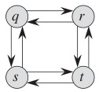
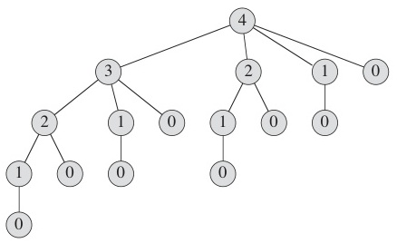
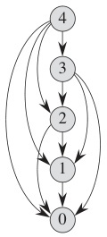
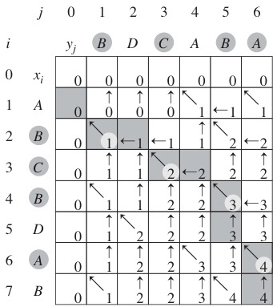

# Week 6 Lecture — Dynamic Programming

[Repository Guide](../../README.md) | [English](Concepts_Lecture.md) | [한국어](Concepts_Lecture.ko.md)

> **Last Updated:** 2026-10-20
>
> Introduction to Algorithms, Cormen, Leiserson, Rivest, and Stein, Ch 15, 25

> **Learning Objectives:**
> 1. Define dynamic programming and state its two required properties (optimal substructure, overlapping subproblems)
> 2. Distinguish DP from divide-and-conquer and explain when each is appropriate
> 3. Implement both top-down (memoization) and bottom-up (tabulation) DP strategies
> 4. Solve the Fibonacci, matrix path, LCS, 0-1 knapsack, coin change, Floyd-Warshall, and edit distance problems using DP
> 5. Formulate DP recurrences (define subproblems, identify base cases, and determine computation order) and analyze the time and space complexity of DP algorithms
> 6. Compare DP with greedy algorithms and decide which approach to use for a given problem

---

## Table of Contents

- [1. Foundations of Dynamic Programming](#1-foundations-of-dynamic-programming)
  - [1.1 Recursive Solutions: Light and Shadow](#11-recursive-solutions-light-and-shadow)
  - [1.2 What is Dynamic Programming?](#12-what-is-dynamic-programming)
  - [1.3 DP vs Divide-and-Conquer](#13-dp-vs-divide-and-conquer)
  - [1.4 Two DP Implementation Strategies](#14-two-dp-implementation-strategies)
  - [1.5 Example: Fibonacci Numbers](#15-example-fibonacci-numbers)
  - [1.6 Fibonacci: Memoization vs Bottom-Up DP](#16-fibonacci-memoization-vs-bottom-up-dp)
  - [1.7 Example: Matrix Path Problem](#17-example-matrix-path-problem)
  - [1.8 Matrix Path: DP Table](#18-matrix-path-dp-table)
- [2. Classic DP Problems](#2-classic-dp-problems)
  - [2.1 LCS: Problem Definition](#21-lcs-problem-definition)
  - [2.2 LCS: Recurrence Relation](#22-lcs-recurrence-relation)
  - [2.3 LCS: Pseudocode](#23-lcs-pseudocode)
  - [2.4 LCS: Step-by-Step Example](#24-lcs-step-by-step-example)
  - [2.5 0-1 Knapsack Problem](#25-0-1-knapsack-problem)
  - [2.6 Knapsack: Recurrence](#26-knapsack-recurrence)
  - [2.7 Knapsack: Worked Example](#27-knapsack-worked-example)
  - [2.8 Coin Change Problem](#28-coin-change-problem)
  - [2.9 Coin Change: Algorithm and Example](#29-coin-change-algorithm-and-example)
  - [2.10 Floyd-Warshall: All-Pairs Shortest Paths](#210-floyd-warshall-all-pairs-shortest-paths)
  - [2.11 Floyd-Warshall: Algorithm](#211-floyd-warshall-algorithm)
  - [2.12 Floyd-Warshall: Example](#212-floyd-warshall-example)
  - [2.13 Edit Distance (Levenshtein Distance)](#213-edit-distance-levenshtein-distance)
  - [2.14 Edit Distance: Example](#214-edit-distance-example)
- [3. DP Problem-Solving Strategy](#3-dp-problem-solving-strategy)
- [Summary](#summary)
- [Self-Check Questions](#self-check-questions)

---

<br>

## 1. Foundations of Dynamic Programming

### 1.1 Recursive Solutions: Light and Shadow

**When recursion works well:**
- Subproblem inputs sum to at most the original input size.
- Examples are merge sort, quick sort, factorial, and graph DFS.

**When recursion is catastrophic:**
- Subproblem inputs sum to **more** than the original input.
- Examples are Fibonacci numbers and matrix chain multiplication.

> **Key Point:** **Overlapping subproblems** cause exponential redundant computation.

### 1.2 What is Dynamic Programming?

**Dynamic Programming (DP)** avoids redundant computation as follows.

1. Solve **small subproblems** first.
2. **Store** (memoize) their solutions.
3. Use the stored solutions to solve **larger subproblems**.
4. Build up to the **original problem**.

**Two requirements for DP:**

| Property | Description |
|----------|-------------|
| **Optimal Substructure** | Optimal solution contains optimal solutions to subproblems |
| **Overlapping Subproblems** | Recursive solution re-solves the same subproblems repeatedly |

*Table 1. Two requirements for DP*

> **Key Point:** DP solves each subproblem exactly once, so when the number of distinct subproblems is polynomial it turns an exponential-time recursive algorithm into a polynomial-time one. The "programming" in dynamic programming refers to a tabular method, not computer programming.

The longest simple path problem in an unweighted directed graph is an example without optimal substructure. In Figure 1, q → r → t is a longest simple path from q to t, but its subpath q → r is not a longest simple path from q to r (that path is q → s → t → r). Hence optimal solutions to subproblems cannot be joined into an optimal overall solution.



*Figure 1. Directed graph showing that the longest simple path problem lacks optimal substructure*

### 1.3 DP vs Divide-and-Conquer

```text
Divide & Conquer           DP

       A                    A
      / \                  / \
     B   C                B   C
    /|   |\              /|\ /|\
   D E   F G            D  E F  G
                        (shared!)
```

*Figure 2. Independent subproblems in divide-and-conquer and shared subproblems in DP*

- In **divide-and-conquer**, subproblems are **independent**, so each is solved once.
- In **DP**, subproblems **overlap**, so each is solved once, stored, and reused.
- **Divide-and-conquer** splits a problem top-down, while **DP** usually computes bottom-up from small to large (it can also be implemented top-down, as with memoization in Section 1.4).

The recursive call tree in divide-and-conquer is a **tree** (no repeated nodes), while in DP the subproblem dependencies form a **DAG** (directed acyclic graph) with shared nodes. Figure 3 is the call tree obtained by directly running a recursion that splits a problem of size 4 into subproblems of sizes 3, 2, 1, and 0, and the same subproblems appear repeatedly (size 2 twice, size 1 four times, size 0 eight times). Figure 4 is the DAG that keeps each subproblem once and draws the dependencies as edges.



*Figure 3. Call tree of the direct recursion for a problem of size 4*



*Figure 4. Subproblem DAG for a problem of size 4*

### 1.4 Two DP Implementation Strategies

**Top-Down: Memoization**
- It uses recursion but caches results in a table.
- It solves only the subproblems that are actually needed.

**Bottom-Up: Tabulation**
- It fills a table iteratively from the smallest subproblems.
- It is systematic and solves all subproblems in order.

```text
Top-Down (Memoization)          Bottom-Up (Tabulation)
┌──────────────────────┐        ┌──────────────────────┐
│ fib(n):              │        │ f[1] = f[2] = 1      │
│   if memo[n] exists  │        │ for i = 3 to n:      │
│     return memo[n]   │        │   f[i] = f[i-1]      │
│   memo[n] = fib(n-1) │        │        + f[i-2]      │
│            +fib(n-2) │        │ return f[n]          │
│   return memo[n]     │        │                      │
└──────────────────────┘        └──────────────────────┘
```

> **Note:** **When to use which?** Memoization is easier to implement (just add caching to recursion) and avoids solving unnecessary subproblems. Tabulation avoids recursion overhead and is typically faster in practice. Most DP problems can be solved either way.

### 1.5 Example: Fibonacci Numbers

**Definition:** $f(n) = f(n-1) + f(n-2)$, with $f(1) = f(2) = 1$

**Naive recursion:**

```text
fib(n):
    if n = 1 or n = 2: return 1
    return fib(n-1) + fib(n-2)
```

**Call tree for fib(7):** the redundancy is enormous.

```text
              fib(7)
            /        \
        fib(6)       fib(5)        <- fib(5) computed twice
        /    \        /   \
    fib(5) fib(4)  fib(4) fib(3)   <- fib(4) computed 3 times
     ...    ...     ...    ...      <- fib(3) computed 5 times!
```

*Figure 5. Call tree of naive recursion computing fib(7)*

**Time complexity:** exponential, $O(2^n)$.

### 1.6 Fibonacci: Memoization vs Bottom-Up DP

**Memoization (Top-Down):**

```text
f[1] = f[2] = 1; all others = 0

fib(n):
    if f[n] != 0: return f[n]
    f[n] = fib(n-1) + fib(n-2)
    return f[n]
```

**Bottom-Up DP (Tabulation):**

```text
fibonacci(n):
    f[1] = f[2] = 1
    for i = 3 to n:
        f[i] = f[i-1] + f[i-2]
    return f[n]
```

| i   | 1 | 2 | 3 | 4 | 5  | 6  | 7  |
|-----|---|---|---|---|----|----|----|
| f[i]| 1 | 1 | 2 | 3 | 5  | 8  | 13 |

*Table 2. Fibonacci table f filled by bottom-up DP*

**Both achieve O(n) time**, reducing exponential time to linear time.

### 1.7 Example: Matrix Path Problem

**Problem:** Given an $n \times n$ matrix of positive integers, find the path from top-left $(1,1)$ to bottom-right $(n,n)$ that **maximizes** the sum of visited cells.

**Constraint:** Only moves **right** or **down** are allowed (no left, up, or diagonal moves).

```text
┌────┬────┬────┬────┐
│  6 │  7 │ 12 │  5 │
├────┼────┼────┼────┤
│  5 │  3 │ 11 │ 18 │
├────┼────┼────┼────┤
│  7 │ 17 │  3 │  3 │
├────┼────┼────┼────┤
│  8 │ 10 │ 14 │  9 │
└────┴────┴────┴────┘
```

*Figure 6. Input matrix of the 4 × 4 matrix path problem*

**Recurrence:** $c[i, j] = m_{ij} + \max(c[i-1, j],\ c[i, j-1])$

Boundary: $c[i, 0] = c[0, j] = 0$

> **Note:** **Optimal substructure.** The best path to cell $(i,j)$ must arrive from either the cell above $(i-1,j)$ or the cell to the left $(i,j-1)$, whichever yields a higher cumulative sum.

### 1.8 Matrix Path: DP Table

```text
matrixPath(n):
    for i = 0 to n: c[i, 0] = 0
    for j = 1 to n: c[0, j] = 0
    for i = 1 to n:
        for j = 1 to n:
            c[i, j] = m[i,j] + max(c[i-1, j], c[i, j-1])
    return c[n, n]
```

| c    |  0 |  1 |  2 |  3 |  4 |
|------|----|----|----|----|-----|
| **0**|  0 |  0 |  0 |  0 |  0 |
| **1**|  0 |  6 | 13 | 25 | 30 |
| **2**|  0 | 11 | 16 | 36 | 54 |
| **3**|  0 | 18 | 35 | 39 | 57 |
| **4**|  0 | 26 | 45 | 59 | **68** |

*Table 3. DP table c of the matrix path problem*

**Answer:** $c[4, 4] = 68$. **Time:** $O(n^2)$.

---

<br>

## 2. Classic DP Problems

### 2.1 LCS: Problem Definition

**Longest Common Subsequence (LCS)**

- A **subsequence** is obtained by deleting zero or more characters without changing the order of the remaining characters.
- A **common subsequence** of X and Y is a subsequence that appears in both strings.
- The **LCS** is the longest such common subsequence.

**Example:**
- X = `ABCBDAB`, Y = `BDCABA`
- Common subsequence: `BCA` (length 3)
- **LCS**: `BCBA` (length **4**)

**Goal:** Find the **length** of the LCS (and optionally the sequence itself).

### 2.2 LCS: Recurrence Relation

Let $X_m = \langle x_1, x_2, \ldots, x_m \rangle$ and $Y_n = \langle y_1, y_2, \ldots, y_n \rangle$.

Define $c[i, j]$ = length of LCS of $X_i$ and $Y_j$.

$$
c[i, j] = \begin{cases}
0 & \text{if } i = 0 \text{ or } j = 0 \\
c[i-1, j-1] + 1 & \text{if } i,j > 0 \text{ and } x_i = y_j \\
\max(c[i-1, j],\ c[i, j-1]) & \text{if } i,j > 0 \text{ and } x_i \neq y_j
\end{cases}
$$

**Intuition:**
- If the last characters **match**, extend the LCS of the shorter prefixes by 1.
- If they **do not match**, take the better result of dropping either character.

### 2.3 LCS: Pseudocode

```text
LCS(m, n):
    for i = 0 to m: C[i, 0] = 0    // empty Y
    for j = 0 to n: C[0, j] = 0    // empty X
    for i = 1 to m:
        for j = 1 to n:
            if x[i] = y[j]:
                C[i, j] = C[i-1, j-1] + 1
            else:
                C[i, j] = max(C[i-1, j], C[i, j-1])
    return C[m, n]
```

**Time:** $\Theta(mn)$, since an $m \times n$ table is filled and each cell takes $O(1)$.

**Space:** $\Theta(mn)$ for the table (it can be optimized to $O(\min(m,n))$ when only the length is needed).

### 2.4 LCS: Step-by-Step Example

X = `ABCBDAB`, Y = `BDCABA`

| c |   | B | D | C | A | B | A |
|---|---|---|---|---|---|---|---|
|   | 0 | 0 | 0 | 0 | 0 | 0 | 0 |
| **A** | 0 | 0 | 0 | 0 | **1** | 1 | **1** |
| **B** | 0 | **1** | 1 | 1 | 1 | **2** | 2 |
| **C** | 0 | 1 | 1 | **2** | 2 | 2 | 2 |
| **B** | 0 | **1** | 1 | 2 | 2 | **3** | 3 |
| **D** | 0 | 1 | **2** | 2 | 2 | 3 | 3 |
| **A** | 0 | 1 | 2 | 2 | **3** | 3 | **4** |
| **B** | 0 | **1** | 2 | 2 | 3 | **4** | 4 |

*Table 4. LCS table c for X = ABCBDAB and Y = BDCABA*

**LCS length = 4** (e.g., `BCBA`). Bold cells show where $x_i = y_j$ (diagonal + 1).



*Figure 7. LCS table with traceback arrows*

> **Note:** **Traceback.** To recover the actual LCS (not just its length), trace back from $c[m,n]$: if $x_i = y_j$, include that character and move diagonally; otherwise, move in the direction of the larger value. The shaded cells in Figure 7 are the path followed by this rule.

### 2.5 0-1 Knapsack Problem

**Problem:** Given $n$ items, each with weight $w_i$ and value $v_i$, and a knapsack of capacity $C$, maximize total value without exceeding capacity.

**Example:** Capacity $C = 10$ kg

| Item | Weight | Value |
|------|--------|-------|
| 1    | 5 kg   | 10    |
| 2    | 4 kg   | 40    |
| 3    | 6 kg   | 30    |
| 4    | 3 kg   | 50    |

*Table 5. Items of the 0-1 knapsack example*

**Subproblem:** $K[i, w]$ = max value considering items $1 \ldots i$ with capacity $w$.

**Answer:** $K[n, C]$

> **Note:** **Why greedy fails for 0-1 knapsack.** The greedy approach (sort by value/weight ratio) does not work because items cannot be divided. Taking a high-ratio item might prevent taking a combination of items with higher total value.

### 2.6 Knapsack: Recurrence

For each item $i$ and capacity $w$:

$$
K[i, w] = \begin{cases}
0 & \text{if } i = 0 \text{ or } w = 0 \\
K[i-1, w] & \text{if } w_i > w \text{ (item too heavy)} \\
\max(K[i-1, w],\ K[i-1, w - w_i] + v_i) & \text{otherwise}
\end{cases}
$$

**Two choices for item $i$:**
- **If it is not taken**, the value is $K[i-1, w]$.
- **If it is taken**, the value is $K[i-1, w - w_i] + v_i$ (make room and add its value).

```text
Knapsack(n, C):
    for i = 0 to n: K[i, 0] = 0
    for w = 0 to C: K[0, w] = 0
    for i = 1 to n:
        for w = 1 to C:
            if w[i] > w: K[i,w] = K[i-1, w]
            else: K[i,w] = max(K[i-1,w], K[i-1,w-w[i]] + v[i])
    return K[n, C]
```

### 2.7 Knapsack: Worked Example

Items (weight, value): (5kg, 10), (4kg, 40), (6kg, 30), (3kg, 50). Capacity = 10.

| K[i,w] | 0 | 1 | 2 | 3 | 4 | 5 | 6 | 7 | 8 | 9 | 10 |
|--------|---|---|---|---|---|---|---|---|---|---|-----|
| **0**  | 0 | 0 | 0 | 0 | 0 | 0 | 0 | 0 | 0 | 0 | 0   |
| **1** (5,10)| 0 | 0 | 0 | 0 | 0 | 10 | 10 | 10 | 10 | 10 | 10 |
| **2** (4,40)| 0 | 0 | 0 | 0 | 40 | 40 | 40 | 40 | 40 | 50 | 50 |
| **3** (6,30)| 0 | 0 | 0 | 0 | 40 | 40 | 40 | 40 | 40 | 50 | 70 |
| **4** (3,50)| 0 | 0 | 0 | 50 | 50 | 50 | 50 | 90 | 90 | 90 | **90** |

*Table 6. DP table K of the 0-1 knapsack example*

**Optimal value:** $K[4, 10] = 90$ (items 2 and 4: 4kg + 3kg = 7kg, value 40 + 50 = 90).

**Time:** $O(nC)$, which is pseudo-polynomial (it depends on the capacity value, not the input size).

### 2.8 Coin Change Problem

**Problem:** Given coin denominations $d_1 > d_2 > \cdots > d_k = 1$ and amount $n$, find the **minimum number of coins** to make change for $n$.

**Greedy can fail.** Example: coins = {16, 10, 5, 1}, amount = 20.
- Greedy: 16 + 1 + 1 + 1 + 1 = **5 coins**
- Optimal: 10 + 10 = **2 coins**

**DP Recurrence:**

$$C[j] = \min_{d_i \leq j} \{ C[j - d_i] + 1 \}$$

Base case: $C[0] = 0$.

### 2.9 Coin Change: Algorithm and Example

```text
DPCoinChange(n, d[1..k]):
    C[0] = 0
    for j = 1 to n: C[j] = infinity
    for j = 1 to n:
        for i = 1 to k:
            if d[i] <= j and C[j - d[i]] + 1 < C[j]:
                C[j] = C[j - d[i]] + 1
    return C[n]
```

**Example:** coins = {16, 10, 5, 1}, amount = 20

| j  | 0 | 1 | 2 | 3 | 4 | 5 | 6 | 7 | 8 | 9 | 10 | ... | 16 | ... | 20 |
|----|---|---|---|---|---|---|---|---|---|---|----|----|----|----|-----|
| C[j]| 0 | 1 | 2 | 3 | 4 | 1 | 2 | 3 | 4 | 5 | 1  | ...| 1  | ...| **2** |

*Table 7. DP table C for making amount 20 with coins {16, 10, 5, 1}*

**Answer:** $C[20] = 2$ (two 10-coins). **Time:** $O(nk)$.

### 2.10 Floyd-Warshall: All-Pairs Shortest Paths

**Problem:** Find shortest paths between **all pairs** of vertices in a weighted directed graph (assuming no negative-weight cycles).

**Key idea:** Incrementally allow intermediate vertices $\{1, 2, \ldots, k\}$.

**Recurrence:**

$$
d_{ij}^{(k)} = \min\left(d_{ij}^{(k-1)},\ d_{ik}^{(k-1)} + d_{kj}^{(k-1)}\right)
$$

- $d_{ij}^{(0)} = w_{ij}$ (direct edge weight, or $\infty$ if no edge)
- $d_{ii}^{(0)} = 0$

**Interpretation:** Is it shorter to go from $i$ to $j$ **through vertex $k$**, or without it?

### 2.11 Floyd-Warshall: Algorithm

```text
FloydWarshall(W, n):
    // W[i,j] = edge weight (infinity if no edge)
    D = W                    // initialize D^(0)
    for k = 1 to n:          // add vertex k as intermediate
        for i = 1 to n:
            for j = 1 to n:
                D[i,j] = min(D[i,j], D[i,k] + D[k,j])
    return D
```

**Time:** $O(n^3)$, from three nested loops over $n$ vertices.

**Space:** $O(n^2)$ for the distance matrix.

> **[Data Structures]** The input $W$ is the adjacency matrix representation of the graph, which stores a graph with $n$ vertices in an $n \times n$ array so that the weight of edge $(i, j)$ is read from $W[i,j]$ in $O(1)$ time. Floyd-Warshall copies this matrix into the distance matrix $D$ and looks up $D[i,k]$ and $D[k,j]$ in constant time at every update, so each step of the three nested loops takes $O(1)$ and the total time is $O(n^3)$.

> **Note:** Each iteration $k$ considers all paths that may pass through vertices $\{1, 2, \ldots, k\}$ as intermediates.

### 2.12 Floyd-Warshall: Example

```text
Initial D^(0):            After k=1,2,3,4: D^(4):
|   1   2   3   4         |   1   2   3   4
|-------------------      |-------------------
1|  0   3  inf  7         1|  0   3   5   6
2| inf  0   2  inf        2|  5   0   2   3
3|  5  inf  0   1         3|  3   6   0   1
4|  2  inf inf  0         4|  2   5   7   0
```

*Figure 8. Initial distance matrix D(0) and final distance matrix D(4) of the Floyd-Warshall example*

Each cell $D[i,j]$ now holds the shortest distance from $i$ to $j$.

### 2.13 Edit Distance (Levenshtein Distance)

**Problem:** Given two strings $X[1 \ldots m]$ and $Y[1 \ldots n]$, find the minimum number of single-character operations to transform $X$ into $Y$.

**Operations** (each costs 1):
- **Insert** a character.
- **Delete** a character.
- **Replace** a character.

**DP Recurrence:**

$$
E[i,j] = \begin{cases}
j & \text{if } i = 0 \\
i & \text{if } j = 0 \\
E[i-1,j-1] & \text{if } X[i] = Y[j] \\
1 + \min(E[i-1,j],\ E[i,j-1],\ E[i-1,j-1]) & \text{otherwise}
\end{cases}
$$

- $E[i-1,j] + 1$ corresponds to deleting $X[i]$.
- $E[i,j-1] + 1$ corresponds to inserting $Y[j]$.
- $E[i-1,j-1] + 1$ corresponds to replacing $X[i]$ with $Y[j]$.

> **Note:** **Applications.** Edit distance is widely used in spell checking, DNA sequence alignment, diff tools, and natural language processing.

### 2.14 Edit Distance: Example

Transform `kitten` into `sitting` (m=6, n=7).

| E | $\varepsilon$ | s | i | t | t | i | n | g |
|---|---|---|---|---|---|---|---|---|
| $\varepsilon$ | 0 | 1 | 2 | 3 | 4 | 5 | 6 | 7 |
| **k** | 1 | 1 | 2 | 3 | 4 | 5 | 6 | 7 |
| **i** | 2 | 2 | 1 | 2 | 3 | 4 | 5 | 6 |
| **t** | 3 | 3 | 2 | 1 | 2 | 3 | 4 | 5 |
| **t** | 4 | 4 | 3 | 2 | 1 | 2 | 3 | 4 |
| **e** | 5 | 5 | 4 | 3 | 2 | 2 | 3 | 4 |
| **n** | 6 | 6 | 5 | 4 | 3 | 3 | 2 | 3 |

*Table 8. Edit distance table E for transforming kitten into sitting*

**Answer:** $E[6,7] = 3$, with three operations:
1. Replace **k** with **s**.
2. Replace **e** with **i**.
3. Insert **g** at the end.

**Time:** $O(mn)$, **Space:** $O(mn)$, reducible to $O(\min(m,n))$ when only the distance value is needed.

---

<br>

## 3. DP Problem-Solving Strategy

**Step-by-step approach to any DP problem:**

1. **Define the subproblem:** What does $OPT[i, j, \ldots]$ represent?
2. **Find the recurrence:** How does $OPT[\cdot]$ relate to smaller subproblems?
3. **Identify base cases:** What are the trivial or boundary values?
4. **Determine computation order:** Fill the table bottom-up (small to large).
5. **Extract the answer:** Where in the table is the final solution?
6. (Optional) **Trace back:** Reconstruct the actual solution, not just its value.

Table 9 summarizes the subproblem, recurrence, and running time of the problems covered above.

| Problem | Subproblem | Recurrence | Time |
|---------|-----------|------------|------|
| Fibonacci | $f[i]$ | $f[i] = f[i-1] + f[i-2]$ | $O(n)$ |
| Matrix Path | $c[i,j]$ | $c[i,j] = m_{ij} + \max(c[i-1,j], c[i,j-1])$ | $O(n^2)$ |
| LCS | $c[i,j]$ | match: $c[i-1,j-1]+1$; else: $\max(c[i-1,j], c[i,j-1])$ | $O(mn)$ |
| 0-1 Knapsack | $K[i,w]$ | $\max(K[i-1,w], K[i-1,w-w_i]+v_i)$ | $O(nC)$ |
| Coin Change | $C[j]$ | $\min_{d_i \leq j}(C[j-d_i]+1)$ | $O(nk)$ |
| Floyd-Warshall | $d_{ij}^{(k)}$ | $\min(d_{ij}^{(k-1)}, d_{ik}^{(k-1)}+d_{kj}^{(k-1)})$ | $O(n^3)$ |
| Edit Distance | $E[i,j]$ | match: $E[i-1,j-1]$; else: $1+\min(E[i-1,j], E[i,j-1], E[i-1,j-1])$ | $O(mn)$ |

*Table 9. Subproblems, recurrences, and running times of representative DP problems*

> **Note:** **An algorithm that remembers the past.** George Santayana wrote, "Those who cannot remember the past are condemned to repeat it." Dynamic programming follows the same idea: it remembers the solutions of subproblems already solved so that it never repeats the same computation.

---

<br>

## Summary

| Concept | Key Summary |
|---------|-------------|
| Dynamic programming | It solves optimization problems by storing and combining the solutions of overlapping subproblems. |
| Requirements | It requires both optimal substructure and overlapping subproblems. |
| Computation order | Subproblems have an implicit order, so smaller ones must be solved first. |
| Implementation strategies | There are two strategies, memoization (top-down) and tabulation (bottom-up). |
| DP vs greedy | DP considers all subproblem combinations, while greedy makes one local choice. |
| DP vs divide-and-conquer | DP reuses subproblem solutions, while divide-and-conquer subproblems are independent. |
| Representative problems | Fibonacci runs in O(n), matrix path in $O(n^2)$, LCS and edit distance in O(mn), 0-1 knapsack in O(nC), coin change in O(nk), and Floyd-Warshall in $O(n^3)$. |

---

<br>

## Self-Check Questions

1. **Optimal Substructure:** In your own words, explain what "optimal substructure" means. Give an example of a problem that has it and one that does not.

   <details>
   <summary>Answer</summary>

   A problem has **optimal substructure** when its optimal solution can be assembled from optimal solutions to its subproblems. **Shortest path** has it: any subpath of a shortest $s \to t$ path is itself a shortest path between its endpoints, which is why both Floyd-Warshall and Dijkstra work. **Longest simple path** does **not**: joining a longest simple $s \to u$ path with a longest simple $u \to t$ path may revisit vertices, so combining locally optimal subpaths does not yield a globally optimal simple path (Figure 1 in Section 1.2).

   </details>

2. **Memoization vs Tabulation:** What are the trade-offs between top-down (memoization) and bottom-up (tabulation) DP? When might you prefer one over the other?

   <details>
   <summary>Answer</summary>

   **Memoization** keeps the natural recursive form and only solves subproblems that are actually reached, which is useful when the reachable subset is sparse (e.g., many states unreachable from the root call). Its downsides are **recursion overhead** and **stack depth** limits, which can blow up for deep recurrences. **Tabulation** iterates over all states in dependency order, avoiding recursion and giving better **cache locality** and constant factors, but may waste work on states the answer never needs. Prefer memoization when the state space is large but sparsely visited; prefer tabulation when most states are needed or when stack depth is a concern.

   </details>

3. **Fibonacci:** Draw the call tree for `fib(6)` using naive recursion. How many times is `fib(3)` computed? Then show how memoization eliminates the redundancy.

   <details>
   <summary>Answer</summary>

   The tree for `fib(6)` expands as `fib(6) -> fib(5) + fib(4)`, then `fib(5) -> fib(4) + fib(3)`, and so on down to the base cases. `fib(3)` is computed **3 times**: once under each `fib(4)` (there are two) and once directly under `fib(5)`. **Memoization** stores `f[n]` the first time it is computed, so every subsequent call returns in $O(1)$. The number of *distinct* subproblems is just $n$, collapsing the call tree from $O(2^n)$ exponential work to $O(n)$ linear work.

   </details>

4. **LCS:** Compute the LCS table for X = `ABCB` and Y = `BDCB`. What is the LCS length? Trace back to find the actual LCS.

   <details>
   <summary>Answer</summary>

   Filling $c[i,j]$ using $c[i-1,j-1]+1$ on match and $\max(c[i-1,j],c[i,j-1])$ otherwise yields the final row/column with $c[4,4] = 3$. **LCS length = 3.** Traceback from $c[4,4]$: $X_4 = B = Y_4$ → take `B`, move diagonal; $X_3 = C = Y_3$ → take `C`, move diagonal; $X_2 = B = Y_1$ after a horizontal step → take `B`. Reversing gives **LCS = `BCB`**.

   </details>

5. **0-1 Knapsack:** Given items (weight, value): (2, 12), (1, 10), (3, 20), (2, 15) and capacity 5, fill the DP table. What is the optimal value and which items are selected?

   <details>
   <summary>Answer</summary>

   Applying $K[i,w] = \max(K[i-1,w],\ K[i-1, w-w_i]+v_i)$ row by row gives $K[1,5]=12$, $K[2,5]=22$, $K[3,5]=32$, and **$K[4,5] = 37$**. Traceback: $K[4,5] \neq K[3,5]$ → take item 4 (w=2, v=15), capacity drops to 3; $K[3,3] = K[2,3] = 22$ → skip item 3; $K[2,3] \neq K[1,3]$ → take item 2 (w=1, v=10), capacity 2; $K[1,2] \neq K[0,2]$ → take item 1 (w=2, v=12). **Selected items: {1, 2, 4}** with total weight $2+1+2 = 5$ and total value $12+10+15 = $ **37**.

   </details>

6. **Coin Change:** With denominations {25, 10, 6, 1}, find the minimum coins for amount 30 using DP. Show why the greedy approach (largest coin first) gives a suboptimal answer.

   <details>
   <summary>Answer</summary>

   **Greedy** picks 25 first, leaving 5 → then 1+1+1+1+1, totaling **6 coins**. **DP** computes $C[j] = \min_{d_i \leq j}(C[j-d_i] + 1)$ and at $j=30$ tries each denomination: $C[30-10]+1 = C[20]+1 = 3$, since $C[20] = 2$ via two 10-coins. So $C[30] = $ **3 coins** (10+10+10). Greedy fails because committing to 25 strands the remainder on a denomination set with no efficient way to make 5; DP considers **all** coin choices at each amount, so it finds the better global combination that avoids 25 entirely.

   </details>

7. **Floyd-Warshall:** Using the 4-vertex graph of Section 2.12, trace through the algorithm for one iteration (k=2). Which cells change and why?

   <details>
   <summary>Answer</summary>

   Iteration $k=2$ updates $D[i,j] \gets \min(D[i,j],\ D[i,2] + D[2,j])$ for every pair $(i,j)$. In the example of Section 2.12, $D^{(1)}$ after iteration $k=1$ differs from $D^{(0)}$ only in $D[3,2] = 8$ and $D[4,2] = 5$. At $k=2$, $D^{(1)}[3,4] = 1$ stays, $D^{(1)}[1,3] = \infty$ becomes $\min(\infty, D[1,2]+D[2,3]) = \min(\infty, 3+2) = 5$, and $D^{(1)}[4,3] = \infty$ becomes $\min(\infty, D[4,2]+D[2,3]) = \min(\infty, 5+2) = 7$. $D[1,4] = 7$ is unchanged since $D[2,4] = \infty$ at this step. **Cells that change are exactly those whose shortest path can now route through vertex 2**; cells whose current best already bypasses or beats that route stay the same.

   </details>

8. **Edit Distance:** Compute the edit distance between `sunday` and `saturday`. Show the DP table and identify the three operations needed.

   <details>
   <summary>Answer</summary>

   With $X$ = `sunday` (m=6), $Y$ = `saturday` (n=8), the recurrence gives **$E[6,8] = 3$**. Aligning the strings: `s` matches, then `a` and `t` must be **inserted** before `u` (2 inserts), then `u-n-d-a-y` aligns with `u-r-d-a-y` requiring one **replace** of `n → r`. So the three operations are **insert `a`**, **insert `t`**, and **replace `n` with `r`**, which is exactly the minimum of 3 single-character edits.

   </details>
