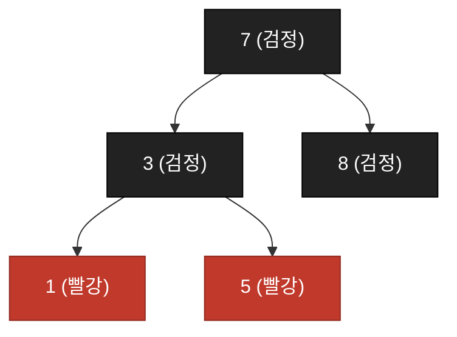

# 9주차 이론 — 탐색 트리

[레포지토리 안내](../../README.ko.md) | [English](Concepts_Lecture.md) | [한국어](Concepts_Lecture.ko.md)

> **최종 수정일:** 2026-10-18
>
> Introduction to Algorithms, Cormen, Leiserson, Rivest, and Stein, Ch 12, 13, 18

> **학습 목표:**
> 1. 트리를 재귀적으로 정의하고, 마스터 정리로 트리 순회의 복잡도를 유도할 수 있다
> 2. 이진 탐색 트리(BST)의 탐색, 삽입, 삭제를 구현하고 평균과 최악 복잡도를 분석하며, 정렬된 입력에서 BST가 $O(n)$으로 퇴화하는 이유를 설명할 수 있다
> 3. 레드-블랙 트리(RBT)의 다섯 가지 성질을 기술하고, 그것이 어떻게 $O(\log n)$ 높이를 보장하는지 설명할 수 있다
> 4. 더블 레드(Double Red) 위반을 **재구성(Restructuring, 삼촌이 검정)** 또는 **재색칠(Recoloring, 삼촌이 빨강)** 로 해결할 수 있다
> 5. 디스크 I/O 비용 모델로부터 B-Tree의 동기와 넓고 얕은 노드가 디스크 접근을 줄이는 원리를 설명하고, B-Tree의 탐색, 삽입(분할 포함), 삭제(빌리기와 병합)를 수행할 수 있다
> 6. BST, RBT, B-Tree를 높이, 연산 비용, 용도 측면에서 비교할 수 있다

---

## 목차

- [1. 트리의 기초](#1-트리의-기초)
  - [1.1 트리의 재귀적 정의](#11-트리의-재귀적-정의)
  - [1.2 트리 순회의 복잡도](#12-트리-순회의-복잡도)
- [2. 이진 탐색 트리 (BST)](#2-이진-탐색-트리-bst)
  - [2.1 BST: 핵심 아이디어](#21-bst-핵심-아이디어)
  - [2.2 BST 탐색](#22-bst-탐색)
  - [2.3 BST 삽입](#23-bst-삽입)
  - [2.4 BST 탐색/삽입: 평균 사례](#24-bst-탐색삽입-평균-사례)
  - [2.5 BST 최악 사례: 문제점](#25-bst-최악-사례-문제점)
  - [2.6 BST 삭제: 세 가지 경우](#26-bst-삭제-세-가지-경우)
  - [2.7 BST 삭제: 복잡도](#27-bst-삭제-복잡도)
- [3. 레드-블랙 트리 (RBT)](#3-레드-블랙-트리-rbt)
  - [3.1 RBT: 동기](#31-rbt-동기)
  - [3.2 RBT: 다섯 가지 성질](#32-rbt-다섯-가지-성질)
  - [3.3 RBT가 O(log n)을 보장하는 이유](#33-rbt가-olog-n을-보장하는-이유)
  - [3.4 RBT 삽입: 개요](#34-rbt-삽입-개요)
  - [3.5 더블 레드: 용어](#35-더블-레드-용어)
  - [3.6 경우 1: 재구성 (삼촌이 검정)](#36-경우-1-재구성-삼촌이-검정)
  - [3.7 경우 2: 재색칠 (삼촌이 빨강)](#37-경우-2-재색칠-삼촌이-빨강)
  - [3.8 RBT: 풀이 예시](#38-rbt-풀이-예시)
  - [3.9 RBT: 연산 복잡도](#39-rbt-연산-복잡도)
- [4. B-Tree](#4-b-tree)
  - [4.1 B-Tree의 동기: 디스크 I/O 문제](#41-b-tree의-동기-디스크-io-문제)
  - [4.2 B-Tree: 핵심 아이디어](#42-b-tree-핵심-아이디어)
  - [4.3 B-Tree: 탐색](#43-b-tree-탐색)
  - [4.4 B-Tree: 삽입 (분할 없음)](#44-b-tree-삽입-분할-없음)
  - [4.5 B-Tree: 삽입 (분할 발생)](#45-b-tree-삽입-분할-발생)
  - [4.6 B-Tree: 삭제 개요](#46-b-tree-삭제-개요)
  - [4.7 B-Tree: 삭제 (리프 노드의 경우들)](#47-b-tree-삭제-리프-노드의-경우들)
- [5. BST vs RBT vs B-Tree](#5-bst-vs-rbt-vs-b-tree)
- [요약](#요약)
- [점검 문제](#점검-문제)

---

<br>

## 1. 트리의 기초

### 1.1 트리의 재귀적 정의

**트리(tree)** 는 루트 노드와 0개 이상의 **부분 트리(subtree)** 를 결합한 재귀적 구조이다.

```text
            [A]                   "n개 노드의 트리
           / | \                    = 루트 + 부분 트리"
         /   |   \
       [B]  [C]  [D]             각 부분 트리 자체가
       / \      / | \           더 작은 트리이다.
     [E] [F]  [G][H][I]
```

*그림 1. 루트와 부분 트리로 이루어진 트리의 재귀 구조*

> **핵심:** 부분 구조가 반복되기 때문에 트리 알고리즘을 **재귀**로 자연스럽게 구현할 수 있다.

- 이는 **분할 정복(divide and conquer)** 과 같은 원리로, 부분 문제(부분 트리)로 나누고 각각 푼 뒤 결과를 합친다.
- 탐색, 삽입, 순회 같은 기본 트리 알고리즘은 대부분 한 줄짜리 재귀와 기저 조건(base case)으로 구성된다.

### 1.2 트리 순회의 복잡도

**균형 잡힌(balanced)** 이진 트리에서 모든 노드를 정확히 한 번 방문하는 순회의 비용은 다음과 같다.

$$T(n) = 2T(n/2) + O(1)$$

- $2T(n/2)$: 왼쪽과 오른쪽 부분 트리를 순회한다(각각 약 $n/2$개 노드).
- $O(1)$: 루트 노드를 방문한다.

**마스터 정리 적용:** $a = 2,\ b = 2,\ f(n) = O(1)$. $f(n)$을 $n^{\log_b a} = n^1$과 비교한다.

$f(n) = O(n^0)$이고 $0 < 1$이므로 **Case 1**:

$$T(n) = \Theta(n)$$

> **참고:** **하한 논증.** 어떤 순회든 모든 노드를 적어도 한 번은 봐야 하므로 $\Omega(n)$은 피할 수 없다. 마스터 정리는 $\Theta(n)$이 또한 달성 가능함을 확인해 준다. 균형 가정은 마스터 정리를 적용하기 위한 것이며, 교재는 트리 모양과 관계없이 중위 순회가 $\Theta(n)$ 시간에 끝남을 증명한다.

---

<br>

## 2. 이진 탐색 트리 (BST)

### 2.1 BST: 핵심 아이디어

BST는 **정렬된 순서**를 유지하는 이진 트리이다:

$$\text{왼쪽 부분 트리} < \text{루트} < \text{오른쪽 부분 트리}$$

```text
              [15]
             /    \
          [6]      [18]
         /   \     /   \
       [3]  [7]  [17] [20]
       / \    \
     [2] [4] [13]
              /
            [9]
```

*그림 2. 이진 탐색 트리의 예*

**모든 노드 $x$에 대한 BST 성질:**
- 왼쪽 부분 트리의 모든 키는 $x.\text{key}$보다 작다.
- 오른쪽 부분 트리의 모든 키는 $x.\text{key}$보다 크다.

여기서는 키가 모두 다르다고 가정한다. 교재는 중복 키를 허용하여 왼쪽에는 $\le$, 오른쪽에는 $\ge$를 쓰며, 그림 5의 두 트리에도 키 5가 두 번 들어 있다.

> **참고:** **이진 탐색과의 연관.** 균형 잡힌 BST에서는 매 단계마다 남은 탐색 공간의 약 절반이 제거된다. 정렬된 배열에서 이진 탐색이 $O(\log n)$이었던 것과 같은 원리이다.

### 2.2 BST 탐색

```text
TREE-SEARCH(x, k):
    if x = NIL or k = x.key:
        return x
    if k < x.key:
        return TREE-SEARCH(x.left, k)
    else:
        return TREE-SEARCH(x.right, k)
```

**예시 (13 탐색):**

```text
             [15]           15: 13 < 15, 왼쪽으로
            /    \
          [6]      [18]     6: 13 > 6, 오른쪽으로
         /   \
       [3]  [7]             7: 13 > 7, 오른쪽으로
              \
             [13]  <- 발견!
```

*그림 3. BST에서 키 13을 탐색하는 경로*

각 레벨에서 **한 번 비교하고 한 간선만 따라 내려가므로**, 비용은 트리 높이 $h$에 대해 $O(h)$이다.

### 2.3 BST 삽입

키 $k$를 삽입하려면 마치 탐색하듯 내려가다가 NIL에 도달한 위치에 새 노드를 **잎(leaf)** 으로 붙인다.

```text
TREE-INSERT(T, z):
    y = NIL
    x = T.root
    while x != NIL:
        y = x
        if z.key < x.key: x = x.left
        else:             x = x.right
    z.parent = y
    if y = NIL:               T.root = z     // 트리가 비어 있었음
    else if z.key < y.key:    y.left  = z
    else:                     y.right = z
```

삽입은 실패한 탐색과 동일한 경로를 따른 뒤 새 노드를 잎으로 연결하므로 비용은 $O(h)$이다.

### 2.4 BST 탐색/삽입: 평균 사례

데이터가 **무작위 순서**로 삽입되면 트리 높이의 기댓값은 $\Theta(\log n)$이다. 각 비교에서 남은 노드가 절반으로 준다고 보면 탐색 비용은 다음 점화식을 따른다.

$$T(n) = T(n/2) + O(1)$$

- $T(n/2)$: 각 노드에서 한 부분 트리(절반의 노드)로만 재귀한다.
- $O(1)$: 현재 노드에서 한 번 비교한다.

**마스터 정리:** $a = 1,\ b = 2,\ f(n) = O(1) = \Theta(n^0) = \Theta(n^{\log_b a})$. **Case 2**:

$$T(n) = \Theta(\log n)$$

따라서 평균 탐색과 삽입은 모두 $O(\log n)$이며, 정렬된 배열의 이진 탐색과 같은 성능이다. 이 점화식은 매번 절반으로 나뉜다고 본 근사이며, 교재는 무작위 순서로 만든 BST의 기대 높이가 $O(\log n)$임을 증명한다.

### 2.5 BST 최악 사례: 문제점

키가 **정렬된 순서**로 들어오면 어떻게 되는가?

```text
삽입: 1, 2, 3, 4, 5

    [1]
      \
      [2]
        \
        [3]
          \
          [4]
            \
            [5]
```

*그림 4. 1, 2, 3, 4, 5를 정렬된 순서로 삽입해 퇴화한 BST*

트리가 **연결 리스트**로 퇴화한다. 그림 5는 같은 키 집합이라도 삽입 순서에 따라 높이가 2인 BST와 높이가 4인 BST가 만들어질 수 있음을 보여 준다.


*그림 5. 같은 키로 만든 높이 2의 BST와 높이 4의 BST*

$$T(n) = T(n-1) + O(1) \implies T(n) = O(n)$$

| 사례              | 높이      | 탐색/삽입    |
|-------------------|-----------|--------------|
| 평균 (무작위)     | $O(\log n)$ | $O(\log n)$ |
| 최악 (정렬)       | $O(n)$    | $O(n)$      |

*표 1. 입력 순서에 따른 BST의 높이와 탐색, 삽입 비용*

> **핵심:** 일반 BST는 평균은 좋지만 최악을 **보장하지 못한다**. 이것이 3절과 4절의 **균형(balanced) 트리**가 등장하는 동기다.

### 2.6 BST 삭제: 세 가지 경우

삭제는 탐색, 삽입보다 까다롭다. 삭제할 노드를 $z$라 하자.

**경우 1: 자식이 없음.** $z$를 단순히 제거한다.

```text
    [5]          [5]
   /   \   =>   /   \
 [3]   [7]    [3]   [7]
   \
   [4]  <- 4 삭제
```

*그림 6. 자식이 없는 노드 4의 삭제*

**경우 2: 자식이 하나.** $z$를 하나뿐인 자식으로 대체(splice)한다.

```text
    [5]          [5]
   /   \   =>   /   \
 [3]   [7]    [4]   [7]
   \
   [4]  <- 3 삭제, 4로 대체
```

*그림 7. 자식이 하나인 노드 3의 삭제*

**경우 3: 자식이 둘.** $z$의 키를 오른쪽 부분 트리에서 가장 작은 키인 **중위 후속자(in-order successor)** 로 대체한 뒤 그 후속자를 삭제한다. 후속자는 자식이 최대 하나이므로 이 삭제는 경우 1 또는 2로 환원된다.

```text
6 삭제:
         [15]                     [15]
        /    \                  /     \
     [6]      [18]           [7]      [18]
    /   \     /   \    =>   /  \      /   \
  [3]  [7]  [17] [20]     [3] [13]  [17] [20]
  / \    \                / \  /
[2] [4] [13]            [2][4][9]
         /
       [9]

1단계: 6의 중위 후속자 = 7 (오른쪽 부분 트리 최소)
2단계: 6의 키를 7로 대체
3단계: 원래의 노드 7을 삭제 (자식이 최대 하나)
```

*그림 8. 자식이 둘인 노드 6을 중위 후속자 7로 대체하는 삭제*

> **참고:** **왜 후속자인가?** 중위 후속자는 6 다음으로 큰 값이므로, 그것으로 대체해도 BST 성질이 유지된다. 왼쪽 부분 트리의 모든 키는 여전히 작고, 오른쪽 부분 트리의 모든 키는 여전히 크다.

### 2.7 BST 삭제: 복잡도

| 단계                  | 비용  |
|-----------------------|-------|
| 삭제할 노드 찾기      | $O(h)$ |
| 중위 후속자 찾기      | $O(h)$ |
| 구조 변경 수행        | $O(1)$ |

*표 2. BST 삭제의 단계별 비용*

**총합:** $O(h)$.

**BST 연산 요약:**

| 연산 | 평균        | 최악     |
|------|-------------|----------|
| 탐색 | $O(\log n)$ | $O(n)$   |
| 삽입 | $O(\log n)$ | $O(n)$   |
| 삭제 | $O(\log n)$ | $O(n)$   |

*표 3. BST 연산의 평균과 최악 복잡도*

---

<br>

## 3. 레드-블랙 트리 (RBT)

### 3.1 RBT: 동기

BST의 최악은 $O(n)$이다. $O(\log n)$을 **보장**할 수 있는가?

**레드-블랙 트리(Red-Black Tree)** 는 노드마다 **색(빨강 또는 검정)** 1비트를 추가한 BST다. 색칠 규칙이 트리를 항상 거의 균형 잡힌 상태로 유지하므로 다음이 성립한다.

$$h \leq 2\log_2(n+1) = O(\log n)$$

따라서 탐색, 삽입, 삭제 모두 최악에서도 **보장된** $O(\log n)$이다.

### 3.2 RBT: 다섯 가지 성질

모든 RBT는 표 4의 다섯 성질을 만족해야 한다. 그림 9의 (a)는 각 NIL 잎을 그리고 노드 옆에 검정 높이를 적은 것이고, (b)는 모든 NIL을 하나의 경계 노드 T.nil로 합친 것이며, (c)는 잎을 생략한 일반적인 그림이다. 검은 노드가 검정, 회색 노드가 빨강이다.


*그림 9. 세 가지 방식으로 그린 레드-블랙 트리의 예*

| # | 성질 |
|---|------|
| 1 | 모든 노드는 **빨강** 또는 **검정** |
| 2 | **루트**는 검정 |
| 4 | 노드가 **빨강**이면 두 자식 모두 **검정** (빨강이 연속하지 않음) |
| 4 | 노드가 **빨강** 이면 두 자식 모두 **검정** (빨강이 연속하지 않음) |
| 5 | 모든 노드에 대해, 그 노드에서 자손 잎까지의 모든 경로는 **같은 수의 검정 노드**를 포함 |

*표 4. 레드-블랙 트리의 다섯 가지 성질*

```text
             [7:B]
           /       \
       [3:R]       [18:R]
       /   \       /    \
    [1:B] [5:B] [10:B] [22:B]
                   \
                  [15:R]

B = 검정(Black), R = 빨강(Red)
성질 4: 빨강 18의 자식 10, 22가 모두 검정  OK
성질 5: 모든 루트→잎 경로가 검정 노드 2개  OK
```

*그림 10. 다섯 가지 성질을 만족하는 레드-블랙 트리*

### 3.3 RBT가 O(log n)을 보장하는 이유

노드 $x$의 **검정 높이(black-height)** $\text{bh}(x)$를 $x$로부터 잎까지 이르는 경로 위 검정 노드의 개수로 정의한다($x$ 자신은 세지 않으며, 성질 5에 의해 잘 정의된다).

- $x$를 루트로 하는 부분 트리는 적어도 $2^{\text{bh}(x)} - 1$개의 내부 노드를 포함한다(높이에 대한 귀납법).
- 성질 4에 의해 임의의 루트→잎 경로 위 노드 중 **적어도 절반**이 검정이므로 $\text{bh}(\text{root}) \geq h/2$이다.

이 둘을 결합하면:

$$n \geq 2^{h/2} - 1 \implies h \leq 2\log_2(n+1)$$

> **참고:** **기하학적 해석.** 가장 긴 경로(빨강과 검정이 교대)는 가장 짧은 경로(전부 검정) 길이의 **최대 2배**이다. 트리가 기울 수는 있지만 상수 배 안에서만 기운다.

### 3.4 RBT 삽입: 개요

새 키는 다음 순서로 삽입한다.

1. 일반 BST처럼 삽입한다(새 노드는 잎이 된다).
2. **새 노드를 빨강으로 칠한다.** 이렇게 하면 성질 5(검정 높이)는 깨지지 않는다.
3. 새 노드가 루트가 되면(빈 트리에 삽입한 경우) 성질 2가 깨지는데, 이는 루트를 검정으로 칠하면 해결된다. 그 밖에 깨질 수 있는 성질은 **성질 4**뿐이다. 빨강 자식 위에 빨강 부모가 오는 이 위반을 **더블 레드(Double Red)** 라 하며, 이를 수정해야 한다.

```text
4를 다음 트리에 삽입:

    [7:B]              [7:B]
   /     \            /     \
 [3:B]  [18:B]  =>  [3:B]  [18:B]
                       \
                      [4:R]   <- 새 노드, 항상 빨강

여기서는 위반 없음. 부모가 빨강이었다면 fix-up이 필요.
```

*그림 11. 검정 부모 아래에 새 빨강 노드 4를 삽입하는 과정*

### 3.5 더블 레드: 용어

더블 레드가 발생하면 관련된 노드를 다음과 같이 부른다:

```text
        [G]          G = 조부모(Grandparent)
       /   \
     [P]   [U]      P = 부모(Parent),  U = 삼촌(Uncle)
     /
   [N]               N = 새로 삽입된 노드(빨강), P 또한 빨강
```

*그림 12. 더블 레드에 관련된 노드 G, P, U, N*

해결 전략은 **삼촌의 색**에 따라 분기된다:

| 삼촌의 색 | 전략          |
|-----------|---------------|
| **검정**  | **재구성(Restructuring, 회전)** |
| **빨강**  | **재색칠(Recoloring, 색 뒤집기)** |

*표 5. 삼촌의 색에 따른 더블 레드 해결 전략*

### 3.6 경우 1: 재구성 (삼촌이 검정)

$U$가 검정이면 $N$, $P$, $G$를 지역적으로 회전한다. 그림 13의 좌회전은 $x$와 그 오른쪽 자식 $y$의 위치를 바꾸어 $y$를 위로 올리고, $y$의 왼쪽 부분 트리 $\beta$를 $x$의 오른쪽 부분 트리로 옮긴다. 우회전은 그 반대이다.


*그림 13. 좌회전과 우회전*

1. $N, P, G$를 **키 순으로 정렬**한다.
2. **중앙값(median)** 이 새로운 지역 루트가 되며 **검정**으로 칠한다. 나머지 둘은 그 자식이 되며 **빨강**으로 칠한다.
3. 원래 부분 트리들은 BST 성질에 부합하는 유일한 방식으로 재연결된다.

```text
이전 (G=7, P=3, N=5):       재구성 후:

      [7:B]                    [5:B]
     /     \                  /     \
   [3:R]  [8:B]       =>   [3:R]   [7:R]
      \                             /
     [5:R]                       [8:B]

정렬: 3, 5, 7
중앙값: 5 -> 새로운 지역 루트 (검정)
나머지: 3, 7 -> 자식 (빨강)
```

*그림 14. 삼촌이 검정일 때의 재구성*

> **참고:** **왜 작동하는가.** 재구성은 **지역적** 연산이다. 회전은 $N$과 $P$가 모두 왼쪽 자식이거나 모두 오른쪽 자식이면 한 번, 그렇지 않으면 두 번(그림 14의 예) 필요하며 $O(1)$ 작업이다. 지역 루트의 검정 높이가 변하지 않으므로 수정이 위로 **전파되지 않는다**.

### 3.7 경우 2: 재색칠 (삼촌이 빨강)

$U$가 빨강이면 색을 교환한다.

1. $P$와 $U$를 **검정**으로 만든다.
2. $G$를 **빨강**으로 만든다.
3. $G$가 루트라면 강제로 **검정**으로 칠한다. 그렇지 않으면 $G$가 그 부모와 함께 새로운 더블 레드를 만들 수 있으므로 $G$에서 fix-up을 반복한다.

```text
이전:                     재색칠 후:

      [7:B]                    [7:R] <- 새로운 더블 레드를
     /     \                  /     \    유발할 수 있음
   [3:R]  [8:R]    =>      [3:B]   [8:B]
   /                        /
 [1:R]                   [1:R]

P=3과 U=8이 검정으로; G=7이 빨강으로.
7이 루트라면 검정으로 강제.
7의 부모도 빨강이라면 위로 fix-up 반복.
```

*그림 15. 삼촌이 빨강일 때의 재색칠*

> **참고:** **왜 작동하는가.** 재색칠은 성질 5를 보존한다($G$를 통과하는 모든 경로의 검정 수가 변하지 않는다). 위반은 한 번에 두 레벨씩 위로 밀리므로 루트에 도달하기까지 최대 $O(\log n)$번 전파될 수 있다.

### 3.8 RBT: 풀이 예시

삽입 순서: 7, 3, 8, 1, 5

```text
1단계: 7 삽입          2단계: 3 삽입         3단계: 8 삽입
   [7:B]               [7:B]                [7:B]
                       /                   /     \
                    [3:R]               [3:R]   [8:R]

4단계: 1 삽입 -> 더블 레드 (N=1, P=3, U=8)
삼촌 8이 빨강 -> 재색칠

       [7:B]                   [7:B]
      /     \       =>        /     \
   [3:R]   [8:R]           [3:B]   [8:B]
    /                       /
 [1:R]                   [1:R]

5단계: 5 삽입 -> 더블 레드 (N=5, P=3, U=8)
이제 U=8은 검정 -> 재구성

      [7:B]            정렬 {N=5, P=3, G=7} = 3, 5, 7
     /     \           중앙값 5 -> 새로운 지역 루트 (검정)
   [3:B]  [8:B]
      \
     [5:R]
                       [5:B]
                      /     \
결과:               [3:R]   [7:R]
                              \
                             [8:B]
```

*그림 16. 7, 3, 8, 1, 5를 차례로 삽입하는 레드-블랙 트리 예제*

> **참고:** **5단계의 오류.** 4단계의 재색칠 뒤에는 3이 검정이므로, 5를 3의 오른쪽 자식으로 삽입해도 부모가 검정이어서 더블 레드가 생기지 않는다. 그림 16의 5단계는 3을 빨강으로 보고 재구성을 적용했으며, 결과 트리에서 키 1도 빠져 있다. 아래 그림 17은 이를 고친 결과이며, 삼촌이 검정일 때의 재구성은 3.6절의 그림 14에 나와 있다.



*그림 17. 5를 삽입한 뒤의 올바른 레드-블랙 트리*

### 3.9 RBT: 연산 복잡도

| 연산       | 복잡도        | 세부                          |
|------------|---------------|-------------------------------|
| **탐색**   | $O(\log n)$ | BST와 동일; 높이가 $O(\log n)$ |
| **삽입**   | $O(\log n)$ | BST 삽입 $O(\log n)$ + fix-up $O(\log n)$ |
| **삭제**   | $O(\log n)$ | BST 삭제 $O(\log n)$ + fix-up $O(\log n)$ |

*표 6. 레드-블랙 트리 연산의 복잡도*

fix-up은 최대 $O(\log n)$번의 재색칠과 상수 번의 회전만 사용한다. 회전은 삽입 후 **최대 2번**, 삭제 후 최대 3번이다.

| | BST (평균)  | BST (최악)  | RBT (최악)        |
|-|-------------|-------------|-------------------|
| 탐색 | $O(\log n)$ | $O(n)$ | **$O(\log n)$** |
| 삽입 | $O(\log n)$ | $O(n)$ | **$O(\log n)$** |
| 삭제 | $O(\log n)$ | $O(n)$ | **$O(\log n)$** |

*표 7. BST와 레드-블랙 트리의 복잡도 비교*

> **참고:** **결론.** RBT는 작은 상수 오버헤드(색 1비트, 가끔의 회전)를 지불하는 대신 최악을 **보장**한다. 그래서 메모리 내 정렬 맵의 기본 선택지로 쓰인다(예: C++ `std::map`, Java `TreeMap`, 리눅스 커널 CFS 스케줄러).

**트립(treap)** 은 무작위성으로 균형을 유지하는 또 다른 BST이다. 각 노드는 키와 우선순위를 함께 가지며, 키에 대해서는 BST 성질을, 우선순위에 대해서는 부모의 우선순위가 자식보다 작은 최소 힙 성질을 만족한다(그림 18). 우선순위를 무작위로 정하면 기대 높이가 $O(\log n)$이다.


*그림 18. 키:우선순위 쌍으로 표시한 트립*

---

<br>

## 4. B-Tree

### 4.1 B-Tree의 동기: 디스크 I/O 문제

데이터가 너무 커서 메인 메모리에 다 들어가지 못하면 **디스크**에 저장되며, 디스크 접근이 실행 시간을 지배한다.

```text
접근 시간 (대략):
  CPU 레지스터     ~0.3 ns
  메인 메모리       ~100 ns
  SSD            ~50 us   (메모리보다 ~500배 느림)
  HDD            ~5 ms    (메모리보다 ~50,000배 느림)
```

$n = 10^9$개의 노드를 가진 RBT의 높이는 적어도 약 30($\log_2 10^9 \approx 30$)이다. HDD에서는 연산마다 $30 \times 5\,\text{ms} = 150\,\text{ms}$가 걸려 데이터베이스로 쓰기에 너무 느리다. 병목은 비교 횟수가 아니라 **디스크 읽기**이다.

> **참고:** **상대적 비율.** 상대적인 비율로 보면 CPU의 1초는 디스크 I/O의 약 10일에 해당한다.

> **참고:** **비용 모델의 전환.** 메모리 내 자료구조에서는 비교 횟수를 최소화하지만, 디스크 자료구조에서는 **읽어 들이는 디스크 블록 수**, 즉 트리의 **높이**를 최소화해야 한다.

### 4.2 B-Tree: 핵심 아이디어

각 노드가 **많은 키**를 담도록 만들어 트리를 **넓고 얕게** 한다.

```text
BST (높음, 좁음):         B-Tree (낮음, 넓음):

     [50]                  [20|40|60|80]
    /    \                / |  |  |  \
  [25]  [75]            [..][..][..][..][..]
  / \    / \
......                  10^9개 노드에 높이 약 3
높이 약 30
```

*그림 19. 높고 좁은 BST와 낮고 넓은 B-Tree*

**설계 결정:**
- 노드 1개를 **디스크 블록 1개**(보통 4 KB)에 맞춘다.
- 한 번의 디스크 읽기로 **수백 개 키**를 한꺼번에 메모리에 적재한다.
- 노드 **내부 탐색**은 빠른 메모리 연산이며 디스크 I/O 비용에 포함되지 않는다.
- 차수 1000인 B-Tree는 높이 3(레벨 3개)만으로 약 $10^9$개의 키를 저장한다.

### 4.3 B-Tree: 탐색

```text
B-TREE-SEARCH(x, k):
    i = 1
    while i <= x.n and k > x.key[i]:
        i = i + 1
    if i <= x.n and k = x.key[i]:
        return (x, i)
    if x.leaf:
        return NIL
    DISK-READ(x.child[i])
    return B-TREE-SEARCH(x.child[i], k)
```

```text
B-Tree(차수 5)에서 키 42 탐색:

  루트: [20 | 40 | 60 | 80]
         |    |    |    |
         v    v    v    v
        ...  ...  ...  ...

  42 > 40, 42 < 60 -> 40과 60 사이 포인터 따라감

  자식: [41 | 42 | 45 | 50]
             ^
             발견 (루트 1회 + 자식 1회 = 총 2회 디스크 읽기)
```

*그림 20. 차수 5인 B-Tree에서 키 42를 탐색하는 경로*

**각 레벨마다 디스크 읽기가 1회 필요하다.** 높이가 3이면 $n$과 관계없이 최대 3회이다.

### 4.4 B-Tree: 삽입 (분할 없음)

**경우 1: 대상 잎에 여유가 있음.** 정렬된 위치에 삽입하면 끝난다.

```text
25 삽입 (노드당 최대 4개 키):

  루트: [10 | 20 | 40 | 60]
             |
             v
  잎: [21 | 30 | 35]        <- 여유 있음 (3개 키, 최대 4)

  삽입 후:
  잎: [21 | 25 | 30 | 35]   <- 25를 정렬 위치에 배치
```

*그림 21. 여유가 있는 잎에 키 25를 삽입하는 과정*

탐색 한 번과 블록 쓰기 한 번이면 되며 구조는 바뀌지 않는다.

### 4.5 B-Tree: 삽입 (분할 발생)

**경우 2: 대상 잎이 가득 참.** 중앙값을 기준으로 **분할(split)** 하고 중앙값을 부모로 **승격(promote)** 한다.

```text
28 삽입 (노드당 최대 4개 키):

  부모: [... | 20 | 40 | ...]
               |
               v
  잎:  [21 | 25 | 30 | 35]    <- 가득 참

1단계: 28 삽입, 일시적 오버플로
  임시: [21 | 25 | 28 | 30 | 35]

2단계: 중앙값 28을 기준으로 분할
  왼쪽: [21 | 25]
  오른쪽: [30 | 35]

3단계: 중앙값 28을 부모로 승격
  부모: [... | 20 | 28 | 40 | ...]
              |     |
              v     v
        [21 | 25] [30 | 35]
```

*그림 22. 가득 찬 잎에 키 28을 삽입할 때의 분할과 승격*

부모도 가득 차 있으면 분할이 **위로 전파**된다. 극단적인 경우 루트가 분할되어 트리 높이가 1 증가한다. 이것이 B-Tree가 높이를 얻는 **유일한 방법**이며, 그래서 트리는 항상 완벽한 균형을 유지한다.

### 4.6 B-Tree: 삭제 개요

삭제는 B-Tree에서 가장 복잡한 연산이다. 주요 경우는 다음과 같다.

**경우 1: 키가 잎 노드에 있음.**
- 1.1: 노드의 키 수가 최소보다 많으면 단순히 삭제한다.
- 1.2: 형제에 여유 키가 있으면 형제에서 **빌리기(borrow)** 를 한다. 키는 부모를 거쳐 회전한다.
- 1.3: 형제도 최소이면 형제와 **병합(merge)** 한다. 부모 키를 끌어내려 합친다.
- 1.4: 병합으로 부모가 부족해지면 위로 재귀한다.

**경우 2: 키가 내부 노드에 있음.**
- **중위 선행자(in-order predecessor, 왼쪽 부분 트리의 최댓값)** 또는 **중위 후속자(in-order successor, 오른쪽 부분 트리의 최솟값)** 와 교환한다.
- 그 후 잎에서 삭제하므로 경우 1로 환원된다.

**경우 3: 내부 키이고 노드와 자식이 모두 최소인 경우.**
- 자식들을 병합하고 부모 키를 끌어내려 재구조화한다.
- 병합이 위로 전파될 수 있다.

### 4.7 B-Tree: 삭제 (리프 노드의 경우들)

**경우 1.1: 단순 제거(여유 키 있음).**

```text
30 삭제:  [10 | 20 | 30 | 40]  =>  [10 | 20 | 40]   OK
```

*그림 23. 여유 키가 있는 잎에서 30을 삭제하는 과정*

**경우 1.2: 형제에서 빌리기(부모를 거친 회전).**

```text
20 삭제:
  부모: [... | 25 | ...]          부모: [... | 30 | ...]
         |    |                         |    |
       [20] [30 | 40]      =>         [25] [40]

오른쪽 형제에서 30을 빌림; 25는 아래로, 30은 위로 회전.
```

*그림 24. 오른쪽 형제에서 키를 빌리는 삭제*

**경우 1.3: 형제와 병합.**

```text
20 삭제:
  부모: [... | 25 | ...]          부모: [... | ...]
         |    |                         |
       [20] [30]           =>     [25 | 30]

25를 끌어내려 형제와 합침.
```

*그림 25. 형제와 병합하는 삭제*

> **참고:** **삽입과의 대칭성.** 삽입은 가득 차면 **분할**로 자라고, 삭제는 부족해지면 **병합**으로 줄어든다. 두 연산 모두 완전 균형을 유지하며, 분기 인수 $M$에 대해 $O(\log_M n)$번의 디스크 읽기가 든다.

---

<br>

## 5. BST vs RBT vs B-Tree

| 성질 | BST | 레드-블랙 트리 | B-Tree |
|------|-----|----------------|--------|
| **종류** | 이진 | 이진 (균형) | $M$-원 (균형) |
| **높이** | 평균 $O(\log n)$, 최악 $O(n)$ | $O(\log n)$ 보장 | $O(\log_M n)$ 보장 |
| **탐색** | 평균 $O(\log n)$, 최악 $O(n)$ | $O(\log n)$ | $O(\log_M n)$ |
| **삽입** | 평균 $O(\log n)$, 최악 $O(n)$ | $O(\log n)$ | $O(\log_M n)$ |
| **삭제** | 평균 $O(\log n)$, 최악 $O(n)$ | $O(\log n)$ | $O(\log_M n)$ |
| **균형 메커니즘** | 없음 | 색 위반 시 재색칠과 회전 | 오버플로 시 분할, 언더플로 시 병합 |
| **적합 용도** | 단순한 메모리 내 사용 | 범용 정렬 맵 (`std::map` 등) | 디스크 기반 시스템 (DB, 파일시스템) |

*표 8. BST, 레드-블랙 트리, B-Tree의 비교*

B-Tree의 비용은 디스크 읽기 횟수 기준이다. 노드 안에서 키를 선형 탐색하면 CPU 시간은 $O(M \log_M n)$이다.

> **참고:** **균형의 강제.** 자가 균형 트리에서 균형은 저절로 주어지는 것이 아니라 회전, 재색칠, 분할, 병합 같은 연산으로 강제하는 것이다.

---

<br>

## 요약

| 개념 | 핵심 요약 |
|------|-----------|
| 트리의 재귀 구조 | 트리는 재귀적 구조이므로 순회는 $\Theta(n)$이며, 많은 트리 알고리즘은 한 줄 재귀와 기저 조건으로 짜여진다. |
| BST | 왼쪽 $<$ 루트 $<$ 오른쪽 순서를 유지하여 평균 $O(\log n)$이지만, 정렬된 입력에서는 연결 리스트로 퇴화하여 최악 탐색, 삽입, 삭제가 $O(n)$이다. |
| 레드-블랙 트리 | 색 1비트와 다섯 가지 성질로 높이를 $2\log_2(n+1)$ 이하로 한정하여 $O(\log n)$을 보장한다. |
| 더블 레드 해결 | 삼촌이 검정이면 $O(1)$ 회전인 재구성을, 삼촌이 빨강이면 위로 전파될 수 있는 재색칠을 적용한다. |
| B-Tree (차수 $M$) | 메모리 내 비교 대신 디스크 읽기를 최소화한다. 넓은 노드 하나를 디스크 블록 하나에 맞추어 $O(\log_M n)$번의 디스크 읽기로 연산하며, 수십억 키에서도 높이가 약 3이다. |
| B-Tree의 활용 | DB(MySQL, PostgreSQL)와 파일 시스템(NTFS, ext4)에서 표준으로 쓰인다. |
| 구조 선택 | 비용 모델에 따라 고르며, RBT는 RAM 접근을, B-Tree는 디스크 블록 읽기를 최적화한다. |

---

<br>

## 점검 문제

1. **재귀 순회:** 균형 잡힌 이진 트리의 중위 순회에 대한 점화식을 적고, 마스터 정리로 복잡도를 유도하라. 어떤 순회도 $\Omega(n)$을 깰 수 없는 이유는?

   <details>
   <summary>정답</summary>

   중위 순회는 왼쪽 부분 트리 → 루트 → 오른쪽 부분 트리를 방문하므로 $T(n) = 2T(n/2) + O(1)$이다. $a = 2$, $b = 2$, $f(n) = O(1) = O(n^0)$이고 $n^{\log_b a} = n^1$이므로 **마스터 정리 Case 1**에 해당하며 $T(n) = \Theta(n)$. $\Omega(n)$ 하한은 피할 수 없는데, **순회**라는 정의 자체가 모든 $n$개의 노드를 적어도 한 번씩 봐야 함을 요구하기 때문이다. 더 적게 보면 어떤 노드는 처리되지 않은 채 남는다.

   </details>

2. **BST 평균 vs 최악:** 빈 BST에 키 $1, 2, 3, 4, 5$를 그 순서로 삽입하라. 결과 트리를 그리고 키 $5$의 탐색 비용을 구하라. 같은 키들을 $3, 1, 5, 2, 4$ 순으로 삽입했을 때와 비교하라.

   <details>
   <summary>정답</summary>

   $1,2,3,4,5$ 순서로 삽입하면 오른쪽으로 기운 사슬(높이 4)이 되며, 키 5를 찾으려면 5개 노드를 모두 거쳐야 하므로 비용은 **비교 5회, $O(n)$** 이다. $3,1,5,2,4$ 순서로 삽입하면 루트가 3, 자식이 1과 5, 손자가 2와 4인 균형 잡힌 트리(높이 2)가 되고, 키 5 탐색에는 **비교 2회, $O(\log n)$** 만 필요하다. 같은 키들이지만 비용은 극적으로 다르며, 이는 일반 BST가 최악을 보장하지 못함을 보여 주는 예이다.

   </details>

3. **BST 삭제:** 2.6절의 트리에서 키 $6$의 노드를 후속자 대신 **중위 선행자(in-order predecessor)** 로 삭제하라. 결과 트리를 보여라.

   <details>
   <summary>정답</summary>

   6의 **중위 선행자**는 **6의 왼쪽 부분 트리의 최댓값**인 4이다. 6의 키를 4로 대체한 뒤 원래의 노드 4(잎이므로 단순 제거)를 삭제한다. 결과 트리는 루트 15와 오른쪽 18이 그대로이고, 왼쪽에서는 4가 6의 자리로 올라가 왼쪽 자식이 3(손자 2 포함), 오른쪽 자식이 7(자식 13과 손자 9 포함)인 형태가 된다. 4의 왼쪽 부분 트리($2,3$)는 모두 4보다 작고 오른쪽 부분 트리($7,9,13$)는 모두 4보다 크므로 **BST 성질이 유지된다**.

   </details>

4. **RBT 성질 5:** 새로 삽입된 노드를 검정이 아닌 **빨강**으로 칠하면 왜 성질 5가 보존되는지 설명하라. 검정으로 칠했다면 무엇이 잘못되는가?

   <details>
   <summary>정답</summary>

   성질 5는 모든 루트→잎 경로에 **같은 수의 검정 노드**가 있어야 함을 요구한다. 새 노드는 NIL 잎(검정)의 자리에 삽입되며, **빨강**으로 칠하면 어떤 경로에도 검정 노드를 추가하지 않으므로 검정 높이가 그대로 유지된다. 검정으로 칠하면 새 노드를 지나는 경로의 검정 수가 1 증가하지만 형제 경로는 변함이 없어 **성질 5가 즉시 깨지며**, 이를 고치려면 트리 전체에 걸쳐 검정 높이를 재조정해야 하므로 더블 레드의 지역적 수정보다 훨씬 비싸다.

   </details>

5. **재구성 vs 재색칠:** 다음 더블 레드 상황 각각에 대해 어느 전략이 적용되는지 결정하고 결과 트리를 보여라.
   (a) $G = 10\,(B),\ P = 5\,(R),\ U = 15\,(B),\ N = 7\,(R)$
   (b) $G = 10\,(B),\ P = 5\,(R),\ U = 15\,(R),\ N = 3\,(R)$

   <details>
   <summary>정답</summary>

   **(a)** 삼촌 $U = 15$가 **검정** → **재구성(Restructuring)**. $\{N=7, P=5, G=10\}$을 정렬하면 중앙값은 **7**, 새 지역 루트가 되어 검정으로 칠하고 5와 10은 빨강 자식이 된다: `7(B)`의 왼쪽이 `5(R)`, 오른쪽이 `10(R)`이며 $U = 15$는 10의 자식으로 재연결된다. **(b)** 삼촌 $U = 15$가 **빨강** → **재색칠(Recoloring)**. $P = 5$와 $U = 15$를 검정으로, $G = 10$을 빨강으로 뒤집는다. 10이 루트라면 다시 검정으로 강제하고, 그렇지 않으면 fix-up이 10의 부모로 위로 전파될 수 있다.

   </details>

6. **RBT 높이 한계:** 검정 높이 부등식 $n \geq 2^{\text{bh}(\text{root})} - 1$을 사용하여, 내부 노드 $n$개의 RBT 높이가 $2\log_2(n+1)$ 이하임을 증명하라.

   <details>
   <summary>정답</summary>

   **성질 4**(빨강 연속 금지)에 의해 임의의 루트→잎 경로 위 노드 중 적어도 절반이 검정이므로 $\text{bh}(\text{root}) \geq h/2$. 이를 $n \geq 2^{\text{bh}(\text{root})} - 1$과 결합하면 $n \geq 2^{h/2} - 1$, 따라서 $n + 1 \geq 2^{h/2}$. 양변에 $\log_2$를 취하면 $\log_2(n+1) \geq h/2$, 즉 $h \leq 2\log_2(n+1) = O(\log n)$. 이것이 RBT 연산이 최악에서도 $O(\log n)$을 보장하는 형식적 근거다.

   </details>

7. **B-Tree 디스크 I/O:** 차수 $M = 100$의 B-Tree가 $n = 10^8$개 키를 저장한다. 높이를 추정하라. 탐색에 디스크 읽기 몇 회가 필요한가? 같은 데이터에 대한 RBT와 비교하라.

   <details>
   <summary>정답</summary>

   노드가 가득 차 있다고 보면 높이는 약 $\log_M n = \log_{100} 10^8 = 8/2 = 4$이다. 탐색은 최대 **4회의 디스크 읽기**만 필요하다(레벨당 1회). 같은 데이터를 RBT에 저장하면 높이는 $2\log_2(10^8 + 1) \approx 2 \cdot 26.6 \approx 53$ 이하이며, 디스크에 상주하면 **최대 약 53회의 디스크 읽기**가 필요하다. 5 ms HDD 기준 B-Tree는 약 20 ms, RBT는 최대 약 265 ms로 B-Tree가 **10배 이상 빠르다**. 관계형 DB의 기본 인덱스가 이진 트리가 아니라 B-Tree 계열인 이유이다.

   </details>

8. **B-Tree 분할 삽입:** 차수 4(노드당 최대 3개 키)의 빈 B-Tree에 $10, 20, 30, 40, 50, 60, 70$을 순서대로 삽입하라. 분할이 발생할 때마다 트리를 그려라.

   <details>
   <summary>정답</summary>

   10, 20, 30 삽입 → 단일 노드 `[10|20|30]`(아직 분할 없음, 가득 참). 40 삽입 → 오버플로 `[10|20|30|40]`, 중앙값 30에서 **분할**한다(키가 4개이므로 두 가운데 키 중 큰 쪽인 30을 택한다). 30을 새 루트로 승격하고, 잎은 `[10|20]`과 `[40]`이 된다. 50, 60을 오른쪽 잎에 삽입 → `[40|50|60]`. 70 삽입 → 오버플로 `[40|50|60|70]`, 같은 규칙으로 중앙값 60에서 **분할**: 60을 루트로 승격하여 루트가 `[30|60]`이 되고 자식은 `[10|20]`, `[40|50]`, `[70]`이다. 트리 높이는 2이고, 모든 잎이 같은 깊이에 있어 완벽하게 균형을 이룬다.

   </details>

9. **자료구조 선택:** 다음 시스템을 설계한다. (a) 컴파일러의 심볼 테이블, (b) 1 TB 관계형 데이터베이스의 인덱스, (c) RAM이 32 KB뿐인 임베디드 기기의 정렬 맵. 각 경우에 BST, RBT, B-Tree 중 무엇이 적합하며 왜 그런가?

   <details>
   <summary>정답</summary>

   **(a) 컴파일러 심볼 테이블 → 해시 테이블 또는 RBT.** 정확한 이름으로만 조회하고 범위 질의가 필요 없다. 스코프 순서 순회가 필요하다면 **RBT**가 최악 $O(\log n)$을 보장한다. **(b) 1 TB 데이터베이스 인덱스 → B-Tree.** 데이터가 디스크에 있으므로 비용 모델은 디스크 읽기이며, 넓은 노드(디스크 블록 1개)가 $10^9$개가 넘는 키에서도 높이를 약 3~4로 유지한다. **(c) 임베디드 정렬 맵 → RBT.** 32 KB RAM은 B-Tree의 오버헤드에는 좁지만 콤팩트한 포인터 기반 균형 트리에는 충분하다. RBT는 디스크 걱정 없이 $O(\log n)$을 보장하며, 작은 $n$에서는 상수 인자가 B-Tree보다 유리하다.

   </details>
