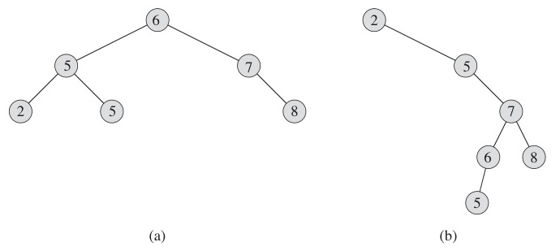
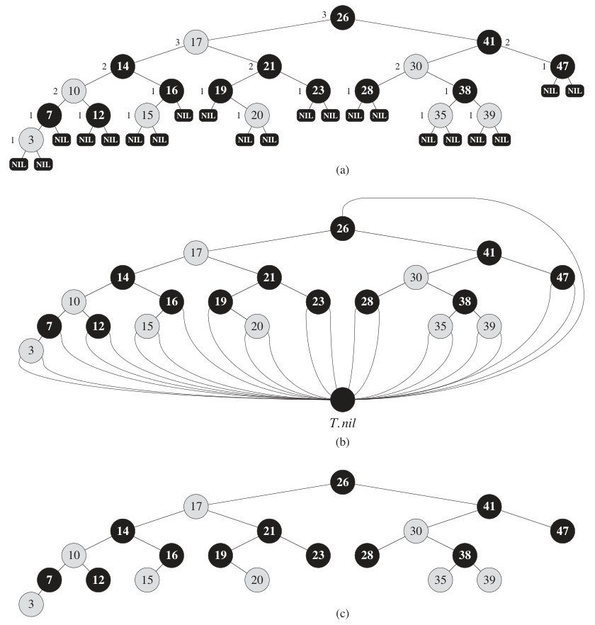
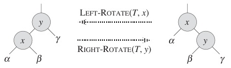
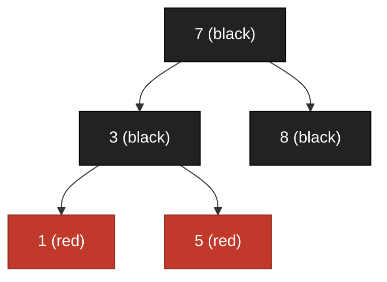
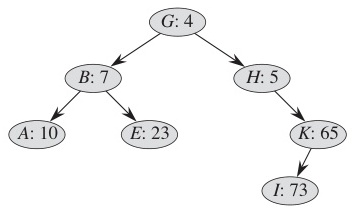

# Week 9 Lecture — Search Trees

[Repository Guide](../../README.md) | [English](Concepts_Lecture.md) | [한국어](Concepts_Lecture.ko.md)

> **Last Updated:** 2026-10-18
>
> Introduction to Algorithms, Cormen, Leiserson, Rivest, and Stein, Ch 12, 13, 18

> **Learning Objectives:**
> 1. Define a tree recursively and derive tree traversal complexity using the Master Theorem
> 2. Implement search, insert, and delete on a Binary Search Tree (BST), analyze its average and worst case, and explain why it can degrade to $O(n)$ when input is sorted
> 3. State the five Red-Black Tree (RBT) properties and explain how they guarantee $O(\log n)$ height
> 4. Resolve a Double-Red violation using **Restructuring** (uncle black) or **Recoloring** (uncle red)
> 5. Motivate B-Trees from the disk I/O cost model, describe how wide, shallow nodes minimize disk reads, and execute B-Tree search, insertion (with split), and deletion (borrow and merge)
> 6. Compare BST, RBT, and B-Tree across height, operation cost, and intended use case

---

## Table of Contents

- [1. Tree Fundamentals](#1-tree-fundamentals)
  - [1.1 Recursive Definition of a Tree](#11-recursive-definition-of-a-tree)
  - [1.2 Tree Traversal Complexity](#12-tree-traversal-complexity)
- [2. Binary Search Trees (BST)](#2-binary-search-trees-bst)
  - [2.1 BST: The Idea](#21-bst-the-idea)
  - [2.2 BST Search](#22-bst-search)
  - [2.3 BST Insertion](#23-bst-insertion)
  - [2.4 BST Search/Insert: Average Case](#24-bst-searchinsert-average-case)
  - [2.5 BST Worst Case: The Problem](#25-bst-worst-case-the-problem)
  - [2.6 BST Deletion: Three Cases](#26-bst-deletion-three-cases)
  - [2.7 BST Deletion: Complexity](#27-bst-deletion-complexity)
- [3. Red-Black Trees (RBT)](#3-red-black-trees-rbt)
  - [3.1 RBT: Motivation](#31-rbt-motivation)
  - [3.2 RBT: Five Properties](#32-rbt-five-properties)
  - [3.3 Why RBT Guarantees O(log n)](#33-why-rbt-guarantees-olog-n)
  - [3.4 RBT Insertion: Overview](#34-rbt-insertion-overview)
  - [3.5 Double Red: Terminology](#35-double-red-terminology)
  - [3.6 Case 1: Restructuring (Uncle is Black)](#36-case-1-restructuring-uncle-is-black)
  - [3.7 Case 2: Recoloring (Uncle is Red)](#37-case-2-recoloring-uncle-is-red)
  - [3.8 RBT: Worked Example](#38-rbt-worked-example)
  - [3.9 RBT: Operation Complexities](#39-rbt-operation-complexities)
- [4. B-Trees](#4-b-trees)
  - [4.1 B-Tree Motivation: The Disk I/O Problem](#41-b-tree-motivation-the-disk-io-problem)
  - [4.2 B-Tree: The Idea](#42-b-tree-the-idea)
  - [4.3 B-Tree: Search](#43-b-tree-search)
  - [4.4 B-Tree: Insertion (No Split)](#44-b-tree-insertion-no-split)
  - [4.5 B-Tree: Insertion (With Split)](#45-b-tree-insertion-with-split)
  - [4.6 B-Tree: Deletion Overview](#46-b-tree-deletion-overview)
  - [4.7 B-Tree: Deletion Leaf Cases](#47-b-tree-deletion-leaf-cases)
- [5. BST vs RBT vs B-Tree](#5-bst-vs-rbt-vs-b-tree)
- [Summary](#summary)
- [Self-Check Questions](#self-check-questions)

---

<br>

## 1. Tree Fundamentals

### 1.1 Recursive Definition of a Tree

A **tree** is a root node together with zero or more **subtrees**, which makes it a recursive structure.

```text
            [A]             "A tree of n nodes
           / | \             = root + subtrees"
         /   |   \
       [B]  [C]  [D]        Each subtree is itself
       / \      / | \       a smaller tree.
     [E] [F]  [G][H][I]
```

*Figure 1. Recursive structure of a tree made of a root and subtrees*

> **Key Point:** The repetition of partial structure lets us implement tree algorithms naturally with **recursion**.

- This is the same principle as **divide and conquer**: split into subproblems (subtrees), solve each, and combine.
- Basic tree algorithms such as search, insertion, and traversal are mostly a one-line recursion plus a base case.

### 1.2 Tree Traversal Complexity

For a **balanced** binary tree with $n$ nodes, traversal visits every node exactly once:

$$T(n) = 2T(n/2) + O(1)$$

- $2T(n/2)$: traverse left and right subtrees (each $\approx n/2$ nodes)
- $O(1)$: visit the root

**Master Theorem:** $a = 2,\ b = 2,\ f(n) = O(1)$. Compare $f(n)$ with $n^{\log_b a} = n^1$.

Since $f(n) = O(n^0)$ and $0 < 1$, this is **Case 1**:

$$T(n) = \Theta(n)$$

> **Note:** **Lower bound argument.** Any traversal must inspect every node at least once, so $\Omega(n)$ is unavoidable. The Master Theorem confirms $\Theta(n)$ is also achievable. The balance assumption is needed only to apply the Master Theorem; the textbook proves that an in-order walk takes $\Theta(n)$ time regardless of the tree's shape.

---

<br>

## 2. Binary Search Trees (BST)

### 2.1 BST: The Idea

A BST is a binary tree that maintains a **sorted order**:

$$\text{left subtree} < \text{root} < \text{right subtree}$$

```text
              [15]
             /    \
          [6]      [18]
         /   \     /   \
       [3]  [7]  [17] [20]
       / \    \
     [2] [4] [13]
              /
            [9]
```

*Figure 2. Example of a binary search tree*

**BST property** for every node $x$:
- All keys in the **left** subtree are less than $x.\text{key}$.
- All keys in the **right** subtree are greater than $x.\text{key}$.

Here we assume all keys are distinct. The textbook allows duplicate keys and uses $\le$ on the left and $\ge$ on the right; the two trees in Figure 5 contain the key 5 twice.

> **Note:** **Connection to binary search.** In a balanced BST, each step eliminates about half of the remaining search space, the same idea that gave binary search $O(\log n)$ on a sorted array.

### 2.2 BST Search

```text
TREE-SEARCH(x, k):
    if x = NIL or k = x.key:
        return x
    if k < x.key:
        return TREE-SEARCH(x.left, k)
    else:
        return TREE-SEARCH(x.right, k)
```

**Example (search for 13):**

```text
             [15]         15: 13 < 15, go left
            /    \
          [6]    [18]     6: 13 > 6, go right
         /   \
       [3]  [7]           7: 13 > 7, go right
              \
             [13]  <- found
```

*Figure 3. Path of searching for key 13 in a BST*

At each level we make **one comparison and descend one edge**, so the cost is $O(h)$ where $h$ is the tree height.

### 2.3 BST Insertion

Insert a key $k$ by walking down as if searching for it; when we reach NIL, attach the new node as a **leaf**.

```text
TREE-INSERT(T, z):
    y = NIL
    x = T.root
    while x != NIL:
        y = x
        if z.key < x.key: x = x.left
        else:             x = x.right
    z.parent = y
    if y = NIL:               T.root = z     // tree was empty
    else if z.key < y.key:    y.left  = z
    else:                     y.right = z
```

Insertion follows the same path as an unsuccessful search and then links the new node as a leaf, so its cost is $O(h)$.

### 2.4 BST Search/Insert: Average Case

If keys are inserted in **random order**, the expected height is $\Theta(\log n)$. If each comparison is taken to halve the remaining nodes, the search cost follows the recurrence

$$T(n) = T(n/2) + O(1)$$

- $T(n/2)$: recurse into only one subtree (half the nodes) at each node
- $O(1)$: one comparison at the current node

**Master Theorem:** $a = 1,\ b = 2,\ f(n) = O(1) = \Theta(n^0) = \Theta(n^{\log_b a})$. **Case 2**:

$$T(n) = \Theta(\log n)$$

So expected search and insert are both $O(\log n)$, matching binary search on a sorted array. The recurrence is an approximation that assumes an even split at every step; the textbook proves that a BST built in random order has expected height $O(\log n)$.

### 2.5 BST Worst Case: The Problem

What if keys arrive in **sorted order**?

```text
Insert: 1, 2, 3, 4, 5

    [1]
      \
      [2]
        \
        [3]
          \
          [4]
            \
            [5]
```

*Figure 4. Degenerate BST from inserting 1, 2, 3, 4, 5 in sorted order*

The tree degenerates into a **linked list**. Figure 5 shows that the same key set can produce a BST of height 2 or a BST of height 4 depending on the insertion order.



*Figure 5. BSTs of height 2 and height 4 built from the same keys*

$$T(n) = T(n-1) + O(1) \implies T(n) = O(n)$$

| Case             | Height   | Search/Insert |
|------------------|----------|---------------|
| Average (random) | $O(\log n)$ | $O(\log n)$ |
| Worst (sorted)   | $O(n)$   | $O(n)$ |

*Table 1. Height and search/insert cost of a BST by input order*

> **Key Point:** Plain BSTs have excellent average-case behavior but **no guarantee** against worst-case degradation. This motivates the **balanced** trees in Sections 3 and 4.

### 2.6 BST Deletion: Three Cases

Deletion is more delicate than search or insert. Let $z$ be the node to delete.

**Case 1: no children.** Simply remove $z$.

```text
    [5]          [5]
   /   \   =>   /   \
 [3]   [7]    [3]   [7]
   \
   [4]  <- delete 4
```

*Figure 6. Deleting node 4, which has no children*

**Case 2: one child.** Splice $z$ out by replacing it with its only child.

```text
    [5]          [5]
   /   \   =>   /   \
 [3]   [7]    [4]   [7]
   \
   [4]  <- delete 3, replaced by 4
```

*Figure 7. Deleting node 3, which has one child*

**Case 3: two children.** Replace $z$'s key with its **in-order successor** (the smallest key in $z$'s right subtree), then delete the successor (which has at most one child, reducing to Case 1 or 2).

```text
Delete 6:
         [15]                     [15]
        /    \                  /     \
     [6]      [18]           [7]      [18]
    /   \     /   \    =>   /  \      /   \
  [3]  [7]  [17] [20]     [3] [13]  [17] [20]
  / \    \                / \  /
[2] [4] [13]            [2][4][9]
         /
       [9]

Step 1: in-order successor of 6 = 7 (smallest in right subtree)
Step 2: replace 6's key with 7
Step 3: delete original node 7 (has at most one child)
```

*Figure 8. Deleting node 6, which has two children, by replacing it with its in-order successor 7*

> **Note:** **Why successor?** The in-order successor is the next larger value, so substituting it preserves the BST property: every key in the left subtree is still less, every key in the right subtree is still greater.

### 2.7 BST Deletion: Complexity

| Step                          | Cost  |
|-------------------------------|-------|
| Find node to delete           | $O(h)$ |
| Find in-order successor       | $O(h)$ |
| Perform the structural change | $O(1)$ |

*Table 2. Cost of each step of BST deletion*

**Total:** $O(h)$.

**Summary of BST operations:**

| Operation | Average     | Worst   |
|-----------|-------------|---------|
| Search    | $O(\log n)$ | $O(n)$  |
| Insert    | $O(\log n)$ | $O(n)$  |
| Delete    | $O(\log n)$ | $O(n)$  |

*Table 3. Average and worst-case complexity of BST operations*

---

<br>

## 3. Red-Black Trees (RBT)

### 3.1 RBT: Motivation

BST worst case is $O(n)$. Can we **guarantee** $O(\log n)$?

A **Red-Black Tree** is a BST with one extra bit per node: a **color** (red or black). Carefully chosen coloring rules force the tree to stay approximately balanced:

$$h \leq 2\log_2(n+1) = O(\log n)$$

so search, insert, and delete are all **guaranteed** $O(\log n)$ in the worst case.

### 3.2 RBT: Five Properties

Every RBT must satisfy the five properties in Table 4. In Figure 9, (a) draws each NIL leaf and writes the black-height next to each node, (b) merges all NILs into a single sentinel node T.nil, and (c) is the usual drawing with the leaves omitted. Black nodes are black and gray nodes are red.



*Figure 9. Example red-black tree drawn in three ways*

| # | Property |
|---|----------|
| 1 | Every node is either **red** or **black** |
| 2 | The **root** is black |
| 3 | Every **leaf (NIL)** is black |
| 4 | If a node is **red**, both its children are **black** (no two consecutive reds) |
| 5 | For every node, all paths from that node to descendant leaves contain the **same number of black nodes** |

*Table 4. Five properties of a red-black tree*

```text
             [7:B]
           /       \
       [3:R]       [18:R]
       /   \       /    \
    [1:B] [5:B] [10:B] [22:B]
                   \
                  [15:R]

B = Black, R = Red
Property 4: red 18 has black children 10, 22  ok
Property 5: every root-to-leaf path has 2 black nodes  ok
```

*Figure 10. Red-black tree satisfying the five properties*

### 3.3 Why RBT Guarantees O(log n)

Define the **black-height** $\text{bh}(x)$ of node $x$ as the number of black nodes on any path from $x$ down to a leaf, not counting $x$ itself (Property 5 makes this well-defined).

- A subtree rooted at $x$ contains at least $2^{\text{bh}(x)} - 1$ internal nodes (induction on height).
- By Property 4, on any root-to-leaf path **at least half** the nodes are black, so $\text{bh}(\text{root}) \geq h/2$.

Combining:

$$n \geq 2^{h/2} - 1 \implies h \leq 2\log_2(n+1)$$

> **Note:** **Geometric reading.** The longest path (alternating red and black) is at most **twice** the shortest path (all black). The tree can lean, but only by a constant factor.

### 3.4 RBT Insertion: Overview

When inserting a new key:

1. Insert as in a normal BST (the new node becomes a leaf).
2. **Color the new node red.** This preserves Property 5 (black-height unchanged).
3. If the new node becomes the root (insertion into an empty tree), Property 2 breaks, which is fixed by coloring the root black. Otherwise the only property that can break is **Property 4**: a red child of a red parent. This is called the **Double Red** problem, and it must be fixed.

```text
Insert 4 into:

    [7:B]              [7:B]
   /     \            /     \
 [3:B]  [18:B]  =>  [3:B]  [18:B]
                       \
                      [4:R]   <- new node, always red

No violation here — but if 4's parent had been red, we'd need to fix up.
```

*Figure 11. Inserting a new red node 4 under a black parent*

### 3.5 Double Red: Terminology

When Double Red occurs, name the relevant nodes:

```text
        [G]          G = grandparent
       /   \
     [P]   [U]      P = parent,  U = uncle
     /
   [N]               N = newly inserted (red), P also red
```

*Figure 12. Nodes G, P, U, N involved in a Double Red*

The fix-up branches on the **uncle's color**:

| Uncle's color | Strategy        |
|---------------|-----------------|
| **Black**     | **Restructuring** (rotation) |
| **Red**       | **Recoloring** (color flip) |

*Table 5. Double Red fix-up strategy by the uncle's color*

### 3.6 Case 1: Restructuring (Uncle is Black)

When $U$ is black, locally rotate $N$, $P$, $G$. The left rotation in Figure 13 swaps $x$ and its right child $y$ so that $y$ moves up, and moves $y$'s left subtree $\beta$ to become $x$'s right subtree. The right rotation is the reverse.



*Figure 13. Left rotation and right rotation*

1. **Sort** $N, P, G$ by key.
2. The **median** becomes the new local root (colored **black**); the other two become its children (colored **red**).
3. The original subtrees are reattached in the only order consistent with the BST property.

```text
Before (G=7, P=3, N=5):       After restructuring:

      [7:B]                       [5:B]
     /     \                     /     \
   [3:R]  [8:B]          =>   [3:R]   [7:R]
      \                                /
     [5:R]                          [8:B]

Sorted: 3, 5, 7
Median: 5 -> new local root (black)
Others: 3, 7 -> children (red)
```

*Figure 14. Restructuring when the uncle is black*

> **Note:** **Why this works.** Restructuring is a **local** operation: it needs one rotation if $N$ and $P$ are both left children or both right children, and two rotations otherwise (as in Figure 14), so the work is $O(1)$. The black-height of the local root is unchanged, so the fix does **not** propagate upward.

### 3.7 Case 2: Recoloring (Uncle is Red)

When $U$ is red, swap colors:

1. $P$ and $U$ become **black**.
2. $G$ becomes **red**.
3. If $G$ is the root, force it **black**. Otherwise, $G$ may now form a new Double Red with its own parent, so repeat the fix-up at $G$.

```text
Before:                   After recoloring:

      [7:B]                   [7:R] <- may cause
     /     \                 /     \    new Double Red
   [3:R]  [8:R]    =>     [3:B]   [8:B]
   /                       /
 [1:R]                  [1:R]

P=3 and U=8 become black; G=7 becomes red.
If 7 is the root, force it black.
If 7's parent is also red, repeat the fix-up upward.
```

*Figure 15. Recoloring when the uncle is red*

> **Note:** **Why this works.** Recoloring preserves Property 5 (black count on every path through $G$ is unchanged) but may push the violation up two levels at a time. It can therefore propagate at most $O(\log n)$ times before reaching the root.

### 3.8 RBT: Worked Example

Insertion sequence: 7, 3, 8, 1, 5

```text
Step 1: insert 7    Step 2: insert 3    Step 3: insert 8
   [7:B]               [7:B]                [7:B]
                       /                   /     \
                    [3:R]               [3:R]   [8:R]

Step 4: insert 1 -> Double Red (N=1, P=3, U=8)
Uncle 8 is RED -> Recoloring

       [7:B]                   [7:B]
      /     \       =>        /     \
   [3:R]   [8:R]           [3:B]   [8:B]
    /                       /
 [1:R]                   [1:R]

Step 5: insert 5 -> Double Red (N=5, P=3, U=8)
Now U=8 is BLACK -> Restructuring

      [7:B]            sort {N=5, P=3, G=7} = 3, 5, 7
     /     \           median 5 -> new local root (black)
   [3:B]  [8:B]
      \
     [5:R]
                       [5:B]
                      /     \
Result:            [3:R]   [7:R]
                              \
                             [8:B]
```

*Figure 16. Red-black tree example inserting 7, 3, 8, 1, 5 in order*

> **Note:** **Error in Step 5.** After the recoloring in Step 4, node 3 is black, so inserting 5 as the right child of 3 creates no Double Red because the parent is black. Step 5 of Figure 16 treats 3 as red and applies restructuring, and its result tree also loses the key 1. Figure 17 below shows the corrected result; restructuring with a black uncle is shown in Figure 14 of Section 3.6.



*Figure 17. Correct red-black tree after inserting 5*

### 3.9 RBT: Operation Complexities

| Operation | Complexity   | Details |
|-----------|--------------|---------|
| **Search** | $O(\log n)$ | identical to BST; height is $O(\log n)$ |
| **Insert** | $O(\log n)$ | BST insert $O(\log n)$ + fix-up $O(\log n)$ |
| **Delete** | $O(\log n)$ | BST delete $O(\log n)$ + fix-up $O(\log n)$ |

*Table 6. Complexity of red-black tree operations*

The fix-up uses at most $O(\log n)$ recolorings and only a constant number of rotations: **at most 2** after an insertion and at most 3 after a deletion.

| | BST (avg)   | BST (worst) | RBT (worst) |
|-|-------------|-------------|-------------|
| Search | $O(\log n)$ | $O(n)$ | **$O(\log n)$** |
| Insert | $O(\log n)$ | $O(n)$ | **$O(\log n)$** |
| Delete | $O(\log n)$ | $O(n)$ | **$O(\log n)$** |

*Table 7. Complexity comparison of BST and red-black tree*

> **Note:** **Bottom line.** RBT pays a tiny constant overhead (1 color bit, occasional rotation) in exchange for a worst-case guarantee. This is why it is the default choice for in-memory ordered maps (e.g., C++ `std::map`, Java `TreeMap`, the Linux kernel's CFS scheduler).

A **treap** is another BST that stays balanced through randomness. Each node holds a key and a priority; the keys obey the BST property, and the priorities obey the min-heap property, in which a parent's priority is smaller than its children's (Figure 18). With random priorities, the expected height is $O(\log n)$.



*Figure 18. Treap with each node labeled key:priority*

---

<br>

## 4. B-Trees

### 4.1 B-Tree Motivation: The Disk I/O Problem

When data is too large for main memory, it lives on **disk**, and disk access dominates running time:

```text
Access times (typical):
  CPU register     ~0.3 ns
  Main memory      ~100 ns
  SSD              ~50 us   (~500x slower than memory)
  HDD              ~5 ms    (~50,000x slower than memory)
```

A Red-Black Tree with $n = 10^9$ nodes has height at least about 30 ($\log_2 10^9 \approx 30$). On HDD that is $30 \times 5\,\text{ms} = 150\,\text{ms}$ per operation, far too slow for a database. The bottleneck is **disk reads**, not comparisons.

> **Note:** **Relative scale.** In relative terms, 1 second of CPU time corresponds to about 10 days of disk I/O.

> **Note:** **Cost model shift.** For in-memory structures we minimize comparisons; for disk-resident structures we minimize **the number of disk blocks read**, i.e., the **height** of the tree.

### 4.2 B-Tree: The Idea

Make each node hold **many keys** so the tree is **wide and shallow**.

```text
BST (tall, narrow):     B-Tree (short, wide):

     [50]                  [20|40|60|80]
    /    \                / |  |  |  \
  [25]  [75]            [..][..][..][..][..]
  / \    / \
......                  Height ~3 for 10^9 nodes
Height ~30
```

*Figure 19. Tall, narrow BST and short, wide B-Tree*

**Design decisions:**
- One node = one **disk block** (typically 4 KB).
- A single disk read brings **hundreds of keys** into memory.
- Searching **within a node** is fast in-memory work and does not count against the disk-I/O budget.
- A B-Tree of order 1000 with height 3 (three levels) stores about $10^9$ keys.

### 4.3 B-Tree: Search

```text
B-TREE-SEARCH(x, k):
    i = 1
    while i <= x.n and k > x.key[i]:
        i = i + 1
    if i <= x.n and k = x.key[i]:
        return (x, i)
    if x.leaf:
        return NIL
    DISK-READ(x.child[i])
    return B-TREE-SEARCH(x.child[i], k)
```

```text
Search for key 42 in a B-Tree (order 5):

  Root: [20 | 40 | 60 | 80]
         |    |    |    |
         v    v    v    v
        ...  ...  ...  ...

  42 > 40 and 42 < 60 -> follow pointer between 40 and 60

  Child: [41 | 42 | 45 | 50]
                ^
                found (1 disk read for root + 1 for child = 2 total)
```

*Figure 20. Path of searching for key 42 in a B-Tree of order 5*

**Each level costs one disk read.** Height 3 means at most 3 disk reads, regardless of $n$.

### 4.4 B-Tree: Insertion (No Split)

**Case 1: target leaf has room.** Insert in sorted order, and the operation is done.

```text
Insert 25 (max 4 keys per node):

  Root: [10 | 20 | 40 | 60]
              |
              v
  Leaf: [21 | 30 | 35]        <- has room (3 keys, max 4)

  After insert:
  Leaf: [21 | 25 | 30 | 35]   <- place 25 in sorted position
```

*Figure 21. Inserting key 25 into a leaf that has room*

One search descent plus one block write, with no structural change.

### 4.5 B-Tree: Insertion (With Split)

**Case 2: target leaf is full.** **Split** at the median and **promote** the median to the parent.

```text
Insert 28 (max 4 keys per node):

  Parent: [... | 20 | 40 | ...]
                  |
                  v
  Leaf:   [21 | 25 | 30 | 35]    <- FULL

Step 1: insert 28, creating temporary overflow
  Temp: [21 | 25 | 28 | 30 | 35]

Step 2: split at median 28
  Left:  [21 | 25]
  Right: [30 | 35]

Step 3: promote median 28 to parent
  Parent: [... | 20 | 28 | 40 | ...]
                 |     |
                 v     v
           [21 | 25] [30 | 35]
```

*Figure 22. Split and promotion when inserting key 28 into a full leaf*

If the parent is also full, the split **propagates upward**. In the extreme case the root splits and the tree grows one level taller; this is the **only way a B-Tree gains height**, and it keeps the tree perfectly balanced.

### 4.6 B-Tree: Deletion Overview

Deletion is the most complex B-Tree operation. The cases are as follows.

**Case 1: key is in a leaf.**
- 1.1: if the leaf has more than the minimum number of keys, just remove the key.
- 1.2: if a sibling has extra keys, **borrow** from it by rotating a key through the parent.
- 1.3: if the sibling is also at the minimum, **merge** with it by pulling a key down from the parent.
- 1.4: if the merge underflows the parent, recurse upward.

**Case 2: key is in an internal node.**
- Replace it with the **in-order predecessor** (largest key in the left subtree) or **in-order successor** (smallest key in the right subtree).
- Then delete from the leaf, which reduces to Case 1.

**Case 3: internal key, all relevant nodes at the minimum.**
- Merge children, pull the parent key down, and restructure.
- Merges may propagate upward.

### 4.7 B-Tree: Deletion Leaf Cases

**Case 1.1: Simple removal (node has spare keys).**

```text
Delete 30:  [10 | 20 | 30 | 40]  =>  [10 | 20 | 40]   ok
```

*Figure 23. Deleting 30 from a leaf with spare keys*

**Case 1.2: Borrow from a sibling via parent rotation.**

```text
Delete 20:
  Parent: [... | 25 | ...]      Parent: [... | 30 | ...]
            |    |                        |    |
          [20] [30 | 40]    =>          [25] [40]

Borrow 30 from right sibling; 25 rotates down, 30 rotates up.
```

*Figure 24. Deletion by borrowing a key from the right sibling*

**Case 1.3: Merge with a sibling.**

```text
Delete 20:
  Parent: [... | 25 | ...]      Parent: [... | ...]
            |    |                        |
          [20] [30]         =>      [25 | 30]

Pull 25 down, combine with sibling.
```

*Figure 25. Deletion by merging with a sibling*

> **Note:** **Symmetry with insertion.** Insertion grows by **splitting** when full; deletion shrinks by **merging** when underflowing. Both operations preserve perfect balance and cost $O(\log_M n)$ disk reads, where $M$ is the branching factor.

---

<br>

## 5. BST vs RBT vs B-Tree

| Property | BST | Red-Black Tree | B-Tree |
|----------|-----|----------------|--------|
| **Type** | Binary | Binary (balanced) | $M$-way (balanced) |
| **Height** | $O(\log n)$ avg, $O(n)$ worst | $O(\log n)$ guaranteed | $O(\log_M n)$ guaranteed |
| **Search** | $O(\log n)$ avg, $O(n)$ worst | $O(\log n)$ | $O(\log_M n)$ |
| **Insert** | $O(\log n)$ avg, $O(n)$ worst | $O(\log n)$ | $O(\log_M n)$ |
| **Delete** | $O(\log n)$ avg, $O(n)$ worst | $O(\log n)$ | $O(\log_M n)$ |
| **Balance mechanism** | none | recoloring and rotations on color violation | splits on overflow, merges on underflow |
| **Best for** | simple in-memory use | general-purpose ordered map (`std::map`) | disk-based systems (databases, file systems) |

*Table 8. Comparison of BST, red-black tree, and B-Tree*

B-Tree costs are counted in disk reads. With a linear scan of the keys inside each node, the CPU time is $O(M \log_M n)$.

> **Note:** **Enforced balance.** In a self-balancing tree, balance is not given; it is enforced by operations such as rotation, recoloring, splitting, and merging.

---

<br>

## Summary

| Concept | Key Summary |
|---------|-------------|
| Recursive structure of trees | Trees are recursive, so traversal is $\Theta(n)$ and many tree algorithms are one recursion plus a base case. |
| BST | It keeps left $<$ root $<$ right order and gives expected $O(\log n)$, but sorted input degenerates it to a list with $O(n)$ worst-case search, insert, and delete. |
| Red-Black Tree | One color bit and five properties bound the height by $2\log_2(n+1)$, guaranteeing $O(\log n)$. |
| Double Red fix | Restructuring ($O(1)$ rotations) applies when the uncle is black, and recoloring (which may propagate) applies when the uncle is red. |
| B-Tree (order $M$) | It trades in-memory comparisons for fewer disk reads. Each wide node fits one disk block, so operations take $O(\log_M n)$ disk reads and the height stays about 3 even for billions of keys. |
| Uses of B-Trees | They are standard in databases (MySQL, PostgreSQL) and file systems (NTFS, ext4). |
| Choosing a structure | The choice depends on the cost model: RBT optimizes RAM accesses, and B-Tree optimizes disk block reads. |

---

<br>

## Self-Check Questions

1. **Recursive Traversal:** Write a recurrence for in-order traversal of a balanced binary tree, and use the Master Theorem to derive its complexity. Why can no traversal beat $\Omega(n)$?

   <details>
   <summary>Answer</summary>

   In-order traversal visits the left subtree, the root, then the right subtree, giving $T(n) = 2T(n/2) + O(1)$. With $a = 2$, $b = 2$, $f(n) = O(1) = O(n^0)$ and $n^{\log_b a} = n^1$, this is **Master Theorem Case 1**, so $T(n) = \Theta(n)$. The $\Omega(n)$ lower bound is unavoidable because a traversal by definition must inspect every one of the $n$ nodes at least once; visiting fewer would leave a node unprocessed.

   </details>

2. **BST Average vs Worst:** Insert the keys $1, 2, 3, 4, 5$ in that order into an empty BST. Draw the result and give the search cost for key $5$. Then insert the same keys in the order $3, 1, 5, 2, 4$ and compare.

   <details>
   <summary>Answer</summary>

   Sorted insertion $1,2,3,4,5$ produces a right-leaning chain (height 4); finding 5 requires walking through all 5 nodes, costing **5 comparisons, $O(n)$**. Inserting in order $3,1,5,2,4$ gives a balanced tree with 3 as root, 1 and 5 as children, and 2, 4 as grandchildren (height 2); finding 5 takes **only 2 comparisons, $O(\log n)$**. The keys are the same but the costs differ dramatically, which demonstrates that plain BSTs have no worst-case guarantee.

   </details>

3. **BST Deletion:** In a BST, delete the node with key $6$ from the tree shown in Section 2.6 using the in-order **predecessor** instead of the successor. Show the resulting tree.

   <details>
   <summary>Answer</summary>

   The **in-order predecessor** of 6 is the **largest key in 6's left subtree**, which is 4. Replace 6's key with 4, then delete the original node 4 (a leaf, so just remove it). The result keeps 15 at the root with 18 on the right; on the left, 4 replaces 6, its left child is still 3 (with grandchild 2), and its right child is the unchanged subtree rooted at 7 containing 13 and 9. The BST property holds because every key in 4's left subtree ($2,3$) is less than 4 and every key in its right subtree ($7,9,13$) is greater than 4.

   </details>

4. **RBT Property 5:** Explain why coloring a newly inserted node **red** (rather than black) preserves Property 5. What would go wrong if we colored it black?

   <details>
   <summary>Answer</summary>

   Property 5 requires that every root-to-leaf path has the **same number of black nodes**. A new node is inserted in place of a NIL leaf (which is black) and inherits its position; coloring the new node **red** adds zero black nodes to any path, so black-heights are unchanged. If we colored it black instead, the path through the new node would gain one black node while sibling paths keep the old count, so **Property 5 breaks immediately**, and the fix would have to propagate black-height adjustments throughout the tree, which is much more expensive than the local Double-Red fix.

   </details>

5. **Restructuring vs Recoloring:** For each of the following Double-Red situations, decide which strategy applies and give the resulting tree.
   (a) $G = 10\,(B),\ P = 5\,(R),\ U = 15\,(B),\ N = 7\,(R)$
   (b) $G = 10\,(B),\ P = 5\,(R),\ U = 15\,(R),\ N = 3\,(R)$

   <details>
   <summary>Answer</summary>

   **(a)** Uncle $U = 15$ is **black** → **Restructuring**. Sort $\{N=7, P=5, G=10\}$ → median is **7**, which becomes the new local root (black) with 5 and 10 as red children: `7(B)` → `5(R)` left, `10(R)` right; $U = 15$ reattaches as a child of 10. **(b)** Uncle $U = 15$ is **red** → **Recoloring**. Flip $P = 5$ and $U = 15$ to black, and $G = 10$ to red. If 10 is the root, force it back to black; otherwise the fix may propagate upward to 10's parent.

   </details>

6. **RBT Height Bound:** Prove that an RBT with $n$ internal nodes has height at most $2\log_2(n+1)$, using the black-height inequality $n \geq 2^{\text{bh}(\text{root})} - 1$.

   <details>
   <summary>Answer</summary>

   By **Property 4** (no two consecutive reds), at least half the nodes on any root-to-leaf path are black, so $\text{bh}(\text{root}) \geq h/2$. Combined with $n \geq 2^{\text{bh}(\text{root})} - 1$, we get $n \geq 2^{h/2} - 1$, hence $n + 1 \geq 2^{h/2}$. Taking $\log_2$ of both sides yields $\log_2(n+1) \geq h/2$, i.e., $h \leq 2\log_2(n+1) = O(\log n)$. This is the formal reason RBT operations are guaranteed $O(\log n)$ in the worst case.

   </details>

7. **B-Tree Disk I/O:** A B-Tree of order $M = 100$ stores $n = 10^8$ keys. Estimate the height. How many disk reads does a search require? Compare with a Red-Black Tree on the same data.

   <details>
   <summary>Answer</summary>

   Assuming full nodes, the height is about $\log_M n = \log_{100} 10^8 = 8/2 = 4$. A search needs at most **4 disk reads** (one per level). A Red-Black Tree on the same data has height $\leq 2\log_2(10^8 + 1) \approx 2 \cdot 26.6 \approx 53$, requiring up to **about 53 disk reads** if the tree is disk-resident. On a 5 ms HDD, a B-Tree query takes about 20 ms versus up to about 265 ms for the RBT, so the B-Tree is over **10× faster**, which is why the default index in relational databases is a B-Tree variant rather than a binary tree.

   </details>

8. **B-Tree Insertion with Split:** Starting from an empty B-Tree of order 4 (max 3 keys per node), insert the sequence $10, 20, 30, 40, 50, 60, 70$ and draw the tree after each split.

   <details>
   <summary>Answer</summary>

   Insert 10, 20, 30 → single node `[10|20|30]` (full, no split yet). Insert 40 → overflow `[10|20|30|40]`, **split** at median 30 (with four keys, take the larger of the two middle keys, 30): promote 30 as new root, leaves `[10|20]` and `[40]`. Insert 50, 60 into right leaf → `[40|50|60]`. Insert 70 → overflow `[40|50|60|70]`, **split** at median 60 by the same rule: promote 60 into root, giving root `[30|60]` with children `[10|20]`, `[40|50]`, `[70]`. Tree height is 2, and the tree is perfectly balanced because every leaf is at the same depth.

   </details>

9. **Choosing a Structure:** You are designing (a) the symbol table of a compiler, (b) the index of a 1 TB relational database, (c) an ordered map for a small embedded device with 32 KB of RAM. Which structure (BST, RBT, B-Tree) fits each, and why?

   <details>
   <summary>Answer</summary>

   **(a) Compiler symbol table → hash table or RBT.** Lookups are by exact name with no need for range queries; if scope-ordered traversal matters, an **RBT** gives worst-case $O(\log n)$. **(b) 1 TB database index → B-Tree.** Data lives on disk, so the cost model is disk reads; wide nodes (one disk block) keep the height near 3-4 even for more than $10^9$ keys. **(c) Embedded ordered map → RBT.** 32 KB RAM is too small for B-Tree overhead but fits a compact pointer-based balanced tree; an RBT guarantees $O(\log n)$ without disk concerns, and the constant factor beats a B-Tree at small $n$.

   </details>
