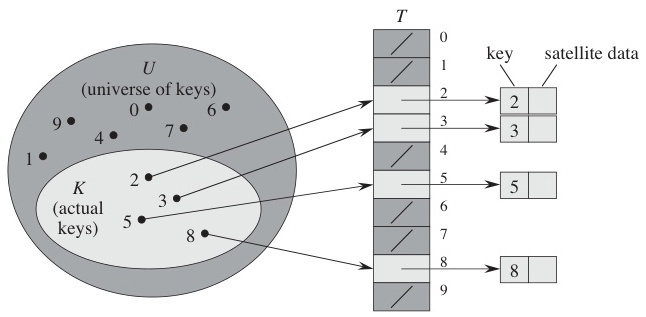
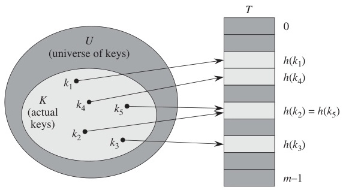
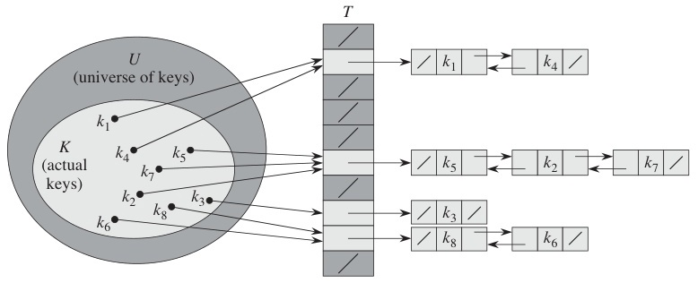
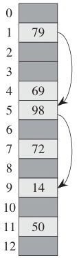

# Week 10 Lecture — Hash Tables and Set Data Structures

[Repository Guide](../../README.md) | [English](Concepts_Lecture.md) | [한국어](Concepts_Lecture.ko.md)

> **Last Updated:** 2026-10-18
>
> Introduction to Algorithms, Cormen, Leiserson, Rivest, and Stein, Ch 11

> **Learning Objectives:**
> 1. Define a hash function, explain the goal of $O(1)$ average-case search, insert, and delete, and explain why collisions are unavoidable using the pigeonhole principle
> 2. Compare **separate chaining** and **open addressing** as collision-resolution strategies, and distinguish **linear probing**, **quadratic probing**, and **double hashing** while explaining primary and secondary clustering
> 3. Compute the load factor $\alpha = n/m$ and analyze expected operation costs under the Simple Uniform Hashing Assumption (SUHA)
> 4. Describe **rehashing** and justify its amortized $O(1)$ cost per insertion
> 5. Decide between a hash table and a balanced BST given workload requirements (ordered iteration, range queries, worst-case guarantees)
> 6. Map the **Set** and **Map** abstractions to their hash-based implementations in real languages

---

## Table of Contents

- [1. Hashing Fundamentals](#1-hashing-fundamentals)
  - [1.1 What is Hashing?](#11-what-is-hashing)
  - [1.2 Hash Table Structure](#12-hash-table-structure)
  - [1.3 Hash Functions](#13-hash-functions)
  - [1.4 Properties of a Good Hash Function](#14-properties-of-a-good-hash-function)
  - [1.5 Collisions are Inevitable](#15-collisions-are-inevitable)
- [2. Collision Resolution](#2-collision-resolution)
  - [2.1 Separate Chaining (Open Hashing)](#21-separate-chaining-open-hashing)
  - [2.2 Separate Chaining: Complexity](#22-separate-chaining-complexity)
  - [2.3 Open Addressing (Closed Hashing)](#23-open-addressing-closed-hashing)
  - [2.4 Linear Probing: Example](#24-linear-probing-example)
  - [2.5 Clustering Problem](#25-clustering-problem)
  - [2.6 Double Hashing](#26-double-hashing)
- [3. Performance Analysis](#3-performance-analysis)
  - [3.1 Load Factor](#31-load-factor)
  - [3.2 Rehashing](#32-rehashing)
  - [3.3 Hash Table: Overall Complexity](#33-hash-table-overall-complexity)
- [4. Sets, Maps, and Comparisons](#4-sets-maps-and-comparisons)
  - [4.1 Set and Map Data Structures](#41-set-and-map-data-structures)
  - [4.2 Hash Table vs BST: When to Use Which](#42-hash-table-vs-bst-when-to-use-which)
- [Summary](#summary)
- [Self-Check Questions](#self-check-questions)

---

<br>

## 1. Hashing Fundamentals

### 1.1 What is Hashing?

**Hashing** transforms data of **arbitrary size** into data of **fixed size**.

- Use a **key** to quickly look up a **value**.
- Store key-value pairs in a **hash table**.
- A **hash function** converts a key into an **index** that determines where data is stored.

```text
   Key  ──►  Hash Function  ──►  Hash Value (Index)  ──►  Hash Table
```

*Figure 1. Flow from a key to the hash table*

**Goal:** achieve **$O(1)$** average-case time for search, insert, and delete.

> **Note:** **Connection to Week 3.** Week 3 gave us $O(1)$ random access to an array slot if we already know the index. Hashing supplies the missing piece: a way to *compute* the index directly from the key, without searching for it.

### 1.2 Hash Table Structure

A hash table is built from the three components in Table 1. Figure 2 shows its starting point, the **direct-address table**, which maps each key k of the universe U to slot k. Only the slots of the actual key set K = {2, 3, 5, 8} point to elements and the others stay empty, so memory is wasted when U is large. A hash function solves this by mapping keys to indices in a smaller table of size m.



*Figure 2. Direct-address table storing key k in slot k*

| Component | Role |
|-----------|------|
| **Key** | Unique identifier of each item |
| **Hash function** | Converts a key into a hash value (index) |
| **Hash table** | Array that stores the item at the computed index |

*Table 1. Three components of a hash table*

```text
   Key: "Alice"                    Hash Table
        │                    ┌───┬───────────┐
        ▼                    │ 0 │           │
   h("Alice") = 3            │ 1 │           │
        │                    │ 2 │           │
        ▼                    │ 3 │  "Alice"  │ ◄── stored here
   Index = 3                 │ 4 │           │
                             │ 5 │           │
                             └───┴───────────┘
```

*Figure 3. Hash table storing the key Alice at index 3*

### 1.3 Hash Functions

A hash function $h(k)$ maps a key $k$ to an index in a table of size $m$.

**Division method** (most common):

$$h(k) = k \bmod m$$

**Example:** table size $m = 10$

| Key $k$ | $h(k) = k \bmod 10$ | Index |
|---------|---------------------|-------|
| 25 | 25 mod 10 | 5 |
| 37 | 37 mod 10 | 7 |
| 42 | 42 mod 10 | 2 |
| 55 | 55 mod 10 | 5 |

*Table 2. Hash values of the division method with m = 10*

Keys 25 and 55 both map to index 5; this is a **collision**.

**Multiplication method** (alternative):

$$h(k) = \lfloor m \cdot (k \cdot A \bmod 1) \rfloor, \quad 0 < A < 1$$

- The value of $m$ is not critical here (no prime-vs-power-of-2 trap).
- Knuth suggests $A \approx (\sqrt{5} - 1)/2 \approx 0.618$ (the golden ratio conjugate).

### 1.4 Properties of a Good Hash Function

A well-designed hash function should satisfy:

1. **Deterministic:** the same key always produces the same hash value.
2. **Uniform distribution:** keys are spread evenly across the table.
3. **Efficient:** computed in $O(1)$ time.

**Choosing $m$ (table size):**

- For the division method, avoid powers of 2: $h(k) = k \bmod 2^p$ depends only on the lower $p$ bits of $k$, so any structure in the high bits is thrown away.
- A **prime** not close to a power of 2 is the standard recommendation (textbook Section 11.3).

> **Note:** **Why uniform matters.** If every key hashes to the same slot, even the best collision-resolution scheme degenerates to a linked-list scan. The $O(1)$ promise rests entirely on the **assumption** that the hash function spreads keys uniformly, which Section 2.2 formalizes as SUHA.

### 1.5 Collisions are Inevitable

A **collision** occurs when two different keys produce the same hash value.



*Figure 4. A hash function mapping keys to slots, with k2 and k5 colliding*

```text
   Key: 25  ──►  h(25) = 5  ──┐
                              ├──►  Index 5  (Collision!)
   Key: 55  ──►  h(55) = 5  ──┘
```

*Figure 5. Keys 25 and 55 colliding at index 5*

**Pigeonhole principle:** the key space is generally much larger than the index space ($|U| \gg m$), so by counting alone some pair of keys must share a slot.

Even with $n \ll m$, the **birthday paradox** tells us collisions arise far earlier than intuition suggests: among about $\sqrt{m}$ random keys (more precisely about $1.18\sqrt{m}$), the probability of *some* collision is already about $1/2$.

The practical question is therefore not how to avoid collisions but **how to resolve them efficiently**. Table 3 lists the two main families.

| Strategy | Also Known As | Idea |
|----------|---------------|------|
| Separate Chaining | Open Hashing | Linked list of colliding elements |
| Open Addressing | Closed Hashing | Find another empty slot |

*Table 3. Two strategies for collision resolution*

---

<br>

## 2. Collision Resolution

### 2.1 Separate Chaining (Open Hashing)

Each table slot holds a **linked list** of all key-value pairs that hash to that index.



*Figure 6. Separate chaining resolving collisions with linked lists*

```text
   Hash Table
   ┌───┬──────────────────────────────┐
   │ 0 │ → NULL                       │
   │ 1 │ → [11] → [21] → NULL         │
   │ 2 │ → [42] → NULL                │
   │ 3 │ → [13] → [33] → [73] → NULL  │
   │ 4 │ → NULL                       │
   │ 5 │ → [25] → [55] → NULL         │
   │ 6 │ → NULL                       │
   │ 7 │ → [37] → NULL                │
   │ 8 │ → NULL                       │
   │ 9 │ → [19] → NULL                │
   └───┴──────────────────────────────┘
```

*Figure 7. Separate-chaining hash table with h(k) = k mod 10*

**Operations:**

| Operation | Procedure | Cost |
|-----------|-----------|------|
| `Insert(k)` | Compute $h(k)$, prepend to the list at slot $h(k)$ | $O(1)$ |
| `Search(k)` | Compute $h(k)$, scan the list at slot $h(k)$ | $O(\text{chain length})$ |
| `Delete(k)` | Search for $k$ in the chain, then unlink | $O(\text{chain length})$ |

*Table 4. Operations and costs of separate chaining*

### 2.2 Separate Chaining: Complexity

**Simple Uniform Hashing Assumption (SUHA):** any key is equally likely to hash to any of the $m$ slots, independently of the other keys.

Define the **load factor** as

$$\alpha = \frac{n}{m} \quad \text{(stored keys per slot)}.$$

Under SUHA the **expected** length of each chain is exactly $\alpha$.

| Operation | Average Case | Worst Case |
|-----------|--------------|------------|
| Search (unsuccessful) | $\Theta(1 + \alpha)$ | $\Theta(n)$ |
| Search (successful)   | $\Theta(1 + \alpha)$ | $\Theta(n)$ |
| Insert | $O(1)$ | $O(1)$ |
| Delete | $\Theta(1 + \alpha)$ | $\Theta(n)$ |

*Table 5. Average and worst-case complexity of separate chaining operations*

If we keep $n = O(m)$, i.e., $\alpha = O(1)$, then **all operations are $O(1)$ on average**.

> **Note:** **Worst case.** All $n$ keys hash to the same slot. The table degenerates into one long linked list and search costs $\Theta(n)$. This is why a sound hash function (and rehashing, Section 3.2) is critical.

### 2.3 Open Addressing (Closed Hashing)

All elements are stored **directly in the table**, with no linked lists. When a collision occurs, the algorithm **probes** for the next available slot.

**General probe sequence:** $h(k, i)$ for $i = 0, 1, 2, \ldots, m-1$.

**Three standard probing strategies:**

| Method | Idea | Formula |
|--------|------|---------|
| Linear Probing | Check consecutive slots | $h(k,i) = (h'(k) + i) \bmod m$ |
| Quadratic Probing | Check with quadratic gaps | $h(k,i) = (h'(k) + c_1 i + c_2 i^2) \bmod m$ |
| Double Hashing | Use a second hash function for the step | $h(k,i) = (h_1(k) + i \cdot h_2(k)) \bmod m$ |

*Table 6. Three probing strategies of open addressing*

Here $h'(k)$ is the underlying (single) hash function.

Because all entries live in **one contiguous array** (no per-element nodes), open addressing avoids the pointer-chasing that makes separate chaining cache-unfriendly. Linear probing in particular walks adjacent memory, so consecutive slots usually share a cache line and it benefits strongly from **memory locality**. This is why open addressing is described as **cache-friendly**.

> **Caution:** **Deletion needs care.** Naively clearing a slot breaks probe chains: search stops at the first empty slot, so any key placed *after* the cleared slot via probing becomes unreachable. Deleted slots are therefore marked with a **tombstone** (a deletion marker): search keeps probing past it, while insert may reuse it (revisited in Self-Check Question 10).

### 2.4 Linear Probing: Example

Insert keys $\{25, 37, 42, 55, 73\}$ into a table of size $m = 10$ using $h(k) = k \bmod 10$:

```text
Step 1: Insert 25 → h(25)=5              Step 2: Insert 37 → h(37)=7
┌───┬────┐                               ┌───┬────┐
│ 5 │ 25 │                               │ 5 │ 25 │
│ 7 │    │                               │ 7 │ 37 │
└───┴────┘                               └───┴────┘

Step 3: Insert 42 → h(42)=2              Step 4: Insert 55 → h(55)=5
┌───┬────┐                               ┌───┬────┐
│ 2 │ 42 │                               │ 2 │ 42 │
│ 5 │ 25 │                               │ 5 │ 25 │ ← occupied!
│ 7 │ 37 │                               │ 6 │ 55 │ ← probe to 6
└───┴────┘                               │ 7 │ 37 │
                                         └───┴────┘

Step 5: Insert 73 → h(73)=3
┌───┬────┐
│ 2 │ 42 │
│ 3 │ 73 │
│ 5 │ 25 │
│ 6 │ 55 │
│ 7 │ 37 │
└───┴────┘
```

*Figure 8. Inserting 25, 37, 42, 55, 73 by linear probing*

### 2.5 Clustering Problem

**Primary clustering** in linear probing:

- Occupied slots tend to form **long contiguous blocks**.
- A new key that hashes anywhere into a cluster must probe to the end of it.
- Clusters absorb new keys faster than empty regions, so they grow super-linearly and worsen performance.

```text
   ┌───┬────┐
   │ 0 │    │
   │ 1 │    │
   │ 2 │ 42 │ ┐
   │ 3 │ 73 │ │ cluster
   │ 4 │ ?? │ │ (growing)
   │ 5 │ 25 │ │
   │ 6 │ 55 │ │
   │ 7 │ 37 │ ┘
   │ 8 │    │
   │ 9 │    │
   └───┴────┘
```

*Figure 9. A growing primary cluster in linear probing*

> **Note:** Figure 9 shows the table of Section 2.4 after one more key lands in the empty slot 4. In the state of Section 2.4, slots 2-3 and slots 5-7 are separate clusters, and filling slot 4 merges them into one cluster spanning slots 2-7.

- **Quadratic probing** reduces primary clustering but introduces **secondary clustering**: keys with the same initial hash still follow identical probe sequences.
- **Double hashing** produces the best distribution and nearly eliminates clustering.

**Quadratic-probing trace:** take $h(k, i) = (h'(k) + i^2) \bmod m$ with $m = 11$ and $h'(k) = k \bmod 11$. Insert a key $k$ that hashes to slot 3 while slots 3, 4, and 7 are already occupied.

| $i$ | $h(k,i) = (3 + i^2) \bmod 11$ | Slot | Result |
|-----|-------------------------------|------|--------|
| 0 | $3 + 0 = 3$ | 3 | occupied → next |
| 1 | $3 + 1 = 4$ | 4 | occupied → next |
| 2 | $3 + 4 = 7$ | 7 | occupied → next |
| 3 | $3 + 9 = 12 \bmod 11 = 1$ | 1 | empty → place here |

*Table 7. Quadratic-probing insertion of a key starting at slot 3*

The gaps $0, 1, 4, 9, \ldots$ jump away from the start, so the probe path does **not** pile up into one contiguous block, which is how quadratic probing avoids **primary** clustering. But every key that also starts at slot 3 would follow the *same* sequence $3, 4, 7, 1, \ldots$, which is **secondary clustering**.

> **Note:** **Intuition.** Clustering is what happens when probe paths are *correlated*. Linear probing makes every nearby key share a path; double hashing decorrelates probe sequences by using a per-key step size.

### 2.6 Double Hashing

Double hashing uses **two** hash functions:

$$h(k, i) = (h_1(k) + i \cdot h_2(k)) \bmod m$$

- $h_1(k)$ chooses the initial slot.
- $h_2(k)$ chooses the **step size** between probes.

**Requirements:**
- $h_2(k) \neq 0$ for every key $k$ (otherwise we loop in place).
- $h_2(k)$ should be **relatively prime to $m$** so the probe sequence visits every slot before repeating.

A standard recipe: pick $m$ prime and use $h_2(k) = 1 + (k \bmod m')$ for some $m' < m$ (any $m' < m$ keeps $1 \le h_2 \le m' < m$, so $h_2 \neq 0$; a prime $m$ then guarantees $\gcd(h_2, m) = 1$, so the probe sequence visits every slot before repeating).

**Example:** $m = 7$, $h_1(k) = k \bmod 7$, $h_2(k) = 1 + (k \bmod 5)$

| Key $k$ | $h_1(k)$ | $h_2(k)$ | Probe sequence |
|---------|----------|----------|----------------|
| 15 | 1 | $1+(15 \bmod 5) = 1$ | 1, 2, 3, 4, 5, 6, 0 |
| 22 | 1 | $1+(22 \bmod 5) = 3$ | 1, 4, 0, 3, 6, 2, 5 |

*Table 8. Probe sequences of double hashing with m = 7*

The two keys collide at index 1 but follow **different** probe paths from there.

Figure 10 inserts the key 14 into a table with $m = 13$, $h_1(k) = k \bmod 13$, and $h_2(k) = 1 + (k \bmod 11)$. Slot $h_1(14) = 1$ holds 79, so the probe moves by the step $h_2(14) = 1 + 3 = 4$ to slot 5; slot 5 holds 98, so it moves 4 more and places 14 in the empty slot 9.



*Figure 10. Inserting key 14 by double hashing*

---

<br>

## 3. Performance Analysis

### 3.1 Load Factor

The **load factor** is

$$\alpha = \frac{n}{m}.$$

| $\alpha$ range | Meaning | Performance |
|----------------|---------|-------------|
| $\alpha < 0.5$ | Table mostly empty | Excellent, close to $O(1)$ |
| $0.5 \leq \alpha < 0.75$ | Moderately full | Good, acceptable |
| $0.75 \leq \alpha < 1.0$ | Crowded | Degraded, more collisions |
| $\alpha = 1.0$ | Full (open addressing) | Very poor, long probe runs |
| $\alpha > 1.0$ | Only possible with chaining | Chains become long |

*Table 9. Meaning and performance by load factor range*

**Rule of thumb:**
- Separate chaining: keep $\alpha \leq 1.0$.
- Open addressing: keep $\alpha \leq 0.7$ (resize before this threshold).

> **Note:** **Why open addressing is more sensitive.** With chaining, a high $\alpha$ just means longer chains. With open addressing, as $\alpha \to 1$ the expected probe length under uniform hashing grows like $\dfrac{1}{1-\alpha}$, which blows up rapidly.

### 3.2 Rehashing

When the load factor crosses a threshold, **rehash**, i.e., resize the table:

1. Allocate a **new table** of size $m' \approx 2m$ (typically the next prime after $2m$).
2. **Recompute** $h(k)$ for every existing key using the new table size.
3. **Reinsert** all elements into the new table.
4. **Free** the old table.

```text
   Old table (m=5, n=4, α=0.8)        New table (m=11, n=4, α≈0.36)
   ┌───┬────┐                          ┌────┬────┐
   │ 0 │ 25 │     rehash               │  0 │ 11 │
   │ 1 │ 11 │   ─────────►             │  1 │    │
   │ 2 │ 42 │                          │  2 │    │
   │ 3 │ 73 │                          │  3 │ 25 │
   │ 4 │    │                          │  4 │    │
   └───┴────┘                          │  5 │    │
                                       │  6 │    │
                                       │  7 │ 73 │
                                       │  8 │    │
                                       │  9 │ 42 │
                                       │ 10 │    │
                                       └────┴────┘
```

*Figure 11. Rehashing a table of size 5 into a table of size 11*

**Cost:** one rehash is $O(n)$, but it happens only after $\Theta(m)$ insertions. Across a long sequence of inserts the total work is bounded, giving **amortized $O(1)$** per insertion.

> **Note:** **Connection to Week 3.** This is the same doubling argument used by the C++ `std::vector` and Python `list` for `push_back` / `append`. The dynamic-array amortization is exactly the trick that lets a hash table claim $O(1)$ insertion in spite of occasional $O(n)$ rebuilds.

### 3.3 Hash Table: Overall Complexity

| Operation | Average Case | Worst Case |
|-----------|--------------|------------|
| Search | **$O(1)$** | $O(n)$ |
| Insert | **$O(1)$** amortized | $O(n)$ |
| Delete | **$O(1)$** | $O(n)$ |

*Table 10. Average and worst-case complexity of hash table operations*

**Why $O(1)$ on average?**
- Under SUHA the expected chain (or probe) length is $\Theta(1 + \alpha)$.
- Rehashing keeps $\alpha = O(1)$, so each operation costs $O(1)$.

**When does the $O(n)$ worst case actually appear?**
- A poorly chosen hash function that maps too many keys to the same slot.
- An **adversarial** input crafted to exploit a known hash function. This is a real concern in web servers (hash-flooding DoS attacks), so many languages now randomize their hash seed at startup.

> **Note:** **A wishful assumption.** A hash table can be seen as a finite map plus a wishful assumption that collisions are rare.

---

<br>

## 4. Sets, Maps, and Comparisons

### 4.1 Set and Map Data Structures

Hash tables power two of the most ubiquitous abstractions in programming:

**Set** is a collection of **unique elements** (no duplicates).
- Operations `add(x)`, `contains(x)`, and `remove(x)` are all $O(1)$ on average.
- Examples: Python `set()`, Java `HashSet`, C++ `unordered_set`.

**Map (Dictionary)** is a collection of **key-value pairs**.
- Operations `put(k, v)`, `get(k)`, and `remove(k)` are all $O(1)$ on average.
- Examples: Python `dict`, Java `HashMap`, C++ `unordered_map`.

```python
# Python Set example                  # Python Dict (Map) example
visited = set()                        phone = {}
visited.add("A")                       phone["Alice"] = "010-1234"
visited.add("B")                       phone["Bob"]   = "010-5678"
visited.add("A")   # duplicate!        print(phone["Alice"])  # O(1)
print(len(visited))    # 2             print("Bob" in phone)  # O(1)
print("A" in visited)  # True, O(1)
```

These are among the most heavily used data structures in coding interviews and competitive programming, and many algorithmic problems reduce to choosing the right Set or Map.

### 4.2 Hash Table vs BST: When to Use Which

| Criterion | Hash Table | Balanced BST (e.g., RBT in Week 9) |
|-----------|------------|-----------------------------------|
| Average search | **$O(1)$** | $O(\log n)$ |
| Worst-case search | $O(n)$ | **$O(\log n)$** guaranteed |
| Ordered iteration | Not supported (or $O(n \log n)$ by collecting all keys and then sorting) | **$O(n)$** in-order (ascending key order) |
| Range queries | Not supported | **$O(\log n + k)$** ($k$ = number of keys in the range) |
| Memory overhead | Array + chains/probes | Pointers per node |
| Implementation | Needs a good hash function | Self-balancing logic |

*Table 11. Comparison of a hash table and a balanced BST*

**Use a hash table when:**
- You only need lookup, insert, and delete by **exact** key.
- Average-case $O(1)$ matters more than worst-case guarantees.

**Use a balanced BST when:**
- You need **ordered** traversal, **range** queries, or min/max.
- A **worst-case** $O(\log n)$ guarantee is required (e.g., real-time systems).

> **Note:** **Tying it back to Week 9.** RBTs and B-Trees enforce *order*. Hash tables throw order away in exchange for direct addressing. The cost model, that is, whether order matters, picks the structure.

---

<br>

## Summary

| Concept | Key Summary |
|---------|-------------|
| Hash function | Hashing turns lookup into arithmetic: the hash function maps a key to an index in $O(1)$ and the array does the rest, with $h(k) = k \bmod m$ as the simplest form. |
| Collisions | Collisions are unavoidable by the pigeonhole principle, so the real question is the resolution strategy. |
| Separate chaining | It keeps a linked list per slot, costs $\Theta(1 + \alpha)$ on average and $\Theta(n)$ in the worst case, and tolerates $\alpha > 1$. |
| Open addressing | It probes for the next free slot by linear probing, quadratic probing, or double hashing, and under uniform hashing an unsuccessful search takes at most $1/(1-\alpha)$ expected probes. It is more cache-friendly but breaks down as $\alpha \to 1$. |
| Clustering | It is the main failure mode of probing schemes, and double hashing largely fixes it by decorrelating probe sequences. |
| Load factor | $\alpha = n/m$ controls the expected cost of operations. |
| Rehashing | The table doubles when $\alpha$ exceeds a threshold, costing $O(n)$ once but **amortized $O(1)$** per insert. |
| Average and worst case | The $O(1)$ promise is average-case under SUHA; the worst case is $O(n)$, and adversarial inputs can trigger it, hence randomized hashing. |
| Set and Map | They are hash-backed abstractions for asking whether an element is present and which value a key maps to, running in $O(1)$ on average. |
| Hash tables and balanced BSTs | They are complementary, not interchangeable, and the choice depends on whether the workload needs **order**. |

---

<br>

## Self-Check Questions

1. **Division method:** Why is choosing $m = 2^p$ usually a bad idea for $h(k) = k \bmod m$? Construct a key set that exposes the weakness.

   <details>
   <summary>Answer</summary>

   $k \bmod 2^p$ depends only on the **lower $p$ bits** of $k$, so any structure in the higher bits is thrown away. If keys share a common low-bit pattern they all collide into a tiny subset of slots. **Example with $m = 8$:** keys $\{8, 16, 24, 32, 40, 48, \ldots\}$ are all $\equiv 0 \pmod 8$, so every key collides at slot 0 regardless of how many slots remain. A **prime $m$** not close to a power of 2 mixes high and low bits and avoids this trap (textbook Section 11.3).

   </details>

2. **Pigeonhole / Birthday:** Suppose $m = 365$ and we insert random keys one at a time. How many insertions before the probability of *some* collision exceeds 1/2? Why is this much smaller than $m$?

   <details>
   <summary>Answer</summary>

   The classic **birthday paradox** answer is $n \approx 23$, far smaller than $m = 365$. The reason is combinatorial: with $n$ insertions there are $\binom{n}{2} \approx n^2/2$ **pairs** of keys, and each pair collides with probability $1/m$. The probability of no collision is therefore about $e^{-n^2/(2m)}$, which drops to 1/2 around $n \approx \sqrt{2m \ln 2} \approx 1.18\sqrt{m}$ (the expected number of collisions reaches 1 around $n \approx \sqrt{2m}$). The 1/2-probability threshold scales as $\Theta(\sqrt{m})$, not $\Theta(m)$, so collisions arise *much* earlier than naive intuition suggests.

   </details>

3. **Chaining complexity:** A chained hash table holds $n = 10^6$ keys in $m = 250{,}000$ slots. Under SUHA, what is the expected time for an unsuccessful search? For a successful one?

   <details>
   <summary>Answer</summary>

   Load factor $\alpha = n/m = 10^6 / 250{,}000 = 4$. Under **SUHA**, expected chain length equals $\alpha$, so an **unsuccessful search** scans an entire chain on average, taking about $1 + \alpha = 5$ steps (compute the hash plus 4 list-node visits). A **successful search** scans about half the chain it lands in, taking about $1 + \alpha/2 = 3$ steps. Both are $\Theta(1 + \alpha)$, hence $O(1)$ when $\alpha$ is constant, but the constant is noticeable, so typically $\alpha \leq 1$ is preferred.

   </details>

4. **Linear probing trace:** Insert $\{4, 14, 24, 25, 35\}$ into a table of size $m = 10$ with $h(k) = k \bmod 10$ using linear probing. Draw the final table and report the probe count for each insertion.

   <details>
   <summary>Answer</summary>

   $h(4) = 4$ → place at slot 4 (**1 probe**). $h(14) = 4$ → slot 4 taken, try 5 → place at slot 5 (**2 probes**). $h(24) = 4$ → 4,5 taken, try 6 → place at slot 6 (**3 probes**). $h(25) = 5$ → 5,6 taken, try 7 → place at slot 7 (**3 probes**). $h(35) = 5$ → 5,6,7 taken, try 8 → place at slot 8 (**4 probes**). Final: slot 4=4, 5=14, 6=24, 7=25, 8=35. A single **primary cluster** of length 5 forms, demonstrating clustering.

   </details>

5. **Double hashing path:** With $m = 11$, $h_1(k) = k \bmod 11$, $h_2(k) = 1 + (k \bmod 9)$, list the first four probe positions for the keys $k = 22$ and $k = 33$. Do they ever revisit the same slot?

   <details>
   <summary>Answer</summary>

   For $k = 22$: $h_1 = 0$, $h_2 = 1 + 4 = 5$ → probes **0, 5, 10, 4** (each step `+5 mod 11`). For $k = 33$: $h_1 = 0$, $h_2 = 1 + 6 = 7$ → probes **0, 7, 3, 10**. They **collide at slot 0** initially and **revisit slot 10** at different probe indices ($i=2$ for 22, $i=3$ for 33), but their full probe sequences are otherwise different: the two **step sizes** (5 and 7) decorrelate the paths after the initial collision, which is exactly what eliminates clustering.

   </details>

6. **Load factor and probe length:** Derive (or look up) the expected number of probes for an unsuccessful search under uniform hashing with open addressing: $E[\text{probes}] \leq \dfrac{1}{1-\alpha}$. What happens as $\alpha \to 1$? What does this imply about resize thresholds?

   <details>
   <summary>Answer</summary>

   Under **uniform hashing**, the first probe finds an occupied slot with probability $\alpha = n/m$. Conditioning on that, the second probe is occupied with probability $\approx (n-1)/(m-1) \leq \alpha$, and so on. The expected probe count is bounded by $\sum_{i \geq 0} \alpha^i = \dfrac{1}{1 - \alpha}$ (geometric series). As $\alpha \to 1$ this **diverges to infinity**: at $\alpha = 0.9$ expected probes is 10, at $\alpha = 0.99$ it is 100. Practical rule: **resize before $\alpha \approx 0.7$** for open addressing to keep expected probes at most about 3.3.

   </details>

7. **Rehashing amortization:** Show that if we double the table whenever $\alpha > 0.75$, the total cost of $n$ insertions is $O(n)$. State the implicit amortized argument explicitly.

   <details>
   <summary>Answer</summary>

   Rehashes occur at sizes roughly $m_0, 2m_0, 4m_0, \ldots$, each costing $\Theta(m_i)$ to reinsert all keys. Total rehash cost is $\Theta(m_0 + 2m_0 + 4m_0 + \cdots + n) = \Theta(2n) = O(n)$, a **geometric series** dominated by its last term. Combined with $n$ trivial $O(1)$ insertions, total work is $O(n)$, giving **amortized $O(1)$ per insertion**. The **accounting argument**: charge each insertion $O(1)$ extra credit; when the table doubles, the accumulated credit pays for the bulk reinsertion. Same trick used by `std::vector::push_back` and Python `list.append`.

   </details>

8. **Hash table vs BST:** For each workload below, choose between a hash table and a balanced BST, and justify in one sentence.
   (a) A spell-checker that asks whether a word is in the dictionary.
   (b) An autocomplete service that returns all words starting with a given prefix.
   (c) A leaderboard that must always be iterable in score order.
   (d) A real-time controller that requires $O(\log n)$ worst-case lookup.

   <details>
   <summary>Answer</summary>

   **(a) Hash table:** Only exact-match membership is queried, so average $O(1)$ lookup is best. **(b) BST (or trie):** Prefix queries require ordered traversal, which hash tables do not support efficiently. **(c) BST:** In-order iteration must yield scores in order. **(d) BST (RBT):** Real-time systems require **worst-case $O(\log n)$**, while hash tables can degrade to $O(n)$ on bad inputs.

   </details>

9. **Adversarial inputs:** A web framework hashes user-supplied strings into a fixed table. Explain how an attacker could degrade performance to $O(n)$ per request, and how randomized (seeded) hashing mitigates the attack.

   <details>
   <summary>Answer</summary>

   If the hash function is **deterministic and public** (e.g., a fixed seed), an attacker can pre-compute many strings that hash to the **same slot** and submit them as POST parameters. All keys land in one chain, turning each insertion into $O(n)$ list traversal, an attack known as **hash-flooding DoS** (PHP, Java, Python were all vulnerable c. 2011). **Randomized hashing** chooses a **secret seed at process startup**, so the attacker cannot precompute colliders for a specific server; SipHash with a random key is the modern standard adopted by Python, Ruby, and Rust.

   </details>

10. **Open addressing deletion:** Why is naively clearing a slot dangerous in open addressing, and how is the **tombstone** (deletion marker) trick used to preserve probe-chain correctness?

    <details>
    <summary>Answer</summary>

    Open addressing's search rule **stops at the first empty slot**, assuming that if the key existed it would have been placed earlier in the probe sequence. If you clear a slot in the middle of a probe chain, any key inserted *after* it via probing becomes **unreachable**; search terminates at the gap before finding it. The **tombstone** trick marks the slot as deleted but previously occupied: search treats it as **occupied** (keep probing), while insert treats it as **empty** (may reuse). Tombstones accumulate over time, so periodic rehashing is needed to flush them.

    </details>
