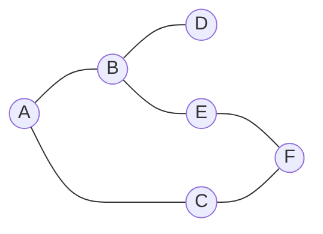
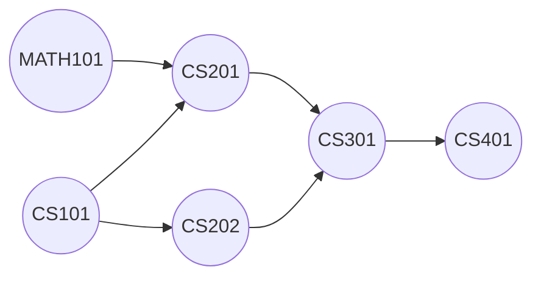
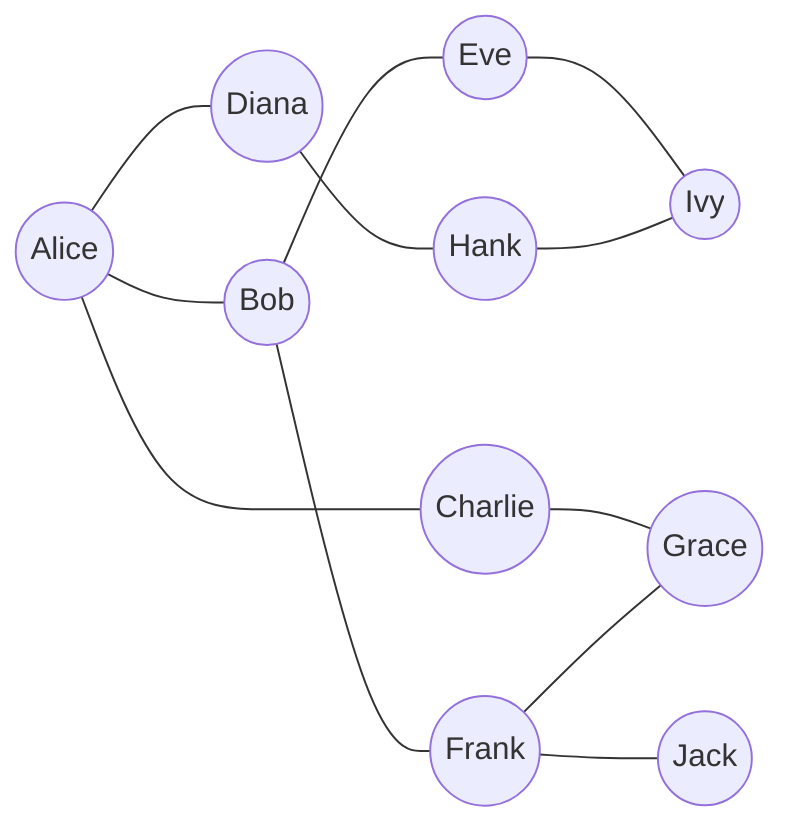

# 11주차 실습 — 그래프 순회와 응용

[레포지토리 안내](../../README.ko.md) | [English](Concepts_Lab.md) | [한국어](Concepts_Lab.ko.md)

> **최종 수정일:** 2026-11-18

> **학습 목표:**
> 1. 큐를 사용하는 BFS를 구현하고 시작 정점에서 각 정점까지의 최단 간선 수를 계산할 수 있다
> 2. 부모 정점을 기록하여 가중치 없는 그래프의 최단 경로를 복원할 수 있다
> 3. 재귀 DFS를 구현하고 DFS의 후위 순서를 뒤집어 DAG를 위상 정렬할 수 있다
> 4. 진입 차수를 쓰는 Kahn 알고리즘과 세 가지 색을 쓰는 DFS로 방향 그래프의 사이클을 판정할 수 있다
> 5. BFS와 DFS를 자료구조, 탐색 순서, 최단 경로, 메모리, 용도의 측면에서 비교하고 친구 추천에 적용할 수 있다

---

## 목차

- [1. 개요](#1-개요)
  - [1.1 실습 목표](#11-실습-목표)
  - [1.2 실습 구성](#12-실습-구성)
  - [1.3 실행 환경](#13-실행-환경)
- [2. 연습 1: BFS와 최단 거리](#2-연습-1-bfs와-최단-거리)
  - [2.1 문제](#21-문제)
  - [2.2 풀이 코드](#22-풀이-코드)
  - [2.3 큐의 변화 추적](#23-큐의-변화-추적)
  - [2.4 최단 경로 복원](#24-최단-경로-복원)
- [3. 연습 2: DFS와 위상 정렬](#3-연습-2-dfs와-위상-정렬)
  - [3.1 문제](#31-문제)
  - [3.2 재귀 DFS](#32-재귀-dfs)
  - [3.3 DFS 기반 위상 정렬](#33-dfs-기반-위상-정렬)
  - [3.4 Kahn 알고리즘](#34-kahn-알고리즘)
  - [3.5 사이클 탐지](#35-사이클-탐지)
- [4. BFS와 DFS의 비교](#4-bfs와-dfs의-비교)
- [5. 그래프 순회의 응용](#5-그래프-순회의-응용)
  - [5.1 그래프 기반 기능](#51-그래프-기반-기능)
  - [5.2 친구 추천](#52-친구-추천)
- [요약](#요약)
- [점검 문제](#점검-문제)

---

<br>

## 1. 개요

> **참고:** 그래프의 표현, DFS와 BFS의 원리, 위상 정렬의 두 알고리즘은 [11주차 이론](Concepts_Lecture.ko.md)에서 다룬다. 이 실습은 인접 리스트로 표현한 그래프에서 두 순회와 위상 정렬을 Python으로 구현한다.

### 1.1 실습 목표

- 큐를 사용하는 **너비 우선 탐색(BFS)** 으로 시작 정점에서 각 정점까지의 최단 거리를 계산한다.
- 재귀를 사용하는 **깊이 우선 탐색(DFS)** 을 구현하고, 이를 이용해 선수 과목 그래프를 **위상 정렬** 한다.
- 위상 정렬의 다른 방법인 Kahn 알고리즘과 사이클 탐지를 구현한다.
- BFS로 소셜 네트워크의 친구 추천 기능을 만든다.

### 1.2 실습 구성

| 구분 | 주제 |
|:-----|:-----|
| **연습 1** | BFS와 최단 거리, 최단 경로 복원 |
| **연습 2** | 재귀 DFS, DFS 기반 위상 정렬, Kahn 알고리즘, 사이클 탐지 |
| **비교** | BFS와 DFS의 비교 |
| **응용** | 그래프 기반 기능, BFS를 이용한 친구 추천 |

*표 1. 실습 구성과 주제*

### 1.3 실행 환경

모든 코드는 Python 3의 표준 라이브러리만 사용한다. 그래프는 정점을 키로, 이웃 정점의 리스트를 값으로 하는 딕셔너리(인접 리스트)로 표현한다. 순회 과정을 그림으로 보여 주는 참조 웹 애플리케이션(그래프 순회 탐색기)은 FastAPI와 uvicorn으로 실행하며, 그 핵심 알고리즘인 최단 경로 복원, Kahn 알고리즘, 사이클 탐지, 친구 추천은 2.4절, 3.4절, 3.5절, 5.2절에서 코드로 다룬다.

---

<br>

## 2. 연습 1: BFS와 최단 거리

### 2.1 문제

**목표:** 시작 정점에서 각 정점까지의 최단 거리를 계산하는 **너비 우선 탐색(Breadth-First Search, BFS)** 을 구현한다.



*그림 1. BFS에 쓰는 정점 6개의 무방향 그래프*

**요구 사항:**

- 순회에 큐(FIFO)를 사용한다.
- 방문한 정점을 기록하여 사이클에서 같은 정점을 다시 방문하지 않는다.
- 시작 정점에서 도달할 수 있는 각 정점까지의 거리(간선 수)를 계산한다.
- 방문 순서와 거리 딕셔너리를 돌려준다.

### 2.2 풀이 코드

```python
from collections import deque

def bfs(graph, start):
    visited = {start}               # 방문한 정점 (큐에 넣을 때 표시)
    queue = deque([start])          # FIFO 큐
    distance = {start: 0}           # 시작 정점에서의 간선 수
    order = []

    while queue:
        node = queue.popleft()      # 맨 앞에서 꺼냄: O(1)
        order.append(node)
        for neighbor in graph.get(node, []):
            if neighbor not in visited:
                visited.add(neighbor)
                queue.append(neighbor)
                distance[neighbor] = distance[node] + 1   # 부모의 거리 + 1

    return order, distance
```

```python
graph = {
    'A': ['B', 'C'], 'B': ['A', 'D', 'E'],
    'C': ['A', 'F'], 'D': ['B'],
    'E': ['B', 'F'], 'F': ['C', 'E']
}
order, dist = bfs(graph, 'A')
print(order)
print(dist)
```

```text
['A', 'B', 'C', 'D', 'E', 'F']
{'A': 0, 'B': 1, 'C': 1, 'D': 2, 'E': 2, 'F': 2}
```

- **`deque`:** 리스트의 `pop(0)`은 뒤의 원소를 모두 한 칸씩 옮기므로 O(n)이지만, `collections.deque`의 `popleft()`는 O(1)이다. 큐는 반드시 `deque`로 구현한다.
- **큐에 넣을 때 방문 표시:** 정점을 큐에 넣는 순간 `visited`에 추가하므로, 여러 정점의 이웃인 정점(F는 C와 E의 이웃)도 큐에 한 번만 들어간다. 꺼낼 때 표시하면 같은 정점이 큐에 여러 번 들어갈 수 있다.
- **거리:** 정점을 처음 발견한 정점(부모)의 거리에 1을 더한다. BFS는 거리 0인 정점, 거리 1인 정점들, 거리 2인 정점들의 순서로 꺼내므로, 처음 발견할 때의 거리가 최단 거리이다(11주차 이론 2.7절).
- **복잡도:** 각 정점은 한 번씩 큐에 들어갔다 나오고 각 인접 리스트는 한 번씩 훑으므로 $`O(V + E)`$이다.

### 2.3 큐의 변화 추적

| 꺼낸 정점 | 새로 넣은 정점 | 큐 (꺼내고 넣은 뒤) | 확정된 거리 |
|:-----|:-----|:-----|:-----|
| A | B, C | B, C | B = 1, C = 1 |
| B | D, E | C, D, E | D = 2, E = 2 |
| C | F | D, E, F | F = 2 |
| D | 없음 | E, F | |
| E | 없음 (F는 이미 방문) | F | |
| F | 없음 | 비어 있음 | |

*표 2. 시작 정점 A에서 BFS의 큐 변화*

F는 C를 처리할 때 처음 발견되어 거리 2를 받는다. E를 처리할 때 F를 다시 보지만 이미 방문했으므로 넣지 않는다. 경로 A, B, E, F는 간선이 3개이므로 F의 최단 거리 2보다 길다.

### 2.4 최단 경로 복원

거리뿐 아니라 경로 자체가 필요하면, 각 정점을 처음 발견한 정점(부모)을 기록한 뒤 목표 정점에서 부모를 따라 거꾸로 올라간다. 그래프 순회 탐색기의 BFS 최단 경로 기능이 이 방식이다.

```python
def shortest_path(graph, start, end):
    parent = {start: None}          # 각 정점을 처음 발견한 정점
    queue = deque([start])
    while queue:
        node = queue.popleft()
        if node == end:             # 목표를 꺼내면 바로 끝냄
            break
        for neighbor in graph.get(node, []):
            if neighbor not in parent:
                parent[neighbor] = node
                queue.append(neighbor)
    if end not in parent:
        return None                 # 도달할 수 없음
    path = []
    while end is not None:          # 부모를 따라 거꾸로 올라감
        path.append(end)
        end = parent[end]
    return path[::-1]

print(shortest_path(graph, 'A', 'F'), shortest_path(graph, 'D', 'F'))
```

```text
['A', 'C', 'F'] ['D', 'B', 'E', 'F']
```

- `parent` 딕셔너리가 방문 집합의 역할을 겸한다. 키로 들어 있으면 이미 발견한 정점이다.
- 부모를 따라가면 목표에서 시작으로 가는 순서가 되므로 마지막에 `[::-1]`로 뒤집는다.
- 부모 포인터들은 시작 정점을 뿌리로 하는 **BFS 트리**를 이루며, 트리에서 뿌리까지의 경로가 그래프의 최단 경로이다. D에서 F로 가는 최단 경로는 간선 3개인 D, B, E, F이며, D, B, A, C, F는 간선이 4개이다.

---

<br>

## 3. 연습 2: DFS와 위상 정렬

### 3.1 문제

**A부:** 재귀를 사용하는 **깊이 우선 탐색(Depth-First Search, DFS)** 을 구현한다.

**B부:** 다음 선수 과목 관계를 나타내는 DAG를 **위상 정렬** 한다. 간선 $`x \to y`$는 과목 x를 y보다 먼저 들어야 한다는 뜻이다.



*그림 2. 선수 과목 관계를 나타내는 DAG*

**질문:** 학생은 이 과목들을 어떤 순서로 들어야 하는가?

### 3.2 재귀 DFS

```python
def dfs(graph, start, visited=None):
    if visited is None:
        visited = set()
    visited.add(start)
    order = [start]
    for neighbor in graph.get(start, []):
        if neighbor not in visited:
            order.extend(dfs(graph, neighbor, visited))
    return order

print(dfs(graph, 'A'))
```

```text
['A', 'B', 'D', 'E', 'F', 'C']
```

- **기본값 `None`:** 기본값을 `visited=set()`으로 두면 그 집합이 함수 정의 때 한 번만 만들어져 모든 호출이 공유하므로, 두 번째 `dfs` 호출은 첫 호출에서 방문한 정점을 이미 방문한 것으로 본다. `None`을 기본값으로 두고 함수 안에서 새 집합을 만드는 것이 Python의 관례이다.
- **방문 순서:** A에서 첫 이웃 B로 내려가고, B에서 D로 내려갔다가 D에 미방문 이웃이 없어 B로 돌아온다. B의 다음 이웃 E로 내려가 E에서 F, F에서 C로 내려간다. C의 이웃 A와 F는 모두 방문했으므로 탐색이 끝난다. 2.2절의 BFS가 A의 이웃 C를 세 번째로 방문한 것과 달리, DFS는 C에 F를 거쳐 마지막으로 도달한다.
- **재귀 호출 스택:** 재귀 호출이 DFS의 스택 역할을 한다. 함수가 돌아오는 것이 한 단계 되돌아가는(backtrack) 것이다.

> **주의:** Python의 재귀 깊이 한도는 기본 약 1,000이므로, 정점이 일렬로 수천 개 이어진 그래프에서 재귀 DFS는 `RecursionError`를 일으킨다. 그런 그래프는 명시적인 스택을 쓰는 반복 DFS로 순회한다.

### 3.3 DFS 기반 위상 정렬

```python
def topological_sort(graph):
    visited = set()
    stack = []
    def _dfs(node):
        visited.add(node)
        for neighbor in graph.get(node, []):
            if neighbor not in visited:
                _dfs(neighbor)
        stack.append(node)      # 후위 순서: 모든 후속 정점을 처리한 뒤 추가
    for node in graph:
        if node not in visited:
            _dfs(node)
    return list(reversed(stack))

dag = {
    'CS101': ['CS201', 'CS202'],
    'CS201': ['CS301'],
    'CS202': ['CS301'],
    'CS301': ['CS401'],
    'MATH101': ['CS201'],
    'CS401': []
}
print(topological_sort(dag))
```

```text
['MATH101', 'CS101', 'CS202', 'CS201', 'CS301', 'CS401']
```

- **후위 순서:** 정점의 모든 후속 정점(그 정점에서 간선으로 갈 수 있는 정점)의 DFS가 끝난 뒤에 정점을 `stack`에 넣는다. DAG에서는 정점이 끝날 때 그 정점에서 도달할 수 있는 모든 정점이 이미 `stack`에 있으므로, `stack`을 뒤집으면 모든 간선 $`x \to y`$에서 x가 y보다 앞에 온다.
- **모든 정점에서 시작:** 바깥의 `for`가 아직 방문하지 않은 정점마다 `_dfs`를 시작하므로, 한 정점에서 모든 정점에 도달할 수 없어도 모든 정점이 결과에 들어간다.

딕셔너리의 삽입 순서(CS101, CS201, CS202, CS301, MATH101, CS401)로 시작 정점을 고를 때 `stack`은 다음과 같이 쌓인다.

```text
enter CS101
  enter CS201
    enter CS301
      enter CS401
      finish CS401 ['CS401']
    finish CS301 ['CS401', 'CS301']
  finish CS201 ['CS401', 'CS301', 'CS201']
  enter CS202
  finish CS202 ['CS401', 'CS301', 'CS201', 'CS202']
finish CS101 ['CS401', 'CS301', 'CS201', 'CS202', 'CS101']
enter MATH101
finish MATH101 ['CS401', 'CS301', 'CS201', 'CS202', 'CS101', 'MATH101']
```

CS202는 CS301이 이미 끝났으므로 바로 끝나고, MATH101은 CS201이 이미 끝났으므로 바로 끝난다. 뒤집은 결과에서 MATH101과 CS101은 모두 CS201보다 앞에 있고, CS202는 CS301보다 앞에 있으므로 모든 선수 관계를 만족한다.

### 3.4 Kahn 알고리즘

위상 정렬은 큐를 쓰는 방법으로도 구할 수 있다. 정점의 **진입 차수(in-degree)**, 곧 들어오는 간선의 수가 0이면 그 정점보다 먼저 올 정점이 없으므로 바로 배치할 수 있다. 진입 차수가 0인 정점을 큐에서 꺼내 배치하고 그 정점의 나가는 간선을 지우는 일을 반복하는 방법이 Kahn 알고리즘이며, 11주차 이론 3.2절의 In-Degree 방법을 큐로 구현한 것이다.

```python
def kahn(graph):
    in_degree = {u: 0 for u in graph}
    for u in graph:
        for v in graph[u]:
            in_degree[v] += 1           # 들어오는 간선 수
    queue = deque(u for u in graph if in_degree[u] == 0)
    order = []
    while queue:
        u = queue.popleft()
        order.append(u)
        for v in graph[u]:
            in_degree[v] -= 1           # u를 지우면 v의 진입 차수가 1 줄어듦
            if in_degree[v] == 0:
                queue.append(v)
    if len(order) < len(graph):
        raise ValueError("Graph has a cycle")   # 남은 정점은 사이클 위에 있음
    return order

print(kahn(dag))
```

```text
['CS101', 'MATH101', 'CS202', 'CS201', 'CS301', 'CS401']
```

| 꺼낸 정점 | 진입 차수가 줄어든 정점 | 큐 (꺼내고 넣은 뒤) |
|:-----|:-----|:-----|
| (시작) | | CS101, MATH101 |
| CS101 | CS201: 2 → 1, CS202: 1 → 0 | MATH101, CS202 |
| MATH101 | CS201: 1 → 0 | CS202, CS201 |
| CS202 | CS301: 2 → 1 | CS201 |
| CS201 | CS301: 1 → 0 | CS301 |
| CS301 | CS401: 1 → 0 | CS401 |
| CS401 | | 비어 있음 |

*표 3. 선수 과목 DAG에서 Kahn 알고리즘의 진행*

결과는 3.3절과 다르지만 역시 유효한 위상 순서이다. 한 DAG에는 위상 순서가 여러 개 있을 수 있다. 진입 차수를 세는 데 $`O(V + E)`$, 각 정점을 한 번씩 꺼내며 나가는 간선을 한 번씩 지우는 데 $`O(V + E)`$가 들므로 전체도 $`O(V + E)`$이다.

### 3.5 사이클 탐지

그래프에 방향 사이클이 있으면 위상 순서가 존재하지 않는다. 사이클 위의 정점들은 서로가 서로보다 먼저 와야 하기 때문이다. 그래프 순회 탐색기는 이를 판정하는 두 방법을 모두 보여 준다.

```python
def has_cycle(graph):
    WHITE, GRAY, BLACK = 0, 1, 2        # 미방문, 방문 중, 완료
    color = {u: WHITE for u in graph}
    def visit(u):
        color[u] = GRAY
        for v in graph[u]:
            if color[v] == GRAY:        # 방문 중인 정점으로 가는 간선: 역방향 간선
                return True
            if color[v] == WHITE and visit(v):
                return True
        color[u] = BLACK
        return False
    return any(color[u] == WHITE and visit(u) for u in graph)

cyclic = dict(dag, CS401=['CS201'])     # CS401 -> CS201을 추가
print(has_cycle(dag), has_cycle(cyclic))
try:
    kahn(cyclic)
except ValueError as e:
    print(e)
```

```text
False True
Graph has a cycle
```

- **세 가지 색:** 흰색은 아직 방문하지 않은 정점, 회색은 DFS가 들어갔지만 아직 끝나지 않은 정점, 검은색은 끝난 정점이다. 어느 순간 회색 정점들은 시작 정점에서 현재 정점까지의 재귀 경로를 이룬다.
- **역방향 간선:** 현재 정점에서 회색 정점으로 가는 간선은 재귀 경로의 앞쪽으로 되돌아가는 간선이므로 사이클을 만든다. `cyclic`에서 CS201, CS301, CS401을 따라 내려간 뒤 CS401 → CS201 간선이 회색인 CS201을 가리킨다.
- **검은색 정점으로 가는 간선:** 이미 끝난 정점으로 가는 간선은 사이클이 아니다. 3.3절에서 CS202 → CS301이 그런 간선이다. 방문 여부만 기록하는 두 가지 상태로는 이 경우와 역방향 간선을 구별할 수 없으므로 색이 세 가지 필요하다.
- **Kahn 알고리즘의 판정:** 사이클 위의 정점은 진입 차수가 끝내 0이 되지 않아 큐에 들어가지 못한다. 그래서 `order`에 들어간 정점이 전체보다 적으면 사이클이 있다.

---

<br>

## 4. BFS와 DFS의 비교

| 관점 | BFS | DFS |
|:-----|:-----|:-----|
| 자료구조 | 큐 (FIFO) | 스택 또는 재귀 |
| 탐색 순서 | 레벨 단위 | 갈 수 있는 한 깊이 먼저 |
| 최단 경로 | 찾음 (가중치 없는 그래프) | 찾지 않음 |
| 위상 정렬 | BFS 자체로는 아님 (큐를 쓰는 Kahn 알고리즘으로 가능) | 가능 (후위 순서의 역순) |
| 메모리 | 그래프의 폭에 비례 | 그래프의 깊이에 비례 |
| 용도 | 최단 경로, 친구 추천 | 사이클 탐지, 위상 정렬 |

*표 4. BFS와 DFS의 비교*

- **최단 경로:** BFS는 거리 순으로 정점을 발견하므로 처음 발견한 경로가 최단이다. DFS는 3.2절에서 C에 F를 거쳐 도달했듯이 먼저 찾은 경로가 최단이라는 보장이 없다.
- **메모리:** BFS의 큐에는 한 레벨의 정점이 한꺼번에 들어가고, DFS의 스택에는 현재 경로의 정점만 들어간다. 한 정점에 이웃이 매우 많은 넓은 그래프에서는 DFS가, 경로가 매우 긴 깊은 그래프에서는 BFS가 메모리를 덜 쓴다. 최악의 경우 둘 다 $`O(V)`$이다.
- **시간:** 두 순회 모두 각 정점과 간선을 한 번씩 처리하므로 $`O(V + E)`$이다.

---

<br>

## 5. 그래프 순회의 응용

### 5.1 그래프 기반 기능

| 주제 | 그래프 기능 |
|:-----|:-----|
| 쇼핑몰 | 함께 구매한 상품을 잇는 그래프를 순회하는 "이 상품을 산 고객이 함께 산 상품" |
| 소셜 네트워크 | BFS로 2단계 연결(친구의 친구)을 찾는 친구 추천 |
| 캠퍼스 지도 | 건물 사이의 연결 그래프 구축 |

*표 5. 웹 애플리케이션 주제별 그래프 기능*

### 5.2 친구 추천

소셜 네트워크에서 사용자 u의 친구 추천 후보는 u의 친구는 아니지만 친구의 친구인 사람, 곧 u에서 간선 2개로 도달하는 사람이다.

```python
def suggest_friends(graph, user):
    """2단계 연결(친구의 친구)을 찾는다."""
    friends = set(graph[user])
    suggestions = set()
    for friend in friends:
        for fof in graph[friend]:
            if fof != user and fof not in friends:
                suggestions.add(fof)
    return suggestions
```

그래프 순회 탐색기의 소셜 네트워크 데모는 사용자 10명의 다음 친구 관계를 쓴다.



*그림 3. 사용자 10명의 친구 관계 그래프*

```python
social = {
    "Alice":   ["Bob", "Charlie", "Diana"],
    "Bob":     ["Alice", "Eve", "Frank"],
    "Charlie": ["Alice", "Grace"],
    "Diana":   ["Alice", "Hank"],
    "Eve":     ["Bob", "Ivy"],
    "Frank":   ["Bob", "Grace", "Jack"],
    "Grace":   ["Charlie", "Frank"],
    "Hank":    ["Diana", "Ivy"],
    "Ivy":     ["Eve", "Hank"],
    "Jack":    ["Frank"],
}
print(sorted(suggest_friends(social, "Alice")))
_, d = bfs(social, "Alice")
print(sorted(v for v, k in d.items() if k == 2))
print(sorted(suggest_friends(social, "Jack")))
```

```text
['Eve', 'Frank', 'Grace', 'Hank']
['Eve', 'Frank', 'Grace', 'Hank']
['Bob', 'Grace']
```

- `suggest_friends`가 돌려주는 집합은 2.2절의 `bfs`로 구한 거리가 정확히 2인 정점의 집합과 같다. 친구(거리 1)와 자기 자신(거리 0)을 빼고 친구의 이웃을 모으는 것이 BFS를 두 레벨까지만 진행하는 것과 같기 때문이다.
- 문자열의 집합은 출력 순서가 실행마다 달라질 수 있으므로 `sorted()`로 정렬하여 출력한다.
- 친구의 이웃 목록을 모두 훑으므로 비용은 친구들의 차수의 합에 비례한다. 더 먼 연결까지 추천하려면 BFS를 원하는 깊이까지 진행하고 그 깊이의 정점을 고른다.

> **참고:** 실제 추천 시스템은 후보를 고른 뒤 공통 친구의 수 같은 기준으로 순위를 매긴다. 위 그래프에서는 모든 후보가 공통 친구를 한 명씩 가지지만, 후보마다 `suggest_friends`의 안쪽 반복에서 몇 번 만나는지 세면 공통 친구의 수가 된다.

---

<br>

## 요약

| 개념 | 핵심 요약 |
|:-----|:-----|
| BFS 구현 | `deque`의 `popleft()`로 큐를 구현하고, 정점을 큐에 넣을 때 방문을 표시하며, 거리는 부모의 거리에 1을 더한다. |
| BFS의 최단 거리 | BFS는 정점을 거리 순으로 발견하므로, 가중치 없는 그래프에서 처음 발견할 때의 거리가 최단 거리이다. |
| 경로 복원 | 각 정점의 부모를 기록하고 목표에서 부모를 따라 올라간 뒤 뒤집으면 BFS 트리 위의 최단 경로를 얻는다. |
| 재귀 DFS | 방문 집합의 기본값을 `None`으로 두고 함수 안에서 만들며, 재귀 호출 스택이 DFS의 스택 역할을 한다. |
| DFS 위상 정렬 | 후속 정점을 모두 처리한 뒤 정점을 쌓는 후위 순서를 뒤집으면 DAG의 위상 순서가 된다. |
| Kahn 알고리즘 | 진입 차수가 0인 정점을 큐에서 꺼내 배치하고 나가는 간선을 지우며, 배치된 정점이 전체보다 적으면 사이클이 있다. |
| 사이클 탐지 | 세 가지 색의 DFS에서 회색 정점으로 가는 역방향 간선이 나타나면 방향 사이클이 있다. |
| BFS와 DFS | 둘 다 $`O(V + E)`$이며, BFS는 최단 경로와 친구 추천에, DFS는 위상 정렬과 사이클 탐지에 쓰인다. |
| 친구 추천 | 친구의 친구는 BFS에서 거리가 정확히 2인 정점이며, 공통 친구의 수로 순위를 매길 수 있다. |

---

<br>

## 점검 문제

1. 2.2절의 BFS가 정점을 큐에서 꺼낼 때가 아니라 큐에 넣을 때 방문을 표시하는 이유는 무엇인가? 꺼낼 때 표시하면 그림 1의 그래프에서 어떤 일이 생기는가?

   <details>
   <summary>정답</summary>

   넣을 때 표시해야 한 정점이 큐에 한 번만 들어간다. 꺼낼 때 표시하면 F처럼 여러 정점의 이웃인 정점은 아직 꺼내지지 않은 동안 다른 이웃이 처리될 때마다 다시 큐에 들어간다. 그림 1에서는 C를 처리할 때 F가 들어가고, F를 꺼내기 전에 E를 처리할 때 F가 한 번 더 들어간다. 그때 거리도 E의 거리 2에 1을 더한 3으로 덮어쓰일 수 있어, 2.2절처럼 `distance`를 넣을 때 갱신하는 코드에서는 최단 거리가 틀어진다. 큐의 크기도 정점 수가 아니라 간선 수에 비례하여 커질 수 있다.

   </details>

2. 그림 1의 그래프에서 시작 정점을 D로 하여 BFS를 실행하면 방문 순서와 각 정점의 거리는 어떻게 되는가? 인접 리스트의 순서는 2.2절의 `graph`를 따른다.

   <details>
   <summary>정답</summary>

   D를 꺼내 B(거리 1)를 넣는다. B를 꺼내면 A, E(거리 2)를 넣는다(D는 이미 방문). A를 꺼내면 C(거리 3)를 넣고, E를 꺼내면 F(거리 3)를 넣는다. 이어서 C와 F를 꺼내지만 새 정점은 없다. 방문 순서는 D, B, A, E, C, F이고, 거리는 D = 0, B = 1, A = 2, E = 2, C = 3, F = 3이다. F까지의 최단 경로는 D, B, E, F로 2.4절의 결과와 같다.

   </details>

3. 3.3절의 DFS 위상 정렬에서 정점을 방문할 때가 아니라 모든 후속 정점의 처리가 끝난 뒤에 `stack`에 넣는 이유를 설명하라. 방문할 때 넣고 뒤집지 않으면 3.3절의 DAG에서 어떤 결과가 나오는가?

   <details>
   <summary>정답</summary>

   위상 순서에서 정점 x는 x에서 도달할 수 있는 모든 정점보다 앞에 와야 한다. DAG에서는 x의 DFS가 끝날 때 그 정점들이 모두 이미 끝나 `stack`에 있으므로, 끝나는 순서를 뒤집으면 x가 그 정점들보다 앞에 놓인다. 방문 순서(전위 순서)는 이를 보장하지 않는다. 같은 시작 순서로 방문할 때 기록하면 CS101, CS201, CS301, CS401, CS202, MATH101이 되는데, CS202가 CS301보다 뒤에 있고 MATH101이 CS201보다 뒤에 있어 간선 CS202 → CS301과 MATH101 → CS201을 어긴다.

   </details>

4. 3.5절의 `has_cycle`에서 색을 두 가지(방문함, 방문하지 않음)만 쓰면 어떤 오류가 생기는지 3.3절의 DAG로 설명하라.

   <details>
   <summary>정답</summary>

   두 가지 상태만 있으면 이미 방문한 정점으로 가는 간선을 모두 사이클로 판단하게 된다. 3.3절의 DAG에서 DFS는 CS101에서 CS201, CS301, CS401을 방문하고 돌아온 뒤 CS202로 내려가는데, CS202 → CS301은 이미 방문한 정점으로 가는 간선이다. CS301은 이미 끝난(검은색) 정점이어서 이 간선은 사이클을 만들지 않지만, 두 상태로는 현재 재귀 경로 위의 정점(회색)과 구별할 수 없어 사이클이 없는 DAG를 사이클이 있다고 잘못 판정한다. 무방향 그래프와 달리 방향 그래프에서는 회색과 검은색의 구별이 필수이다.

   </details>

5. Kahn 알고리즘이 사이클이 있는 그래프에서 모든 정점을 배치하지 못하는 이유를 설명하라.

   <details>
   <summary>정답</summary>

   사이클 위의 각 정점은 사이클의 이전 정점에서 들어오는 간선을 가진다. Kahn 알고리즘은 진입 차수가 0인 정점만 꺼내므로, 사이클 위의 어느 정점이 처음으로 꺼내지려면 그 전에 사이클의 이전 정점이 먼저 꺼내져 간선을 지워야 한다. 사이클을 따라가면 이 조건이 자기 자신에게 돌아오므로 사이클 위의 어떤 정점도 먼저 꺼내질 수 없다. 따라서 사이클 위의 정점과 그 정점에서 도달할 수 있는 정점은 진입 차수가 0이 되지 않은 채 남고, 배치된 정점 수가 전체보다 적어진다.

   </details>

6. 5.2절의 그래프에서 Eve의 친구 추천 후보를 구하라. 이 후보가 BFS의 어떤 정점들과 같은지 설명하라.

   <details>
   <summary>정답</summary>

   Eve의 친구는 Bob과 Ivy이다. Bob의 친구 Alice, Eve, Frank 중 Eve 자신을 빼면 Alice와 Frank가, Ivy의 친구 Eve, Hank 중 Eve를 빼면 Hank가 남는다. 이들 중 Eve의 친구는 없으므로 후보는 Alice, Frank, Hank이다. 이는 Eve에서 시작한 BFS에서 거리가 정확히 2인 정점들이다. 거리 1인 Bob과 Ivy가 친구이고, 그 이웃 중 아직 발견되지 않은 정점이 거리 2를 받기 때문이다.

   </details>
