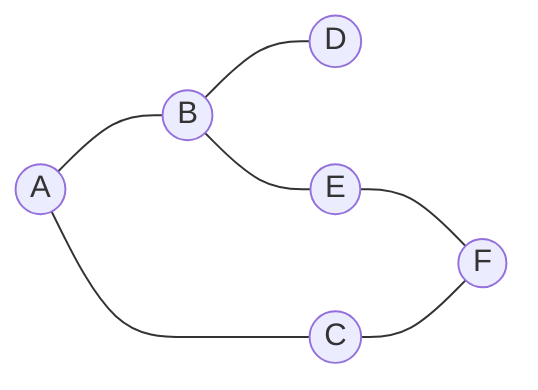
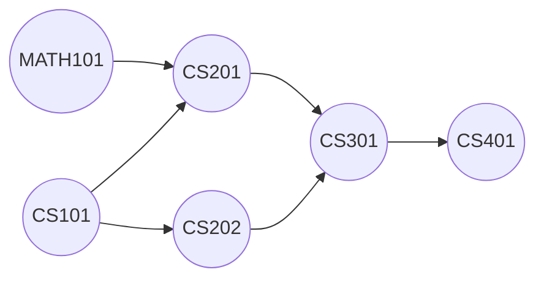
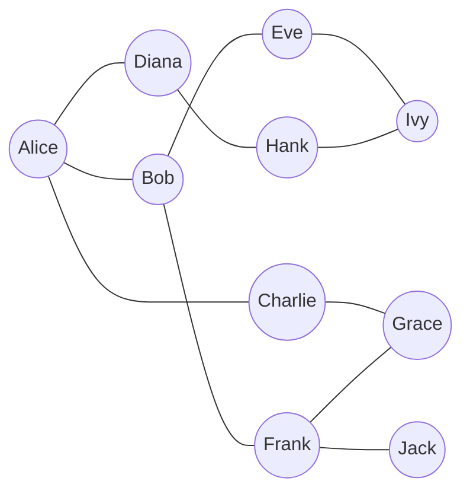

# Week 11 Lab — Graph Traversal and Applications

[Repository Guide](../../README.md) | [English](Concepts_Lab.md) | [한국어](Concepts_Lab.ko.md)

> **Last Updated:** 2026-11-18

> **Learning Objectives:**
> 1. Implement BFS with a queue and compute the shortest number of edges from a start vertex to each vertex
> 2. Recover shortest paths in an unweighted graph by recording parent vertices
> 3. Implement recursive DFS and topologically sort a DAG by reversing the DFS postorder
> 4. Decide whether a directed graph has a cycle with Kahn's algorithm, which uses in-degrees, and with a three-color DFS
> 5. Compare BFS and DFS in terms of data structure, traversal order, shortest paths, memory, and uses, and apply them to friend suggestions

---

## Table of Contents

- [1. Overview](#1-overview)
  - [1.1 Lab Goals](#11-lab-goals)
  - [1.2 Lab Structure](#12-lab-structure)
  - [1.3 Environment](#13-environment)
- [2. Exercise 1: BFS and Shortest Distances](#2-exercise-1-bfs-and-shortest-distances)
  - [2.1 Problem](#21-problem)
  - [2.2 Solution Code](#22-solution-code)
  - [2.3 Tracing the Queue](#23-tracing-the-queue)
  - [2.4 Recovering Shortest Paths](#24-recovering-shortest-paths)
- [3. Exercise 2: DFS and Topological Sort](#3-exercise-2-dfs-and-topological-sort)
  - [3.1 Problem](#31-problem)
  - [3.2 Recursive DFS](#32-recursive-dfs)
  - [3.3 DFS-Based Topological Sort](#33-dfs-based-topological-sort)
  - [3.4 Kahn's Algorithm](#34-kahns-algorithm)
  - [3.5 Cycle Detection](#35-cycle-detection)
- [4. BFS versus DFS](#4-bfs-versus-dfs)
- [5. Applications of Graph Traversal](#5-applications-of-graph-traversal)
  - [5.1 Graph-Based Features](#51-graph-based-features)
  - [5.2 Friend Suggestions](#52-friend-suggestions)
- [Summary](#summary)
- [Self-Check Questions](#self-check-questions)

---

<br>

## 1. Overview

> **Note:** Graph representations, the principles of DFS and BFS, and the two topological sorting algorithms are covered in the [Week 11 lecture](Concepts_Lecture.md). This lab implements the two traversals and topological sorting in Python on graphs represented by adjacency lists.

### 1.1 Lab Goals

- Compute the shortest distance from a start vertex to each vertex with **breadth-first search (BFS)**, which uses a queue.
- Implement **depth-first search (DFS)** with recursion and use it to **topologically sort** a course prerequisite graph.
- Implement Kahn's algorithm, another method of topological sorting, and cycle detection.
- Build a friend suggestion feature for a social network with BFS.

### 1.2 Lab Structure

| Part | Topic |
|:-----|:-----|
| **Exercise 1** | BFS and shortest distances, recovering shortest paths |
| **Exercise 2** | Recursive DFS, DFS-based topological sort, Kahn's algorithm, cycle detection |
| **Comparison** | BFS versus DFS |
| **Applications** | Graph-based features, friend suggestions with BFS |

*Table 1. Lab structure and topics*

### 1.3 Environment

All code uses only the Python 3 standard library. A graph is represented as a dictionary (adjacency list) whose keys are vertices and whose values are lists of neighboring vertices. The reference web application that shows traversals graphically (the Graph Traversal Explorer) runs on FastAPI and uvicorn, and its core algorithms, namely shortest path recovery, Kahn's algorithm, cycle detection, and friend suggestions, are covered as code in Sections 2.4, 3.4, 3.5, and 5.2.

---

<br>

## 2. Exercise 1: BFS and Shortest Distances

### 2.1 Problem

**Goal:** Implement **breadth-first search (BFS)** that computes the shortest distance from a start vertex to each vertex.



*Figure 1. Undirected graph of six vertices used for BFS*

**Requirements:**

- Use a queue (FIFO) for the traversal.
- Record visited vertices so that no vertex is visited again through a cycle.
- Compute the distance (number of edges) from the start vertex to each reachable vertex.
- Return the visit order and the distance dictionary.

### 2.2 Solution Code

```python
from collections import deque

def bfs(graph, start):
    visited = {start}               # Visited vertices (marked when enqueued)
    queue = deque([start])          # FIFO queue
    distance = {start: 0}           # Number of edges from the start vertex
    order = []

    while queue:
        node = queue.popleft()      # Remove from the front: O(1)
        order.append(node)
        for neighbor in graph.get(node, []):
            if neighbor not in visited:
                visited.add(neighbor)
                queue.append(neighbor)
                distance[neighbor] = distance[node] + 1   # Parent's distance + 1

    return order, distance
```

```python
graph = {
    'A': ['B', 'C'], 'B': ['A', 'D', 'E'],
    'C': ['A', 'F'], 'D': ['B'],
    'E': ['B', 'F'], 'F': ['C', 'E']
}
order, dist = bfs(graph, 'A')
print(order)
print(dist)
```

```text
['A', 'B', 'C', 'D', 'E', 'F']
{'A': 0, 'B': 1, 'C': 1, 'D': 2, 'E': 2, 'F': 2}
```

- **`deque`:** A list's `pop(0)` shifts every later element by one place, so it is O(n), whereas `popleft()` of `collections.deque` is O(1). A queue should always be implemented with `deque`.
- **Marking on enqueue:** A vertex is added to `visited` the moment it is enqueued, so a vertex that neighbors several vertices (F neighbors C and E) enters the queue only once. Marking on dequeue would let the same vertex enter the queue several times.
- **Distance:** A vertex gets the distance of the vertex that first discovered it (its parent) plus 1. BFS removes the vertex at distance 0, then the vertices at distance 1, then those at distance 2, so the distance at first discovery is the shortest distance (Section 2.7 of the Week 11 lecture).
- **Complexity:** Each vertex enters and leaves the queue once and each adjacency list is scanned once, so the cost is $`O(V + E)`$.

### 2.3 Tracing the Queue

| Vertex removed | Vertices added | Queue (after removing and adding) | Distances settled |
|:-----|:-----|:-----|:-----|
| A | B, C | B, C | B = 1, C = 1 |
| B | D, E | C, D, E | D = 2, E = 2 |
| C | F | D, E, F | F = 2 |
| D | None | E, F | |
| E | None (F already visited) | F | |
| F | None | Empty | |

*Table 2. Queue changes of BFS from start vertex A*

F is first discovered while C is processed and gets distance 2. While E is processed, F is seen again but is not enqueued because it is already visited. The path A, B, E, F has 3 edges, so it is longer than F's shortest distance 2.

### 2.4 Recovering Shortest Paths

When the path itself is needed and not only the distance, record the vertex that first discovered each vertex (its parent), then climb back from the target vertex along the parents. The BFS shortest path feature of the Graph Traversal Explorer works this way.

```python
def shortest_path(graph, start, end):
    parent = {start: None}          # The vertex that first discovered each vertex
    queue = deque([start])
    while queue:
        node = queue.popleft()
        if node == end:             # Stop as soon as the target is removed
            break
        for neighbor in graph.get(node, []):
            if neighbor not in parent:
                parent[neighbor] = node
                queue.append(neighbor)
    if end not in parent:
        return None                 # Unreachable
    path = []
    while end is not None:          # Climb back along the parents
        path.append(end)
        end = parent[end]
    return path[::-1]

print(shortest_path(graph, 'A', 'F'), shortest_path(graph, 'D', 'F'))
```

```text
['A', 'C', 'F'] ['D', 'B', 'E', 'F']
```

- The `parent` dictionary doubles as the visited set: a vertex present as a key has already been discovered.
- Following the parents gives the order from the target to the start, so the list is reversed with `[::-1]` at the end.
- The parent pointers form a **BFS tree** rooted at the start vertex, and the tree path to the root is a shortest path in the graph. The shortest path from D to F is D, B, E, F with 3 edges, while D, B, A, C, F has 4 edges.

---

<br>

## 3. Exercise 2: DFS and Topological Sort

### 3.1 Problem

**Part A:** Implement **depth-first search (DFS)** with recursion.

**Part B:** **Topologically sort** the DAG of the following course prerequisites. An edge $`x \to y`$ means that course x must be taken before y.



*Figure 2. DAG of course prerequisites*

**Question:** In what order should a student take these courses?

### 3.2 Recursive DFS

```python
def dfs(graph, start, visited=None):
    if visited is None:
        visited = set()
    visited.add(start)
    order = [start]
    for neighbor in graph.get(start, []):
        if neighbor not in visited:
            order.extend(dfs(graph, neighbor, visited))
    return order

print(dfs(graph, 'A'))
```

```text
['A', 'B', 'D', 'E', 'F', 'C']
```

- **Default `None`:** With the default `visited=set()`, that set would be created only once, when the function is defined, and shared by every call, so a second call to `dfs` would treat the vertices visited in the first call as already visited. Using `None` as the default and creating a new set inside the function is the Python convention.
- **Visit order:** From A the search descends to the first neighbor B, from B to D, and returns to B because D has no unvisited neighbor. It then descends to B's next neighbor E, from E to F, and from F to C. Both neighbors of C, A and F, have been visited, so the search ends. Whereas the BFS of Section 2.2 visits A's neighbor C third, DFS reaches C last, through F.
- **Recursion call stack:** The recursive calls play the role of the DFS stack, and a function returning is one step of backtracking.

> **Caution:** Python's default recursion limit is about 1,000, so recursive DFS raises `RecursionError` on a graph whose vertices form a chain of thousands. Such graphs are traversed with an iterative DFS that uses an explicit stack.

### 3.3 DFS-Based Topological Sort

```python
def topological_sort(graph):
    visited = set()
    stack = []
    def _dfs(node):
        visited.add(node)
        for neighbor in graph.get(node, []):
            if neighbor not in visited:
                _dfs(neighbor)
        stack.append(node)      # Postorder: append after all successors are handled
    for node in graph:
        if node not in visited:
            _dfs(node)
    return list(reversed(stack))

dag = {
    'CS101': ['CS201', 'CS202'],
    'CS201': ['CS301'],
    'CS202': ['CS301'],
    'CS301': ['CS401'],
    'MATH101': ['CS201'],
    'CS401': []
}
print(topological_sort(dag))
```

```text
['MATH101', 'CS101', 'CS202', 'CS201', 'CS301', 'CS401']
```

- **Postorder:** A vertex is pushed onto `stack` after the DFS of all its successors (the vertices reachable from it by an edge) has finished. In a DAG, when a vertex finishes, every vertex reachable from it is already in `stack`, so reversing `stack` puts x before y for every edge $`x \to y`$.
- **Starting from every vertex:** The outer `for` starts `_dfs` from each vertex not yet visited, so every vertex enters the result even if no single vertex reaches all the others.

When start vertices are chosen in the dictionary's insertion order (CS101, CS201, CS202, CS301, MATH101, CS401), `stack` builds up as follows.

```text
enter CS101
  enter CS201
    enter CS301
      enter CS401
      finish CS401 ['CS401']
    finish CS301 ['CS401', 'CS301']
  finish CS201 ['CS401', 'CS301', 'CS201']
  enter CS202
  finish CS202 ['CS401', 'CS301', 'CS201', 'CS202']
finish CS101 ['CS401', 'CS301', 'CS201', 'CS202', 'CS101']
enter MATH101
finish MATH101 ['CS401', 'CS301', 'CS201', 'CS202', 'CS101', 'MATH101']
```

CS202 finishes at once because CS301 has already finished, and MATH101 finishes at once because CS201 has already finished. In the reversed result, MATH101 and CS101 both precede CS201 and CS202 precedes CS301, so every prerequisite relation is satisfied.

### 3.4 Kahn's Algorithm

A topological order can also be obtained with a queue. If a vertex's **in-degree**, the number of incoming edges, is 0, no vertex has to come before it, so it can be placed at once. Kahn's algorithm repeatedly removes a vertex of in-degree 0 from a queue, places it, and deletes its outgoing edges; it is the In-Degree method of Section 3.2 of the Week 11 lecture implemented with a queue.

```python
def kahn(graph):
    in_degree = {u: 0 for u in graph}
    for u in graph:
        for v in graph[u]:
            in_degree[v] += 1           # Number of incoming edges
    queue = deque(u for u in graph if in_degree[u] == 0)
    order = []
    while queue:
        u = queue.popleft()
        order.append(u)
        for v in graph[u]:
            in_degree[v] -= 1           # Deleting u lowers v's in-degree by 1
            if in_degree[v] == 0:
                queue.append(v)
    if len(order) < len(graph):
        raise ValueError("Graph has a cycle")   # The remaining vertices lie on a cycle
    return order

print(kahn(dag))
```

```text
['CS101', 'MATH101', 'CS202', 'CS201', 'CS301', 'CS401']
```

| Vertex removed | In-degrees lowered | Queue (after removing and adding) |
|:-----|:-----|:-----|
| (start) | | CS101, MATH101 |
| CS101 | CS201: 2 → 1, CS202: 1 → 0 | MATH101, CS202 |
| MATH101 | CS201: 1 → 0 | CS202, CS201 |
| CS202 | CS301: 2 → 1 | CS201 |
| CS201 | CS301: 1 → 0 | CS301 |
| CS301 | CS401: 1 → 0 | CS401 |
| CS401 | | Empty |

*Table 3. Progress of Kahn's algorithm on the prerequisite DAG*

The result differs from that of Section 3.3, but it is also a valid topological order; a DAG can have several topological orders. Counting in-degrees takes $`O(V + E)`$, and removing each vertex once while deleting each outgoing edge once takes $`O(V + E)`$, so the whole algorithm is $`O(V + E)`$ as well.

### 3.5 Cycle Detection

If a graph has a directed cycle, no topological order exists, because each vertex on the cycle would have to come before the others. The Graph Traversal Explorer shows both methods of deciding this.

```python
def has_cycle(graph):
    WHITE, GRAY, BLACK = 0, 1, 2        # Unvisited, in progress, finished
    color = {u: WHITE for u in graph}
    def visit(u):
        color[u] = GRAY
        for v in graph[u]:
            if color[v] == GRAY:        # Edge to a vertex in progress: back edge
                return True
            if color[v] == WHITE and visit(v):
                return True
        color[u] = BLACK
        return False
    return any(color[u] == WHITE and visit(u) for u in graph)

cyclic = dict(dag, CS401=['CS201'])     # Add CS401 -> CS201
print(has_cycle(dag), has_cycle(cyclic))
try:
    kahn(cyclic)
except ValueError as e:
    print(e)
```

```text
False True
Graph has a cycle
```

- **Three colors:** White marks a vertex not yet visited, gray a vertex the DFS has entered but not finished, and black a finished vertex. At any moment, the gray vertices form the recursion path from the start vertex to the current vertex.
- **Back edge:** An edge from the current vertex to a gray vertex leads back to an earlier point on the recursion path, so it closes a cycle. In `cyclic`, after the search descends through CS201, CS301, and CS401, the edge CS401 → CS201 points to the gray vertex CS201.
- **Edges to black vertices:** An edge to an already finished vertex is not a cycle. In Section 3.3, CS202 → CS301 is such an edge. Two states that only record whether a vertex was visited cannot tell this case from a back edge, so three colors are needed.
- **Kahn's algorithm's test:** The in-degree of a vertex on a cycle never reaches 0, so it never enters the queue. Therefore, if fewer vertices end up in `order` than the graph has, there is a cycle.

---

<br>

## 4. BFS versus DFS

| Aspect | BFS | DFS |
|:-----|:-----|:-----|
| Data structure | Queue (FIFO) | Stack or recursion |
| Traversal order | Level by level | As deep as possible first |
| Shortest path | Found (unweighted graphs) | Not found |
| Topological sort | Not by BFS itself (possible with Kahn's algorithm, which uses a queue) | Possible (reverse of postorder) |
| Memory | Proportional to the graph's width | Proportional to the graph's depth |
| Uses | Shortest paths, friend suggestions | Cycle detection, topological sort |

*Table 4. Comparison of BFS and DFS*

- **Shortest path:** BFS discovers vertices in order of distance, so the first path found is a shortest one. DFS gives no such guarantee, as it reached C through F in Section 3.2.
- **Memory:** The BFS queue holds the vertices of a whole level at once, while the DFS stack holds only the vertices of the current path. DFS uses less memory on a wide graph where a vertex has very many neighbors, and BFS uses less on a deep graph with very long paths. In the worst case both use $`O(V)`$.
- **Time:** Both traversals handle each vertex and edge once, so both run in $`O(V + E)`$.

---

<br>

## 5. Applications of Graph Traversal

### 5.1 Graph-Based Features

| Topic | Graph feature |
|:-----|:-----|
| Shopping mall | "Customers who bought this also bought," which traverses a graph linking products bought together |
| Social network | Friend suggestions that find second-degree connections (friends of friends) with BFS |
| Campus map | Building a connectivity graph between buildings |

*Table 5. Graph features by web application topic*

### 5.2 Friend Suggestions

In a social network, the friend suggestion candidates for a user u are the people who are not u's friends but are friends of u's friends, that is, the people reached from u by two edges.

```python
def suggest_friends(graph, user):
    """Find second-degree connections (friends of friends)."""
    friends = set(graph[user])
    suggestions = set()
    for friend in friends:
        for fof in graph[friend]:
            if fof != user and fof not in friends:
                suggestions.add(fof)
    return suggestions
```

The social network demo of the Graph Traversal Explorer uses the following friendships among 10 users.



*Figure 3. Friendship graph of 10 users*

```python
social = {
    "Alice":   ["Bob", "Charlie", "Diana"],
    "Bob":     ["Alice", "Eve", "Frank"],
    "Charlie": ["Alice", "Grace"],
    "Diana":   ["Alice", "Hank"],
    "Eve":     ["Bob", "Ivy"],
    "Frank":   ["Bob", "Grace", "Jack"],
    "Grace":   ["Charlie", "Frank"],
    "Hank":    ["Diana", "Ivy"],
    "Ivy":     ["Eve", "Hank"],
    "Jack":    ["Frank"],
}
print(sorted(suggest_friends(social, "Alice")))
_, d = bfs(social, "Alice")
print(sorted(v for v, k in d.items() if k == 2))
print(sorted(suggest_friends(social, "Jack")))
```

```text
['Eve', 'Frank', 'Grace', 'Hank']
['Eve', 'Frank', 'Grace', 'Hank']
['Bob', 'Grace']
```

- The set returned by `suggest_friends` equals the set of vertices whose distance, computed with the `bfs` of Section 2.2, is exactly 2. Collecting the neighbors of friends while excluding the friends (distance 1) and the user (distance 0) amounts to running BFS for only two levels.
- The output order of a set of strings can vary from run to run, so the sets are sorted with `sorted()` before printing.
- The neighbor lists of all friends are scanned, so the cost is proportional to the sum of the friends' degrees. To suggest more distant connections, run BFS to the desired depth and pick the vertices at that depth.

> **Note:** Real recommendation systems rank the candidates after selecting them, by criteria such as the number of mutual friends. In the graph above every candidate has exactly one mutual friend, but counting how many times each candidate is met in the inner loop of `suggest_friends` gives the number of mutual friends.

---

<br>

## Summary

| Concept | Key Summary |
|:-----|:-----|
| BFS implementation | The queue is implemented with `popleft()` of a `deque`, a vertex is marked visited when enqueued, and its distance is its parent's distance plus 1. |
| Shortest distances by BFS | BFS discovers vertices in order of distance, so in an unweighted graph the distance at first discovery is the shortest distance. |
| Path recovery | Recording each vertex's parent, climbing from the target along the parents, and reversing gives a shortest path on the BFS tree. |
| Recursive DFS | The visited set has the default `None` and is created inside the function, and the recursion call stack plays the role of the DFS stack. |
| DFS topological sort | Reversing the postorder, in which a vertex is pushed after all its successors are handled, gives a topological order of a DAG. |
| Kahn's algorithm | Vertices of in-degree 0 are removed from a queue, placed, and their outgoing edges deleted; if fewer vertices are placed than the graph has, there is a cycle. |
| Cycle detection | In a three-color DFS, a back edge to a gray vertex reveals a directed cycle. |
| BFS and DFS | Both run in $`O(V + E)`$; BFS serves shortest paths and friend suggestions, and DFS serves topological sorting and cycle detection. |
| Friend suggestions | Friends of friends are the vertices at distance exactly 2 in BFS, and they can be ranked by the number of mutual friends. |

---

<br>

## Self-Check Questions

1. Why does the BFS of Section 2.2 mark a vertex visited when it is enqueued rather than when it is dequeued? What happens in the graph of Figure 1 if it marks on dequeue?

   <details>
   <summary>Answer</summary>

   Marking on enqueue makes each vertex enter the queue only once. With marking on dequeue, a vertex that neighbors several vertices, such as F, re-enters the queue each time another neighbor is processed while it is still waiting. In Figure 1, F is enqueued when C is processed and enqueued again when E is processed before F is dequeued. Its distance can then be overwritten with E's distance 2 plus 1, that is 3, so in code that updates `distance` on enqueue, as in Section 2.2, the shortest distance goes wrong. The queue can also grow in proportion to the number of edges rather than the number of vertices.

   </details>

2. If BFS is run on the graph of Figure 1 with start vertex D, what are the visit order and the distance of each vertex? The adjacency lists follow the order of `graph` in Section 2.2.

   <details>
   <summary>Answer</summary>

   D is removed and B (distance 1) is added. Removing B adds A and E (distance 2), since D is already visited. Removing A adds C (distance 3), and removing E adds F (distance 3). C and F are then removed with no new vertices. The visit order is D, B, A, E, C, F, and the distances are D = 0, B = 1, A = 2, E = 2, C = 3, and F = 3. The shortest path to F is D, B, E, F, the same as the result of Section 2.4.

   </details>

3. Explain why the DFS topological sort of Section 3.3 pushes a vertex onto `stack` after all its successors are handled rather than when it is visited. If vertices were recorded on visit without reversing, what would result for the DAG of Section 3.3?

   <details>
   <summary>Answer</summary>

   In a topological order, a vertex x must precede every vertex reachable from x. In a DAG, when the DFS of x finishes, all those vertices have already finished and are in `stack`, so reversing the finishing order places x before them. The visit order (preorder) does not guarantee this. Recording on visit with the same start order gives CS101, CS201, CS301, CS401, CS202, MATH101, in which CS202 comes after CS301 and MATH101 comes after CS201, violating the edges CS202 → CS301 and MATH101 → CS201.

   </details>

4. Using the DAG of Section 3.3, explain what error arises if the `has_cycle` of Section 3.5 uses only two colors (visited and not visited).

   <details>
   <summary>Answer</summary>

   With only two states, every edge to an already visited vertex would be judged a cycle. In the DAG of Section 3.3, the DFS visits CS201, CS301, and CS401 from CS101, returns, and then descends to CS202, and CS202 → CS301 is an edge to an already visited vertex. CS301 has already finished (black), so this edge does not close a cycle, but two states cannot distinguish it from a vertex on the current recursion path (gray), so a DAG with no cycle would wrongly be judged cyclic. Unlike in undirected graphs, the distinction between gray and black is essential in directed graphs.

   </details>

5. Explain why Kahn's algorithm cannot place every vertex of a graph that has a cycle.

   <details>
   <summary>Answer</summary>

   Each vertex on a cycle has an incoming edge from the previous vertex of the cycle. Kahn's algorithm removes only vertices of in-degree 0, so for any vertex on the cycle to be removed first, the previous vertex of the cycle must have been removed before it to delete that edge. Following the cycle, this condition returns to the vertex itself, so no vertex on the cycle can be removed first. Hence the vertices on the cycle and the vertices reachable from them remain with in-degree above 0, and fewer vertices are placed than the graph has.

   </details>

6. Find the friend suggestion candidates for Eve in the graph of Section 5.2. Explain which BFS vertices these candidates coincide with.

   <details>
   <summary>Answer</summary>

   Eve's friends are Bob and Ivy. Of Bob's friends Alice, Eve, and Frank, removing Eve herself leaves Alice and Frank, and of Ivy's friends Eve and Hank, removing Eve leaves Hank. None of them is Eve's friend, so the candidates are Alice, Frank, and Hank. They are the vertices at distance exactly 2 in a BFS from Eve, because Bob and Ivy, at distance 1, are the friends, and their neighbors not yet discovered receive distance 2.

   </details>
