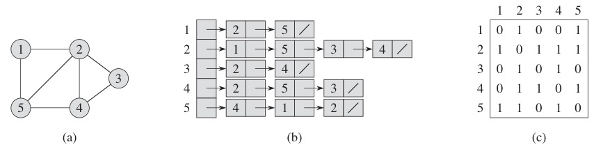
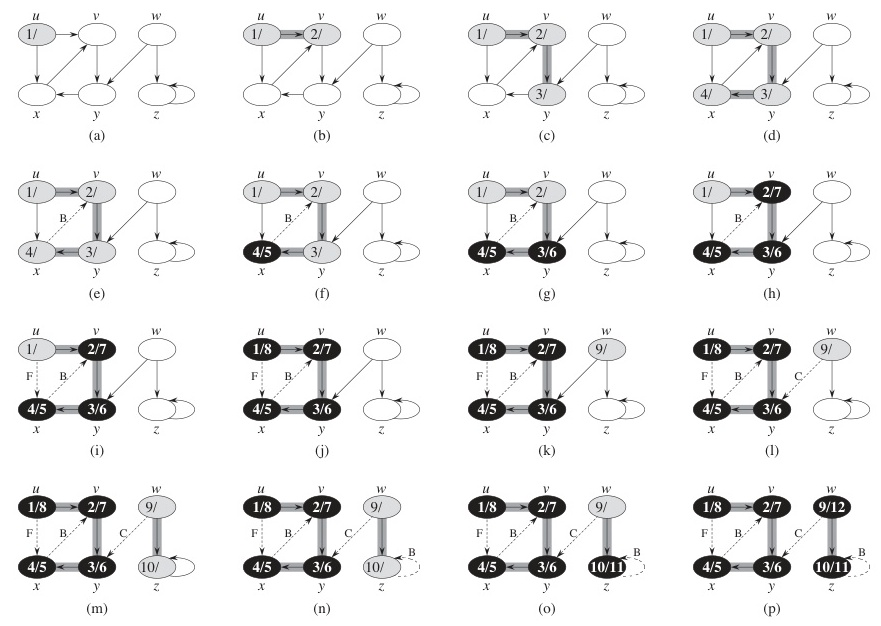
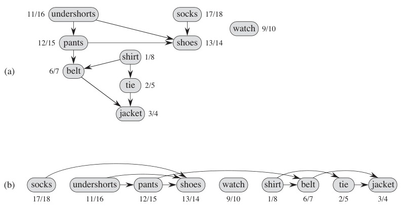

# Week 11 Lecture — Graph Algorithms I

[Repository Guide](../../README.md) | [English](Concepts_Lecture.md) | [한국어](Concepts_Lecture.ko.md)

> **Last Updated:** 2026-10-20
>
> Introduction to Algorithms, Cormen, Leiserson, Rivest, and Stein, Ch 21, 22, 23

> **Learning Objectives:**
> 1. Define a graph $G = (V, E)$, distinguish directed and undirected, weighted and unweighted variants, and compare **adjacency matrix**, **adjacency list**, and **adjacency array** representations on space and edge-lookup cost
> 2. Implement and trace **DFS** and **BFS**, and explain why both run in $O(V + E)$
> 3. State and justify that **BFS** finds shortest **hop-count** paths in unweighted graphs
> 4. Define a Directed Acyclic Graph (DAG) and produce a **topological order** by either the in-degree-zero method or DFS finish-time method
> 5. Define a **Minimum Spanning Tree (MST)**, prove that any MST has exactly $|V|-1$ edges, execute **Prim's** and **Kruskal's** algorithms, reason about the greedy choice that makes each correct, and analyze their running times
> 6. Choose the appropriate algorithm and representation given graph density and edge-list versus vertex-list access patterns

---

## Table of Contents

- [1. Graph Basics and Representations](#1-graph-basics-and-representations)
  - [1.1 What is a Graph?](#11-what-is-a-graph)
  - [1.2 Types of Graphs](#12-types-of-graphs)
  - [1.3 Adjacency Matrix](#13-adjacency-matrix)
  - [1.4 Adjacency Matrix: Directed and Weighted Examples](#14-adjacency-matrix-directed-and-weighted-examples)
  - [1.5 Adjacency Matrix: Analysis](#15-adjacency-matrix-analysis)
  - [1.6 Adjacency List](#16-adjacency-list)
  - [1.7 Adjacency List: Analysis](#17-adjacency-list-analysis)
  - [1.8 Adjacency Array](#18-adjacency-array)
  - [1.9 Representation Comparison](#19-representation-comparison)
- [2. Graph Traversal: BFS and DFS](#2-graph-traversal-bfs-and-dfs)
  - [2.1 Visiting All Vertices](#21-visiting-all-vertices)
  - [2.2 DFS: Algorithm](#22-dfs-algorithm)
  - [2.3 DFS: Step-by-Step Example](#23-dfs-step-by-step-example)
  - [2.4 DFS: Detailed Trace](#24-dfs-detailed-trace)
  - [2.5 BFS: Algorithm](#25-bfs-algorithm)
  - [2.6 BFS: Step-by-Step Example](#26-bfs-step-by-step-example)
  - [2.7 BFS Gives Shortest Hop-Count Paths](#27-bfs-gives-shortest-hop-count-paths)
  - [2.8 BFS vs DFS: Comparison](#28-bfs-vs-dfs-comparison)
- [3. Topological Sorting](#3-topological-sorting)
  - [3.1 Topological Sort: Definition](#31-topological-sort-definition)
  - [3.2 Algorithm 1: In-Degree Method](#32-algorithm-1-in-degree-method)
  - [3.3 Algorithm 2: DFS-Based Method](#33-algorithm-2-dfs-based-method)
  - [3.4 DFS Topological Sort: Example](#34-dfs-topological-sort-example)
- [4. Minimum Spanning Trees (MST)](#4-minimum-spanning-trees-mst)
  - [4.1 MST: Concept and Motivation](#41-mst-concept-and-motivation)
  - [4.2 Prim's Algorithm: Idea](#42-prims-algorithm-idea)
  - [4.3 Prim's Algorithm: Detailed Pseudocode](#43-prims-algorithm-detailed-pseudocode)
  - [4.4 Prim's Algorithm: Worked Example](#44-prims-algorithm-worked-example)
  - [4.5 Kruskal's Algorithm: Idea](#45-kruskals-algorithm-idea)
  - [4.6 Kruskal's Algorithm: Worked Example](#46-kruskals-algorithm-worked-example)
  - [4.7 Prim's vs Kruskal's](#47-prims-vs-kruskals)
- [Summary](#summary)
- [Self-Check Questions](#self-check-questions)

---

<br>

## 1. Graph Basics and Representations

### 1.1 What is a Graph?

A **graph** models relationships between objects using **vertices** and **edges**.

- A graph is written $G = (V, E)$.
  - $V$ is the set of **vertices** (nodes).
  - $E$ is the set of **edges** (connections).
- Two vertices connected by an edge are **adjacent**.

```text
     1 --- 2
     |   / |
     |  /  |
     | /   |
     3 --- 4
```

*Figure 1. Undirected graph with four vertices and five edges*

**Applications:** social networks, road maps, circuit design, web hyperlinks, build dependencies, task scheduling, biological pathways, and more.

> **Note:** **Why graphs are special.** Unlike arrays or trees, a graph has no built-in relation such as a next element or a parent. To talk about a graph algorithmically we first have to choose a *representation*, and that choice (matrix vs list) drives the complexity of everything that follows.

### 1.2 Types of Graphs

| Type | Description | Example |
|------|-------------|---------|
| **Undirected** | Edges have no direction | Friendship network |
| **Directed (Digraph)** | Edges have direction (arrows) | Web hyperlinks, prerequisites |
| **Weighted** | Edges carry numerical weights | Road distances, costs |
| **Unweighted** | All edges are equal | Simple connectivity |

*Table 1. Four types of graphs with examples*

```text
Undirected:          Directed:           Weighted:
  1 --- 2            1 --> 2             1 --5-- 2
  |     |            |     ^             |       |
  3 --- 4            v     |             3       7
                     3 --> 4             |       |
                                         3 --2-- 4
```

*Figure 2. Examples of undirected, directed, and weighted graphs*

### 1.3 Adjacency Matrix

Use an $N \times N$ matrix where $N = |V|$:

- Entry $(i, j)$ is **1** if the edge exists and **0** if not.
- For a **directed graph**, entry $(i, j)$ means an edge from $i$ to $j$, so the matrix is generally **asymmetric**.
- For a **weighted graph**, store the **weight** at $(i, j)$ instead of 1.



*Figure 3. Adjacency-list and adjacency-matrix representations of an undirected graph with five vertices*

```text
Graph:             Adjacency Matrix:
   1 --- 2              1  2  3  4
   |   / |          1 [ 0  1  1  0 ]
   |  /  |          2 [ 1  0  1  1 ]
   | /   |          3 [ 1  1  0  1 ]
   3 --- 4          4 [ 0  1  1  0 ]
```

*Figure 4. Undirected graph and its symmetric adjacency matrix*

### 1.4 Adjacency Matrix: Directed and Weighted Examples

In a **directed graph**, the matrix loses symmetry:

```text
Directed Graph:          Adjacency Matrix:
   1 --> 2                    1  2  3  4
   |     ^                1 [ 0  1  1  0 ]
   v     |                2 [ 0  0  0  0 ]
   3 --> 4                3 [ 0  0  0  1 ]
                          4 [ 0  1  0  0 ]
```

*Figure 5. Directed graph and its asymmetric adjacency matrix*

In a **weighted graph**, the matrix carries weights. Depending on convention, $0$ or $\infty$ marks a missing edge:

```text
Weighted Graph:          Adjacency Matrix:
   1 --5-- 2                  1   2   3   4
   |       |              1 [ 0   5   3   0 ]
   3       7              2 [ 5   0   0   7 ]
   |       |              3 [ 3   0   0   2 ]
   3 --2-- 4              4 [ 0   7   2   0 ]
```

*Figure 6. Weighted graph and its adjacency matrix of weights*

### 1.5 Adjacency Matrix: Analysis

**Advantages:**
- Easy to understand and implement.
- **$O(1)$** time to test whether edge $(i, j)$ exists.

**Disadvantages:**
- Always **$O(N^2)$** space, even when very few edges exist.
- Initialization alone takes $\Theta(N^2)$ time.
- Wasteful for **sparse** graphs.

**Example:** consider a graph with $10^6$ vertices and $2 \cdot 10^6$ edges.
- The matrix holds $10^{12}$ entries, but only $2 \cdot 10^6$ are non-zero (for a directed graph; an undirected graph has a symmetric matrix, so $4 \cdot 10^6$).

> **Note:** **Best for.** The adjacency matrix suits **dense** graphs where most vertex pairs are connected, because most matrix cells will be filled anyway.

### 1.6 Adjacency List

Use **$N$ linked lists**, one per vertex. The $i$-th list contains all vertices adjacent to vertex $i$. For weighted graphs, each list node also stores the edge weight.

```text
Graph:                Adjacency List:
   1 --- 2            1: [2] -> [3]
   |   / |            2: [1] -> [3] -> [4]
   |  /  |            3: [1] -> [2] -> [4]
   | /   |            4: [2] -> [3]
   3 --- 4
```

*Figure 7. Undirected graph and its adjacency list*

The **weighted version** stores `(neighbor, weight)` pairs:

```text
Weighted Graph:       Adjacency List (vertex, weight):
   1 --5-- 2          1: [(2,5)] -> [(3,3)]
   |       |          2: [(1,5)] -> [(4,7)]
   3       7          3: [(1,3)] -> [(4,2)]
   |       |          4: [(2,7)] -> [(3,2)]
   3 --2-- 4
```

*Figure 8. Adjacency list of a weighted graph*

### 1.7 Adjacency List: Analysis

**Advantages:**
- Space proportional to the number of edges: **$O(V + E)$**.
- No wasted slots, which is ideal when edges are few.
- Efficient when iterating over the neighbors of a vertex.

**Disadvantages:**
- Edge-existence query $(i, j)$ costs $O(\deg(i))$, not $O(1)$.
- Pointer chasing can hurt cache performance on very dense graphs.

> **Note:** **Best for.** The adjacency list suits **sparse** graphs where $E \ll V^2$, which describes most real-world graphs (social networks, road maps, web links).

### 1.8 Adjacency Array

Replace the linked lists with **arrays** for each vertex, or pack them all into one **contiguous array** plus an index table.

```text
Per-vertex arrays:        Packed array form:
   Vertex:  1    2    3    4
   Count:  [2]  [3]  [3]  [2]
                                A = [2,3 | 1,3,4 | 1,2,4 | 2,3]
   1: [2, 3]                    Index: [0, 2, 5, 8, 10]
   2: [1, 3, 4]
   3: [1, 2, 4]
   4: [2, 3]
```

*Figure 9. Adjacency array as per-vertex arrays and as a packed array*

Reading the packed form: the `Index` array is an **offset table**. Referring to vertices by 0-based position $i$ (vertex 1 is $i = 0$), the neighbor block at position $i$ occupies `A[Index[i] .. Index[i+1]-1]`. For example, the 2nd vertex sits at `A[Index[1]..Index[2]-1] = A[2..4] = [1, 3, 4]`. The block length `Count[i] = Index[i+1] - Index[i]` is exactly that vertex's degree, so `Index` and `Count` are two views of the same boundaries. `Index` carries one extra trailing entry so that the last vertex's block has a defined end; its value is $2|E| = 10$, because each undirected edge is stored once in the block of each endpoint.

**Advantages over linked-list adjacency:**
- No pointer overhead, which gives better cache behavior.
- If neighbors are sorted, edge-existence becomes **$O(\log \deg)$** by binary search.
- Standard layout for *static* graphs in performance-critical settings (graph databases, GPU work).

### 1.9 Representation Comparison

| | Adjacency Matrix | Adjacency List | Adjacency Array |
|---|------------------|----------------|-----------------|
| **Space** | $O(V^2)$ | $O(V + E)$ | $O(V + E)$ |
| **Edge lookup** | $O(1)$ | $O(\deg)$ | $O(\log \deg)$ |
| **Iterate neighbors** | $O(V)$ | $O(\deg)$ | $O(\deg)$ |
| **Add edge** | $O(1)$ | $O(1)$ | $O(\deg)$ (rebuild) |
| **Best for** | Dense graphs | Sparse graphs | Sparse, static graphs |

*Table 2. Operation costs and best uses of adjacency matrix, list, and array*

> **Key Point:** Most real-world graphs are sparse, so in practice **adjacency lists** (or arrays) are the default. The matrix wins only when $E$ approaches $V^2$ or when constant-time edge queries dominate the workload.

---

<br>

## 2. Graph Traversal: BFS and DFS

### 2.1 Visiting All Vertices

There are two fundamental ways to systematically visit every vertex:

| | **BFS** (Breadth-First Search) | **DFS** (Depth-First Search) |
|---|--------------------------------|------------------------------|
| **Strategy** | Visit level by level | Go as deep as possible first |
| **Data structure** | Queue (FIFO) | Stack / recursion (LIFO) |
| **Time complexity** | $O(V + E)$ | $O(V + E)$ |

*Table 3. Strategy, data structure, and time complexity of BFS and DFS*

```text
         1
        /|\
       2  3  4
      /|     |
     5  6    7

BFS from 1: 1 -> 2, 3, 4 -> 5, 6, 7
DFS from 1: 1 -> 2 -> 5 -> 6 -> 3 -> 4 -> 7
```

*Figure 10. BFS and DFS visiting orders on a tree*

> **Key Point:** BFS and DFS are the **foundation** of almost every graph algorithm. Connected components, cycle detection, topological sort, shortest hop paths, and SCC decomposition are all one of these two with a little extra bookkeeping.

### 2.2 DFS: Algorithm

```text
DFS(G)
    for each v in V
        visited[v] <- NO
    for each v in V
        if visited[v] = NO then aDFS(v)

aDFS(v)
    visited[v] <- YES                    ... (A)
    for each x in L(v)                   ... (B)
        if visited[x] = NO then aDFS(x)  ... (C)
```

- **(A)** Mark $v$ visited. Across all calls this happens $|V|$ times, giving **$O(V)$**.
- **(B)** Scan $v$'s adjacency list.
- **(C)** Recurse only if unvisited. Each edge is inspected at most twice (once from each endpoint in an undirected graph, once in a directed graph), so the total work across lines (B) and (C) is **$O(E)$**.

**Total time: $O(V + E)$.**

> **Note:** **Why linear in $V+E$ is the right yardstick.** Any algorithm that touches all vertices and edges at least once must pay $\Omega(V + E)$. DFS hits this lower bound, so it is asymptotically optimal for looking at every vertex.

### 2.3 DFS: Step-by-Step Example



*Figure 11. DFS progress on a directed graph with discovery and finish times*

```text
Graph:                    Adjacency Lists:
     2                    1: [2, 3, 4, 6]
    / \                   2: [1, 3]
   1---3                  3: [1, 2, 5]
   |\   \                 4: [1, 6]
   | 6---5                5: [3, 6]
   |/                     6: [1, 4, 5]
   4
```

*Figure 12. Example graph and adjacency lists for DFS*

```text
DFS starting from vertex 1:
Step 1: Visit 1, go to neighbor 2
Step 2: Visit 2, go to neighbor 3
Step 3: Visit 3, go to neighbor 5
Step 4: Visit 5, go to neighbor 6
Step 5: Visit 6, go to neighbor 4
Step 6: Visit 4, backtrack

Traversal: 1 → 2 → 3 → 5 → 6 → 4
```

### 2.4 DFS: Detailed Trace

```text
Call stack trace:

aDFS(1)                     visited: {1}
  aDFS(2)                   visited: {1,2}
    aDFS(3)                 visited: {1,2,3}
      aDFS(5)               visited: {1,2,3,5}
        aDFS(6)             visited: {1,2,3,5,6}
          aDFS(4)           visited: {1,2,3,5,6,4}
            neighbors: 1(visited), 6(visited)
            -> return
          -> return
        -> return
      -> return
    -> return
  -> return
```

Each vertex is visited **exactly once**, and each edge is examined **at most twice**.

### 2.5 BFS: Algorithm

```text
BFS(G, s)
    for each v in V - {s}
        visited[v] <- NO
    visited[s] <- YES
    enqueue(Q, s)                       ... (A)
    while Q is not empty
        u <- dequeue(Q)                 ... (A)
        for each v in L(u)              ... (B)
            if visited[v] = NO then
                visited[v] <- YES
                enqueue(Q, v)
```

- **(A)** Each vertex enters and leaves the queue at most once, giving **$O(V)$**.
- **(B)** Each adjacency list is scanned at most once, giving **$O(E)$**.

**Total time: $O(V + E)$.**

### 2.6 BFS: Step-by-Step Example

```text
Graph:                    Adjacency Lists:
     2                    1: [2, 3, 4, 6]
    / \                   2: [1, 3]
   1---3                  3: [1, 2, 5]
   |\   \                 4: [1, 6]
   | 6---5                5: [3, 6]
   |/                     6: [1, 4, 5]
   4
```

*Figure 13. Example graph and adjacency lists for BFS*

```text
BFS starting from vertex 1:

Step 1: Dequeue 1.  Visit neighbors: 2, 3, 4, 6
        Queue: [2, 3, 4, 6]       Level 0: {1}

Step 2: Dequeue 2.  Neighbor 1 (visited), 3 (visited) → skip
        Queue: [3, 4, 6]          Level 1: {2, 3, 4, 6}

Step 3: Dequeue 3.  Neighbor 5 not visited → enqueue
        Queue: [4, 6, 5]

Step 4: Dequeue 4.  All neighbors visited → skip
        Queue: [6, 5]

Step 5: Dequeue 6.  All neighbors visited → skip
        Queue: [5]

Step 6: Dequeue 5.  All neighbors visited → skip
        Queue: []                 Level 2: {5}

Traversal order: 1 → 2 → 3 → 4 → 6 → 5
```

### 2.7 BFS Gives Shortest Hop-Count Paths

Starting from vertex 1, BFS naturally discovers vertices **level by level**:

```text
Level 0: {1}           ← 0 hops from source
Level 1: {2, 3, 4, 6}  ← 1 hop from source
Level 2: {5}           ← 2 hops from source
```

> **Key Point:** In an **unweighted** graph, BFS finds the **shortest path** (minimum number of edges) from the source to every reachable vertex.

**Proof sketch:** by induction on the level $\ell$. The first time we discover a vertex $v$, the parent is at level $\ell - 1$, and a shorter path would imply $v$ had been reached earlier, which is a contradiction. The FIFO discipline of the queue is exactly what forces level $\ell - 1$ to be processed before level $\ell$.

This shortest-path property does **not** generalize to weighted graphs. With non-negative weights, Dijkstra's algorithm (Week 5, Week 12) is needed.

### 2.8 BFS vs DFS: Comparison

| Property | BFS | DFS |
|----------|-----|-----|
| **Data structure** | Queue (FIFO) | Stack / Recursion (LIFO) |
| **Order** | Level by level | As deep as possible |
| **Shortest path** | Yes (unweighted) | No |
| **Memory** | $O(V)$ for the queue (worst-case width) | $O(V)$ for the recursion stack (worst-case depth) |
| **Time** | $O(V + E)$ | $O(V + E)$ |
| **Common uses** | Shortest hop path, level-order processing, web crawling within hop bound | Topological sort, cycle detection, SCC (Tarjan/Kosaraju), maze solving |

*Table 4. Comparison of BFS and DFS properties*

Both have the same asymptotic time, but they explore the graph in fundamentally different orders.

---

<br>

## 3. Topological Sorting

### 3.1 Topological Sort: Definition

**Precondition:** the graph must be a Directed Acyclic Graph (DAG), that is, it has no directed cycles.

**Definition:** arrange all vertices in a linear order such that for every directed edge $(x, y)$, vertex $x$ appears **before** vertex $y$.

- Multiple valid orderings may exist for the same DAG.
- A graph admits a topological order **if and only if** it is a DAG.

```text
DAG:
   A --> B --> D
   |          ^
   v         /
   C -------

Topological orders:
   A, B, C, D    (valid)
   A, C, B, D    (valid)
```

*Figure 14. DAG and two valid topological orders*

> **Note:** **Use cases.** Topological sorting is used for course prerequisites, build systems (e.g., `make`, `ninja`), package managers, recipe steps, and spreadsheet recomputation order.

### 3.2 Algorithm 1: In-Degree Method

```text
topologicalSort1(G)
    for i ← 1 to n
        Select a vertex u with no incoming edges (in-degree = 0)
        A[i] ← u
        Remove vertex u and all its outgoing edges from the graph
    // A[1..n] now contains the topological order
```

**Why it works:** if a vertex has in-degree 0, no other vertex must come before it, so it is safe to place next. Removing it can only *reduce* other in-degrees, and the remaining graph is still a DAG, so a vertex with in-degree 0 exists at the next step as well.

**Implementation tip:** keep an `in_degree[]` array and a queue of zero-in-degree vertices; the algorithm becomes BFS-like and runs in **$O(V + E)$**. This implementation is sometimes called Kahn's algorithm.

```text
Example (instant-ramen recipe):

Step (a): "Open packet" has in-degree 0 → select, remove its edges
Step (b): "Boil water" has in-degree 0 → select, remove edges
Step (c): "Add noodles" has in-degree 0 → select, remove edges
   …continue until all vertices are placed
```

### 3.3 Algorithm 2: DFS-Based Method

```text
topologicalSort2(G)
    for each v in V
        visited[v] ← NO
    for each v in V
        if visited[v] = NO then DFS-TS(v)

DFS-TS(v)
    visited[v] ← YES
    for each x in L(v)
        if visited[x] = NO then DFS-TS(x)
    Insert v at the FRONT of linked list R    // after visiting all children
```

- When DFS finishes a vertex (all descendants done), **prepend** it to the result list $R$.
- After the algorithm completes, $R$ is a topological order.

**Time complexity: $O(V + E)$** (same as DFS).

> **Note:** **Why prepend on finish.** In a DAG, a vertex is done only when every descendant it can reach is already in $R$. Putting the just-finished vertex at the front guarantees that it precedes everything reachable from it, which is exactly the topological-order requirement.

### 3.4 DFS Topological Sort: Example



*Figure 15. DFS discovery and finish times on the getting-dressed DAG and the resulting topological order*

```text
DAG:
   A --> B --> D
   |          ^
   v         /
   C -------

DFS-TS from A (assume adjacency order L(A) = [B, C], so B is explored before C):
   Visit A → Visit B → Visit D
     D done  → R = [D]
     B done  → R = [B, D]
   Visit C
     D already visited, C done → R = [C, B, D]
   A done    → R = [A, C, B, D]

Result: A → C → B → D ✓
```

*Figure 16. Trace of DFS-based topological sorting on a DAG*

> **Key Point:** A vertex is added to the front **only after** every vertex reachable from it has already been recorded.

---

<br>

## 4. Minimum Spanning Trees (MST)

### 4.1 MST: Concept and Motivation

**Preconditions:**
- The graph must be **connected**: a path exists between every pair of vertices.
- Edges are **undirected** and **weighted**.

**Tree:**
- A tree is a connected graph with **no cycles**.
- A tree on $n$ vertices has **exactly $n - 1$ edges**.

> **[Discrete Mathematics]** By the basic properties of trees proved by induction in Discrete Mathematics, a connected graph on $n$ vertices has no cycle if and only if it has exactly $n - 1$ edges, and adding one edge to a tree creates exactly one cycle. The first property is why every MST has $|V| - 1$ edges, and the second underlies the exchange argument in the cut-property proof of Self-Check Question 7.

**Spanning tree of $G$:**
- A spanning tree is a subgraph that is a tree and contains **every** vertex of $G$, using only edges of $G$.

**Minimum Spanning Tree (MST):**
- An MST is a spanning tree with the **minimum total edge weight** among all spanning trees of $G$.

```text
Problem: connect all cities with minimum road cost.

   Cities (vertices):       Goal: connect all cities using
     A --5-- B                    the FEWEST, CHEAPEST roads
     |\ /|                  
     | X  |                  MST = pick n-1 edges with minimum
     |/ \|                         total weight that keep
     C --3-- D                     the graph connected
```

*Figure 17. MST problem of connecting all cities with minimum road cost*

> **Note:** **Surprising fact.** MST is one of the few optimization problems where a **greedy** algorithm is provably optimal. The greedy choice is justified by the **cut property**: for any partition of $V$ into $(S, V \setminus S)$, the minimum-weight edge crossing the cut belongs to *some* MST. Prim's and Kruskal's are two different ways to apply this property.

### 4.2 Prim's Algorithm: Idea

**Strategy:** grow the MST one vertex at a time, starting from a single root.

```text
Prim(G, r)
    S ← empty set
    Mark vertex r as visited; add r to S
    while S ≠ V
        Find the minimum-weight edge (x, y) connecting S to V - S   (x ∈ S, y ∈ V - S)
        Mark y as visited; add y to S
```

- At each step, pick the **cheapest edge crossing the cut** $(S, V \setminus S)$. This is the classic greedy move.
- Using a binary heap to extract the minimum gives **$O(E \log V)$**.
- Using a Fibonacci heap gives $O(E + V \log V)$, which is better for dense graphs in theory.

### 4.3 Prim's Algorithm: Detailed Pseudocode

```text
Prim(G, r)                            // G = (V, E), r = start vertex
    S ← empty
    for each u in V
        d[u] ← ∞                      // (1) initialize distances
    d[r] ← 0                          // (2) start vertex has distance 0
    while S ≠ V                       // (3) iterate |V| times
        u ← extractMin(V - S, d)      // (4) closest fringe vertex
        S ← S ∪ {u}                   // (5) add to MST set
        for each v in L(u)            // (6) relax neighbors
            if v in V - S and w(u, v) < d[v] then
                d[v] ← w(u, v)        // (7) update best connection
                tree[v] ← u           // remember parent in MST
```

- A **fringe vertex** is one *not yet in the tree* ($v \in V - S$) but adjacent to some vertex already in $S$, that is, a candidate sitting on the boundary of the growing MST, with a finite $d[v]$.
- **extractMin** uses a heap, so each extraction costs $O(\log V)$, and $V$ extractions total cost $O(V \log V)$.
- **Relaxation** at step (7) of the pseudocode updates $d[v]$ if a cheaper edge from $S$ to $v$ is found. Each edge contributes at most one **decrease-key**, so across all neighbors over all iterations this costs $O(E \log V)$. A decrease-key is the priority-queue operation that lowers a key already stored in the heap, costing $O(\log V)$.
- **Total: $O(E \log V)$.**

> **Note:** **Array variant.** If `extractMin` is a plain linear scan of $d[]$ over the unvisited vertices (no heap), each of the $V$ extractions costs $O(V)$, giving **$O(V^2)$** overall. This is *faster* than the heap version on **dense** graphs (where $E$ approaches $V^2$), since $V^2 \leq E \log V$ there. Self-Check Question 10 covers this trade-off.

### 4.4 Prim's Algorithm: Worked Example

```text
Weighted Graph:
        A --8-- B
       / \     / \
      3   5   9   7
     /     \ /     \
    C --2-- D --6-- E
     \_____________/
            4

Edges: (A,B,8) (A,C,3) (A,D,5) (B,D,9) (B,E,7) (C,D,2) (C,E,4) (D,E,6)
```

*Figure 18. Weighted graph for the Prim's algorithm example*

**Execution trace (start at A):**

```text
Step 0: S={A}     d: A=0, B=∞, C=∞, D=∞, E=∞
        Relax from A: d[B]=8, d[C]=3, d[D]=5

Step 1: extractMin → C (d=3).  S={A, C}
        Relax from C: d[D] = min(5,2) = 2,  d[E] = 4
        MST edge: A-C  (weight 3)

Step 2: extractMin → D (d=2).  S={A, C, D}
        Relax from D: d[B] = min(8,9) = 8 (no change),  d[E] = min(4,6) = 4 (no change)
        MST edge: C-D  (weight 2)

Step 3: extractMin → E (d=4).  S={A, C, D, E}
        Relax from E: d[B] = min(8,7) = 7
        MST edge: C-E  (weight 4)

Step 4: extractMin → B (d=7).  S={A, C, D, E, B}
        MST edge: E-B  (weight 7)

MST total weight: 3 + 2 + 4 + 7 = 16
```

**Resulting MST:**

```text
   MST (weight = 16):
     A         B
     |         |
     |3        |7
     |         |
     C         |
     |\        |
     | \2      |
     |  D      |
     |         |
    4|         |
     |         |
     E---------+

MST edges: A-C(3), C-D(2), C-E(4), E-B(7)
```

*Figure 19. MST produced by Prim's algorithm*

### 4.5 Kruskal's Algorithm: Idea

**Strategy:** sort all edges by weight. Greedily add the next cheapest edge unless it would form a cycle.

```text
Kruskal(G)
    T ← empty set                       // MST edges
    Create n singleton sets (one per vertex)
    Sort all edges Q by weight (ascending)
    while |T| < n - 1
        Remove minimum-weight edge (u, v) from Q
        if u and v are in DIFFERENT sets then
            Union the two sets
            T ← T ∪ {(u, v)}
```

- **Cycle detection** uses the **Union-Find (Disjoint Set)** data structure.
  - `Find(x)` returns the component that $x$ belongs to. With path compression and union-by-rank together, it takes $O(\alpha(V))$ amortized time.
  - `Union(x, y)` merges two components, also in $O(\alpha(V))$ amortized time under the same conditions.
- Edge sorting takes $O(E \log E) = O(E \log V)$ (since $E \leq V^2$).

**Total time: $O(E \log V)$.**

> **Note:** **Union-Find primer.** Maintain each component as a tree of parent pointers; `Find` walks to the root, and `Union` links one root under the other. Path compression flattens trees during `Find`; union-by-rank attaches the shorter tree under the taller. Together they make the amortized cost per operation the inverse Ackermann function $\alpha(V)$, so the total time is near-linear, and $\alpha(V) \leq 4$ for any conceivable $V$.

### 4.6 Kruskal's Algorithm: Worked Example

```text
Edges sorted by weight:
   (C,D,2), (A,C,3), (C,E,4), (A,D,5), (D,E,6), (B,E,7), (A,B,8), (B,D,9)

Initial sets: {A}, {B}, {C}, {D}, {E}
```

```text
Step 1: Edge (C,D,2), C and D in different sets → ADD
        Sets: {A}, {B}, {C,D}, {E}        T = {(C,D)}

Step 2: Edge (A,C,3), A and C in different sets → ADD
        Sets: {A,C,D}, {B}, {E}           T = {(C,D),(A,C)}

Step 3: Edge (C,E,4), C and E in different sets → ADD
        Sets: {A,C,D,E}, {B}              T = {(C,D),(A,C),(C,E)}

Step 4: Edge (A,D,5), A and D in SAME set → SKIP (would form a cycle)

Step 5: Edge (D,E,6), D and E in SAME set → SKIP

Step 6: Edge (B,E,7), B and E in different sets → ADD
        Sets: {A,B,C,D,E}                 T = {(C,D),(A,C),(C,E),(B,E)}
        |T| = 4 = n-1 → DONE

MST total weight: 2 + 3 + 4 + 7 = 16
```

```text
MST (weight = 16):
   A         B
   |         |
  3|        7|
   |         |
   C---------E
   |       4
  2|
   |
   D
```

*Figure 20. MST produced by Kruskal's algorithm*

The MST is the **same** as Prim's result. When the MST is unique, both algorithms agree edge by edge; when edge weights tie, the two may produce *different but equally optimal* MSTs.

### 4.7 Prim's vs Kruskal's

| | Prim's | Kruskal's |
|---|--------|-----------|
| **Strategy** | Grow MST from one vertex | Pick cheapest edge globally |
| **Data structure** | Priority queue (heap) | Union-Find + sorted edges |
| **Time** | $O(E \log V)$ | $O(E \log V)$ |
| **Better when** | Dense graphs ($E$ close to $V^2$) | Sparse graphs ($E$ close to $V$) |
| **Approach** | Vertex-centric (extend the cut) | Edge-centric (scan global edge list) |
| **Parallelism** | Hard to parallelize | Sorting phase parallelizes easily |

*Table 5. Comparison of Prim's and Kruskal's algorithms*

Both are **greedy** algorithms that produce a **provably optimal** MST.

> **Note:** **Week 5 callback.** Greedy algorithms are *correct* exactly when the greedy-choice property holds. For MST, the cut property *is* that justification, and MST is one of the rare optimization settings where the greedy heuristic happens to be a theorem.

Shortest-path algorithms (Dijkstra, Bellman-Ford, Floyd-Warshall) are covered in Week 12.

---

<br>

## Summary

| Concept | Key Summary |
|---------|-------------|
| Graph | A graph $G = (V, E)$ is how relationships become computable: it models relationships with vertices and edges and is directed or undirected, weighted or unweighted. |
| Adjacency matrix | It uses $O(V^2)$ space with $O(1)$ edge lookup and is best for dense graphs. |
| Adjacency list | It uses $O(V + E)$ space with $O(\deg)$ edge lookup and is best for sparse graphs. |
| Choice of representation | The representation decides the cost, so use a matrix for dense graphs and a list or array for sparse graphs. |
| DFS | It goes as deep as possible first using recursion or a stack and runs in $O(V + E)$. |
| BFS | It explores level by level using a queue and finds shortest hop-count paths in unweighted graphs in $O(V + E)$, making it the cheapest shortest-path algorithm. |
| Choosing DFS or BFS | Both run in $O(V + E)$ but differ in order of discovery, so pick by what you need (depth or level). |
| Topological sort | It exists only for a DAG and is computed in $O(V + E)$ by the in-degree method or the DFS-finish method. |
| Prim's MST | It grows the MST from a vertex using extractMin with a heap and runs in $O(E \log V)$. |
| Kruskal's MST | It sorts edges and avoids cycles with Union-Find, running in $O(E \log V)$. |
| Greedy optimality of MST | Prim's and Kruskal's are both justified by the cut property; they differ in which cut they look at. |
| Prim's vs Kruskal's | They have the same complexity but different bias: Prim's likes density and Kruskal's likes sparsity. |

---

<br>

## Self-Check Questions

1. **Representation choice:** For a road network of $10^7$ intersections with average degree 4, which representation should you use and why? Estimate the space requirement for each.

   <details>
   <summary>Answer</summary>

   The graph has about $E \approx V \cdot \bar{d}/2 = 10^7 \cdot 4 / 2 = 2 \cdot 10^7$ edges, so it is **sparse** ($E \ll V^2$). An **adjacency matrix** needs $V^2 = 10^{14}$ entries, about 100 TB at one byte per entry, and is infeasible. An **adjacency list or array** needs $O(V + E)$ entries; even storing each undirected edge once at each endpoint, it needs only $V + 2E = 5 \cdot 10^7$ entries, about 400 MB at 8 bytes per entry, which fits easily in memory. Choose an adjacency list, or a packed adjacency array for better cache locality. Road networks are a typical sparse graph.

   </details>

2. **DFS vs BFS traces:** Given the graph from Section 2.3, run BFS and DFS starting at vertex 6. Report the visitation order for both.

   <details>
   <summary>Answer</summary>

   Adjacency lists from Section 2.3: 1:[2,3,4,6], 2:[1,3], 3:[1,2,5], 4:[1,6], 5:[3,6], 6:[1,4,5]. **BFS from 6:** the queue starts with 6. Dequeue 6 and enqueue 1, 4, 5; dequeue 1 and enqueue 2, 3. When 4 and 5 are dequeued, all their neighbors are already visited; then dequeue 2 and 3. Order: **6 → 1 → 4 → 5 → 2 → 3**. **DFS from 6:** visit 6, then recurse into 1, 2, 3, 5 in turn (5's neighbors 3 and 6 are already visited). Backtrack to 1 and visit 4. Order: **6 → 1 → 2 → 3 → 5 → 4**.

   </details>

3. **BFS shortest path proof:** Prove that when BFS first dequeues vertex $v$, the recorded distance $d[v]$ equals the shortest hop distance from $s$ to $v$. Where exactly does the FIFO discipline enter the argument?

   <details>
   <summary>Answer</summary>

   Induct on $d[v]$. **Base case:** $d[s] = 0$ is trivially the shortest. **Inductive step:** suppose all vertices at true distance $< \ell$ have been dequeued with the correct $d$-value. When BFS dequeues $u$ at distance $\ell - 1$ and visits neighbor $v$ for the first time, it sets $d[v] = \ell$. Suppose for contradiction that $v$ had a shorter true distance $\ell' < \ell$; then $v$'s actual BFS parent would have been at distance $\ell' - 1 < \ell - 1$ and would already have been dequeued before $u$, contradicting the assumption that $v$ was first discovered from $u$. The **FIFO discipline** is essential here: it guarantees that all vertices at distance $\ell - 1$ are dequeued *before* any at distance $\ell$, so no shorter path can sneak in late.

   </details>

4. **DFS on a directed graph:** Apply DFS to the directed graph with edges $\{(A,B), (B,C), (C,A), (A,D)\}$ starting at $A$. Identify the back edge. What does its presence imply about the graph?

   <details>
   <summary>Answer</summary>

   DFS from A enters A, B, and C in turn, and C's neighbor A is **on the DFS stack** (still in progress, not yet finished), so $(C, A)$ is a **back edge**. After C returns and B returns, A visits D. The back edge implies the directed graph contains a **cycle** $A \to B \to C \to A$. In general, a directed graph has a cycle **if and only if** DFS encounters at least one back edge. This is the basis of DFS-based cycle detection, and because this graph is **not a DAG**, no topological order exists.

   </details>

5. **Topological sort:** Apply both topological-sort algorithms to the DAG with edges $\{(1,2), (1,3), (3,4), (2,4), (4,5)\}$. Show that every valid topological order respects all edge constraints.

   <details>
   <summary>Answer</summary>

   **In-degree method:** the initial in-degrees are 1:0, 2:1, 3:1, 4:2, 5:1. Picking 1 makes 2:0 and 3:0. Picking 2 makes 4:1, picking 3 makes 4:0, picking 4 makes 5:0, and finally 5 is picked. Order: **1, 2, 3, 4, 5**. **DFS method:** from 1, go down 1 → 2 → 4 → 5. When 5 finishes and is prepended, R=[5]; when 4 finishes, R=[4,5]; when 2 finishes, R=[2,4,5]. Visiting 3 finds 4 already done, so 3 finishes with R=[3,2,4,5], and 1 finishes with R=[**1,3,2,4,5**]. Both orders are valid because for each edge $(x,y)$, $x$ precedes $y$. For example, 1 comes before 2 and 3, 2 before 4, 3 before 4, and 4 before 5.

   </details>

6. **Topological sort vs cycles:** Run the in-degree algorithm on a graph that secretly contains a cycle. What goes wrong? How can you *detect* the cycle from the algorithm's failure mode?

   <details>
   <summary>Answer</summary>

   Every vertex in a cycle has **at least one incoming edge from another cycle member**, so its in-degree can never reach 0 just by removing non-cycle vertices. The algorithm processes the vertices reachable from in-degree-0 sources and then **halts with cycle vertices still unplaced**. **Detection rule:** after the algorithm terminates, if `|placed vertices| < |V|`, the remaining vertices form a **cycle** or feed into one. This is the standard linear-time DAG check, and Kahn's algorithm doubles as both topological sort and cycle detection in $O(V+E)$.

   </details>

7. **MST cut property:** State and prove the cut property: for any cut $(S, V \setminus S)$, the minimum-weight edge crossing the cut belongs to *some* MST. Why is the qualifier "some" important when edge weights tie?

   <details>
   <summary>Answer</summary>

   **Cut property:** let $(S, V \setminus S)$ be any non-trivial cut and let $e = (u, v)$ be a minimum-weight edge with $u \in S$, $v \in V \setminus S$. **Proof (exchange argument):** take any MST $T$. If $e \in T$, the proof is done. Otherwise, adding $e$ to $T$ creates a cycle, and this cycle must contain some other edge $e'$ crossing the same cut. Since $w(e) \leq w(e')$, swapping $e'$ for $e$ produces a new spanning tree $T' = T \cup \{e\} \setminus \{e'\}$ with $w(T') \leq w(T)$, so $T'$ is also an MST, and it contains $e$. The qualifier "**some**" matters when edge weights tie: if multiple edges cross the cut at the same minimum weight, **different MSTs may include different ones**. Prim's and Kruskal's might produce distinct MSTs, both of which are optimal.

   </details>

8. **Prim's vs Kruskal's:** On the graph of Section 4.4, run Kruskal's from scratch and compare the edges selected at each step with Prim's. Where do the two algorithms make *different* choices, and do they still produce the same MST?

   <details>
   <summary>Answer</summary>

   **Kruskal's order** (by weight): pick (C,D,2), (A,C,3), (C,E,4), skip (A,D,5) (cycle), skip (D,E,6) (cycle), and pick (B,E,7). MST = {(C,D), (A,C), (C,E), (B,E)} with weight 16. **Prim's from A** picks (A,C,3), (C,D,2), (C,E,4), (E,B,7). The **selected edges are identical**, and only the **order of selection differs**: Prim's picks (A,C) first because it extends from A, while Kruskal's picks (C,D) first because it has the lowest weight globally. The MST is unique here (no tied weights), so both algorithms reach the same tree.

   </details>

9. **Union-Find:** Trace `Find` and `Union` operations during Kruskal's on the Section 4.6 example using union-by-rank with path compression. Draw the parent-pointer forest after each step.

   <details>
   <summary>Answer</summary>

   Initially each vertex is its own root and all ranks are 0. (1) **(C,D,2)**: `Find(C)=C` and `Find(D)=D`; the ranks tie, so make D's parent C and set rank(C)=1. Forest: {A}, {B}, {C←D}, {E}. (2) **(A,C,3)**: `Find(A)=A` (rank 0) and `Find(C)=C` (rank 1), so attach A under C. Forest: {C←D, A}, {B}, {E}. (3) **(C,E,4)**: `Find(C)=C` and `Find(E)=E`, so attach E under C. Forest: {C←D, A, E}, {B}. (4) **(A,D,5)**: `Find(A)` follows A→C to the root (A's parent is already the root C, so path compression changes nothing). `Find(D)` also follows D→C. Same root, so **skip**. (5) **(D,E,6)**: both point to C, so skip. (6) **(B,E,7)**: `Find(B)=B` (rank 0) and `Find(E)=C` (rank 1), so attach B under C. Final forest: a single tree rooted at C with children A, B, D, E.

   </details>

10. **Density-based choice:** For a graph with $V = 1000$ and $E = 999$ (almost a tree) vs $V = 1000$ and $E = 400{,}000$ (dense), which MST algorithm would you prefer in each case, and why?

    <details>
    <summary>Answer</summary>

    **Sparse case ($E = 999$): Kruskal's.** With $E \approx V$, sorting $E$ edges costs $O(E \log E) \approx 10^4$ comparisons and Union-Find adds a near-constant factor. It is very fast in practice, and its sorting phase parallelizes easily. **Dense case ($E = 400{,}000$, $E \approx V^2/2.5$): Prim's (array implementation).** Prim's $O(V^2)$ array implementation beats Kruskal's $O(E \log V) \approx 4 \cdot 10^5 \cdot 10 = 4 \cdot 10^6$ on dense graphs because Prim's performs only $V = 1000$ extractions. With a Fibonacci heap, Prim's reaches $O(E + V \log V)$, which is asymptotically optimal for dense graphs.

    </details>
