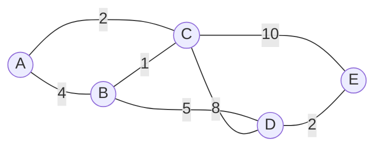
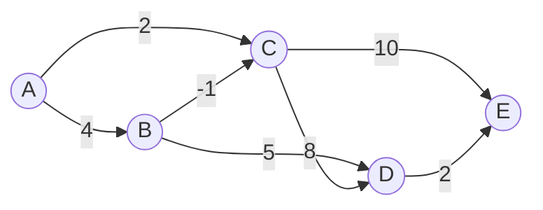
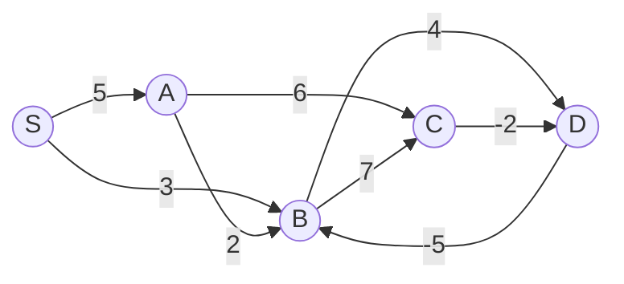
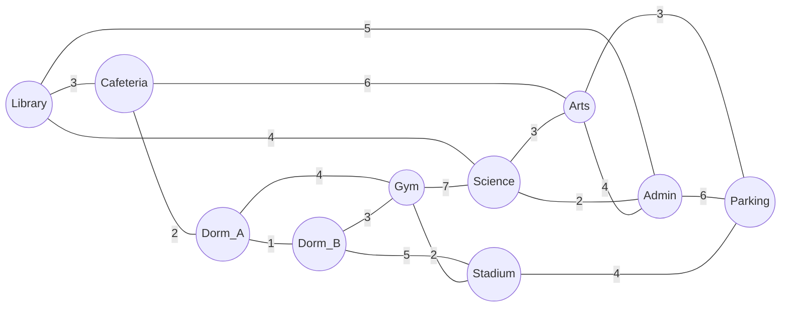

# 12주차 실습 — 최단 경로와 응용

[레포지토리 안내](../../README.ko.md) | [English](Concepts_Lab.md) | [한국어](Concepts_Lab.ko.md)

> **최종 수정일:** 2026-11-18

> **학습 목표:**
> 1. 최소 힙을 쓰는 Dijkstra 알고리즘을 구현하고 힙에서 낡은 항목을 건너뛰는 이유를 설명할 수 있다
> 2. 선행자 딕셔너리로 시작 정점에서 임의의 목표 정점까지의 최단 경로를 복원할 수 있다
> 3. Bellman-Ford 알고리즘을 구현하고 음수 사이클을 탐지할 수 있다
> 4. Dijkstra 알고리즘이 음수 가중치를 다루지 못하는 이유를 반례로 설명할 수 있다
> 5. Dijkstra 알고리즘과 Bellman-Ford 알고리즘을 비교하고 캠퍼스 지도의 경로 찾기에 적용할 수 있다

---

## 목차

- [1. 개요](#1-개요)
  - [1.1 실습 목표](#11-실습-목표)
  - [1.2 실습 구성](#12-실습-구성)
  - [1.3 실행 환경](#13-실행-환경)
- [2. 연습 1: Dijkstra 알고리즘](#2-연습-1-dijkstra-알고리즘)
  - [2.1 문제](#21-문제)
  - [2.2 풀이 코드](#22-풀이-코드)
  - [2.3 힙의 변화 추적](#23-힙의-변화-추적)
  - [2.4 실행 결과와 경로 복원](#24-실행-결과와-경로-복원)
- [3. 연습 2: Bellman-Ford 알고리즘](#3-연습-2-bellman-ford-알고리즘)
  - [3.1 문제](#31-문제)
  - [3.2 풀이 코드](#32-풀이-코드)
  - [3.3 패스별 추적](#33-패스별-추적)
  - [3.4 음수 사이클 탐지](#34-음수-사이클-탐지)
- [4. Dijkstra 알고리즘과 음수 가중치](#4-dijkstra-알고리즘과-음수-가중치)
  - [4.1 꺼낸 정점을 확정하는 구현](#41-꺼낸-정점을-확정하는-구현)
  - [4.2 다시 넣는 구현의 동작](#42-다시-넣는-구현의-동작)
- [5. Dijkstra와 Bellman-Ford의 비교](#5-dijkstra와-bellman-ford의-비교)
- [6. 최단 경로의 응용](#6-최단-경로의-응용)
  - [6.1 최단 경로 기반 기능](#61-최단-경로-기반-기능)
  - [6.2 캠퍼스 경로 찾기](#62-캠퍼스-경로-찾기)
- [요약](#요약)
- [점검 문제](#점검-문제)

---

<br>

## 1. 개요

> **참고:** 최단 경로의 최적 부분 구조, 이완, Dijkstra와 Bellman-Ford의 정당성은 [12주차 이론](Concepts_Lecture.ko.md)에서 다룬다. 이 실습은 두 알고리즘을 Python으로 구현하고, 음수 가중치에서 두 알고리즘의 동작 차이를 관찰한다.

### 1.1 실습 목표

- 우선순위 큐(최소 힙)를 쓰는 **Dijkstra 알고리즘**으로 가중치 그래프의 단일 시작점 최단 경로를 구한다.
- 음수 가중치 간선을 허용하는 **Bellman-Ford 알고리즘**을 구현하고 음수 사이클을 탐지한다.
- Dijkstra 알고리즘이 음수 가중치를 다루지 못하는 이유를 반례로 확인한다.
- 최단 경로 알고리즘으로 캠퍼스 지도의 경로 찾기 기능을 만든다.

### 1.2 실습 구성

| 구분 | 주제 |
|:-----|:-----|
| **연습 1** | Dijkstra 알고리즘, 최단 경로 복원 |
| **연습 2** | Bellman-Ford 알고리즘, 음수 사이클 탐지 |
| **비교** | 음수 가중치에서의 Dijkstra 알고리즘, Dijkstra와 Bellman-Ford의 비교 |
| **응용** | 최단 경로 기반 기능, 캠퍼스 경로 찾기 |

*표 1. 실습 구성과 주제*

### 1.3 실행 환경

모든 코드는 Python 3의 표준 라이브러리만 사용하며, 최소 힙은 `heapq` 모듈로 구현한다. 가중치 그래프는 정점을 키로, `(이웃 정점, 가중치)` 튜플의 리스트를 값으로 하는 딕셔너리로 표현한다. 두 알고리즘의 진행을 그림으로 보여 주는 참조 웹 애플리케이션(최단 경로 탐색기)은 FastAPI와 uvicorn으로 실행하며, 그 음수 사이클 예제와 캠퍼스 지도는 3.4절과 6.2절에서 코드로 다룬다.

---

<br>

## 2. 연습 1: Dijkstra 알고리즘

### 2.1 문제

**목표:** 가중치 그래프에서 시작 정점으로부터 각 정점까지의 최단 경로를 구하는 **Dijkstra 알고리즘**을 구현한다.



*그림 1. Dijkstra 알고리즘에 쓰는 정점 5개의 무방향 가중치 그래프*

**요구 사항:**

- 효율을 위해 최소 힙(우선순위 큐)을 사용한다.
- 최단 거리와 선행자(predecessor) 딕셔너리를 돌려준다.
- 선행자 딕셔너리로 임의의 목표 정점까지의 최단 경로를 복원한다.

### 2.2 풀이 코드

```python
import heapq

def dijkstra(graph, start):
    dist = {node: float('inf') for node in graph}
    dist[start] = 0
    prev = {node: None for node in graph}
    pq = [(0, start)]                       # (거리, 정점)의 최소 힙

    while pq:
        d, u = heapq.heappop(pq)
        if d > dist[u]:
            continue                        # 이미 더 짧은 거리로 처리한 낡은 항목
        for v, w in graph[u]:
            if dist[u] + w < dist[v]:       # 이완
                dist[v] = dist[u] + w
                prev[v] = u
                heapq.heappush(pq, (dist[v], v))
    return dist, prev

def get_path(prev, target):
    path = []
    node = target
    while node is not None:
        path.append(node)
        node = prev[node]
    return list(reversed(path))
```

- **힙의 항목:** `heapq`는 튜플을 첫 원소부터 비교하므로, `(거리, 정점)`을 넣으면 거리가 가장 작은 항목이 먼저 나온다.
- **이완(relaxation):** `dist[u] + w < dist[v]`이면 u를 거쳐 v로 가는 경로가 지금까지 알던 경로보다 짧으므로 `dist[v]`와 `prev[v]`를 갱신한다.
- **낡은 항목 건너뛰기:** `heapq`에는 이미 들어 있는 항목의 키를 낮추는 decrease-key 연산이 없다. 그래서 거리가 줄어든 정점을 새 거리로 한 번 더 넣고, 옛 항목은 힙에 남겨 둔다. 나중에 옛 항목이 나오면 그 거리 `d`가 현재의 `dist[u]`보다 크므로 건너뛴다. 이 방식을 **지연 삭제(lazy deletion)** 라고 한다.
- **복잡도:** 가중치가 음수가 아니면 각 정점은 한 번만 처리되므로 이완은 인접 리스트의 항목마다 최대 한 번 성공하고, 힙에 들어가는 항목 수는 $`O(E)`$이다. 넣기와 꺼내기는 각각 $`O(\log E)`$이다. $`E \le V^2`$이므로 $`\log E \le 2 \log V`$이고, 전체 시간은 $`O((V + E) \log V)`$이다.
- **`get_path`:** 목표 정점에서 `prev`를 따라 시작 정점까지 올라간 뒤 뒤집는다. 시작 정점의 선행자는 `None`이므로 거기서 멈춘다.

### 2.3 힙의 변화 추적

시작 정점 A에서 실행하면 힙은 다음과 같이 변한다. 힙 칸은 꺼내고 넣은 뒤의 항목을 거리 순으로 적은 것이다.

| 꺼낸 항목 | 처리 | 갱신된 거리 | 힙 (처리 뒤) |
|:-----|:-----|:-----|:-----|
| (0, A) | A의 이웃 이완 | B = 4, C = 2 | (2, C), (4, B) |
| (2, C) | C의 이웃 이완 | B = 3, D = 10, E = 12 | (3, B), (4, B), (10, D), (12, E) |
| (3, B) | B의 이웃 이완 | D = 8 | (4, B), (8, D), (10, D), (12, E) |
| (4, B) | 낡은 항목이므로 건너뜀 | | (8, D), (10, D), (12, E) |
| (8, D) | D의 이웃 이완 | E = 10 | (10, D), (10, E), (12, E) |
| (10, D) | 낡은 항목이므로 건너뜀 | | (10, E), (12, E) |
| (10, E) | 이완할 간선 없음 | | (12, E) |
| (12, E) | 낡은 항목이므로 건너뜀 | | 비어 있음 |

*표 2. 시작 정점 A에서 Dijkstra 알고리즘의 힙 변화*

- C를 처리할 때 B의 거리가 4에서 3으로 줄어든다. A에서 B로 바로 가는 간선(4)보다 A, C, B로 가는 경로(2 + 1)가 짧기 때문이다. 이때 (3, B)가 새로 들어가고 (4, B)는 낡은 항목으로 남는다.
- D와 E도 같은 이유로 낡은 항목을 남긴다. 낡은 항목은 꺼내는 비용만 들고 이완을 일으키지 않는다.

### 2.4 실행 결과와 경로 복원

```python
graph = {
    'A': [('B', 4), ('C', 2)],
    'B': [('A', 4), ('C', 1), ('D', 5)],
    'C': [('A', 2), ('B', 1), ('D', 8), ('E', 10)],
    'D': [('B', 5), ('C', 8), ('E', 2)],
    'E': [('C', 10), ('D', 2)]
}
dist, prev = dijkstra(graph, 'A')
for node in sorted(dist):
    print(f"A -> {node}: dist={dist[node]}, path={' -> '.join(get_path(prev, node))}")
```

```text
A -> A: dist=0, path=A
A -> B: dist=3, path=A -> C -> B
A -> C: dist=2, path=A -> C
A -> D: dist=8, path=A -> C -> B -> D
A -> E: dist=10, path=A -> C -> B -> D -> E
```

A에서 E까지의 최단 경로는 A, C, B, D, E이고 길이는 2 + 1 + 5 + 2 = 10이다. 간선 하나로 가는 C → E(10)를 쓰는 경로 A, C, E는 길이가 12이므로 더 길다. 간선의 개수가 아니라 가중치의 합이 경로의 길이이므로, 11주차 실습의 BFS로는 이 경로를 찾을 수 없다.

---

<br>

## 3. 연습 2: Bellman-Ford 알고리즘

### 3.1 문제

**목표:** **음수 가중치** 간선이 있을 수 있는 방향 그래프에서 최단 경로를 구하는 **Bellman-Ford 알고리즘**을 구현한다.



*그림 2. 음수 가중치 간선이 하나 있는 방향 가중치 그래프*

**요구 사항:**

- 모든 간선을 $`\lvert V \rvert - 1`$번 이완한다.
- 음수 사이클을 탐지하면 예외를 발생시킨다.
- 최단 거리와 선행자 딕셔너리를 돌려준다.

**질문:** Dijkstra 알고리즘은 왜 음수 가중치를 다루지 못하는가? (4절)

### 3.2 풀이 코드

```python
def bellman_ford(vertices, edges, start):
    dist = {v: float('inf') for v in vertices}
    dist[start] = 0
    prev = {v: None for v in vertices}

    for _ in range(len(vertices) - 1):      # 모든 간선을 |V| - 1번 이완
        for u, v, w in edges:
            if dist[u] + w < dist[v]:
                dist[v] = dist[u] + w
                prev[v] = u

    for u, v, w in edges:                   # 한 번 더 줄어들면 음수 사이클
        if dist[u] + w < dist[v]:
            raise ValueError("Graph contains a negative cycle")

    return dist, prev
```

- **입력:** Bellman-Ford는 간선을 정점별로 모을 필요 없이 `(시작, 끝, 가중치)` 튜플의 간선 리스트를 그대로 훑는다.
- **$`\lvert V \rvert - 1`$번의 패스:** 음수 사이클이 없으면 최단 경로는 같은 정점을 두 번 지나지 않으므로 간선이 최대 $`\lvert V \rvert - 1`$개이다. 패스 i가 끝나면 간선 i개 이하로 이루어진 최단 경로의 거리가 모두 확정되므로(12주차 이론 2.7절), $`\lvert V \rvert - 1`$번이면 모든 거리가 확정된다.
- **음수 사이클 검사:** $`\lvert V \rvert - 1`$번 뒤에도 줄어드는 거리가 있다면, 간선을 더 쓸수록 짧아지는 경로, 곧 시작 정점에서 도달할 수 있는 음수 사이클이 있다는 뜻이다.
- **복잡도:** 패스마다 간선 E개를 이완하므로 $`O(V \cdot E)`$이다.
- `float('inf')`에 음수를 더해도 `inf`이므로, 아직 도달하지 못한 정점 u에서 나가는 간선은 `dist[v]`를 바꾸지 않는다.

### 3.3 패스별 추적

```python
vertices = ['A', 'B', 'C', 'D', 'E']
edges = [('A','B',4), ('A','C',2), ('B','C',-1),
         ('B','D',5), ('C','D',8), ('C','E',10), ('D','E',2)]
dist, prev = bellman_ford(vertices, edges, 'A')
print({v: dist[v] for v in vertices})
print(' -> '.join(get_path(prev, 'E')))
```

```text
{'A': 0, 'B': 4, 'C': 2, 'D': 9, 'E': 11}
A -> B -> D -> E
```

첫 패스에서 간선을 리스트 순서대로 이완하면 거리가 다음과 같이 정해진다.

| 간선 | 검사 | 결과 |
|:-----|:-----|:-----|
| A → B (4) | 0 + 4 < ∞ | B = 4 |
| A → C (2) | 0 + 2 < ∞ | C = 2 |
| B → C (-1) | 4 - 1 = 3 < 2 거짓 | 변화 없음 |
| B → D (5) | 4 + 5 < ∞ | D = 9 |
| C → D (8) | 2 + 8 = 10 < 9 거짓 | 변화 없음 |
| C → E (10) | 2 + 10 < ∞ | E = 12 |
| D → E (2) | 9 + 2 = 11 < 12 | E = 11 |

*표 3. Bellman-Ford 알고리즘의 첫 패스*

- 음수 간선 B → C가 있지만, A에서 C로 바로 가는 경로(2)가 A, B, C로 가는 경로(4 - 1 = 3)보다 짧아 C의 거리는 2로 남는다. 음수 간선이 있다고 해서 그 간선이 최단 경로에 들어가는 것은 아니다.
- 이 간선 리스트는 나가는 정점이 A, B, C, D의 순서로 나열되어 있고 이 순서는 그래프의 위상 순서이므로, 어떤 정점에서 나가는 간선을 이완할 때 그 정점의 거리는 이미 확정되어 있다. 그래서 첫 패스에서 모든 거리가 확정되고 나머지 세 패스에서는 아무것도 바뀌지 않는다. 그래서 한 패스 동안 거리가 하나도 바뀌지 않으면 남은 패스를 건너뛰고 끝내는 최적화를 흔히 쓴다.
- 이완 순서가 나쁘면 한 패스에 경로가 간선 하나씩만 전파되어 $`\lvert V \rvert - 1`$번이 모두 필요할 수 있다. 최종 거리는 이완 순서와 무관하다.

### 3.4 음수 사이클 탐지

최단 경로 탐색기의 음수 사이클 예제는 다음 그래프이다. B → D → B는 가중치의 합이 4 + (-5) = -1인 음수 사이클이다.



*그림 3. 시작 정점 S에서 도달할 수 있는 음수 사이클이 있는 그래프*

```python
vs = ['S', 'A', 'B', 'C', 'D']
neg_cycle = [('S','A',5), ('S','B',3), ('A','B',2), ('A','C',6),
             ('B','C',7), ('B','D',4), ('C','D',-2), ('D','B',-5)]
try:
    bellman_ford(vs, neg_cycle, 'S')
except ValueError as e:
    print(e)
```

```text
Graph contains a negative cycle
```

사이클 B, D, B를 한 바퀴 돌 때마다 경로의 길이가 1씩 줄어들므로 B와 D의 최단 거리는 정의되지 않는다. $`\lvert V \rvert - 1 = 4`$번의 패스 뒤에도 D → B를 이완하면 B의 거리가 또 줄어들므로, 마지막 검사가 이를 발견한다.

---

<br>

## 4. Dijkstra 알고리즘과 음수 가중치

### 4.1 꺼낸 정점을 확정하는 구현

12주차 이론 2.2절의 의사코드처럼, 힙에서 꺼낸 정점을 확정 집합에 넣고 확정된 정점은 다시 이완하지 않는 구현으로 12주차 이론 2.4절의 반례를 실행한다. 간선은 A → B(1), A → C(0), B → C(-2)이다.

```python
def dijkstra_finalized(graph, start):
    dist = {node: float('inf') for node in graph}
    dist[start] = 0
    done = set()                            # 거리가 확정된 정점
    pq = [(0, start)]
    while pq:
        d, u = heapq.heappop(pq)
        if u in done:
            continue
        done.add(u)                         # 꺼내는 순간 확정
        for v, w in graph[u]:
            if v not in done and dist[u] + w < dist[v]:
                dist[v] = dist[u] + w
                heapq.heappush(pq, (dist[v], v))
    return dist

neg = {'A': [('B', 1), ('C', 0)], 'B': [('C', -2)], 'C': []}
print(dijkstra_finalized(neg, 'A'))
print(bellman_ford(['A','B','C'], [('A','B',1),('A','C',0),('B','C',-2)], 'A')[0])
```

```text
{'A': 0, 'B': 1, 'C': 0}
{'A': 0, 'B': 1, 'C': -1}
```

C는 거리 0으로 먼저 꺼내져 확정되고, 그 뒤 B를 처리할 때 B → C로 1 + (-2) = -1을 얻지만 C는 이미 확정되어 갱신되지 않는다. Dijkstra 알고리즘은 그리디 알고리즘으로, 가장 가까운 정점을 먼저 확정하며 그 뒤의 어떤 간선도 확정된 거리를 줄일 수 없다는 가정에 기댄다. 간선의 가중치가 음수가 아니면 경로가 길어질수록 길이가 줄지 않으므로 이 가정이 성립하지만, 음수 가중치가 있으면 나중에 처리한 정점을 거치는 경로가 더 짧아질 수 있어 앞의 결정이 틀어진다. Bellman-Ford는 이런 확정 없이 모든 간선을 반복해서 이완하므로 올바른 거리 -1을 얻는다.

### 4.2 다시 넣는 구현의 동작

2.2절의 `dijkstra`는 확정 집합이 없고, 거리가 줄어든 정점을 언제든 다시 힙에 넣는다. 같은 반례에서 이 구현은 다른 결과를 낸다.

```python
print(dijkstra(neg, 'A')[0])
```

```text
{'A': 0, 'B': 1, 'C': -1}
```

B를 처리할 때 C의 거리가 -1로 줄어들면 (-1, C)가 힙에 들어가고, C가 한 번 더 꺼내져 처리된다. 거리가 줄어든 정점은 다시 처리되어 그 개선이 이웃으로 퍼지므로, 음수 사이클이 없으면 이 구현은 음수 간선이 있어도 올바른 거리를 낸다. 그러나 이는 Dijkstra 알고리즘의 성질이 아니다.

- 이 예에서 정점은 3개이지만 처리된 횟수는 A, C, B, C의 4번이다. 한 정점을 여러 번 꺼내 처리할 수 있으므로 "각 정점을 한 번씩 꺼낸다"는 전제가 깨지고, 2.2절의 $`O((V + E) \log V)`$ 시간 보장이 더 이상 성립하지 않는다.
- 음수 사이클이 있으면 사이클을 돌 때마다 거리가 계속 줄어들어 힙이 비지 않으므로 반복이 끝나지 않는다. 그림 3의 그래프에서는 B와 D의 거리가 끝없이 작아진다.

> **핵심:** 음수 가중치가 있는 그래프에는 $`O(V \cdot E)`$ 시간이 보장되고 음수 사이클을 탐지하는 Bellman-Ford 알고리즘을 쓴다. Dijkstra 알고리즘은 모든 가중치가 음수가 아닐 때만 쓴다.

---

<br>

## 5. Dijkstra와 Bellman-Ford의 비교

| 관점 | Dijkstra | Bellman-Ford |
|:-----|:-----|:-----|
| 시간 복잡도 | $`O((V + E) \log V)`$ | $`O(V \cdot E)`$ |
| 음수 가중치 | 지원하지 않음 | 지원 |
| 음수 사이클 | 탐지 불가 | 탐지하고 보고 |
| 자료구조 | 최소 힙(우선순위 큐) | 단순한 간선 리스트 |
| 적합한 경우 | 가중치가 음수가 아닌 희소 그래프 | 음수 가중치가 있는 그래프 |

*표 4. Dijkstra 알고리즘과 Bellman-Ford 알고리즘의 비교*

- **시간:** 간선 수가 정점 수와 비슷한 희소 그래프에서 Dijkstra는 $`O(V \log V)`$, Bellman-Ford는 $`O(V^2)`$이다. 정점이 만 개이면 대략 13만과 1억의 차이이다.
- **전략:** Dijkstra는 가장 가까운 정점을 먼저 처리하는 그리디 알고리즘이므로 음수 가중치가 앞의 결정을 무효로 만들 수 있다. Bellman-Ford는 모든 간선을 되풀이해 이완하여 간선 수가 점점 많은 경로를 차례로 고려하는 동적 프로그래밍이므로 결정을 뒤집을 수 있고 정확성이 보장된다.
- **음수 사이클:** Bellman-Ford의 마지막 패스가 음수 사이클의 존재를 알려 주는 반면, Dijkstra에는 이를 판정할 방법이 없다.

---

<br>

## 6. 최단 경로의 응용

### 6.1 최단 경로 기반 기능

| 주제 | 최단 경로 기능 |
|:-----|:-----|
| 쇼핑몰 | 유사도를 가중치로 하여 추천 상품을 잇는 최적 경로 |
| 소셜 네트워크 | 관계의 가까움을 가중치로 한 최단 경로 |
| 캠퍼스 지도 | 건물 사이의 최단 이동 경로 |

*표 5. 웹 애플리케이션 주제별 최단 경로 기능*

### 6.2 캠퍼스 경로 찾기

최단 경로 탐색기의 캠퍼스 지도는 건물 10개를 정점으로, 걸어서 걸리는 시간(분)을 가중치로 하는 무방향 그래프이다.



*그림 4. 건물 10개와 도보 시간(분)으로 이루어진 캠퍼스 지도*

웹 애플리케이션은 출발 건물과 도착 건물을 받아 거리와 경로를 돌려주는 함수를 `GET /route/{start}/{end}` 같은 API 엔드포인트로 노출한다. 그 핵심은 다음 함수이다.

```python
CAMPUS_EDGES = [
    ("Library", "Cafeteria", 3), ("Library", "Science", 4), ("Library", "Admin", 5),
    ("Cafeteria", "Dorm_A", 2), ("Cafeteria", "Arts", 6), ("Dorm_A", "Dorm_B", 1),
    ("Dorm_A", "Gym", 4), ("Dorm_B", "Gym", 3), ("Dorm_B", "Stadium", 5),
    ("Gym", "Stadium", 2), ("Science", "Arts", 3), ("Science", "Admin", 2),
    ("Arts", "Admin", 4), ("Arts", "Parking", 3), ("Admin", "Parking", 6),
    ("Stadium", "Parking", 4), ("Gym", "Science", 7),
]
campus = {}
for u, v, w in CAMPUS_EDGES:                # 무방향: 양쪽에 간선 추가
    campus.setdefault(u, []).append((v, w))
    campus.setdefault(v, []).append((u, w))

def find_route(graph, start, end):
    dist, prev = dijkstra(graph, start)
    return {"distance": dist[end], "path": get_path(prev, end)}

print(find_route(campus, "Dorm_B", "Admin"))
print(find_route(campus, "Library", "Parking"))
```

```text
{'distance': 11, 'path': ['Dorm_B', 'Dorm_A', 'Cafeteria', 'Library', 'Admin']}
{'distance': 10, 'path': ['Library', 'Science', 'Arts', 'Parking']}
```

- 무방향 그래프이므로 간선 하나를 두 정점의 인접 리스트에 모두 넣는다. 도보 시간은 음수가 아니므로 Dijkstra 알고리즘을 쓸 수 있다.
- Dorm_B에서 Admin까지는 1 + 2 + 3 + 5 = 11분이다. Gym과 Science를 거치는 경로는 3 + 7 + 2 = 12분으로 간선 수는 적지만 1분 더 걸린다.
- Library에서 Parking까지는 Science와 Arts를 거쳐 4 + 3 + 3 = 10분이다. Admin을 거쳐 바로 가는 경로는 5 + 6 = 11분이다.
- 한 출발 건물에 대해 `dijkstra`를 한 번 실행하면 모든 도착 건물까지의 거리와 선행자가 함께 구해진다. 같은 출발지에서 여러 목적지를 찾는 요청이 많으면 이 결과를 캐시하여 재사용할 수 있다.

---

<br>

## 요약

| 개념 | 핵심 요약 |
|:-----|:-----|
| Dijkstra 구현 | `(거리, 정점)`을 최소 힙에 넣고 거리가 가장 작은 정점을 꺼내 이웃을 이완하며, 거리가 줄면 새 항목을 넣는다. |
| 지연 삭제 | `heapq`에 decrease-key가 없으므로 옛 항목을 남겨 두고, 꺼낸 거리가 현재 거리보다 크면 건너뛴다. |
| 경로 복원 | 이완할 때 선행자를 기록하고, 목표에서 선행자를 따라 시작 정점까지 올라간 뒤 뒤집는다. |
| Bellman-Ford 구현 | 모든 간선을 $`\lvert V \rvert - 1`$번 이완하여 $`O(V \cdot E)`$에 최단 거리를 구하며 음수 가중치를 허용한다. |
| 음수 사이클 탐지 | $`\lvert V \rvert - 1`$번의 패스 뒤에도 이완되는 간선이 있으면 시작 정점에서 도달할 수 있는 음수 사이클이 있다. |
| 음수 가중치와 Dijkstra | 꺼낸 정점을 확정하는 Dijkstra는 음수 간선에서 틀린 거리를 내고, 다시 넣는 구현은 정확성을 되찾는 대신 시간 보장을 잃으며 음수 사이클에서 끝나지 않는다. |
| 두 알고리즘의 선택 | 가중치가 음수가 아니면 빠른 Dijkstra를, 음수 가중치가 있거나 음수 사이클을 탐지해야 하면 Bellman-Ford를 쓴다. |
| 경로 찾기 응용 | 캠퍼스 지도처럼 가중치가 음수가 아닌 도로망의 경로 찾기는 Dijkstra와 선행자 복원으로 구현한다. |

---

<br>

## 점검 문제

1. 2.2절의 `dijkstra`에서 `if d > dist[u]: continue`를 지우면 결과와 실행 시간은 어떻게 되는가?

   <details>
   <summary>정답</summary>

   최종 거리는 같다. 낡은 항목 (d, u)를 처리해도 d가 현재 거리보다 크므로, `dist[u] + w`로 이완을 시도할 때 `dist[u]`는 이미 더 작은 값이고 그 값으로 u를 처리할 때 같은 이완이 이미 이루어졌기 때문에 아무것도 바뀌지 않는다. 그러나 낡은 항목마다 u의 인접 리스트를 다시 훑으므로 불필요한 작업이 늘어난다. 표 2에서는 (4, B), (10, D), (12, E)의 세 낡은 항목에서 각각 B, D, E의 이웃을 다시 검사하게 된다. 거리가 여러 번 줄어드는 정점이 많은 그래프에서는 이 낭비가 커진다.

   </details>

2. 그림 1의 그래프에서 시작 정점을 E로 하여 Dijkstra 알고리즘을 실행하면 각 정점까지의 최단 거리와 A까지의 경로는 어떻게 되는가?

   <details>
   <summary>정답</summary>

   E를 꺼내면 C = 10, D = 2가 된다. D(2)를 꺼내면 B = 7, C = min(10, 2 + 8) = 10이 그대로이다. B(7)를 꺼내면 A = 11, C = min(10, 7 + 1) = 8로 줄어든다. C(8)를 꺼내면 A = min(11, 8 + 2) = 10으로 줄어든다. 마지막으로 A(10)를 꺼낸다. 최단 거리는 E = 0, D = 2, B = 7, C = 8, A = 10이고, A까지의 경로는 E, D, B, C, A이다. 무방향 그래프이므로 이 경로는 2.4절의 A에서 E까지의 경로를 뒤집은 것이고 길이도 10으로 같다.

   </details>

3. Bellman-Ford 알고리즘이 모든 간선을 정확히 $`\lvert V \rvert - 1`$번 이완하면 충분한 이유를 설명하라. 3.3절의 그래프에서 간선 리스트를 거꾸로 하면 몇 번째 패스에서 모든 거리가 확정되는가?

   <details>
   <summary>정답</summary>

   음수 사이클이 없으면 사이클을 포함하는 경로는 사이클을 빼도 길이가 늘지 않으므로, 최단 경로 중에는 같은 정점을 두 번 지나지 않는 단순 경로가 있고 그 간선 수는 최대 $`\lvert V \rvert - 1`$이다. 패스 i가 끝나면 간선 i개 이하로 이루어진 최단 경로가 모두 반영되므로 $`\lvert V \rvert - 1`$번이면 충분하다. 간선을 거꾸로(D → E, C → E, C → D, B → D, B → C, A → C, A → B 순서) 이완하면 첫 패스에서는 A에서 나가는 간선만 성공해 B = 4, C = 2가 된다. 둘째 패스에서 C → E(12), C → D(10), B → D(9)가 이완되고, 셋째 패스에서 D → E로 E = 11이 된다. 셋째 패스에서 모든 거리가 확정되고 넷째 패스에서는 아무것도 바뀌지 않는다. 최단 경로 A, B, D, E의 간선 3개가 한 패스에 하나씩 전파된 것이다.

   </details>

4. 4.1절의 반례에서 꺼낸 정점을 확정하는 Dijkstra가 틀리는 이유를 그리디 선택의 관점에서 설명하라.

   <details>
   <summary>정답</summary>

   Dijkstra는 힙에서 거리가 가장 작은 정점을 꺼내는 순간 그 거리를 최종값으로 확정한다. 이는 아직 처리하지 않은 정점 x를 거쳐 그 정점에 이르는 경로가, x까지의 거리가 이미 더 크거나 같고 그 뒤에 더하는 간선의 가중치가 음수가 아니므로 더 짧을 수 없다는 추론에 기댄다. 반례에서 C는 거리 0으로 확정되지만, 아직 처리하지 않은 B(거리 1)에서 가중치 -2인 간선으로 C에 이르면 -1이 된다. 음수 간선이 x 뒤에서 길이를 줄여 추론이 깨지고, 확정된 C는 갱신되지 않으므로 틀린 거리 0이 남는다.

   </details>

5. 2.2절의 구현처럼 거리가 줄어든 정점을 다시 힙에 넣는 Dijkstra가 음수 간선이 있는 그래프에서 올바른 거리를 내더라도, 음수 가중치가 있는 그래프에 Bellman-Ford를 쓰는 이유는 무엇인가?

   <details>
   <summary>정답</summary>

   다시 넣는 구현은 거리가 줄 때마다 정점을 다시 처리하므로, 음수 사이클이 없으면 결국 올바른 거리에 이른다. 그러나 한 정점이 처리되는 횟수에 상한이 없으므로 $`O((V + E) \log V)`$라는 Dijkstra의 시간 보장이 사라진다. 또 음수 사이클이 있으면 거리가 끝없이 줄어들어 반복이 끝나지 않으며, 음수 사이클이 있다는 사실을 보고할 수도 없다. Bellman-Ford는 음수 가중치가 있어도 $`O(V \cdot E)`$에 반드시 끝나고, 마지막 패스로 음수 사이클을 탐지하므로 정확성과 종료가 모두 보장된다.

   </details>

6. 6.2절의 캠퍼스 지도에서 Dorm_A와 Dorm_B 사이의 간선을 지우면 Dorm_B에서 Admin까지의 최단 경로와 시간은 어떻게 되는가?

   <details>
   <summary>정답</summary>

   Dorm_B에서는 Gym(3분)과 Stadium(5분)으로만 갈 수 있다. Gym을 거치는 경로 중 Gym, Science, Admin은 3 + 7 + 2 = 12분, Gym, Dorm_A, Cafeteria, Library, Admin은 3 + 4 + 2 + 3 + 5 = 17분이다. Stadium을 거치면 Stadium(5)에서 Parking(4)을 지나 Admin(6)까지 15분이다. 따라서 최단 경로는 Dorm_B, Gym, Science, Admin이고 12분이다. 원래의 11분 경로가 Dorm_B에서 Dorm_A로 가는 1분짜리 간선에 기대고 있었기 때문에 그 간선이 사라지면 1분이 늘어난다.

   </details>
