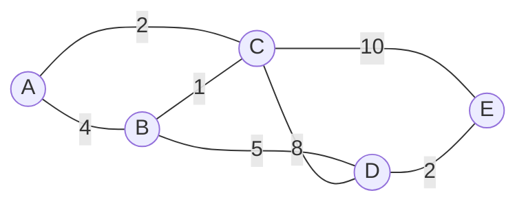
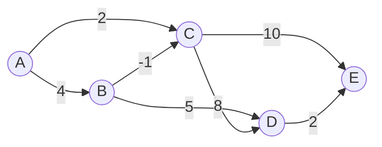
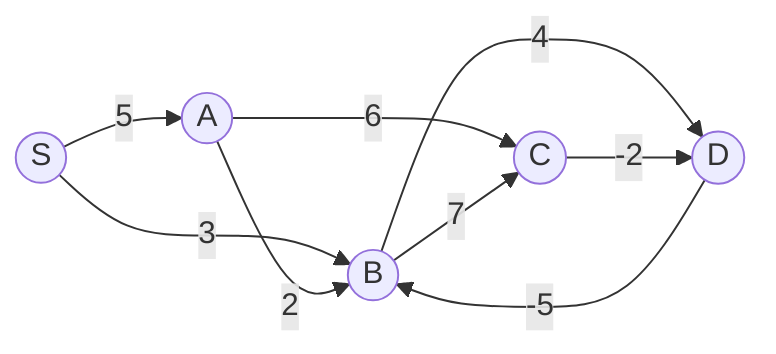
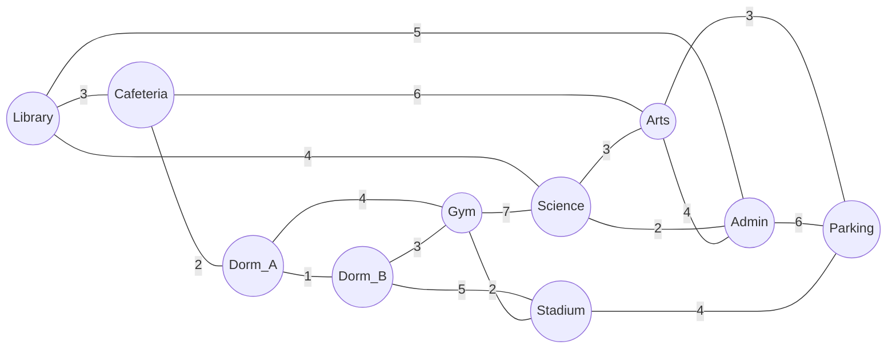

# Week 12 Lab — Shortest Paths and Applications

[Repository Guide](../../README.md) | [English](Concepts_Lab.md) | [한국어](Concepts_Lab.ko.md)

> **Last Updated:** 2026-11-18

> **Learning Objectives:**
> 1. Implement Dijkstra's algorithm with a min-heap and explain why outdated heap entries are skipped
> 2. Recover the shortest path from the start vertex to any target vertex with a predecessor dictionary
> 3. Implement the Bellman-Ford algorithm and detect negative cycles
> 4. Explain with a counterexample why Dijkstra's algorithm cannot handle negative weights
> 5. Compare Dijkstra's algorithm with the Bellman-Ford algorithm and apply them to route finding on a campus map

---

## Table of Contents

- [1. Overview](#1-overview)
  - [1.1 Lab Goals](#11-lab-goals)
  - [1.2 Lab Structure](#12-lab-structure)
  - [1.3 Environment](#13-environment)
- [2. Exercise 1: Dijkstra's Algorithm](#2-exercise-1-dijkstras-algorithm)
  - [2.1 Problem](#21-problem)
  - [2.2 Solution Code](#22-solution-code)
  - [2.3 Tracing the Heap](#23-tracing-the-heap)
  - [2.4 Results and Path Recovery](#24-results-and-path-recovery)
- [3. Exercise 2: The Bellman-Ford Algorithm](#3-exercise-2-the-bellman-ford-algorithm)
  - [3.1 Problem](#31-problem)
  - [3.2 Solution Code](#32-solution-code)
  - [3.3 Tracing the Passes](#33-tracing-the-passes)
  - [3.4 Detecting Negative Cycles](#34-detecting-negative-cycles)
- [4. Dijkstra's Algorithm and Negative Weights](#4-dijkstras-algorithm-and-negative-weights)
  - [4.1 An Implementation That Finalizes Removed Vertices](#41-an-implementation-that-finalizes-removed-vertices)
  - [4.2 How the Reinserting Implementation Behaves](#42-how-the-reinserting-implementation-behaves)
- [5. Dijkstra versus Bellman-Ford](#5-dijkstra-versus-bellman-ford)
- [6. Applications of Shortest Paths](#6-applications-of-shortest-paths)
  - [6.1 Shortest-Path-Based Features](#61-shortest-path-based-features)
  - [6.2 Campus Route Finding](#62-campus-route-finding)
- [Summary](#summary)
- [Self-Check Questions](#self-check-questions)

---

<br>

## 1. Overview

> **Note:** The optimal substructure of shortest paths, relaxation, and the correctness of Dijkstra and Bellman-Ford are covered in the [Week 12 lecture](Concepts_Lecture.md). This lab implements the two algorithms in Python and observes how differently they behave with negative weights.

### 1.1 Lab Goals

- Find single-source shortest paths in a weighted graph with **Dijkstra's algorithm**, which uses a priority queue (min-heap).
- Implement the **Bellman-Ford algorithm**, which allows edges with negative weights, and detect negative cycles.
- Confirm with a counterexample why Dijkstra's algorithm cannot handle negative weights.
- Build a route finding feature for a campus map with a shortest path algorithm.

### 1.2 Lab Structure

| Part | Topic |
|:-----|:-----|
| **Exercise 1** | Dijkstra's algorithm, shortest path recovery |
| **Exercise 2** | The Bellman-Ford algorithm, negative cycle detection |
| **Comparison** | Dijkstra's algorithm with negative weights, Dijkstra versus Bellman-Ford |
| **Applications** | Shortest-path-based features, campus route finding |

*Table 1. Lab structure and topics*

### 1.3 Environment

All code uses only the Python 3 standard library, and the min-heap is implemented with the `heapq` module. A weighted graph is represented as a dictionary whose keys are vertices and whose values are lists of `(neighbor, weight)` tuples. The reference web application that shows the progress of the two algorithms graphically (the Shortest Path Explorer) runs on FastAPI and uvicorn, and its negative cycle example and campus map are covered as code in Sections 3.4 and 6.2.

---

<br>

## 2. Exercise 1: Dijkstra's Algorithm

### 2.1 Problem

**Goal:** Implement **Dijkstra's algorithm**, which finds the shortest path from a start vertex to each vertex of a weighted graph.



*Figure 1. Undirected weighted graph of five vertices used for Dijkstra's algorithm*

**Requirements:**

- Use a min-heap (priority queue) for efficiency.
- Return the shortest distances and a predecessor dictionary.
- Recover the shortest path to any target vertex from the predecessor dictionary.

### 2.2 Solution Code

```python
import heapq

def dijkstra(graph, start):
    dist = {node: float('inf') for node in graph}
    dist[start] = 0
    prev = {node: None for node in graph}
    pq = [(0, start)]                       # Min-heap of (distance, vertex)

    while pq:
        d, u = heapq.heappop(pq)
        if d > dist[u]:
            continue                        # Outdated entry, already handled with a shorter distance
        for v, w in graph[u]:
            if dist[u] + w < dist[v]:       # Relaxation
                dist[v] = dist[u] + w
                prev[v] = u
                heapq.heappush(pq, (dist[v], v))
    return dist, prev

def get_path(prev, target):
    path = []
    node = target
    while node is not None:
        path.append(node)
        node = prev[node]
    return list(reversed(path))
```

- **Heap entries:** `heapq` compares tuples from the first element, so pushing `(distance, vertex)` makes the entry with the smallest distance come out first.
- **Relaxation:** If `dist[u] + w < dist[v]`, the path to v through u is shorter than the best path known so far, so `dist[v]` and `prev[v]` are updated.
- **Skipping outdated entries:** `heapq` has no decrease-key operation that lowers the key of an entry already in the heap. So a vertex whose distance decreases is pushed once more with the new distance, and the old entry is left in the heap. When the old entry comes out later, its distance `d` is greater than the current `dist[u]`, so it is skipped. This approach is called **lazy deletion**.
- **Complexity:** With nonnegative weights each vertex is processed only once, so relaxation succeeds at most once per adjacency list entry, and the number of entries pushed onto the heap is $`O(E)`$. Each push and pop takes $`O(\log E)`$. Since $`E \le V^2`$, $`\log E \le 2 \log V`$, and the total time is $`O((V + E) \log V)`$.
- **`get_path`:** It climbs from the target vertex along `prev` to the start vertex and reverses the result. The start vertex's predecessor is `None`, so the climb stops there.

### 2.3 Tracing the Heap

Running from start vertex A changes the heap as follows. The heap column lists the entries after removing and pushing, in order of distance.

| Entry removed | Action | Distances updated | Heap (after the action) |
|:-----|:-----|:-----|:-----|
| (0, A) | Relax A's neighbors | B = 4, C = 2 | (2, C), (4, B) |
| (2, C) | Relax C's neighbors | B = 3, D = 10, E = 12 | (3, B), (4, B), (10, D), (12, E) |
| (3, B) | Relax B's neighbors | D = 8 | (4, B), (8, D), (10, D), (12, E) |
| (4, B) | Skipped as outdated | | (8, D), (10, D), (12, E) |
| (8, D) | Relax D's neighbors | E = 10 | (10, D), (10, E), (12, E) |
| (10, D) | Skipped as outdated | | (10, E), (12, E) |
| (10, E) | No edge to relax | | (12, E) |
| (12, E) | Skipped as outdated | | Empty |

*Table 2. Heap changes of Dijkstra's algorithm from start vertex A*

- When C is processed, B's distance falls from 4 to 3, because the path A, C, B (2 + 1) is shorter than the direct edge from A to B (4). At this point (3, B) is pushed and (4, B) remains as an outdated entry.
- D and E leave outdated entries for the same reason. An outdated entry costs only its removal and triggers no relaxation.

### 2.4 Results and Path Recovery

```python
graph = {
    'A': [('B', 4), ('C', 2)],
    'B': [('A', 4), ('C', 1), ('D', 5)],
    'C': [('A', 2), ('B', 1), ('D', 8), ('E', 10)],
    'D': [('B', 5), ('C', 8), ('E', 2)],
    'E': [('C', 10), ('D', 2)]
}
dist, prev = dijkstra(graph, 'A')
for node in sorted(dist):
    print(f"A -> {node}: dist={dist[node]}, path={' -> '.join(get_path(prev, node))}")
```

```text
A -> A: dist=0, path=A
A -> B: dist=3, path=A -> C -> B
A -> C: dist=2, path=A -> C
A -> D: dist=8, path=A -> C -> B -> D
A -> E: dist=10, path=A -> C -> B -> D -> E
```

The shortest path from A to E is A, C, B, D, E, of length 2 + 1 + 5 + 2 = 10. The path A, C, E, which uses the single edge C → E (10), has length 12 and is longer. The length of a path is the sum of its weights, not the number of its edges, so the BFS of the Week 11 lab cannot find this path.

---

<br>

## 3. Exercise 2: The Bellman-Ford Algorithm

### 3.1 Problem

**Goal:** Implement the **Bellman-Ford algorithm**, which finds shortest paths in a directed graph that may contain **negative edge weights**.



*Figure 2. Directed weighted graph with one negative-weight edge*

**Requirements:**

- Relax all edges $`\lvert V \rvert - 1`$ times.
- Raise an exception if a negative cycle is detected.
- Return the shortest distances and a predecessor dictionary.

**Question:** Why can Dijkstra's algorithm not handle negative weights? (Section 4)

### 3.2 Solution Code

```python
def bellman_ford(vertices, edges, start):
    dist = {v: float('inf') for v in vertices}
    dist[start] = 0
    prev = {v: None for v in vertices}

    for _ in range(len(vertices) - 1):      # Relax all edges |V| - 1 times
        for u, v, w in edges:
            if dist[u] + w < dist[v]:
                dist[v] = dist[u] + w
                prev[v] = u

    for u, v, w in edges:                   # A further decrease means a negative cycle
        if dist[u] + w < dist[v]:
            raise ValueError("Graph contains a negative cycle")

    return dist, prev
```

- **Input:** Bellman-Ford does not need edges grouped by vertex; it scans an edge list of `(source, destination, weight)` tuples as it is.
- **$`\lvert V \rvert - 1`$ passes:** Without negative cycles, a shortest path never visits the same vertex twice, so it has at most $`\lvert V \rvert - 1`$ edges. After pass i, the distances of all shortest paths made of at most i edges are settled (Section 2.7 of the Week 12 lecture), so $`\lvert V \rvert - 1`$ passes settle every distance.
- **Negative cycle check:** If some distance still decreases after $`\lvert V \rvert - 1`$ passes, there is a path that keeps getting shorter as it uses more edges, that is, a negative cycle reachable from the start vertex.
- **Complexity:** Each pass relaxes E edges, so the cost is $`O(V \cdot E)`$.
- Adding a negative number to `float('inf')` still gives `inf`, so edges leaving a vertex u not yet reached do not change `dist[v]`.

### 3.3 Tracing the Passes

```python
vertices = ['A', 'B', 'C', 'D', 'E']
edges = [('A','B',4), ('A','C',2), ('B','C',-1),
         ('B','D',5), ('C','D',8), ('C','E',10), ('D','E',2)]
dist, prev = bellman_ford(vertices, edges, 'A')
print({v: dist[v] for v in vertices})
print(' -> '.join(get_path(prev, 'E')))
```

```text
{'A': 0, 'B': 4, 'C': 2, 'D': 9, 'E': 11}
A -> B -> D -> E
```

Relaxing the edges in list order during the first pass settles the distances as follows.

| Edge | Test | Result |
|:-----|:-----|:-----|
| A → B (4) | 0 + 4 < ∞ | B = 4 |
| A → C (2) | 0 + 2 < ∞ | C = 2 |
| B → C (-1) | 4 - 1 = 3 < 2 false | No change |
| B → D (5) | 4 + 5 < ∞ | D = 9 |
| C → D (8) | 2 + 8 = 10 < 9 false | No change |
| C → E (10) | 2 + 10 < ∞ | E = 12 |
| D → E (2) | 9 + 2 = 11 < 12 | E = 11 |

*Table 3. First pass of the Bellman-Ford algorithm*

- Although there is a negative edge B → C, the direct path from A to C (2) is shorter than the path A, B, C (4 - 1 = 3), so C's distance stays 2. A negative edge does not necessarily lie on a shortest path.
- This edge list lists the source vertices in the order A, B, C, D, which is a topological order of the graph, so whenever the edges leaving a vertex are relaxed, that vertex's distance is already settled. That is why every distance is settled in the first pass and nothing changes in the remaining three passes. A common optimization therefore stops early once a pass changes no distance.
- With an unfavorable relaxation order, a pass may propagate a path by only one edge, so all $`\lvert V \rvert - 1`$ passes can be needed. The final distances do not depend on the relaxation order.

### 3.4 Detecting Negative Cycles

The negative cycle example of the Shortest Path Explorer is the following graph. B → D → B is a negative cycle whose weights sum to 4 + (-5) = -1.



*Figure 3. Graph with a negative cycle reachable from start vertex S*

```python
vs = ['S', 'A', 'B', 'C', 'D']
neg_cycle = [('S','A',5), ('S','B',3), ('A','B',2), ('A','C',6),
             ('B','C',7), ('B','D',4), ('C','D',-2), ('D','B',-5)]
try:
    bellman_ford(vs, neg_cycle, 'S')
except ValueError as e:
    print(e)
```

```text
Graph contains a negative cycle
```

Each lap around the cycle B, D, B shortens the path by 1, so the shortest distances of B and D are undefined. Even after $`\lvert V \rvert - 1 = 4`$ passes, relaxing D → B lowers B's distance again, and the final check detects this.

---

<br>

## 4. Dijkstra's Algorithm and Negative Weights

### 4.1 An Implementation That Finalizes Removed Vertices

Following the pseudocode of Section 2.2 of the Week 12 lecture, an implementation that puts each vertex removed from the heap into a finalized set and never relaxes finalized vertices again is run on the counterexample of Section 2.4 of the Week 12 lecture. The edges are A → B (1), A → C (0), and B → C (-2).

```python
def dijkstra_finalized(graph, start):
    dist = {node: float('inf') for node in graph}
    dist[start] = 0
    done = set()                            # Vertices whose distance is final
    pq = [(0, start)]
    while pq:
        d, u = heapq.heappop(pq)
        if u in done:
            continue
        done.add(u)                         # Finalized the moment it is removed
        for v, w in graph[u]:
            if v not in done and dist[u] + w < dist[v]:
                dist[v] = dist[u] + w
                heapq.heappush(pq, (dist[v], v))
    return dist

neg = {'A': [('B', 1), ('C', 0)], 'B': [('C', -2)], 'C': []}
print(dijkstra_finalized(neg, 'A'))
print(bellman_ford(['A','B','C'], [('A','B',1),('A','C',0),('B','C',-2)], 'A')[0])
```

```text
{'A': 0, 'B': 1, 'C': 0}
{'A': 0, 'B': 1, 'C': -1}
```

C is removed first with distance 0 and finalized; when B is processed afterward, B → C gives 1 + (-2) = -1, but C is already finalized and is not updated. Dijkstra's algorithm is greedy: it finalizes the closest vertex first and relies on the assumption that no later edge can reduce a finalized distance. With nonnegative weights a path never gets shorter as it grows, so the assumption holds, but with negative weights a path through a vertex processed later can become shorter, invalidating the earlier decision. Bellman-Ford makes no such commitment and relaxes all edges repeatedly, so it obtains the correct distance -1.

### 4.2 How the Reinserting Implementation Behaves

The `dijkstra` of Section 2.2 has no finalized set and pushes a vertex whose distance decreases back onto the heap at any time. On the same counterexample this implementation gives a different result.

```python
print(dijkstra(neg, 'A')[0])
```

```text
{'A': 0, 'B': 1, 'C': -1}
```

When C's distance falls to -1 while B is processed, (-1, C) is pushed onto the heap and C is removed and processed once more. Since a vertex whose distance decreases is processed again and the improvement spreads to its neighbors, this implementation gives correct distances even with negative edges as long as there is no negative cycle. This, however, is not a property of Dijkstra's algorithm.

- In this example there are 3 vertices, but they are processed 4 times: A, C, B, C. Because a vertex can be removed and processed several times, the premise "each vertex is removed once" breaks, and the $`O((V + E) \log V)`$ time guarantee of Section 2.2 no longer holds.
- With a negative cycle, distances keep decreasing on every lap around the cycle and the heap never empties, so the loop never terminates. In the graph of Figure 3, the distances of B and D decrease without bound.

> **Key Point:** For graphs with negative weights, use the Bellman-Ford algorithm, whose $`O(V \cdot E)`$ time is guaranteed and which detects negative cycles. Use Dijkstra's algorithm only when all weights are nonnegative.

---

<br>

## 5. Dijkstra versus Bellman-Ford

| Aspect | Dijkstra | Bellman-Ford |
|:-----|:-----|:-----|
| Time complexity | $`O((V + E) \log V)`$ | $`O(V \cdot E)`$ |
| Negative weights | Not supported | Supported |
| Negative cycles | Cannot detect | Detects and reports |
| Data structure | Min-heap (priority queue) | Simple edge list |
| Best for | Sparse graphs with nonnegative weights | Graphs with negative weights |

*Table 4. Comparison of Dijkstra's algorithm and the Bellman-Ford algorithm*

- **Time:** In a sparse graph, whose number of edges is close to its number of vertices, Dijkstra takes $`O(V \log V)`$ and Bellman-Ford $`O(V^2)`$. With ten thousand vertices, that is roughly 130,000 versus 100 million.
- **Strategy:** Dijkstra is a greedy algorithm that processes the closest vertex first, so negative weights can invalidate its earlier decisions. Bellman-Ford is dynamic programming that relaxes all edges repeatedly, considering paths with more and more edges in turn, so it can revise its decisions and its correctness is guaranteed.
- **Negative cycles:** The final pass of Bellman-Ford reports whether a negative cycle exists, whereas Dijkstra has no way to decide this.

---

<br>

## 6. Applications of Shortest Paths

### 6.1 Shortest-Path-Based Features

| Topic | Shortest path feature |
|:-----|:-----|
| Shopping mall | Optimal path linking recommended products, weighted by similarity |
| Social network | Shortest path weighted by the closeness of relationships |
| Campus map | Shortest walking route between buildings |

*Table 5. Shortest path features by web application topic*

### 6.2 Campus Route Finding

The campus map of the Shortest Path Explorer is an undirected graph whose vertices are 10 buildings and whose weights are walking times in minutes.



*Figure 4. Campus map of 10 buildings and walking times in minutes*

A web application exposes a function that takes a departure and an arrival building and returns the distance and the path as an API endpoint such as `GET /route/{start}/{end}`. Its core is the following function.

```python
CAMPUS_EDGES = [
    ("Library", "Cafeteria", 3), ("Library", "Science", 4), ("Library", "Admin", 5),
    ("Cafeteria", "Dorm_A", 2), ("Cafeteria", "Arts", 6), ("Dorm_A", "Dorm_B", 1),
    ("Dorm_A", "Gym", 4), ("Dorm_B", "Gym", 3), ("Dorm_B", "Stadium", 5),
    ("Gym", "Stadium", 2), ("Science", "Arts", 3), ("Science", "Admin", 2),
    ("Arts", "Admin", 4), ("Arts", "Parking", 3), ("Admin", "Parking", 6),
    ("Stadium", "Parking", 4), ("Gym", "Science", 7),
]
campus = {}
for u, v, w in CAMPUS_EDGES:                # Undirected: add the edge on both sides
    campus.setdefault(u, []).append((v, w))
    campus.setdefault(v, []).append((u, w))

def find_route(graph, start, end):
    dist, prev = dijkstra(graph, start)
    return {"distance": dist[end], "path": get_path(prev, end)}

print(find_route(campus, "Dorm_B", "Admin"))
print(find_route(campus, "Library", "Parking"))
```

```text
{'distance': 11, 'path': ['Dorm_B', 'Dorm_A', 'Cafeteria', 'Library', 'Admin']}
{'distance': 10, 'path': ['Library', 'Science', 'Arts', 'Parking']}
```

- The graph is undirected, so each edge is added to the adjacency lists of both vertices. Walking times are nonnegative, so Dijkstra's algorithm can be used.
- From Dorm_B to Admin takes 1 + 2 + 3 + 5 = 11 minutes. The path through Gym and Science, 3 + 7 + 2 = 12 minutes, has fewer edges but takes one minute longer.
- From Library to Parking takes 4 + 3 + 3 = 10 minutes through Science and Arts. The direct path through Admin takes 5 + 6 = 11 minutes.
- One run of `dijkstra` from a departure building computes the distances and predecessors to every arrival building at once. If many requests look up several destinations from the same departure point, this result can be cached and reused.

---

<br>

## Summary

| Concept | Key Summary |
|:-----|:-----|
| Dijkstra implementation | `(distance, vertex)` pairs go into a min-heap; the vertex with the smallest distance is removed and its neighbors relaxed, and a new entry is pushed whenever a distance decreases. |
| Lazy deletion | Since `heapq` has no decrease-key, old entries are left in place, and an entry whose removed distance exceeds the current distance is skipped. |
| Path recovery | Predecessors are recorded during relaxation, and the path is obtained by climbing from the target along the predecessors to the start vertex and reversing. |
| Bellman-Ford implementation | Relaxing all edges $`\lvert V \rvert - 1`$ times finds shortest distances in $`O(V \cdot E)`$ and allows negative weights. |
| Negative cycle detection | If some edge can still be relaxed after $`\lvert V \rvert - 1`$ passes, there is a negative cycle reachable from the start vertex. |
| Negative weights and Dijkstra | Dijkstra that finalizes removed vertices gives wrong distances with negative edges, while the reinserting implementation regains correctness at the cost of its time guarantee and never terminates on a negative cycle. |
| Choosing between the two | Use the faster Dijkstra when weights are nonnegative, and Bellman-Ford when there are negative weights or negative cycles must be detected. |
| Route finding application | Route finding on road networks with nonnegative weights, such as the campus map, is implemented with Dijkstra and predecessor recovery. |

---

<br>

## Self-Check Questions

1. What happens to the results and the running time if `if d > dist[u]: continue` is removed from the `dijkstra` of Section 2.2?

   <details>
   <summary>Answer</summary>

   The final distances are the same. When an outdated entry (d, u) is processed, d exceeds the current distance; the relaxations use `dist[u] + w`, but `dist[u]` is already the smaller value and the same relaxations were already performed when u was processed with that value, so nothing changes. However, u's adjacency list is scanned again for every outdated entry, adding unnecessary work. In Table 2, the three outdated entries (4, B), (10, D), and (12, E) would each recheck the neighbors of B, D, and E. In graphs with many vertices whose distance decreases several times, this waste grows.

   </details>

2. If Dijkstra's algorithm is run on the graph of Figure 1 with start vertex E, what are the shortest distances to each vertex and the path to A?

   <details>
   <summary>Answer</summary>

   Removing E gives C = 10 and D = 2. Removing D (2) gives B = 7, and C stays at min(10, 2 + 8) = 10. Removing B (7) gives A = 11 and lowers C to min(10, 7 + 1) = 8. Removing C (8) lowers A to min(11, 8 + 2) = 10. Finally A (10) is removed. The shortest distances are E = 0, D = 2, B = 7, C = 8, and A = 10, and the path to A is E, D, B, C, A. The graph is undirected, so this path is the reverse of the path from A to E in Section 2.4 and has the same length 10.

   </details>

3. Explain why it suffices for the Bellman-Ford algorithm to relax all edges exactly $`\lvert V \rvert - 1`$ times. If the edge list of the graph in Section 3.3 is reversed, in which pass are all distances settled?

   <details>
   <summary>Answer</summary>

   Without negative cycles, removing a cycle from a path does not make it longer, so among the shortest paths there is a simple path that visits no vertex twice, and it has at most $`\lvert V \rvert - 1`$ edges. After pass i, all shortest paths of at most i edges are reflected, so $`\lvert V \rvert - 1`$ passes suffice. Relaxing the edges in reverse (in the order D → E, C → E, C → D, B → D, B → C, A → C, A → B), only the edges leaving A succeed in the first pass, giving B = 4 and C = 2. In the second pass C → E (12), C → D (10), and B → D (9) are relaxed, and in the third pass D → E gives E = 11. All distances are settled in the third pass, and nothing changes in the fourth. The three edges of the shortest path A, B, D, E propagated one per pass.

   </details>

4. Explain from the viewpoint of the greedy choice why the Dijkstra that finalizes removed vertices goes wrong on the counterexample of Section 4.1.

   <details>
   <summary>Answer</summary>

   Dijkstra fixes a vertex's distance as final the moment the vertex with the smallest distance is removed from the heap. This relies on the reasoning that a path to that vertex through an unprocessed vertex x cannot be shorter, because the distance to x is already at least as large and the weights added after x are nonnegative. In the counterexample, C is finalized with distance 0, but reaching C from the unprocessed B (distance 1) by the edge of weight -2 gives -1. The negative edge shortens the path after x, the reasoning breaks, and since the finalized C is not updated, the wrong distance 0 remains.

   </details>

5. Even if a Dijkstra that pushes vertices back onto the heap when their distance decreases, as in Section 2.2, gives correct distances on a graph with negative edges, why is Bellman-Ford used for graphs with negative weights?

   <details>
   <summary>Answer</summary>

   The reinserting implementation processes a vertex again whenever its distance decreases, so without negative cycles it eventually reaches the correct distances. However, the number of times a vertex is processed has no bound, so Dijkstra's time guarantee of $`O((V + E) \log V)`$ disappears. Moreover, with a negative cycle the distances decrease without end and the loop never terminates, and it cannot report that a negative cycle exists. Bellman-Ford always terminates in $`O(V \cdot E)`$ even with negative weights and detects negative cycles with its final pass, so both correctness and termination are guaranteed.

   </details>

6. If the edge between Dorm_A and Dorm_B is removed from the campus map of Section 6.2, what are the shortest path and time from Dorm_B to Admin?

   <details>
   <summary>Answer</summary>

   From Dorm_B one can go only to Gym (3 minutes) and Stadium (5 minutes). Among the paths through Gym, Gym, Science, Admin takes 3 + 7 + 2 = 12 minutes, and Gym, Dorm_A, Cafeteria, Library, Admin takes 3 + 4 + 2 + 3 + 5 = 17 minutes. Through Stadium, going from Stadium (5) past Parking (4) to Admin (6) takes 15 minutes. The shortest path is therefore Dorm_B, Gym, Science, Admin, taking 12 minutes. The original 11-minute path depended on the 1-minute edge from Dorm_B to Dorm_A, so removing that edge adds one minute.

   </details>
