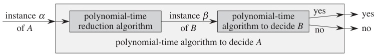
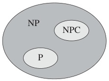
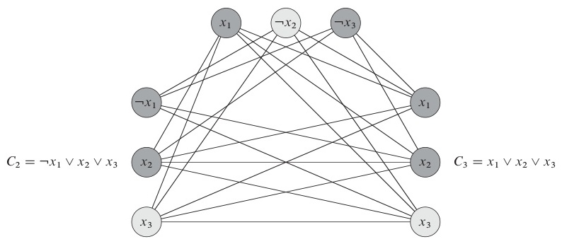
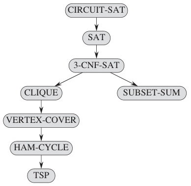

# Week 13 Lecture — NP-Completeness and Approximation Algorithms

[Repository Guide](../../README.md) | [English](Concepts_Lecture.md) | [한국어](Concepts_Lecture.ko.md)

> **Last Updated:** 2026-10-20
>
> Introduction to Algorithms, Cormen, Leiserson, Rivest, and Stein, Ch 34, 35

> **Learning Objectives:**
> 1. Distinguish **tractable** (polynomial time) from **intractable** problems, **decidable** from **undecidable** problems, and **decision** problems (Yes/No) from **optimization** problems, and explain why NP-Completeness is stated on decision problems
> 2. State the definitions of **P** and **NP**, articulate the *verify vs solve* intuition, and list several **famous NP-Complete problems** (SAT, Subset Sum, Partition, 0-1 Knapsack, Vertex Cover, Independent Set, Clique, Graph Coloring, Longest Path, Set Cover, TSP, Hamiltonian Cycle, Bin Packing, Job Scheduling)
> 3. Define **polynomial-time reduction** $A \leq_P B$ and use it to transfer hardness, and define **NP-Hard** and **NP-Complete**
> 4. Apply the **two-step recipe** (in NP + reduction from a known NP-Complete problem) to prove NP-Completeness of a new problem, and reproduce the **LONGEST-PATH is NP-Complete** proof and sketch the **3-SAT $\leq_P$ CLIQUE** reduction
> 5. Decide what to do in practice when a problem is proven NP-Complete (heuristics, approximation, special cases), and define the **approximation ratio** and the **indirect-optimal** technique for proving it
> 6. Execute and analyze the **2-approximations** for TSP (MST-based), **Vertex Cover** (maximal matching), **Bin Packing** (FF, NF, BF, WF), **Job Scheduling** (earliest-finishing machine), and **k-Clustering** (farthest-first traversal)

---

## Table of Contents

- [1. Problem Complexity Classes](#1-problem-complexity-classes)
  - [1.1 Why NP-Completeness Theory Matters](#11-why-np-completeness-theory-matters)
  - [1.2 Classification of Problems](#12-classification-of-problems)
  - [1.3 Tractable Time = Polynomial Time](#13-tractable-time--polynomial-time)
  - [1.4 Famous NP-Complete Problems](#14-famous-np-complete-problems)
  - [1.5 Decision vs Optimization Problems](#15-decision-vs-optimization-problems)
- [2. P, NP, and NP-Completeness Theory](#2-p-np-and-np-completeness-theory)
  - [2.1 The Class P](#21-the-class-p)
  - [2.2 The Class NP](#22-the-class-np)
  - [2.3 P vs NP: The Million-Dollar Question](#23-p-vs-np-the-million-dollar-question)
  - [2.4 Polynomial-Time Reduction](#24-polynomial-time-reduction)
  - [2.5 Reduction Examples](#25-reduction-examples)
  - [2.6 NP-Hard and NP-Complete: Definitions](#26-np-hard-and-np-complete-definitions)
  - [2.7 How to Prove NP-Completeness](#27-how-to-prove-np-completeness)
  - [2.8 Proof: LONGEST-PATH is NP-Complete](#28-proof-longest-path-is-np-complete)
  - [2.9 Sketch: 3-SAT $\leq_P$ CLIQUE](#29-sketch-3-sat-leq_p-clique)
  - [2.10 The Reduction Chain](#210-the-reduction-chain)
  - [2.11 Counterintuitive Boundaries](#211-counterintuitive-boundaries)
  - [2.12 What "NP-Complete" Means in Practice](#212-what-np-complete-means-in-practice)
- [3. Approximation Algorithms: Foundations](#3-approximation-algorithms-foundations)
  - [3.1 Why Approximation?](#31-why-approximation)
  - [3.2 Approximation Ratio](#32-approximation-ratio)
  - [3.3 The Indirect-Optimal Technique](#33-the-indirect-optimal-technique)
- [4. TSP: MST-Based 2-Approximation](#4-tsp-mst-based-2-approximation)
  - [4.1 Problem and Metric Assumptions](#41-problem-and-metric-assumptions)
  - [4.2 Algorithm](#42-algorithm)
  - [4.3 Worked Example](#43-worked-example)
  - [4.4 Approximation Ratio Proof](#44-approximation-ratio-proof)
  - [4.5 Complexity](#45-complexity)
- [5. Vertex Cover: Maximal-Matching 2-Approximation](#5-vertex-cover-maximal-matching-2-approximation)
  - [5.1 Problem](#51-problem)
  - [5.2 Algorithm](#52-algorithm)
  - [5.3 Worked Example and Proof](#53-worked-example-and-proof)
- [6. Bin Packing: Four Greedy Heuristics](#6-bin-packing-four-greedy-heuristics)
  - [6.1 Problem](#61-problem)
  - [6.2 First Fit / Next Fit / Best Fit / Worst Fit](#62-first-fit--next-fit--best-fit--worst-fit)
  - [6.3 Worked Example](#63-worked-example)
  - [6.4 Approximation Ratio Proofs](#64-approximation-ratio-proofs)
- [7. Job Scheduling: Earliest-Finishing-Machine 2-Approximation](#7-job-scheduling-earliest-finishing-machine-2-approximation)
  - [7.1 Problem](#71-problem)
  - [7.2 Algorithm and Worked Example](#72-algorithm-and-worked-example)
  - [7.3 Approximation Ratio Proof](#73-approximation-ratio-proof)
- [8. k-Clustering: Farthest-First 2-Approximation](#8-k-clustering-farthest-first-2-approximation)
  - [8.1 Problem](#81-problem)
  - [8.2 Algorithm and Worked Example](#82-algorithm-and-worked-example)
  - [8.3 Approximation Ratio Proof](#83-approximation-ratio-proof)
  - [8.4 Practical Considerations](#84-practical-considerations)
- [9. Approximation Algorithms: Summary Table](#9-approximation-algorithms-summary-table)
- [Summary](#summary)
- [Self-Check Questions](#self-check-questions)

---

<br>

## 1. Problem Complexity Classes

### 1.1 Why NP-Completeness Theory Matters

Suppose your boss gives you a problem that no efficient algorithm seems to crack. There are three possible answers.

- **Scenario 1:** *"I cannot find an efficient algorithm. I am not smart enough."* This answer is merely embarrassing.
- **Scenario 2:** *"I cannot find an efficient algorithm, because no such algorithm exists."* This is the strongest answer, but proving non-existence is hard.
- **Scenario 3 (NP-Complete):** *"I cannot find an efficient algorithm, but neither could thousands of brilliant people over more than 50 years for hundreds of related problems."* This answer is professionally defensible.

> **Key Point:** The whole point of NP-Completeness theory is to upgrade Scenario 1 to Scenario 3. It gives a *legitimate*, *theory-grounded* reason to stop searching for an exact polynomial-time solution and pivot to heuristics or approximations.

### 1.2 Classification of Problems

```text
┌──────────────────────────────────────────────────────────┐
│                   ALL PROBLEMS                            │
│                                                          │
│  ┌─────────────────────────────────────────────────────┐ │
│  │  Solvable (Decidable)                                │ │
│  │                                                     │ │
│  │  ┌───────────────────────────────────────────────┐  │ │
│  │  │  Tractable: polynomial time                   │  │ │
│  │  │  - Shortest Path, MST, Sorting, ...           │  │ │
│  │  │  - Time: O(n^k) for some constant k           │  │ │
│  │  └───────────────────────────────────────────────┘  │ │
│  │  ┌───────────────────────────────────────────────┐  │ │
│  │  │  Intractable: no known polynomial algorithm   │  │ │
│  │  │  *** NP-Complete problems live here ***        │  │ │
│  │  │  - SAT, TSP, Vertex Cover, Clique, ...        │  │ │
│  │  │  - Best known: O(2^n), O(n!), etc.            │  │ │
│  │  └───────────────────────────────────────────────┘  │ │
│  │  ┌───────────────────────────────────────────────┐  │ │
│  │  │  Super-exponential: e.g., Presburger arith.   │  │ │
│  │  └───────────────────────────────────────────────┘  │ │
│  └─────────────────────────────────────────────────────┘ │
│                                                          │
│  ┌─────────────────────────────────────────────────────┐ │
│  │  Unsolvable (Undecidable)                            │ │
│  │  - Halting Problem, Hilbert's 10th Problem, ...      │ │
│  └─────────────────────────────────────────────────────┘ │
└──────────────────────────────────────────────────────────┘
```

*Figure 1. Classification of problems by decidability and time complexity*

> **Note:** **Important distinction.** Intractable is not the same as unsolvable (intractable ≠ unsolvable). Intractable problems *have* algorithms; those algorithms just do not run in polynomial time. Unsolvable problems have *no* algorithm at all. The Halting Problem is undecidable regardless of how much time is allowed.

### 1.3 Tractable Time = Polynomial Time

**Polynomial time:** for input size $n$, the running time is bounded by $O(n^k)$ for some constant $k$.

| Tractable (Polynomial) | Intractable (Super-polynomial)  |
|------------------------|---------------------------------|
| $O(\log n)$            | $O(2^n)$ (exponential)          |
| $O(n)$                 | $O(n!)$ (factorial)             |
| $O(n \log n)$          | $O(n^n)$                        |
| $O(n^2), O(n^3)$       |                                 |

*Table 1. Examples of tractable and intractable time complexities*

> **Note:** **Convention.** A problem is efficiently solvable **if and only if** a polynomial-time algorithm exists for it. This convention is the Cobham-Edmonds thesis. The boundary is deliberately coarse, but it works for theoretical purposes because the polynomial class is robust to changes in the computational model.

### 1.4 Famous NP-Complete Problems

The following problems motivate the rest of this note. Each is NP-Complete; the proofs come later, or follow by reduction from one of these.

**SAT (Boolean Satisfiability).** Given Boolean variables connected by OR ($\lor$) within clauses, the clauses connected by AND ($\land$), find an assignment satisfying every clause.

$$(\overline{w} \lor x) \land (w \lor y) \land (\overline{x} \lor \overline{y} \lor z)$$

- The formula above is satisfied by $w = T, x = T, y = F$ regardless of the value of $z$.
- $(x) \land (\overline{x})$ is **unsatisfiable**.
- SAT is the **first problem proven NP-Complete** (Cook, 1971; independently Levin, 1973).

**Subset Sum.** Given a set $S$ of integers and target $K$, does a subset of $S$ sum to exactly $K$?
- For $S = \{20, 30, 40, 80, 90\}$ and $K = 200$, the subset $\{30, 80, 90\}$ works.

**Partition.** Given $S$, can it be split into two subsets with equal sum?
- $S = \{20, 30, 40, 80, 90\}$ (total 260) splits into $\{20, 30, 80\}$ and $\{40, 90\}$ (each 130).
- Subset Sum reduces to Partition in polynomial time.

**0-1 Knapsack (decision version).** We are given a capacity $C$ and items with weights $w_i$ and values $v_i$. Is there a subset with total weight $\leq C$ and total value $\geq K$?

| Item | Weight | Value |
|------|--------|-------|
| 1    | 12 kg  | 20    |
| 2    | 8 kg   | 10    |
| 3    | 6 kg   | 15    |
| 4    | 5 kg   | 25    |

*Table 2. Weights and values of the items in the 0-1 Knapsack example*

- For $C = 20$, items $\{2, 3, 4\}$ weigh 19 and have value 50.
- **Why is it NP-Complete despite the DP?** The Week 6 DP solution runs in $O(nC)$. But $C$ can be encoded in $\log C$ bits, so the DP is *pseudo-polynomial*: polynomial in the *value* of $C$, but exponential in its *bit-length*.

**Graph problems:**

- **Vertex Cover.** Find the smallest set of vertices touching every edge.
- **Independent Set.** Find the largest set of pairwise non-adjacent vertices.
- **Clique.** Find the largest complete subgraph.
- **Graph Coloring.** Find the fewest colors such that adjacent vertices get different colors.
- **Longest Path.** Is there a simple $s \to t$ path of length $\geq K$? This problem is surprisingly NP-Complete (compare with Shortest Path, which is in P).
- **Set Cover.** Find the fewest subsets whose union equals the universe.

> **Note:** **Beautiful relationship.** In graph $G = (V, E)$, $S$ is a vertex cover **iff** $V \setminus S$ is an independent set. A clique in $G$ corresponds to an independent set in the complement graph $\overline{G}$. Many NP-Complete problems sit on opposite sides of trivial dualities like this.

**Tour-style problems:**

- **TSP.** Given a weighted complete graph, find the shortest Hamiltonian cycle.
- **Hamiltonian Cycle.** Does the graph have *any* Hamiltonian cycle? This problem reduces to TSP: give weight 1 to the edges of the original graph and a large weight to the edges not in it (Section 2.5).
- **Bin Packing.** Pack $n$ items into the fewest bins of capacity $C$.
- **Job Scheduling.** Assign $n$ jobs to $m$ identical machines to minimize the **makespan**. The makespan is the completion time of the last-finishing machine, equivalently the completion time of the last-finishing job.

### 1.5 Decision vs Optimization Problems

| Aspect                     | Decision Problem                          | Optimization Problem        |
|----------------------------|-------------------------------------------|-----------------------------|
| **Answer**                 | Yes or No                                 | The best solution           |
| **Example (TSP)**          | Is there a tour of length $\leq K$?       | What is the shortest tour length? |
| **Example (Shortest Path)**| Is there a path of length $\leq 100$?     | What is the shortest path length? |

*Table 3. Comparison of decision and optimization problems*

**Why NP-Completeness is stated on decision problems:**

- The reduction machinery is cleanest when answers are Yes/No.
- The optimization version is **at least as hard** as the decision version. If you can find the length of the shortest tour, you can trivially answer whether it is at most $K$.
- So hardness of the decision version *implies* hardness of the optimization version, but the converse does not follow cleanly. Stating hardness on the decision form is therefore the strongest, tightest claim.

---

<br>

## 2. P, NP, and NP-Completeness Theory

### 2.1 The Class P

**P** is the set of decision problems solvable by a **deterministic** algorithm in **polynomial time**.

- Given any input of size $n$, the algorithm outputs Yes or No in $O(n^k)$ time for some fixed $k$.

**Examples in P:**

- Is a graph connected? BFS or DFS answers in $O(V + E)$.
- With nonnegative edge weights, is there a shortest path from $u$ to $v$ of length $\leq K$? Dijkstra's algorithm answers in $O(V^2)$ or $O((V+E) \log V)$.
- Can we sort $n$ numbers in $\leq T$ comparisons? Merge sort sorts them in $O(n \log n)$.
- Is there a minimum spanning tree of weight $\leq K$? Kruskal's algorithm answers in $O(E \log E)$.

> **Note:** Most algorithms studied in Weeks 1-12 solve problems in **P** in polynomial time. The exception is the Week 6 0-1 Knapsack DP, which runs in pseudo-polynomial time $O(nC)$; the decision version of 0-1 Knapsack is NP-Complete (Section 1.4).

### 2.2 The Class NP

**NP** stands for **N**ondeterministic **P**olynomial time.

A decision problem is in NP if, given a **Yes certificate** (a proposed solution), we can **verify in polynomial time** whether the certificate is valid.

> **Caution:** **Common confusion.** NP does **not** stand for non-polynomial. It stands for *nondeterministic polynomial*, the class of problems solvable in polynomial time by an idealized **nondeterministic** machine. Equivalently, these are problems whose Yes-answer admits polynomial-time **verification**.

> **Note:** **What nondeterministic means here.** The historical definition imagines a machine that, at each step, guesses one of several next moves and accepts if *some* sequence of guesses leads to a Yes. This is effectively trying all certificates in parallel. This note uses the **equivalent verifier/certificate definition** throughout: given a certificate, check it in polynomial time. The two definitions describe the same class, so nondeterministic is just **historical naming** here. You can read NP as the class of polynomially verifiable problems.

> **[Theory of Computation]** Theory of Computation encodes decision problems as languages, which are sets of strings, and defines P as the class of languages accepted in polynomial time by a deterministic Turing machine and NP as the class accepted in polynomial time by a nondeterministic Turing machine. The verifier definition used in this note gives the same class as that formal definition, and the undecidability of Section 1.2 and Cook's theorem of Section 2.10 are also stated rigorously on the same Turing machine model.

**Intuitive characterization:**

- **P** is the class of problems we can **solve** quickly.
- **NP** is the class of problems we can **verify** quickly.

**Examples in NP:**

- **Hamiltonian Cycle:** the certificate is a vertex sequence. Checking that all vertices appear once and each consecutive pair is connected by an edge takes $O(V)$.
- **SAT:** the certificate is a True/False assignment. Plugging it in and checking each clause takes $O(m \cdot k)$ for $m$ clauses with $k$ literals each.
- **Subset Sum:** the certificate is a subset. Summing it and comparing to $K$ takes $O(n)$.

> **Key Point:** Showing a problem is in NP is usually easy; it is essentially a formality in NP-Completeness proofs. The hard part is showing NP-Hardness.

### 2.3 P vs NP: The Million-Dollar Question

```text
  Possibility (a): P ≠ NP                Possibility (b): P = NP
       (strongly believed)                    (would be shocking)

  ┌──────────────────────┐                ┌──────────────────────┐
  │         NP           │                │                      │
  │   ┌──────────────┐   │                │       P = NP         │
  │   │      P       │   │                │                      │
  │   └──────────────┘   │                │  Everything in NP    │
  │                      │                │  becomes solvable    │
  └──────────────────────┘                │  in polynomial time  │
                                          └──────────────────────┘
```

*Figure 2. The two possibilities P ≠ NP and P = NP*

- $P \subseteq NP$ trivially: if you can solve in polynomial time, you can verify in polynomial time by just re-running.
- Whether $P = NP$ or $P \neq NP$ is the **most famous open problem in computer science**.
- The **Clay Millennium Prize** offers one million dollars for a proof either way.
- The overwhelming consensus of researchers is $P \neq NP$, but this is *not* proven.

> **Note:** **Why anyone cares.** If $P = NP$, every problem in NP (factoring, SAT, TSP, vertex cover, and every NP-Complete problem) becomes solvable in polynomial time. Present-day cryptography loses the basis of its security. Optimal everything becomes possible: planning, scheduling, drug discovery. Plenty of researchers spend their careers trying to prove $P \neq NP$; nobody has succeeded.

### 2.4 Polynomial-Time Reduction

Polynomial-time reduction is the single most important construction in this topic.



*Figure 3. Polynomial-time reduction diagram*

**Definition.** Problem $A$ **reduces to** problem $B$ (written $A \leq_P B$) if there is a function $f$ such that:

1. $f$ transforms every instance $\alpha$ of $A$ into an instance $f(\alpha) = \beta$ of $B$ **in polynomial time**.
2. $\alpha$ is a Yes-instance of $A$ **if and only if** $f(\alpha)$ is a Yes-instance of $B$.

**Consequence:** if $A \leq_P B$ and $B$ is solvable in polynomial time, then $A$ is also solvable in polynomial time. We solve $A$ by transforming its input to $B$ and asking $B$'s algorithm.

The **contrapositive** drives NP-Completeness: if $A$ is *hard* and $A \leq_P B$, then $B$ is also *hard*. Otherwise, solving $B$ efficiently would solve $A$ efficiently, a contradiction.

### 2.5 Reduction Examples

**Example 1 (number theory, toy example):**

- **Problem 1:** Is integer $x = x_1 x_2 \dots x_n$ (digit representation) divisible by 3?
- **Problem 2:** Is $x_1 + x_2 + \dots + x_n$ divisible by 3?

The two problems have identical answers for every input (the standard digit-sum divisibility rule). The transformation extracts the digits and sums them in $O(n)$. Problem 2 is trivially easy, so Problem 1 is too. That is, $\text{Problem 1} \leq_P \text{Problem 2}$.

**Example 2 (HAM-CYCLE $\leq_P$ TSP):**

- **HAM-CYCLE:** given graph $G = (V, E)$, does $G$ have a Hamiltonian cycle?
- **TSP (decision):** given weighted complete graph $G'$ and bound $K$, does $G'$ have a Hamiltonian cycle of total weight $\leq K$?

**Transformation:** take the HAM-CYCLE input $G$ and build a complete graph $G'$ on the same vertices. The edge weights are as follows.

```text
  HAM-CYCLE instance          TSP instance
  (4 vertices, 5 edges)       (complete, all 6 edges weighted)

    a --- b                    a --1-- b
    |   / |        ===>        |1\∞ /1 |1
    |  /  |                    |  \/   |
    c --- d                    c --1-- d

  Edge of G        → weight 1                Set K = |V|
  Edge NOT in G    → weight ∞ (or 2|V|)
```

*Figure 4. Transforming a HAM-CYCLE instance into a TSP instance*

- The only edge missing from $G$ in the figure is the one joining $a$ and $d$, so in $G'$ only that edge has weight ∞ (or $2|V|$) and the other five edges have weight 1.
- $G$ has a Hamiltonian cycle **iff** $G'$ has a tour of weight $\leq |V|$.
- The transformation takes $O(V^2)$, which is polynomial.

So $\text{HAM-CYCLE} \leq_P \text{TSP}$. Since HAM-CYCLE is known to be NP-Complete, this proves TSP is NP-Hard.

### 2.6 NP-Hard and NP-Complete: Definitions

**NP-Hard.** $A$ is NP-Hard if **every** problem in NP reduces to $A$:

$$\text{For every } L \in NP: \quad L \leq_P A.$$

In words, $A$ is **at least as hard as every problem in NP**. Crucially, $A$ does **not** need to be in NP itself. The Halting Problem is NP-Hard but is outside NP because it is undecidable.



*Figure 5. P, NP, NPC Venn diagram*

**NP-Complete.** $A$ is NP-Complete if it satisfies both conditions:

1. $A \in NP$ (Yes-certificates are polynomial-time verifiable), **AND**
2. $A$ is NP-Hard.

```text
  ┌──────────────────────────────────────────────┐
  │                  NP-Hard                      │
  │                                               │
  │       ┌───────────────────────────────┐       │
  │       │            NP                 │       │
  │       │                               │       │
  │       │    ┌───────────────────┐      │       │
  │       │    │        P          │      │       │
  │       │    └───────────────────┘      │       │
  │       │                               │       │
  │       │          NP-Complete           │       │
  │       │        (SAT, TSP, Clique,      │       │
  │       │      Vertex Cover, 3-SAT, …)   │       │
  │       └───────────────────────────────┘       │
  │                                               │
  │   NP-Hard but NOT in NP:                      │
  │   (Halting Problem, Generalized Chess, …)     │
  └──────────────────────────────────────────────┘

  * The P subset is shown assuming P ≠ NP (widely believed).
```

*Figure 6. Schematic of the relationship among P, NP, NP-Complete, and NP-Hard*

- **NP-Complete = NP ∩ NP-Hard.**
- An NP-Complete problem is NP-Hard by definition, so calling it NP-Hard is also true, but less informative because it omits membership in NP.
- Generalized chess in the figure is EXPTIME-complete and therefore NP-Hard. However, since NP ≠ EXPTIME has not been proven, the claim that generalized chess lies outside NP is widely believed but not proven.

> **Note:** Figure 6 draws all of NP inside the NP-Hard box, but the two classes actually overlap only in their intersection, NP-Complete. If $P \neq NP$, no problem in P is NP-Hard.

### 2.7 How to Prove NP-Completeness

**Two-step recipe.**

**Step 1:** Show $A \in NP$.
- Describe a polynomial-time verification algorithm for a Yes-certificate of $A$.
- Usually a few lines suffice; this is the easy part.

**Step 2:** Show $A$ is NP-Hard.
- Pick a known NP-Hard (or NP-Complete) problem $C$.
- Construct a polynomial-time reduction $C \leq_P A$.
- Prove the Yes/No answers are preserved **in both directions**.

```text
  Polynomial-time reduction
    α (instance of C) ────f────> β = f(α) (instance of A)
                                         │
                                  algorithm for A
                                         │
                                         ▼
       Yes  ◄────────────────────────► Yes
       No   ◄────────────────────────► No

  "If A could be solved in polynomial time,
   then C could also be solved in polynomial time."
```

*Figure 7. How a polynomial-time reduction preserves Yes/No answers*

By transitivity of $\leq_P$, since *every* NP problem reduces to $C$ and $C$ reduces to $A$, *every* NP problem reduces to $A$. Therefore $A$ is NP-Hard. Combined with $A \in NP$, $A$ is NP-Complete.

### 2.8 Proof: LONGEST-PATH is NP-Complete

**Definitions.**

- **HAM-PATH-2-POINTS:** given $G = (V, E)$ and vertices $s, t$, does $G$ have a Hamiltonian path from $s$ to $t$? This problem is *known to be NP-Complete*.
- **LONGEST-PATH:** given weighted $G = (V, E)$, vertices $s, t$, and constant $K$, does a simple path from $s$ to $t$ of total weight $\geq K$ exist?

**Step 1: LONGEST-PATH $\in$ NP.**
- *Certificate:* a sequence of vertices forming a path from $s$ to $t$.
- *Verification:* check that the sequence starts at $s$, ends at $t$, and repeats no vertex, check that consecutive pairs are edges in $E$, then sum the weights and confirm the sum $\geq K$.
- *Time:* $O(|V|)$.

**Step 2: HAM-PATH-2-POINTS $\leq_P$ LONGEST-PATH.**

*Transformation.* Given HAM-PATH-2-POINTS instance $G = (V, E)$ with endpoints $s, t$, do the following.
- Copy $G$ unchanged and assign **weight 1** to every edge.
- Set $K = |V| - 1$.

```text
  HAM-PATH-2-POINTS instance         LONGEST-PATH instance

  s --- a --- b                       s -1- a -1- b
  |           |          ═══>         |           |
  c --- d --- t                       c -1- d -1- t

  "Hamiltonian s→t path?"             "Simple s→t path of weight ≥ |V|-1 ?"
```

*Figure 8. Transforming a HAM-PATH-2-POINTS instance into a LONGEST-PATH instance*

**Forward direction.** A Hamiltonian $s \to t$ path visits all $|V|$ vertices and uses $|V| - 1$ edges, so in the transformed instance it has total weight $|V| - 1 = K$. So a Yes-instance of HAM-PATH becomes a Yes-instance of LONGEST-PATH.

**Reverse direction.** A simple $s \to t$ path of weight $\geq |V| - 1$ in the transformed graph has $\geq |V| - 1$ edges. A simple path has at most $|V| - 1$ edges, so it has *exactly* $|V| - 1$ edges and visits *all* $|V|$ vertices. That is, it is a Hamiltonian $s \to t$ path.

The transformation is $O(|E|)$. Therefore LONGEST-PATH is NP-Hard, and combined with Step 1, **LONGEST-PATH is NP-Complete**. $\blacksquare$

### 2.9 Sketch: 3-SAT $\leq_P$ CLIQUE

**3-SAT.** Given a CNF formula where every clause has exactly 3 literals, is there a satisfying assignment?

**CLIQUE.** Does graph $G$ contain a complete subgraph of size $k$?

**Reduction.** Given a 3-SAT instance with $m$ clauses, build a graph $G_\phi$ as follows.

- For each literal in each clause, create a vertex (three per clause, $3m$ vertices total).
- Add an edge between two vertices, except in the following cases.
  - The two vertices are in the **same clause**.
  - The two vertices are **contradictory**, like $x_i$ and $\overline{x_i}$.
- Set $k = m$ (the number of clauses).



*Figure 9. 3-SAT to CLIQUE reduction graph construction*

**Why it works.** A clique of size $m$ in $G_\phi$ selects one literal per clause because no two same-clause vertices are connected, and it selects them without contradictions because no $x_i / \overline{x_i}$ pair is connected. Setting every literal in the clique to True satisfies every clause. Conversely, if a satisfying assignment chooses one true literal per clause, that choice forms a clique.

The construction is polynomial. So $\text{3-SAT} \leq_P \text{CLIQUE}$, and CLIQUE is NP-Hard.

### 2.10 The Reduction Chain

The first NP-Completeness proof was the one Cook (1971) gave for **SAT** *directly* from the definition of NP. It shows that a polynomial-time nondeterministic Turing machine can be simulated by a Boolean formula.



*Figure 10. NP-Completeness reduction chain*

Subsequent NP-Completeness proofs reuse Cook's result by **reducing from a known NP-Complete problem**.

```text
  CIRCUIT-SAT
      ↓ (reduction)
     SAT
      ↓
   3-CNF-SAT
   /       \
 CLIQUE   SUBSET-SUM
   ↓
 VERTEX-COVER
   ↓
 HAM-CYCLE
   ↓
  TSP
```

*Figure 11. Reduction chain from CIRCUIT-SAT to TSP and SUBSET-SUM*

Today, **thousands** of problems are known to be NP-Complete. **If you could solve any single one of them in polynomial time, all of them would be solvable in polynomial time.** They are completely interlocked.

### 2.11 Counterintuitive Boundaries

Some problems that *look* similar have vastly different complexities.

| Problem                                              | Complexity   | Algorithm                  |
|------------------------------------------------------|--------------|----------------------------|
| **Shortest Path**                                    | P            | Dijkstra $O(V^2)$          |
| **Longest Path**                                     | NP-Complete  | no known poly-time algorithm |
| **Euler Circuit** (visit every **edge** once)        | P            | Hierholzer $O(E)$          |
| **Hamiltonian Cycle** (visit every **vertex** once)  | NP-Complete  | no known poly-time algorithm |
| **2-SAT**                                            | P            | Implication graph $O(n+m)$ |
| **3-SAT**                                            | NP-Complete  | no known poly-time algorithm |
| **2-Coloring**                                       | P            | BFS / DFS $O(V+E)$         |
| **3-Coloring**                                       | NP-Complete  | no known poly-time algorithm |

*Table 4. Pairs of similar-looking problems with different complexities*

> **Key Point:** The boundary between P and NP-Complete can be surprisingly thin. Changing a single constraint (vertices instead of edges, 3 instead of 2 literals per clause, longest instead of shortest) flips a polynomial-time problem into one for which no efficient algorithm is known. There is something deep here, and what makes a problem hard is still an active research area.

### 2.12 What "NP-Complete" Means in Practice

When your problem is proven NP-Complete, respond as follows.

1. **Stop searching for an exact polynomial-time algorithm.** Nobody has found one for any NP-Complete problem in more than 50 years, and finding one now is very unlikely.
2. **Use heuristics.** Heuristics are algorithms that find good (sometimes optimal) solutions on practical instances without quality guarantees.
3. **Use approximation algorithms.** These are polynomial-time algorithms with provable bounds on solution quality, the topic of Section 3 onward.
4. **Use special-case solvers.** Many NP-Complete problems become polynomial on restricted inputs such as trees, planar graphs, and bounded-treewidth graphs.

> **Note:** **Leonid Levin's remark.** Leonid Levin, co-discoverer of NP-Completeness independently of Cook, remarked: "Sometimes it is useful to know that something is impossible."

---

<br>

## 3. Approximation Algorithms: Foundations

### 3.1 Why Approximation?

NP-Complete problems appear *everywhere*: routing, scheduling, packing, covering, clustering. No way is known to find optimal solutions to them in polynomial time, so to deal with them we must **give up one** of the following three desires.

1. Finding a solution **in polynomial time**.
2. Finding a solution **for all inputs**.
3. Finding the **optimal** solution.

**Approximation algorithms give up (3)**: they find a near-optimal solution in polynomial time, with a **provable quality guarantee**. Heuristics also give up (3) but without provable guarantees. Randomized algorithms sometimes give up (2) probabilistically, and exponential-time exact algorithms give up (1).

### 3.2 Approximation Ratio

An approximation algorithm comes with an **approximation ratio**:

$$
\rho = \frac{\text{value of approximate solution}}{\text{value of optimal solution}}
$$

For maximization, the ratio is inverted; we always state it so that $\rho \geq 1$.

- The closer $\rho$ is to $1.0$, the higher the quality.
- $\rho = 2.0$ means a solution within a factor of 2 of optimal, called a **2-approximation**.
- **The catch:** computing $\rho$ requires knowing the optimal value, which no known method computes in polynomial time. This forces a clever workaround.

### 3.3 The Indirect-Optimal Technique

The way around the chicken-and-egg problem is to use an **easily computable bound** on the optimal solution and prove the approximation ratio against the bound.

**For minimization problems:**
- Find a computable value $L$ such that $\text{OPT} \geq L$ (lower bound on OPT).
- Show $\text{APX} \leq c \cdot L$.
- Then $\text{APX} \leq c \cdot \text{OPT}$, giving approximation ratio $c$.

**For maximization problems:**
- Find a computable value $U$ such that $\text{OPT} \leq U$ (upper bound on OPT).
- Show $\text{APX} \geq U / c$.
- Then $\text{APX} \geq \text{OPT} / c$.

> **Note:** **Why this works.** The technique *bypasses* OPT entirely and never computes it directly. It just sandwiches OPT between a computable bound and the algorithm's output. Every 2-approximation proof in Sections 4-8 follows this template.

---

<br>

## 4. TSP: MST-Based 2-Approximation

### 4.1 Problem and Metric Assumptions

**Traveling Salesman Problem (TSP).** A salesperson starts in a city, visits every other city exactly once, and returns to the starting city. **Goal:** minimize total travel distance.

**Metric TSP** assumes the following.

- **Symmetry:** $d(A, B) = d(B, A)$.
- **Triangle inequality:** $d(A, B) \leq d(A, C) + d(C, B)$.

Both hold for Euclidean distances and many real-world cost models. Without the triangle inequality, TSP cannot be approximated within any constant factor unless $P = NP$. That is, the metric assumption is what makes a 2-approximation possible.

### 4.2 Algorithm

The plan is to compute the MST (Week 11) and then traverse it.

**Approx_MST_TSP**(input: $n$ cities with pairwise distances)

```text
1. Compute the MST of the input graph using Kruskal's or Prim's.
2. Starting from any city, perform a DFS traversal of the MST,
   recording the order in which vertices are visited.
   (Each tree edge is traversed twice: once forward, once back.)
3. Remove duplicate cities from the visit order, keeping the first
   occurrence of each city; append the starting city at the end.
4. Return the resulting tour.
```

Step 3 is the **shortcutting** step. When the DFS would revisit a vertex, the tour skips directly to the next unseen one. The triangle inequality guarantees this shortcut is no longer than the path it replaces.

### 4.3 Worked Example

Consider 8 cities $A, B, C, D, E, F, G, H$ and their MST.

**Step 1: Build MST.** Apply Kruskal's or Prim's algorithm to obtain tree edges connecting all 8 vertices.

**Step 2: DFS traversal** (starting at $A$):

$$
A \to G \to E \to G \to D \to H \to C \to H \to D \to F \to B \to F \to D \to G \to A
$$

The total length is $2M$, where $M$ is the total MST weight, because each of the $n - 1$ tree edges is used twice.

**Step 3: Remove duplicates** via shortcut:

$$
A \to G \to E \to \cancel{G} \to D \to H \to C \to \cancel{H} \to \cancel{D} \to F \to B \to \cancel{F} \to \cancel{D} \to \cancel{G} \to A
$$

**Final tour:** $A \to G \to E \to D \to H \to C \to F \to B \to A$.

By the triangle inequality, the resulting tour length is at most $2M$.

### 4.4 Approximation Ratio Proof

**Claim:** Approx_MST_TSP has approximation ratio $< 2.0$.

Let $M$ be the total weight of the MST, $\text{OPT}$ the optimal TSP tour length, and $\text{APX}$ our approximate tour length.

**Step 1.** $\text{OPT} > M$.

*Why:* the optimal tour visits every vertex and returns to the start. Removing one edge leaves a spanning tree. This tree touches every vertex, is connected, and has $|V| - 1$ edges. Since $M$ is the *minimum* spanning-tree weight, $M \leq (\text{tour minus one edge})$. If the removed edge has **strictly positive weight**, then $(\text{tour minus one edge}) < \text{OPT}$, so $M < \text{OPT}$. When all edge weights are positive, the usual case, the ratio is strictly $< 2$. If zero-weight edges are allowed, we only get $M \leq \text{OPT}$ and the bound weakens to $\leq 2$.

**Step 2.** $\text{APX} \leq 2M$.

*Why:* the DFS traversal has length exactly $2M$. Each shortcut in Step 3 replaces a sub-path $x \to y \to z$ of the traversal with the direct edge $x \to z$. The triangle inequality gives $d(x, z) \leq d(x, y) + d(y, z)$, so shortcuts never increase the length.

**Combining:** $\text{APX} \leq 2M < 2 \cdot \text{OPT}$, hence the following holds.

$$
\frac{\text{APX}}{\text{OPT}} < 2.0. \qquad \blacksquare
$$

### 4.5 Complexity

| Step | Operation                  | Complexity   |
|------|----------------------------|--------------|
| 1    | Build MST (Kruskal's)      | $O(m \log m)$ |
| 1    | Build MST (Prim's)         | $O(n^2)$      |
| 2    | DFS traversal              | $O(n)$        |
| 3    | Remove duplicates          | $O(n)$        |

*Table 5. Step-by-step complexity of Approx_MST_TSP*

**Overall:** MST construction dominates, giving $O(n^2)$ with Prim's algorithm or $O(m \log m)$ with Kruskal's algorithm.

---

<br>

## 5. Vertex Cover: Maximal-Matching 2-Approximation

### 5.1 Problem

A **vertex cover** of a graph $G = (V, E)$ is a subset $S \subseteq V$ such that every edge has at least one endpoint in $S$. **Goal:** find a minimum-size vertex cover.

**Real-world analogy:** the problem is like placing the fewest CCTV cameras at intersections so that every corridor (edge) is monitored.


*Figure 12. Vertex cover example*

### 5.2 Algorithm

**Key insight:** instead of an expensive set-cover-style reduction, build a **maximal matching** and take all of its endpoints.

- **Matching:** a set of edges with no shared endpoints.
- **Maximal matching:** a matching to which no more edges can be added (greedy stopping point). It is not the same as a **maximum** matching, which is the largest possible matching.
- A maximal matching is found *greedily* in polynomial time.

**Approx_Matching_VC**(input: graph $G = (V, E)$)

```text
1. Find a maximal matching M in G:
   - M ← ∅
   - For each edge (u, v) in E:
       If neither u nor v is already an endpoint of an edge in M,
       add (u, v) to M.
2. Return the set of all endpoints of edges in M.
```

### 5.3 Worked Example and Proof

```text
Given graph with 9 vertices:
   1 --- 2 --- 3
   |   / |   / |
   4 --- 5 --- 6
   |   / |   / |
   7 --- 8 --- 9
```

*Figure 13. Example graph with 9 vertices and 16 edges*

If the edges are examined in the order $(1,2), (2,3), (4,5), (5,6), (7,8), (8,9), (1,4), (4,7), (2,5), (5,8), (3,6), (6,9), (2,4), (3,5), (5,7), (6,8)$, the greedy maximal matching picks the 4 edges $M = \{(1,2), (4,5), (7,8), (3,6)\}$. The algorithm returns the $2 \cdot 4 = 8$ endpoints $\{1, 2, 3, 4, 5, 6, 7, 8\}$. Partitioning the vertices into the cliques $\{1, 2, 4\}$, $\{3, 5, 6\}$, $\{7, 8\}$, and $\{9\}$ shows that an independent set contains at most one vertex from each clique, so it has at most 4 vertices, and every vertex cover therefore has at least $9 - 4 = 5$ vertices. Since $\{2, 4, 5, 6, 8\}$ is a vertex cover of size 5, the optimum is 5, and the ratio $8 / 5 = 1.6$ is within the guaranteed $2.0$.

A matching in a graph with 9 vertices can contain at most 4 edges. In a larger graph, if a greedy maximal matching picked 6 edges, the algorithm would return $2 \cdot 6 = 12$ endpoints, and if the optimal vertex cover had size 7, the ratio would be $12 / 7 \approx 1.71$.

**Approximation Ratio Proof.**

**Claim:** Approx_Matching_VC has approximation ratio $\leq 2.0$.

Let $|M|$ be the number of edges in the maximal matching and $\text{OPT}$ the size of the optimal vertex cover.

**Step 1.** $\text{OPT} \geq |M|$.

*Why:* every vertex cover must include at least one endpoint of each matching edge. Otherwise, that edge is uncovered. Since matching edges share no endpoints, *distinct* vertices are needed for distinct matching edges, so at least $|M|$ vertices are needed in total.

**Step 2.** $\text{APX} = 2|M|$.

*Why:* the algorithm returns both endpoints of every matching edge. Since matching edges share no endpoints, the returned vertices are all distinct, and there are exactly $2|M|$ of them.

**Combining:**
$$
\frac{\text{APX}}{\text{OPT}} = \frac{2|M|}{\text{OPT}} \leq \frac{2|M|}{|M|} = 2.0. \qquad \blacksquare
$$

**Complexity.** If we check whether an edge's endpoints are already used by scanning $M$, each edge costs $O(n)$, so $m$ edges take **$O(nm)$** time in total. With an array that marks each vertex as used or unused, each check costs $O(1)$ and the total drops to $O(n + m)$.

---

<br>

## 6. Bin Packing: Four Greedy Heuristics

### 6.1 Problem

Given $n$ items with sizes $s_1, s_2, \dots, s_n$ (each $\leq C$) and bins of capacity $C$, pack all items into the **fewest** bins.

Applications include memory allocation, container loading, disk partitioning, and virtual machine packing.

### 6.2 First Fit / Next Fit / Best Fit / Worst Fit

| Method | Strategy |
|--------|----------|
| **First Fit (FF)** | Place each item in the **first bin** that has enough room. |
| **Next Fit (NF)**  | Check **only the most recently used bin**; if the item does not fit, open a new bin. |
| **Best Fit (BF)**  | Place each item in the bin where it fits with the **least remaining space**. |
| **Worst Fit (WF)** | Place each item in the fitting bin with the **most remaining space**. |

*Table 6. Placement strategies of the four Bin Packing heuristics*

In every method, if no existing bin fits the item, open a new bin.

```text
Approx_BinPacking(items s_1, …, s_n, capacity C):
    B = 0
    for i = 1 to n:
        if some existing bin has enough room (per chosen strategy):
            place item i there
        else:
            open a new bin, place item i, B = B + 1
    return B
```

### 6.3 Worked Example

$C = 10$ and the items are $[7, 5, 6, 4, 2, 3, 7, 5]$.

| Method      | Bin contents                          | Bins used |
|-------------|---------------------------------------|-----------|
| First Fit   | {7,2}, {5,4}, {6,3}, {7}, {5}         | 5         |
| Next Fit    | {7}, {5}, {6,4}, {2,3}, {7}, {5}      | 6         |
| Best Fit    | {7,2}, {5,3}, {6,4}, {7}, {5}         | 5         |
| Worst Fit   | {7,3}, {5,4}, {6,2}, {7}, {5}         | 5         |
| **Optimal** | {7,3}, {5,5}, {6,4}, {7,2}            | **4**     |

*Table 7. Bin assignments of each heuristic for C = 10*

### 6.4 Approximation Ratio Proofs

**Claim:** First Fit, Best Fit, and Worst Fit all achieve $\rho \leq 2.0$.

**Key observation.** At most **one bin** can be at most half full at the end. *Why:* if two bins were each at most $C/2$ full, the first item of the later-opened bin would have fit into the earlier bin. That contradicts the greedy rule of FF/BF/WF, which never opens a new bin when an existing bin can hold the item.

**Proof.** Let $\text{OPT}'$ be the number of bins used by the algorithm and $\text{OPT}$ the optimal number. At least $\text{OPT}' - 1$ bins are *more than* half full, so the following holds.

$$
\sum s_i > (\text{OPT}' - 1) \cdot \frac{C}{2}
$$

The optimum also uses at least $\sum s_i / C$ bins just by volume, so $\text{OPT} \geq \sum s_i / C$. Combining gives the following.

$$
\text{OPT} \geq \frac{\sum s_i}{C} > \frac{\text{OPT}' - 1}{2}
\implies 2 \cdot \text{OPT} > \text{OPT}' - 1
\implies 2 \cdot \text{OPT} \geq \text{OPT}'.
\qquad \blacksquare
$$

**Claim:** Next Fit also achieves $\rho \leq 2.0$, via a slightly different argument.

**Key observation.** For any two *consecutive* bins under Next Fit, the sum of their contents exceeds $C$. *Why:* if the first item of the second bin had fit in the first bin, Next Fit would not have opened the second bin.

**Proof.** Group consecutive bins into pairs: (bin 1, bin 2), (bin 3, bin 4), ... There are $\lfloor \text{OPT}' / 2 \rfloor$ complete pairs, each holding more than $C$.

$$
\sum s_i > \left\lfloor \frac{\text{OPT}'}{2} \right\rfloor \cdot C
\implies \text{OPT} \geq \frac{\sum s_i}{C} > \left\lfloor \frac{\text{OPT}'}{2} \right\rfloor
\implies \text{OPT} \geq \left\lfloor \frac{\text{OPT}'}{2} \right\rfloor + 1 > \frac{\text{OPT}'}{2}
\implies 2 \cdot \text{OPT} > \text{OPT}'.
\qquad \blacksquare
$$

**Complexity:**

| Method | Per-item work | Total |
|--------|---------------|-------|
| First Fit  | Scan all bins, $O(n)$ | $O(n^2)$ |
| Best Fit   | Scan all bins, $O(n)$ | $O(n^2)$ |
| Worst Fit  | Scan all bins, $O(n)$ | $O(n^2)$ |
| Next Fit   | Check one bin, $O(1)$ | $O(n)$   |

*Table 8. Time complexity of each Bin Packing heuristic*

> **Note:** **Improvement in practice.** Sorting items in *decreasing* size first (First Fit Decreasing, Best Fit Decreasing) yields better ratios near $11/9$ asymptotically. The analysis is beyond the scope of this note.

---

<br>

## 7. Job Scheduling: Earliest-Finishing-Machine 2-Approximation

### 7.1 Problem

- There are $n$ jobs with processing times $t_1, t_2, \dots, t_n$.
- There are $m$ identical machines $M_1, \dots, M_m$.
- Each job runs on exactly one machine without interruption, and each machine processes one job at a time.

**Goal:** assign jobs to machines to minimize the **makespan** (the completion time of the last finishing job).

### 7.2 Algorithm and Worked Example

**Algorithm.** When a new job arrives, assign it to the machine that will be free the **earliest**.

```text
Approx_JobScheduling(times t_1, …, t_n, m machines):
    for j = 1 to m:
        L[j] = 0                       // current finishing time of machine j
    for i = 1 to n:
        min = 1
        for j = 2 to m:
            if L[j] < L[min]:
                min = j
        assign job i to machine M_min
        L[min] = L[min] + t_i
    return max(L[1], …, L[m])
```

**Worked example.** The jobs are $t = [5, 2, 4, 3, 4, 7, 9, 2, 4, 1]$ and there are $m = 4$ machines.

| Job | $t_i$ | Assigned to | Loads after          |
|-----|-------|-------------|----------------------|
| 1   | 5     | M1          | [5, 0, 0, 0]         |
| 2   | 2     | M2          | [5, 2, 0, 0]         |
| 3   | 4     | M3          | [5, 2, 4, 0]         |
| 4   | 3     | M4          | [5, 2, 4, 3]         |
| 5   | 4     | M2          | [5, 6, 4, 3]         |
| 6   | 7     | M4          | [5, 6, 4, 10]        |
| 7   | 9     | M3          | [5, 6, 13, 10]       |
| 8   | 2     | M1          | [7, 6, 13, 10]       |
| 9   | 4     | M2          | [7, 10, 13, 10]      |
| 10  | 1     | M1          | [8, 10, 13, 10]      |

*Table 9. Job-by-job assignment trace of Approx_JobScheduling*

**Makespan (APX) = 13.**

### 7.3 Approximation Ratio Proof

**Claim:** Approx_JobScheduling has approximation ratio $\leq 2.0$.

Let job $i$ be the job that determines the makespan, that is, the job that finishes last, and let it start at time $T$. Then $\text{APX} = T + t_i$.

**Two lower bounds on OPT:**

1. **Volume bound:** $\text{OPT} \geq \frac{\sum_j t_j}{m}$. Even with perfect load balancing, some machine must run at least the average.
2. **Per-job bound:** $\text{OPT} \geq t_i$. Any schedule must process job $i$ on some machine, taking $t_i$.

**Proof.** Job $i$ was placed on the machine that finished earliest at the time of placement, so $T$ is at most the average finishing time of all machines just before placing $i$. Since $i$ was not yet placed, that average is in turn at most the sum of all job times except $t_i$ divided by $m$.

$$
T \leq \frac{\sum_{j \neq i} t_j}{m} \leq \frac{\sum_j t_j}{m} \leq \text{OPT}.
$$

Combining with $t_i \leq \text{OPT}$ gives the following.

$$
\text{APX} = T + t_i \leq \text{OPT} + \text{OPT} = 2 \cdot \text{OPT}. \qquad \blacksquare
$$

**Complexity:** for each of $n$ jobs we scan $m$ machine loads to find the minimum, so the total time is **$O(nm)$**.

> **Note:** **Improvement in practice.** A **Longest Processing Time First (LPT)** variant sorts jobs in decreasing order of $t_i$ before applying the same greedy assignment. It achieves a $4/3$ approximation ratio and behaves much better empirically.

---

<br>

## 8. k-Clustering: Farthest-First 2-Approximation

### 8.1 Problem

**k-Clustering Problem.** Given $n$ points in a 2D plane (or any metric space) and an integer $k$, partition the points into **$k$ groups**, each with a designated **center** point. **Goal:** minimize the **maximum cluster diameter** (the diameter of the largest cluster).

Applications include recommendation systems, data mining, VLSI design, parallel processing, web search, pattern recognition, gene analysis, and social network analysis.

### 8.2 Algorithm and Worked Example

**Farthest-First Traversal (greedy).** Pick centers one at a time, each time choosing the point **farthest** from all centers chosen so far.

```text
Approx_k_Clusters(points x_0, …, x_{n-1}, k > 1):
    C[1] = x_r                            // random first center
    for j = 2 to k:
        for each non-center point x_i:
            D[i] = min distance from x_i to any existing center
        C[j] = the point x_i with the largest D[i]
    Assign each non-center point to its nearest center
    return centers C and cluster assignments
```

**Intuition:** spreading the centers far apart ensures every cluster covers only a small area.

**Worked example ($k = 4$).**

- **Step 1:** pick an arbitrary point as $C_1$.
- **Step 2:** compute $D[i]$ for all non-center points, and choose the point farthest from $C_1$ as $C_2$.
- **Step 3:** for each remaining point, compute $D[i] = \min(d(x_i, C_1), d(x_i, C_2))$, and choose the point with the largest $D[i]$ as $C_3$. For example, if $D[3] = 20$ is the largest, then $C_3 = x_3$.
- **Step 4:** recompute $D[i] = \min(d(x_i, C_1), d(x_i, C_2), d(x_i, C_3))$, and choose the point with the largest value as $C_4$.
- **Step 5:** assign each non-center point to its nearest center.

### 8.3 Approximation Ratio Proof

**Claim:** Approx_k_Clusters has approximation ratio $\leq 2.0$.

**Setup.** After choosing $k$ centers, imagine selecting a **hypothetical $(k+1)$-th center** $C_{k+1}$ using the same farthest-first rule. Let $d$ be the distance from $C_{k+1}$ to its nearest already-chosen center.

**Step 1: $\text{OPT} \geq d$.** We now have $k + 1$ points that must be divided into $k$ optimal groups. By the **pigeonhole principle**, at least one optimal group contains at least two of these $k+1$ centers. The diameter of *that* group is at least the distance between the two centers it contains. By the farthest-first construction, the smallest pairwise distance among the $k+1$ centers is $d$, so that distance is at least $d$. So $\text{OPT} \geq d$.

**Step 2: $\text{APX} \leq 2d$.** $C_{k+1}$ is the point farthest from the chosen centers, so **every** other point is within distance $d$ of its nearest center. Each cluster therefore has radius $\leq d$, and by the triangle inequality its diameter is $\leq 2d$.

**Combining:**
$$
2 \cdot \text{OPT} \geq 2d \geq \text{APX}
\implies \frac{\text{APX}}{\text{OPT}} \leq 2.0. \qquad \blacksquare
$$

**Complexity.** The inner loop computes $D[i]$ for $n$ points and $k$ centers, which takes $O(kn)$. The outer loop runs $k - 1$ times, giving $(k-1) \cdot O(kn) = O(k^2 n)$. The final assignment takes $O(kn)$. Therefore **the total time is $O(k^2 n)$.**

### 8.4 Practical Considerations

- **Random first center:** results vary between runs, so run several times and take the best result.
- **Outlier sensitivity:** noisy points distort center selection, so preprocess the data to remove outliers.
- **Heritage:** this algorithm is closely related to the **k-center problem** and is sometimes called **Gonzalez's algorithm** (1985). It inspired the **k-means++** initialization used in modern k-means clustering.

---

<br>

## 9. Approximation Algorithms: Summary Table

| Problem               | Indirect Optimal Bound                              | Ratio    | Time          |
|-----------------------|------------------------------------------------------|----------|---------------|
| **TSP** (Metric)      | $M$ = MST weight ($\text{OPT} > M$)                  | $< 2.0$  | $O(n^2)$ or $O(m \log m)$ |
| **Vertex Cover**      | $\vert M \vert$ = maximal-matching size ($\text{OPT} \geq \vert M \vert$) | $\leq 2.0$ | $O(nm)$        |
| **Bin Packing (FF/BF/WF)** | $\sum s_i / C$ ($\text{OPT} \geq \sum s_i / C$) | $\leq 2.0$ | $O(n^2)$       |
| **Bin Packing (NF)**  | $\sum s_i / C$                                       | $\leq 2.0$ | $O(n)$         |
| **Job Scheduling**    | $\sum t_i / m$ and $\max t_i$                        | $\leq 2.0$ | $O(nm)$        |
| **k-Clustering**      | Virtual $(k+1)$-th center distance $d$               | $\leq 2.0$ | $O(k^2 n)$     |

*Table 10. Indirect optimal bounds, approximation ratios, and time complexities of the five approximation algorithms*

All five problems achieve a **2-approximation**, producing solutions at most twice the optimum. Week 14 continues with approximation algorithms.

---

<br>

## Summary

| Concept | Key Summary |
|---------|-------------|
| P | P is the class of decision problems solvable by a deterministic algorithm in polynomial time. |
| NP | NP is the class of decision problems whose Yes-certificates can be verified in polynomial time; $P \subseteq NP$ trivially, and whether $P = NP$ is the most famous open problem in computer science. |
| NP-Hard | An NP-Hard problem is one to which every problem in NP reduces in polynomial time, so it is at least as hard as every problem in NP. |
| NP-Complete | An NP-Complete problem is in NP and NP-Hard, and since solving one would crack thousands of related problems, it is the right vocabulary for legitimately declaring a problem probably hard. |
| Reduction $A \leq_P B$ | A reduction transforms instances of $A$ into instances of $B$ in polynomial time while preserving Yes/No answers. |
| NP-Completeness proof | NP-Completeness is proved by the two-step recipe of showing the problem is in NP and reducing a known NP-Complete problem to it. |
| Handling NP-Complete problems | Once a problem is proven NP-Complete, switch to heuristics, approximations, or special-case algorithms. |
| Approximation ratio | The approximation ratio $\text{APX} / \text{OPT}$ is the gold standard for measuring quality and is proven via an indirect bound on OPT. |
| Indirect-optimal technique | The indirect-optimal technique is the universal proof template that sandwiches OPT between a computable bound and the algorithm's output, and every 2-approximation proof in Sections 4-8 follows it. |
| Five 2-approximations | The canonical approximation algorithms for TSP, Vertex Cover, Bin Packing, Job Scheduling, and Clustering all achieve factor-2 guarantees using simple greedy strategies and clean proofs. |
| Overall approach | If a problem cannot be solved exactly, prove it is hard, and if it is hard, approximate it and prove the quality of the approximation. |

---

<br>

## Self-Check Questions

1. **P vs NP intuition:** Explain in plain English the difference between P and NP using the words *solve* and *verify*. Why is every problem in P automatically in NP?

   <details>
   <summary>Answer</summary>

   **P** is the class of decision problems where we can produce the correct Yes/No answer from scratch in polynomial time. We can **solve** them quickly. **NP** is the class where a candidate Yes-certificate (a proposed solution) can be **verified** in polynomial time. Every problem in P is in NP because a verifier can ignore the certificate and solve the problem again. The reverse question, whether fast verification implies fast solving, is the $P = NP$ question.

   </details>

2. **Decision vs optimization:** TSP has both forms. State each clearly and explain why NP-Completeness is proved on the decision version, yet hardness still transfers to the optimization version.

   <details>
   <summary>Answer</summary>

   The **decision version** asks whether, given a weighted complete graph $G$ and bound $K$, $G$ has a tour of total weight $\leq K$. Its answer is Yes or No. The **optimization version** asks for the minimum tour weight in $G$. NP-Completeness is defined for decision problems because reductions $A \leq_P B$ must preserve Yes/No answers. **Hardness transfers** because solving the optimization problem lets us compare the minimum with $K$ and answer the decision problem. Thus the optimization version is at least as hard. If the decision version is NP-Complete, the optimization version has no polynomial-time algorithm assuming $P \neq NP$.

   </details>

3. **Reduction direction:** A student says "Hamiltonian Cycle reduces to TSP, so TSP must be easier than Hamiltonian Cycle." Is this correct or wrong, and why?

   <details>
   <summary>Answer</summary>

   **Wrong.** $A \leq_P B$ means we can solve $A$ by transforming it to $B$ and using an algorithm for $B$. Therefore, $B$ is **at least as hard as** $A$. The reduction direction also says that $A$ is no harder than $B$. Since Hamiltonian Cycle is NP-Complete and reduces to TSP, **TSP is NP-Hard**. TSP is at least as hard as Hamiltonian Cycle. The student reversed the relationship.

   </details>

4. **LONGEST-PATH proof:** Reproduce the two key directions of the LONGEST-PATH NP-Completeness proof. In particular, why does the reverse direction need the weight-1 trick?

   <details>
   <summary>Answer</summary>

   **Forward (HAM-PATH-2-POINTS → LONGEST-PATH):** suppose $G$ has a Hamiltonian path from $s$ to $t$. In the transformed graph every edge has weight 1 and $K = |V| - 1$. That path has $|V| - 1$ edges, so its total weight is $|V| - 1 = K$. Therefore it is a Yes-instance of LONGEST-PATH. **Reverse (LONGEST-PATH → HAM-PATH-2-POINTS):** a simple $s \to t$ path in the transformed graph with weight $\geq |V| - 1$ has at least $|V| - 1$ edges. A simple path visits each vertex at most once, so it has at most $|V| - 1$ edges. It therefore has exactly $|V| - 1$ edges and visits every vertex, making it a Hamiltonian path. **The weight-1 trick** equates path weight with edge count, so $K = |V| - 1$ forces every vertex to be visited. Without uniform weights, a short path with a few heavy edges could meet the threshold, and the reverse direction would fail.

   </details>

5. **Pseudo-polynomial paradox:** 0-1 Knapsack has a DP solution in $O(nC)$, yet it is NP-Complete. Resolve the apparent contradiction.

   <details>
   <summary>Answer</summary>

   In NP-Completeness theory, polynomial time means polynomial in the **bit-length of the input**, not in its numeric values. Capacity $C$ is encoded in $\log_2 C$ bits, so $O(nC) = O(n \cdot 2^{\log_2 C})$ is exponential in input bit-length. This is called **pseudo-polynomial**. The running time is polynomial in the *value* of $C$ but exponential in its *encoding length*. Small capacities (say $C \leq 10^6$) can make the DP practical, but $C \approx 2^{100}$ does not. The NP-Completeness proof constructs instances whose $C$ has a value exponentially large in the input bit-length, and NP-Completeness concerns the worst case over all input lengths.

   </details>

6. **2-SAT vs 3-SAT:** Why is 2-SAT in P but 3-SAT NP-Complete? What property changes between the two?

   <details>
   <summary>Answer</summary>

   **2-SAT** can be expressed as an implication graph: a clause $(a \lor b)$ is equivalent to $\overline{a} \implies b$ and $\overline{b} \implies a$. Building this graph and finding **strongly connected components** (the Kosaraju algorithm of Week 12) gives a polynomial-time algorithm that checks that no variable and its negation lie in the same SCC. The formula is satisfiable iff this condition holds. For **3-SAT** no corresponding technique is known. A 3-clause $(a \lor b \lor c)$ encodes a choice among three options, not a binary implication. That extra freedom is exactly the **nondeterminism** NP captures, and once each clause has $\geq 3$ literals, the problem can encode arbitrary NP computation. The boundary is razor-thin, and understanding *why* this extra freedom makes problems NP-Hard is a deep theme in complexity theory.

   </details>

7. **Approximation ratio via indirect optimal:** State why the proof of $\text{APX} \leq 2 \cdot \text{OPT}$ never directly compares APX with OPT, and how the indirect bound $L$ acts as a substitute.

   <details>
   <summary>Answer</summary>

   The point of approximation is that we cannot compute OPT directly. The proof places OPT between two quantities we can control: (1) a polynomial-time computable lower bound $L$ with $L \leq \text{OPT}$ for minimization, and (2) the algorithm output APX, with $\text{APX} \leq c \cdot L$. Combining them gives $\text{APX} \leq c \cdot L \leq c \cdot \text{OPT}$ without computing OPT. The indirect bound $L$ is the key tool. Each 2-approximation proof in Sections 4-8 uses a different bound, such as MST weight, matching size, volume bound, average load, or the distance to a virtual $(k+1)$-th center.

   </details>

8. **TSP triangle inequality:** Where exactly in the Approx_MST_TSP proof do we use the triangle inequality? What goes wrong without it?

   <details>
   <summary>Answer</summary>

   The triangle inequality is used in **Step 3 of the algorithm** (shortcutting) and **Step 2 of the proof** ($\text{APX} \leq 2M$). Replacing the DFS subpath $x \to y \to z$ with the direct edge $x \to z$ requires $d(x, z) \leq d(x, y) + d(y, z)$. Without it, the shortcut could be *longer* than the original path and the $\text{APX} \leq 2M$ bound could fail. **Without the triangle inequality**, general TSP cannot be approximated within any constant factor unless $P = NP$. For any constant $\rho$, transforming a HAM-CYCLE instance $G$ into a TSP instance that gives weight 1 to the edges of $G$ and weight $\rho|V| + 1$ to all other edges lets a $\rho$-approximation algorithm decide HAM-CYCLE. Metric TSP is the tractable case because the triangle inequality makes shortcutting safe.

   </details>

9. **Tightness of the Vertex Cover ratio:** Show that the maximal-matching algorithm can actually return a vertex cover *exactly* twice the size of the optimum (so the 2-bound of this algorithm cannot be improved).

   <details>
   <summary>Answer</summary>

   Consider a graph that is just $k$ disjoint edges, that is, a perfect matching of size $k$ with no shared vertices. The optimal vertex cover picks one endpoint per edge, so it has size $k$. The algorithm picks all $k$ edges as the maximal matching, so it returns $2k$ endpoints. The ratio $2k / k = 2.0$ is **exactly** 2. So the 2-approximation analysis is tight, and no ratio better than 2 can be guaranteed for this algorithm. Beating 2 for vertex cover requires a fundamentally different approach. Indeed, achieving a $(2 - \epsilon)$-approximation for any constant $\epsilon > 0$ is known to be NP-Hard if the Unique Games Conjecture holds.

   </details>

10. **Bin Packing First Fit Decreasing (FFD):** Why does sorting items in decreasing size *before* applying First Fit yield a better ratio in practice? Give the intuition; no proof is needed.

    <details>
    <summary>Answer</summary>

    First Fit on an arbitrary order can pack small items into bins early, leaving no room for the large items that arrive later. The large items are then forced into their own nearly empty bins. Sorting in **decreasing order** places the large items first, while bins have lots of room, and then the small items fill the residual gaps. Small items are well suited to exactly this role. Asymptotically, FFD achieves $11/9 \cdot \text{OPT} + O(1)$ instead of FF's $1.7 \cdot \text{OPT}$. The intuition generalizes: in many greedy approximations, **processing the lumpy items first** lets the small items act as filler, greatly improving packing efficiency.

    </details>

11. **LPT improvement for Job Scheduling:** Sketch why scheduling jobs in **Longest Processing Time First** order achieves a $4/3$ approximation instead of $2$.

    <details>
    <summary>Answer</summary>

    With LPT, the job $i$ that determines the makespan was assigned *after* all larger jobs, so it is among the smaller jobs. There are two cases. **Case A:** if $t_i \leq \text{OPT}/3$, then reusing the volume bound $T \leq \text{OPT}$ from the 2-approximation proof gives $\text{APX} = T + t_i \leq \text{OPT} + \text{OPT}/3 = (4/3)\,\text{OPT}$. **Case B:** if $t_i > \text{OPT}/3$, then every job processed up to and including job $i$ also has size $> \text{OPT}/3$ (LPT processed them earlier, so they are at least as large). Each optimal machine can hold at most two such jobs (three would exceed $\text{OPT}$), so there are at most $2m$ such jobs. For such instances, with at most $2m$ jobs and at most two jobs per optimal machine, LPT is known to produce an optimal schedule, so $\text{APX} = \text{OPT} \leq (4/3)\,\text{OPT}$. Either way $\text{APX} \leq (4/3)\cdot\text{OPT}$. Conceptually, putting large jobs first lets the small jobs serve as load-balancing slack at the end, where mismatches matter less.

    </details>

12. **Pigeonhole step of k-Clustering:** Spell out the pigeonhole step in the $\text{OPT} \geq d$ argument with $k = 3$ and 4 centers including the hypothetical one.

    <details>
    <summary>Answer</summary>

    The $k = 3$ chosen centers $C_1, C_2, C_3$ plus the hypothetical $C_4$ make 4 centers in total. The optimal solution partitions all points into 3 clusters. By the **pigeonhole principle**, distributing 4 items into 3 bins forces at least one bin to contain 2 or more items. That is, some optimal cluster contains at least 2 of $\{C_1, C_2, C_3, C_4\}$. The diameter of that cluster is at least the distance between the two centers it contains. By the farthest-first construction, that distance is at least $d$, the smallest pairwise distance among the four centers, so the maximum cluster diameter is also at least $d$, and therefore $\text{OPT} \geq d$.

    </details>
