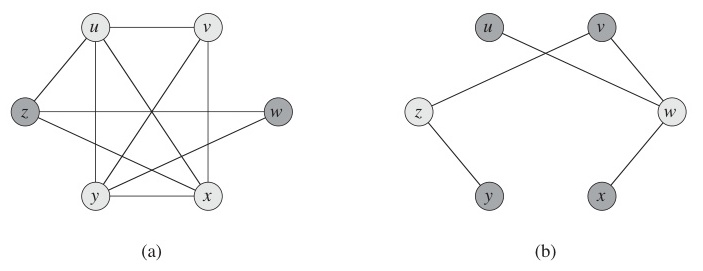

# Week 14 Lecture — Approximation Algorithms

[Repository Guide](../../README.md) | [English](Concepts_Lecture.md) | [한국어](Concepts_Lecture.ko.md)

> **Last Updated:** 2026-10-27
>
> Introduction to Algorithms, Cormen, Leiserson, Rivest, and Stein, Ch 35

> **Learning Objectives:**
> 1. State, among the **three things** one can give up when facing an NP-Complete problem (polynomial time, all inputs, optimality), which one an approximation algorithm gives up, define the **approximation ratio**, and explain the chicken-and-egg problem that computing it requires an optimal value no known method finds in polynomial time
> 2. Apply the **indirect-optimal technique**, the universal proof template of sandwiching a computable lower or upper bound on OPT, to minimization and maximization problems
> 3. Execute the MST-based 2-approximation for **TSP** (MST, DFS traversal, duplicate removal), show where the triangle inequality is needed, and prove $\rho < 2$
> 4. Execute the maximal-matching 2-approximation for **Vertex Cover** and show that the ratio is tight with an input on which it is **exactly** 2
> 5. Execute the four **Bin Packing** heuristics (First Fit, Next Fit, Best Fit, Worst Fit) and the earliest-finishing-machine greedy for **Job Scheduling**, and prove $\rho \leq 2$ for each via the at-most-one-bin-at-most-half-full argument and two lower bounds (volume, per-job)
> 6. Execute the farthest-first traversal for **k-Clustering**, prove $\rho \leq 2$ via the virtual $(k+1)$-th center and the pigeonhole principle, and compare the **time complexity** and **indirect-optimal bound** of all five algorithms in a summary table

---

## Table of Contents

- [1. Approximation Algorithms: Foundations](#1-approximation-algorithms-foundations)
  - [1.1 Why Approximation Algorithms?](#11-why-approximation-algorithms)
  - [1.2 Approximation Ratio](#12-approximation-ratio)
  - [1.3 The Indirect-Optimal Technique](#13-the-indirect-optimal-technique)
- [2. TSP: MST-Based 2-Approximation](#2-tsp-mst-based-2-approximation)
  - [2.1 Problem and the Metric Assumption](#21-problem-and-the-metric-assumption)
  - [2.2 MST-Based Approach: Intuition](#22-mst-based-approach-intuition)
  - [2.3 Algorithm](#23-algorithm)
  - [2.4 Worked Example](#24-worked-example)
  - [2.5 Approximation-Ratio Proof](#25-approximation-ratio-proof)
  - [2.6 Complexity](#26-complexity)
- [3. Vertex Cover: Maximal-Matching 2-Approximation](#3-vertex-cover-maximal-matching-2-approximation)
  - [3.1 Problem](#31-problem)
  - [3.2 Maximal-Matching Approach](#32-maximal-matching-approach)
  - [3.3 Algorithm and Worked Example](#33-algorithm-and-worked-example)
  - [3.4 Ratio Proof and Tightness](#34-ratio-proof-and-tightness)
- [4. Bin Packing: Four Greedy Heuristics](#4-bin-packing-four-greedy-heuristics)
  - [4.1 Problem](#41-problem)
  - [4.2 First Fit / Next Fit / Best Fit / Worst Fit](#42-first-fit--next-fit--best-fit--worst-fit)
  - [4.3 Worked Example](#43-worked-example)
  - [4.4 Algorithm and Complexity](#44-algorithm-and-complexity)
  - [4.5 Approximation-Ratio Proof](#45-approximation-ratio-proof)
- [5. Job Scheduling: Earliest-Finishing-Machine 2-Approximation](#5-job-scheduling-earliest-finishing-machine-2-approximation)
  - [5.1 Problem](#51-problem)
  - [5.2 Algorithm and Worked Example](#52-algorithm-and-worked-example)
  - [5.3 Approximation-Ratio Proof](#53-approximation-ratio-proof)
  - [5.4 Complexity](#54-complexity)
- [6. k-Clustering: Farthest-First 2-Approximation](#6-k-clustering-farthest-first-2-approximation)
  - [6.1 Problem](#61-problem)
  - [6.2 Algorithm and Worked Example](#62-algorithm-and-worked-example)
  - [6.3 Approximation-Ratio Proof](#63-approximation-ratio-proof)
  - [6.4 Complexity and Practical Considerations](#64-complexity-and-practical-considerations)
- [7. Approximation Algorithms: Summary Table](#7-approximation-algorithms-summary-table)
- [Summary](#summary)
- [Self-Check Questions](#self-check-questions)

---

<br>

## 1. Approximation Algorithms: Foundations

### 1.1 Why Approximation Algorithms?

NP-Complete problems appear *everywhere* in the real world, in routing, scheduling, packing, covering, and clustering, yet no polynomial-time algorithm has ever been found for any of them. As Week 13 showed, if even one were solved in polynomial time, all of them would be. So what do we actually do in practice?

To deal with an NP-Complete problem we must **give up one** of the following three.

1. Finding a solution **in polynomial time**.
2. Finding a solution **for all inputs**.
3. Finding the **optimal** solution.

**Approximation algorithms give up (3)**: they find a *near*-optimal solution in polynomial time, with a **provable quality guarantee**.

| Strategy                  | Gives up                  | Characteristics                                    |
|---------------------------|---------------------------|----------------------------------------------------|
| **Approximation algorithm** | (3) optimality          | Polynomial time + provable ratio guarantee         |
| **Heuristic**             | (3) optimality            | Polynomial time but *no provable guarantee*        |
| **Exact exponential alg.**| (1) polynomial time       | Optimal but practical only for small inputs        |
| **Randomized algorithm**  | (2) all inputs (probabilistically) | Fast and correct with high probability    |

*Table 1. Strategies for NP-Complete problems and what each gives up*

> **Key Point:** Approximation algorithms produce, in polynomial time, not merely a plausible solution but one whose *closeness to optimal* is mathematically guaranteed. That guarantee is the **approximation ratio**.

### 1.2 Approximation Ratio

An approximation algorithm always comes with an **approximation ratio** $\rho$. The approximation ratio measures how close the approximate solution is to the optimum.

$$
\rho = \frac{\text{Approximate Solution Value (APX)}}{\text{Optimal Solution Value (OPT)}}
$$

For maximization problems we invert the ratio so that $\rho \geq 1$ always.

- The closer $\rho$ is to **$1.0$**, the higher the accuracy.
- $\rho = 2.0$ means a solution **within twice** the optimum. All five algorithms in Sections 2-6 achieve this **2-approximation**.
- **The catch:** computing $\rho$ requires OPT, and because the problem is NP-Hard, no known method computes OPT in polynomial time. A clever workaround is needed.

### 1.3 The Indirect-Optimal Technique

The key idea for sidestepping the chicken-and-egg problem is to find an **easily computable bound on OPT** instead of computing OPT itself, and to prove the ratio against *that*.

**Minimization problems** (TSP, Vertex Cover, Bin Packing, Job Scheduling, and Clustering in Sections 2-6 are all minimization problems):

- Find a computable value $L$ with $\text{OPT} \geq L$ (a **lower bound** on OPT).
- Show the algorithm's output satisfies $\text{APX} \leq c \cdot L$.
- Then $\text{APX} \leq c \cdot L \leq c \cdot \text{OPT}$, i.e. approximation ratio $c$.

**Maximization problems:**

- Find a computable value $U$ with $\text{OPT} \leq U$ (an **upper bound** on OPT).
- Show the algorithm's output satisfies $\text{APX} \geq U / c$.
- Then $\text{APX} \geq U / c \geq \text{OPT} / c$.

> **Note:** **Why it works.** The technique never directly *computes* OPT. It merely sandwiches OPT between two quantities we can control, a computable bound $L$ and the algorithm's output APX. Every 2-approximation proof in Sections 2-6 follows exactly this template; the only difference is *which $L$ we plug in* (MST weight, matching size, volume bound, average load, virtual $(k+1)$-th center distance).

---

<br>

## 2. TSP: MST-Based 2-Approximation

### 2.1 Problem and the Metric Assumption

**Traveling Salesman Problem (TSP).** A salesperson starts from a city, visits every other city exactly once, and returns to the start. **Goal:** minimize the total travel distance.

**Metric TSP** makes the following assumptions, which are what make a 2-approximation possible.

- **Symmetry:** $d(A, B) = d(B, A)$.
- **Triangle inequality:** $d(A, B) \leq d(A, C) + d(C, B)$. That is, a detour is never shorter than the direct route.

Both hold for Euclidean distances and many real-world cost models.

> **Note:** **Why the metric assumption is essential.** General TSP without the triangle inequality is known to be inapproximable to *any* constant factor unless $P = NP$ (provable by a HAM-CYCLE reduction). The triangle inequality is precisely the property guaranteeing that a shortcut is always safe, and it underpins Step 2 of the proof below.

### 2.2 MST-Based Approach: Intuition

To design a polynomial-time approximation, the standard move is to find a related problem whose efficient algorithm is *already known*. The **Minimum Spanning Tree (MST)** shares key properties with TSP.

- MST connects **all vertices**, just as TSP visits all cities.
- MST minimizes **total edge weight**, which is related to TSP minimizing tour length.

So we borrow the MST (Week 11) and traverse it to construct an approximate tour.

### 2.3 Algorithm

**Approx_MST_TSP** (input: $n$ cities with pairwise distances, output: a tour visiting each city once and returning to the start)

```text
1. Compute the MST of the input graph (Kruskal's or Prim's).
2. Starting from any city, perform a DFS traversal of the MST, recording
   the visit order. (Each tree edge is used twice: once forward, once back.)
3. Remove duplicate cities from the visit order: keep only the first
   occurrence of each city, then append the starting city at the end.
4. Return the resulting tour.
```

Step 3 is the **shortcut** step. Whenever the DFS passes through an already-visited vertex, the tour jumps directly to the next unvisited vertex. The triangle inequality guarantees each shortcut is no longer than the path it replaces.

### 2.4 Worked Example

Consider 8 cities $A, B, C, D, E, F, G, H$.

**Step 1: Build the MST.** Apply Kruskal's or Prim's algorithm to obtain the tree edges connecting all 8 vertices.

```text
Original graph (partial)            MST (Kruskal/Prim result)

A --- B --- C                          A
|   / |   / |                         / \
D --- E --- F          ═══>           G   ...
|         / |                        / \
G ------ H  |                        E   D
                                        / \
                                       H   F …
```

*Figure 1. Original graph (partial) and the MST obtained by Kruskal's or Prim's algorithm*

**Step 2: DFS traversal** (starting from $A$, each edge used twice):

$$
A \to G \to E \to G \to D \to H \to C \to H \to D \to F \to B \to F \to D \to G \to A
$$

The total length of this traversal is $2M$ (where $M$ is the total MST weight). This is because each of the $n - 1$ tree edges is used exactly **twice** (forward and back).

**Step 3: Remove duplicates (shortcut).** Skip already-visited cities.

$$
A \to G \to E \to \cancel{G} \to D \to H \to C \to \cancel{H} \to \cancel{D} \to F \to B \to \cancel{F} \to \cancel{D} \to \cancel{G} \to A
$$

**Resulting tour:** $A \to G \to E \to D \to H \to C \to F \to B \to A$.

By the triangle inequality, each shortcut is no longer than the path it replaces, so the resulting tour length is at most $2M$.

### 2.5 Approximation-Ratio Proof

**Claim:** Approx_MST_TSP has approximation ratio $< 2.0$.

Let $M$ be the total MST weight, $\text{OPT}$ the optimal TSP tour length, and $\text{APX}$ the approximate tour length.

**Step 1: $\text{OPT} > M$.**
The optimal tour visits all vertices and returns to start. Removing *any one edge* from that tour leaves a spanning tree that touches all vertices, is connected, and has $|V| - 1$ edges. Since $M$ is the *minimum* spanning-tree weight, $M \leq (\text{tour} - \text{one edge})$. With positive edge weights, $(\text{tour} - \text{one edge}) < \text{OPT}$, hence $M < \text{OPT}$. When all edge weights are positive, the usual case, the ratio is strictly $< 2$. If zero-weight edges are allowed, we only get $M \leq \text{OPT}$ and the bound weakens to $\leq 2$.

> **[Discrete Mathematics]** In Discrete Mathematics a tree is a connected graph with no cycle, and a tree on $n$ vertices always has $n - 1$ edges. Removing one edge from a Hamiltonian cycle leaves a path that strings all vertices together, a connected graph with no cycle, so it is a spanning tree, and Step 1 uses this fact to compare the weight of the optimal tour with that of the MST.

**Step 2: $\text{APX} \leq 2M$.**
The DFS traversal has length exactly $2M$. Each shortcut in Step 3 replaces a sub-path $x \to y \to z$ of the traversal with the direct edge $x \to z$, and by the triangle inequality $d(x, z) \leq d(x, y) + d(y, z)$ this never increases the length.

**Combining:**

$$
\text{APX} \leq 2M < 2 \cdot \text{OPT}
\implies \frac{\text{APX}}{\text{OPT}} < 2.0. \qquad \blacksquare
$$

### 2.6 Complexity

| Step | Operation                  | Complexity    |
|------|----------------------------|---------------|
| 1    | Build MST (Kruskal's)      | $O(m \log m)$ |
| 1    | Build MST (Prim's)         | $O(n^2)$      |
| 2    | DFS traversal              | $O(n)$        |
| 3    | Remove duplicates          | $O(n)$        |

*Table 2. Step-by-step complexity of Approx_MST_TSP*

**Overall:** MST construction dominates, giving $O(m \log m)$ with Kruskal's algorithm ($m$ = number of edges) or $O(n^2)$ with Prim's algorithm ($n$ = number of cities).

---

<br>

## 3. Vertex Cover: Maximal-Matching 2-Approximation

### 3.1 Problem

A **vertex cover** of a graph $G = (V, E)$ is a subset $S \subseteq V$ such that every edge has at least one endpoint in $S$. **Goal:** find the minimum-size vertex cover.

**Real-world analogy:** the problem is like placing the minimum number of CCTV cameras at intersections (vertices) so that every corridor (edge) is monitored.

**Example (triangle graph {1, 2, 3}):**
- $\{1, 2, 3\}, \{1, 2\}, \{1, 3\}, \{2, 3\}$ are all vertex covers.
- In general, if one vertex touches all edges, that single vertex is the minimum cover. A triangle has no such vertex, so its minimum cover has size 2.
- $\{2\}$ alone is not a vertex cover because edge $(1,3)$ is uncovered.

In Figure 2, (a) is a graph $G$ with the clique $\{u, v, x, y\}$ and (b) is its complement graph $\overline{G}$. In $\overline{G}$, $\{w, z\}$ is a vertex cover because every edge has at least one endpoint in it.



*Figure 2. Vertex cover example*

### 3.2 Maximal-Matching Approach

**Key insight:** instead of an expensive set-cover-style reduction, use a **maximal matching**.

- **Matching:** a set of edges sharing no endpoints.
- **Maximal matching:** a matching to which no further edge can be added (a greedy stopping point).
  - It is not the same as a *maximum* matching, the largest possible matching. Maximal means it cannot be extended, while maximum means it is the largest.
  - A maximal matching can be found greedily in polynomial time.

**Idea:** select edges greedily only when neither endpoint is already used, then take all endpoints of the selected edges as the vertex cover.

### 3.3 Algorithm and Worked Example

**Approx_Matching_VC** (input: graph $G = (V, E)$, output: a vertex cover)

```text
1. Find a maximal matching M in G:
   - M ← ∅
   - for each edge (u, v) ∈ E:
       if neither u nor v is an endpoint of any edge already in M,
       add (u, v) to M.
2. Return the set of all endpoints of edges in M.
```

**Worked example.**

```text
9-vertex graph:
   1 --- 2 --- 3
   |   / |   / |
   4 --- 5 --- 6
   |   / |   / |
   7 --- 8 --- 9
```

*Figure 3. Example graph with 9 vertices and 16 edges*

If the edges are examined in the order $(1,2), (2,3), (4,5), (5,6), (7,8), (8,9), (1,4), (4,7), (2,5), (5,8), (3,6), (6,9), (2,4), (3,5), (5,7), (6,8)$, the greedy maximal matching selects the 4 edges $M = \{(1,2), (4,5), (7,8), (3,6)\}$. The algorithm returns the $2 \times 4 = 8$ endpoints $\{1, 2, 3, 4, 5, 6, 7, 8\}$. Partitioning the vertices into the cliques $\{1, 2, 4\}$, $\{3, 5, 6\}$, $\{7, 8\}$, and $\{9\}$ shows that an independent set contains at most one vertex from each clique, so it has at most 4 vertices, and every vertex cover therefore has at least $9 - 4 = 5$ vertices. Since $\{2, 4, 5, 6, 8\}$ is a vertex cover of size 5, the optimum is 5.

$$
\rho = \frac{8}{5} = 1.6 \quad (\text{well within the guaranteed } 2.0).
$$

A matching in a graph with 9 vertices can contain at most 4 edges. In a larger graph, if the greedy maximal matching selected 6 edges, the algorithm would return $2 \times 6 = 12$ endpoints, and if the optimal vertex cover were 7, the ratio would be as follows.

$$
\rho = \frac{12}{7} \approx 1.71 \quad (\text{well within the guaranteed } 2.0).
$$

### 3.4 Ratio Proof and Tightness

**Claim:** Approx_Matching_VC has approximation ratio $\leq 2.0$.

Let $|M|$ be the number of edges in the maximal matching and $\text{OPT}$ the size of the optimal vertex cover.

**Step 1: $\text{OPT} \geq |M|$.**
Any vertex cover must include at least one endpoint of each matching edge. Otherwise, that edge is uncovered. Since matching edges share no endpoints, distinct matching edges require *distinct* vertices, so at least $|M|$ vertices are needed.

**Step 2: $\text{APX} = 2|M|$.**
The algorithm returns both endpoints of every matching edge. Since matching edges share no endpoints, the returned vertices are all distinct, and there are exactly $2|M|$ of them.

**Combining:**

$$
\frac{\text{APX}}{\text{OPT}} = \frac{2|M|}{\text{OPT}} \leq \frac{2|M|}{|M|} = 2.0. \qquad \blacksquare
$$

> **Note:** **The ratio is tight (exactly 2).** If the graph consists of $k$ disjoint edges (a perfect matching of size $k$ with no shared endpoints), the optimal cover takes one endpoint per edge, so it has size $k$. But the algorithm returns $2k$ endpoints, so $\rho = 2k/k = 2.0$ holds **exactly**. That is, no ratio better than 2 can be guaranteed for this algorithm. Obtaining a $(2-\epsilon)$-approximation for any constant $\epsilon > 0$ is known to be NP-Hard if the Unique Games Conjecture holds.

**Complexity.** If we check whether an edge's endpoints are already used by scanning $M$, each edge costs $O(n)$, so $m$ edges take **$O(nm)$** time in total. With an array that marks each vertex as used or unused, each check costs $O(1)$ and the total drops to $O(n + m)$.

---

<br>

## 4. Bin Packing: Four Greedy Heuristics

### 4.1 Problem

**Bin Packing Problem.** Given $n$ items of sizes $s_1, s_2, \dots, s_n$ (each $\leq C$) and bins of capacity $C$, pack all items into the **fewest number of bins**.

Bin Packing is an NP-Hard optimization problem with rich applications. Examples include memory allocation, container loading, disk partitioning, and virtual-machine packing.

### 4.2 First Fit / Next Fit / Best Fit / Worst Fit

| Method            | Strategy                                                              |
|-------------------|-----------------------------------------------------------------------|
| **First Fit (FF)** | Scan bins from the first; place the item in the **first bin** with enough room. |
| **Next Fit (NF)**  | Check only the **most recently used bin**; if the item fits, place it there, else open a new bin. |
| **Best Fit (BF)**  | Place the item in the fitting bin that leaves the **least remaining space**. |
| **Worst Fit (WF)** | Place the item in the fitting bin that leaves the **most remaining space**. |

*Table 3. Placement strategies of the four Bin Packing heuristics*

For all four methods, if no existing bin has room, **open a new bin**.

### 4.3 Worked Example

$C = 10$ and the items are $[7, 5, 6, 4, 2, 3, 7, 5]$ in arrival order.

| Method       | Bin Contents                           | Bins Used |
|--------------|----------------------------------------|-----------|
| First Fit    | {7,2}, {5,4}, {6,3}, {7}, {5}          | 5         |
| Next Fit     | {7}, {5}, {6,4}, {2,3}, {7}, {5}       | 6         |
| Best Fit     | {7,2}, {5,3}, {6,4}, {7}, {5}          | 5         |
| Worst Fit    | {7,3}, {5,4}, {6,2}, {7}, {5}          | 5         |
| **Optimal**  | {7,3}, {5,5}, {6,4}, {7,2}             | **4**     |

*Table 4. Bin assignments of each heuristic for C = 10*

> **Note:** First Fit, Best Fit, and Worst Fit use 5 bins and Next Fit uses 6, while the optimum is 4. The ratios $5/4 = 1.25$ and $6/4 = 1.5$ are well within the guaranteed 2.0. Next Fit is worst because it looks only at the previous bin and misses the leftover space in earlier bins.

### 4.4 Algorithm and Complexity

```text
Approx_BinPacking(items s_1, …, s_n, capacity C):
    B = 0
    for i = 1 to n:
        if a bin with enough room exists (per the chosen strategy):
            place item i in that bin
        else:
            open a new bin, place item i in it, B = B + 1
    return B
```

| Method     | Per-item work        | Total    |
|------------|----------------------|----------|
| First Fit  | Scan all bins, $O(n)$ | $O(n^2)$ |
| Best Fit   | Scan all bins, $O(n)$ | $O(n^2)$ |
| Worst Fit  | Scan all bins, $O(n)$ | $O(n^2)$ |
| Next Fit   | Check one bin, $O(1)$ | $O(n)$   |

*Table 5. Time complexity of each Bin Packing heuristic*

### 4.5 Approximation-Ratio Proof

**Claim (FF / BF / WF):** First Fit, Best Fit, and Worst Fit all achieve $\rho \leq 2.0$.

**Key observation.** At termination, at most **one** bin can be **at most half full**.
*Why:* if two bins were each at most $C/2$ full, the first item of the later-opened bin would have fit into the earlier bin. That contradicts the greedy strategy of FF/BF/WF, which tries existing bins before opening a new one.

**Proof.** Let $\text{OPT}'$ be the number of bins used by the algorithm and $\text{OPT}$ the optimal number. At least $\text{OPT}' - 1$ bins are *more* than half full, so the following holds.

$$
\sum s_i > (\text{OPT}' - 1) \cdot \frac{C}{2}.
$$

The optimum also needs at least $\sum s_i / C$ bins by volume alone, so $\text{OPT} \geq \sum s_i / C$. Combining gives the following.

$$
\text{OPT} \geq \frac{\sum s_i}{C} > \frac{\text{OPT}' - 1}{2}
\implies 2 \cdot \text{OPT} > \text{OPT}' - 1
\implies 2 \cdot \text{OPT} \geq \text{OPT}'. \qquad \blacksquare
$$

**Claim (NF):** Next Fit also achieves $\rho \leq 2.0$ via a slightly different argument.

**Key observation.** Under Next Fit, the combined contents of any *two consecutive* bins exceed $C$. *Why:* if the first item of the second bin had fit in the first bin, Next Fit would not have opened the second bin.

**Proof.** Group consecutive bins into pairs: (bin 1, bin 2), (bin 3, bin 4), …. There are $\lfloor \text{OPT}'/2 \rfloor$ complete pairs, each with total $> C$.

$$
\sum s_i > \left\lfloor \frac{\text{OPT}'}{2} \right\rfloor \cdot C
\implies \text{OPT} \geq \frac{\sum s_i}{C} > \left\lfloor \frac{\text{OPT}'}{2} \right\rfloor
\implies \text{OPT} \geq \left\lfloor \frac{\text{OPT}'}{2} \right\rfloor + 1 > \frac{\text{OPT}'}{2}
\implies 2 \cdot \text{OPT} > \text{OPT}'. \qquad \blacksquare
$$

> **Note:** **Improvement in practice.** Sorting items in *decreasing* size first (First Fit Decreasing, Best Fit Decreasing) yields a much better asymptotic result near $\frac{11}{9}\,\text{OPT} + O(1)$, compared with $1.7\,\text{OPT}$ for First Fit. Large items are placed first and small items act as filler for the leftover gaps.

---

<br>

## 5. Job Scheduling: Earliest-Finishing-Machine 2-Approximation

### 5.1 Problem

**Job Scheduling Problem.**
- There are $n$ jobs with processing times $t_1, t_2, \dots, t_n$.
- There are $m$ identical machines $M_1, \dots, M_m$.
- Each job runs on exactly one machine without interruption, and each machine processes one job at a time.

**Goal:** assign jobs to machines to minimize the **makespan** (the time at which the last job finishes).

### 5.2 Algorithm and Worked Example

**Algorithm.** Always assign the next job to the machine that finishes **earliest (smallest current load)**.

```text
Approx_JobScheduling(times t_1, …, t_n, m machines):
    for j = 1 to m:
        L[j] = 0                       // current finishing time of machine j
    for i = 1 to n:
        min = 1
        for j = 2 to m:                // find the earliest-finishing machine
            if L[j] < L[min]:
                min = j
        assign job i to machine M_min
        L[min] = L[min] + t_i
    return max(L[1], …, L[m])
```

**Worked example.** The jobs are $t = [5, 2, 4, 3, 4, 7, 9, 2, 4, 1]$ and there are $m = 4$ machines.

| Job | $t_i$ | Assigned to | Loads after      |
|-----|-------|-------------|-------------------|
| 1   | 5     | M1          | [5, 0, 0, 0]      |
| 2   | 2     | M2          | [5, 2, 0, 0]      |
| 3   | 4     | M3          | [5, 2, 4, 0]      |
| 4   | 3     | M4          | [5, 2, 4, 3]      |
| 5   | 4     | M2          | [5, 6, 4, 3]      |
| 6   | 7     | M4          | [5, 6, 4, 10]     |
| 7   | 9     | M3          | [5, 6, 13, 10]    |
| 8   | 2     | M1          | [7, 6, 13, 10]    |
| 9   | 4     | M2          | [7, 10, 13, 10]   |
| 10  | 1     | M1          | [8, 10, 13, 10]   |

*Table 6. Job-by-job assignment trace of Approx_JobScheduling*

**Makespan (APX) = 13** (M3).

### 5.3 Approximation-Ratio Proof

**Claim:** Approx_JobScheduling has approximation ratio $\leq 2.0$.

Let job $i$ be the job that determines the makespan, that is, the job that finishes last, and let it start at time $T$. Then $\text{APX} = T + t_i$.

**Two lower bounds on OPT:**

1. **Volume bound:** $\text{OPT} \geq \dfrac{\sum_j t_j}{m}$. Even with perfect load balancing, some machine must run at least the average.
2. **Per-job bound:** $\text{OPT} \geq t_i$. Any schedule must also process job $i$ somewhere, taking $t_i$ time.

**Proof.** Job $i$ was placed on the earliest-finishing machine at placement time, so its start time $T$ is at most the average of all machine finishing times at that moment. Since job $i$ was not yet assigned, that average is in turn at most the sum of all job times except $t_i$ divided by $m$.

$$
T \leq \frac{\sum_{j \neq i} t_j}{m} \leq \frac{\sum_j t_j}{m} \leq \text{OPT}.
$$

Combining with $t_i \leq \text{OPT}$ gives the following.

$$
\text{APX} = T + t_i \leq \text{OPT} + \text{OPT} = 2 \cdot \text{OPT}. \qquad \blacksquare
$$

> **Note:** **Improvement in practice.** **Longest Processing Time first (LPT)**, which sorts jobs by decreasing $t_i$ before the same greedy assignment, achieves a $\frac{4}{3}$-approximation and performs much better empirically. Placing big jobs first lets small jobs fine-tune the load at the end.

### 5.4 Complexity

For each of $n$ jobs, find the minimum among $m$ machine loads ($O(m)$), and compute one final maximum ($O(m)$).

$$
n \cdot O(m) + O(m) = \mathbf{O(nm)}.
$$

---

<br>

## 6. k-Clustering: Farthest-First 2-Approximation

### 6.1 Problem

**k-Clustering Problem.** Given $n$ points in a 2D plane (or any metric space) and an integer $k$, partition the points into **$k$ groups**, each with a designated **center** point. **Goal:** minimize the **maximum cluster diameter** (the diameter of the largest cluster).

**Applications:** the problem is used in recommendation systems, data mining, VLSI design, parallel processing, web search, pattern recognition, gene analysis, social-network analysis, and more.

### 6.2 Algorithm and Worked Example

**Farthest-First Traversal (greedy).** Select centers one at a time, each time choosing the point **farthest from all existing centers** as the next center.

```text
Approx_k_Clusters(points x_0, …, x_{n-1}, k > 1):
    C[1] = x_r                            // random first center
    for j = 2 to k:
        for each non-center point x_i:
            D[i] = min distance from x_i to any existing center
        C[j] = the point x_i with the largest D[i]  (x_i not already a center)
    assign each non-center point to its nearest center
    return centers C and cluster assignments
```

**Intuition:** spreading centers far apart guarantees that every cluster covers only a small area.

**Worked example ($k = 4$):**

- **Step 1:** pick an arbitrary point as $C_1$.
- **Step 2:** compute $D[i]$ for all non-center points, and choose the point farthest from $C_1$ as $C_2$.
- **Step 3:** recompute $D[i] = \min(d(x_i, C_1), d(x_i, C_2))$ for each point. For example, if $D[1]=18, D[2]=19, D[3]=20, D[4]=17$ and all other values are below 20, the point with the largest value $D[3]=20$ becomes $C_3$.
- **Step 4:** recompute $D[i] = \min(d(x_i, C_1), d(x_i, C_2), d(x_i, C_3))$, and choose the point with the largest value as $C_4$.
- **Step 5:** assign each non-center point to its nearest center.

### 6.3 Approximation-Ratio Proof

**Claim:** Approx_k_Clusters has approximation ratio $\leq 2.0$.

**Setup.** After choosing $k$ centers, imagine selecting one more, a **virtual $(k+1)$-th center** $C_{k+1}$, using the same farthest-first rule. Let $d$ be the distance from $C_{k+1}$ to its nearest existing center.

**Step 1: $\text{OPT} \geq d$.**
We now have $k + 1$ center points that must be split into $k$ optimal groups. By the **pigeonhole principle**, at least one optimal group contains two of these $k+1$ points. The diameter of that group is at least the distance between its two centers. By the farthest-first construction, the minimum pairwise distance among the $k+1$ centers is $d$, so that diameter is $\geq d$. Hence $\text{OPT} \geq d$.

**Step 2: $\text{APX} \leq 2d$.**
Since $C_{k+1}$ is the farthest point from the existing centers, **every** other point is within distance $d$ of its nearest center. So each cluster has radius $\leq d$, and by the triangle inequality its diameter is $\leq 2d$.

**Combining:**

$$
2 \cdot \text{OPT} \geq 2d \geq \text{APX}
\implies \frac{\text{APX}}{\text{OPT}} \leq 2.0. \qquad \blacksquare
$$

### 6.4 Complexity and Practical Considerations

**Complexity.**

| Component                          | Analysis        |
|------------------------------------|-----------------|
| Inner loop (each point to centers) | $O(kn)$         |
| Find max $D[i]$                    | $O(n)$          |
| Outer loop ($k-1$ iterations)      | $\times (k-1)$  |
| Final assignment                   | $O(kn)$         |

*Table 7. Complexity of each component of Approx_k_Clusters*

$$
(k-1)\,(O(kn) + O(n)) + O(kn) = \mathbf{O(k^2 n)}.
$$

**Practical considerations.**
- **Random first center:** since $C_1$ is random, results vary between runs. Run several times and take the best result.
- **Outlier sensitivity:** noise and outliers distort center selection, so preprocess the data to remove outliers.
- **Legacy:** this algorithm is closely related to the **k-center problem** and is also known as **Gonzalez's algorithm** (1985). It inspired the **k-means++** initialization used in modern k-means.

---

<br>

## 7. Approximation Algorithms: Summary Table

| Problem                    | Indirect-Optimal Bound                                  | Ratio              | Time                        |
|----------------------------|--------------------------------------------------------|--------------------|-----------------------------|
| **TSP** (Metric)           | $M$ = MST weight ($\text{OPT} > M$)                    | $< 2.0$            | $O(n^2)$ or $O(m \log m)$   |
| **Vertex Cover**           | $\vert M \vert$ = maximal-matching size ($\text{OPT} \geq \vert M \vert$)  | $\leq 2.0$ (tight) | $O(nm)$                     |
| **Bin Packing (FF/BF/WF)** | $\sum s_i / C$ ($\text{OPT} \geq \sum s_i / C$)        | $\leq 2.0$         | $O(n^2)$                    |
| **Bin Packing (NF)**       | $\sum s_i / C$                                         | $\leq 2.0$         | $O(n)$                      |
| **Job Scheduling**         | $\sum t_i / m$ and $\max t_i$                          | $\leq 2.0$         | $O(nm)$                     |
| **k-Clustering**           | virtual $(k+1)$-th center distance $d$                 | $\leq 2.0$         | $O(k^2 n)$                  |

*Table 8. Indirect-optimal bounds, approximation ratios, and time complexities of the five approximation algorithms*

All five problems achieve a **2-approximation**, guaranteeing a solution at most twice the optimum in polynomial time. The common proof technique is the **indirect-optimal** technique: find a computable bound on OPT and sandwich OPT between that bound and the algorithm's output.

---

<br>

## Summary

| Concept | Key Summary |
|---------|-------------|
| Approximation algorithm | An approximation algorithm gives up optimality in exchange for polynomial time and a provable quality guarantee, which distinguishes it from a heuristic with no guarantee. |
| Approximation ratio $\rho$ | The ratio $\text{APX} / \text{OPT}$ is the gold standard of quality; closer to $1.0$ is better, and $\rho = 2.0$ means a 2-approximation. |
| Indirect optimal | The indirect-optimal technique is the universal proof template that finds a computable lower or upper bound on OPT and sandwiches OPT between that bound and APX. |
| 2-approximation | A 2-approximation guarantees at most twice the optimum, and all five algorithms in Sections 2-6 achieve it. |
| Five canonical algorithms | TSP (MST), Vertex Cover (maximal matching), Bin Packing (FF, NF, BF, WF), Job Scheduling (earliest-finishing machine), and Clustering (farthest-first) all earn a factor-2 guarantee through a simple greedy plus a clean proof. |
| Plugged-in bound $L$ | The proofs differ only in the bound plugged in: MST weight, matching size, volume bound, average load and per-job bound, and virtual $(k+1)$-th center distance. |
| Tightness of Vertex Cover | The ratio of 2 is tight because a graph of disjoint edges makes the algorithm produce exactly twice the optimum. |
| Decisive observations | Each proof rests on one decisive assumption or observation that makes the algorithm safe: the triangle inequality for TSP, at most one at-most-half-full bin for Bin Packing, two lower bounds for Job Scheduling, and pigeonhole for Clustering. |
| Overall approach | If a problem cannot be solved exactly, approximate it and prove the quality of the approximation. |

---

<br>

## Self-Check Questions

1. **The three give-ups:** What are the three things one can give up when facing an NP-Complete problem, and which does an approximation algorithm give up? How does it differ from a heuristic?

   <details>
   <summary>Answer</summary>

   The three are (1) polynomial time, (2) all inputs, and (3) optimality. An **approximation algorithm gives up (3) optimality** while keeping a *provable* guarantee (the approximation ratio) that the solution is within a fixed factor of optimal. A heuristic also gives up (3) but *without a provable guarantee*. A heuristic may work well in practice yet offers no mathematical bound on worst-case quality. Whether a provable guarantee exists is the decisive difference between an approximation algorithm and a heuristic.

   </details>

2. **Why indirect optimal:** Why does the proof of $\text{APX} \leq 2 \cdot \text{OPT}$ not compare APX to OPT directly, and how does the indirect bound $L$ act as a substitute?

   <details>
   <summary>Answer</summary>

   OPT is what we cannot compute. The whole point of approximation is to *avoid* computing it. So the proof sandwiches OPT between two quantities we *can* control: (1) a polynomial-time computable bound $L$ that we can prove satisfies $L \leq \text{OPT}$, and (2) the algorithm's output APX, for which we can prove $\text{APX} \leq c \cdot L$. Combining them gives $\text{APX} \leq c \cdot L \leq c \cdot \text{OPT}$ without ever computing OPT. Every 2-approximation proof in Sections 2-6 plugs in a different $L$, such as MST weight, matching size, volume bound, average load, or virtual $(k+1)$-th center distance.

   </details>

3. **TSP triangle inequality:** Where exactly is the triangle inequality used in the Approx_MST_TSP proof? What breaks without it?

   <details>
   <summary>Answer</summary>

   The triangle inequality is used in **algorithm Step 3** (shortcut) and **proof Step 2** ($\text{APX} \leq 2M$). When replacing a sub-path $x \to y \to z$ of the DFS traversal with the direct edge $x \to z$, we need $d(x, z) \leq d(x, y) + d(y, z)$. Otherwise a shortcut could be *longer* than the path it replaces, breaking the $\text{APX} \leq 2M$ bound. **Without the triangle inequality**, general TSP cannot be approximated to any constant factor unless $P = NP$, because for any constant $\rho$, transforming a HAM-CYCLE instance $G$ into a TSP instance that gives weight 1 to the edges of $G$ and weight $\rho|V| + 1$ to all other edges lets a $\rho$-approximation algorithm decide HAM-CYCLE. Metric TSP is the well-behaved case where the triangle inequality makes shortcutting safe.

   </details>

4. **TSP's $\text{OPT} > M$ step:** Explain why the optimal TSP tour length exceeds the MST weight.

   <details>
   <summary>Answer</summary>

   The optimal tour is a cycle visiting all $n$ vertices and returning to the start. Removing *any one edge* from that cycle leaves a spanning tree that connects all vertices, preserves connectivity, and has $n-1$ edges. Since the MST is the *minimum* spanning tree, its weight $M$ is at most the weight of that spanning tree (the tour minus one edge). Assuming positive edge weights, $M \leq \text{OPT} - (\text{removed edge}) < \text{OPT}$. Hence $M < \text{OPT}$, which provides the lower bound $L = M$ for the TSP proof.

   </details>

5. **Vertex Cover tightness:** Give an input where the maximal-matching algorithm returns a cover *exactly* twice the optimum, and explain what this means.

   <details>
   <summary>Answer</summary>

   Take a graph consisting of $k$ disjoint edges, that is, a perfect matching of size $k$ with no shared endpoints. The optimal vertex cover takes one endpoint per edge, so it has size $k$. But the algorithm selects all $k$ edges into the maximal matching and returns $2k$ endpoints, so $\rho = 2k/k = 2.0$ holds **exactly**. This means the algorithm's 2-approximation guarantee is **tight**, and no ratio better than 2 can be guaranteed for this algorithm. Beating 2 requires a fundamentally different approach.

   </details>

6. **Bin Packing key observation:** Justify the observation, used in the FF/BF/WF proof of $\rho \leq 2$, that at most one bin is at most half full.

   <details>
   <summary>Answer</summary>

   Suppose two bins $B_1, B_2$ are both at most half full (at most $C/2$). Then their combined contents are at most $C/2 + C/2 = C$, so they would fit in a single bin. But FF/BF/WF always try to place an item into an existing bin before opening a new one, so the first item of the later-opened bin could not have fit into the earlier bin. This is a contradiction. Hence at most one bin is at most half full. Consequently at least $\text{OPT}'-1$ bins are more than half full, giving $\sum s_i > (\text{OPT}'-1)\cdot C/2$, and combining this with $\text{OPT} \geq \sum s_i/C$ yields $2\,\text{OPT} \geq \text{OPT}'$.

   </details>

7. **Why Next Fit is worse:** In the Section 4.3 example Next Fit uses 6 bins versus 5 for the other heuristics. Explain this by the algorithm's behavior.

   <details>
   <summary>Answer</summary>

   Next Fit checks only the **most recently opened bin** and opens a new bin the moment an item does not fit. It never looks back at earlier bins even if they have room. In the example, when processing the 6 it looks only at the previous bin {5} (the 6 does not fit) and opens a new bin, and it never returns to the {7} bin afterwards. So the later items 2 and 3 cannot use the remaining space of 3 in the {7} bin and occupy a new bin {2,3}. First Fit, Best Fit, and Worst Fit instead scan *all* open bins and reuse earlier leftover space. The trade-off is that Next Fit is faster, at $O(1)$ per item and $O(n)$ overall, while the others are $O(n^2)$.

   </details>

8. **Job Scheduling's two bounds:** Why does the makespan proof need *both* lower bounds on OPT? Why is one insufficient?

   <details>
   <summary>Answer</summary>

   With the last-finishing job $i$ starting at time $T$ and taking $t_i$, $\text{APX} = T + t_i$. (1) The **volume bound** $\text{OPT} \geq \sum t_j/m$ gives $T \leq \text{OPT}$ (the greedy placed job $i$ on the earliest-finishing machine, so $T$ is at most the average). (2) The **per-job bound** $\text{OPT} \geq t_i$ gives $t_i \leq \text{OPT}$. Both are needed for $\text{APX} = T + t_i \leq \text{OPT} + \text{OPT} = 2\,\text{OPT}$. **One alone is insufficient.** The volume bound cannot handle a huge $t_i$ that dominates the average, in which case a single large job can dominate the makespan. The per-job bound cannot handle many small jobs accumulating into a large $T$. Both cases must be blocked for the 2-approximation to hold.

   </details>

9. **Clustering pigeonhole:** Detail the pigeonhole step of the $\text{OPT} \geq d$ argument with $k = 3$ and 4 centers including the virtual one.

   <details>
   <summary>Answer</summary>

   The chosen $k=3$ centers $C_1, C_2, C_3$ plus the virtual $C_4$ make 4 center points. The optimal solution partitions all points into 3 clusters. By the **pigeonhole principle**, distributing 4 items into 3 bins forces at least one bin to hold 2 or more items. That is, some optimal cluster contains at least 2 of $\{C_1, C_2, C_3, C_4\}$. The diameter of that cluster is at least the distance between its two centers, and since the minimum pairwise distance among the four centers is $d$ by the farthest-first construction, that diameter is $\geq d$. Hence the maximum cluster diameter is $\geq d$, that is, $\text{OPT} \geq d$. Combined with Step 2's $\text{APX} \leq 2d$, this gives $\rho \leq 2$.

   </details>

10. **Ratio vs complexity trade-off:** All five algorithms achieve $\rho \leq 2$, yet complexities range from $O(n)$ (Next Fit) to $O(k^2 n)$ (Clustering). What drives the complexity difference at the same ratio?

    <details>
    <summary>Answer</summary>

    The ratio guarantee (2) comes from the *proof structure* (indirect optimal), while complexity comes from *how many candidates the algorithm inspects per step*. **Next Fit** checks one bin, so it runs in $O(n)$. **First Fit, Best Fit, and Worst Fit** scan all bins per item, so they run in $O(n^2)$. **TSP** is dominated by MST construction, so it runs in $O(n^2)$ or $O(m\log m)$. **Vertex Cover and Job Scheduling** do a linear check per edge or job, so they run in $O(nm)$. **Clustering** multiplies an outer loop of $k-1$ iterations by an inner $O(kn)$, giving $O(k^2 n)$. The key point is that a greedy that examines more global information (all bins, all machines, all centers) usually yields better *practical* solutions but the same *worst-case* guarantee of 2. The ratio is a worst-case bound, not average performance.

    </details>

11. **Approximation vs exact:** 0-1 Knapsack is solved by an $O(nC)$ DP, so why is it still a target for approximation algorithms and heuristics? (Week 13 connection)

    <details>
    <summary>Answer</summary>

    The $O(nC)$ DP is **pseudo-polynomial**: polynomial in the *value* of the capacity $C$ but exponential in the input *bit-length* ($\log C$ bits). For instances like $C \approx 2^{100}$ it is impractical, and the NP-Completeness proof constructs exactly such instances with exponentially large $C$. So for general large $C$ the exact DP fails and we turn to approximation algorithms (e.g. an FPTAS) or heuristics. This ties directly to the Week 13 point that polynomial time means polynomial in the *encoding length*, not the *value*.

    </details>

12. **Greedy improvement pattern:** What improvement idea do Bin Packing's FFD (First Fit Decreasing) and Job Scheduling's LPT (Longest Processing Time) share?

    <details>
    <summary>Answer</summary>

    Both **process the large items or jobs first** and let the small ones act as filler for the leftover gaps at the end. In an arbitrary order, small items occupy resources early, forcing later large items into their own nearly empty bins or machines. Sorting in *decreasing* order places big items first, when there is plenty of room, and then lets small items precisely fill the remaining space. As a result FFD achieves $\frac{11}{9}\,\text{OPT}+O(1)$ and LPT a $\frac{4}{3}$-approximation, beating the 2-approximation of plain FF and the plain greedy. The general lesson is that in many greedy approximations, handling the chunky items first lets small items serve as load fine-tuning, greatly improving packing and scheduling efficiency.

    </details>

13. **LPT improvement for Job Scheduling:** Sketch why scheduling jobs in **Longest Processing Time First** order achieves a $4/3$ approximation instead of $2$.

    <details>
    <summary>Answer</summary>

    With LPT, the job $i$ that determines the makespan was assigned *after* all larger jobs, so it is among the smaller jobs. There are two cases. **Case A:** if $t_i \leq \text{OPT}/3$, then reusing the volume bound $T \leq \text{OPT}$ from the 2-approximation proof gives $\text{APX} = T + t_i \leq \text{OPT} + \text{OPT}/3 = (4/3)\,\text{OPT}$. **Case B:** if $t_i > \text{OPT}/3$, then every job processed up to and including job $i$ also has size $> \text{OPT}/3$ (LPT processed them earlier, so they are at least as large). Each optimal machine can hold at most two such jobs (three would exceed $\text{OPT}$), so there are at most $2m$ such jobs. For such instances, with at most $2m$ jobs and at most two jobs per optimal machine, LPT is known to produce an optimal schedule, so $\text{APX} = \text{OPT} \leq (4/3)\,\text{OPT}$. Either way $\text{APX} \leq (4/3)\cdot\text{OPT}$. Conceptually, putting large jobs first lets the small jobs serve as load-balancing slack at the end, where mismatches matter less.

    </details>
